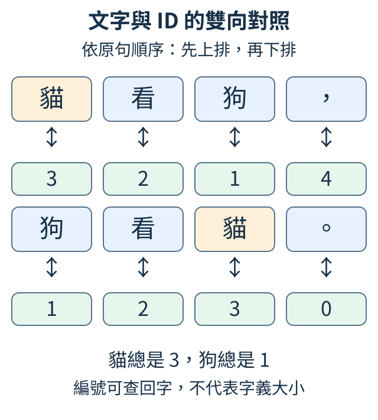

# 小小感知機 Tiny Perceptron

看到「今天天氣」，電腦怎麼猜下一個字？這套教材從幾個字的編號與接字表開始，用完整例子、圖解和短程式，逐步解釋文字、圖片與聲音模型的運作。

繁體中文 | [English](README_en.md)

**[線上教材](https://birdhackor.github.io/tiny-perceptron-vlm/) · [閱讀路線](course/README.md) · [操作與數學暖身](course/first-steps.md) · [全部小節](course/lessons.md) · [名詞頁](course/glossary.md) · [訓練操作](course/training.md)**

教材預覽版：網站提供正文、SVG 圖解，以及每節程式在 CPU 上實際執行的輸出，可以直接當書讀，不必先安裝；第一次讀從[1.1](course/chapters/01.md#1.1)開始。想自己改程式再跑時，照下方步驟把專案下載到自己的電腦，開啟同一節的 Notebook；或按網站每節頁尾的「在 Colab 開啟」開啟同一份 Notebook，有程式的 Notebook 在 Colab 會先在第一個程式格下載專案並安裝套件。小實驗不必先租 GPU。Colab 需要 Google 帳號，Colab 雲端執行尚未實機驗證。



## 教材提供什麼

20章與A／B延伸及C推理計算單元，共312份逐課Notebook；閱讀指南、暖身、訓練操作與名詞頁另有26個編號小節，合計338個編號小節。前段只用小矩陣、接字表、MLP與手寫注意力；後段才加入多token預測（MTP）、現代架構、Dense／MoE、長上下文、cache／SDPA、量化與蒸餾。每節聚焦一個問題，可以回跳，也不必一路訓練同一個模型。

用幾個字看懂運作後，[7.17](course/chapters/07.md#7.17)解釋為什麼常先預訓練，再做後訓練；[第13章](course/chapters/13.md)逐步介紹偏好回饋、獎勵模型、PPO與DPO。指令遵循分開檢查內容、指定範圍、格式與停止；長上下文則分開討論容納長度、位置表示、計算成本與資訊使用。

[第19章整合專題](course/chapters/19.md#19.1)把自行訓練的文字、圖片、聲音與工具使用組成一位小助理，也就是 MoE 助理。它目前的 v2 版有 MoE 與較簡單的 Dense 兩種架構，文字核心、視覺／語音入口與接頭都由本專案從零訓練，已完成訓練、公開推論權重，並在兩版各3,734題的固定測試資料上評估。MoE共5,447,107參數，Dense共2,288,067參數；兩版仍未通過全部原定能力判準。任務限於三類服飾與兩格位置、12個已知中文字的指定連續1–4字區域、三種銀行客服語音主題，以及有限文字對話和計算器。完整成績與限制見[19.12](course/chapters/19.md#19.12)，先試用可走[公開CPU操作](docs/selftrained/v2-public-cpu-commands.md)。另一組合成小世界整合實驗的權重、配方與逐題報告在[固定實驗](docs/course-experiments/README.md)，那些是另一組模型的成績。

[第20章](course/chapters/20.md#20.1)是成熟模型的應用延伸：Qwen3-VL處理圖文，Whisper先把語音轉成文字。它另有[操作](docs/natural-assistant/v4/STUDENT.md)、[資料](docs/natural-assistant/v4/DATA.md)與[訓練](docs/natural-assistant/v4/TRAINING.md)指引。上游模型的能力與自行訓練主線分開驗收。

Python、tensor、機率、矩陣與梯度有[按需暖身](course/first-steps.md)。各章的訓練命令集中在[操作頁](course/training.md)，來源與實測證據見[驗證範圍](docs/validation.md)。

Thinking effort（思考投入）、Looped Transformer（循環深度）及Jev式機率判斷已納入必修，分別見[7.23](course/chapters/07.md#7.23)、[14.11](course/chapters/14.md#14.11)與[9.11](course/chapters/09.md#9.11)。C.1–C.5接在第7章後。第19章的[三個成品](course/chapters/19.md#19.13)是 MoE 助理、有限文字的 Looped 解題器與獨立的機率判斷器，使用者依任務選用；機率判斷器還能接到 Looped 解題器，先判斷題目是否支援、資訊是否齊全，再依規則選 Looped 解題器要跑的輪數，這叫 Auto effort（見[19.17](course/chapters/19.md#19.17)）。Looped 解題器與機率判斷器已在 NVIDIA L4 完成訓練，設定凍結後才在測試資料上評估：Looped 解題器的兩盒追蹤答對 2928/2956、三數加法 2/42；機率判斷器在固定測試題的候選判斷上全對，但換一種說法就會出錯。固定下載與命令見[產品操作](docs/lesson-products/README.md)，完整分母、變化測試與限制見[19.20](course/chapters/19.md#19.20)。

## 安裝與開啟 Notebook

先安裝 [uv](https://docs.astral.sh/uv/getting-started/installation/) 與用來取得專案的[Git](https://git-scm.com/downloads)。訓練資料包用 Git LFS（Git 處理大型檔案的擴充工具）保存，下面第一行開頭的 `GIT_LFS_SKIP_SMUDGE=1` 讓 clone 不下載這些資料包；沒有安裝 Git LFS 也可以照打。Windows PowerShell 不寫這段開頭，改成先執行 `git config --global core.longpaths true`，再依序執行 `$env:GIT_LFS_SKIP_SMUDGE="1"` 與 `git clone https://github.com/birdhackor/tiny-perceptron-vlm.git`。專案裡有些檔的路徑很深，Windows 上的 Git 預設建不出超過 260 字元的路徑；設定 `core.longpaths` 的那一行讓這台電腦上的 Git 都允許長路徑，之後的 clone 與切換版本也適用。CPU 閱讀與練習：

```bash
GIT_LFS_SKIP_SMUDGE=1 git clone https://github.com/birdhackor/tiny-perceptron-vlm.git
cd tiny-perceptron-vlm
uv sync --frozen --extra cpu --group notebook
source .venv/bin/activate
python scripts/check_env.py
python -m ipykernel install --sys-prefix --name tiny-perceptron --display-name "Tiny Perceptron"
jupyter lab notebooks
```

Windows PowerShell 啟用指令是 `.venv\Scripts\Activate.ps1`；不啟用的寫法見[W.1](course/first-steps.md#W.1)。JupyterLab 從 `notebooks` 資料夾列出檔案；選擇 **Tiny Perceptron** kernel，先開啟其中的 `01/1.1.ipynb`。詳細操作見[暖身指南](course/first-steps.md)。只讀教材與跑各節短程式不需要 Git LFS；要下載訓練資料包時才需要，安裝與確認方式見[W.1](course/first-steps.md#W.1)。

上面的命令裝的是 CPU 用的 PyTorch，在 Apple Silicon 的 Mac 上也能用。要改用其他安裝選擇時，把 `uv sync` 那一行換成下表的寫法：

| 環境 | 安裝選擇 |
| --- | --- |
| CPU | `uv sync --frozen --extra cpu --group notebook` |
| Apple Silicon | `uv sync --frozen --group notebook` |
| NVIDIA CUDA 13.0 相容硬體／驅動 | `uv sync --frozen --extra cu130 --group notebook` |
| NVIDIA CUDA 12.6 相容硬體／驅動 | `uv sync --frozen --extra cu126 --group notebook` |

各版本的顯卡、驅動與套件配套選擇見[環境說明](docs/environment.md)。Colab操作另見[W.1](course/first-steps.md#W.1)。使用 extra 後，啟用 `.venv` 直接用 `python`，或每次 `uv run` 都帶相同 extra，避免更換 PyTorch。本機小節核驗使用CPU；前19章的正式GPU訓練另在Modal的NVIDIA L4、PyTorch 2.14.1+cu126上實測，版本與結果保存於[實驗紀錄](docs/course-experiments/README.md)。第20章另用Python 3.12與PyTorch 2.8.0的獨立環境；GPU訓練用CUDA 12.8配套，安裝步驟見[學生操作指引](docs/natural-assistant/v4/STUDENT.md)。Apple MPS已在macOS CI通過基本矩陣前向／反向與CPU比對；整套教材與正式模型訓練尚未在MPS驗證，範圍見[CI紀錄](docs/validation-artifacts/release-compatibility-ci.json)。

只想閱讀，可直接開啟線上教材。全站使用 [Zensical](https://zensical.org/) 建置，提供全文搜尋、章節目錄、頁內目錄、深淺色模式與程式碼複製；每節頁尾可下載 Notebook，或在 Colab 開啟同一份內容。SVG 可放大並保留靜態標註，支援系統減少動態效果。網站建置另需 `--group site`；本機閱讀與 GitHub Pages 操作見[教材發布](docs/publishing.md)。公式由 MathJax 連網排版。

## 最小流程

先做一次通路檢查：第一行準備小段文字，第二行讓模型讀一小批題目、算預測與代價，再用反向傳播算出參數應往哪裡調。這裡先算方向，不更新模型中的可調數字（參數），也不保存權重檔。

```bash
python scripts/prepare_data.py --kind toy-text
python scripts/train.py --task text --data data/generated/toy-text/train.jsonl
```

報告的`mode`應為`dry-run-no-weight-update`；逐步紀錄`history`第一筆的`loss`是有限數字、`grad_norm`也有限且大於0，表示這批題目的代價與更新方向能算出來。這只驗證通路，還沒有學會回答或通過新題。正式訓練再明確加 `--train`；字元模型、多模態、風格與安全、偏好和蒸餾配方在[訓練操作](course/training.md)。[首批固定訓練資料](assets/training/README.md)以 Git LFS 發布，下載前先依[W.1](course/first-steps.md#W.1)安裝 Git LFS；先用 `python scripts/fetch_training_assets.py --list` 查看名稱（這一步不需要 Git LFS），再用 `python scripts/fetch_training_assets.py --asset NAME` 下載、核對並解包所選包；將`NAME`換成清單中的名稱。原始快取與權重仍放在被 Git 忽略的 `data/`、`checkpoints/`；分工見[資產管理](docs/asset-storage.md)。

已設定 Modal 與 Hugging Face 帳號時，可手動執行 GitHub Actions 的 **GPU training smoke test**，驗證 GPU 權重更新、HF checkpoint 上傳與下載續訓。帳號設定、時間限制與結果判讀見 [GPU 操作說明](docs/gpu-training.md)。

想先觀察第19章的v2成品，可按[公開CPU操作](docs/selftrained/v2-public-cpu-commands.md)安裝 `cpu` 和 `selftrained` 配套，匿名取得[固定HF版本](https://huggingface.co/birdhackor/tiny-perceptron-course-models/tree/979cdfacc588ad0536f1c64fff96f264571cf054/selftrained/v2)。該版有MoE pretrain、MoE SFT、MoE joint與Dense joint四組推論輸出，共16個配對檔案，採MIT授權。MoE joint選用最後一段第1,000步，該段實際完成4,000步；Dense joint選用第1,000步，該段完成10,000步。這些是依驗證選出的權重，成功示範不代表測試題全部通過。

要自己從隨機初始化重做，使用[本機訓練指引](docs/selftrained/TRAINING.md)和[固定v2資料清單](docs/selftrained/v2-manifest.json)：Git LFS資料包67,862,431 bytes，含8,962個檔案，訓練／驗證／測試題數為28,876／2,435／3,734。各段接自己的完整檢查點（checkpoint），不需要作者的私人Volume；公開safetensors推論權重不含最佳化器等訓練狀態，不能精確續訓。

各章的局部比較仍可下載[公開學生權重](https://huggingface.co/birdhackor/tiny-perceptron-course-models)：30組實驗共120份權重檔，包含不同尺寸與教師／學生等比較版本。[下載清單](docs/course-experiments/public-models.json)保留固定版本與檔案指紋；[合成小世界整合清單](docs/course-experiments/capstone-public.json)另保留11份階段、量化及Dense學生檔。例如在上面已安裝的 CPU 環境中：

```bash
python scripts/fetch_course_models.py --list
python scripts/check_course_models.py --model text_foundation
```

第二條會匿名下載文字模型 `text_foundation`、核對檔案並在 CPU 上執行推論。這是檔案與執行通路的檢查；回答是否正確要看對應實驗在驗證與測試題上的評估。推論權重已去除最佳化器與隨機狀態，不能拿來精確接續同一次訓練；教材的完整訓練備份另行保存。

## 專案結構與維護

```text
course/chapters/     教材正文與短程式，單一來源
course/figures/      自製 SVG
notebooks/          每小節一份，由正文產生
tiny_perceptron/    模型、資料、對齊、模態與壓縮零件
scripts/            資料、訓練、推論、評估與教材建置
tests/              離線契約測試
docs/               大綱、研究、環境與驗證紀錄
```

```bash
python scripts/build_visuals.py
python scripts/format_course_code.py course/chapters/01.md
python scripts/build_course.py
python scripts/build_course.py --check
python scripts/check_course_reviews.py
python scripts/check_technical_reviews.py
python scripts/check_notebooks.py --mode python
python scripts/check_notebooks.py --mode kernel --lesson 3.6
pytest -ra
ruff check .
ruff format --check .
```

修改教材請改 `course/chapters/`，先格式化該檔的 Python 範例再產生 Notebook。每節須由獨立讀者核對目前正文與 SVG，再由另一位審閱者查核事實、原始來源與實測結果，分別見[編輯說明](docs/editorial-guide.md)與[正確性審閱](docs/technical-review-guide.md)；版本不符會阻止發布。執行輸出與網頁放在 `outputs/`。完整 kernel 檢查用 `--mode kernel`，每節開獨立工作桌。GitHub Actions 保留 Linux、macOS、Windows 的核心測試；Notebook整套驗證另行執行。

## 參考與授權

參考 [nanoGPT](https://github.com/karpathy/nanoGPT)、[nanochat](https://github.com/karpathy/nanochat)、[MiniMind](https://github.com/jingyaogong/minimind)、[MiniMind-V](https://github.com/jingyaogong/minimind-v) 與 [nanoVLM](https://github.com/huggingface/nanoVLM)。公開課與學習者回饋的來源、取捨與查證限制保留在[大綱](docs/curriculum.md)與研究筆記。

程式、教材與自製圖解使用 [MIT](LICENSE)。外部資料依各自授權。
