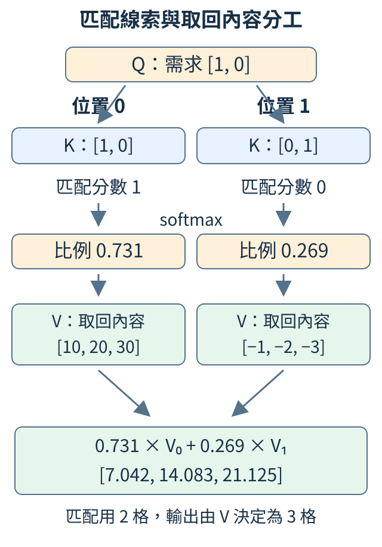
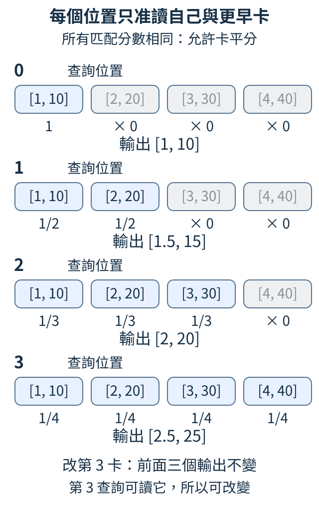
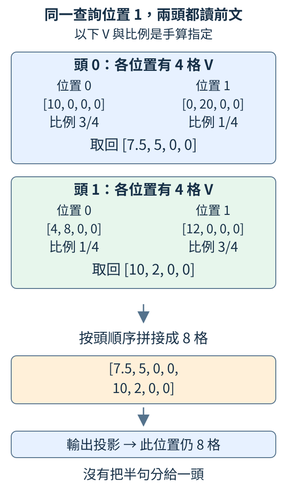

# 第 3 章：注意力，按內容決定讀哪些位置

「紅色物體是」與「藍色物體是」的答案差在前面的顏色。固定視窗把線索送進去後，模型還需要決定哪些位置該讀多些。本章先把幾張數字卡按比例混成一張，再用內容算比例，分清「提出需求、匹配位置、取回內容」三個角色，最後限制不能讀未來，並讓幾個注意力頭同時工作。3.6 與 3.7 會逐行讀本課函式庫 `tiny_perceptron` 裡的注意力程式。

## 3.1 幾個位置的資訊，怎樣按比例混在一起？

兩個位置的數字卡分別是 `[2,0]` 和 `[0,4]`。希望多用第一張時，可以取第一張九成、第二張一成：第一格得 `0.9×2+0.1×0=1.8`，第二格得 `0.9×0+0.1×4=0.4`。

這叫**加權平均**。每張卡乘自己的比例，再逐格相加；比例非負、總和為 1，結果便是各卡的混合。它與把卡片原封拼接不同：兩張兩格卡混完，只剩一張兩格卡 `[1.8,0.4]`。

```python
import torch

values = torch.tensor([[2.0, 0.0], [0.0, 4.0]])
weights = torch.tensor([0.9, 0.1])
output = weights @ values
print(output)
assert torch.allclose(output, torch.tensor([1.8, 0.4]))
```

`values` 每列是一個位置，`weights` 為每位置指定比例；`@` 把相同特徵欄加權相加。輸出與手算一致，斷言核對兩格。

**注意力**（attention）最基本的讀取動作就是這種按比例混合。這組比例本章叫**讀取比例**，程式與文獻常叫注意力權重（attention weights），所以程式裡的變數名是 `weights`。這裡還是由人指定 0.9、0.1；下一節才讓內容決定比例。注意力不一定只挑一個位置，本例兩張都有參與。

比例較大也不直接代表帶回數值較大。例如同一格中 `0.9×1=0.9`，而 `0.1×100=10`。需要一起看比例與內容；更不能只憑比例宣佈模型理解某個概念。本節的兩格沒有固定語意，只是手算材料。

練習把 `weights = torch.tensor([0.9, 0.1])` 改成 `[0.1, 0.9]`，先預測輸出 `[0.2,3.6]`，再把斷言裡的 `[1.8, 0.4]` 同步改成 `[0.2, 3.6]` 核對。你改的是讀取比例，兩張來源卡沒有改。

<details>
<summary>補充與重做</summary>

一般 Linear 權重可負、也不必加總為 1；讀取比例則像機率一樣非負、總和為 1。矩陣與特徵軸見 [W.3](../first-steps.md#W.3)、[W.5](../first-steps.md#W.5)。`allclose` 只作數值核對，本例沒有可調參數或訓練。

</details>

## 3.2 能不能根據當前需求，改變讀取比例？

剛才九成與一成是人指定的。現在準備一個「目前要找什麼」的數字卡 `[1,0]`，以及三個候選位置的線索 `[1,0]`、`[0,1]`、`[-1,0]`。我們希望第一個位置匹配最高，第二個其次，第三個最低，讓讀取隨需求改變。

需求卡叫 **query**，縮寫 q；候選的匹配卡叫 **key**。像用需求對照書目，但這裡每張都是實際數字，而不是人寫的關鍵詞。兩格僅是手動例子，不宣稱第一格代表顏色。

匹配方法是對應格相乘再相加，叫**點積**：三個分數依序是 `1×1+0×0=1`、0、-1。再用 [1.7](01.md#1.7) 的 softmax 將分數變成非負、總和為 1 的讀取比例。

```python
import torch

q = torch.tensor([1.0, 0.0])
keys = torch.tensor([[1.0, 0.0], [0.0, 1.0], [-1.0, 0.0]])
scores = q @ keys.T
weights = scores.softmax(dim=0)
print(scores)
print(weights)
```

`q @ keys.T` 得 `[1,0,-1]`；`.T` 交換 key 表的列欄（[2.3](02.md#2.3) 用過），讓一次乘法算三個匹配。比例約 `[0.665,0.245,0.090]`。第一個最多，另外兩個仍有份。

若需求改 `[0,1]`，分數變 `[0,1,0]`，第二個位置取得最多。候選位置沒有改，比例已因需求改變；這就是用內容決定讀取比例。

點積也受數字大小影響。將第一個 key 改 `[2,0]`，方向沒變，對 `[1,0]` 的分數卻變 2。它不是只量方向的相似度，稍後還要控制分數尺度。

練習先把 `q = torch.tensor([1.0, 0.0])` 改成 `[0.0, 1.0]`，核對第二個比例最高；再只把 `keys` 的第三列 `[-1.0, 0.0]` 改成 `[-1.0, 1.0]`，先預測後兩個分數都是 1、各分到約 0.422。需求和候選線索都能改比例。

<details>
<summary>補充與重做</summary>

本節只算匹配與比例，沒有取回內容，也先不限制讀哪些位置。分數尚未除以特徵數平方根；[3.5](#3.5) 再加入尺度規則，[3.6](#3.6) 加入防偷看許可。

</details>

## 3.3 同一個位置，為什麼要有查詢與匹配兩份表示？

一個位置既會問「我現在需要哪些線索」，又會成為別的位置可讀的資料。這兩份工作不必用同一套數字：**query 表示提出需求，key 表示提供匹配線索**，所以模型為它們準備不同的可調配方。

先用一個人工查找任務說明：每個位置要找自己缺少的線索，同時讓別的位置找到自己已有的線索。暫用兩格分別標記顏色與形狀；一個已有顏色、需要形狀的位置，key 可以是 `[1,0]`，query 則可以是 `[0,1]`。這些格子的含義是為示意指定的，真實模型的特徵不固定代表顏色或形狀。

下面先直接給轉換後的卡：兩個查詢與三個候選。所有查詢排成表 Q，所有 key 排成表 K。希望每個查詢各自比較全部三候選，得到兩列三欄的分數。

```python
import torch

q = torch.tensor([[1.0, 0.0], [0.0, 1.0]])
k = torch.tensor([[1.0, 0.0], [0.0, 1.0], [1.0, 1.0]])
scores = q @ k.T
print("Q", q.shape, "K轉置", k.T.shape)
print(scores)
assert scores.shape == (2, 3)
```

第一列 query `[1,0]` 得 `[1,0,1]`，第二列 `[0,1]` 得 `[0,1,1]`。第三個 key `[1,1]` 對兩種需求都得 1。輸出每列是一個問的人，每欄是一個可讀位置；`k.T` 只改排列以便相乘，不會把 key 改成 query。

用尺寸核對：Q 是 `[2,2]`，K 轉置是 `[2,3]`，共同的內側 2 是匹配特徵數，輸出 `[2,3]`。查詢數與候選數不必相等，但兩邊的匹配特徵數要相同。

為什麼不讓每個位置只用一份表示，同時當 query 與 key？用兩個位置試試：A 已有顏色、要找形狀；B 已有形狀、要找顏色。只用一份時，A 是 `[1,0]`、B 是 `[0,1]`，提問與被讀都用它。分開兩份時，key 仍記「已有什麼」，query 改記「要找什麼」；本例的 query 正好是把 key 的兩格對調。

```python
has = torch.tensor([[1.0, 0.0], [0.0, 1.0]])
need = torch.tensor([[0.0, 1.0], [1.0, 0.0]])
print("共用一份", has @ has.T)
print("分開兩份", need @ has.T)
```

兩張表的列都是提問的 A、B，欄是被讀的 A、B。共用一份得到 `[[1,0],[0,1]]`：A 跟自己最匹配，讀回的是它早已有的顏色。分開兩份得到 `[[0,1],[1,0]]`：A 找到有形狀的 B，B 找到有顏色的 A。一般來說，共用一份時 A 對 B 的分數一定等於 B 對 A 的分數；各位置向量長度相同時，跟自己的分數也最高（或並列最高）。「要找什麼」與「能提供什麼」常常不同，所以要兩份。

真實模型讓位置表示 X 各經過一套 Linear，得到 Q 與 K；這種特徵轉換也叫**投影**，這裡先理解為不同的加權配方。剛才從 `has` 得到 `need`，就像套用「交換兩格」的配方；key 則套用「保留原樣」的配方：同一份資訊經不同配方，扮演不同角色。**自注意力**的「自」是指：提出查詢、提供匹配線索，以及實際取回的內容，都由同一組位置產生。這裡先看 Q、K 的匹配部分；下一節會加入代表取回內容的第三份表示。位置來源相同，角色仍不同。

練習在第一段程式的 `k` 最後加一列 `[2.0, 0.0]`，先預測輸出變兩列四欄、新欄為 2、0，再把斷言改為 `(2, 4)` 核對。若再做 softmax，要沿每列的候選欄，讓每個問題自己分配讀取比例。

<details>
<summary>補充與重做</summary>

Q `[Tq,Dk]`、K `[Tk,Dk]` 得分數 `[Tq,Tk]`，Tq 是查詢數，Tk 是候選數，Dk 是匹配特徵數。不同查詢之間不一起做 softmax，否則會讓不同問題互搶比例。Linear 見 [2.3](02.md#2.3)；本例直接指定 Q/K，沒有建立或訓練投影權重。

</details>

## 3.4 找到位置後，實際取回的是什麼？

書目幫你找到一本書，真正讀的是書的內容。注意力也把匹配線索與取回內容分開：每個候選位置除了 key，還準備 **value**，縮寫 V，表示要按比例帶回的數字。

本節需求為 `[1,0]`，兩個 key 是 `[1,0]` 與 `[0,1]`，匹配分數是 1、0，softmax 後比例約 0.731、0.269（多取幾位是 0.73106、0.26894）。兩個位置的 value 則各有三格：`[10,20,30]` 與 `[-1,-2,-3]`。key 兩格足以做本例匹配，不表示取回內容也只能兩格。

```python
import torch

q = torch.tensor([[1.0, 0.0]])
k = torch.tensor([[1.0, 0.0], [0.0, 1.0]])
v = torch.tensor([[10.0, 20.0, 30.0], [-1.0, -2.0, -3.0]])
weights = (q @ k.T).softmax(dim=-1)
output = weights @ v
print(weights)
print(output, output.shape)
```

第一格輸出為 `0.73106×10+0.26894×(-1)≈7.042`；其餘兩格為 14.083、21.125。若用三位小數的 0.731、0.269 手算，會得到 7.041、14.082、21.123：差在最後一位，是比例取整造成的，程式用的是未取整的比例。每個查詢取回一張三格卡，所以輸出形狀 `[1,3]`，由 V 的寬度決定。



圖中兩位置始終按相同順序排列；比例只標到三位小數，輸出則按未取整的比例算。左比例乘左 V，右比例乘右 V；若調換 V 的列卻不調換對應 key，會把找到第一份的比例套到第二份內容，算出另一個答案。

整條運算可寫 `softmax(QKᵀ)V`：先匹配，再分配讀取比例，最後混合內容。Q、K、V 都是數字表示。實際自注意力先把各位置的輸入表示排成一張表，稱為 X；每排是該位置目前的一串數字。同一張 X 分別通過三套 Linear，為各位置產生 Q、K、V，三套權重都可訓練。本節為看清三者分工，直接填入一個查詢與兩個候選的數字，沒有執行產生它們的三套 Linear 或訓練。

練習只把 `v` 的第一列改成 `[20.0, 40.0, 60.0]`，Q/K 不動。先預測比例保持相同、輸出變約 `[14.352,28.704,43.057]`，再執行核對。這是最直接的角色檢查：定位線索沒改，帶回內容改了。

混合多張卡後只留一張，通常不能由結果完整還原每張來源。注意力是在建立此刻有用的表示；[4.2](04.md#4.2) 的殘差連線會另留一條保留原表示的路線。

<details>
<summary>補充與重做</summary>

Tq 個查詢、Tk 個候選、每份 V 有 Dv 格，則權重 `[Tq,Tk]` 乘 V `[Tk,Dv]` 得 `[Tq,Dv]`。本節仍用未縮放、方便手算的算例；完整縮放規則在下一節。

</details>

## 3.5 匹配特徵越多，為什麼要除以平方根？

同樣兩個候選，softmax 對分數 `[1,0]` 給約 `[0.731,0.269]`，對 `[8,0]` 卻給約 `[0.9997,0.0003]`。分數差越大，讀取比例越集中。若只增加匹配特徵數，就順帶讓分數起伏大很多，讀取比例可能在我們沒打算時變得更集中。

點積把每格乘積相加。先想像各格乘積的取值互不影響，這叫獨立；每格有一半機會為 -1、一半為 +1；它的平均是 0，平方偏離平均後再取平均為 1，這個起伏量叫**變異數**。取變異數平方根得到**標準差**，能用原數字的尺度看典型起伏。

加兩格時，四種等可能結果是 -2、0、0、2。變異數為 `(4+0+0+4)/4=2`，標準差為 √2，沒有直接翻倍，因為正負可能抵消。對 D 個獨立、平均為 0、變異數為 1 的格子，加總變異數為 D，標準差為 √D。

因此常將 Q/K 點積除以 `sqrt(D)`，D 是每個匹配向量的格數。這叫**縮放點積注意力**，完整讀取為 `softmax(QKᵀ/√D)V`。四格除以 2，六十四格除以 8，使指定假設下的典型起伏接近同一尺度。

```python
import math
import torch

torch.manual_seed(42)
for d in [4, 64]:
    q = torch.randint(0, 2, (1000, d)).float() * 2 - 1
    k = torch.randint(0, 2, (1000, d)).float() * 2 - 1
    scores = (q * k).sum(dim=-1)
    scaled = scores / math.sqrt(d)
    print(d, scores.std().item(), scaled.std().item())
```

程式沿用前段的正負一算例。`randint(0, 2, ...)` 每格等機會抽到 0 或 1；`.float()` 轉成小數表示，再乘 2、減 1，變成 -1 或 +1。q、k 的各格分別抽符號。同號相乘得 +1，異號相乘得 -1；四種等可能符號組合有兩種正、兩種負，所以每格乘積也正好符合「平均 0、變異數 1」的假設。

每組 q、k 有 d 格，共一千組。`q*k` 逐格相乘，`sum` 得每組點積，`std()` 量這一千個結果的起伏。`manual_seed(42)` 固定這次抽樣起點，方便重做；`.item()` 把算出的單一數值取出列印。

d=4 時，未縮放標準差應靠近 2；d=64 時靠近 8。縮放後兩者都靠近 1，樣本有限所以不會恰好等於理論值。這次是檢查尺度推算，沒有做完整匹配表或訓練。

真實訓練後的 q/k 未必符合獨立、零平均、每格變異數為 1 的假設，所以除以 √D 不保證分數永遠同樣大。練習把 `scores = (q * k).sum(dim=-1)` 改成 `scores = (2 * q * 2 * k).sum(dim=-1)`，讓 q、k 每格都變 ±2。先預測每格乘積變 ±4，縮放前後的標準差也都約為原來四倍，再執行核對。它控制特徵數的影響，不能抵消全部數值變化。

<details>
<summary>補充與重做</summary>

「獨立」表示知道一格取什麼，不改另一格的機會。變異數相加用到這項假設。√D 的效果與 [1.15](01.md#1.15) 的分數除溫度相似，但這裡控制的是注意力匹配，生成溫度控制的是選下一字。分成多個注意力頭時（[3.7](#3.7)），D 要用每頭 Q/K 的寬度；[3.6](#3.6) 的 `manual_attention` 用 `q.shape[-1]` 取這個寬度。

</details>

## 3.6 整段一起算，怎樣禁止讀後面的答案？

「貓看狗。」會配成「貓→看、看→狗、狗→。」。訓練時已知完整文字，可以同時計算各位置；但貓位置若讀到右邊的看，就是把答案拿來猜答案。生成時只給貓，又沒有這個答案可讀。

所以每個查詢要有讀取許可：位置 i 只准讀位置 j≤i，即自己與更早的位置。這份真／假的許可表叫**因果遮罩**（causal mask）。目前字允許讀，因為要猜的是它右邊一字。

本課函式庫的 `manual_attention` 把 3.2–3.5 的匹配、縮放、讀取比例與混合，連同這份許可表寫成一個函式。先準備四個位置的手算用小數字卡：q、k 全為 0，所有允許位置分數相同，就會平分讀取比例；value 為 `[1,10]`、`[2,20]`、`[3,30]`、`[4,40]`。我們希望前面查詢不受後面資料改動影響。

```python
import math

import torch

q = torch.zeros(1, 1, 4, 2)
k = torch.zeros_like(q)
v = torch.tensor([[[[1.0, 10.0], [2.0, 20.0], [3.0, 30.0], [4.0, 40.0]]]])
allowed = torch.ones(4, 4, dtype=torch.bool).tril()[None, None]
print(allowed[0, 0])
```

`torch.zeros(1, 1, 4, 2)` 的四個軸依序是一筆、一個注意力頭、四個位置、每位置兩格。注意力頭是 [3.7](#3.7) 的內容；這裡只有一個頭，這一軸長度是 1。`torch.ones(4, 4, dtype=torch.bool)` 是全為 True 的四乘四表，`dtype=torch.bool` 指定內容是真／假；`.tril()` 只留對角線與下方的 True，上方改成 False。`[None, None]` 在前面補兩個長度 1 的軸，讓許可表成為 `[1,1,4,4]`，對上一筆、一個頭。印出的表每列是一個查詢位置，每欄是一個候選位置：第 0 列只有第 0 欄是 True，最後一列四欄都是 True。開頭的 `import math` 是給下面函式裡的 `math.sqrt` 用的。

```python
# 節錄自 tiny_perceptron/attention.py：manual_attention
def manual_attention(q, k, v, allowed):
    scores = q @ k.transpose(-2, -1) / math.sqrt(q.shape[-1])
    scores = scores.masked_fill(~allowed, float("-inf"))
    # 全 PAD 的 query 沒有可見 key；softmax(-inf,...) 會 NaN，要明確改成零。
    empty = ~allowed.any(dim=-1, keepdim=True)
    scores = scores.masked_fill(empty, 0.0)
    weights = scores.softmax(dim=-1).masked_fill(empty, 0.0)
    return weights @ v, weights
```

`manual_attention` 收四份輸入：q、k、v 與許可表 `allowed`，逐行做的事如下。

- `q @ k.transpose(-2, -1) / math.sqrt(q.shape[-1])` 是 3.3 的 `q @ k.T` 加上 3.5 的縮放。`.T` 只用在二維表；這裡有四個軸，所以用 `transpose(-2, -1)` 只交換最後兩軸，也就是位置與特徵。`@` 只對最後兩軸做矩陣乘法，前面的筆數軸與頭軸各算各的。分數形狀是 `[1,1,4,4]`：每個查詢位置對每個候選位置一個分數。`q.shape[-1]` 是每位置的匹配特徵數，本例是 2。
- `scores.masked_fill(~allowed, float("-inf"))`：`~` 把真假顛倒，標出不准讀的位置；`masked_fill` 在標記處填入新值。`float("-inf")` 是負無限，它的指數是 0，所以 softmax 後比例正好是 0。若只填普通的 0，softmax 仍會給它一份比例，排除不了。
- 註解與接下來三行處理「整列都不准讀」：`allowed.any(dim=-1, keepdim=True)` 問每個查詢列是否至少有一個 True，`~` 顛倒後標出一個都沒有的列。這種列的分數全是負無限，softmax 會算出 NaN（not a number，不是有效數字），所以先把那列分數填 0，算完比例再填回 0，讓它取回全 0 的內容。因果遮罩下每個查詢至少能讀自己，本節遇不到這種列；[7.7](07.md#7.7) 在序列左邊補 PAD 時，最前面的 PAD 查詢才會一個位置都不准讀。
- `return weights @ v, weights` 照 3.4 按比例混合 V，同時回傳讀取比例表，方便檢查。

```python
out, weights = manual_attention(q, k, v, allowed)
changed = v.clone()
changed[:, :, 3] += 100
other, _ = manual_attention(q, k, changed, allowed)
print(weights[0, 0])
print(out[0, 0])
print(other[0, 0])
assert torch.allclose(out[:, :, :3], other[:, :, :3])
```

`out, weights =` 用兩個名字接住函式回傳的兩樣東西。印出的讀取比例第 0 列是 `[1,0,0,0]`，第 1 列平分前兩個位置，最後一列四個位置各 0.25；混合結果如下圖。



圖中每列是一個查詢位置，列內四張卡從左到右是位置 0、1、2、3，卡內是 V 的兩個特徵。第 0 查詢只讀第 0 卡，輸出 `[1,10]`；第 1 查詢平分前兩卡，得 `[1.5,15]`；第 2 得 `[2,20]`；最後可讀四卡，得 `[2.5,25]`。灰色未來卡的比例為 0，不參與該列混合。

程式再把第 3 卡的兩個特徵都加 100，重算一次；`clone()` 先複製一份，原本的 v 不變，`_` 表示不用第二個回傳值（[1.14](01.md#1.14) 用過）。最後一行印出的新結果裡，前面三個輸出不變，只有最後一個變成 `[27.5,50]`。斷言比較前三個位置 `out[:, :, :3]`，查的是這個實際影響，而不只是許可表是否呈三角形。

練習先在第一段程式刪掉 `.tril()`，讓每個位置都可讀。預測四列比例都是 0.25、四個輸出都是 `[2.5,25]`，改第 3 卡會影響所有輸出，第三段的斷言應失敗。答案配對決定「猜什麼」，因果許可決定「能用什麼猜」；兩者都要正確。接著恢復 `.tril()`，在第一段最後加一行 `allowed[0, 0, 0, 0] = False`，讓第 0 個查詢一個位置都不准讀。預測它的比例全為 0、輸出 `[0,0]`，其他三列不變，也不出現 NaN。

<details>
<summary>補充與重做</summary>

前面的 shift 見 [1.3](01.md#1.3)。這段只測讀取範圍，沒有更新模型；答案代價低，不代表沒偷看。下一節的 `CausalAttention` 直接呼叫這個函式；函式庫版另用 `attention_mask` 產生許可表，順帶排除 PAD 與文件邊界，見 [16.5](16.md#16.5)。

</details>

## 3.7 幾種讀法怎樣並行，再交回同一位置？

同一位置可能需要讀不同線索。注意力可以準備幾組各自的 Q/K/V 配方，各算匹配與混合，再把結果拼回來。每組叫一個**注意力頭**（attention head），多組同時使用就叫**多頭注意力**（multi-head attention）。

先看一個指定比例的手算，不代表訓練後必然如此。當前查詢在位置 1，可讀位置 0、1。兩頭各取回四格：

| 注意力頭 | 位置 0 的 V | 位置 1 的 V | 讀取比例 | 混合輸出 |
| --- | --- | --- | --- | --- |
| 頭 0 | `[10,0,0,0]` | `[0,20,0,0]` | 3/4、1/4 | `[7.5,5,0,0]` |
| 頭 1 | `[4,8,0,0]` | `[12,0,0,0]` | 1/4、3/4 | `[10,2,0,0]` |

兩份按頭順序拼接，得到此位置的八格 `[7.5,5,0,0,10,2,0,0]`，再經一個 Linear 混合成八格；這個 Linear 叫**輸出投影**，和 [4.6](04.md#4.6) 替候選字打分的輸出層不同。**兩頭都讀整串允許的位置**，不是各分到半句。



實際比例由各頭 Q/K 匹配產生，V 也由各自配方得到。每個頭的 Q/K/V 配方是各自的一組參數，訓練時分別被調整，可能學到不同的讀取比例，卻沒有預設第一頭懂文法、第二頭懂物體。

程式要讓每個頭拿到自己的四格。下面用一筆、兩個位置、每位置八格的特徵追蹤這一步，位置 0 是 0 到 7，位置 1 是 8 到 15：

```python
import torch

features = torch.arange(16).reshape(1, 2, 8)
split = features.reshape(1, 2, 2, 4).transpose(1, 2)
print(split.shape)
print(split[0, 0])
print(split[0, 1])
```

`torch.arange(16)` 產生 0 到 15，`reshape(1, 2, 8)` 排成 `[筆數, 位置, 特徵]`。`reshape(1, 2, 2, 4)` 把每位置的八格切成兩組四格，形狀是 `[筆數, 位置, 頭, 每頭格數]`；和 [W.3](../first-steps.md#W.3) 一樣，reshape 只重新分組，不改數字順序。`transpose(1, 2)` 交換編號 1 與編號 2 的兩個軸（軸的編號和 `dim` 一樣從 0 算起），也就是位置軸與頭軸，其餘軸不動，成為 `[筆數, 頭, 位置, 每頭格數]`，也就是印出的 `[1,2,2,4]`；二維表的 `.T` 是交換兩軸的特例。頭 0 印出 `[[0,1,2,3],[8,9,10,11]]`，是兩個位置的前四格；頭 1 是兩個位置的後四格。每個頭都有全部位置，只是各拿一段特徵，這正是 3.6 的 `manual_attention` 要的形狀。

下面把整個流程寫成一個 PyTorch 零件。這是本課第一次寫零件類別，程式後面先說怎麼讀類別，再逐段讀計算。

```python
# 精簡自 tiny_perceptron/attention.py：CausalAttention（省略 kv_heads、sdpa、RoPE、cache 與 valid／positions／segments）
from torch import nn

from tiny_perceptron.attention import manual_attention


class CausalAttention(nn.Module):
    def __init__(self, width, heads=1):
        super().__init__()
        if width % heads:
            raise ValueError("width 必須能被 heads 整除")
        self.heads, self.head_dim = heads, width // heads
        self.q = nn.Linear(width, width, bias=False)
        self.k = nn.Linear(width, width, bias=False)
        self.v = nn.Linear(width, width, bias=False)
        self.out = nn.Linear(width, width, bias=False)

    def forward(self, x):
        b, t, d = x.shape
        q = self.q(x).reshape(b, t, self.heads, self.head_dim).transpose(1, 2)
        k = self.k(x).reshape(b, t, self.heads, self.head_dim).transpose(1, 2)
        v = self.v(x).reshape(b, t, self.heads, self.head_dim).transpose(1, 2)
        allowed = torch.ones(t, t, dtype=torch.bool).tril()[None, None]
        out, _ = manual_attention(q, k, v, allowed)
        out = out.transpose(1, 2).reshape(b, t, d)
        return self.out(out)
```

怎麼讀這個類別：

- `class CausalAttention(nn.Module):` 用 `class` 定義一種新的物件，這裡是一種新的 PyTorch 零件。括號裡的 `nn.Module` 是 PyTorch 所有零件的共同基礎；[2.1](02.md#2.1) 的 `nn.Embedding`、[2.3](02.md#2.3) 的 `nn.Linear` 也都是 `nn.Module`。寫好後，`CausalAttention(width=8, heads=2)` 就會造出一個這種零件，就像 `nn.Linear(3, 2)` 造出一個線性層。
- `def __init__(self, width, heads=1):` 在造零件時執行一次，負責建立可學的部分。`self` 指正在建立的那個零件本身；`width` 是特徵寬度 D，也就是每位置幾格；`heads=1` 表示沒指定頭數時用 1。第一行 `super().__init__()` 先讓 `nn.Module` 做好自己的準備，例如準備登記零件的地方，所以要寫在其他設定之前。
- `width % heads` 是 width 除以 heads 的餘數；不為 0 時，`raise ValueError(...)` 立刻停止並顯示引號裡的錯誤訊息。`width // heads` 是只取整數的除法，8 // 2 得 4，也就是每頭格數 `head_dim`。`self.heads, self.head_dim = heads, width // heads` 一行把兩個值依序存起來。
- `self.q = nn.Linear(width, width, bias=False)` 這四行把四個 Linear 掛到零件上：q、k、v 產生 Q、K、V，out 是輸出投影。掛在 `self` 上的 Linear 會自動登記成這個零件的參數；`bias=False` 表示不加偏移（[2.4](02.md#2.4) 用過）。
- `def forward(self, x):` 定義計算。呼叫 `layer(x)` 時，PyTorch 會替你執行 `forward`，不必寫 `layer.forward(x)`。

`forward` 的計算：`b, t, d = x.shape` 把三個軸長度依序取名為筆數、位置數與特徵寬度 D。接下來三行各用一個 Linear 算出 Q、K、V，再照剛才的追蹤拆頭：`[b,t,D]` → `[b,t,頭數,每頭格數]` → `[b,頭數,t,每頭格數]`。許可表和 3.6 相同；`manual_attention` 就是 3.6 節錄的函式，這裡從函式庫 import。它的 `@` 只對最後兩軸相乘，所以每個頭用自己的 Q、K、V 各自算讀取比例與混合，縮放用的也是每頭格數。`out.transpose(1, 2)` 把頭軸換回位置之後，`reshape(b, t, d)` 再把每位置的兩組四格接回八格：前四格來自頭 0，後四格來自頭 1，就是上表的拼接。最後 `self.out` 把這八格混成新的八格。

```python
from tiny_perceptron.attention import CausalAttention as LibraryCausalAttention

torch.manual_seed(42)
layer = CausalAttention(width=8, heads=2)
x = torch.randn(1, 4, 8)
out = layer(x)
print("可學的參數", list(layer.state_dict()))
print("輸入", x.shape, "輸出", out.shape)
library = LibraryCausalAttention(width=8, heads=2)
library.load_state_dict(layer.state_dict())
library_out, _ = library(x)
same = torch.allclose(out, library_out)
print("與函式庫版本相同：", same)
assert out.shape == x.shape and same
```

這段建一層特徵寬度 8、兩個頭的注意力，送入四個位置的隨機特徵。`state_dict()` 把零件的全部參數按名字收成字典，`list(...)` 只取字典的鍵：印出的 `q.weight`、`k.weight`、`v.weight`、`out.weight` 就是 `__init__` 掛上的四個 Linear。輸入 `[1,4,8]`，輸出仍是 `[1,4,8]`：內容已經更新，位置數沒有增加。

函式庫版用 `as` 換名成 `LibraryCausalAttention`，免得蓋掉剛寫的版本。`load_state_dict` 依名字把我們的參數抄進函式庫版；兩版零件名字相同，才能直接抄。函式庫版回傳兩樣東西：輸出，以及這次算出的 K、V，叫 KV 快取（KV cache，[16.3](16.md#16.3) 生成時才重用），所以用 `library_out, _ =` 只取輸出。兩版算出相同結果，印出 True。

精簡版省略了函式庫的幾項後章功能：減少 K/V 份數的 `kv_heads`（[16.4](16.md#16.4)）、改用 PyTorch 內建注意力函式的 `backend="sdpa"`（[16.8](16.md#16.8)）、旋轉位置的 RoPE（[14.1](14.md#14.1)）、生成時接續的 cache（16.3），以及 PAD、自訂位置編號與文件邊界用的 `valid`、`positions`、`segments`（[7.7](07.md#7.7)、[16.5](16.md#16.5)）。這些都不用時，函式庫算的就是上面這段；它把 reshape 寫成 `.view` 與 `.contiguous().view`，效果相同。

練習把第三段程式兩處 `heads=2` 都改成 `heads=4`。總寬度不動，先預測每頭變兩格、輸出仍是 `[1,4,8]`、兩版仍相同，再執行核對。再改成 `heads=3`，應停在 `ValueError`：八格不能均分給三頭。本例用亂數且未訓練，輸出或頭數的變化不提供哪個較聰明的證據。

<details>
<summary>補充與重做</summary>

種子 42 固定隨機起點，只為重現這次初始化。上面的指定 V 與比例是解釋輸出的手算；本節程式使用另一份隨機輸入，沒有聲稱會印出那些手算數值。函式庫的完整寫法見 [tiny_perceptron/attention.py](../../tiny_perceptron/attention.py)。

</details>
