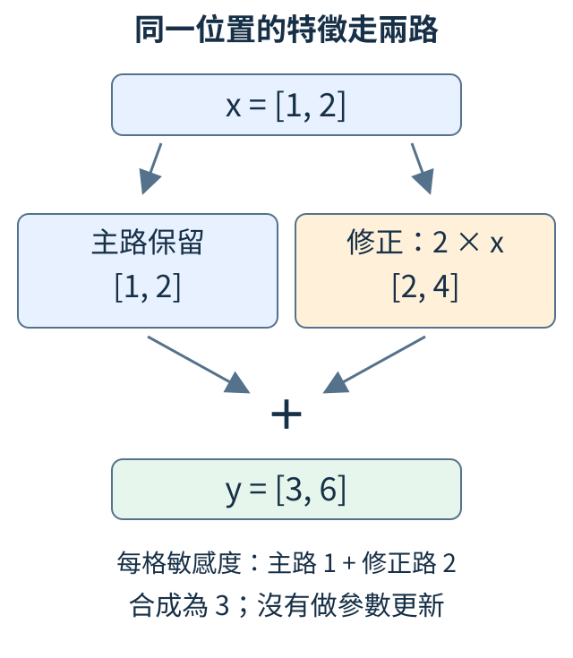
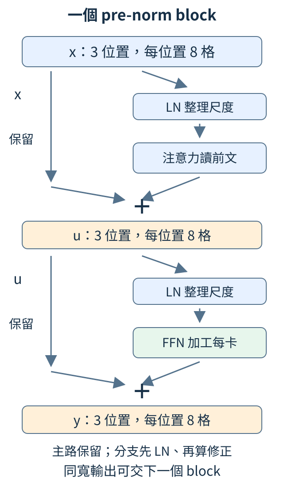
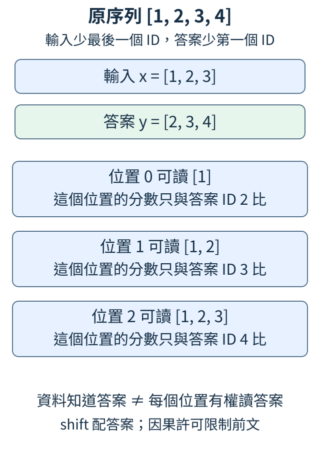

# 第 4 章：把零件接成第一個 Transformer

上一章已能按內容讀取前文。現在讓整段文字走完一條猜字路線：查字特徵與位置，經注意力讀前文、在各位置處理特徵，最後替候選字打分。把這些計算接成可重複的層，就得到本章的 Transformer。我們先採每個位置都用完整特徵配方的 Dense 版本，核對輸入、答案與梯度，再談增加層數會改變什麼。4.4–4.6 會逐段讀本課函式庫的 FFN、block 與完整模型 `TinyLM`；第 5 章以後的許多程式都用這個模型。

本章先教各層有自己的參數。等到[14.11](14.md#14.11)，會把同一個區塊的輸出交回去再算幾輪，每輪都用同一組參數（區塊共用參數）；層數、參數份數與實際工作量到時再分開比較。

## 4.1 同一個字放不同位置，怎樣提供不同線索？

「貓追狗」與「狗追貓」字相同、順序不同。字特徵只靠 ID 查表，單看「貓」那一排不知道它放在哪個位置。因此除了文字內容，我們再提供位置線索。

先用「貓看貓」，約定 ID 1=貓、2=看。兩次貓都查到 `[1,0,0]`；再讓位置 0、1、2 各查一排三數，與字的 embedding 向量逐格相加。這叫**位置表示**，本節使用可調的絕對位置表：「絕對」指每個位置編號各查自己的一列，位置 2 永遠查編號 2 那一列，不管前後是什麼字。第 14 章的 RoPE（[14.1](14.md#14.1)）改看兩個位置相差多遠，那是相對的做法。

| 位置 | 字特徵 | 本節指定的位置特徵 | 相加後 |
| --- | --- | --- | --- |
| 0／貓 | `[1,0,0]` | `[0,0,0]` | `[1,0,0]` |
| 1／看 | `[0,1,0]` | `[0.1,0.2,0.3]` | `[0.1,1.2,0.3]` |
| 2／貓 | `[1,0,0]` | `[0.2,0.4,0.6]` | `[1.2,0.4,0.6]` |

```python
import torch
from torch import nn

e = nn.Embedding(4, 3)
p = nn.Embedding(5, 3)
with torch.no_grad():
    e.weight.copy_(torch.tensor([[0.0, 0.0, 0.0], [1.0, 0.0, 0.0], [0.0, 1.0, 0.0], [0.0, 0.0, 1.0]]))
    p.weight.copy_(torch.tensor([[0.0, 0.0, 0.0], [0.1, 0.2, 0.3], [0.2, 0.4, 0.6], [0.3, 0.6, 0.9], [0.4, 0.8, 1.2]]))
ids = torch.tensor([1, 2, 1])
positions = torch.arange(3)
x = e(ids) + p(positions)
print(positions)
print(x)
assert not torch.equal(x[0], x[2])
```

`e` 是字的 embedding 表，`p` 是位置表。`torch.arange(3)` 產生 `[0,1,2]`，選位置表的相應列；`e(ids)+p(positions)` 正是表中的逐格相加。最後檢查兩次貓的相加結果不同。

這些位置小數由人指定，沒有「位置越後，每格必須等差增加」的要求。真正使用這種模型時，位置表通常從亂數開始，與字的 embedding 表一起訓練。加入位置使線索可用，後面的計算還要學會使用它，不代表相加後已懂語序。

因果許可決定誰能讀誰，位置特徵給每位置額外數字，兩者用途不同。沒有位置表時，因果許可也會帶來一點間接的順序線索：「貓看貓」的位置 0 只能讀自己，位置 2 能讀三個位置，兩次貓混到的內容不同，就像 [3.6](03.md#3.6) 各查詢平分的卡數不同。但若三個字都是貓，每個位置混到的都是同一張卡，結果完全一樣，順序就看不出來。本節讓位置明確參與特徵計算，不靠這種間接線索。

練習在填表的 `with torch.no_grad():` 區塊加 `p.weight.zero_()`，並把斷言改成 `assert torch.equal(x[0], x[2])`。兩次貓又相同，差異正是位置表帶來的。

位置表有五列，只容許位置 0 到 4。設定能放五個位置，只表示這些索引有效；某位置是否被充分訓練、長文是否能用好線索，仍是別的問題。

<details>
<summary>補充與重做</summary>

字特徵見 [2.1](02.md#2.1)，逐格相加要兩表同寬。本例輸入位置 5 會超出表格範圍。`no_grad()` 的縮排範圍只包手動修改，見 [1.12](01.md#1.12)；輸出附的 `AddBackward0` 是相加的求導記錄。第 14 章的 RoPE 與上下文視窗的延長（[14.8](14.md#14.8)）會改變位置方法，本節先建立查表起點。

</details>

## 4.2 新計算怎樣加回去，又保留已有表示？

假設一個位置已經有兩格 `[1,2]`，分支算出修正 `[2,4]`。我們希望用新資訊，又不讓原表示必須整份透過新分支，所以留一條**主路**把原表示直接帶到後面，最後逐格相加，得 `[3,6]`。

這叫**殘差連線**（residual connection），寫成 `y=x+f(x)`。x 沿主路保留，f(x) 是**修正路**算出的修正；兩邊必須同形狀。本節用簡單 `f(x)=2*x` 看清兩路，並測試輸出對輸入的敏感度。



圖中主路保留 `[1,2]`，修正路產生 `[2,4]`。前向數值相加，反向傳播（backpropagation）時同一格也有兩條影響路徑。

```python
import torch

x = torch.tensor([1.0, 2.0], requires_grad=True)
correction = 2 * x
y = x + correction
y.sum().backward()
print("結果", y.detach())
print("對輸入的敏感度", x.grad)
assert torch.equal(x.grad, torch.tensor([3.0, 3.0]))
```

輸出印 `[3,6]`，梯度印 `[3,3]`。為什麼每格敏感度是 3？讓某格 x 微增 0.001，主路使相應輸出增 0.001，修正路再增 0.002，總共增 0.003。因此兩路影響是 1+2=3，與 [1.10](01.md#1.10) 的鏈式法則一致：每條路各自求導，再相加。

`y.sum()` 只為把兩格輸出加成單個數，以便測敏感度；它不是文字答案的代價。程式也沒有可調分支參數或更新步驟。

殘差讓已有資訊沿主路往後算，也讓梯度沿這條路往前層傳回。即使修正暫時接近 0，主路仍有一份資訊與敏感度。它不保證訓練永不失敗，也不表示所有原文能完整還原；作用是讓每層可在已有表示上學修正。

練習把 `correction = 2 * x` 改成 `0 * x`，先預測輸出變 `[1,2]`、梯度變 `[1,1]`，將斷言的 `[3.0, 3.0]` 同步改成 `[1.0, 1.0]` 再核對。分支不提供改變時，主路仍工作。

<details>
<summary>補充與重做</summary>

兩格屬於同一位置的特徵，不是兩個文字位置。更一般的導數寫 `I+df/dx`，I 代表各特徵沿主路原樣傳遞。本例不需矩陣微積分，只要看每格 1+2；多路求導背景見 [1.10](01.md#1.10)。

</details>

## 4.3 每位置的一排數字，怎樣先整理尺度？

兩個位置的特徵是 `[1,2,3]` 與 `[10,20,30]`，相對排列相同，大小卻差十倍。送入後續配方前，常先讓每張卡各自整理尺度，避免數值任意放大。

在模型裡，這種尺度差會自然出現：[4.2](#4.2) 的殘差每層都把新修正加到主路上，主路上的數字大小沒有固定範圍。所以 4.5 會在每個分支計算之前先做本節的整理，4.6 再在輸出層之前整理一次。

**層正規化**叫 LayerNorm，簡稱 LN。每位置先減自己的平均，再除自己的標準差：第一排平均 2，減後 `[-1,0,1]`；平方偏離的平均是 2/3，標準差約 0.816，整理後約 `[-1.225,0,1.225]`。第二排用平均 20、標準差約 8.165，也得到近似相同結果。

```python
import torch
from torch import nn

x = torch.tensor([[[1.0, 2.0, 3.0], [10.0, 20.0, 30.0]]])
layer = nn.LayerNorm(3)
y = layer(x)
print(y)
print("平均", y.mean(dim=-1))
print("變異數", y.var(dim=-1, unbiased=False))
assert torch.allclose(y.mean(dim=-1), torch.zeros(1, 2), atol=1e-6)
```

輸入形狀 `[1,2,3]` 表示一筆、兩位置、每位置三格。`LayerNorm(3)` 沿最後三格，給每張卡各算平均與變異數；不是沿兩個位置一起算。輸出兩排都接近上面的結果，平均約 0，變異數約 1。斷言核對平均接近 0；`atol=1e-6` 指定百萬分之一的絕對差容許量，讓微小浮點誤差不會被當成不相等。

實際分母是 `sqrt(變異數+epsilon)`，加小正數 epsilon 防止三格全相同時除以 0。之後每格還可乘自己的可調倍率 γ、加偏移 β；初始 γ=1、β=0，所以現在看到整理結果。若後來全設 γ=2、β=1，輸出平均會為 1、變異數接近 4。LN 是先整理再可調，最終不必永遠零平均。

這種計算不跨位置，也不依賴同批另一句。因此把第二個位置（索引 1）每格加 100，第一個位置因為沒有改動而保持原樣；第二個位置也因為平均同步加 100，整理結果近乎不變。用下面的小段核對：

```python
first = layer(x)
x[0, 1] += 100
moved = layer(x)
print(torch.allclose(first[0, 0], moved[0, 0]))
print(torch.allclose(first[0, 1], moved[0, 1]))
```

兩行應都為 `True`。再重跑第一段程式恢復原始輸入，把這段的 `x[0, 1] += 100` 換成 `x[0, 1, 0] += 100`，只增第二個位置（索引 1）的第一格（索引 0）；第一行仍 True，第二行變 False。全排平移與格間關係改變，是不同操作。

如果誤跨位置算平均，前面位置可能間接使用後面資料，即使注意力遮罩正確也會偷看。用「每張位置卡自己整理」來核對軸，才能保住前文限制。

<details>
<summary>補充與重做</summary>

`dim=-1` 是最後特徵軸，`x[0,1]` 是第一筆（索引 0）、第二個位置（索引 1）的整排，`x[0,1,0]` 才是其中一格。`unbiased=False` 用三格平方偏離的平均，與 LN 約定相同。變異數與標準差見 [3.5](03.md#3.5)。公式為 `z_j=(x_j-m)/sqrt(v+epsilon)`、`y_j=γ_j*z_j+β_j`，j 是特徵格；同一格的 γ/β 在各位置共用。

</details>

## 4.4 讀完前文後，每位置自己的特徵怎樣加工？

注意力讓當前位置從其他位置帶回資料；接著還需要把手上的一排特徵組合成新特徵。這個工作在各位置獨立完成，叫**前饋網路**（Feed-Forward Network，FFN）。FFN 的結構就是 [2.5](02.md#2.5) 的多層感知器（MLP）：Linear、非線性、Linear，只是在每個位置各套用一次。

本節用同一套配方處理兩個位置，每個位置的四格都是 1。先將四格擴大為十六個中間特徵，經過非線性轉換，再縮回四格。擴張讓同一排輸入先產生更多不同的特徵組合，各自經非線性加工，再由縮回層混成四格修正。擴張的是特徵，不是文字位置；縮回則讓這份修正變回四格，和輸入同形狀，才能加回 [4.2](#4.2) 的主路。十六叫**中間寬度**（程式裡的 `hidden`），是特徵寬度四格（程式裡的 `width`）的四倍。

```python
# 精簡自 tiny_perceptron/modern.py：DenseFFN（省略 relu2 與 swiglu 分支）
import torch
from torch import nn
from torch.nn import functional as F


class DenseFFN(nn.Module):
    def __init__(self, width, hidden=None):
        super().__init__()
        hidden = hidden or width * 4
        self.up, self.down = nn.Linear(width, hidden), nn.Linear(hidden, width)

    def forward(self, x):
        h = self.up(x)
        h = F.gelu(h)
        return self.down(h)
```

怎麼讀一個零件類別見 [3.7](03.md#3.7)。`hidden = hidden or width * 4` 的 `or` 表示：沒有指定 `hidden`（預設 `None`）時，改用 `width * 4`，本例是 16。下一行一次建立兩個 Linear：`up` 是四格到十六格，`down` 是十六格到四格，兩者都照 `nn.Linear` 的預設帶偏移。`forward` 依序擴張、做非線性、縮回。

這裡的非線性，也就是 [2.4](02.md#2.4) 說的**啟用函式**（activation function），用的是**高斯誤差線性單元**（Gaussian Error Linear Unit，GELU）。它和 2.4 的 ReLU 一樣是非線性，差別在曲線平滑、負數不全部清成 0：GELU 把 1 變成約 0.841、-1 變成約 -0.159、-0.5 變成約 -0.154。本課沿用函式庫預設的 GELU，不在這裡比較優劣；第 14 章（[14.4](14.md#14.4)、[14.5](14.md#14.5)）才比較其他選擇。

```python
from tiny_perceptron.modern import DenseFFN as LibraryDenseFFN

torch.manual_seed(42)
layer = DenseFFN(4)
x = torch.ones(1, 2, 4)
y = layer(x)
print("擴張後", layer.up(x).shape, "輸出", y.shape)
print(y)
library = LibraryDenseFFN(4)
library.load_state_dict(layer.state_dict())
same = torch.allclose(y, library(x))
print("與函式庫版本相同：", same)
assert same and torch.allclose(y[:, 0], y[:, 1])
```

輸入形狀 `[1,2,4]` 經 `up` 成為 `[1,2,16]`，GELU 不改形狀，`down` 再縮回 `[1,2,4]`：

`[1,2,4] → up → [1,2,16] → GELU → [1,2,16] → down → [1,2,4]`

兩個位置輸入完全相同，又使用同一配方，因此輸出兩排逐格相同，斷言核對的是值，不只是形狀。權重從亂數開始，這些輸出沒有固定意義。函式庫版用 `load_state_dict` 載入同一組參數後算出相同結果（做法見 3.7）；它另有 `activation` 參數，可換成 14.4 的 relu2 或 14.5 的 swiglu，精簡版只留預設的 GELU。

這裡的 **Dense** 表示每個位置都用完整這套 FFN，不依當前字只選部分配方；第 15 章的 MoE 才會只選一部分。共享配方不等於位置互相讀取：改變位置 1，只會透過此 FFN 改位置 1，跨位置交流由注意力做。

練習在第二段程式最後加三行：`x[0, 1, 0] = 2`、`changed = layer(x)`、`print(torch.equal(changed[0, 0], y[0, 0]), torch.equal(changed[0, 1], y[0, 1]))`。先預測印出 `True False`：位置 0 不變，位置 1 改變，再執行核對。這分清「每位置內部加工」和「跨位置讀取」。

<details>
<summary>補充與重做</summary>

Linear 見 [2.3](02.md#2.3)，非線性為何有用見 [2.4](02.md#2.4)。`manual_seed(42)` 固定初始化起點，這次沒有答案、求導或更新。GELU 的完整公式暫不需要；本節關心非線性放在擴張與縮回之間，以及位置數不變。

</details>

## 4.5 注意力、FFN與殘差怎樣接成一層？

現在有四種動作：LN 整理每張位置卡，注意力讀前文，FFN 加工各卡，殘差把新修正加回舊卡。希望把它們接成能反覆使用的一層，而且輸入與輸出保持同樣的筆數、位置數與特徵寬度。

這種層塊叫 **block**。本章採「分支先整理再算」，叫 **pre-norm**，分兩段：

`u=x+Attention(LN(x))`

`y=u+FFN(LN(u))`

第一段留著 x，分支整理後讀前文，再加回修正。第二段留著 u，分支整理後加工特徵，再加回。主路沒有被 LN 永久替換；LN 在分支中。



圖裡每條主路都是同樣三位置、每位置八格。注意力分支允許讀前文，FFN 分支在每位置獨立算；最後的輸出可交下一個同寬 block。

這兩個式子就是函式庫 `Block` 的計算。下面的精簡版 `Block` 直接從函式庫 import `CausalAttention` 與 `DenseFFN`：[3.7](03.md#3.7)、[4.4](#4.4) 已經核對過，不用後章功能時，這兩個函式庫零件和那兩節自己寫的類別算出相同結果，所以不必重貼。

```python
# 精簡自 tiny_perceptron/model.py：Block（省略 norm、kv_heads、backend、rotary、activation、experts 設定，valid、positions、segments、cache 參數，以及回傳的 KV 快取與輔助代價）
import torch
from torch import nn

from tiny_perceptron.attention import CausalAttention
from tiny_perceptron.modern import DenseFFN


class Block(nn.Module):
    def __init__(self, config):
        super().__init__()
        self.norm1, self.norm2 = nn.LayerNorm(config.width), nn.LayerNorm(config.width)
        self.attention = CausalAttention(config.width, config.heads)
        self.ffn = DenseFFN(config.width)

    def forward(self, x):
        attended, _ = self.attention(self.norm1(x))
        u = x + attended
        return u + self.ffn(self.norm2(u))
```

零件類別的寫法同 3.7。`__init__` 建立四個零件：兩個 LN（`norm1`、`norm2` 各有自己的倍率與偏移）、一個注意力、一個 FFN；`config` 是一份模型設定，下面說明。`forward` 逐行對上兩個式子：

- `attended, _ = self.attention(self.norm1(x))`：先 LN、再讀前文。函式庫的 `CausalAttention` 回傳輸出與 KV 快取兩樣（3.7），`_` 表示不用第二樣。
- `u = x + attended`：第一次殘差，就是 `u=x+Attention(LN(x))`。
- `return u + self.ffn(self.norm2(u))`：第二次殘差，就是 `y=u+FFN(LN(u))`。

```python
from tiny_perceptron.model import Block as LibraryBlock
from tiny_perceptron.model import ModelConfig

config = ModelConfig(width=8)
print(config)
torch.manual_seed(42)
block = Block(config)
with torch.no_grad():
    block.norm2.weight.fill_(2.0)
x = torch.randn(2, 3, 8)
y = block(x)
library = LibraryBlock(config)
library.load_state_dict(block.state_dict())
library_y, _, auxiliary = library(x)
same = torch.allclose(y, library_y)
print("輸入", x.shape, "輸出", y.shape)
print("與函式庫版本相同：", same, "輔助代價", auxiliary.item())
assert same and y.shape == x.shape
```

`ModelConfig` 是只存設定的小記錄，`print(config)` 列出全部欄位與這次的值；完整定義見 [tiny_perceptron/model.py](../../tiny_perceptron/model.py)。本章用到的是下面五個：

| 欄位 | 預設 | 意思 | 用在 |
| --- | ---: | --- | --- |
| `width` | 32 | 特徵寬度 D，每位置幾格 | 所有零件 |
| `heads` | 1 | 注意力頭數 | 3.7、本節 |
| `vocab_size` | 264 | 字表大小，也就是輸出層的候選數 | 4.6 |
| `max_length` | 128 | 位置表的列數，也就是最多幾個位置 | 4.1、4.6 |
| `layers` | 1 | 疊幾個 block | 4.6、4.8 |

本章的程式常只改 `width`，其他用預設。後面章節寫 `ModelConfig(width=8)` 時也是這樣，字表大小就是預設的 264，它的由來在第 6 章（[6.4](06.md#6.4)）。其餘欄位用來換成後章的零件：`norm`（14.2 的 RMSNorm）、`activation`（14.4、14.5）、`rotary`（14.1 的 RoPE）、`tied`（14.6 的權重共享，weight tying）、`kv_heads`（16.4）、`backend`（16.8）、`experts` 與 `top_k`（第 15 章的 MoE）。用預設值時，它們都是本章的做法。

輸入兩筆、三位置、每位置八格，輸出形狀也為 `[2,3,8]`。數值已經過兩次修正，相同形狀不表示內容沒變。

和函式庫比對之前，程式先把 `norm2` 的倍率改成 2，否則比對抓不到兩個 LN 用反：剛建立時兩個 LN 的倍率都是 1、偏移都是 0，精簡版就算把兩個分支的 LN 用反，也算出同樣的數字。`norm2.weight` 就是 [4.3](#4.3) 的倍率 γ；`with torch.no_grad():` 裡的 `fill_(2.0)` 把它每格都填成 2（`no_grad` 與尾端底線都見 [1.6](01.md#1.6)）。`load_state_dict` 再把這組參數連同其他參數一起抄給函式庫版。兩版算出相同結果，印出 True。

函式庫的 `Block` 回傳三樣：新的表示、KV 快取，以及**輔助代價**（auxiliary loss）。輔助代價是某些設計額外加進訓練的代價，例如第 15 章的 MoE 準備多組 FFN，用它鼓勵各組分到相近的工作量（[15.9](15.md#15.9)）；本章的 Dense 沒有這一項，所以印出 0.0。這**不是 [1.8](01.md#1.8) 的代價為 0**：這段程式還沒和正確的下一字比較。

精簡版省略的是函式庫依設定換零件、傳參數的分支：

- `config.norm` 為 `"rms"` 時，兩個 LN 換成 RMSNorm（[14.2](14.md#14.2)）。
- 注意力另外收到三個設定：`kv_heads` 減少 K/V 的份數（[16.4](16.md#16.4)），`backend` 改用 PyTorch 內建的注意力函式（[16.8](16.md#16.8)），`rotary` 改用 RoPE 表示位置（[14.1](14.md#14.1)）。
- `config.activation` 交給 `DenseFFN`，可換成 relu2（[14.4](14.md#14.4)）或 swiglu（[14.5](14.md#14.5)）；`config.experts` 不為 0 時，FFN 換成第 15 章的 MoE，這時輔助代價才不為 0。
- `forward` 另收 `valid`、`positions`、`segments`、`cache`，原樣交給注意力（[7.7](07.md#7.7)、[16.5](16.md#16.5)、[16.3](16.md#16.3)），並把新的 KV 快取一起回傳。

用預設設定時，函式庫算的就是上面這段。

本節只檢查連線和形狀，隨機輸出不說明語言能力。練習把 `x = torch.randn(2, 3, 8)` 的 2 改成 1，先預測輸出形狀變 `[1,3,8]`；改回 2、把 3 改成 4，預測 `[2,4,8]`。若只把 8 改成 16 會報錯，因為各零件的輸入格數由 `ModelConfig(width=8)` 決定，要一起改。

<details>
<summary>補充與重做</summary>

另有先計算並相加、再正規化的 post-norm 排列，順序會改計算路徑；本節只用 pre-norm。`auxiliary.item()` 把單個輔助代價取成 Python 數字，不會更新參數。

</details>

## 4.6 每位置的八個特徵，怎樣變成候選字分數？

經過 block 後，每位置還是八個內部特徵；我們想要的卻是「下一字各候選得幾分」。因此最後再接一個八格到候選數的 Linear：每個候選各有一套權重，把八格加權成一個分數。

這個最後配方叫**輸出層**（output layer，也叫 LM head；LM 指語言模型，language model）；這裡的 head 和 [3.7](03.md#3.7) 的注意力頭不是同一個零件。尚未變成最終預測的一排特徵叫**隱藏表示**，只是內部計算的名字。

把前幾節的零件依序接起來，就是一個完整的語言模型：字的 embedding 表查出每個 ID 的特徵（[2.1](02.md#2.1)），加上位置表（[4.1](#4.1)），經過一疊 block（[4.5](#4.5)），最後 LN 再整理一次尺度（[4.3](#4.3)：主路上的數字大小沒有固定範圍），輸出層打分。本課叫它 `TinyLM`。

```python
# 精簡自 tiny_perceptron/model.py：TinyLM（省略 RoPE、RMSNorm、權重共享、cache、valid／positions／segments、多模態輸入與設定檢查）
import torch
from torch import nn

from tiny_perceptron.model import Block, ModelConfig


class TinyLM(nn.Module):
    def __init__(self, config):
        super().__init__()
        self.embedding = nn.Embedding(config.vocab_size, config.width)
        self.position = nn.Embedding(config.max_length, config.width)
        self.blocks = nn.ModuleList([Block(config) for _ in range(config.layers)])
        self.final_norm = nn.LayerNorm(config.width)
        self.output = nn.Linear(config.width, config.vocab_size, bias=False)

    def forward(self, ids):
        positions = torch.arange(ids.shape[1])
        x = self.embedding(ids) + self.position(positions)
        for block in self.blocks:
            x, _, _ = block(x)
        return {"logits": self.output(self.final_norm(x))}
```

零件類別的寫法同 3.7。`__init__` 建立五個零件：

- `embedding`：字的 embedding 表，列數是字表大小，每列 `width` 格。
- `position`：位置表，`max_length` 列。
- `blocks`：`layers` 個 block。`[Block(config) for _ in range(config.layers)]` 是把迴圈寫在方括號裡的清單寫法（[1.1](01.md#1.1) 用過）：重複 `layers` 次，每次造一個新的 block，收成一個清單，所以各 block 彼此獨立；`nn.ModuleList` 是裝零件的清單，和一般清單不同的是，裡面每個 block 的參數都會算進模型。這裡的 `Block` 從函式庫 import，就是 4.5 的那一層。
- `final_norm`：最後 LN。
- `output`：輸出層，`width` 格進、字表大小那麼多個分數出；`bias=False`，沒有偏移。

`forward` 收一批 ID：`torch.arange(ids.shape[1])` 依位置數產生 `[0,1,2,…]`，`self.embedding(ids) + self.position(positions)` 就是 4.1 的逐格相加。`for block in self.blocks:` 依序經過每個 block；函式庫的 `Block` 回傳三樣（4.5），`x, _, _ =` 只留新的表示。最後 `self.output(self.final_norm(x))` 給每位置每候選一個分數，放在字典的 `"logits"` 鍵下回傳。

先用二十個候選 ID 0 到 19，不賦予真實字義。輸入一筆 `[1,2,3]`，每位置都應產生二十個分數。假設完整序列是 `[1,2,3,4]`（[4.7](#4.7) 會用同一個例子），三個位置的答案就是 2、3、4。

```python
from tiny_perceptron.model import TinyLM as LibraryTinyLM

torch.manual_seed(42)
config = ModelConfig(vocab_size=20, width=8)
model = TinyLM(config)
ids = torch.tensor([[1, 2, 3]])
logits = model(ids)["logits"]
library = LibraryTinyLM(config)
library.load_state_dict(model.state_dict())
result = library(ids)
same = torch.allclose(logits, result["logits"])
print(logits.shape)
print("各位置最高分ID", logits.argmax(dim=-1))
print("與函式庫版本相同：", same, "函式庫回傳的鍵", list(result))
assert same and logits.shape == (1, 3, 20)
```

輸出形狀 `[1,3,20]`：一筆、三個預測位置、每位置二十候選。`"logits"` 是原始分數，還不是機率。函式庫版回傳的字典有三個鍵（`list(result)` 列出字典的鍵）：`"logits"` 同上；`"cache"` 是每個 block 的 KV 快取（[16.3](16.md#16.3)）；`"auxiliary"` 是各 block 輔助代價的總和，Dense 為 0（4.5）。第 5 章以後的程式寫 `model(ids)["logits"]`，取的就是這份分數。兩版算出相同結果，印出 True。

| 預測位置 | 這個位置可讀的前文 ID | 若正確續接，答案 ID |
| --- | --- | ---: |
| 0 | `[1]` | 2 |
| 1 | `[1,2]` | 3 |
| 2 | `[1,2,3]` | 4 |

三排是在答三道不同的下一字題。`argmax(dim=-1)` 沿候選軸取最高分，所以輸出形狀是 `[1,3]`，各位置各有一個猜測；本次初始化印出 `[[10,17,7]]`，和答案都不同，因為模型還沒訓練。續寫時，前兩排要猜的 2、3 已經在輸入裡，只有最後一排猜的是新字，所以只用最後那排選新 ID，接回輸入後再算下一步（[1.14](01.md#1.14)）。

若要用表中的三個答案算平均代價，每位置當一題：分數的形狀從 `[1,3,20]` 排成 `[3,20]`，答案 2、3、4 的形狀從 `[1,3]` 排成 `[3]`，再交給交叉熵（[1.8](01.md#1.8)）。下面接續上一段的 `logits`：

```python
import torch.nn.functional as F

target = torch.tensor([[2, 3, 4]])
scores_for_questions = logits.reshape(-1, logits.shape[-1])
answers_for_questions = target.reshape(-1)
print("三題平均代價", F.cross_entropy(scores_for_questions, answers_for_questions).item())
```

`reshape` 只整理形狀，不改題目順序；`-1` 推算題數 3，最後候選軸仍 20。三排依次跟答案 2、3、4 比，本次初始化的平均代價約 3.336。這是隨機模型的計算示範，不能說已知道這些答案。

這個 `TinyLM` 就是本章標題說的 **Transformer**：字的 embedding 表、位置表、一疊注意力加 FFN 的 block、最後 LN 與輸出層。之後看到 `TinyLM(ModelConfig(...))`，裡面就是這五樣零件。精簡版省略了函式庫依設定或參數改變的部分：

- `config.rotary` 為 True 時不建位置表，改在注意力裡旋轉 Q/K（RoPE，[14.1](14.md#14.1)）。
- `config.norm` 為 `"rms"` 時，最後 LN 也換成 RMSNorm（[14.2](14.md#14.2)），和各 block 一致。
- `config.tied` 為 True 時，輸出層與字的 embedding 表共用同一張表（權重共享，[14.6](14.md#14.6)）。
- `forward` 另收 `cache`，生成時從上次停下的位置接續（16.3）；回傳字典裡的 `"cache"`、`"auxiliary"` 兩鍵也是精簡版沒有的。
- `positions` 指定每個位置查位置表的哪一列（左邊補 PAD 時用），並和 `valid`、`segments` 一起交給各 block（[7.7](07.md#7.7)、[16.5](16.md#16.5)）；`embeddings` 讓圖片或聲音特徵以算好的向量直接送入，跳過查字的 embedding 表那一步（多模態輸入，[10.8](10.md#10.8)）。

函式庫版還會檢查設定是否合法、位置數是否超過 `max_length`，沒給設定時改用預設的 `ModelConfig()`；4.8 用到的 `description()` 也只在函式庫版。

練習把第二段程式的 `vocab_size=20` 改成 25，並把斷言的 `(1, 3, 20)` 改成 `(1, 3, 25)`。先預測輸出形狀變 `[1,3,25]`、兩版仍相同；最高分 ID 可能因為重新初始化而變。確定增加的是每題五個候選分數。

<details>
<summary>補充與重做</summary>

原始分數與交叉熵見 [1.7](01.md#1.7)、[1.8](01.md#1.8)。本例字的 embedding 表與輸出層各有自己的參數，沒有權重共享（weight tying）。合法 ID 必須落在 0 到字表大小減 1；輸入 20 對二十個候選的字表會超出範圍。

</details>

## 4.7 一次算整段時，答案該怎樣對齊？

有完整序列 `[1,2,3,4]` 時，希望模型在看到 1 後猜 2，看到 1、2 後猜 3，看到 1、2、3 後猜 4。與 [1.3](01.md#1.3) 同樣只錯開一個位置：輸入 `[1,2,3]`，答案 `[2,3,4]`。這就是 1.3 的下一位置對齊（shift）：每個位置配上右邊那個位置當答案。



圖中上方資料知道全部四個 ID，下面每題的可讀前文卻受因果許可限制。訓練可同時算三題，是因為答案已經提供給評分；這不表示每題有權讀後面的位置。生成不知道新答案，仍需逐字接長。

本課函式庫用 `shifted` 做這一步：

```python
# 節錄自 tiny_perceptron/data.py：shifted
def shifted(ids):
    """只 shift 一次：輸入第 t 格猜原序列的第 t+1 格。"""
    if len(ids) < 2:
        raise ValueError("至少需要兩個 token 才有下一字目標")
    ids = torch.tensor(ids, dtype=torch.long)
    return ids[:-1], ids[1:]
```

`shifted` 收一串 ID。函式第一行用三個引號包住的是說明文字，其中「第 t 格」指序列第 t 個位置。`len(ids) < 2` 時用 `raise ValueError(...)` 停下（[3.7](03.md#3.7) 說過 `raise`）：至少要兩個 ID 才有一道下一字題；訊息裡的 token 是第 6 章才正式介紹的文字單位（[6.1](06.md#6.1)），這裡就是一個 ID。`torch.tensor(ids, dtype=torch.long)` 把清單轉成整數 tensor，`torch.long` 是整數型別，查表用的 ID 必須是整數。最後 `ids[:-1], ids[1:]` 就是 1.3 的兩個切片，分別當輸入與答案回傳。

```python
import torch
from tiny_perceptron.model import TinyLM, ModelConfig, masked_loss

torch.manual_seed(42)
x, y = shifted([1, 2, 3, 4])
model = TinyLM(ModelConfig(vocab_size=5, width=8))
logits = model(x[None])["logits"]
loss = masked_loss(logits, y[None])
print("問題答案", list(zip(x.tolist(), y.tolist())))
print("分數形狀", logits.shape, "平均代價", loss.item())
loss.backward()
```

`shifted` 回傳輸入 x 與答案 y，兩者各三個 ID。`TinyLM` 的內容見 [4.6](#4.6)。`x[None]` 加筆數軸，形狀成為 `[1,3]`，模型得到形狀 `[1,3,5]` 的分數；字表五候選，合法 ID 是 0 到 4。

第一行印 `(1,2)、(2,3)、(3,4)`，指各輸入位置與答案；`zip` 的配對見 1.3，`.tolist()` 把 tensor 轉成一般清單（[W.3](../first-steps.md#W.3)）。`masked_loss` 把每個位置的分數和同一位置的答案做交叉熵，再取平均，不會再錯開一次，錯開已由 `shifted` 做完；標成 -100 的答案會被跳過，怎麼跳過與它的實作見 [5.2](05.md#5.2)。本例三個答案都計入，這次平均代價約 1.827。

`loss.backward()` 只將這個代價對各參數的敏感度存起來，這次沒有 `step()` 或手動更新。模型尚未學會這段序列；示範目的是讓資料→模型→代價→梯度整條路接通。

若工具已 shift，模型內又 shift 一次，就會把「看 1 猜 2」改成「看 1 猜 3」。反過來把 `y=x.clone()`，長度仍吻合、程式仍能跑，卻改成複製目前字。先逐題讀對應，比看到代價是正數更有用。

練習把第二段程式的 `shifted([1, 2, 3, 4])` 改成 `shifted([1, 2, 3, 4, 0])`。先手寫四對，預測配對為 `(1,2)、(2,3)、(3,4)、(4,0)`、分數形狀 `[1,4,5]`，再執行核對。

<details>
<summary>補充與重做</summary>

這種防偷看檢查也在真正訓練過的模型上做過，結果記在固定配方 `text_foundation` 的[實驗紀錄](https://github.com/birdhackor/tiny-perceptron-vlm/blob/main/docs/course-experiments/results/text_foundation.json)（JSON 檔，機器可讀的完整結果）。訓練後把輸入 `[1,10,11,12,13]` 的最後一個 ID 改成 14，比較前四個位置的全部候選分數，最大絕對差是 `results.causal_max_difference` 欄的 0.0。同一份紀錄的 `gpu` 欄是 NVIDIA L4，`results.data` 記訓練 9 篇、驗證 1 篇、測試 2 篇短文，`results.training.steps` 是 600 次更新；模型的特徵寬度 64、兩層寫在 [scripts/course_experiments/text.py](../../scripts/course_experiments/text.py) 的 `run_text_foundation`，重做指令在 [T.4](../training.md#T.4) 補充區。這項檢查確認改後面的位置不影響前面，不能由單看代價下降取代；本節的短程式則只示範配對與梯度能接通。

</details>

## 4.8 多一層，是多了什麼計算與成本？

一層 block 讀前文並修正表示；第二層拿的是**第一層更新後的表示**，再讀取與加工。層數叫**深度**，不是把相同原卡平均三次。更多層有機會構成更複雜規則，但每層也要儲存自己的配方並增加運算。

先固定二十候選、每位置八格、位置表最多 128 個位置，只改深度 1、2、3。希望檢查輸出仍是相同形狀，並數清每多一層加多少參數。

```python
import torch
from tiny_perceptron.model import TinyLM, ModelConfig

for depth in [1, 2, 3]:
    model = TinyLM(ModelConfig(vocab_size=20, width=8, layers=depth))
    count = model.description()["parameters"]
    logits = model(torch.tensor([[1, 2]]))["logits"]
    print("層數", depth, "參數格數", count, "輸出", logits.shape)
    assert logits.shape == (1, 2, 20)
```

`layers=depth` 決定 [4.6](#4.6) 的 `blocks` 裝幾個 block。`model.description()` 是函式庫 `TinyLM` 附帶的函式，回傳設定與參數總數的字典，`["parameters"]` 取出全部參數的格數加總。三次輸出形狀都為 `[1,2,20]`：一筆兩位置，每位置二十候選。特徵寬度八格不會把候選數變成八。參數格數為：

| 深度 | 總參數格數 | 比前一個多 |
| --- | ---: | ---: |
| 1 | 2,200 | — |
| 2 | 3,040 | 840 |
| 3 | 3,880 | 840 |

為什麼三層不是一層的三倍？輸入端與輸出端的零件只存一套：字的 embedding 表 `20×8=160`、位置表 `128×8=1024`（128 個位置、每位置八格）、最後 LN 的倍率與偏移 `8+8=16`、輸出層 `8×20=160`，共 1,360 格。每個 block 則各存一份：

| 每個 block 的參數 | 計算式 | 格數 |
| --- | --- | ---: |
| Q、K、V 與輸出投影四個 Linear 的權重 | `4×8×8` | 256 |
| FFN 擴張、縮回的權重 | `8×32+32×8` | 512 |
| FFN 兩個 Linear 的偏移 | `32+8` | 40 |
| 兩個 LN 的倍率與偏移 | `2×(8+8)` | 32 |

合計 840，所以總數是 `1360+深度×840`。注意力的四個 Linear 和輸出層在程式裡寫了 `bias=False`（[3.7](03.md#3.7)、4.6），這是本課模型的設定；FFN 的兩個 Linear 照 `nn.Linear` 的預設帶偏移（[2.3](02.md#2.3)）。GELU 本身沒有可調數字。

把 8 換成特徵寬度 D（`width`）、20 換成字表大小（`vocab_size`）、128 換成位置上限（`max_length`），就是一般式：輸入端與輸出端共 `2×字表大小×D+位置上限×D+2D`；每個 block 是 `12D²+9D`，其中 `4D²` 來自注意力，`8D²` 來自 FFN 權重（中間寬度是 4D），`5D` 來自 FFN 偏移，`4D` 來自兩個 LN。D=8 時正好是 `12×64+9×8=840`。

更深也需要更多前向計算、反向傳播與中間結果。特徵寬度增加則影響許多矩陣的兩邊：8×8 變 16×16 是四倍；字的 embedding 表與位置表只有一邊是寬度，剛好兩倍。不能將層數、寬度、候選數都用同一倍率估算。

這幾份模型都未訓練，只檢查結構，不提供三層更準的證據。要比較品質，應固定資料，交代更新步數或計算預算，並在驗證資料上評估。更多參數也可能只記住少量訓練句。

練習只把 `width=8` 改成 16，候選仍二十，輸出形狀保持 `[1,2,20]`。先用一般式預測深度 1 的總數與每多一層的差額，再執行核對；答案在補充區。

<details>
<summary>補充與重做</summary>

練習答案：特徵寬度 16 時，輸入端與輸出端是 `2×20×16+128×16+2×16=2720`，剛好是 1,360 的兩倍；每個 block 是 `12×16²+9×16=3216`，約為 840 的 3.8 倍，因為注意力與 FFN 的權重隨 D² 增加。深度 1 共 5,936，之後每層多 3,216。

本課實際訓練過的一個模型也能用同一式核對。固定配方 `text_foundation`（4.7 補充的防偷看檢查也用它，重做指令在 [T.4](../training.md#T.4) 補充區）建立特徵寬度 64、兩層的 `TinyLM`，字表大小與位置上限用預設的 264 與 128。代入得輸入端與輸出端 `2×264×64+128×64+2×64=42112`、每個 block `12×64²+9×64=49728`，共 `42112+2×49728=141568`；`TinyLM(ModelConfig(width=64, layers=2)).description()["parameters"]` 也是這個數。寬度與層數寫在 [scripts/course_experiments/text.py](../../scripts/course_experiments/text.py) 的 `run_text_foundation`，參數數記在[實驗紀錄](https://github.com/birdhackor/tiny-perceptron-vlm/blob/main/docs/course-experiments/results/text_foundation.json)的 `results.training.parameters` 欄。264 是第 6 章 byte 字表的大小：256 種 byte 加 8 個特殊 token，不是 264 個中文字。那次訓練沒有另做同預算的一層對照，不能用來證明兩層更好。

</details>
