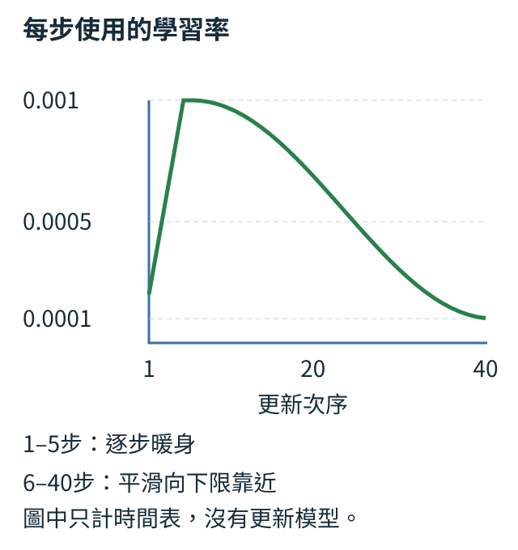

# 第 5 章：訓練與評估形成一個流程

先讓「狗看貓，」這一道固定題改善，再把幾題合成一次更新。本章沿這條線認識動量、Adam、權重衰減、學習率排程與檢查點，接著問新題是否更好。有效目標數（要計分的位置有幾個，[5.2](#5.2) 定義）、不同資料的筆數、參數（parameter）的個數與秒數各有自己的單位；分清它們，才能選模型、比較配方和解讀結果。忘記某個名詞時，可以查[名詞頁](../glossary.md)。

這套評估流程也用在後面的思考投入（thinking effort）：同一組參數多算幾輪，仍須用新題量品質與成本。[7.25](07.md#7.25)先教檔位比較，[14.16](14.md#14.16)再檢查為何多輪不一定改善。

## 5.1 訓練迴圈真的正常嗎？

「狗看貓，」是一條固定短句。我們把句號、狗、看、貓、逗號依序編成 0、1、2、3、4；給模型「狗看貓」，要求三個位置分別接「看、貓、逗號」。先只練這一道題：如果連它的代價（loss）都降不下來，就該先檢查更新流程，再擴大資料。

下面用 [4.6](04.md#4.6) 組好的 `TinyLM`：字表（vocabulary）有 5 項、特徵寬度（width，每個位置的特徵數字個數）是 8、最多 8 個位置。輸入 `x` 是 `[1,2,3]`，各位置的下一項答案 `y` 是 `[2,3,4]`。`masked_loss` 是 [4.7](04.md#4.7) 用過的平均代價函式，它怎麼略過不計分的位置，[5.2](#5.2) 會展開。

`torch.optim.AdamW` 是 PyTorch 內建的一種最佳化器（optimizer）；[1.13](01.md#1.13) 說過，最佳化器用 `zero_grad()` 清梯度、用 `step()` 更新參數。這裡把它的權重衰減（weight decay，[5.5](#5.5) 說明）設為 0。AdamW 不只用學習率（lr）乘當次梯度，還會參考梯度的歷史，內部做法在 [5.3](#5.3)–[5.5](#5.5) 逐步拆解。現在先觀察清梯度、算代價、求梯度、更新這四步。

```python
import torch
from tiny_perceptron.model import TinyLM, ModelConfig, masked_loss

torch.manual_seed(42)
model = TinyLM(ModelConfig(vocab_size=5, width=8, max_length=8))
x = torch.tensor([[1, 2, 3]])
y = torch.tensor([[2, 3, 4]])
optimizer = torch.optim.AdamW(model.parameters(), lr=0.03, weight_decay=0.0)
before = masked_loss(model(x)["logits"], y).item()
for step in range(40):
    optimizer.zero_grad()
    loss = masked_loss(model(x)["logits"], y)
    loss.backward()
    if step == 0:
        print("第一步embedding梯度大小", model.embedding.weight.grad.norm().item())
    optimizer.step()
after = masked_loss(model(x)["logits"], y).item()
print("固定例子代價", before, "→", after)
assert after < before
```

`model.parameters()` 把模型的全部參數交給最佳化器。迴圈每一輪先清掉舊梯度，再做前向計算得到新的分數與代價；`backward()` 做反向傳播（backpropagation），把梯度存進各參數的 `.grad`；最後 `step()` 更新參數。四步的順序與 [1.12](01.md#1.12)、[1.13](01.md#1.13) 對得上。`if step == 0:` 只在條件成立時執行底下縮排的那一行，所以梯度大小只在第一輪印一次。迴圈結束後重新算一次代價，它應明顯低於開始時（本機執行約由 2.27 降到 0.0004）；精確的小數依 PyTorch 環境而異。

`model.embedding` 是 [2.1](02.md#2.1) 的查表零件，`model.embedding.weight` 是整張 embedding 表：本例 5 列、每列 8 個數，每個 ID 對應一列，查出的那一列叫 embedding 向量。`.grad` 保存這張表每一格收到的梯度；`.norm()` 把各格平方加總再開根號，得到一個總大小。第一步這個大小應為正，表示答案的代價已經影響到這張表。

梯度大小大於 0，只說明這張表收到更新訊號；代價下降，才說明更新改善了這道固定題。若代價不動，依序檢查最佳化器是否拿到對的參數、`step()` 是否真的執行、梯度是否在更新前就被清掉。固定題刻意允許模型背答案；要知道新題是否改善，需要另外留資料，[5.8](#5.8) 起處理這件事。

練習把 `y` 的三個答案都改成 -100。本課約定 -100 表示「這個位置不計分」，三個位置都不計分，就等於沒有學習目標。先預測 `masked_loss` 會直接報錯「所有 labels 都被忽略」，再執行核對；這次不應印出代價下降的結果。報錯的那一行在 [5.2](#5.2) 的實作裡。流程拒絕空目標，才不會把沒有訓練假裝成訓練完成。

<details>
<summary>補充：實驗紀錄與重做</summary>

通過固定題之後，才把練習擴到幾篇短文。課程的固定實驗 `text_foundation` 用 9 篇 `color=red;shape=circle;side=left.` 這類顏色、形狀與左右的屬性短文（和 [T.4](../training.md#T.4) 文字路線的預設資料相同），讓一個特徵寬度 64、兩層的模型在 NVIDIA L4 GPU 上更新 600 次：用同一批訓練位置重新計算的平均代價，由 5.79243 降至 0.06352。這一次確實有更新，而不只是呼叫了 `backward()`；但同一個模型在沒教過的那篇驗證短文上，代價仍有 0.96282。教過的題目與新題要分開看，正是 [5.8](#5.8) 接下來要處理的事。

數字出自[實驗紀錄（JSON）](../../docs/course-experiments/results/text_foundation.json)，這是機器可讀的完整結果：`results.training.initial_loss` 與 `results.training.final_loss` 是更新前後的訓練代價，`results.after.validation.nll` 是驗證代價。重做這組實驗的指令在 [T.4](../training.md#T.4) 的補充區（`--experiment text_foundation`）。它和 T.4 正文那條在 CPU 上更新 200 次、只有一層的練習是不同設定，成績不要混用，也不要把 600 次的結果套到上面特徵寬度 8、40 次的診斷程式。

</details>

## 5.2 一次看多少例子？

兩篇短文一起練，第一篇有四個下一項答案，第二篇只有一個。這次更新要聽「兩篇各一票」，還是「五個答案各一票」？本課選後者，讓一起練的每個答案分量相同：五項代價相加再除以五，為了排齊而留下的空位不投票。

同一次計算裡一起處理的幾筆例子叫 **batch**。下面只給候選分數和答案，看平均規則怎麼算：兩筆各排四個位置，五個候選沿用句號、狗、看、貓、逗號。每個位置要對上的答案 ID 叫這個位置的**目標**，整串目標叫 **labels**。第二筆後三個位置的目標寫成 -100，表示那裡沒有要計分的答案；label 不是 -100、真的要計分的位置叫**有效目標**，它們的個數叫有效目標數；課程的訓練程式與實驗紀錄把這個數字記在 `effective_tokens` 欄位。

```python
import torch
from torch.nn import functional as F

from tiny_perceptron.data import IGNORE

logits = torch.zeros(2, 4, 5, requires_grad=True)
labels = torch.tensor([[1, 2, 3, 4], [1, -100, -100, -100]])
print("IGNORE 的值", IGNORE)
print("哪些位置是有效目標", (labels != IGNORE).tolist())
```

`logits` 的形狀是 `[2,4,5]`：兩筆、每筆四個位置、每個位置五個候選分數，都是還沒轉成機率的原始分數（[1.7](01.md#1.7)）。`requires_grad=True` 讓 PyTorch 記錄用這份分數做的計算，稍後才能用 `backward()` 求出代價對它們的梯度。`F` 是 `torch.nn.functional` 的短名字（[1.8](01.md#1.8)）；`IGNORE` 是課程函式庫裡的常數，第一行印出它的值就是 -100。`labels != IGNORE` 逐格比較，得到同形狀的 True／False 表，`.tolist()` 把它轉成清單方便閱讀：第二行應是第一筆四個 True、第二筆只有第一個 True，有效目標共五個。

課程函式庫用下面兩個函式完成「相加，再除以有效目標數」：

```python
# 節錄自 tiny_perceptron/model.py：loss_sum、masked_loss
def loss_sum(logits, labels):
    """先求和再數有效 token，才能正確合併長短不同的 micro-batch。"""
    count = (labels != IGNORE).sum()
    if count.item() == 0:
        raise ValueError("所有 labels 都被忽略：没有可學習的答案")
    loss = F.cross_entropy(
        logits.reshape(-1, logits.shape[-1]), labels.reshape(-1), ignore_index=IGNORE, reduction="sum"
    )
    return loss, count


def masked_loss(logits, labels):
    total, count = loss_sum(logits, labels)
    return total / count
```

`loss_sum` 的 `count = (labels != IGNORE).sum()` 把 True 當成 1 加總，得到有效目標數。若它是 0，`if` 底下的 `raise ValueError(...)` 會停下程式、顯示錯誤訊息，這就是 [5.1](#5.1) 練習會看到的報錯。

`F.cross_entropy` 是 [1.8](01.md#1.8) 的交叉熵，一次要收「題數×候選數」的分數與一排答案，所以先用 `reshape`（[W.3](../first-steps.md#W.3)）重新分組：`logits.reshape(-1, logits.shape[-1])` 的 `logits.shape[-1]` 是最後一軸的長度 5，`-1` 讓 PyTorch 自己算出題數 8，於是 `[2,4,5]` 排成八題、每題五個候選的 `[8,5]`；labels 同樣排成 `[8]`，題目順序不變。`ignore_index=IGNORE` 讓目標是 -100 的題目不產生代價；`reduction` 指定其餘各題的代價怎麼合併，不寫時取平均，這裡的 `"sum"` 改成相加。最後 `return loss, count` 一次交回總和與個數兩個值，`masked_loss` 裡的 `total, count = ...` 讓左邊兩個名字依序接住它們，最後只除一次。

為什麼要分成兩步？`loss_sum` 開頭用三個引號包起來的說明文字提到 token 與 micro-batch。token 是模型一次讀寫的一個文字單位，本章例子一個字就是一個 token，[6.1](06.md#6.1) 再細談；說明裡的「有效 token」就是有效目標。micro-batch 是一批太大、放不下時拆出的幾小份，[16.6](16.md#16.6) 才會用到。幾小份分別算出總和與個數後，總和相加、個數相加，最後再除一次，結果才會和整批一起算相同。

```python
total, count = loss_sum(logits, labels)
mean_loss = masked_loss(logits, labels)
print("有效目標數", count.item(), "總代價", total.item(), "平均代價", mean_loss.item())
mean_loss.backward()
received = logits.grad.abs().sum(dim=-1) > 0
print("哪些位置收到梯度", received.tolist())
assert torch.equal(received, labels != IGNORE)
```

五個相同的 0 分經過 softmax 會得到相同的機率，五個機率總和是 1，所以各為 1÷5＝0.2。依 1.8 的負對數代價，每個有效目標的代價都是 `-log(0.2)≈1.609`，因此第一行應印出有效目標數 5、總代價 `5×(-log(0.2))≈8.047`、平均代價約 1.609。`count`、`total` 與 `mean_loss` 都是只含一個數的 tensor，`.item()` 取出普通的 Python 數字方便列印。

`backward()` 之後，`logits.grad` 和 `logits` 同形狀；`.abs().sum(dim=-1)` 沿候選軸把每個位置五個梯度的大小加起來，大於 0 就表示這個位置收到更新訊號。第二行應和第一段印的有效目標表完全相同：被忽略的三個位置梯度都是 0，最後的 `assert` 核對這件事。

若先各篇平均、再平均兩篇，第二篇唯一的答案就占一半，第一篇每個答案只占八分之一，分量隨所在那篇的長短改變，和「每個答案五分之一」不同。梯度也照代價相加與平均的方式合併；平均後由最佳化器更新一次，和每題各更新一步不是同一個流程。

練習把第一段 `labels` 第二筆第二個位置的 -100 改成 2。先預測：有效目標數變 6、總代價 `6×(-log(0.2))≈9.657`、平均仍約 1.609，兩張 True／False 表都多一個 True。執行核對後再改回 -100，應回到五個。你改的是哪些答案進入統計，不是模型的候選字表。

## 5.3 更新方向怎麼累積？

同一格參數連續收到梯度 1、1，第三次變成 -1。只聽當輪梯度，第三步會立刻反向；保留先前方向的一部分，則可能再朝原方向走一步。這種跨輪累積方向的做法叫**動量**（momentum）。

用 m 保存累積的方向、w 保存參數的位置；g 是當輪梯度，μ 是保留比例，η 是學習率。規則是新 m＝μ×舊 m＋g，再令新 w＝舊 w−η×新 m。程式裡的 `velocity`（速度）存的就是 m，`position` 存的就是 w。以下 μ=0.9、η=0.1，兩個狀態都從 0 開始；三個梯度是我們指定的材料。

```python
velocity = 0.0
position = 0.0
for gradient in [1.0, 1.0, -1.0]:
    velocity = 0.9 * velocity + gradient
    position -= 0.1 * velocity
    print("新梯度", gradient, "保留方向", round(velocity, 3), "位置", round(position, 3))
```

輸入是我們指定的三個梯度 1、1、-1，不是從模型測出的資料。m 與 w 最初都是 0。第一步 m=1，位置 -0.1；第二步 m=0.9+1=1.9，位置 -0.29；第三步新梯度雖是 -1，m 仍是 `0.9×1.9-1=0.71`，位置繼續下降到 -0.361。印出的三欄把當輪梯度、累積的方向與真正的參數位置分開，`round` 只是讓顯示的小數變短。

第三步最值得觀察：當前代價的梯度已經轉向，動量卻暫時延續先前的方向。這可能幫助參數穿過小抖動，也可能讓它越過谷底後還前進過頭。因此動量不保證每一步的當下代價都下降，要和學習率一起看訓練曲線。μ 越靠近 1，記憶越長，轉向也越慢。

這裡沒有定義代價函數，不能從位置越來越負判斷品質。每格參數各有自己的 m，中斷後要接續訓練，就得把它存下來（[5.7](#5.7)）。動量也要和 [1.13](01.md#1.13) 的梯度累加分清：`backward()` 沿運算關係算出當次梯度，再加進參數的 `.grad`；若在一次更新前多次呼叫又沒清空 `.grad`，會把本輪的多份梯度相加。本節的 m 則在更新後仍保留，讓過去的方向繼續影響下一輪。

練習只把保留係數 0.9 改成 0，先手算三個位置為 -0.1、-0.2、-0.1，再執行核對：第三步立刻反向，因為沒有過去的推力。最後試 0.5，m 應依序為 1、1.5、-0.25：同樣的梯度序列，保留強度決定什麼時候轉彎。

## 5.4 各參數能用不同步幅嗎？

兩格參數的梯度是 1 與 100，都用學習率 0.001。基本梯度下降（[1.12](01.md#1.12)）讓每格移動「學習率×梯度」，分別是 0.001 與 0.1。參數在一次更新中實際移動的量，本書叫**步幅**；學習率是我們設定的比例，步幅則由學習率和更新方向一起算出。單靠這兩個梯度，還不能判斷哪個步幅合適。

更新希望往代價較低處移動，也要避免一步太大、越過合適的位置。若為了讓梯度 100 的那格不跨太遠而縮小共同學習率，梯度 1 的那格就幾乎不動；這時會想依每格自己的歷史調整步幅。**Adam**（Adaptive Moment Estimation，自適應矩估計）這種最佳化器就是這樣做：它記下每格過去的梯度通常多大，用這個大小決定這一格這一步走多遠。這樣是否更合適，仍要用訓練與驗證結果比較；下面只追算這項調整。

Adam 替每格保存兩份歷史，β1、β2 是兩份歷史各自的保留比例。第一份 m 對應 [5.3](#5.3) 的動量，規則是新 m＝β1×舊 m＋(1−β1)×g。它比 5.3 多乘了 (1−β1)，讓 m 成為過去梯度的加權平均：β1=0.9 時，新梯度只占一成。5.3 的寫法若連續收到梯度 1，m 會一路漲到接近 10；這裡的 m 則停在 1 附近，和梯度本身同一個大小。第二份 v 保存梯度平方的加權平均：新 v＝β2×舊 v＋(1−β2)×g²。平方去掉正負號、只留大小，所以 v 回答「這格的梯度通常多大」，m 則保留方向。下面取 β1=0.9、β2=0.999，只追第一步。

```python
import torch

g = torch.tensor([1.0, 100.0])
m = torch.zeros(2)
v = torch.zeros(2)
m = 0.9 * m + 0.1 * g
v = 0.999 * v + 0.001 * g.square()
m_hat = m / (1 - 0.9)
v_hat = v / (1 - 0.999)
update = 0.001 * m_hat / (v_hat.sqrt() + 1e-8)
print("方向平均", m, "平方平均", v)
print("原梯度", g, "應減去的更新量", update)
```

輸入 g 為 `[1,100]`，歷史全是 0。第一步 m 得到 `[0.1,10]`，v 得到 `[0.001,10]`。從 0 開始的歷史會讓早期的平均偏小，所以第一步把 m 除以 0.1、v 除以 0.001，得到 `m_hat=[1,100]`、`v_hat=[1,10000]`。這叫偏差修正；到第 t 次更新，兩個分母分別是 `1-β1**t` 與 `1-β2**t`（`**` 是次方，見 [W.4](../first-steps.md#W.4)）。

最後用 `m_hat` 除以 `v_hat` 的平方根，再乘學習率 0.001。兩格的步幅都約為 0.001，而不是一格 0.001、一格 0.1；`1e-8` 是一億分之一的小正數，避免分母為 0。輸出寫「應減去」，因為這段只算步幅，沒有建立真正的參數去執行更新。

第一步的分子與分母來自同一個梯度，所以兩格的步幅相近；之後 m、v 的記憶長度不同，步幅就不必再相同。因此共同的學習率不等於每格實際的步幅。中斷後要接續訓練，還得保存最佳化器狀態（optimizer state：Adam 的 m、v 與已更新的次數），見 [5.7](#5.7)。

練習只把第二個梯度 100 改成 -100，先預測平方平均不變、方向平均的第二格變負、應減去的更新量約 -0.001，再執行核對。在這個從零歷史開始的第一步，應減去的更新量與當前梯度同號；減去負值會讓那格參數增加，方向的含義與 [1.12](01.md#1.12) 一致。之後更新量的正負由歷史平均 `m_hat` 決定，可能和當前梯度不同號。

## 5.5 怎麼獨立控制權重衰減？

只依任務梯度更新，不會主動限制權重的大小。如果也希望避免只為了貼合訓練材料而讓權重不斷放大，可以把「偏向較小的權重」列為訓練配方的候選設定；它是否有助於沒見過的題目，仍要用驗證資料判斷。這份額外把權重拉向 0 的動作叫**權重衰減**（weight decay），和朝答案的梯度移動是兩件事。

本節取一格權重 w=2，這輪的任務梯度恰好是 0，讓額外的回拉單獨可見。

AdamW 先把 w 乘上 1−ηλ，再減去 Adam 算出的步幅。η 是學習率、λ 是衰減強度；取 η=0.1、λ=0.2，任務梯度為 0 時應剩 2×0.98=1.96。

```python
import torch
from torch import nn

w = nn.Parameter(torch.tensor([2.0]))
optimizer = torch.optim.AdamW([w], lr=0.1, weight_decay=0.2)
w.grad = torch.zeros_like(w)
optimizer.step()
print(w.detach())
assert torch.allclose(w.detach(), torch.tensor([1.96]))
```

輸入參數 w=2、學習率 0.1、衰減 0.2。`nn.Parameter` 把它標成可更新的參數（[1.13](01.md#1.13)）；我們故意給任務梯度 0，讓這次只觀察衰減。`torch.zeros_like(w)` 建立同形狀的零梯度 tensor，`step()` 後 w 變成 `2×(1-0.1×0.2)=1.96`。零梯度讓 Adam 那一份步幅也是 0，所以縮小的 0.04 全部來自衰減，最後的檢查核對這個結果。

這裡的 0 梯度和「沒有梯度」不同。在 PyTorch 的 AdamW 實作裡，若 `.grad` 是 `None`，這個參數本次會被跳過；若有一份零梯度，最佳化器知道它參與了這一輪，仍會套用衰減。不要把 [1.13](01.md#1.13) 清梯度後的 `None` 和實際算出的 0 梯度當成同一狀態，它們決定參數會不會被更新。

另一種常見做法是把懲罰寫進代價：在任務代價後面加上 c×w²（c 是懲罰強度；這裡不用 λ，以免和衰減強度混淆），常叫 L2 懲罰。它的梯度是 2cw，w=2、c=0.1 時是 0.4。這份梯度會和任務梯度一起進入 Adam 的 m、v，再被 v 的平方根除掉大小。下面比較兩種做法。PyTorch 的 `torch.optim.Adam` 也有名叫 `weight_decay` 的設定，做的卻是 L2 懲罰：`weight_decay=0.2` 會把 0.2×w 加進梯度，正好是 c=0.1 的 2cw。

```python
for start in [2.0, 20.0]:
    a = nn.Parameter(torch.tensor([start]))
    b = nn.Parameter(torch.tensor([start]))
    penalty = torch.optim.Adam([a], lr=0.1, weight_decay=0.2)
    decoupled = torch.optim.AdamW([b], lr=0.1, weight_decay=0.2)
    for parameter, method in [(a, penalty), (b, decoupled)]:
        parameter.grad = torch.zeros_like(parameter)
        method.step()
    print("起點", start, "L2懲罰經Adam", round(a.item(), 4), "AdamW", round(b.item(), 4))
```

外層迴圈對起點 2 與 20 各建一對參數：`a` 交給把懲罰加進梯度的 Adam，`b` 交給 AdamW；內層迴圈替兩者都放上零任務梯度，再各更新一次。L2 懲罰那一格，起點 2 與 20 都只少了約 0.1，變成 1.9 與 19.9：在這第一步，懲罰梯度 0.4 與 4 進入 Adam 後都被除掉大小，縮成約一個學習率的步幅，大權重並沒有被多拉一些。AdamW 那一格則分別少了 0.04 與 0.4，回拉量和 w 成正比，因為乘 1−ηλ 的那一步不經過 m、v。把衰減和梯度歷史分開，正是 AdamW 的用意。

縮小有用的大權重也可能暫時提高任務代價，衰減強度仍需用驗證資料選。偏移（bias）或正規化層的倍率有時另外分組、不做衰減，分組規則也要寫明。

練習只把第一段的 `weight_decay` 改成 0，先預測任務梯度為 0 時 w 維持 2，再執行，並把 `assert` 的預期值改成 2 核對。接著恢復衰減 0.2、把 `w.grad = torch.zeros_like(w)` 改成 `w.grad = None`，`assert` 的預期值仍用 2，觀察這份實作同樣不改 w。兩次實驗各回答一個問題：衰減有沒有開，以及參數有沒有進入本輪更新。

## 5.6 學習率怎麼隨訓練變化？

一趟 40 次更新的訓練，可以先用小的學習率起步，放大到高峰後再慢慢降低。高峰 0.001、前五次暖身時，前五次的學習率依序是 0.0002、0.0004、0.0006、0.0008、0.001。這種隨更新次序決定學習率的時間表叫**排程**（schedule），先小後大的開頭叫暖身（warmup）。

若不想在起步的幾次更新就大幅改動參數，可以先調低這幾次的學習率，再按計畫放大；[1.12](01.md#1.12) 已看到方向正確也可能因步子太大而提高代價。這是預先指定的起步方式，暖身長度與高峰仍要用驗證資料選擇。暖身之後用餘弦（cos）曲線平滑降低，是一種常見選擇。課程函式庫的排程是下面這個函式：

```python
# 節錄自 tiny_perceptron/training.py：learning_rate
def learning_rate(step, total, peak=0.001, warmup=10):
    import math

    if total < 1 or peak <= 0:
        raise ValueError("total/peak 必須為正")
    warmup = min(warmup, max(1, total // 4))
    if step < warmup:
        return peak * (step + 1) / warmup
    progress = min(1.0, (step - warmup) / max(1, total - warmup))
    return peak * (0.1 + 0.9 * 0.5 * (1 + math.cos(math.pi * progress)))
```

`step` 是第幾次更新，從 0 算起；`total` 是計畫的總更新次數，`peak` 是高峰，`warmup` 是想要的暖身次數。`import math` 在函式被呼叫時載入數學工具，後面要用 `math.cos` 與圓周率 `math.pi`。`if total < 1 or peak <= 0:` 在兩個條件任一成立（`or`）時用 `raise` 報錯，因為總次數與高峰都必須是正數。

`warmup = min(warmup, max(1, total // 4))` 限制暖身長度，四分之一是這個函式選定的比例。`//` 是整數除法，會捨去餘數，`40 // 4` 得 10；`max(1, …)` 取兩者較大的值，讓上限至少是 1；`min` 再取兩者較小的值。所以 40 次的計畫最多暖身 10 次，要求 30 次也只會暖身 10 次。還在暖身時（`step < warmup`），回傳 `peak * (step + 1) / warmup`：`step` 從 0 起算，`+1` 讓第一次更新就有高峰的 1/warmup（本例五分之一），而不是 0。

暖身結束後，`progress` 是下降段走了幾成：剛結束暖身時是 0，越接近計畫的最後一次越接近 1；外面的 `min(1.0, …)` 不讓它超過 1，分母的 `max(1, …)` 避免除以 0。最後一行的 `0.5 * (1 + math.cos(math.pi * progress))` 隨 `progress` 由 0 到 1，從 1 平滑降到 0；乘 0.9 再加 0.1，學習率就從高峰降向高峰的一成，不會降到 0。

```python
rates = [learning_rate(i, 40, peak=0.001, warmup=5) for i in range(40)]
print("前十次", [round(rate, 6) for rate in rates[:10]])
print("最後三次", [round(rate, 6) for rate in rates[-3:]])
assert max(rates) <= 0.001 + 1e-9
```

`range(40)` 依序給出 0 到 39，清單 `rates` 收集 40 次更新各自的學習率。`rates[:10]` 取前十項、`rates[-3:]` 取最後三項（切片見 [1.3](01.md#1.3)），`round(rate, 6)` 只是把小數取到第六位方便閱讀。i=0 就是第一次更新，沒有先跳過一輪。前五項 0.0002、0.0004、0.0006、0.0008、0.001 是暖身；i=5（第六次更新）已離開暖身，`progress` 是 0，所以仍在高峰 0.001；之後開始緩慢下降，i=9 約 0.000971。最後三項約 0.000116、0.000107、0.000102，接近高峰的一成 0.0001，而不是突然變成 0。最後的 `assert` 核對 40 個值的最大值沒有超過高峰；`1e-9` 是 0.000000001，用來容許浮點計算的捨入差。



圖中橫軸是更新次序，從 1 數起，所以第 1–5 次對應 i=0 到 4；縱軸是當次的學習率。排程按預定進度工作，不會自動知道最好的學習率；同樣是第 20 次更新，總計畫 40 次或 100 次時的學習率就不同。所以中斷後接續訓練要保存總計畫，延長訓練則是在改計畫。

練習把第二段的 `warmup=5` 改成 `warmup=10`，先預測前十項：第一次 0.0001、i=4 只有 0.0005、i=9 才到 0.001，再執行核對；最後三項仍向約 0.0001 降低，但數字變了。再改成 `warmup=30`，先依 `min` 那一行預測：實際仍只暖身 10 次，印出的數字和 `warmup=10` 完全相同。讀一個排程要看實作的邊界與索引約定，不能只看到 warmup、cosine 這些名字，就假定各家的做法完全相同。

## 5.7 訓練中斷怎麼接續？

沿用「狗看貓，」：先更新一步，把當下的狀態存成檔案，再載入回來。訓練途中存下的這種檔案叫**檢查點**（checkpoint）。只恢復參數，當下的預測可以相同；若希望兩邊的下一步也相同，還要恢復 Adam 的方向平均、平方平均與更新次數這些最佳化器狀態（[5.4](#5.4)）。

X=[1,2,3] 是狗、看、貓，Y=[2,3,4] 是看、貓、逗號。下面先比較剛載入時的分數，再讓兩邊各更新一步比較；`metadata` 另存每個 ID 代表哪個字。

```python
import tempfile
from pathlib import Path
import torch
from tiny_perceptron.model import TinyLM, ModelConfig, masked_loss
from tiny_perceptron.training import save_checkpoint, load_checkpoint

torch.manual_seed(42)
model = TinyLM(ModelConfig(vocab_size=5, width=8, max_length=8))
optimizer = torch.optim.AdamW(model.parameters(), lr=0.01)
x, y = torch.tensor([[1, 2, 3]]), torch.tensor([[2, 3, 4]])
masked_loss(model(x)["logits"], y).backward()
optimizer.step()
with tempfile.TemporaryDirectory() as directory:
    path = Path(directory) / "state.pt"
    save_checkpoint(path, model, optimizer, step=1, metadata={"chars": ["。", "狗", "看", "貓", "，"]})
    loaded, payload = load_checkpoint(path, restore_rng=True)
    restored_optimizer = torch.optim.AdamW(loaded.parameters(), lr=0.01)
    restored_optimizer.load_state_dict(payload["optimizer"])
    assert torch.equal(model(x)["logits"], loaded(x)["logits"])
    for candidate, opt in [(model, optimizer), (loaded, restored_optimizer)]:
        opt.zero_grad()
        masked_loss(candidate(x)["logits"], y).backward()
        opt.step()
    assert torch.equal(model(x)["logits"], loaded(x)["logits"])
    print("保存步數", payload["step"], "字表", payload["metadata"]["chars"])
    print("檢查點欄位", sorted(payload))
```

`tempfile.TemporaryDirectory()` 建立一個暫存資料夾，`with` 底下縮排的程式跑完，資料夾就自動刪除。`Path(directory)` 表示那個資料夾的位置，後面的 `/ "state.pt"` 接上檔名，得到資料夾內 state.pt 的路徑；路徑的其他基本操作見 [W.7](../first-steps.md#W.7)。`load_checkpoint` 交回兩個值：重建好的模型 `loaded`，以及整份檔案內容 `payload`（一個字典）。載入後先確認同樣的輸入得到完全相同的分數，再讓兩邊各更新一步比較，兩個 `assert` 都應通過。最後印出保存的步數 1、五字對照表，以及檢查點裡的全部欄位名稱；`sorted(payload)` 把字典的鍵排序後列出。

`save_checkpoint` 把下表這些欄位放進一個字典，用 `torch.save` 寫成檔案；完整程式在 [tiny_perceptron/training.py](../../tiny_perceptron/training.py)。

| 欄位 | 存什麼 | 為什麼需要 |
| --- | --- | --- |
| `config` | `ModelConfig` 的全部設定 | 先照設定建出同樣形狀的 `TinyLM`，才放得進參數 |
| `model` | 全部參數，以名稱對應數值的字典（`state_dict()`） | 恢復模型本身；當下的預測只需要它 |
| `optimizer` | 最佳化器的 `state_dict()`：每個參數的 m、v、已更新次數，以及學習率等設定 | 下一步的步幅取決於這些歷史 |
| `step` | 已更新幾次 | 排程要知道現在走到計畫的哪裡（[5.6](#5.6)） |
| `torch_rng`、`python_rng`、`cuda_rng`、`mps_rng` | 各種亂數產生器的狀態 | 接續後抽到同樣的亂數，例如同樣的抽題順序 |
| `training_state` | 訓練程式自訂的進度 | 例如資料抽樣器的狀態與計畫的總次數 |
| `trainable_parameters` | 哪些參數要更新 | 只訓練一部分參數時，載入後照樣凍結其他參數 |
| `tokenizer` | 字表的類型與大小 | 提醒 ID 要用哪種方式轉回文字 |
| `metadata` | 使用者自訂的資料 | 本例存五字對照表 |
| `format_version` | 檔案格式的版本 | 載入時先核對，認不得的格式就拒絕 |

寫檔時，它先把整份內容寫進 `state.pt.tmp`，寫完才把檔名換成 `state.pt`。所以程式若在寫入途中被中斷，例如被手動停止或當掉，寫了一半的只會是 `.tmp` 檔，`state.pt` 不是維持上一份完整的內容，就是還不存在。它沒有另外確認資料已真正寫進磁碟，所以斷電這類情況不在保證範圍內。多模態模型另外存 `modal_config` 與 `task`，第 10 章以後才用到。`load_checkpoint` 用 `torch.load(..., weights_only=True)` 讀檔，只接受 tensor 與一般資料，不執行檔案裡夾帶的程式；接著核對 `format_version`，照 `config` 重建 `TinyLM`，以 `load_state_dict(..., strict=True)` 放回參數（名稱必須一一對上），再照 `trainable_parameters` 設定哪些參數要更新。`restore_rng=True` 時，它在模型建好之後才恢復亂數狀態，避免建模型用掉的亂數打亂接續。

最佳化器不在 `load_checkpoint` 裡重建：要自己為載入的模型另建一個 AdamW，再呼叫 `load_state_dict(payload["optimizer"])`，不能只建一個新的 AdamW 就認為歷史也回來了。`metadata` 的字表也不會自動變成轉換文字的工具，要按存下的約定重建編碼與解碼。

正式接續訓練還要讓下一批題目和學習率都一致，所以資料抽樣（sampling）的狀態與排程的總計畫也要存。以本課的訓練程式 `scripts/train.py` 為例：它把計畫的總步數與高峰學習率記在 `metadata`，加上 `--resume` 接續時，若這些設定和原訓練不同就拒絕執行；抽題順序則靠恢復的亂數狀態重現。若有 dropout 這類隨機省略中間數值的操作，需要恢復相應的亂數；若運算本身不能逐位重現，就另定可接受的誤差。讀進來的檔案仍應來自可信的來源。只含參數、沒有最佳化器狀態的檔案可以照樣預測，卻不能精確接續原本的訓練；只供推論（inference，也就是拿模型來回答、不再訓練）的成品常是這種檔案。

練習只把 `restored_optimizer.load_state_dict(...)` 那一行註解掉（行首加 `#`），先預測第一個 `assert` 仍通過、第二個在各更新一步後失敗，再執行核對。參數成功恢復和訓練狀態完整恢復是兩個層次，第二個檢查才會發現漏掉的歷史。

<details>
<summary>補充：實驗紀錄與重做</summary>

我們也在 GPU 上另做了有隨機抽題的接續實驗，它是課程固定實驗 `text_foundation` 的一部分：先定好總共 80 次更新的學習率計畫，一路跑完；另一份在第 40 次更新後保存參數、最佳化器狀態和亂數狀態，載入後再跑第 41 到 80 次。最後逐項比較兩份參數，最大差為 0，見[實驗紀錄（JSON）](../../docs/course-experiments/results/text_foundation.json)的 `results.resume.max_weight_difference`。這項結果支持的是這份小模型和這次排程的接續，不是所有 GPU 計算都必然逐位相同。尤其不能在載入後偷偷換成新的總次數計畫，卻仍要求它走出原來的路線；排程也是檢查點的一部分。這個 80 次的接續檢查，和 [5.1](#5.1) 補充裡 600 次的文字訓練是分開的實驗，但由同一個指令一起跑完：重做指令在 [T.4](../training.md#T.4) 的補充區（`--experiment text_foundation`）。

</details>

## 5.8 Loss 下降代表任務做得更好嗎？

希望模型寫出 [1,2,3,4]。在正確前文下，各位置預測 [1,2,0,4]，有三個位置對；自由生成卻接成 [1,2,0,0]，只剩兩個位置對。兩份都沒有交出完整答案，所以逐位置的表現與整題是否完成要分開記。

訓練時每個位置都拿到資料中的正確前文（標準序列），這叫 teacher forcing；自由生成則把自己剛選的字接回去當前文，第三個位置錯成 0，就改變了第四個位置看到的條件。下面先用這兩份手寫的預測算分。

```python
truth = [1, 2, 3, 4]
teacher_forced = [1, 2, 0, 4]
generated = [1, 2, 0, 0]
for name, prediction in [("正確前文下", teacher_forced), ("自由生成", generated)]:
    correct = sum(a == b for a, b in zip(truth, prediction, strict=True))
    token_accuracy = correct / len(truth)
    exact_match = prediction == truth
    print(name, "逐token正確率", token_accuracy, "整串相同", exact_match)
```

`truth` 是正確答案（ground truth），兩份 `prediction` 分別模擬正確前文下與自己前文下的結果。`zip` 把同位置的兩項配成一對（[1.3](01.md#1.3) 用過）；`strict=True` 要求兩份清單長度相同，否則提出 ValueError 並停止，不會默默略過較長清單的尾端。`a == b` 成立算 1、不成立算 0，`sum` 數出答對的位置數；除以答案長度 4，就得到 **token accuracy**（逐 token 正確率）。token 是模型一次讀寫的一個文字單位，本例一個字就是一個 token；tokenizer 怎麼把文字切成 token，[第 6 章](06.md#6.1)才正式說明。第一份三個位置正確，輸出 0.75；第二份兩個位置正確，輸出 0.5。

`prediction == truth` 比較整份清單，順序、長度與每個位置都相同才是 True，這叫 **sequence exact match**（整串完全相同）。兩份都是 False。像算術答案、固定標籤這類任務，整串相同常比逐 token 的比例直接；開放式的表達則有許多合理寫法，完全相同不一定反映好壞，評分方法要依任務選擇。

代價量的是正確答案得到多少機率，不只量最高分的候選有沒有選對：正確字的機率是 0.6 或 0.9 都可能排第一，代價卻不同（[1.8](01.md#1.8)）。所以代價下降，不保證模型接著自己寫時寫得出好句子。例如補充區那個用英文短篇故事訓練的模型，驗證代價已明顯下降；給它開頭 `Once upon a time there w`、每次選最高分的候選，它接出 `as a big was a she was a ber the`：用上了常見的英文片段，卻還沒組成清楚的句子。代價與實際生成的回答要一起看。

還要確認題目提供了答案需要的線索。例如想重現一段包含左右位置的原文，提示卻只給顏色和形狀、沒給左右時，沒重現原文不能直接算成答錯已知事實。

練習只把 `teacher_forced` 第三個位置的 0 改成 3。先預測第一份逐 token 正確率變 1、整串相同變 True，第二份仍是 0.5 和 False，再執行核對。這次只改了示意資料，沒有真的改變生成模型；要提升第二份的表現，還得在實際生成中驗證訓練是否有效。

<details>
<summary>補充：實驗紀錄與重做</summary>

再看兩個真正訓練後的例子。[5.1](#5.1) 補充的屬性短文模型，驗證資料的平均代價從 5.73454 降到 0.96282；可是給它開頭 `color=blue;shape=circle;`、每次選最高分的候選時，它接出 `side=right.`，那篇驗證原文剩下的卻是 `side=left.`。代價改善了，並沒有讓自由生成完整重現這篇原文。

這裡還有一個重要的判斷：提示只給顏色與形狀，沒有告訴模型物體在哪一邊；左或右都可能是格式合法的續寫。所以這個差異說明的是「沒有重現驗證原文」，不能單憑它判定右邊是錯誤的事實。若任務真的要判斷左右，就要在輸入提供相應的線索，另定答案與成功條件。文字接續的代價、寫出合法格式、回答有正確答案的問題，各自需要相應的評估，這也是後面另做[屬性問答](07.md#7.12)的理由。

換成真正的故事，這個差別更容易看到。課程固定實驗 `real_text` 用 409 篇 TinyStories 英文短篇故事訓練，在另外 51 篇驗證故事的全部 42,453 個有效目標上，平均代價從 5.76091 降至 1.80083。但是讓它每次選最高分的候選、最多新增 32 個 token，一筆實際結果如下。這個模型把文字拆成 byte（位元組），本例的英文字母與空格各占一個 byte；表示寫完的結束標記另占一個 token，第 6 章起寫作 EOS；切詞方法在 [6.1](06.md#6.1) 展開。

```text
給模型的開頭：Once upon a time there w
新生成的部分：as a big was a she was a ber the
```

它開始接出常見的英文片段，卻還沒有把片段組成清楚的句子，更沒有講出一個故事。這段輸出只是一筆觀察；平均代價用的是全部驗證文字，兩者不能互相取代。[實驗紀錄（JSON）](../../docs/course-experiments/results/real_text.json)保留完整結果：`results.runs.tinystories.after.validation` 的 `nll` 是驗證代價、`effective_tokens` 是有效目標數，`samples` 是前 8 篇驗證故事的生成示例；前 8 篇測試故事的示例另外放在 `results.runs.tinystories.after.test.samples`。兩份都照實保留，沒有因為續寫不好就省略。這也給我們一個實用的檢查順序：先確認模型確實學到一些文字規律，再問它能否在自己的前文下完成想要的任務。重做這組實驗的指令在 [T.4](../training.md#T.4) 的補充區：先用 `scripts/fetch_training_assets.py --asset tinystories --asset chinese-poetry` 取得故事與詩文資料包，再跑 `--experiment real_text`。

</details>

## 5.9 每次實驗用了多少資源？

同一個小模型用三個位置做預測，保存它的參數需要多少空間、前向計算一次需要多久？參數格數描述要存多少個數字，秒數描述這臺機器完成這份工作花了多久，兩者不能互相代替。

儲存空間以 byte（位元組）計量，一個 byte 有 8 個 bit（位元）。FP32 是用 32 個 bit 表示一個浮點數的格式，所以每個參數占 4 bytes；這種數值的儲存格式在程式中叫 dtype。先用參數格數乘 4，估算純參數的大小；訓練時還要另外保存梯度、Adam 的 m 與 v 以及中間特徵（activation），實際用量更多。以下先關閉這次的求導記錄，暖身一次，再在 CPU 上計時十次相同的輸入。

```python
import time
import torch
from tiny_perceptron.model import TinyLM, ModelConfig

model = TinyLM(ModelConfig(width=8))
c = model.config
print("字表", c.vocab_size, "位置上限", c.max_length, "層數", c.layers)
x = torch.tensor([[1, 2, 3]])
model.eval()
with torch.no_grad():
    model(x)
    start = time.perf_counter()
    for _ in range(10):
        model(x)
    average_seconds = (time.perf_counter() - start) / 10
parameters = model.description()["parameters"]
print("參數格數", parameters, "FP32參數bytes", parameters * 4)
print("CPU每次前向秒數", average_seconds)
assert parameters == 264 * 8 + 128 * 8 + 16 + 8 * 264 + 840
```

`ModelConfig(width=8)` 只指定特徵寬度 8，其餘沿用預設；第一行印出預設的字表 264 項（256 種 byte 值加上 8 個特殊 token，[6.6](06.md#6.6) 說明）、位置上限 128、層數 1。`model.eval()` 切到評估模式，`torch.no_grad()` 讓這段測量不保存求導關係，兩者的差別在 [5.17](#5.17) 展開。第一次 `model(x)` 當作暖身，讓初始化的成本不要全算進正式計時。`time.perf_counter()` 是適合量時間間隔的時鐘；`for _ in range(10)` 重複十次，`_` 表示這個迴圈變數用不到，最後把總秒數除以 10。

參數格數應為 6,104，可以用 [4.8](04.md#4.8) 的算法自己重算。輸入端與輸出端各存一套：embedding 表 `264×8=2112`、位置表 `128×8=1024`、最後 LN 的倍率與偏移 `8+8=16`、輸出層 `8×264=2112`，共 5,264；一層 block 是 4.8 算過的 840。合計 `5264+840=6104`，最後的 `assert` 就核對這條算式。乘 4 得到純 FP32 參數 24,416 bytes。

耗時則隨機器、執行緒數與當下的負載改變，應觀察自己測到的數字，不必期待統一答案。十次小運算可能受作業系統排程與計時雜訊影響，所以這只是流程示例；正式的速度比較需要更多重複、報告波動，並使用相同的設定。

三個位置變成六個，參數量不變，注意力的分數表則從 3×3 變成 6×6；這部分工作變多，整體耗時卻還包含其他成本。GPU 收到工作後可能先回傳、稍後才算完，計時前後需要同步等待。比較時要固定硬體、版本、dtype、筆數、長度與計時範圍；一次前向的秒數和整組實驗的秒數不能混比。

練習只把 `x` 改成六個位置 `[[1,2,3,1,2,3]]`，先預測參數格數與 bytes 不變、前向耗時可能上升，再測量核對。若十次的結果反而稍低，不要急著宣稱長序列更快，先增加重複次數看看波動。記錄這些限制，也是讓實驗可以被評估的一部分。

<details>
<summary>補充：實驗紀錄與重做</summary>

用一次實際的訓練練習讀成本，更容易看出單位為什麼重要。[5.1](#5.1) 補充那個特徵寬度 64、兩層的模型有 141,568 個 FP32 參數（算式見 [4.8](04.md#4.8) 補充），純參數約 566,272 bytes；更新 600 次、每次抽 16 篇短文，累計計分 342,462 個有效目標。這是同 9 篇材料反覆練習的曝光量，不是收集了 342,462 個不同的字，也不是 342,462 篇文章。

在 NVIDIA L4 上，600 次更新的訓練區間約 6.1885 秒，其中也包含紀錄與定期保存檢查點。整組實驗約 16.0354 秒，還包括另四組小模型比較、接續檢查、評估與在本機保存檢查點；兩個數字都不包含雲端機器啟動、映像建置或上傳備份的時間。因此 16 秒可以幫我們安排這組實驗，卻不能拿它當純訓練速度，也不能直接和上面的 CPU 前向秒數相比。要回答硬體快多少，還得讓兩邊做同一件事，並使用相同的計時範圍。數字出自[實驗紀錄（JSON）](../../docs/course-experiments/results/text_foundation.json)：`results.training` 的 `parameters`、`effective_tokens` 與 `seconds`，以及最上層的 `elapsed_seconds` 和說明計時範圍的 `timing_scope`。重做這組實驗的指令在 [T.4](../training.md#T.4) 的補充區（`--experiment text_foundation`）；在不同硬體上重跑，秒數本來就會不同。

</details>

## 5.10 用來選模型的分數能當最後成績嗎？

兩個設定在驗證題上得到 0.7 與 0.8，我們選了 0.8 那個。這份分數已經參與決策，不能再當作定案方法在獨立測試資料上的成績；就像反覆用同一份模擬考挑讀書方法，方法會漸漸迎合那份模擬考。

[1.2](01.md#1.2) 把資料分成三種用途：訓練資料更新參數，驗證資料選設定，測試資料等方法定案後才計分。區別在用途，不只是檔名；下面只執行選設定這件事。

```python
candidates = [
    {"lr": 0.001, "validation": 0.7},
    {"lr": 0.01, "validation": 0.8},
]
selected = candidates[0]
for candidate in candidates[1:]:
    if candidate["validation"] > selected["validation"]:
        selected = candidate
print("選擇的設定", selected)
print("測試資料仍封存，尚未計算最終成績")
```

輸入是兩份假設的實驗記錄：`lr` 是學習率，`validation` 是驗證題的成功比例；這些分數是為了講解選擇規則而指定的，不是模型測量。程式先拿第一份當目前最佳，再比較後面的候選；`candidates[1:]` 是從第二份開始的切片。`if` 只在條件成立時執行縮排的那一行，0.8 大於 0.7，所以更新 `selected`。輸出選中 lr 0.01、validation 0.8；第二行明確說測試資料還沒評，程式沒有憑空捏造測試成績。

一次選擇也會受隨機波動影響：候選越多，越容易恰好挑到對這份驗證資料特別幸運的結果。這種「挑最高」造成的偏差，不能靠只報最好的數字消除。應保留各候選的記錄、選擇規則與嘗試次數，最後在同一份封存的測試資料上報告定案的方法，再依 [5.15](#5.15) 看不同種子的波動。

看完測試成績再回頭調設定，這份測試資料也就變成選設定的一部分。分組也要先於切訓練視窗：先把整篇文件分進訓練、驗證或測試資料，再把各篇切成模型一次讀得下的長度，這樣切出的一段叫訓練視窗（[6.8](06.md#6.8) 詳述）。同一篇故事若前半拿來教、後半拿來評，後半不能當成獨立的新故事，這是 [1.2](01.md#1.2) 說的資料洩漏。自己切出的測試資料成績，也不等於資料集官方測試資料的成績。

練習在 `candidates` 加一份 `{"lr": 0.1, "validation": 0.6}`，先預測選擇仍是 0.01，再執行核對。接著把新加那份的 `validation` 改成 0.9：選擇會改變，但第二行仍應是「尚未計算」。程式挑到更高的驗證分數，不等於它已經提供了更好的獨立成績。

<details>
<summary>補充：實驗紀錄與重做</summary>

實際操作還要分清「上游的檔名」與「這次實驗的用途」。[T.4 的 TinyStories 資料](../training.md#T.4)選自上游的 train 檔，但我們先保留完整故事，自行切出訓練、驗證和測試資料，再把各篇切成訓練視窗。因此這次沒有拿自己的驗證或測試故事更新參數；它們仍不等於 TinyStories 官方的驗證資料，也不能代表對完整資料集的成績。中文詩集本來沒有這三份切分，同樣需要先按整首詩分開，不能把一首詩的前半拿去教、後半當成獨立的新詩。切好的三份資料會隨 `--experiment real_text` 一起保存，指令在 [T.4](../training.md#T.4) 的補充區。

</details>

## 5.11 同一段文字出現很多次會怎樣？

三筆原文是「貓␣␣看狗」「貓␣看狗」「狗␣看貓」（␣ 代表一個空格）。前兩筆只差空白的數量，卻可能被當成不同內容，分別切到訓練資料與驗證資料兩側；這時模型練過的內容又被當成新材料考一次，就是 [1.2](01.md#1.2) 說的資料洩漏。我們先講明哪些差異可以忽略，再數不同的內容。

本例只把連續的空白合成一個空格，這叫**文字正規化**；它不改字序和字義，也和 [4.3](04.md#4.3) 整理每個位置數字尺度的層正規化是兩回事。

```python
import hashlib

docs = ["貓  看狗", "貓 看狗", "狗 看貓"]
normalized = [" ".join(text.split()) for text in docs]
print(normalized)
```

`text.split()` 不帶參數時，把任何一段連續的空白（空格、換行或 Tab）都當成一個分隔，「貓␣␣看狗」切成 `["貓", "看狗"]`；`" ".join(...)` 再用單一空格接回。輸出應顯示兩份 `貓 看狗` 與一份 `狗 看貓`。`import hashlib` 載入 Python 內建的雜湊工具，下面的函式會用到。

為了快速比較內容，課程函式庫的 `fingerprint` 先做同樣的整理，再用 SHA-256 算出固定長度的內容指紋，也叫 hash：

```python
# 節錄自 tiny_perceptron/data.py：fingerprint
def fingerprint(text):
    normalized = " ".join(text.split())
    return hashlib.sha256(normalized.encode()).hexdigest()
```

`normalized.encode()` 把字串轉成 UTF-8 的 bytes（[6.1](06.md#6.1) 細談），因為 `hashlib.sha256` 只接受 bytes；`.hexdigest()` 把算出的結果寫成十六進位的文字。整理是在函式裡面做的，所以可以把原文直接交給它，不必先換成上面的 `normalized`。

```python
hashes = [fingerprint(text) for text in docs]
print("原始筆數", len(docs), "文字正規化後不同內容", len(set(hashes)))
print("第一份的指紋", hashes[0])
print("指紋字元數", len(hashes[0]))
assert hashes[0] == hashes[1]
```

`set(hashes)` 只保留不同的指紋（[1.2](01.md#1.2)），所以三筆記錄只有兩種不同內容；前兩個完整指紋相同，最後的 `assert` 核對這件事。每個完整指紋有 64 個十六進位字元，每個字元是 0–9 或 a–f 這 16 種符號之一。

我們常用指紋比較長文件，不必每次逐字掃描。它不是可以還原的文字壓縮，也不證明兩段文字的意思相同；換一個字，指紋往往整個改變。碰撞指兩份文字正規化後不同的內容，偶然得到同一個完整指紋；SHA-256 發生這種情況的機會極小，但判定重要的重複時，仍可保留原文核對。只取指紋開頭的極短一段，就丟掉了許多區分資訊，更容易讓不同內容對上相同的短字串，不能當成絕對唯一。

程式的縮排、詩的換行、字串值裡的空白都可能有意義，不能一律清掉。用統一空白作比較，也不表示訓練用的原文必須失去空白。副本即使只在訓練資料那一側，也會增加抽到該內容的機會，改變資料的分配。

練習只把第一段程式 `docs` 裡的第二筆原文改成 `"鳥 看狗"`。先預測不同內容變 3、前兩個指紋不相同，第三段最後的舊 `assert` 會失敗，再執行核對。把那個檢查改成 `assert hashes[0] != hashes[1]`，確認一個字的變化被保留。

<details>
<summary>補充：實驗紀錄與重做</summary>

這個想法已用在 [T.4 的真實文字實驗](../training.md#T.4)：先以合併空白後的完整文字判定重複，相同內容只留一份；留下的記錄再以完整內容指紋作分組標籤（下一節的家族），然後切分。TinyStories 的 512 篇仍是 512 篇，資料包中的 365 首詩也仍是 365 首，這一步沒有刪掉記錄，見[實驗紀錄（JSON）](../../docs/course-experiments/results/real_text.json)各組的 `source_records` 與 `deduplicated_records`。原文仍保留自己的空白與換行來訓練；合併空白只是比較內容的規則。注意「沒有找到這種重複」只回答了完整內容是否相同，改寫、同一故事的相似版本還要另查，下一節就看這個缺口。重做這組實驗的指令在 [T.4](../training.md#T.4) 的補充區（`--experiment real_text`）。

</details>

## 5.12 改幾個字就算新資料嗎？

「紅色圓形在左邊」與「紅色圓形在右邊」只差一個字，完整指紋不同，卻仍是相近的資料。為了避免幾乎同一題的兩個版本分別落在訓練資料與測試資料，再看兩句的文字重疊有多少。

各取連續兩字的片段：兩句共有「紅色、色圓、圓形、形在」四種，合起來共八種，比例 4/8=0.5。共有片段的集合大小除以合併後的集合大小，叫 **Jaccard 相似度**。

```python
def grams(text, n=2):
    return {text[i : i + n] for i in range(len(text) - n + 1)}


a = grams("紅色圓形在左邊")
b = grams("紅色圓形在右邊")
common = a & b
all_parts = a | b
score = len(common) / len(all_parts)
print("共有片段", sorted(common))
print("共有數", len(common), "聯集數", len(all_parts), "相似度", score)
```

輸入兩段七個字的句子，`grams` 預設 n=2，收集每個起點的連續兩字。i 從 0 到 5，共六段；切片 `text[i : i + n]` 的右端 `i+n` 不包含在內，所以每次正好取兩字。大括號裡的迴圈建立集合，重複的片段只留一份。`&` 取兩集合的交集，`|` 取聯集；清單與集合的寫法可回看 [W.2](../first-steps.md#W.2) 與 [1.2](01.md#1.2)。

輸出共有四段、聯集八段、相似度 0.5；`sorted` 只讓顯示順序固定，不參與計分。這種兩字片段常叫 character n-gram，n 就是片段長度。這裡的片段只用來比較文字重疊，和模型一次讀入的前文（[2.5](02.md#2.5) 的視窗）是兩回事。這個小函式假定句子不是空的、長度至少 n；若兩個集合都是空的，分母是 0，必須另定處理規則。

相近不等於同義：左與右正是關鍵答案，不能把它們合成同一個標籤。比較好的做法是把相近的版本歸成同一個**家族**（family）：從同一個來源或同一組屬性衍生出來的題目算一家，切分時整個家族放在同一邊，全部是訓練資料、全部是驗證資料或全部是測試資料。歸成一家不等於合併答案，左與右仍各自保留自己的正確答案。片段法會漏掉換了措辭的同義句，也可能把短句誤合在一起；判斷哪些題目屬於同一家族，還需要來源與改寫的記錄。門檻要連同片段長度一起保存，沒有通用的 0.5 標準。

練習把兩次 `grams` 呼叫都加上 `n=3`，先手數每句五個三字片段，共有「紅色圓、色圓形、圓形在」三段、聯集七段，分數 3/7≈0.429，再執行核對。只改片段長度就改變分數，說明門檻要和比較方式一起定義。

<details>
<summary>補充：實驗紀錄與重做</summary>

目前 [T.4 的故事與詩文實跑](../training.md#T.4)只做上一節的完整內容去重，還沒有把近重複的版本聚成家族。因此「沒有完整重複跨組」可以核對，「所有相似版本都已隔開」則不能宣稱。這份驗證與測試成績適合檢查小型訓練流程，不能據此排除模型從相似材料得到提示的可能。[實驗紀錄（JSON）](../../docs/course-experiments/results/real_text.json)各組的 `split_warning` 寫著 near-duplicate clustering was not performed（沒有做近重複分群），保留了這項限制。想進一步確認模型在新題上的表現，下一步應先補家族判定，再固定新的切分做比較。現有切分的重做指令在 [T.4](../training.md#T.4) 的補充區（`--experiment real_text`）。

</details>

## 5.13 資料或模型變大，哪個值得花預算？

模型變大、資料也從 16 篇換成 64 篇，成績提升後很難知道是哪個改動有用。先做兩種特徵寬度 × 兩種資料量的四格設計，讓一條比較只改模型，另一條只改資料。

計畫用特徵寬度 8 或 16、不同的記錄 16 筆或 64 筆，每次更新四筆、每筆八個有效目標、共更新 100 次。每一格都是 3,200 個有效目標的曝光：16 筆會被重複練更多次，64 筆則有更多不同的內容。

```python
from tiny_perceptron.model import TinyLM, ModelConfig

for width in [8, 16]:
    parameters = TinyLM(ModelConfig(width=width)).description()["parameters"]
    for records in [16, 64]:
        batch_size, answers_per_record, steps = 4, 8, 100
        print(
            {
                "特徵寬度": width,
                "不同記錄": records,
                "參數格數": parameters,
                "更新步數": steps,
                "有效目標預算": batch_size * answers_per_record * steps,
                "品質": "尚待訓練與量測",
            }
        )
```

輸入是實驗計畫，不是現成的訓練資料。`records` 是不同例子的數量；`batch_size, answers_per_record, steps = 4, 8, 100` 一次替三個名字依序賦值：每次更新四筆、假定每筆八個有效目標、共 100 次，所以每格有 `4×8×100=3200` 個有效目標。程式只建立模型、數參數，再印出四份計畫；品質欄保留未測的狀態，不能從參數數字推定分數。特徵寬度 8 的模型有 6,104 個參數（[5.9](#5.9) 算過），16 則有 13,744 個。

「公平預算」有多種定義。固定更新次數，方便看每次更新的效果；固定有效目標數，讓見到的監督總量相近；固定時間或 FLOPs，則更直接限制計算成本。FLOPs 是浮點運算次數，一次乘法與一次加法各算一次。設 D 是輸入的特徵數、M 是輸出的特徵數：密集的 Linear 用一張 M 列、D 欄的權重表，把 D 個輸入數加權混合成 M 個輸出數，每個輸出都用到全部輸入。處理一個位置約需 2×D×M 次運算，也就是每個權重一次乘法、一次加法；這裡忽略每個輸出最後加上偏移（bias，[2.3](02.md#2.3)）的成本與其他較小的成本。8 進 8 出約 128 次，16 進 16 出約 512 次。模型變寬會同時放大兩邊，所以相同的有效目標預算也不等於相同的計算預算。耗時的量法可回看 [5.9](#5.9)。

看四格實驗的品質時，訓練代價與驗證代價都是「每個有效目標的平均代價」，也就是 [1.8](01.md#1.8) 的代價（loss）：用相應資料的有效目標重算再取平均，規則回看 [5.2](#5.2)。補充區有一組實際做過的四格實驗：特徵寬度 16 時，64 篇練習短文的驗證代價 0.31105 低於 16 篇的 0.49288，訓練代價卻是 0.33032，高於 16 篇的 0.27166。兩組的訓練平均涵蓋不同的材料，訓練代價不能當成同一批新題的成績。

固定更新次數、有效目標數、秒數或運算量，各自回答不同的預算問題。比較前先選定主要的限制，再用共同的新題和實際成本判讀；四個小設定不足以外推大型模型的規模規律。

練習保持每次更新四筆，假設每筆只有 4 個有效目標，想維持 3,200 的有效目標預算要更新幾次？先算 `3200/(4×4)=200`，再把那一行改成 `batch_size, answers_per_record, steps = 4, 4, 200`，執行核對四列的有效目標預算仍是 3200。若只改成 `4, 4, 100`，預算只剩 1,600，已經不是同樣的監督量。把計畫中的假設換成實測的長度統計，才會成為真實的資源記錄。

<details>
<summary>補充：實驗紀錄與重做</summary>

把計畫落成實驗時，結果不必沿用上面的示意數字。課程固定實驗 `text_foundation` 另外產生 80 篇 `object=67;color=red;shape=circle.` 這類短文，先按物體編號分出 8 篇驗證資料與 8 篇測試資料，再從其餘 64 篇中取 16 篇或全部 64 篇練習。模型的特徵寬度改用 16 或 32，各一層，種子 42；四組都更新 150 次、每次 4 篇。特徵寬度 16 的模型有 13,744 個參數，32 則有 33,632 個。下面是實際測得的四格，代價都是更新完成後重算的每個有效目標平均代價：

| 特徵寬度 | 不同練習短文 | 累計有效目標 | 訓練代價 | 驗證代價 | 測試代價 |
| --- | ---: | ---: | ---: | ---: | ---: |
| 16 | 16篇 | 20,765 | 0.27166 | 0.49288 | 0.39779 |
| 16 | 64篇 | 20,623 | 0.33032 | 0.31105 | 0.31061 |
| 32 | 16篇 | 20,765 | 0.14502 | 0.40927 | 0.27961 |
| 32 | 64篇 | 20,623 | 0.20107 | 0.21914 | 0.22258 |

這一次，兩種特徵寬度下，64 篇的驗證代價都比 16 篇低，訓練代價卻較高。要記得，兩組訓練平均涵蓋的是不同的材料，不能把它們當成在同一批新題上的成績。固定 150 次也不等於所有材料都練了同樣多次，16 篇會被反覆抽到更多次。累計有效目標 20,765 與 20,623 並不相同，因為實際抽到的短文長度不同；我們匹配的是更新次數與每批筆數，沒有把監督總量或計算成本控制成完全相等。

較大模型與更多資料如何共同影響品質，常被研究成 scaling law（規模與表現的經驗規律）。眼前只有一個種子、有限的規則短文、四個小設定，能回答的是這批資料在這個更新預算下如何變化，不能由此說 64 篇必然較好，更不能外推大型模型的規律。[實驗紀錄（JSON）](../../docs/course-experiments/results/text_foundation.json)的 `results.scaling` 以 `scaling-w16-n16` 這類名稱（w 後面是特徵寬度、n 後面是練習篇數）保存四組：`training.final_loss` 是訓練代價，`evaluation.validation.nll` 與 `evaluation.test.nll` 是驗證與測試代價，`training.effective_tokens` 是累計有效目標數。重做這組實驗的指令在 [T.4](../training.md#T.4) 的補充區（`--experiment text_foundation`）。

</details>

## 5.14 模型不動或震盪要怎麼找學習率？

參數 w=1、目標位置 3，代價 (w−3)²。三種學習率 0.01、0.1、2 都沿著一開始的下降方向走，是否都能降低代價？讓每個候選都回到相同的起點，再比較一步後的結果。

起點的梯度是 2(w−3)=−4，新位置是 w 減去學習率乘梯度。這一步實際移動的量（[5.4](#5.4) 的步幅）是學習率乘 4；步幅太大，就可能越過 3，走到另一邊。

```python
import torch

w = torch.tensor(1.0)
gradient = 2 * (w - 3)
print("起點代價", (w - 3).square().item())
for lr in [0.01, 0.1, 2.0]:
    new = w - lr * gradient
    print("學習率", lr, "新位置", new.item(), "新代價", (new - 3).square().item())
```

輸入起點與三種學習率；程式每一輪只計算 `new`，沒有覆蓋 w，所以三個候選的比較條件一致。0.01 走到 1.04，代價約 3.8416，改善很少；0.1 走到 1.4，代價 2.56；2.0 走到 9，代價 36，遠比原來的 4 差。大的學習率雖然沿著正確的初始方向，卻跨過目標 3，走到另一邊。

若學習率 2 繼續用下去，每一步都會越過最低點 3，位置在 3 的兩側來回跳，這叫**震盪**。來回跳的是位置；代價會怎麼變，要看每次的落點離 3 多遠。落點越跳越遠、代價一路變大，叫**發散**。下面讓它連走三步：

```python
w = 1.0
for step in range(3):
    w = w - 2.0 * 2 * (w - 3)
    print("第", step + 1, "步後位置", w, "代價", (w - 3) ** 2)
```

這段只用普通的 Python 數字，算法和上面相同。第一步到 9；第二步在 w=9 時梯度是 12，新位置 `9−2×12=−15`，代價 324；第三步跳到 57，代價 2,916。位置一次在 3 的右邊、一次在左邊，這是震盪；落點離 3 的距離從 6、18 變成 54，代價 36、324、2,916 一路變大，所以它同時在發散。

對真正的模型，可以用一小份固定資料做學習率範圍試驗：觀察前幾步的代價是否下降、是否突然跳大、梯度有沒有異常。第一次先試量級，例如 0.0001、0.001、0.01，再在有效的範圍內細分；不要只根據一次幸運的下降就定案。各次試驗都從同一組初始參數與最佳化器歷史開始，使用同一個資料順序及同樣的更新次數，在同一步觀察代價；最後的參數與代價是要比較和記錄的結果，不必相同。種子是讓隨機選擇可以重現的起始設定，各次應使用相同的種子，見 [5.15](#5.15)。

若觀察幾次更新後參數似乎完全沒變，先對照同一格在更新前後的數值、保留足夠的小數位，分清變化很小與完全沒有更新。接著確認是否真的呼叫了 `optimizer.step()`，回看 [5.1](#5.1)；再檢查這批資料是否至少有一個有效目標參與代價計算，有效目標的計數與平均規則見 [5.2](#5.2)。若出現無窮大或 NaN（不是有效數值），要找出哪個輸入或運算先產生異常，並檢查用到的分母是否為 0。這個平方函數用學習率 0.5 能一步走到 3，不能把算例中的 0.1 或 0.5 直接當成語言模型的最佳學習率。

練習把第二段的 `2.0` 改成 `1.0`，先手算：每一步都是 `w−2×(w−3)`，位置應在 5 與 1 之間來回，離 3 一直是 2，代價一直是 4：仍在震盪，卻既不變好也不發散。再改成 `0.75`，先預測位置依序是 4、2.5、3.25，代價依序是 1、0.25、0.0625：位置仍在 3 的兩側來回，代價卻一路變小，越來越靠近 3。三次都在震盪，代價卻分別變大、不變、變小；學習率決定的不只是走多快，還有每一步會越過多少。

## 5.15 一次比較略好就有進步嗎？

先看一組講解用的假設數字，不是實測：方法 A 用種子 1、2、3 各訓練一次，成績是 0.70、0.72、0.69；方法 B 用同樣三個種子，得到 0.71、0.71、0.73。同一個種子下 B 減 A 的差叫**同種子差**，這裡是 +0.01、-0.01、+0.04。只比各自的最高值，會遮住第二個種子下 B 反而較差；先保留全部結果，再問改善是否穩定。

初始化、抽 batch、生成都可能用到亂數。種子是讓亂數從同一個起點開始的編號，不是品質排名。下面只換初始化的種子，觀察 embedding 表：程式中的 `model.embedding.weight` 就是這張表，每個文字 ID 對應一列可調的特徵，這次用標準差概括整張表初始值的起伏。

```python
import torch
from tiny_perceptron.model import TinyLM, ModelConfig

for seed in [1, 2, 3]:
    torch.manual_seed(seed)
    model = TinyLM(ModelConfig(width=8))
    print("種子", seed, "embedding表初值標準差", model.embedding.weight.std().item())
torch.manual_seed(1)
a = TinyLM(ModelConfig(width=8))
torch.manual_seed(1)
b = TinyLM(ModelConfig(width=8))
print("同種子重建的embedding表相同", torch.equal(a.embedding.weight, b.embedding.weight))
```

輸入種子 1、2、3，架構不動。`torch.manual_seed` 重設 PyTorch 的隨機起始狀態，之後的亂數初始化都受它控制；三個標準差一般都接近 1，卻不完全相同。標準差的意思見 [3.5](03.md#3.5)。最後兩次建立模型之前都重設種子 1，所以兩張 embedding 表應逐格相同，印出 True。這段觀察的是初始化，不是品質測量。

回到開頭的假設數字：直接報 B 的最高 0.73 比 A 的最高 0.72 高，看不見第二個種子下 B 反而較差。保存全部的值與範圍，讓人看出波動與平均趨勢，才知道「略好」有多穩定。

真正比較時，可讓兩個方法用同一組種子，保存每次的品質與同種子差。相同的種子也不保證抽到相同的 batch：架構不同，消耗亂數的次數也不同，後面的抽樣可能錯開，必要時把模型與資料的亂數分開。少數幾次重複只提供局部波動的線索，題數、家族與嘗試次數也影響結論。

練習只刪掉建立 b 之前的第二次 `torch.manual_seed(1)`，先預測：a 建立時已經用掉一些亂數，b 會接著往下抽，最後的比較通常是 False，再執行核對。要再次設定種子，才會從同一個起點重建；保留同一個整數變數名稱，並不會讓隨機狀態自動倒回去。

## 5.16 配比怎麼落到實際 batch？

有 90 筆短答，每筆只有 1 個有效目標（答案只有一個 token）；另有 10 筆長答，每筆有 20 個有效目標。按答案筆數，短答是 90/100，占九成；按有效目標數，短答 90、長答 200，共 290。若照 [5.2](#5.2) 把這 290 個位置的代價加總再除以 290，長答的位置就占分母的 200/290，約七成。這是位置的占比，各來源實際貢獻多少代價，還取決於那些位置猜錯多少。談配比時，先說清楚是筆數還是有效目標數。

`source` 標記資料的來源或任務。以下用固定長度手算；真實的 batch 則要逐筆數 label 不是 -100 的位置。PAD 是把不同長度的資料補齊時放進去的佔位 ID（[7.6](07.md#7.6) 細談）；問題部分與這些填充位置的 label 都是 -100，不進入分母。

```python
counts = {"短答": 90, "長答": 10}
lengths = {"短答": 1, "長答": 20}
tokens = {}
for source in counts:
    tokens[source] = counts[source] * lengths[source]
total = sum(tokens.values())
ratios = {source: amount / total for source, amount in tokens.items()}
print("有效目標數", tokens)
print("有效目標比例", ratios)
```

輸入 `counts` 是筆數，`lengths` 是假設的每筆有效目標數。`for source in counts:` 逐一取出字典的鍵；迴圈逐來源相乘，得到短答 90、長答 200，`sum(tokens.values())` 加總得 290。`ratios` 那一行用大括號裡的迴圈建立新字典，冒號左邊是鍵、右邊是值，和 [5.12](#5.12) 用大括號建集合的寫法相似；比例約 0.310 與 0.690，所以少數的長答貢獻了約七成的監督。這裡只計答案位置，不把使用者的問題、填充或被忽略的文字混進來；真正的 batch 長度不齊時，要逐筆數有效目標，而不是用補齊後的總位置數。

如果想要的配比真的是有效目標數 90:10，就要調整抽樣的筆數，或每筆取多少有效內容。假設兩類的固定長度是 1 與 20，要讓長答只占一成，短答筆數約應為長答筆數的 180 倍：從 `短答筆數×1 : 長答筆數×20 = 9 : 1` 可以算出這個比例，但資料夠不夠、batch 放不放得下，還要另外檢查。

也可以改各來源代價的加權係數，但那改的是計分貢獻，實際的答案量仍然不同。截斷會改有效目標數，重新抽樣會改筆數；最好累計一段訓練，並分來源評估，避免總平均遮住少數任務的退步。

練習只把長答的長度 20 改成 1，先預測兩類有效目標數為 90 與 10、比例回到 0.9 與 0.1，再執行核對：筆數完全沒變，變化來自答案長度。再恢復 20、把長答筆數改成 5，先手算長答 100、總數 190、長答比例約 0.526，驗證少了一半的長答仍可能主導監督。

<details>
<summary>補充：實驗紀錄與重做</summary>

這個差別已在 [7.16 的回放實驗](07.md#7.16)實際出現：兩個版本都更新 500 次、每批 16 題，只練加法的版本累計 18,453 個有效目標，混回較長屬性答案的版本卻有 36,384 個。每批筆數與更新次數相同，監督總量仍差了近一倍。因此比較資料混合的成績時，要把實際的有效目標數帶回來，不能只寫「都跑 500 步」。數字見[實驗紀錄（JSON）](../../docs/course-experiments/results/sft_ablation.json)的 `results.runs.b-only.training.effective_tokens` 與 `results.runs.replay.training.effective_tokens`。重做指令在 [T.4](../training.md#T.4) 的補充區：照那裡的順序先完成 `--experiment sft`（含它需要的資料包），再跑 `--experiment sft_ablation`。

</details>

## 5.17 eval 就會停止計算梯度嗎？

Linear 把 [1,1] 變成 y=w1×1+w2×1+b，w1、w2 是權重，b 是偏移（bias）。切到 eval 之後，還能對 w1、w2、b 求梯度嗎？能。評估模式控制前向計算的行為，不負責關閉求導。

`eval()` 讓 dropout 這類訓練時隨機省略數值的操作改用評估時的行為；`torch.no_grad()` 則讓這一次計算不留下求導關係。先用沒有 dropout 的 Linear 看這兩個開關。

```python
import torch
from torch import nn

layer = nn.Linear(2, 1)
x = torch.ones(1, 2)
layer.eval()
output = layer(x)
print("eval輸出可求導", output.requires_grad, output.grad_fn)
output.sum().backward()
with torch.no_grad():
    other = layer(x)
print("no_grad輸出可求導", other.requires_grad, other.grad_fn)
assert output.requires_grad and not other.requires_grad
```

輸入一筆兩個 1，Linear 的參數預設可求導。`eval()` 之後 output 仍連著權重的計算，所以印出 True 與一個 `grad_fn`；`grad_fn` 是記錄這個結果由哪種運算得來的內部標記，不需要背它的具體名稱。`backward()` 能把影響傳回權重。`no_grad` 裡的 other 則印出 False 與 None，表示沒有這條求導路線。

Linear 本身沒有 dropout，所以 eval 不會讓它的數值改變；選它正是為了專注證明「評估行為」與「能否求導」互相獨立。換成含 dropout 的網路時，eval 會影響輸出的方式，但仍不表示它停用梯度。反過來，訓練模式下使用 no_grad，同樣不會記錄那次運算。

第三個開關是 `requires_grad=False`，它只凍結相應的參數，也就是不再替它們求梯度、不再更新它們。權重固定後，整段計算仍然能對輸入求導：輸入若需要梯度，輸出仍能對它求導。固定的參考模型常同時用 eval、凍結和 no_grad，三者各有目的；若還要讓梯度穿過這一段，去訓練它前面產生輸入的零件，就不能把這一段包進 no_grad。

練習改成凍結參數、對輸入求導。用下面這段程式代替上面的示範：它從頭建立自己的 `layer` 與 `x`，不需要上面的 `other`、`no_grad` 比較或最後的斷言。先預測：輸出仍可求導，`backward()` 後 `x.grad` 的兩格會分別等於固定的 w1、w2，因為每個輸入微增時，y 就按對應的係數改變。

```python
import torch
from torch import nn

layer = nn.Linear(2, 1)
for parameter in layer.parameters():
    parameter.requires_grad_(False)
layer.eval()
x = torch.ones(1, 2, requires_grad=True)
output = layer(x)
print("輸出可求導", output.requires_grad)
output.sum().backward()
print("固定權重w1與w2", layer.weight)
print("輸入梯度", x.grad)
assert torch.allclose(x.grad, layer.weight)
```

輸入仍是一筆兩個 1，但這次兩格都需要梯度。`requires_grad_(False)` 的迴圈逐一凍結 Linear 的權重與偏移，保留 eval，並讓前向計算留下求導關係。`layer.weight` 那一列的兩個數就是 w1、w2，它們在這次計算中固定。第一行應印出 True，後兩行的兩個數應逐格相同，最後的斷言核對這件事。實際的初始化值每次可以不同，核對的是輸入的敏感度是否等於同一次程式裡的固定係數。你凍結的是哪一組參數，不等於整段計算停止可以求導。
