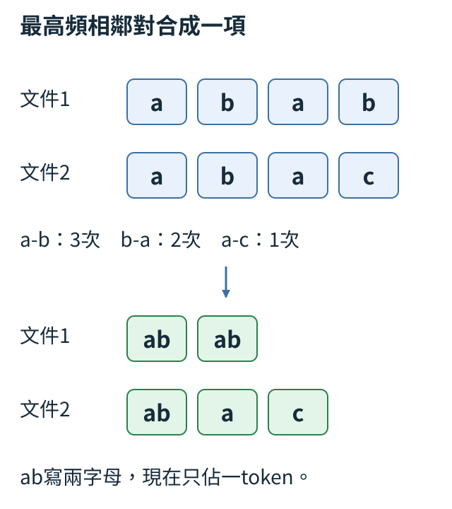
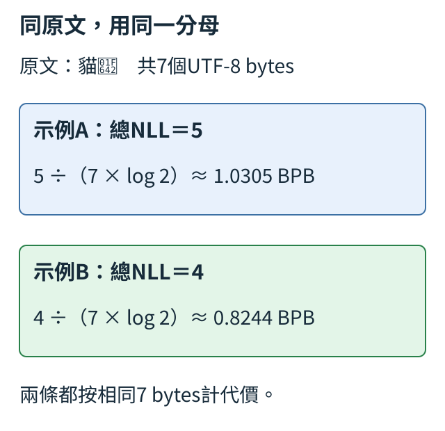
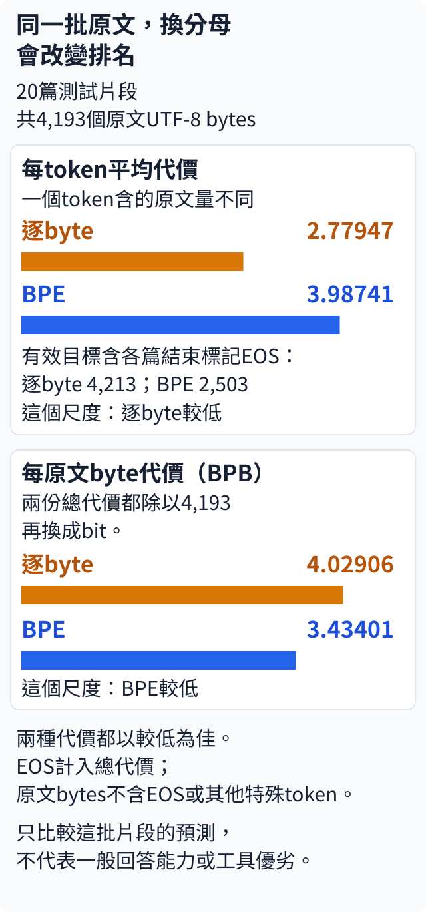

# 第 6 章：自己的中英文 tokenizer

「小小貓」是幾個字、幾個 byte，又是模型的幾個 token？本章從看得見的文字一路追到模型收到的 ID：先數字元與 byte，合併一次常見片段，再訓練一個能還原沒見過文字的 BPE。接著看字表大小的取捨、換了 tokenizer 之後怎麼在同一份原文上比較模型、特殊 token 怎麼和普通文字分開、半個字怎麼處理，最後分清訓練視窗與讀檔分段。這些問題都圍繞同一件事：模型在某個位置收到的 ID，究竟代表原文的哪一塊。讀到忘了的名詞，可以查[名詞頁](../glossary.md)。

## 6.1 字元切詞有什麼成本？

「小小貓」和「cat」看起來都是三個字，🙂 只是一個圖案。可是存成檔案時，「小小貓」要 9 個 byte，「cat」只要 3 個，🙂 要 4 個。模型一次要處理幾個位置，取決於我們用什麼單位切開文字，所以先把「字」數清楚。

平常看到的一個字、一個字母或一個圖案，叫一個**字元**。**Unicode** 是全世界共用的文字標準，它替每個字元訂了一個編號，叫**碼點**（code point）：例如「c」是 99、「貓」是 35987、🙂 是 128578，文件上常用十六進位寫成 U+0063、U+8C93、U+1F642。Python 的字串以碼點為單位，`len(text)` 數的就是碼點數。常見的字元一個就是一個碼點；少數字元由幾個碼點組成，例如帶膚色的 👍🏽 是「豎拇指」加「膚色」兩個碼點。

碼點只是編號，存檔時還要換成 byte。[5.9](05.md#5.9) 說過一個 byte 有 8 個 bit；8 個 bit 共有 2⁸＝256 種排法，所以一個 byte 能存 0 到 255 之間的一個整數。**UTF-8** 是把每個碼點存成 1 到 4 個 byte 的規則：英文字母、數字和半形標點用 1 個，常見中文字用 3 個，🙂 這類 emoji 用 4 個。所以「小小貓」是 3×3＝9 個 byte，「cat」是 3×1＝3 個。

**token** 是模型一次處理的一個單位。**tokenizer** 把原文切成 token，再把每個 token 換成 ID，這個動作叫**切詞**（tokenization）；反過來把 ID 換回文字，就是 [1.1](01.md#1.1) 的解碼，能不能完整還原原文，要看字表與切詞規則。「切詞」不保證切出人認得的詞：一個 token 可以是一個字、好幾個字，或一個字的幾個 byte。1.1 把所有可用的字列成**字表**；換成 token 之後仍叫字表，每一項是一種 token。

下面先數三段文字的碼點與 byte。

```python
texts = ["小小貓", "cat", "🙂"]
for text in texts:
    raw = text.encode("utf-8")
    print(text, "Unicode碼點", len(text), "UTF-8 bytes", len(raw))
```

`text.encode("utf-8")` 照 UTF-8 規則把字串換成一串 byte，`len(raw)` 數這串 byte 有幾個。三行依序是 3 與 9、3 與 3、1 與 4：前兩段都是三個碼點，存起來的 byte 數卻不同；🙂 只有一個碼點，卻要 4 個 byte。

切詞的單位會直接改變模型的工作量。若一個字元切成一個 token，「小小貓」和「cat」都是 3 個位置；若一個 byte 切成一個 token，就變成 9 個與 3 個位置。[3.6](03.md#3.6) 的注意力要替每一對位置算一個讀取比例，序列有 T 個 token 時，這張表就有 T×T 格：「小小貓」從 3 個位置變成 9 個位置，表格便從 9 格變成 81 格。

另一邊是字表。[2.1](02.md#2.1) 的 embedding 表每種 token 一列、每列有 D 個特徵（特徵寬度），共「字表大小×D」個參數。逐 byte 切詞的字表只要 256 種 byte，而任何文字存成 UTF-8 都是這 256 種值排成的序列，所以沒見過的字也一定表示得出來；代價是常見中文字的序列長了三倍。逐字元切詞的序列較短，字表卻要收進每一個可能用到的字，沒收到的新字只能換成一個代表「不認得」的 ID，原文就還原不回來。單位越細，字表越小、序列越長；越粗則相反，所以長度與字表要一起看。字表大小怎麼取捨留到 [6.4](#6.4)，下一節先看怎麼把常見片段合併起來。

練習把程式的 `texts = ["小小貓", "cat", "🙂"]` 改成 `texts = ["cat🙂", "貓🙂"]`，先預測再執行：`cat🙂` 是 4 個碼點、7 個 byte（3＋4）；`貓🙂` 是 2 個碼點，仍是 7 個 byte（3＋4）。碼點少了兩個，byte 數卻一樣：「幾個字」不能直接當成「模型要處理幾個 token」，還得說明用的是哪一種切法。

<details>
<summary>補充：一次真實生成的例子</summary>

「能表示原文」和「模型會生成合法的文字」要分開看。本課有一組中文詩的小實驗，用逐 byte 切詞的模型接寫詩句；它的[實驗紀錄（JSON）](../../docs/course-experiments/results/real_text.json)是這次實驗機器可讀的完整結果。在 `results.runs.chinese-poetry.after.validation.samples` 的第 8 筆（`samples[7]`）可以看到：提示是一首驗證詩的開頭 `渡漢江\n李頻\n嶺外`（`\n` 表示原文的換行），新生成的部分是 `孟沙，天夜天天天天春�`。

提示最多取 24 個 byte，而且只在完整的字元後面結束，沒有把半個中文字交給模型。生成則一次選一個 byte，最多寫 32 個新 byte：`generated_ids` 正好 32 個，最後兩個只寫到下一個字的前兩個 byte 就到了上限，解碼後便顯示替代符號 `�`（[6.7](#6.7) 會解釋）。中間重複的「天」是另一個品質問題，補齊最後一個字也解決不了。同樣 32 個位置，英文常能寫 32 個字母或標點，中文卻通常只夠十個字左右；比較生成長短之前，先問每個位置究竟是什麼單位。重做這組實驗的指令在 [T.4](../training.md#T.4) 的補充區（`--experiment real_text`）。

</details>

## 6.2 常見片段怎麼合併？

兩份文件 `abab` 與 `abac`。數相鄰的兩個字母：a-b 共 3 次（第一份 2 次、第二份 1 次），b-a 2 次，a-c 1 次。把最常見的 a-b 接成一個新單位 ab 之後，第一份從四項縮成兩項 `[ab, ab]`，第二份縮成三項 `[ab, a, c]`；兩份原文仍是同樣的四個字母，變的只是切法。

反覆「數相鄰對、合併最常見的一對」，這種方法叫**位元組對編碼**（Byte Pair Encoding，BPE）。名字裡的「位元組」（byte）來自它最早是一種壓縮 byte 資料的方法；合併的步驟本身不管單位是字母還是 byte。這裡先用字母 a、b、c 看清規則，[6.3](#6.3) 再改成從 256 種 byte 開始。

下圖上半是合併前的兩份文件與三種相鄰對的次數，下半是把 a-b 接成 ab 之後的結果。每份文件各自合併，不跨文件：第一份結尾的 b 和第二份開頭的 a 不算相鄰。



下面的程式先數相鄰對、挑出最常見的一對，再逐份文件合併。數次數用 [1.4](01.md#1.4) 的 `Counter`，這次每個鍵是一對相鄰符號；配出相鄰對用 [1.3](01.md#1.3) 的 `zip` 與切片。

```python
from collections import Counter

corpus = [list("abab"), list("abac")]
pairs = Counter()
for row in corpus:
    for left, right in zip(row, row[1:]):
        pairs[(left, right)] += 1
pair = pairs.most_common(1)[0][0]


def merge(row, pair):
    out = []
    i = 0
    while i < len(row):
        if i + 1 < len(row) and tuple(row[i : i + 2]) == pair:
            out.append("".join(pair))
            i += 2
        else:
            out.append(row[i])
            i += 1
    return out


print(pairs)
print("選擇", pair, "結果", [merge(row, pair) for row in corpus])
```

`list("abab")` 把字串拆成四個字母的清單。`row[1:]` 從第二項開始，`zip(row, row[1:])` 便配出每一對相鄰字母。`pairs[(left, right)] += 1` 把這一對的次數加 1 再存回；`Counter` 把還沒見過的鍵當作 0 次，所以不必先列出每一對。`most_common(1)` 取最常見的一項，得到 `[(("a", "b"), 3)]` 這樣的清單：第一個 `[0]` 取出「符號對、次數」這一項，第二個 `[0]` 再取出符號對 `("a", "b")`。第一行輸出 `Counter({('a', 'b'): 3, ('b', 'a'): 2, ('a', 'c'): 1})`，和手數的一樣。

這裡 a-b 唯一最多。若有兩對一樣多，要事先規定固定的選法，否則同一份資料可能學出不同的規則；`Counter` 遇到平手時，按第一次數到的先後排列。

`merge` 從左到右掃過一份文件，`i` 記錄目前看到第幾項。`while 條件:` 的意思是「條件成立就再做一次縮排裡的程式」；它和 [W.2](../first-steps.md#W.2) 的 `for` 不同，不會自動逐項走過清單，每次前進幾項由我們自己決定。`if` 的條件用 `and` 連起兩件事，兩件都成立才算：`i + 1 < len(row)` 確認後面還有一項，`tuple(row[i : i + 2]) == pair` 確認這兩項正是要合併的那一對（切片得到的是清單，`tuple` 把它換成和 `pair` 一樣的形式才能比較）。成立時用 `"".join(pair)` 接成 `"ab"`，前進兩項；否則照抄目前這一項，只前進一項。

用第一份 `["a", "b", "a", "b"]` 走一次：`i` 是 0 時前兩項是 a、b，輸出 `ab`，`i` 變 2；`i` 是 2 時又是 a、b，再輸出 `ab`，`i` 變 4；`4 < 4` 不成立，迴圈結束，得到 `['ab', 'ab']`。第二份在 `i` 是 2 時遇到 a、c，不是要合併的一對，只抄下 a、前進到 3；這時已是最後一項，抄下 c 後結束，得到 `['ab', 'a', 'c']`。這正是第二行的輸出。

ab 現在是一個 token，但不一定是有語言意義的詞，只是在這份資料裡常一起出現。完整的 BPE 會反覆做三件事：數相鄰對、合併最常見的一對、把新項加進字表並記下合併的先後順序；直到字表達到預先設定的大小（6.3 的 `vocab_size`），或再也沒有可以合併的相鄰對才停。合併只把相鄰項接起來，沒有改動任何字母，所以一定接得回原文。

這一步只是在決定切詞規則，還沒有訓練語言模型。規則只用訓練資料學，理由和 [1.2](01.md#1.2) 一樣：驗證與測試文字如果參與決定規則，就不再是沒見過的材料；它們只用來檢查新文字切出來有多長、能不能完整還原。

練習在 `corpus` 清單加入第三份 `list("acacacac")`，先預測再執行：a-c 在新文件出現 4 次，加上原來的 1 次共 5 次，超過 a-b 的 3 次，所以這次選 a-c。三份的結果應是 `['a', 'b', 'a', 'b']`、`['a', 'b', 'ac']`、`['ac', 'ac', 'ac', 'ac']`。前兩份原文一個字母都沒改，切法卻跟著新規則變了：tokenizer 的規則一變，舊文件的編碼也會跟著不同。

## 6.3 怎麼訓練實用的 tokenizer？

只用「貓看狗。」與「a cat sees a dog.」兩句建立字表，卻要表示新文字「小鳥🙂new」——小、鳥和 🙂 都沒在這兩句出現過。如果字表一開始只收見過的字元，新字就表示不出來。改從 [6.1](#6.1) 的 256 種 byte 開始，再用 [6.2](#6.2) 的方法合併常見片段：見過的片段變短，沒見過的字仍能逐 byte 表示。

這種從 byte 開始合併的 BPE 叫 **byte-level BPE**。6.2 的手寫版只合併一次；實用的 BPE 要反覆合併很多次，還要處理空白與 byte 的細節，這裡交給 `tokenizers`：它是 Hugging Face 開發、專門訓練與使用 tokenizer 的函式庫，安裝本專案時已一起裝好。訓練學到的是合併規則；之後 `encode` 把文字轉成 ID，`decode` 把 ID 拼回原文。本課後面的程式多半用 [6.6](#6.6) 自己寫的 `ByteTokenizer`：它不學合併，每個 byte 一個 ID，是最簡單、一定能還原的起點。

```python
from tokenizers import Tokenizer, decoders, models, pre_tokenizers, trainers

tok = Tokenizer(models.BPE())
tok.pre_tokenizer = pre_tokenizers.ByteLevel(add_prefix_space=False)
tok.decoder = decoders.ByteLevel()
trainer = trainers.BpeTrainer(
    vocab_size=280,
    initial_alphabet=pre_tokenizers.ByteLevel.alphabet(),
    show_progress=False,
)
tok.train_from_iterator(["貓看狗。", "a cat sees a dog."], trainer)
print("字表大小", tok.get_vocab_size())
for text in ["貓看狗。", "小鳥🙂new"]:
    encoded = tok.encode(text)
    print(text, "UTF-8 bytes", len(text.encode("utf-8")), "token數", len(encoded.ids))
    print("片段", encoded.tokens)
    print("還原", tok.decode(encoded.ids))
    assert tok.decode(encoded.ids) == text
```

逐項看設定：

- `models.BPE()` 指定用 BPE 的合併規則。
- `pre_tokenizers.ByteLevel(add_prefix_space=False)` 是 BPE 之前的前處理，做兩件事：先在空白與標點處把文字分成幾段，空白黏在後一個詞的開頭，合併只在每一段裡進行；再把每個 byte 換成一個看得見的符號，方便統計。例如「a cat」會分成 `a` 與 `Ġcat` 兩段，`Ġ` 就是空白的可見代號。`add_prefix_space=False` 表示不在開頭自動補一個空白。這裡也沒有設定文字正規化（normalizer，例如把全形字換成半形、大寫換成小寫），原文不會被改寫。
- `decoders.ByteLevel()` 是反方向的工具：把看得見的符號換回 byte，再照 UTF-8 拼回文字。
- `initial_alphabet=pre_tokenizers.ByteLevel.alphabet()` 讓字表一開始就收進全部 256 種 byte 的符號，而不只是兩句裡出現過的 byte。
- `vocab_size=280` 是字表大小的目標；`train_from_iterator` 從兩句話學合併規則，字表到了目標，或再也沒有可合併的相鄰對，就停下來。

第一行印出的字表大小是 277，不是 280：256 種 byte 加上 21 次合併之後，兩句話裡已經沒有可以再合併的相鄰對了。資料這麼少時，字表未必長得到目標。

「貓看狗。」共 12 個 byte，整串都在訓練句出現過，合併到只剩 2 個 token：一個是「貓看狗」，一個是「。」。「小鳥🙂new」共 13 個 byte，訓練學到的合併一個都用不上，13 個 byte 各自成為一個 token。兩句的「還原」都和原文完全相同，assert 也通過。印出的片段像一串奇怪的拉丁字母，因為那是 byte 的可見代號，不是原文壞了；要核對的是還原後的文字，不是每個片段肉眼能不能讀。

保存 tokenizer 時，要連同版本與每個 ID 代表什麼一起保存。即使字表大小相同，重新訓練一次也可能讓同一個 ID 換成別的片段，不能直接接上舊模型。

練習把迴圈清單的 `"小鳥🙂new"` 改成 `"未見字🦊"`，先預測：三個中文字與 🦊 都沒在訓練句出現，13 個 byte 會切成 13 個 token，但還原仍等於原文，再執行核對。改回後，把 `add_prefix_space=False` 改成 `True` 再執行一次，先預測會發生什麼：每句開頭多補了一個空白，還原出來的文字也多了這個空白（例如 ` 貓看狗。`），assert 失敗。能不能還原，取決於整組前處理與解碼規則，不只 BPE 這個名字；改了任何一條，都要重新檢查空白、換行與特殊字元。

<details>
<summary>補充：本課的 BPE 實驗</summary>

上面的短示範之外，本課也做過一次較接近真實資料準備流程的實驗：從本課的固定資料包各取 96 篇英文故事與 96 首中文詩，先按完整篇章分成訓練 153 篇、驗證 19 篇、測試 20 篇，再各取最多 256 個 byte、結尾保持完整字元的片段。BPE 只用 153 篇訓練片段學合併規則，字表共 512 項，包含 8 個特殊 token（[6.6](#6.6) 會列出它們），保存成 `tokenizer-bpe512.json`；驗證與測試片段都沒有參與決定合併規則。沒見過的 `未見字🦊 new`，以及頭尾有空白、中間有換行的 ` 小鳥🙂\nnew `（`\n` 表示一個實際的換行）都能完整還原。這些核對證明的是 tokenizer 能還原，不表示語言模型已經懂句意；模型成績在 [6.5](#6.5) 比較。

還原結果記在[實驗紀錄（JSON）](../../docs/course-experiments/results/tokenizer.json)的 `results.roundtrip`，每筆的 `same` 表示還原後是否與原文相同。重做指令在 [T.4](../training.md#T.4) 的補充區（`--experiment tokenizer`）。

</details>

## 6.4 字表要多大？

同樣的特徵寬度下，字表加入更多合併項，可能讓同一句用較少的 token；可是每多一種 token，embedding 表就要多存一列，輸出層也要多算一個分數。字表大小的取捨，要把「這份原文變成幾個 token」和「模型多存幾個數」放在一起看。

先算存的那一邊。設每個 token 有 32 個特徵（特徵寬度，程式裡的 `width`），輸入的 embedding 表（[2.1](02.md#2.1)）有「字表大小×32」格。模型最後的輸出層要替字表裡每一種 token 算一個分數（[4.6](04.md#4.6)），本課的輸出層沒有偏移，也是「字表大小×32」個權重；除非像 [14.6](14.md#14.6) 的權重共享那樣讓兩者共用同一張表，否則要再加一張同樣大的表。下面比較字表大小 300、1000、3000 的成本。

```python
width = 32
for vocab in [300, 1000, 3000]:
    embedding = vocab * width
    input_and_output = 2 * embedding
    print("字表大小", vocab, "embedding表參數", embedding, "FP32 bytes", embedding * 4, "兩表合計", input_and_output)
```

程式只算表格的格數，沒有建立模型。字表大小 300 時，embedding 表是 300×32＝9,600 個參數；FP32 每個參數占 4 byte（[5.9](05.md#5.9)），共 38,400 byte；加上不共用的輸出層，兩表合計 19,200 個參數。字表大小 1000 時是 32,000、128,000 與 64,000；3000 時是 96,000、384,000 與 192,000。字表大小變成 10 倍，這兩張表也變成 10 倍。這些數字不含梯度、最佳化器狀態與其他層，所以不是整個訓練的記憶體預算。

成本的另一邊是序列長度 T。更多合併如果剛好覆蓋眼前的文字，token 數就變少，[6.1](#6.1) 說的 T×T 注意力表也跟著變小。但字表大，不保證每份文字都切得短：如果訓練 tokenizer 的資料主要是英文，新增的合併項多半是英文片段，對中文幫不上忙。所以要拿同一份沒參與字表訓練的原文，實際記錄切出幾個 token、能不能還原，以及模型品質，再對照預算。

本課的 BPE 實驗（設定見 [6.3](#6.3) 的補充）實際量過一次。在 19 篇驗證片段上，`ByteTokenizer`（256 種 byte 加 8 個特殊 token，共 264 項）需要 3,894 個 token，512 項的 BPE 只要 2,112 個，平均每篇從約 205 個降到約 111 個（3,894÷19、2,112÷19；這裡只數原文，還沒加開始與結束標記）。可是兩個同樣特徵寬度 32、一層的模型，參數卻從 41,824 個增加到 57,696 個；多出的 15,872 個，正好是 embedding 表與輸出層各多了 512－264＝248 列：248×32×2＝15,872。序列變短和表格變大同時發生，只看其中一邊，都不能說哪個更省；[6.5](#6.5) 再把預測品質放進來。

字表也沒有通用的最佳大小。罕見的大 token 在訓練資料裡出現得少，學到的機會也少；小片段能在許多詞之間共用、例子多，序列卻比較長。

練習把程式的 `width = 32` 改成 `width = 64`，先預測三列的每個數都翻倍，再執行核對；字表大小沒變，增加的是每個 token 的特徵寬度。改回 32 後，把清單裡的 `300` 改成 `600`，第一列的數字同樣翻倍，這次增加的卻是可用的 token 種類。兩次數字的變化一樣，意思不同。

<details>
<summary>補充：數字在實驗紀錄的哪裡</summary>

上面的數字來自 [tokenizer 實驗的實驗紀錄（JSON）](../../docs/course-experiments/results/tokenizer.json)：`results.runs.byte256` 與 `results.runs.bpe512` 底下，`validation_text_token_lengths` 是 19 篇驗證片段各自的 token 數（加總分別是 3,894 與 2,112），`parameters` 是模型參數總數，`input_embedding_parameters` 是 embedding 表的參數數（264×32＝8,448、512×32＝16,384）。重做指令在 [T.4](../training.md#T.4) 的補充區（`--experiment tokenizer`）。

</details>

## 6.5 換 tokenizer 後如何比較模型？

同一份原文，甲 tokenizer 切成 10 個 token，模型平均每個 token 的代價是 0.6；乙切成 5 個 token，平均 1.0。只看平均，甲比較低；可是兩者猜的是同一份原文，把每個 token 的代價加起來，甲是 10×0.6＝6，乙是 5×1.0＝5，乙反而比較低。切法一變，「一個 token」包含的原文就不一樣多，所以要回到共同的原文來比較。

先把要加總的東西講清楚。**有效目標**是有正確答案、而且這次要計分的位置。每個有效目標的代價，是模型給正確 token 的機率取負自然對數（[1.8](01.md#1.8)）；把全部有效目標的代價**加總**，叫 **NLL**（Negative Log-Likelihood，負對數似然），本課說 NLL 一律指這個加總，也寫成「總 NLL」。加總後再除以有效目標數，叫**平均 NLL**，就是 [5.2](05.md#5.2) 的 `total / count`。兩者各有用途：訓練時印出的代價（`masked_loss` 的回傳值），以及後面各章比較回答時寫的平均 NLL（例如 [17.14](17.md#17.14)），都是平均，回答「平均每個目標猜得多好」；換 tokenizer 比較時要用加總，因為接下來要把它改除以原文的 byte 數。

為什麼各位置的代價可以直接相加？整段原文的機率，是每個位置「在前文已知時」猜中下一個 token 的條件機率相乘（[1.5](01.md#1.5) 的 `p(看|貓)` 就是一個條件機率）。[W.4](../first-steps.md#W.4) 的例子要假設兩題獨立，才能把機率直接相乘；這裡每個機率都已經把前文放進條件裡，乘起來就是整段的機率，不需要假設獨立。例如已知 A，接著猜 B、C：整段的機率是「看到 A 時猜中 B 的機率」乘「看到 A、B 時猜中 C 的機率」；若兩項是 0.5 與 0.25，這段的機率就是 0.125。取負對數之後，乘積變成各位置代價的和：0.693＋1.386＝2.079，正好等於 0.125 的負對數。所以總 NLL 就是整段原文機率的負對數。

自然對數 ln（Python 的 `math.log` 也用這個底數）算出的代價，單位叫 nat。要換成以 2 為底的 bit，把總 NLL 除以 ln 2≈0.6931：例如機率 1/2 的代價是 ln 2≈0.6931 nat，除以 ln 2 正好是 1 bit。再除以原文的 UTF-8 byte 數，就得到 **BPB**（bits per byte），也就是平均每個原文 byte 花多少 bit 的代價：BPB＝總 NLL÷（原文 byte 數×ln 2）。下面「貓🙂」共 7 個 byte，兩個總 NLL 5 與 4 是手寫的例子，還不是模型量到的值。

```python
import math

raw = "貓🙂"
bytes_count = len(raw.encode("utf-8"))
for name, total_nll in [("示例A", 5.0), ("示例B", 4.0)]:
    bpb = total_nll / (bytes_count * math.log(2))
    print(name, "原文bytes", bytes_count, "BPB", bpb)
```

「貓」3 個 byte、🙂 4 個（[6.1](#6.1)），共 7 個。輸出 A 約 1.0305、B 約 0.8244：兩者的除數都是 7×0.6931≈4.852，B 的總 NLL 較小，BPB 也就較低。示例 A、B 只換了總 NLL，原文都是同樣的 7 個 byte，所以分母相同。下圖上方是共同的原文與它的 7 個 byte，下方兩條算式各用自己的總 NLL 除以同一個分母。



真正量測時，先用各自的 tokenizer 編碼同一份驗證文件，再交給和它配對的模型預測。不能把甲的 ID 丟進乙的模型，同一個 ID 在兩張字表裡代表不同的片段。也不能只拿平均 NLL、不知道有效目標數就推算 BPB：總 NLL＝平均 NLL×有效目標數，少了目標數就算不出分子。

哪些位置算有效目標，兩邊也要一致。序列開頭的 **BOS**（Beginning of Sequence，開始標記）只當前文，不計分；為了把長短不同的序列排齊而補上的位置也不計分（[5.2](05.md#5.2) 的 -100）。每篇結尾的 **EOS**（End of Sequence，結束標記；第 1 章提過的結束標記，本章起寫作 EOS）表示這段到此結束。BOS、EOS 都是特殊 token，[6.6](#6.6) 會列出全部 8 個。本節的實驗把「猜中 EOS」也算進總 NLL，所以有效目標數＝原文的 token 數＋篇數；分母則只數原文的 UTF-8 byte，不含 EOS 與其他特殊 token。

長文放不進模型一次能讀的長度時，要切成幾段依序計分，每個 token 只能計一次。例如原文 A、B、C、D，模型一次讀三個位置：第一段讀 [A,B,C]，A 前面沒有東西可以拿來猜它，只當前文，計分的是 B（看 A 猜 B）與 C（看 A、B 猜 C）；第二段讀 [B,C,D]，B、C 已經計過，這次只當前文，只新增 D 的代價。如果 C 在兩段都計分，它就被算了兩次，總 NLL 會偏大。兩個模型的開頭、能讀的前文長度、EOS 算不算，都要用同一套規則。本節實驗的每篇片段都放得進一段，沒有這個問題（[6.8](#6.8) 的補充）。

現在看真實的量測。逐 byte 的 `ByteTokenizer` 與 512 項的 BPE 各自配一個模型（訓練設定見補充），在同一批 20 篇測試片段上評分；這 20 篇共 4,193 個原文 byte。這次實驗的實驗紀錄（存成 JSON 檔的完整結果，欄位說明見補充）給的是平均 NLL（nat）與有效目標數，下面換回總 NLL 與 BPB（bit）。程式裡的平均 NLL 取到小數第六位：若只取五位的 2.77947，印出的總 NLL 仍是 11,709.9，BPB 卻會算成 4.02905，和實驗紀錄的 4.02906 差在最後一位。

```python
import math

raw_bytes = 4193
for name, mean_nll, targets in [("逐byte", 2.779473, 4213), ("BPE", 3.987411, 2503)]:
    total_nll = mean_nll * targets
    bpb = total_nll / (raw_bytes * math.log(2))
    print(name, "平均NLL", mean_nll, "有效目標", targets, "總NLL", round(total_nll, 1), "BPB", round(bpb, 5))
```

逐 byte 的平均 NLL 約 2.77947，比 BPE 的 3.98741 低，看起來逐 byte 比較好。可是逐 byte 要猜 4,213 個目標（4,193 個 byte 加 20 個 EOS），BPE 只猜 2,503 個（2,483 個 token 加 20 個 EOS）：一個 BPE token 平均包含較多原文，每次猜的是比較大的一口。換回總 NLL，逐 byte 是 11,709.9，BPE 是 9,980.5；除以同一個 4,193×ln 2 之後，BPB 是 4.02906 對 3.43401，排名反過來，BPE 較低。這就是開頭甲、乙的情況。

這次比較固定的是原文曝光（兩個模型訓練時看了一樣多的原文）與更新次數，沒有固定參數數量、有效目標數與運算量；[6.4](#6.4) 已經看到 BPE 模型多了參數。所以它示範的是「換了切法之後怎麼讀數字」，不能據此說哪一種 tokenizer 比較好，也不能說 512 是最好的字表大小。

練習把第一段程式的 `[("示例A", 5.0), ("示例B", 4.0)]` 改成 `[("示例A", 10.0), ("示例B", 8.0)]`，先預測兩個 BPB 都翻倍（約 2.0610 與 1.6488）、排序不變，再執行核對。改回後，把 `raw = "貓🙂"` 改成 `raw = "貓🙂貓🙂"`（14 個 byte），總 NLL 保持 5 與 4，數值會減半（約 0.5152 與 0.4122）。這一步只是示範分母的作用；真實模型換了文本，總 NLL 一定要重新量，不能沿用舊數字。

<details>
<summary>補充：實驗設定與實驗紀錄</summary>

這組實驗讓逐 byte 與 BPE 兩個模型各更新 400 次，每次抽 8 篇訓練片段；兩邊每一步用的是相同的原文片段，累計都看了 664,759 個原文 byte。模型都是特徵寬度 32、一層、最多 384 個位置，學習率 0.003、種子 42。驗證片段上也是同樣的方向：逐 byte 的 BPB 由訓練前的 8.29037 降到 3.59830，BPE 由 5.04502 降到 3.06109。兩個模型訓練前的分數本來就不同，因為兩張字表要猜的單位不同，不能把兩份隨機模型當成同一個起點。

下圖把兩種尺度上下並排：上半是每 token 的平均代價，下半是共同原文尺度的 BPB，兩種都是越低越好。



生成也要分開看：兩個模型都允許寫 32 個新 token 時，BPE 能寫出的原文通常比較長，不能把「寫得長」直接當成「回答得好」。

數字出處是 [tokenizer 實驗的實驗紀錄（JSON）](../../docs/course-experiments/results/tokenizer.json)。`results.runs.byte256` 與 `results.runs.bpe512` 底下，`after.test` 是訓練後的測試片段、`after.validation` 是驗證片段、`before` 是訓練前；每一份裡的 `mean_token_nll` 是平均 NLL，`effective_tokens` 是有效目標數，`raw_utf8_bytes` 是原文 byte 數，`bpb_including_eos_boundary_targets` 是 BPB，`samples` 是生成的例子。重做指令在 [T.4](../training.md#T.4) 的補充區（`--experiment tokenizer`）。

</details>

## 6.6 特殊 token 怎麼保持完整？

使用者問：「`<assistant>` 這串字是做什麼用的？」他只是在討論這串字，模型應該把它當成普通文字讀，不該以為輪到助理說話了。要做到這件事，tokenizer 需要兩個約定：普通文字和標示結構的 token 用不重疊的 ID；標示結構的 token 只由程式依照資料的欄位插入，不從文字內容猜。

**特殊 token**（special token）是不代表任何原文、專門標示結構的 token。本課 `ByteTokenizer` 的 ID 0 到 7 就是 8 個特殊 token，它們的拼寫依序存在 `tiny_perceptron/data.py` 開頭的常數 `SPECIALS` 裡：

| ID | 拼寫 | 名稱 | 標示什麼 |
| --- | --- | --- | --- |
| 0 | `<pad>` | PAD（填充） | 把長短不同的序列補成一樣長時補上的位置（[7.6](07.md#7.6)） |
| 1 | `<bos>` | BOS（開始標記） | 一條序列的開頭 |
| 2 | `<eos>` | EOS（結束標記） | 一段文字或一段話到此結束 |
| 3 | `<user>` | 角色標記 | 接下來是使用者說的話 |
| 4 | `<assistant>` | 角色標記 | 接下來是助理說的話 |
| 5 | `<image>` | 圖片的位置 | 圖片要放進序列的地方（第 10 章） |
| 6 | `<audio>` | 聲音的位置 | 聲音要放進序列的地方（第 12 章） |
| 7 | `<system>` | 角色標記 | 接下來是整段對話共用的規則 |

**角色**（role）指這段話是誰說的：user 是使用者，assistant 是助理，system 放整段對話共用的規則。第 7 章才講對話資料，這裡只需要知道：每段話旁邊另有一個欄位寫明角色，例如 `{"role": "user", "content": "你好"}`，`content` 才是那段話的文字。**模態**（modality）指資料的種類，例如文字、圖片、聲音；`<image>`、`<audio>` 就是替圖片與聲音保留的特殊 token。

先看結果：把字串 `<assistant>` 當普通文字編碼，看看會不會冒出 ID 4。

```python
from tiny_perceptron.data import ByteTokenizer, SPECIALS

tok = ByteTokenizer()
print(list(enumerate(SPECIALS)))
literal = tok.encode("<assistant>")
print("普通文字的ID", literal)
print("還原", tok.decode(literal))
assert tok.assistant_id not in literal
```

`enumerate(SPECIALS)`（[1.1](01.md#1.1)）逐項給出「位置、拼寫」，`list(...)` 把它們收成清單印出；位置就是 ID，所以印出的第一行有 `(4, '<assistant>')`。`tok.encode("<assistant>")` 得到 11 個 ID：這串字是 11 個 ASCII 字元，每個 1 byte，`encode` 把每個 byte 加 8，例如 `<` 的 byte 是 60，變成 68；結尾的 `>` 是 62，變成 70。內容 ID 都至少是 8，不可能出現 4。`decode` 把它還原成同樣的 `<assistant>`，最後的 assert 確認這串文字沒有被當成助理的角色標記。

它怎麼做到的？下面是函式庫裡 `ByteTokenizer` 的原始碼。

```python
# 節錄自 tiny_perceptron/data.py：ByteTokenizer
class ByteTokenizer:
    """不學切詞的可還原起點；每個 UTF-8 byte 對應一個 ID。"""

    vocab_size = 264
    pad_id, bos_id, eos_id, user_id, assistant_id, image_id, audio_id, system_id = range(8)

    def encode(self, text):
        return [b + len(SPECIALS) for b in text.encode("utf-8")]

    def decode(self, ids):
        raw = bytes(i - len(SPECIALS) for i in ids if i >= len(SPECIALS))
        return raw.decode("utf-8", errors="replace")

    def state(self):
        return {"type": "byte", "specials": list(SPECIALS)}
```

`class ByteTokenizer:` 定義一種新的物件，`ByteTokenizer()` 就建立一個，像上面的 `tok`。它和 [3.7](03.md#3.7) 的注意力 module 有兩點不同，各有各的原因。第一，它沒有可學的參數，所以不繼承 `nn.Module`。第二，它沒有寫 `__init__`：`__init__` 是建立物件時讓每個物件記住自己那份資料的地方，而每個 `ByteTokenizer` 要用的東西都一樣，字表大小與 8 個特殊 token 的 ID 直接寫成整個 class 共用的設定，位移 8 由 `len(SPECIALS)` 算出。同一個檔案裡的 [`CharTokenizer`](../../tiny_perceptron/data.py) 就是對照：它也沒有可學的參數，卻有 `__init__`，因為每建立一個，都要記住從自己那份文字收集到的字元清單。逐段看：

- 直接寫在 class 底下的 `vocab_size = 264` 是每個 `ByteTokenizer` 共用的設定：256 種 byte 加 8 個特殊 token。
- `range(8)` 那一行一次把 0 到 7 依序指定給等號左邊的八個名字，所以 `tok.assistant_id` 是 4、`tok.image_id` 是 5。
- 寫在 class 裡的 `def` 叫方法，用 `tok.encode(...)` 這種寫法呼叫；第一個參數 `self` 是 `tok` 本身，由 Python 自動傳入。
- `encode`：`text.encode("utf-8")` 得到一串 0 到 255 的 byte，`b + len(SPECIALS)` 把每個加上 8（`len(SPECIALS)` 是 8），普通文字因此只會落在 8 到 263。
- `decode`：`for i in ids if i >= len(SPECIALS)` 後面的 `if` 表示只留下符合條件的項，ID 小於 8 的特殊 token 不代表原文，直接略過；其餘減回位移 8，`bytes(...)` 把這串 0 到 255 的整數組回 byte，再照 UTF-8 換成文字。`errors="replace"` 讓不完整的 byte 顯示成 �，[6.7](#6.7) 會看到它。
- `state`：回傳 tokenizer 的種類與特殊 token 清單。本課有些成品程式保存權重時會把它一起存下，載入時核對每個 ID 的意思沒有換掉。

那真正的角色標記從哪裡來？由程式依照角色欄位插入：

```python
message = {"role": "user", "content": "<assistant>"}
role_ids = {"user": tok.user_id, "assistant": tok.assistant_id}
ids = [tok.bos_id, role_ids[message["role"]]] + tok.encode(message["content"]) + [tok.eos_id]
ids = ids + [tok.assistant_id]
print(ids)
print("最後一個ID", ids[-1], "ID 4 的個數", ids.count(tok.assistant_id))
```

`role_ids` 是查表用的字典：角色欄位寫的是 `"user"`，就查到 3。程式依序放進 BOS（1）、查到的角色 ID（3）、內容的 byte ID、EOS（2）；清單的 `+` 是把兩份清單接起來。`ids = ids + [tok.assistant_id]` 再接上 4，表示接下來輪到助理回答（[7.2](07.md#7.2) 準備生成時也是這個順序）。`ids.count(tok.assistant_id)` 數出 4 只有一個，就是程式最後放上的那一個；內容裡字面上的 `<assistant>` 仍是 68、105 這些普通 ID。原文與結構分開，內容就能無損還原，邊界也不會被文字冒充。

BPE 這類會學合併的 tokenizer 也要守住同一條線。`tokenizers` 套件可以把 `<user>`、`<assistant>` 整串登記成特殊 token，讓它們各占一個固定的 ID；但登記之後，`encode` 預設會把普通文字裡字面上的 `<user>` 也換成那個 ID，使用者打的字就冒充了角色標記。所以光登記特殊 token 不夠，還要規定普通內容怎麼編碼：本課的 BPE 實驗另外準備一份不認特殊 token 的規則，專門編普通內容（見補充）。保存 tokenizer 時，字表要和這條規則一起保存。另外，插入特殊 token 只是標出結構，本身不會教會模型怎麼回答，也不會產生圖片的特徵。

練習把第一段程式的 `tok.encode("<assistant>")` 改成 `tok.encode("<image>")`，`assert tok.assistant_id not in literal` 改成 `assert tok.image_id not in literal`。先預測：還原仍是這 7 個字元，內容 ID 都至少是 8，不會出現圖片的特殊 token 5，再執行核對。接著把第三段程式的 `"role": "user"` 改成 `"role": "assistant"`，先預測第二個 ID 變成 4，`ID 4 的個數` 變成 2：角色欄位改了，插入的標記才跟著改，內容那串字仍是普通 ID。

<details>
<summary>補充：BPE 實驗怎麼守住這條線</summary>

本課的 BPE 實驗（[6.3](#6.3) 的補充）先把 8 個特殊 token 登記進字表，占 ID 0 到 7；編普通內容時，改用一份移除了特殊 token 比對的規則。實際核對 `<user>這只是引用文字` 時，它完整還原成同一段原文，內容 ID 裡也沒有任何特殊 token 的 ID：[實驗紀錄（JSON）](../../docs/course-experiments/results/tokenizer.json)的 `results.roundtrip` 第 3 筆，`same` 是 `true`、`contains_control_id` 是 `false`。推論時配對 BPE 的 [`ByteLevelBPE`](../../tiny_perceptron/tokenization.py) 也照這個做法，而且普通文字一旦被編成 0 到 7 就直接報錯。

</details>

## 6.7 一個 token 一定是一個完整字嗎？

「貓🙂」的第一個 byte 單獨解碼會顯示 �，完整的 7 個 byte 卻能還原原文。差別在取了多少材料，不一定是原資料壞了。

「貓」的 UTF-8 是 232、178、147 三個 byte，🙂 是 240、159、153、130 四個 byte。BPE 按出現次數合併，合併的邊界不一定對齊完整的字：一個 token 可以只是某個字的一部分，也可以包含好幾個字。[6.3](#6.3) 的例子就是這樣：見過的「貓看狗」合成一個 token，包含三個字；沒見過的「小」拆成 3 個 token，每個只是它的一個 byte。

```python
raw = "貓🙂".encode()
print("全部bytes", list(raw))
print("只看第一byte", raw[:1].decode("utf-8", errors="replace"))
print("先拼完整再解碼", raw.decode("utf-8"))
assert raw.decode("utf-8") == "貓🙂"
```

輸入整句「貓🙂」並轉成 byte；字串的 `.encode()` 不填參數時就用 UTF-8。第一行應是 `[232, 178, 147, 240, 159, 153, 130]`：前三個合起來是貓，後四個合起來是 🙂。`raw[:1]` 用切片（[1.3](01.md#1.3)）只留下第一個 byte 232；UTF-8 的規則看得出它是三 byte 字的開頭，後面兩個卻沒有給。`errors="replace"` 表示遇到不完整的資料就用替代符號 � 代替，所以第二行是 �；沒有這個參數時，Python 會停下來報 `UnicodeDecodeError`（無法解碼的錯誤）。`raw.decode("utf-8")` 把完整的 7 個 byte 一起解碼，印出的第三行還原成「貓🙂」，assert 通過。

所以第一次看到 � 是觀察方式造成的，不能證明原始 byte 已經壞了。反過來，如果把這個 � 當成真正的內容存回去，原來的 byte 就被替代符號換掉了，之後再接上後面的 byte 也拼不回「貓」。要保留原始的 byte 或完整的 token 序列，不把臨時顯示用的替代符號當成原始資料。

逐 token 生成（一次接一個 token，[1.14](01.md#1.14)）時也會遇到這件事：這一步可能只生出某個中文字的前兩個 byte，下一步才補上第三個（[6.1](#6.1) 的補充有一次真實生成停在半個字的例子）。要邊生成邊顯示，就把還沒湊成完整字的尾巴先留著，湊齊了再解碼。Python 內建的 `codecs` 模組有現成的工具：

```python
import codecs

decoder = codecs.getincrementaldecoder("utf-8")()
shown = [decoder.decode(bytes([b])) for b in raw]
print("每收到一個byte顯示", shown)
assert "".join(shown) == "貓🙂"
```

`codecs.getincrementaldecoder("utf-8")` 先取得 UTF-8 解碼器的 class，後面再接一組 `()` 才真正建立一個解碼器，就像 [6.6](#6.6) 用 `ByteTokenizer()` 建立一個 tokenizer。這個解碼器會記住還沒用完的 byte。迴圈每次只交給它一個 byte（`bytes([b])` 把一個整數包成只有一個 byte 的資料）：湊不成完整字時它回傳空字串 `''`，把收到的 byte 留著；湊齊時才一次給出整個字。所以輸出是兩個空字串、`貓`、三個空字串、`🙂`，接起來正好是原文。若改成每收到一個 byte 就用 `errors="replace"` 各自解碼再接起來，會得到七個 �，原文就回不來了。

練習把第一段程式的 `raw[:1]` 改成 `raw[:3]`，先預測剛好包含完整的「貓」，會顯示「貓」；再改成 `raw[:4]`，預測顯示「貓�」，因為 🙂 只取到開頭的一個 byte。三次觀察用的都是同一份原始 byte，所以問題出在切在哪裡，不在內容本身。

## 6.8 訓練視窗是在切詞嗎？

已經切好詞的 ID 是 0 到 9，模型每題只讀三個位置。取出 [0,1,2,3] 這一段後，輸入 X＝[0,1,2]、答案 Y＝[1,2,3]。取段決定的是這一題的前文，沒有改變任何 ID 的意思。

從長序列裡取出、當作一筆訓練樣本的一段，叫**訓練視窗**。一個訓練視窗裡有好幾個「猜下一個 ID」的位置；它也限制了每個位置能讀的前文（[2.5](02.md#2.5) 的視窗），最多只能讀到這一段的開頭。設訓練視窗長度為 T（程式裡的 `context`），要湊出 T 個輸入與 T 個答案，得從原序列取 T＋1 個 ID，再用 shift 錯開一個位置配對（[1.3](01.md#1.3)）。切詞在這之前就做完了。

```python
from tiny_perceptron.data import shifted

ids = list(range(10))
context = 3
for start in [0, 3, 6]:
    segment = ids[start : start + context + 1]
    x, y = shifted(segment)
    print("起點", start, "輸入", x.tolist(), "答案", y.tolist())
    assert len(x) == len(y) == context
```

`range(10)` 建立 0 到 9 一排整數；本例它們只是容易追蹤的代號，假裝已經切好詞。三個起點分別取 0–3、3–6、6–9，每段 4 個 ID：切片 `ids[start : start + context + 1]` 取的正是 T＋1＝4 個。`shifted` 把一段 ID 轉成 tensor，回傳去掉最後一項的輸入與去掉第一項的答案（它的實作在 [4.7](04.md#4.7)），所以輸出 `[0, 1, 2]→[1, 2, 3]`、`[3, 4, 5]→[4, 5, 6]`、`[6, 7, 8]→[7, 8, 9]`。`.tolist()` 把 tensor 轉回普通清單方便顯示；assert 確認每題都是 3 個輸入、3 個答案。

相鄰兩個訓練視窗共用了 3 和 6，但角色不同：3 在第一個視窗只當答案（看 0、1、2 之後要猜 3），在第二個視窗是第一個輸入，只當前文。本例的三題都屬於同一份訓練資料，這樣共用沒有問題。不能先從同一份文件取出這些視窗，再隨機分成訓練與驗證：[1.2](01.md#1.2) 說過，重疊的片段跨到兩邊，驗證就不再是新材料。也不能把兩份文件直接接起來，讓「上一份的結尾」去猜「下一份的開頭」，除非明確設計並標出這個邊界。

所以順序是：先按完整文件或家族（[5.12](05.md#5.12)）分成訓練、驗證、測試資料，再在各自那一份裡取訓練視窗。序列尾端不足 T＋1 個 ID 時，最後一個視窗的預測位置會變少；要丟掉這段尾巴還是補齊，都要明說。另外，「每個視窗固定取多少原文 byte」和「每個視窗固定多少 token」也不一樣：BPE 的一個 token 平均包含較多 byte，若固定 256 個 token，BPE 會讀進比逐 byte 更多的原文，兩邊的資料量就不同了。

練習把 `context = 3` 改成 `context = 4`，保留三個起點，先預測：起點 6 只取得到 `[6, 7, 8, 9]` 四個 ID（清單到 9 就結束，切片不會報錯，只會取到尾端為止），shift 後 x、y 各只有 3 個，assert 會失敗。執行核對後，再把起點清單改成 `[0, 4]`：兩個視窗各取 5 個 ID，各有 4 個預測位置，assert 通過，最後的 9 沒有用到。這次沒有改 tokenizer，只改了每題取哪一段資料。

<details>
<summary>補充：BPE 實驗怎麼取段</summary>

[6.5](#6.5) 的兩個 tokenizer 比較也把「取多少原文」和「模型能讀幾個位置」分開：先把完整篇章分成訓練、驗證、測試，再各取同一段最多 256 個 byte 的片段，兩個 tokenizer 各自編碼。模型最多容納 384 個位置，逐 byte 的 256 個 token 加上開始與結束標記也放得下，所以每篇片段剛好是一個訓練視窗，不會因為 BPE 切得較短就多取後面的文字。這讓兩個模型看到的原文一樣多；若改成固定 256 個 token，BPE 那邊就會讀進更多原文，等於換了資料預算。

</details>

## 6.9 讀檔分段會改變切詞嗎？

「hello」一次編碼可以合成一個 token；如果先讀進「hel」、再讀進「lo」，兩塊各自編碼後接起來，卻可能變成兩個 token。讀檔時一次讀進一塊，只是儲存與搬運資料的做法，切開的地方不代表詞的邊界，也不代表文件的邊界。

下面用純英文，避開 [6.7](#6.7) 的半個 UTF-8 字；先讓 BPE 從重複的 hello 學合併，再比較整段編碼與分段編碼。

```python
from tokenizers import Tokenizer, models, pre_tokenizers, trainers

tok = Tokenizer(models.BPE(unk_token="[UNK]"))
tok.pre_tokenizer = pre_tokenizers.Whitespace()
tok.train_from_iterator(
    ["hello hello hello"],
    trainers.BpeTrainer(vocab_size=20, special_tokens=["[UNK]"], show_progress=False),
)
whole = tok.encode("hello")
first = tok.encode("hel")
second = tok.encode("lo")
print("整段", whole.tokens, whole.ids)
print("分段後相接", first.tokens + second.tokens, first.ids + second.ids)
assert whole.ids != first.ids + second.ids
```

這個簡化的 tokenizer 和 [6.3](#6.3) 的不同。`models.BPE(unk_token="[UNK]")` 從訓練文字裡見過的字母開始，沒見過的字元一律換成 `[UNK]`（unknown，「不認得」的預留項），所以不保證能還原；`Whitespace` 先在空白處把文字分成詞，空白本身不會留下來。訓練文字只有反覆的 hello，`vocab_size=20` 只是目標，實際只學到 9 項：`[UNK]`、e、h、l、o，以及合併出來的 el、hel、lo、hello。所以整段的 `hello` 是一個 token（ID 8）；分段時 `hel` 與 `lo` 各自剛好是字表裡的一項（ID 6 與 7），接起來是兩個 token，長度與 ID 都不同。具體號碼只是這次訓練的結果，要看的是整段與分段的差別。

分段編碼不一定錯，關鍵是事先講好規則。分三種情況：

1. **同一份文件的連續內容**：讀檔切開的地方不是詞的邊界。應整份編碼；若要一塊一塊讀、邊讀邊編碼，就把每塊最後一小段先留著，等確認切點落在安全的位置（對這個 tokenizer 來說是空白）才編碼。上面的 hel／lo 就是切在不安全的位置。
2. **不同文件**：要保留文件邊界，不為了縮短序列而把兩份接起來合併；每份的開頭與結尾用 BOS、EOS 標清楚（[6.6](#6.6)）。
3. **切在半個字上**：讀檔若剛好切在一個 UTF-8 字的中間（[6.7](#6.7)），把不完整的尾端 byte 留到下一塊再一起解碼，不要先換成 � 改掉原內容。

文件邊界與 byte 邊界，兩層都要守住。另外，`Whitespace` 和 6.3 的 `ByteLevel` 對空白的處理也不同：這裡空白會被丟掉，`"hello "` 和 `"hello"` 編出一樣的 ID；`ByteLevel` 則把空白也編進 token（`Ġ`），才能完整還原。

練習在程式最後加一行 `print(tok.encode("hello hello").ids, tok.encode("hello ").ids + tok.encode("hello").ids)`，先預測兩者相同，都是 `[8, 8]`：這次切點落在空白，而 `Whitespace` 本來就在空白處把詞分開，所以分段不影響結果。對照上面切在 hel／lo 中間的結果，差異就出現了。把邊界與工具的規則講清楚，才能解釋為什麼這次可以分段、上次不行。
