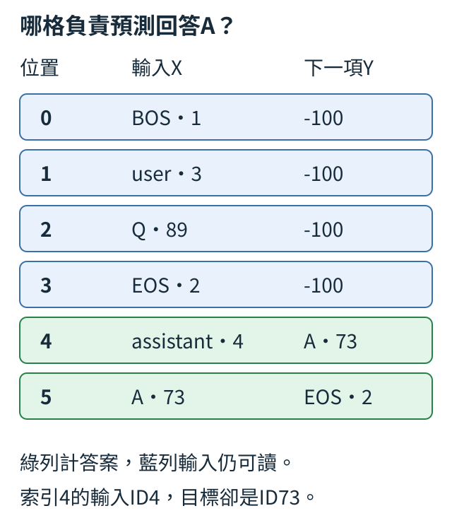
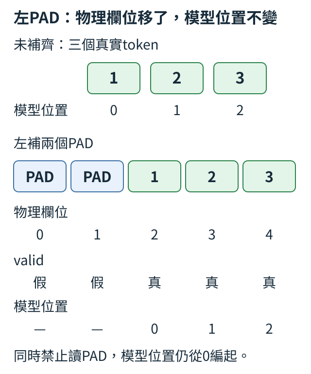
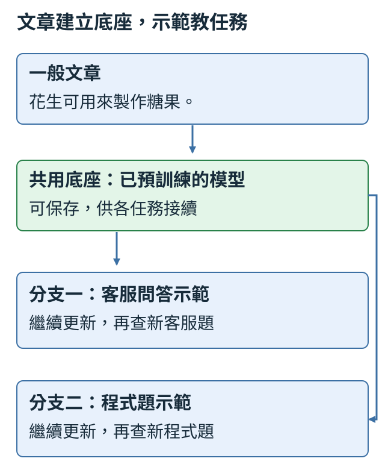
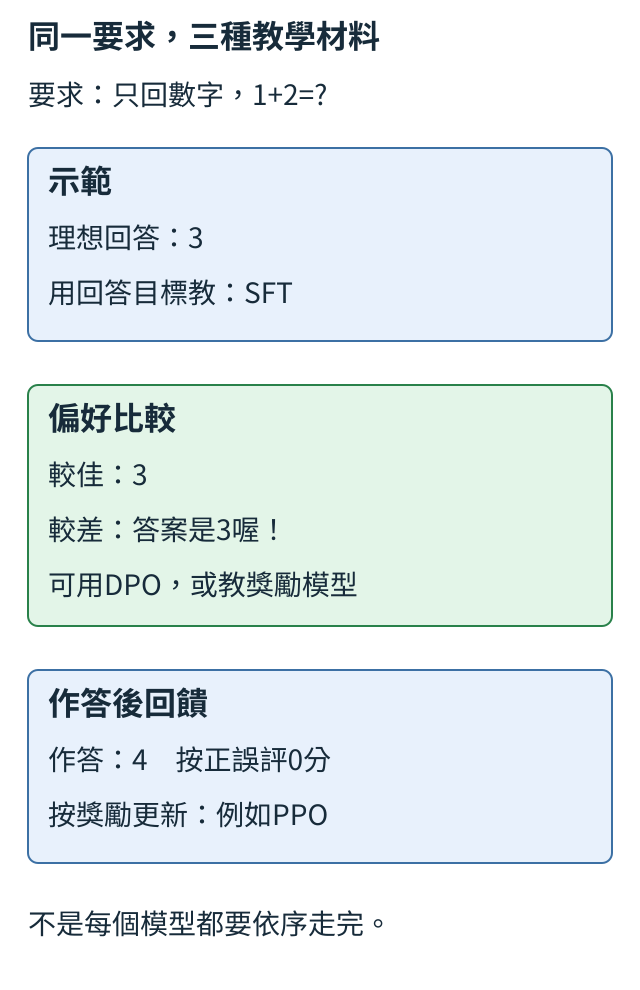
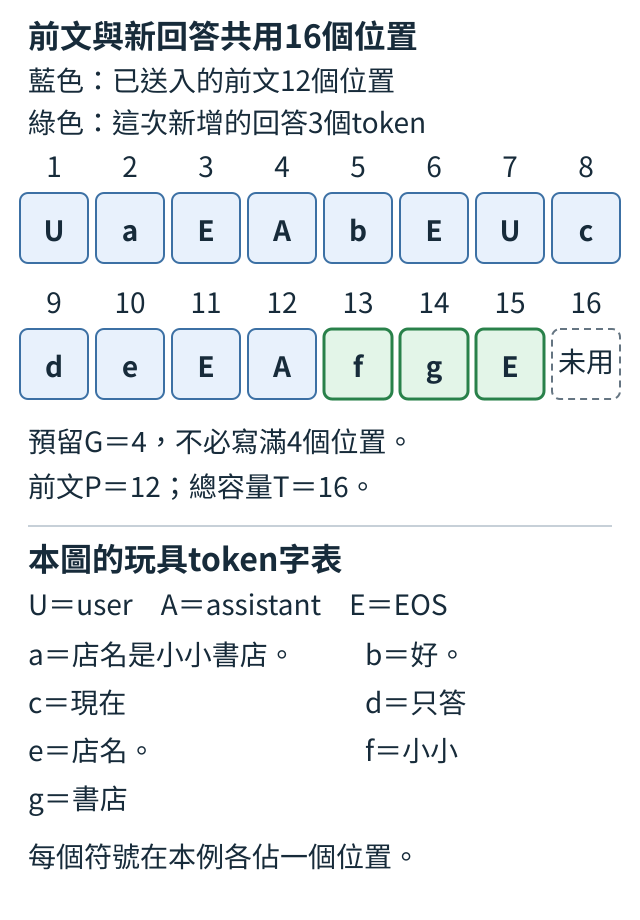
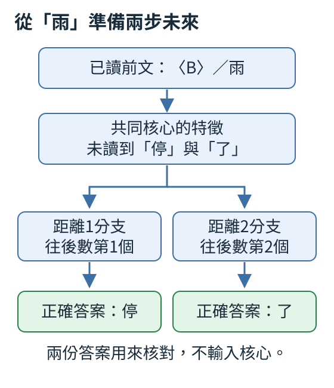
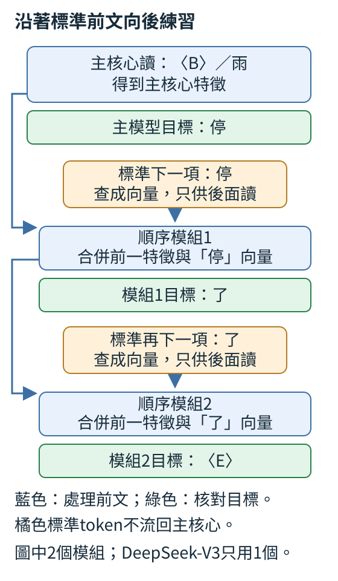

# 第 7 章：從續寫文字到回答問題

從一筆「1+1=?→2」開始，追蹤誰在說話、回答的第一個 token 在哪個位置被預測，以及哪些內容只供讀取、哪些答案要計代價。接著處理填充、結束與截斷，再把這些約定接到監督式微調（SFT），並用留出的驗證題與測試題檢查成果。章末比較預訓練與後訓練的教法、數清前文與回答各佔多少容量，最後改一個訓練問題：讀到同一處時，除了下一個 token，能否也練習預測再下一個？

學會回答與長度上限後，[7.23–7.25](07.md#7.23)把思考投入（thinking effort）納入必修，分辨請求偏好、實際計算與答案品質；接著必修[C.1–C.5](0C.md#C.1)，比較步驟、候選與驗證的成本。

## 7.1 對話怎麼表示？

一位使用者問「1+1=?」，助手回答「2」。同樣兩段文字，若丟掉誰問誰答，模型只看到一串接續的字；先把每段的角色與內容分欄，再串成有邊界的序列，才能明確要求它在問題之後回答。

一筆對話是一份消息清單，每條消息是一個字典：`role` 記 user（使用者）或 assistant（助手），`content` 記原文字。tokenizer 沿用 [6.6](06.md#6.6) 的 ByteTokenizer：普通內容每個 byte 是一個 token；BOS（開始標記）、EOS（結束標記）和每種角色，各有一個特殊 token。下面把這份問答轉成模型輸入 X 與答案標籤 Y。

```python
from tiny_perceptron.data import IGNORE, ByteTokenizer, render_chat

messages = [
    {"role": "user", "content": "1+1=?"},
    {"role": "assistant", "content": "2"},
]
tok = ByteTokenizer()
x, y = render_chat(messages, tok)
print("模型輸入X", x.tolist())
print("答案標籤Y", y.tolist())
print("IGNORE是", IGNORE, "；有效目標", y[y != IGNORE].tolist())
```

X 是 `[1,3,57,51,57,69,71,2,4,58]`：1 是 BOS，3 是 user，57、51、57、69、71 是「1+1=?」五個字元的 byte 各加 8；接著 2 是 user 段的 EOS，4 是 assistant，最後的 58 是字元「2」（byte 50 加 8）。Y 也有 10 個位置，前八個是 −100，最後是 58 與 2。Y 的每個位置是一個**目標**：第 i 個目標，是 X 第 i 個位置要猜的下一項。所以 X 讀到 assistant（4）的位置要猜 58，讀到 58 的位置要猜 EOS（2）。

−100 是函式庫裡名叫 `IGNORE` 的常數，表示「這個位置不計代價」：模型在那裡照樣算出下一項的分數，但猜得好不好都不加進代價（loss）。它只出現在 Y，不是可以拿去查表的 token ID。整串 Y 也叫 labels；不是 −100 的目標叫**有效目標**。`y[y != IGNORE]` 用真／假條件挑出有效目標，得到 `[58, 2]`：58 是字元「2」，2 是 EOS 的 ID，也就是要求模型寫出「2」之後以 EOS 結束。user 的問題仍完整留在 X 裡，供後面的位置透過注意力讀取，只是不當成要模仿的答案。

這些數字是怎麼排出來的？下面是 `render_chat` 的原始碼：

```python
# 節錄自 tiny_perceptron/data.py：render_chat
def render_chat(messages, tokenizer=None):
    """邊界由角色欄位建立；使用者文字不會被解析為特殊 token。"""
    tok = tokenizer or ByteTokenizer()
    ids, targets = [tok.bos_id], [IGNORE]
    roles = {"user": tok.user_id, "assistant": tok.assistant_id, "system": tok.system_id}
    for message in messages:
        role = message["role"]
        if role not in roles or not isinstance(message["content"], str):
            raise ValueError("role 必須是 user/assistant/system，content 必須是文字")
        content = tok.encode(message["content"]) + [tok.eos_id]
        ids += [roles[role]] + content
        targets += [IGNORE] + (content if role == "assistant" else [IGNORE] * len(content))
    if not any(t != IGNORE for t in targets):
        raise ValueError("這筆對話没有可監督的 assistant 答案")
    return torch.tensor(ids[:-1]), torch.tensor(targets[1:])
```

函式一開始的 `tok = tokenizer or ByteTokenizer()` 處理沒有傳 tokenizer 的情況：這時參數是預設的 `None`，`or` 便取右邊，新建一個 ByteTokenizer。接著 `ids, targets = [tok.bos_id], [IGNORE]` 同時開兩份清單：`ids` 是完整序列，從 BOS 開始；`targets` 和 `ids` 逐項對應，記錄每個 token 要不要當成答案。BOS 不是答案，所以放 IGNORE。`roles` 把角色名稱對到特殊 token 的 ID。

迴圈逐條處理消息。`if` 先檢查角色是否合法、內容是不是文字：`isinstance(值, str)` 問「這個值是不是字串」；不符合就執行 `raise ValueError(...)`，主動丟出錯誤並停止，訊息說明哪裡不對。變數 `content` 和消息裡的 `"content"` 欄位同名，裝的卻是 ID：文字編碼後再接一個 EOS，標出這段話在哪裡結束。`ids += [roles[role]] + content` 把角色 token、內容與 EOS 接到 `ids` 尾端（`+=` 是「接在後面」）；角色 token 由 `role` 欄位決定，不是從內容文字猜的，這正是 6.6 說的邊界。`targets` 同步接上同樣長度的一段：角色 token 本身不是答案，放 IGNORE；後面括號裡的 `A if 條件 else B` 在條件成立時取 A、否則取 B，所以 assistant 的內容與 EOS 原樣抄進 `targets`，其他角色則換成同樣多個 IGNORE（`[IGNORE] * len(content)` 是把同一項重複 `len(content)` 次的清單）。

最後兩步。`any(...)` 只要有一項成立就是 True；若 `targets` 全是 IGNORE，這筆對話沒有可學的答案，直接報錯。`return` 把 `ids` 去掉最後一項當輸入、`targets` 去掉第一項當目標，這就是 [4.7](04.md#4.7) 的移一位。`targets` 原本和完整序列逐項對應，移位之後，Y 的第 i 個位置才變成「X 第 i 個位置的下一項，以及它要不要計分」。

有了這份格式，就能拿正確的助手回答當示範，繼續訓練一個已經學會續寫文字的語言模型（像第 4–6 章那樣逐 token 預測的模型），這叫**監督式微調**（Supervised Fine-Tuning，SFT）。這種事先訓練好、拿來當起點的模型從哪裡來，[7.11](#7.11) 與 [7.17](#7.17) 會說明；本節只處理資料怎麼排。模型仍是預測下一個 token，改變的是教材和哪些位置計分：文章教「原文接什麼」，問答教「這個問題應答什麼」。多輪對話也按消息順序逐條加上角色，不能靠內容裡的字樣猜誰在說話。接下來 [7.2](#7.2) 看推論時輸入停在哪裡，[7.3](#7.3)、[7.4](#7.4) 再細看哪些位置計分、回答的第一個 token 由誰預測。

練習只把第一段程式的問題改成 `"2+1=?"`。先預測：X 的長度與角色、邊界的位置都不變，有效目標仍是 `[58, 2]`；只有 X 位置 2 的 ID 從 57（字元「1」）變成 58（字元「2」）。再執行核對。這裡故意讓答案仍是 2，是為了只看格式的變化；若要把它當成正確的算術訓練例，回答必須一起改成 3，不能讓資料默默帶著錯答案。

## 7.2 模型怎麼知道輪到誰？

要讓助手接著回答「1+1=?」，輸入應停在哪裡？不能把還不知道的「2」先放進去，也不能只停在問題末尾。先用 EOS 結束 user 段，再放 assistant 標記，讓下一步正好預測回答的第一個 token。

本字表 BOS=1、EOS=2、user=3、assistant=4，普通內容的 byte 加 8。生成之前先送進模型的這段前文叫 **prompt**。下面直接拼出它，再和 [7.1](#7.1) 訓練時的輸入 X 比較。

```python
from tiny_perceptron.data import ByteTokenizer, render_chat

tok = ByteTokenizer()
question = "1+1=?"
prompt = [tok.bos_id, tok.user_id] + tok.encode(question) + [tok.eos_id, tok.assistant_id]
print(prompt)
print("最後一項", prompt[-1])
x, _ = render_chat([{"role": "user", "content": question}, {"role": "assistant", "content": "2"}])
print("訓練輸入X的前九項", x[:9].tolist())
assert prompt[-1] == tok.assistant_id
assert prompt == x[:9].tolist()
```

清單的 `+` 表示按順序相接，不是逐項相加，所以 prompt 是 `[1,3,57,51,57,69,71,2,4]`，共九個 token。`prompt[-1]` 取最後一項 4，第一個 assert 確認它是 assistant 標記。這裡沒有放入答案 2，因為生成時還不知道它；模型要從最後一個位置（assistant）的 logits 預測回答的第一個 token。`x, _ = ...` 的 `_` 表示 Y 這次用不到。印出的 X 前九項和 prompt 完全相同，第二個 assert 核對這件事：訓練時，X 在 assistant 之後才接上答案；推論時就停在 assistant，讓模型接著寫。

為什麼 user 段的 EOS 和 assistant 標記都要保留？兩者功能不同：EOS 宣告前一段話結束，assistant 指定下一段由誰說。訓練資料的每一筆都是「…EOS、assistant、回答」的順序，模型學到的是在這個結構之後開始回答。若推論時換了邊界順序，例如省略 EOS 或改用別的角色標記，模型遇到的是沒有練過的結構，不能因為字面看得懂就期待它接對。

多輪對話的歷史可以包含完整的舊回答，但當前這一輪只放到 assistant 為止。這份結構只告訴模型輪到誰，不提供算術能力；回答內容對不對，仍要用新題檢查。

練習只刪掉 prompt 那一行尾端的 `tok.assistant_id`。先預測：最後一項變成 EOS（2），模型的當前位置停在問題結尾，而不是我們指定的回答角色；第一個 assert 就會失敗並停下。再執行核對。這不是要修掉的程式錯誤，而是檢查發現 prompt 不符合約定。恢復後兩個檢查都通過。

## 7.3 哪些位置應該學？

「問→答」這筆對話，需要模型讀到「問」，但我們希望它練習寫的是「答」和回答結束。把問題留在輸入 X，再用 Y 標出哪些下一項要計代價，就能同時做到這兩件事。

回想 [7.1](#7.1)：Y 的第 i 個目標，是 X 第 i 個位置要猜的下一項；目標是 −100 的位置不計代價。`render_chat` 先讓 `targets` 和完整序列逐項對應，再和輸入一起移一位，所以「答案是什麼」和「要不要計分」會一起落在負責預測它的位置上。下面逐位置印出輸入 ID、目標與是否計分。這次沒有傳 tokenizer，`render_chat` 會自己建立同一份 ByteTokenizer（7.1 原始碼的 `tokenizer or ByteTokenizer()`）。

```python
from tiny_perceptron.data import render_chat

messages = [
    {"role": "user", "content": "問"},
    {"role": "assistant", "content": "答"},
]
x, y = render_chat(messages)
for position, (token, label) in enumerate(zip(x.tolist(), y.tolist(), strict=True)):
    status = "計代價" if label != -100 else "不計代價"
    print(position, "輸入ID", token, "目標", label, status)
print("有效目標數", (y != -100).sum().item())
assert (y != -100).sum().item() > 0
```

ByteTokenizer 以 byte 表示文字，「問」與「答」各是三個 byte，也就是各三個 token，所以不能按一個字算一個有效目標（見 [6.7](06.md#6.7)）。迴圈的 `enumerate(zip(...))` 同時提供位置編號與「輸入、目標」這一對，是 [1.1](01.md#1.1) 的 `enumerate` 和 [1.3](01.md#1.3) 的 `zip` 疊在一起；`status` 用 7.1 介紹過的 `A if 條件 else B` 選出要印的文字。最後的有效目標數應是 4：答的三個 byte，加上回答結尾的 EOS。user 內容、user 段的 EOS 與兩個角色標記，都不當成要模仿的答案。`(y != -100)` 得到一串真／假，`sum` 把 True 當 1、False 當 0 相加，正好數出有效目標；`.item()` 取成普通整數。

X 和 Y 交給不同的對象。X 交給模型，用每個 ID 查 [2.1](02.md#2.1) 的 embedding 表；Y 只交給交叉熵，和模型的預測比對，−100 從來不會被拿去查表。不計 user 位置的代價，並沒有刪掉問題，也沒有禁止後面的位置透過注意力讀它，[7.5](#7.5) 會實際檢查這一點。只學 assistant 的位置，能讓監督集中在回答上；但示範本身對不對，仍要另外核對。

練習只把 assistant 的內容改成 `"答案"`。先預測：兩個中文字共六個 byte，加 EOS 共七個有效目標；X 也會變長，被忽略的 user 問題仍在輸入裡。執行核對後，再試英文 `"OK"`：應是兩個 byte 加 EOS，共三個。有效目標的計數單位跟著編碼規則走，不跟著肉眼看到的字數走。

## 7.4 回答第一個 token 在哪個位置被預測？

問題 Q，回答 A。完整序列是 BOS、user、Q、EOS、assistant、A、EOS。要教模型寫出第一個 A，代價應落在 assistant 所在的位置，因為讀到 assistant 的那個位置正在猜下一項。

兩個字都是 ASCII，各一個 byte；Q 的 ID 是 81＋8＝89，A 是 65＋8＝73。X 去掉原序列的最後一項，Y 則去掉原序列的第一項，讓每個位置對上它的下一項：原序列索引 5 的 A 落在 Y 的索引 4，成為 X 索引 4（assistant）要猜的答案；原序列索引 6 的 EOS 落在 Y 的索引 5。圖把位置索引、輸入 ID 和目標 ID 分欄，先看索引 4 的 assistant→A，再看索引 5 的 A→EOS。



```python
from tiny_perceptron.data import ByteTokenizer, render_chat

tok = ByteTokenizer()
x, y = render_chat(
    [
        {"role": "user", "content": "Q"},
        {"role": "assistant", "content": "A"},
    ]
)
first = (y != -100).nonzero()[0].item()
print("X", x.tolist(), "Y", y.tolist())
print("首答案預測位置", first, "輸入", x[first].item(), "答案", y[first].item())
assert x[first].item() == tok.assistant_id
assert y[first].item() == tok.encode("A")[0]
```

輸出的 X 是 `[1,3,89,2,4,73]`，Y 是四個 −100 後接 73、2。`(y != -100).nonzero()` 列出條件為 True 的位置，`[0]` 取第一個，`.item()` 轉成整數，得到 first＝4：這個位置的 X 是 4（assistant），Y 是 73（A）。下一個位置的 X 是 73，負責預測 EOS（2）。原序列的索引、當前的輸入 ID 和目標 ID 是三種用途不同的數字，讀的時候要分開。

有效目標的數量對了，不代表位置對了。`render_chat` 已經移過一位；若訓練程式又自己移一次（[4.7](04.md#4.7) 提醒過的錯誤），X 會變成 `[1,3,89,2,4]`、Y 變成 `[-100,-100,-100,73,2]`。有效目標仍是 2 個，但 A 改由 user 段 EOS 的位置預測，assistant 的位置反而去猜 EOS。所以要同時檢查兩件事：第一個有效目標所在的位置，X 是 assistant，Y 是回答的第一個 byte。程式最後兩個 assert 做的就是這兩項檢查。`TinyLM` 與 `masked_loss` 都按同一個位置比較 logits 和 labels，不會再替你移位。

練習把問題 Q 改成 `"QQ"`，先預測回答的第一個目標從位置 4 移到 5，但 X[first] 仍是 4、Y[first] 仍是 73，再執行核對。接著只把答案 A 改成 B，先預測：first 仍是 5，答案 ID 變成 74，最後一個 assert 會失敗，因為它比對的仍是 A 的 ID 73；把那一行的 `"A"` 也改成 `"B"` 就會通過。兩次分別改變前文長度與回答內容，可以看清第一個目標的位置取決於哪些材料。

## 7.5 不算 loss 的內容就看不見嗎？

問題 Q 的位置不計代價，模型卻需要讀 Q 才能回答 A。這裡要分清兩件事。某個位置的預測和它自己的目標比對得到的代價，叫這個位置的**直接代價**；Q 所在位置的目標是 −100，沒有直接代價。可是 Q 這個 token 仍在輸入裡，後面預測 A 的位置會透過注意力讀到它，A 的代價也就沿著這條路，回頭影響 Q 的表示。

在最短的 Q／A 對話裡，Q 位於 X 的索引 2，ID 是 89。模型開頭用 ID 查 embedding 表 `model.embedding.weight`（每個 ID 一列，見 [2.1](02.md#2.1)），查出來的第 89 列就是 Q 的 embedding 向量。這張表被所有位置共用：任何位置讀到 ID 89，都查同一列。下面分別看兩個梯度：問題位置的 logits 的梯度，以及 Q 那一列 embedding 向量的梯度。

`logits` 是中間結果，PyTorch 預設不保留中間結果的 `.grad`，所以用 `retain_grad()` 要求留下它。`TinyLM` 的組成見 [4.6](04.md#4.6)，`masked_loss` 見 [5.1–5.2](05.md#5.1)。

```python
import torch
from tiny_perceptron.data import render_chat
from tiny_perceptron.model import TinyLM, ModelConfig, masked_loss

torch.manual_seed(42)
x, y = render_chat([{"role": "user", "content": "Q"}, {"role": "assistant", "content": "A"}])
model = TinyLM(ModelConfig(width=8))
logits = model(x[None])["logits"]
logits.retain_grad()
masked_loss(logits, y[None]).backward()
print("問題位置logits的梯度", logits.grad[0, 2].norm().item())
print("Q的embedding向量梯度", model.embedding.weight.grad[x[2]].norm().item())
```

問題位置的目標是 −100，第一行應印 0：這個位置的候選分數完全不影響代價。第二行大於 0，因為後面答案的預測讀到了 Q。`norm` 把各數平方加總再開根號，這裡只用來看「是不是 0」；兩行屬於不同的量，大小不拿來互相比較。

第一行回答「這個位置的候選分數有沒有直接代價」，第二行回答「這份輸入表示有沒有影響後面的答案」。兩者都叫梯度，卻是對不同的變量問不同的問題。只檢查整個 embedding 層的 `.grad` 是不是 None，看不出 Q 那一列有沒有參與；只看到問題位置 logits 的梯度為 0，也不能推斷 user 內容都被凍結了。

所以不計 user 位置的代價，並沒有凍結 user 內容的 embedding 向量：它們會因為被後面讀取而收到梯度，在更新時跟著改變。若真的想切斷這條路，得另做別的操作，例如把查表後的向量 detach（讓梯度不再往回傳），或禁止回答讀 Q；那是新的設計決定，不是 −100 的效果。這段程式只求梯度，沒有呼叫 `step()` 更新參數；它檢查的是資料之間的依賴，還沒有教出回答能力。

練習只把 user 的 Q 改成 Z，答案 A 與種子都不動。先預測：問題位置 logits 的梯度仍是 0，Z 那一列 embedding 向量的梯度通常大於 0；再執行核對。X 索引 2 仍是問題字，程式會自動查新的那一列；這次測的是角色與位置的關係，不是 Q 這個字有什麼特別。

## 7.6 補齊 batch 的位置該算 loss 嗎？

兩筆對話長短不同，為了排成同一張表，短的那筆要補上 PAD（[6.6](06.md#6.6) 的填充 token，ID 0）。補上的位置沒有真正的答案，不能因為多補幾個位置，就讓平均代價變好，或要求模型學著寫 PAD。

先固定兩個位置的候選分數與答案，再接上三個目標為 −100 的位置。這樣可以單獨看平均代價的分子與分母，是否只計真正的兩個答案。注意兩種值的分工：PAD 是放在輸入 X 裡的 token ID，−100 是放在 labels 裡的忽略值。

```python
import torch
from tiny_perceptron.model import masked_loss

a = torch.tensor([[[0.0, 2.0, 0.0, 0.0], [0.0, 0.0, 0.0, 0.0]]])
labels = torch.tensor([[1, 2]])
b = torch.cat([a, torch.zeros(1, 3, 4)], dim=1)
extended = torch.tensor([[1, 2, -100, -100, -100]])
before = masked_loss(a, labels)
after = masked_loss(b, extended)
print(before.item(), after.item())
assert torch.allclose(before, after)
```

輸入 a 是一筆、兩個位置、四個候選，正確答案分別是 ID 1 與 2。第一個位置的分數 `[0,2,0,0]` 給 ID 1 約 0.711 的機率，代價約 0.341；第二個位置全是 0，每個候選的機率都是 0.25，代價約 1.386，所以平均約 (0.341＋1.386)÷2≈0.864。`torch.cat(..., dim=1)` 沿位置軸再接三個位置，形狀變成 `[1,5,4]`；新位置的目標都是 −100，分子不納入它們，分母仍是 2。兩次印出的平均應相同。

新位置的 logits 這裡設成全 0，但換成任何分數都一樣：只要目標是 −100，它們就不參與代價。反過來，若把目標誤設成 PAD 的 ID 0，交叉熵會認真把它當成「下一項應該是 0」的題目，產生新的更新方向。只把輸入填 0，代價的計算不會自動知道那是補齊。

代價的統計不變，還不代表模型讀入 PAD 後的預測不變；這段沒有跑模型，只檢查代價。讀取許可與位置編號由 [7.7](#7.7) 檢查。另外，補齊不能增加有效目標；整批的有效目標若是 0，平均根本無法計算，`masked_loss` 會直接報錯（見 [5.1](05.md#5.1)）。

練習只把 extended 的第一個 −100 改成 0。先預測：它變成第三個有效目標，答案是 ID 0、分數全 0，代價 ln 4≈1.386，平均變成 (0.341＋1.386＋1.386)÷3≈1.038，原本的 assert 失敗；再執行核對。改回 −100 後兩個值又相同。你沒有改原本兩個位置的預測，變化完全來自哪些位置被納入統計。

## 7.7 填充的位置會被當線索嗎？

原序列是 `[1,2,3]`，在左邊補兩個 PAD 後變成 `[0,0,1,2,3]`。我們希望真實的三個 token 得到和補齊前相同的預測。要做到這點有兩個條件：它們不能讀到 PAD；它們查位置表時，仍要用位置 0、1、2。

這裡有兩種編號。**物理欄位**是補齊後陣列裡的欄位索引，0 到 4，只用來在陣列裡找資料。**模型位置**是送進位置表的編號；位置表就是 [4.1](04.md#4.1) 那張依位置查向量的表，`TinyLM` 的 forward 用 `x = x + self.position(positions)` 把查到的位置向量加到 token 的 embedding 向量上。不傳 positions 時，TinyLM 直接用物理欄位 0、1、2…… 當模型位置，於是左補兩個 PAD 後，真實 token 會查到位置 2、3、4 的向量，和補齊前不同。所以要另外傳入 `positions`，讓最後三個真實 token 的模型位置仍是 0、1、2。

讀取許可則交給 `valid`：它標出哪些位置是真實 token。[3.6](03.md#3.6) 的因果遮罩只禁止讀未來，`valid` 另外禁止讀 PAD；兩個條件同時成立，一個位置才可以讀另一個位置。圖的上半是未補齊的三個真實 token 和它們的模型位置；下半是左補兩個 PAD 之後的序列，依序標出物理欄位、valid 與模型位置。



```python
import torch
from tiny_perceptron.model import TinyLM, ModelConfig

torch.manual_seed(42)
model = TinyLM(ModelConfig(vocab_size=10, width=8))
base = model(torch.tensor([[1, 2, 3]]))["logits"]
ids = torch.tensor([[0, 0, 1, 2, 3]])
valid = ids != 0
positions = torch.tensor([[0, 0, 0, 1, 2]])
actual = model(ids, valid=valid, positions=positions)["logits"][:, 2:]
print("非填充位置最大差", (base - actual).abs().max().item())
assert torch.allclose(base, actual, atol=1e-6, rtol=0.0)
```

base 是未補齊、三個真實 token 的 logits。補齊版的 ids 用 0 當 PAD，`valid` 是 `[False,False,True,True,True]`；positions 的最後三個是 0、1、2，前兩個 PAD 填什麼都不會被真實位置用到，這裡填 0。模型把 valid 與因果遮罩合成讀取許可，輸出再用 `[:, 2:]` 只取最後三個非填充位置來比較。最大差應是 0 或極小的浮點誤差；assert 容許百萬分之一的絕對差。

本例假定 ID 0 專供 PAD、真實內容不會用到 0，所以能用 `ids != 0` 算出 valid。換成別的字表要確認同樣的約定，不能無條件把所有 0 當成空位。一般的 batch 工具會直接回傳 valid（[7.10](#7.10) 的 `pad_batch` 就是），不必從 token 值去猜；後面的程式都應保留它。

訓練時，PAD 位置的目標另設為 −100，不計入 [5.2](05.md#5.2) 的平均代價；本例只比較 logits，沒有算代價。取消 valid，真實位置可能讀到 PAD；取消自訂的 positions，真實位置會查到不同的位置向量。兩種改動各自都會破壞相同的結果。

練習先只刪掉呼叫裡的 `valid=valid`、保留 positions。先預測差值不再接近 0、assert 失敗，再執行核對。恢復 valid 後，改成只刪 positions 再試一次，分別找出兩種差異的來源。比較時固定種子與模型，避免重新初始化把 PAD 的影響和其他變化混在一起。

<details>
<summary>補充：前面兩個 PAD 位置讀什麼？</summary>

前兩個 PAD 位置在因果遮罩下只能讀自己與更早的位置，而那些全是 PAD，又被 valid 禁止，於是它們沒有任何可讀的位置。注意力會把不可讀的分數設成負無窮；若一整列都是負無窮，softmax 會算出 NaN（not a number，不是有效數字），還可能擴散到後面的計算。本課的注意力程式把這種「沒有可讀位置」的輸出直接設成 0，原始碼見 [3.6](03.md#3.6) 的 `manual_attention`。這些 PAD 位置的輸出本來就不用：比較時用 `[:, 2:]` 排除，訓練時目標設為 −100。

</details>

## 7.8 補了 PAD 該取哪個輸出？

生成下一個 token 時，要用每筆最後一個真實位置的 logits，不能一律取矩陣的最後一欄。第一筆在右邊補 PAD，valid 是 `[真,真,假,假]`，最後的真實位置是索引 1；第二筆在左邊補，valid 是 `[假,真,真,真]`，最後的真實位置是索引 3。

只用「真實位置數減一」會出錯：第二筆有三個真實位置，算出 2，正確答案卻是 3。正確做法是找出每筆 True 所在的最大物理索引，再替每筆取那個位置的 logits。下面用人工編號的分數，讓取到哪個位置一眼看得出來。

```python
import torch

valid = torch.tensor([[True, True, False, False], [False, True, True, True]])
positions = torch.arange(4)[None].expand_as(valid)
last = positions.masked_fill(~valid, -1).amax(dim=-1)
logits = torch.arange(40, dtype=torch.float32).reshape(2, 4, 5)
selected = logits[torch.arange(2), last]
print("最後的真實位置", last)
print("逐筆手動取", logits[0, 1], logits[1, 3])
print("一次取出", selected)
assert last.tolist() == [1, 3]
assert torch.equal(selected[0], logits[0, 1]) and torch.equal(selected[1], logits[1, 3])
```

先看 `last` 怎麼算。`torch.arange(4)` 產生 `[0,1,2,3]`，是物理位置的編號；`[None]` 在最前面加一個長度 1 的筆數軸（[4.7](04.md#4.7) 用過），變成 `[[0,1,2,3]]`；`expand_as(valid)` 把這一列沿筆數軸重複成和 valid 一樣的形狀 `[2,4]`，讓兩筆各有一份編號。`~valid` 把真／假對調，`masked_fill(條件, -1)` 把條件為 True 的地方換成 −1，也就是把非真實位置的編號蓋掉，兩筆分別變成 `[0,1,-1,-1]` 與 `[-1,1,2,3]`。最後 `amax(dim=-1)` 沿最後一軸取最大值，得到每筆最後一個真實位置 `[1,3]`。

logits 用 0 到 39 排成形狀 `[2,4,5]`：兩筆、每筆四個位置、每個位置五個候選，數字只為了看清取到哪裡。逐筆手動取時，`logits[0, 1]` 是第 0 筆位置 1 的 `[5,6,7,8,9]`，`logits[1, 3]` 是第 1 筆位置 3 的 `[35,36,37,38,39]`。`logits[torch.arange(2), last]` 一次做完這兩件事：方括號裡放兩份等長的索引清單時，PyTorch 會逐項配對，筆數 `[0,1]` 配上位置 `[1,3]`，取出 `logits[0,1]` 與 `logits[1,3]`，疊成形狀 `[2,5]`。每筆一組下一項的候選分數，沒有多出位置軸。最後的 assert 確認一次取出的結果和逐筆手動取的相同。

選取只是找對起點，不會修改分數，也不會替你選出下一個 token。若某筆的 valid 全是 False，last 會是 −1，而 Python 的索引 −1 代表最後一個位置，結果會默默取到 PAD；正式的程式要先拒絕空題。前面的 valid 或模型位置若錯，取對最後位置也修不好預測。

練習只把第一筆的 valid 改成 `[False,False,True,True]`。先預測 last 從 `[1,3]` 變成 `[3,3]`，第一筆取到 `[15,16,17,18,19]`，第二筆不變；再執行，並把手動取與 assert 裡第一筆的位置一起改成 3。這次第一筆的真實位置數仍是兩個，最後位置卻不同，正好說明數量與最後位置是不同的資訊。

## 7.9 模型怎麼知道回答結束？

回答 A 之後應該結束，可是普通的句號後面也可能接下一句。把 EOS 這個特殊 token 放在回答尾端，並當成有效目標，模型才有機會學到「在這裡結束」。

生成另有一個上限，限制這次最多寫多少新 token。EOS 是模型自己選的結束，上限是外部給的預算。下面先查回答最後一個目標，再給一份手寫的候選 `[A, EOS, B]`，只驗證停止的判斷。

```python
from tiny_perceptron.data import ByteTokenizer, render_chat

tok = ByteTokenizer()
x, y = render_chat([{"role": "user", "content": "Q"}, {"role": "assistant", "content": "A"}])
print("最後一個目標", y[-1].item(), "EOS", tok.eos_id)
assert y[-1].item() == tok.eos_id
generated = [tok.encode("A")[0], tok.eos_id, tok.encode("B")[0]]
max_new_tokens = 2
visible = []
for token in generated[:max_new_tokens]:
    if token == tok.eos_id:
        break
    visible.append(token)
print("顯示的內容", tok.decode(visible))
```

第一行確認 [7.1](#7.1) 的 `render_chat` 產生的最後一個目標是 2，也就是 EOS。後半段的 generated 是預先寫好的模擬輸出 `[73,2,74]`，不是模型訓練後的實測：73 是 A，74 是 B。`generated[:max_new_tokens]` 只取前兩項，代表最多生成兩個新 token；迴圈每次檢查一項，遇到 EOS 就 `break`，立刻跳出迴圈，不把 EOS 加進要顯示的 visible。所以畫面只顯示 A，後面的 B 不會出現。

實際的模型每一步會替所有候選給出 logits，選出下一個 ID 後再檢查要不要停，就像 [1.14](01.md#1.14) 的逐步生成；這裡先給定結果，是為了單獨驗證停止規則。EOS 通常留在保存的 token 序列裡；轉回文字時，`decode` 只轉換普通內容的 ID（8 以上），跳過特殊 token，所以使用者看到的回答不會出現字面上的 `<eos>`。

歷史 user 段的 EOS 只表示那段話已經結束，不會讓還沒開始的 assistant 回答立刻停止。逐 byte 生成時，上限還可能把一個中文字切成一半，轉成文字前要像 [6.7](06.md#6.7) 那樣等 bytes 完整。評估時要分開記三件事：內容是否正確、模型是否自己選了 EOS、是否因為達到上限才停。只看到回答末尾有句號，分不出是模型選了 EOS 還是被上限截斷，更看不出內容對不對。

練習把 generated 改成 `tok.encode("ABCD")`，max_new_tokens 保持 2。先預測：裡面沒有 EOS，只能顯示 AB，再執行核對；這次停止來自上限，不代表模型學會適時結束。改回原本的清單則顯示 A。兩種停止來源都能直接驗證。

<details>
<summary>補充：實測中，會結束不等於答對</summary>

學會結束，也不等於內容答對。[T.4 的屬性問答模型](../training.md#T.4)訓練 900 次後，對一筆應回答 `circle` 的驗證題生成 `cire`，原始 ID 是 `[107,113,122,109,2]`：最後的 2 確實是 EOS，前四項卻拼出錯誤的答案。這份模型在五題驗證題與十題測試題都自己結束了，內容仍有許多錯誤。逐題結果在[實驗紀錄（JSON）](https://github.com/birdhackor/tiny-perceptron-vlm/blob/main/docs/course-experiments/results/sft.json)，這是機器可讀的完整結果：`results.after.validation.samples` 與 `results.after.test.samples` 的每一筆裡，`generated_ids` 是生成的 ID，`eos` 表示是否自己結束，`exact` 表示是否完全答對。因此評估要保留原始生成 ID 與 EOS 欄位，再分開計算答案是否正確，不能只看最後有沒有停。

重跑這份實驗：依 [T.4 的固定對話配方](../training.md#fixed-sft-recipe)，先用 `.venv/bin/python scripts/fetch_training_assets.py --asset ultrachat-sft` 取得資料包，再執行 `.venv/bin/python -m scripts.course_experiments.run --experiment sft --device cuda`；結果與權重檔寫在 `outputs/course-experiments/course-v1/sft/`。紀錄中的這次執行用一張 NVIDIA L4，訓練、評估與存檔共 31.7 秒（`elapsed_seconds`，不含環境建置與啟動）。

</details>

## 7.10 答案被截光了還在訓練嗎？

問題「很長的問題」，回答「是」。如果只保留序列的前兩個位置，剩下的是 BOS 和 user，沒有任何回答目標。輸入裡仍有 token ID，卻不表示這份資料還提供可以平均的答案代價。

labels 中不是 −100 的個數，就是平均代價的分母。把資料截短或切段後要重新數：至少要保留一個目標，也要看完整答案和 EOS 有沒有留下來。下面用專案的 `pad_batch` 把資料排成 batch，並故意只留兩個位置。

```python
from tiny_perceptron.data import IGNORE, pad_batch, render_chat

example = render_chat(
    [
        {"role": "user", "content": "很長的問題"},
        {"role": "assistant", "content": "是"},
    ]
)
try:
    pad_batch([example], max_length=2)
except ValueError as error:
    print("預期的資料錯誤：", error)
else:
    raise AssertionError("應該偵測到沒有可學的答案")
x, y = example
first = (y != IGNORE).nonzero()[0].item()
print("第一個有效目標的索引", first, "最低保留長度", first + 1, "完整長度", len(x))
```

`pad_batch` 把幾筆資料補齊成同一張表，`max_length=2` 要求最多只留兩個位置。這一筆截斷後全是 −100，`pad_batch` 會報錯。為了讓程式在預期的錯誤之後繼續，這裡用 `try`：先試著執行 try 底下的程式；若發生 except 指名的那種錯誤（ValueError），就改跑 except 底下的程式，`as error` 把錯誤取名為 error，印出來就是錯誤訊息。若 try 底下完全沒出錯，則跑 else。我們預期一定會報錯，沒報錯反而表示檢查失效，所以在 else 裡用 `raise AssertionError(...)` 主動丟出錯誤。

程式後半段找出第一個有效目標在索引 18。原序列依序是 BOS、user、問題的 15 個 byte（五個字各三個 byte）、user 段的 EOS、assistant、答案的 3 個 byte 與 EOS，共 23 個 token；答案的第一個 byte 在原序列索引 19，移一位後落在 Y 的索引 18，由 X 在這個位置的 assistant 預測。所以長度至少要 19，才保留一個答案目標。完整長度是 22：X 是原序列去掉最後一項，所以 X 不含最後的 EOS；Y 的索引 18 到 21 依序是「是」的三個 byte 與 EOS，共四個有效目標。長度按 X／Y 的位置數計，不按中文字數；依 [7.4](#7.4)，回答的第一個 byte 由 assistant 的位置預測，所以最低合法長度不必把答案本身放進輸入。只有一個目標，表示平均有分母，不表示完整的回答都受過訓練。

`pad_batch` 怎麼補齊、又怎麼抓到空題？下面是它的原始碼：

```python
# 節錄自 tiny_perceptron/data.py：pad_batch
def pad_batch(examples, pad_id=0, max_length=None):
    """右側 padding；attention 的有效位置和 loss 的有效位置各自保留。"""
    if not examples:
        raise ValueError("batch 不能是空的")
    length = max(len(x) for x, _ in examples)
    if max_length is not None:
        length = min(length, max_length)
    x = torch.full((len(examples), length), pad_id, dtype=torch.long)
    y = torch.full_like(x, IGNORE)
    valid = torch.zeros_like(x, dtype=torch.bool)
    for row, (inputs, labels) in enumerate(examples):
        n = min(length, len(inputs))
        x[row, :n], y[row, :n], valid[row, :n] = inputs[:n], labels[:n], True
        if not (y[row] != IGNORE).any():
            raise ValueError(f"第 {row} 筆截斷後没有有效答案；增加 max_length 或移除這筆")
    return x, y, valid
```

`examples` 是一份清單，每項是一筆的「X、Y」。`max(len(x) for x, _ in examples)` 逐筆取輸入長度，用最長那筆當表的寬度（`_` 表示 Y 在這裡用不到）；有傳 max_length 時（`is not None`），再取兩者較小的那個。接著先做三張填好預設值的表：`torch.full` 做出全是 PAD 的輸入表，`torch.full_like(x, IGNORE)` 做出同形狀、全是 −100 的目標表，`torch.zeros_like(..., dtype=torch.bool)` 做出全是 False 的 valid。

迴圈 `for row, (inputs, labels) in enumerate(examples)` 逐筆處理，`row` 是第幾列。`n` 是這筆實際能放幾個位置，下一行用逗號一次填三張表：把前 n 個輸入、前 n 個目標與 True 填進第 row 列的開頭。資料都放在左邊，PAD 留在右邊，所以這是右側補齊。最後的 `if` 檢查這一列：`.any()` 問有沒有任何一個目標不是 −100，一個都沒有就報錯。錯誤訊息用的是 f 字串：開頭寫 `f` 的字串裡，大括號 `{row}` 會換成變數 row 的值，所以訊息會指出是第幾筆。逐筆檢查，才能避免一批之中的空題被其他題的答案掩蓋。

遇到長題，可以擴大上下文視窗、保住完整答案、重新設計切段方式，或明確地過濾掉，並記下來源與原因。語意被截斷的回答，也不能靠補一個 EOS 變成完整答案。

練習把第一段程式從 `try:` 到 `raise` 的六行，換成 `bx, by, valid = pad_batch([example], max_length=19)` 與 `print((by != IGNORE).sum().item())`。先預測：不再報錯，有效目標只有 1 個，也就是答案的第一個 byte；再執行核對。改成 22 應得到 4。用有效目標數，就能看出答案被截掉多少，而不是只看長題有多少輸入 token。

<details>
<summary>補充：自然對話的截斷實跑</summary>

自然對話尤其不能只問「放得進去嗎」。[T.4 的 UltraChat 小型實跑](../training.md#T.4)另取 100 筆資料的第一輪問題與回答，各保留最多 120 個 byte、末尾保持完整的字，再按家族切成 80／10／10 筆。這讓一筆能放進位置上限 256 的實跑小模型，答案也不會被截到一個有效目標都不剩；但有些問題與回答在句中就結束，意思可能已不完整。我們為片段加上的 EOS，表示這次片段結束，不是原對話已回答完畢。

這個獨立模型只更新 80 次，十題驗證題與十題測試題的答案 ID 完全相同的題數都是 0，實際生成也有大量零碎字詞；見[實驗紀錄（JSON）](https://github.com/birdhackor/tiny-perceptron-vlm/blob/main/docs/course-experiments/results/sft.json)的 `results.ultrachat_pilot.evaluation`，`matches` 是完全答對的題數。開放式問答本來就不能只靠與示範一字不差來判斷好壞；這份結果更沒有支持「已能完成原問題」。它適合確認下載、轉換、遮罩與更新走得通；若要研究完整的對話能力，應先保留題目語意與完整答案，再安排相應的模型與預算。

重跑這份實驗：依 [T.4 的固定對話配方](../training.md#fixed-sft-recipe)，先用 `.venv/bin/python scripts/fetch_training_assets.py --asset ultrachat-sft` 取得資料包，再執行 `.venv/bin/python -m scripts.course_experiments.run --experiment sft --device cuda`；結果與權重檔寫在 `outputs/course-experiments/course-v1/sft/`。紀錄中的這次執行用一張 NVIDIA L4，訓練、評估與存檔共 31.7 秒（`elapsed_seconds`，不含環境建置與啟動）。

</details>

## 7.11 預訓練模型怎麼學會對話？

讀文章時，模型練習「原文接下來是什麼」；當助手時，還要練「這位使用者要什麼回答」。先在大量文章上練續寫的階段叫**預訓練**（pretraining）。已經訓練好、拿來當下一階段起點的模型叫**底座**（base model），例如預訓練後保存、再拿去做 SFT 的模型。監督式微調把正確的問答與角色邊界放進輸入，只用回答位置的目標，繼續調整底座的參數。它仍是預測下一個 token、仍用 [1.8](01.md#1.8) 的交叉熵，不需要另換一種模型才能回答。

先用 0+0→0、0+1→1 兩筆對話，把輸入、答案與有效目標接到模型。下面新建一個隨機的小模型，只求梯度，讓這條從資料到代價的路看得見；真正的微調會載入底座和它配套的字表，再用 [5.1](05.md#5.1) 的最佳化器更新參數。`pad_batch` 回傳的 `valid` 標出非填充位置（[7.10](#7.10)）；Y 中不是回答的目標都是 −100，`masked_loss` 略過它們，只計回答的 bytes 與 EOS（[7.1](#7.1)）。問題仍在輸入裡供模型讀取。

```python
import torch
from tiny_perceptron.data import toy_conversations, render_chat, pad_batch
from tiny_perceptron.model import TinyLM, ModelConfig, masked_loss

torch.manual_seed(42)
examples = [render_chat(messages) for messages in toy_conversations()[:2]]
x, y, valid = pad_batch(examples)
model = TinyLM(ModelConfig(width=8))
loss = masked_loss(model(x, valid=valid)["logits"], y)
loss.backward()
print("batch形狀", x.shape, "有效目標數", (y != -100).sum().item())
print("代價", loss.item())
```

`toy_conversations` 產生專案合成的加法對話，前兩筆的問題是 0+0 與 0+1，回答 0 與 1；每個答案是一個 byte 加 EOS，所以有效目標共 4 個。`pad_batch` 回傳 X、Y 與 valid；這兩筆一樣長，每筆 10 個位置，形狀是 `[2,10]`。模型在每個位置輸出 264 個候選分數（256 種 byte 加 8 個特殊 token）。最後的代價為正，`backward()` 算出梯度，表示資料、模型和代價接通了；這段沒有呼叫 `optimizer.step()`，還沒有真正訓練。

`toy_conversations` 本身只有幾行：

```python
# 節錄自 tiny_perceptron/data.py：toy_conversations
def toy_conversations():
    return [
        [{"role": "user", "content": f"{a}+{b}=?"}, {"role": "assistant", "content": str(a + b)}]
        for a in range(4)
        for b in range(4)
    ]
```

這是 [1.1](01.md#1.1) 教過的清單寫法 `[... for ...]`，只是寫了兩個 `for`：外層的 a、內層的 b 各從 0 跑到 3，所以依序產生 0+0、0+1、0+2、0+3、1+0……共 16 筆。每筆是一份消息清單：`f"{a}+{b}=?"` 是 [7.10](#7.10) 的 f 字串，把 a、b 的值填進問題；`str(a + b)` 把和轉成文字當回答。`toy_conversations()[:2]` 取到的就是 0+0 與 0+1。

要知道微調有沒有用，得固定題目與選字規則（[1.15](01.md#1.15)），比較微調前後的內容、格式和原本的能力。為了比較而分開訓練的版本叫**支線**，比較時要寫明它們差在哪些條件，例如起點、資料或更新次數。專案用另一份合成資料比較過兩條支線，訓練題是 45 筆屬性問答：題目用欄位列出顏色、形狀等屬性再發問，例如 `color=green;shape=square;pitch=low;shape?`，答案是 `square`。兩條都從同一份隨機參數出發。第一條直接用 SFT 的資料格式（加上角色標記，只用回答位置的目標）訓練，沒有先學過續寫，嚴格說不是 [7.1](#7.1) 定義的微調，而是用來對照的支線。第二條先把同一批問題與答案接成純文字練續寫，再用同樣的格式微調。這個文字階段只讀這 45 筆，不是在大量文章上預訓練；它也讓第二條比第一條多更新 250 次，所以成績差異不能全算在「先練續寫」這個安排上（細節見補充）。業界為什麼常分成兩個階段、資料成本差在哪裡，[7.17](#7.17) 再展開；眼前只需記住：材料從文章換成了回答示範。

練習取第一筆對話，沿用 7.1 的消息結構：每項是含 role 與 content 的字典，第二項是 assistant 的答案。下面逐項複製字典成新的消息清單，再把答案 0 改成 3。

```python
messages = [message.copy() for message in toy_conversations()[0]]
messages[1]["content"] = "3"
exercise_x, exercise_y = render_chat(messages)
print("練習的有效目標", exercise_y[exercise_y != -100].tolist())
```

`message.copy()` 建立一份新字典；這裡 role 與 content 都是字串，逐項複製就足以讓修改只發生在練習的副本，`toy_conversations()` 給的原資料仍保留正確答案。`exercise_y[exercise_y != -100]` 只選出要計代價的答案 ID。執行前先預測：原本「0」的 byte 48 加 8 是 56，改成「3」後是 51 加 8＝59，輸出應為 `[59, 2]`；EOS 仍是 2，角色與問題都不變。

<details>
<summary>補充：兩條支線的實跑設定</summary>

我們實跑了兩條獨立的支線，兩條都用種子 42 建立模型，從同一份隨機參數出發。第一條直接用 SFT 的資料格式（加上角色標記，只用回答位置的目標），用 45 筆屬性問答更新 900 次；第二條先把這 45 筆的問題與答案接成文字、練 250 次續寫，保存後再以同樣的格式微調 900 次。第二條並沒有沿用前幾章的故事模型，也沒有先得到廣泛的知識。兩條支線的對話階段都用同樣的寬度 64、兩層、種子 42、每批 16 筆與學習率 0.003，最後用同一組測試題比較，成績見 [7.17](#7.17)。切分以家族為單位（[5.12](05.md#5.12)），[7.12](#7.12) 用四種組合再示範一次。要把成績差異歸因於「先練續寫」這個安排，還需另外匹配總訓練預算。

重跑這份實驗：依 [T.4 的固定對話配方](../training.md#fixed-sft-recipe)，先用 `.venv/bin/python scripts/fetch_training_assets.py --asset ultrachat-sft` 取得資料包，再執行 `.venv/bin/python -m scripts.course_experiments.run --experiment sft --device cuda`；結果與權重檔寫在 `outputs/course-experiments/course-v1/sft/`。紀錄中的這次執行用一張 NVIDIA L4，訓練、評估與存檔共 31.7 秒（`elapsed_seconds`，不含環境建置與啟動）。

</details>

## 7.12 模型會回答新組合嗎？

訓練時見過紅圓、藍圓、藍方，把紅方留出、不拿來更新參數。紅與方都出現過，新的只是兩者同時出現的組合。這種切法能問模型會不會組合已學過的屬性，和考從未見過的顏色不同。

先把任務寫清楚：給一個物件的顏色與形狀，問「是什麼形狀？」。例如「紅色方塊是什麼形狀？」的答案是「方塊」。答案就寫在題目裡，模型要學的是找出被問的那個屬性、照格式回答。這份小材料有兩種顏色×兩種形狀，共四種組合；答案由形狀決定。

| 屬性組合 | 問題 | 答案 | 用途 |
| --- | --- | --- | --- |
| 紅、圓 | 紅色圓形是什麼形狀？ | 圓形 | 訓練 |
| 藍、圓 | 藍色圓形是什麼形狀？ | 圓形 | 訓練 |
| 藍、方 | 藍色方塊是什麼形狀？ | 方塊 | 訓練 |
| 紅、方 | 紅色方塊是什麼形狀？ | 方塊 | 留出作測試 |

下面只安排四種組合的切分，檢查訓練與測試沒有交集；沒有訓練模型，也沒有產生答題成績。

```python
all_pairs = [(color, shape) for color in ["紅", "藍"] for shape in ["圓", "方"]]
held_out = {("紅", "方")}
train = [pair for pair in all_pairs if pair not in held_out]
print("訓練組合", train)
print("留出作測試的組合", held_out)
assert not (set(train) & held_out)
```

第一行是有兩個 `for` 的清單寫法（[7.11](#7.11) 的 `toy_conversations` 也是這樣寫）：每種顏色都配上每種形狀，依序是紅圓、紅方、藍圓、藍方。`held_out` 用集合保存留出的組合，`if pair not in held_out` 只保留其餘的。輸出三組訓練組合；`&` 取兩個集合的交集（[1.2](01.md#1.2)），assert 確認兩組沒有共同的項目。這個檢查只驗證分組規則。

同一屬性組合的所有措辭要分在同一邊，不能只看表面文字分組。例如「紅色方塊是什麼形狀？」和「一個紅方形，請說出形狀」都屬於紅方，答案都是方塊；兩題都要留在測試這邊，不能一題進訓練、另一題進測試，然後宣稱考的是新組合。這就是 [5.12](05.md#5.12) 的**家族**：同一組屬性衍生出來的題目，切分時整組放在同一邊。資料工具應記錄顏色與形狀欄位，按這些欄位分組。

練習把 held_out 改成 `{("藍", "圓"), ("藍", "方")}`，先預測訓練只剩兩種紅色組合、訓練中完全沒有藍色，再執行核對，並寫一句「這次測的是沒見過的顏色」說明目標變了。恢復紅方留出後，確認紅、藍、圓、方在訓練中各出現至少一次，才回到新組合的原問題。

<details>
<summary>補充：獨立實驗與閱讀範圍</summary>

專案另有 12 個家族的獨立實驗，每個家族是一種屬性組合；逐題紀錄見[實驗紀錄（JSON）](https://github.com/birdhackor/tiny-perceptron-vlm/blob/main/docs/course-experiments/results/sft.json)，`results.data` 列出訓練、驗證、測試各有幾筆、幾個家族。那份比較的支線更新預算不同，而且只有一個種子和少量組合，不能當作通則。讀這個四種組合的例子不需要執行該實驗；本節只示範材料與切分，沒有新的訓練結果。

重跑這份實驗：依 [T.4 的固定對話配方](../training.md#fixed-sft-recipe)，先用 `.venv/bin/python scripts/fetch_training_assets.py --asset ultrachat-sft` 取得資料包，再執行 `.venv/bin/python -m scripts.course_experiments.run --experiment sft --device cuda`；結果與權重檔寫在 `outputs/course-experiments/course-v1/sft/`。紀錄中的這次執行用一張 NVIDIA L4，訓練、評估與存檔共 31.7 秒（`elapsed_seconds`，不含環境建置與啟動）。

</details>

## 7.13 後續改動要和什麼比？

1+1 的回答是 `{"answer":3}`，格式整齊、數字卻錯。之後改風格、拒答或壓縮模型時，要先保存固定的題目和分項規則，才能知道改善的是交付方式，還是回答內容。

JSON（JavaScript Object Notation，JavaScript 物件表示法）把欄位名稱與值保存成文字。下面要求只有 answer 一個欄位、而且值真的是整數；內容則另外問是否等於 2。這是兩個可以一過一錯的檢查。

```python
import json

reply = '{"answer": 3}'
parsed = json.loads(reply)
scores = {
    "格式符合": isinstance(parsed, dict) and set(parsed) == {"answer"} and type(parsed["answer"]) is int,
    "1+1內容正確": parsed.get("answer") == 2,
}
print(scores)
assert scores["格式符合"] and not scores["1+1內容正確"]
```

輸入 reply 是示意的回答字串，不是模型當場生成的。`json.loads` 把它解析成 Python 字典 `{"answer": 3}`。格式檢查有三項，用 `and` 串起來、全部成立才算符合：`isinstance(parsed, dict)` 問解析結果是不是字典；`set(parsed) == {"answer"}` 要求鍵恰好只有 answer（`set` 取出字典的全部鍵）；`type(parsed["answer"]) is int` 要求值的類型確實是整數。為什麼不用 `isinstance(值, int)`？JSON 的 `true`、`false` 會解析成 Python 的 `True`、`False`，而 Python 把真假值當成整數的一種（bool 是 int 的子類別，True 等於 1），所以 `isinstance(True, int)` 也成立，`{"answer": true}` 會被誤判成整數答案；`type(...) is int` 只接受真正的整數。內容檢查用 `get` 取 answer 欄位，沒有這個欄位時回傳 None 而不報錯；字典的基本用法見 [W.2](../first-steps.md#W.2)。輸出是格式 True、內容 False，最後的 assert 確認這兩種結果可以同時發生。

評估規則應在比較前寫明，例如算術用精確數值、分類用合法標籤；對開放式回答，可能需要多種合理答案或分項審讀，不一定只用字串完全相同。若只把所有表現加成一個總分，格式提升可能抵消事實退步；保存指標向量，也就是幾個分項數字，能保留這種行為差異。

基準要保存完整題目、模型的權重檔、配套的 tokenizer 與生成設定，後續改動都用同一份題目重測。是否正常結束也單獨記。一份基準若被反覆拿來挑設定，它就成了驗證資料；最後仍要用沒有參與挑選的測試題。缺資訊、開放建議或安全邊界各有相應的標準，不能拿 JSON 解析代替判斷。

練習只把 reply 的 3 改成 2，先預測格式仍是 True、內容變成 True，原本的 assert 會失敗，再執行核對，並把 assert 改成兩項都是 True 的檢查。再把欄位 answer 改名為 result：數字雖然是 2，格式要求與欄位讀取都不符合。分別解釋這兩項失敗，讓評估規則可以被追蹤。

<details>
<summary>補充：後續實驗的起點</summary>

本課後續實驗保留的屬性基準是 [T.4 實跑](../training.md#T.4)的 `sft/model.pt`，也就是 [7.11](#7.11) 補充裡的第一條支線：從隨機參數開始、直接用 SFT 的資料格式練 900 次的模型，不是成績較好的 `pretrain-sft.pt`；[7.14](#7.14)–[7.16](#7.16) 都把它當底座。它在十題測試題只答對 5 題，因此後續改動要對照這個實際起點，不能先假定原本的能力已經滿分。[實驗紀錄（JSON）](https://github.com/birdhackor/tiny-perceptron-vlm/blob/main/docs/course-experiments/results/sft.json)的 `results.after.test` 記錄這次成績（`matches` 是答對題數），`samples` 每題保存問題（`messages`）、正確答案（`expected`）、生成的 ID（`generated_ids`）、是否完全答對（`exact`）與是否結束（`eos`）。之後做新任務或壓縮時，用完整的固定題目再量一次，才能看見哪些面向改善、哪些退步。

重跑這份實驗：依 [T.4 的固定對話配方](../training.md#fixed-sft-recipe)，先用 `.venv/bin/python scripts/fetch_training_assets.py --asset ultrachat-sft` 取得資料包，再執行 `.venv/bin/python -m scripts.course_experiments.run --experiment sft --device cuda`；結果與權重檔寫在 `outputs/course-experiments/course-v1/sft/`。紀錄中的這次執行用一張 NVIDIA L4，訓練、評估與存檔共 31.7 秒（`elapsed_seconds`，不含環境建置與啟動）。

</details>

## 7.14 少量錯誤答案會被學走嗎？

1+1 的正確答案是 2，資料卻標成 3。[1.8](01.md#1.8) 的交叉熵會自己發現標錯嗎？它只看我們提供的目標得到多少機率；模型越相信錯的標籤，這筆資料的代價反而越低。

用四個候選「0、1、2、3」做一個獨立的小算例：這裡的 ID 0 到 3 只是四個候選的編號，剛好和數字相同，不是 byte 字表裡字元「0」到「3」的 ID（那些是 56 到 59）。先給正確候選 2 分數 3、錯誤候選 3 分數 1，再只把錯誤候選的分數提高到 5。

```python
import torch
from torch.nn import functional as F

logits = torch.tensor([[0.0, 0.0, 3.0, 1.0]])
for label in [2, 3]:
    loss = F.cross_entropy(logits, torch.tensor([label]))
    print("提供的答案ID", label, "代價", loss.item())
wrong_favored = torch.tensor([[0.0, 0.0, 3.0, 5.0]])
print("提高錯誤候選分數後，錯標代價", F.cross_entropy(wrong_favored, torch.tensor([3])).item())
```

四個分數經過 softmax，候選 2 約 0.810、候選 3 約 0.110，所以提供 label 2 時代價約 0.211，提供 label 3 時約 2.211。最後把錯誤候選的分數提高到 5，錯誤標籤的代價降到約 0.139，儘管正確答案 2 得到的支持變少了。交叉熵完全照著輸入的 label 計算，不會自動檢查 1+1 的數學事實。

真實訓練中，錯誤答案也會產生清楚的梯度，推動模型在這類前文之後更常接出錯字。如果錯例反覆出現或答案很長，它佔的有效目標可能超過它的筆數比例，見 [5.16](05.md#5.16)。少量錯誤會不會造成可觀的影響，要實測才知道，不能只靠這一個位置的代價，推出所有模型都會如何的量化結論。

所以要先獨立核對標籤，再用乾淨的驗證題與測試題檢查內容。專案做過一個小對照：從同一個底座出發的兩條支線，一條保留正確答案、一條把四筆答案改錯，在同樣的十題測試題上分別答對 7 題與 6 題，錯標的那條平均代價卻略低。題目少、只有一個種子，不能據此估計錯標一般會造成多少退步；但它再次說明，代價較低不能代替答對（數字與條件見補充）。

練習只把最後錯誤候選的分數 5 改成 8。先預測：錯標的代價繼續下降，但正確答案 2 的代價會變大；再執行，並另外算 label 2 的代價核對。這次只改了模型的偏好，沒有改算術事實，能直接看到「最佳化我們提供的目標」與「外部任務是否正確」的差別。

<details>
<summary>補充：錯標實驗的設定與成績</summary>

我們從 [7.13](#7.13) 保留的底座各複製一份，做這個比較。這份起點是從隨機參數開始、用 SFT 的資料格式練了 900 次的模型；兩條支線都用同樣的 45 筆訓練題再更新 300 次、每批 16 筆。一條保留正確答案，另一條把其中四筆的 `circle` 與 `square` 對調，約佔 8.9%。四筆集中在兩個訓練過的家族，並不是隨機把所有任務均勻汙染。問題、更新步數與抽題起點都不變，兩條支線的有效目標數都是 33,733；驗證題與測試題仍用正確答案評分。

| 繼續練習的答案 | 驗證題完整答對 | 測試題完整答對 | 測試題平均代價 |
| --- | ---: | ---: | ---: |
| 全部保留正確答案 | 2／5 | 7／10 | 0.37101 |
| 四筆形狀答案寫錯 | 1／5 | 6／10 | 0.34698 |

這次錯標的支線少答對一題，測試題的平均代價卻略低。這並不矛盾：代價看的是給定正確前文時每個位置的機率，完整答對看的是模型沿著自己的輸出，最後能否生成整份答案，[5.8](05.md#5.8) 已拆過兩者。兩條支線在全部驗證題與測試題都會以 EOS 結束，這也不能替內容過關。只有一個種子、兩個被改動的家族和很少的新題，這些數字不能推成「固定比例的錯標必然造成多少退步」；它們提醒我們保存兩種結果，而不是挑代價較低的就說資料無害。[實驗紀錄（JSON）](https://github.com/birdhackor/tiny-perceptron-vlm/blob/main/docs/course-experiments/results/sft_ablation.json)的 `results.corruptions` 列出四筆改動，`results.runs.clean` 與 `results.runs.noisy` 是兩條支線的成績。

重跑這份實驗：先依 [T.4 的固定對話配方](../training.md#fixed-sft-recipe) 完成 `sft`，再執行 `.venv/bin/python -m scripts.course_experiments.run --experiment sft_ablation --device cuda`。紀錄中的這次執行用一張 NVIDIA L4，共 23.5 秒（`elapsed_seconds`，不含環境建置與啟動）。

</details>

## 7.15 學會新任務會忘記舊任務嗎？

一個模型先學會回答顏色和形狀的題目（任務 A），再只練加法（任務 B）。兩個任務共用同一組參數，練 B 的更新可能改到 A 所依賴的數字，造成**遺忘**。要發現它，得先在兩個任務上各測一次，再從同一個模型繼續訓練，之後用同一批 A 題與 B 題重測。

A 題沿用 [7.12](#7.12) 的題型：題目寫明物件的顏色與形狀，問其中一個屬性。答案字面上就在題目裡，對人很容易，模型要做的是找到被問的屬性、照格式回答。正因為簡單，它很適合用來看遺忘：只練加法之後，模型連這種題都可能答成數字（實測見補充）。B 題是 1+1 與 2+1。下面先建立記錄表，四格 None 是還沒測的成績；真正的評估除了問題，還要保存正確答案與固定的選字規則。

```python
measurements = {
    "訓練B之前": {"A舊任務": None, "B新任務": None},
    "只訓練B之後": {"A舊任務": None, "B新任務": None},
}
a_questions = ["紅色圓形是什麼形狀？", "藍色方塊是什麼形狀？"]
b_questions = ["1+1=?", "2+1=?"]
print("固定A題", a_questions)
print("固定B題", b_questions)
print("待填成績", measurements)
```

輸入是兩份固定的評估題與一張四格的記錄表。None 表示尚未測量，不是 0 分，也不是模型拒答；這段只建立比較用的表，沒有在背後訓練模型，所以不填假成績。表的兩列是「訓練B之前」與「只訓練B之後」，兩欄是 A 與 B 的成績，下面說的成績都指這四格之一。

真正的流程是：拿已學會 A 的模型當底座，在 A、B 題各測一次，保存檢查點（checkpoint，[5.7](05.md#5.7)）；再從它接著只用 B 資料更新，保存新的檢查點，用同一批 A、B 題重測。不能新建一個隨機模型，冒充「同一個模型繼續訓練」。這些評估題必須是留出的題目：不拿來更新參數，並寫明是驗證題還是測試題。

若「只訓練B之後」的 B 成績提高、A 成績下降，可以說新的學習伴隨舊任務退步。但若 A 在「訓練B之前」就不會，「只訓練B之後」的 A 成績再低，也說明不了遺忘。專案的實測中，A 的測試題從 5/10 降到 0/10，B 的測試題仍是 0/7：這只顯示舊任務退步，不支持新能力已經學好。是否正常結束與回答風格，也要和內容分開記。

練習在 a_questions 新增一題，例如 `"紅色方塊是什麼形狀？"`，但不加入任何訓練資料。先預測：這段程式只是擴大待測清單，四格仍是 None；再執行核對。你改變的是觀察範圍，不是模型訓練；真正重測時，兩個檢查點都要用更新後的同一份清單，不能一邊多一道難題。

<details>
<summary>補充：遺忘實驗的設定與成績</summary>

本課實跑的 A 屬性任務使用 [7.13](#7.13) 保留的底座，實際的 A 題是英文欄位格式，例如 `color=blue;shape=circle;pitch=low;shape?`，答案是 `circle`；B 則是 0 到 7 的短加法題。從同一份底座接著只用 49 筆 B 題更新 500 次後，A 的十題測試題由答對 5 題降到 0 題。原本應回答 `circle` 的屬性題，這時甚至會生成 `9` 並正常結束；舊任務的內容表現確實變差，不只是多加一句客氣話。

但不能把這份結果寫成「新能力學好了，代價是忘掉舊能力」。B 的七題測試題仍是 0 題答對，雖然它的平均代價已從 7.05820 降到 4.57756，訓練資料上的代價也降了。這次看到的是舊任務退步，而新任務還沒有在沒教過的加法組合上成功。兩個加數對調的題仍放在同一家族，所以 `2+3` 教過時、`3+2` 答對不會被算成獨立的新組合。[實驗紀錄（JSON）](https://github.com/birdhackor/tiny-perceptron-vlm/blob/main/docs/course-experiments/results/sft_ablation.json)的 `results.before` 是訓練 B 之前、`results.runs.b-only` 是只訓練 B 之後，各自的 `A_attributes` 與 `B_arithmetic` 底下有驗證題（`validation`）與測試題（`test`）的成績，`matches` 是答對題數。下一節把舊題混回來，再看兩邊完整的成績。

重跑這份實驗：先依 [T.4 的固定對話配方](../training.md#fixed-sft-recipe) 完成 `sft`，再執行 `.venv/bin/python -m scripts.course_experiments.run --experiment sft_ablation --device cuda`。紀錄中的這次執行用一張 NVIDIA L4，共 23.5 秒（`elapsed_seconds`，不含環境建置與啟動）。

</details>

## 7.16 舊例子混回去有用嗎？

只練加法，會改到屬性題也依賴的共用參數。一個辦法是在新任務的每個 batch 裡，再放進少量舊屬性題，讓兩種目標都提供更新訊號。這叫**回放**（replay）：每次更新都用當前的參數重新計算舊題的代價與梯度，不是把以前算好的梯度存起來重放。

例如舊題「紅色圓形是什麼形狀？」應答「圓形」，新題「1+1=?」應答「2」。下面 A 與 B 各兩筆、每筆假設有兩個有效目標，合成一個四筆、八個有效目標的 batch。source 記錄來源；text 只用「舊題一」這類代號表示這份配方，真正訓練要換成完整的問答。

```python
a = [
    {"source": "A", "text": "舊題一", "answer_tokens": 2},
    {"source": "A", "text": "舊題二", "answer_tokens": 2},
]
b = [
    {"source": "B", "text": "新題一", "answer_tokens": 2},
    {"source": "B", "text": "新題二", "answer_tokens": 2},
]
recipe = a + b
print("每批來源", [record["source"] for record in recipe])
print("有效目標數", sum(record["answer_tokens"] for record in recipe))
print("待測B-only與回放各自的A/B成績")
```

輸入兩筆 A 與兩筆 B，所以每批的來源是 A、A、B、B，有效目標共 8 個，兩個任務各半。`sum(... for record in recipe)` 把每筆的 answer_tokens 加起來，寫法和 [7.10](#7.10) 的 `max(... for ...)` 相同。text 只是代號，不是完整的訓練對話；真正的資料要用實際的問答與實測的答案長度。這段只計算配方與預算，沒有訓練，所以不輸出虛構的成績曲線。

比較兩種配方時，要先說清楚固定了什麼。情境一：每批固定四筆。只用 B 題訓練的支線（下文稱 B-only）每批四筆都是 B，共 8 個有效目標；回放每批兩筆 A、兩筆 B，也是 8 個。總預算相同，但回放裡新任務只佔一半，這是方法本身的取捨。情境二：回放在原本的兩筆 B 之外再加兩筆 A，B-only 卻仍只有那兩筆 B。這時回放每批多算了兩筆資料，不能說兩邊的成本相同。

專案的實測裡，回放支線的 A 測試題保住 6/10，B-only 是 0/10；兩邊的 B 測試題都仍是 0/7。舊屬性答案比加法數字長，回放的有效目標也接近翻倍，所以這不是在相同有效目標數下的純粹效果（細節見補充）。

練習把 recipe 改成 `[a[0], b[0], b[1], b[0]]`，先預測來源比例 A：B 是 1：3（25%：75%）、有效目標仍是 8，再執行核對。為了保持四筆，這裡重複了一筆 B；真正的實驗應換成不同的 B 資料，重複不會增加資料的覆蓋範圍。接著把 B 題的 answer_tokens 改成 4，重算後，有效目標的比例就不再是 25%：75%：配比要說清楚是按筆數還是按有效目標數（[5.16](05.md#5.16)）。

<details>
<summary>補充：回放實驗的設定與成績</summary>

把 [7.15 的實跑](#7.15)加上回放支線，兩條支線都從同一份底座開始、更新 500 次，每批 16 題、學習率 0.003。B-only 只抽 49 筆加法訓練題；回放則從 45 筆舊屬性題加 49 筆加法題一起抽。下面比較完整答案的 ID，兩個任務的題目與生成上限始終相同：

| 模型狀態 | A 驗證題／測試題答對 | B 驗證題／測試題答對 | 這段訓練的有效目標數 |
| --- | --- | --- | ---: |
| 訓練B之前 | 1／5、5／10 | 0／8、0／7 | — |
| B-only，500 次 | 0／5、0／10 | 0／8、0／7 | 18,453 |
| 回放，500 次 | 4／5、6／10 | 0／8、0／7 | 36,384 |

回放支線保住了這批舊題的表現，測試題還多答對一題；但兩條支線的 B 在加法的驗證題與測試題都沒有答對任何一題，所以不能說回放已讓兩種能力一起學好。兩條支線與起點在這些題都會生成 EOS，內容成績的差異並非漏掉結束標記。表中的答對數以完整題目計：A 有 5 題驗證題、10 題測試題，B 分別有 8 題、7 題；各支線都比較全部的驗證題與測試題，沒有挑掉錯題。

還要讀右欄：相同的步數與筆數，不代表相同的監督總量。舊屬性答案比加法數字長，混回 A 後，這次的有效目標數接近翻倍；輸入也較長，運算成本不能視為已經完全匹配。這個實驗支持「在這個配方下，舊任務保留得較好」，沒有隔離出相同有效目標數下的純粹回放效應。[實驗紀錄（JSON）](https://github.com/birdhackor/tiny-perceptron-vlm/blob/main/docs/course-experiments/results/sft_ablation.json)的 `results.runs.replay` 是回放支線，`training.effective_tokens` 是表中右欄的有效目標數。

重跑這份實驗：先依 [T.4 的固定對話配方](../training.md#fixed-sft-recipe) 完成 `sft`，再執行 `.venv/bin/python -m scripts.course_experiments.run --experiment sft_ablation --device cuda`。紀錄中的這次執行用一張 NVIDIA L4，共 23.5 秒（`elapsed_seconds`，不含環境建置與啟動）。

</details>

## 7.17 為什麼先大量讀文章，再練習當助手？

讀過許多食譜，接到「列三種不含花生的點心」仍可能開始介紹食材。文章的合理下一句，和使用者需要的交付物不同。前面已實際接過 SFT，現在從材料怎麼取得、怎麼重用，看兩個階段的理由。

一般文章如「花生可用來製作糖果」，原文本身就提供了每個位置的下一字答案；在大量這種文章上學習，就是 [7.11](#7.11) 說的預訓練。問答則需要有人寫出理想的三項點心，並核對裡面沒有花生。接在底座之後的學習叫**後訓練**（post-training），SFT 是其中一種。先用假設的整理成本看兩者的差異：文章每筆 1 單位、核對過的問答每筆 20 單位。

```python
article_count, checked_chat_count = 1000, 50
article_cost, checked_chat_cost = 1, 20
print("文章整理成本", article_count * article_cost)
print("問答整理成本", checked_chat_count * checked_chat_cost)
print("若1000筆都逐筆核對問答", article_count * checked_chat_cost)
```

輸入是筆數與假設的每筆成本。三行分別是 1000、1000、20000：少量需要仔細核對的問答，已經能花掉與大量文章相同的整理預算。這段沒有訓練模型，也沒有計算訓練的運算費用；它說明資料取得的方式為何會影響配方，不能證明「先預訓練一定比較省」或「50 筆問答一定夠」。兩個階段的實際成效，仍要用固定預算與留出的測試題檢查。

底座就是 [7.11](#7.11) 定義的起點模型，這裡指預訓練後保存下來的模型。下圖從文章訓練出一個共用的底座，再分給兩個任務各自繼續更新；圖中的客服問答與程式題只是兩個例子。底座可以保存、重複使用，但每條分支仍需要自己的示範材料與評測。原文自動提供下一字答案，不表示文章內容可靠；後訓練也不只是改語氣，示範與回饋也能改變回答的格式和解題步驟（[7.18](#7.18) 的補充有例子）。



[InstructGPT 的引言與 3.1 節](https://arxiv.org/pdf/2203.02155v1)展示這種目標差別與接續流程。眼前的成本是假設，不證明兩個階段必然更省；[7.11](#7.11) 屬性問答實驗的成績也沒有匹配總預算。

練習只把 `checked_chat_cost` 改成 5，先預測問答整理成本變成 250、全部逐筆核對變成 5000，再執行核對。接著寫一句：這個算例還缺什麼才能選配方？至少缺實際的資料品質、訓練成本，以及驗證題與測試題上的表現。這些不是用成本比例就能代填的數字。

<details>
<summary>補充：屬性問答的兩階段實測</summary>

本教材的[實驗紀錄（JSON）](https://github.com/birdhackor/tiny-perceptron-vlm/blob/main/docs/course-experiments/results/sft.json)讓這條路變得可操作：[7.11](#7.11) 補充的第二條支線，十題測試題從對話微調前答對 1 題，變成微調後答對 7 題（`results.pretrain_then_sft` 的 `before_sft.test` 與 `after_sft.test`，`matches` 是答對題數）。但它的文字階段只讀同一批 45 題的材料，沒有學到廣泛的知識；與從隨機參數直接用 SFT 資料格式訓練的那條支線（5／10）相比，它還多了 250 次文字更新。因此這份實驗驗證了接續流程與這次的成績，沒有隔離出業界採用兩個階段的因果理由。[19.4](19.md#19.4) 會把保存與接續用到整合模型，而不是要求你先相信兩個階段必勝。

重跑這份實驗：依 [T.4 的固定對話配方](../training.md#fixed-sft-recipe)，先用 `.venv/bin/python scripts/fetch_training_assets.py --asset ultrachat-sft` 取得資料包，再執行 `.venv/bin/python -m scripts.course_experiments.run --experiment sft --device cuda`；結果與權重檔寫在 `outputs/course-experiments/course-v1/sft/`。紀錄中的這次執行用一張 NVIDIA L4，訓練、評估與存檔共 31.7 秒（`elapsed_seconds`，不含環境建置與啟動）。

</details>

## 7.18 後訓練有哪些不同教法？

問題是「只回數字：1+2=?」。可以示範 3，也可以讓人比較「3」與「答案是3喔！」哪個好，或者先讓模型作答 4，再按正誤給 0 分。先看三種給模型的材料，再記方法的名字。

示範提供期望的回答；偏好比較提供同一題的兩份回答中哪一份較好；作答後的回饋提供一個分數。這個分數叫**獎勵**（reward），是依我們指定的規則打的分，不自動等於回答的真實品質。下面的資料都是手寫的。

```python
demonstration = {"question": "只回數字：1+2=?", "answer": "3"}
preference = {"question": demonstration["question"], "chosen": "3", "rejected": "答案是3喔！"}
feedback = {"question": demonstration["question"], "sampled_answer": "4", "reward": 0}
print("示範給什麼", demonstration["answer"])
print("偏好比較什麼", preference["chosen"], "勝過", preference["rejected"])
print("作答後得到什麼", feedback["sampled_answer"], feedback["reward"])
```

輸入是我們人工寫的字典：`chosen` 表示被選為較佳、`rejected` 表示較差，`sampled_answer` 記錄作答，這裡只是用 `4` 示意，沒有真的讓模型抽樣作答。輸出依序是示範 `3`、偏好 `3` 勝過附加句、錯答 `4` 得到 0。偏好裡的兩份回答數字都對，但後者違反了「只回數字」；回饋則採用這個例子的正確性規則。換了任務，不能沿用數字 0 就假裝已定義好完整的標準。

只有理想回答時，用它當示範就是 SFT。有偏好比較時，可以直接調整模型對兩份回答的傾向，**直接偏好最佳化**（Direct Preference Optimization，DPO）是其中一種方法；它需要可靠的比較，以及一個固定參考：訓練起點的模型副本，保留下來、不再更新，用來衡量新模型偏離了多少。

也可以先用人類的偏好比較，訓練一個**獎勵模型**：輸入題目與回答，輸出一個分數。接著讓要訓練的模型自己作答，由獎勵模型替這些回答打分，再依分數更新模型，讓高分的回答更常出現。這種「自己作答、依得到的分數調整」的訓練叫**強化學習**（Reinforcement Learning，RL）。分數的源頭是人類偏好時，整個流程叫**人類回饋強化學習**（Reinforcement Learning from Human Feedback，RLHF）。**近端策略最佳化**（Proximal Policy Optimization，PPO）則是強化學習裡的一種更新方法，每次只讓回答的機率改變一小步。RLHF 說的是回饋從哪裡來、流程怎麼接，PPO 說的是參數怎麼更新，兩個名詞的層次不同；細節在第 13 章。



這些是可選的教法，不必依序全跑。若分數來自程式驗算，即使用 PPO 更新，也不叫人類回饋。[InstructGPT](https://arxiv.org/pdf/2203.02155v1) 和 [DeepSeek-R1](https://arxiv.org/pdf/2501.12948v1) 給出不同的接續配方，方法的機制在[第 13 章](13.md#13.1)展開；後訓練也可能改善任務能力，必須另用新題查證。

練習把問題改成「用一句話解釋1+2」。先寫出新的示範回答；再重新判斷原本的偏好是否還合理：`chosen` 的「3」沒有解釋，`rejected` 的「答案是3喔！」也沒有，只把兩欄對調並不夠，要把 chosen 重寫成一句真正解釋加法的話，例如「1 加 2，就是從 1 往後數 2 個，得到 3」。最後說明：若用真人比較、程式驗算或另一個模型評分，回饋的來源各是哪一種？方法的縮寫不應遮住這個差別。

<details>
<summary>補充：後訓練不只改語氣</summary>

後訓練能改變的不只語氣。若示範包含解題步驟，或回饋能辨認答案的正誤，它也可能改善模型做某些任務的能力；成功與否仍要用新題檢查。另一個實際配方是 [DeepSeek-R1 論文的 2.2 與 2.3 節](https://arxiv.org/pdf/2501.12948v1)：一條路線從已完成預訓練的底座，直接用作答回饋做強化學習；另一條先用少量理想的解題示範，教出清楚的起始回答方式，再接後續訓練。這批起步時加入的示範稱為**冷啟動資料**。兩條路線說明 SFT 不是所有強化學習配方不可省略的前一步，不代表我們的微型模型能重現論文的能力。

</details>

## 7.19 回答能寫多長，和前文能放多少，有何不同？

你先告訴助手「店名是小小書店」，它回「好」。下一輪問「現在只答店名」，希望它寫出「小小書店」就結束。這次回答很短，助手卻仍要讀到前面的店名、誰說了哪句話，以及現在輪到它回答。只數最後這個問題，會漏掉真正送進模型的前文。

我們把對話排成一串，用一個只有 16 個位置的紙上例子看清楚。這裡特別指定一份玩具字表：〈user〉是使用者標記，〈assistant〉是助手標記，〈eos〉就是 EOS，表示這一段結束；每個標記各算一個 token。文字片段「店名是小小書店。」「好。」「現在」「只答」「店名。」「小小」「書店」也各自指定為一個 token。這是為了容易數位置而訂的規則，沒有說一般模型把一句話算一個 token，也沒有說每個中文字都算一個 token。

照這份字表，已提供的歷史和目前的問題排成下面的序列。表中每個由斜線分開的項目佔一個位置，斜線只用來顯示分隔，不送入模型。

| 這段訊息 | 依序放入的token | 位置數 |
| --- | --- | ---: |
| 先前使用者說店名 | 〈user〉／店名是小小書店。／〈eos〉 | 3 |
| 先前助手確認 | 〈assistant〉／好。／〈eos〉 | 3 |
| 現在的要求 | 〈user〉／現在／只答／店名。／〈eos〉 | 5 |
| 輪到助手回答 | 〈assistant〉 | 1 |

全部輸入佔 12 個位置。最後的助手標記已經在輸入裡，下一步才開始生成答案；歷史裡的結束標記也佔位置，但不會讓新的回答立即停止。把對話依角色與文字排成這種輸入序列，叫作序列化。實際使用別的模型時，要用它配套的對話格式與 tokenizer 數這份序列，不能直接沿用這裡的 12。

圖中 U、A、E 分別代表三種標記，a 到 g 代表上面指定的文字片段。先看第 1 到 12 個位置：它們都是已送入的前文。第 13 到 16 個位置才是預留給新回答的空間；第 13 到 15 個位置填入的 f、g、E 是手寫的示意回答，第 16 個位置沒有用到。



這份生成器保留完整歷史，並規定「前文加上新生成的 token」最多 16 個位置；這個總上限就是上下文視窗（context window）的長度，記為 T。前文的長度記為 P，本例 P＝12。另有一個設定 G，只限制這次最多新增幾個 token，常見名稱是 max_new_tokens。G 不包含已送入的 12 個位置，也不會把 T 改大，所以必須滿足 P＋G≤T。下面用手寫的候選代替模型每一步選出的 token，試三種 G：

```python
T = 16
prompt = ["〈user〉", "店名是小小書店。", "〈eos〉", "〈assistant〉", "好。", "〈eos〉"]
prompt += ["〈user〉", "現在", "只答", "店名。", "〈eos〉", "〈assistant〉"]
P = len(prompt)
print("前文長度P", P, "還能生成的位置T-P", T - P)
candidates = ["小小", "書店", "〈eos〉", "謝謝"]
for G in [4, 2, 5]:
    if P + G > T:
        print(f"G={G}：P+G={P + G} 超過 T={T}，拒絕這個設定")
        continue
    reply = []
    for token in candidates[:G]:
        reply.append(token)
        if token == "〈eos〉":
            break
    reason = "模型選了EOS" if reply[-1] == "〈eos〉" else "用完G"
    print(f"G={G}：新增{len(reply)}個token {reply}，停止原因：{reason}")
```

第一行印出 P＝12，剩下 T−P＝4 個位置可以生成。G＝4 時，候選在第三個 token 選了〈eos〉，`break` 提早結束，只新增 3 個 token，最後一個預留位置沒有用到。EOS 也算在新增的數量裡：它雖然不顯示成回答文字，仍是模型選出的一個 token。沒用到的位置不是補進輸入的 PAD，只是空間還沒用完。G＝2 時只能留下「小小／書店」，讀者已看得到完整店名，卻還沒有生成〈eos〉：這次是預算用完而截停。G＝5 時 P＋G＝17，超過 T＝16，程式先拒絕這個設定，而不是假裝多出的空間存在；`continue` 跳過這一輪剩下的程式，直接試下一個 G。

反過來，若第一步就選〈eos〉，雖然提早停止，店名仍沒有回答。回答長度、停止原因與內容是否完成，各自告訴我們不同的事。

練習保持前文不變，把 candidates 改成 `["小小", "〈eos〉"]`。先預測 G＝4 時新增幾個 token、有沒有超過 G、是否完成「只答店名」，再執行核對：應得到 2 個、沒有超過、沒有完成。空間足夠、主動結束，都不能替少掉的「書店」補上證據。

<details>
<summary>補充：長度設定的來源與這個算例的範圍</summary>

Hugging Face Transformers v4.57.1 的 [GenerationConfig 文件](https://github.com/huggingface/transformers/blob/v4.57.1/src/transformers/generation/configuration_utils.py)把 max_new_tokens 定義為不含 prompt 的新生成上限；vLLM v0.8.5 的 [ModelConfig 文件](https://github.com/vllm-project/vllm/blob/v0.8.5/vllm/config.py)把 max_model_len 定義為 prompt 與 output 的總長度。本節採用保留完整歷史、共用一個總上限的簡化例子；滑動視窗或其他模型介面，要另看它們的長度規定。

實際核對正常結束時，還要保存原始 token 與停止原因，分清模型選了 EOS、程式強制加上 EOS 和其他外部停止條件，不能只看畫面末尾。回答目標與 EOS 的監督位置沿用 [7.3](#7.3)、[7.4](#7.4)、[7.9](#7.9) 的安排。

</details>

## 7.20 下一個之外，還能一起練習預測什麼？

讀到「雨」，下一個字可能是「停」；若訓練材料的完整句子是「雨停了」，再下一個則是「了」。以前每個位置只交一份下一步的答案。現在想讓模型讀同一段前文時，也為稍遠的未來做準備，可以多交一份「再下一步」的答案。

這種訓練稱為 **Multi-Token Prediction（MTP，多 token 預測）**。它改的是學習目標：在同一個前文位置，要求模型預測不止一個未來的 token。我們希望這些額外練習，能讓共用的特徵包含對後續有用的線索；是否真的改善能力，要看資料、架構與訓練條件。先看目標怎麼改，不把它當成已學會整句話。

本例特別指定每個中文字各是一個 token，另有開始標記〈B〉（即 BOS）與結束標記〈E〉（即 EOS），它們也各佔一個位置。訓練序列是「〈B〉／雨／停／了／〈E〉」，斜線只表示分隔。讀到「雨」的位置，依 [3.6](03.md#3.6) 的因果遮罩只能使用〈B〉和雨，不能先讀到停與了。

模型裡負責讀前文、替每個位置算出特徵的主體，也就是 embedding、注意力與 FFN 這些層，下文叫**核心**。把讀到「雨」的那份特徵送到兩條預測分支：**距離 1** 的分支預測往後數第 1 個 token「停」，**距離 2** 的分支預測往後數第 2 個 token「了」，中間隔著一個停。每條分支先用自己的一小段網路處理這份特徵，最後都交給同一個輸出層（output layer；[4.6](04.md#4.6) 那種把特徵變成每個候選分數的層，也叫 LM head）算出分數。選讀引用的論文把每條分支自己的那一小段網路叫 head；它既不是 [3.7](03.md#3.7) 的注意力頭，也不是共用的輸出層。兩條分支共用核心與輸出層，卻各有自己的預測任務。



圖中的「停」與「了」是用來核對的正確答案，不是事先塞給核心的輸入。在這個平行版本中，距離 2 的分支也不先接距離 1 猜出的停；兩條都從相同的已讀前文預測，所以可能各自猜錯，也可能彼此不搭配。

每往後移一個位置，兩條分支的正確答案也跟著移動。下面逐個位置列出讀到的前文，以及兩個距離的目標：

```python
tokens = ["〈B〉", "雨", "停", "了", "〈E〉"]
for t in range(len(tokens) - 1):
    read = "／".join(tokens[: t + 1])
    near = tokens[t + 1]
    far = tokens[t + 2] if t + 2 < len(tokens) else "（沒有目標）"
    print(f"位置{t} 讀到 {read}｜距離1：{near}｜距離2：{far}")
```

`range(len(tokens) - 1)` 是位置 0 到 3：最後的〈E〉後面沒有下一項，不必再預測。`tokens[: t + 1]` 是位置 t 能讀的前文，`"／".join(...)` 用斜線把它們接成一段文字，方便顯示。距離 d 的目標就是 `tokens[t + d]`；位置 3 讀到「了」時，往後數兩個已經超出序列，所以距離 2 沒有目標，[7.21](#7.21) 會處理這種位置。

訓練時，這四個位置可以一起算，但因果遮罩仍限制每個位置只讀當時的前文。「一次同時算很多個位置」和「同一個位置多預測一個未來答案」，是兩種不同的改動。

練習把 tokens 改成「〈B〉／雨／又／停／了／〈E〉」，每字仍各一個 token。先預測讀到「雨」的位置 1，兩條分支各該學什麼，再執行核對。

<details>
<summary>練習的答案思路</summary>

位置 1 讀到〈B〉／雨，距離 1 的目標是「又」，距離 2 的目標是「停」。距離 2 的意思是往後數第 2 個 token，不是「永遠猜句子的最後一字」，所以這時還輪不到「了」。

</details>

<details>
<summary>選讀：這裡的平行分支對應哪個來源？</summary>

[Gloeckle 等人 2024 年原論文的第 2 節](https://arxiv.org/pdf/2404.19737v1)使用共用的核心與各自獨立的未來分支。原文的分支含 Transformer 層，之後共用同一個輸出層，也就是把特徵映成字表分數的矩陣；本圖只畫任務關係，沒有畫出分支內部的層。原論文的比較還會調整核心與分支的層數，不能把增加分支說成免費增加能力。

只用距離 1 的分支，也能照常**逐 token 生成**（也叫自回歸，autoregressive）：每次只生成一個 token，接回輸入再算下一個，就像 [1.14](01.md#1.14)。額外的分支能否拿來加速，另需草稿與驗證程序，見 [16.14](16.md#16.14)。

</details>

## 7.21 未來答案該對到哪個位置？

沿用「〈B〉／雨／停／了／〈E〉」：距離 2 的分支讀到「停」時，要學的是〈E〉；讀到「了」時，序列裡已經沒有往後數第 2 個 token。若為了湊出一個答案，拿下一篇文章的開頭當答案，就把兩份無關的材料接成了同一句。

因此每條分支都要有自己的目標位置與有效範圍。這個例子的規則是：**可以預測 EOS 本身，但不能越過它**；沒有目標的位置填 [7.3](07.md#7.3) 的 −100，不計代價。角色邊界、PAD 與拼接在一起的多篇文件，也要按資料規則另外處理，不能把整批資料的答案直接整排平移，讓超出尾端的部分繞回開頭。

下面只計算兩條分支的交叉熵，不建立或訓練完整的模型。字表次序固定為雨、停、了、〈E〉，ID 分別是 0、1、2、3（〈B〉從來不是目標，這裡省略）。人工分數全設為 0，每個候選的 softmax 機率都是四分之一；先用這個容易手算的情況，核對哪些位置真的計分。

```python
import torch
import torch.nn.functional as F

vocab = ["雨", "停", "了", "〈E〉"]
next_labels = torch.tensor([0, 1, 2, 3])
later_labels = torch.cat([next_labels[1:], torch.tensor([-100])])
next_scores = torch.zeros(4, 4)
later_scores = torch.zeros(4, 4)

next_loss = F.cross_entropy(next_scores, next_labels, ignore_index=-100)
later_loss = F.cross_entropy(later_scores, later_labels, ignore_index=-100)
weight = 0.5
total = next_loss + weight * later_loss
print("距離2的目標", later_labels.tolist())
print("各分支有效目標數", (next_labels != -100).sum().item(), (later_labels != -100).sum().item())
print("各分支平均代價", round(next_loss.item(), 4), round(later_loss.item(), 4))
print("加上輔助代價後", round(total.item(), 4))
```

每張分數表有四列（四個已讀位置）、四欄（字表裡的候選）。距離 1 的四個目標依序是雨、停、了、〈E〉。距離 2 的目標，就是去掉距離 1 目標的第一項、在最後補一個 −100：`next_labels[1:]` 去掉第一項，`torch.cat` 把它和 `[-100]` 接成一條，得到 `[1,2,3,-100]`，也就是停、了、〈E〉和不計分。`cross_entropy` 在每條分支內只對有效目標取平均，所以有效目標數印出 4 和 3。每個有效目標的代價都是 `−log(1/4)`，兩條分支的平均都約 1.3863；總代價是距離 1 的代價加上半份距離 2 的代價，約 1.3863＋0.5×1.3863≈2.0794。主要目標仍是下一個 token，距離 2 這份額外加上的代價叫**輔助代價**（auxiliary loss）。

這裡選擇「距離 1 的平均代價＋0.5×距離 2 的平均代價」，是為了把係數和分母說清楚；係數 0.5 是本例指定的，不是所有 MTP 方法的預設。兩條分支先各自除以自己的有效目標數，再相加。若改成直接加總，距離 2 只有 3 項，總和約 4.159，自然比距離 1 的 4 項總和約 5.545 小，看起來像距離 2 猜得比較準，其實只是少算一項。真正訓練時，用總代價的梯度同時更新共用的核心與兩條分支，兩份目標都會影響學習；這段程式只做固定分數的數值核對。

如果兩篇文章被裝進同一列，還要保存它們的邊界。對較遠的目標而言，不只終點要有效，從當前位置走到終點的路上也不能跨過文件結束。對話微調則要明確決定哪些助手回答的位置受監督；原本距離 1 的遮罩不能不加思考就複製給每個距離。

練習只把 `weight` 改成 0。先預測：有效目標數仍是 4 與 3，兩條分支的平均代價仍約 1.3863，總代價只剩距離 1 的 1.3863；再執行核對。若真的用這個總代價更新，距離 2 的代價不再提供梯度：算出第二份數字，和用它教模型，是兩件事。

<details>
<summary>選讀：目標移位與論文配方</summary>

若目前位置是 t，距離 1 的目標在 t+1，距離 2 的在 t+2。這是 [7.4](07.md#7.4) 下一位置對齊向不同距離的延伸，不是改變因果注意力。Gloeckle 等人的[第 2 節](https://arxiv.org/pdf/2404.19737v1)加總不同距離的交叉熵；DeepSeek-V3 的[第 2.2 節式 24–25](https://arxiv.org/pdf/2412.19437v2)則定義各順序模組的代價與係數。比較配方時要讀它們完整的約定，不把本節按有效目標取平均、係數 0.5 的做法搬過去當成相同的公式。

</details>

## 7.22 為什麼有些MTP分支串成一條鏈？

平行版本讀到「雨」時，距離 2 的分支直接猜「了」。但「雨停」之後接「了」，和「雨又」之後接「了」，是不同的文字問題。能不能讓較遠的預測沿著中間的 token 一步步往前，而不是每條都只拿同一份雨的特徵？

**DeepSeek-V3 的 MTP** 採用**順序模組**（MTP module）。主模型的核心先讀已知的前文；第一個順序模組再拿到主核心在這個位置的特徵，以及訓練資料裡真正的下一個 token，處理後預測再下一個 token。順序模組是一段額外的神經網路，把兩份資訊合在一起，不是把答案文字直接當成模型的輸出。

沿用句子「雨停了」。讀到「雨」的主核心負責預測「停」；訓練時，第一個順序模組取得「雨」位置的特徵和標準序列中「停」的 embedding 向量，負責預測「了」。若再接第二個順序模組，就取得第一個模組的特徵和「了」的向量，預測〈E〉。下圖示範兩個順序模組，為的是看清資料流。



這份配對規則可以寫成程式：在位置 t，第 k 個順序模組讀進前一段的特徵，以及標準序列的第 t+k 個 token，目標是第 t+k+1 個 token。

```python
tokens = ["〈B〉", "雨", "停", "了", "〈E〉"]
t = 1  # 主核心讀到「雨」的位置
print(f"主核心：讀 {'／'.join(tokens[: t + 1])} → 目標 {tokens[t + 1]}")
for k in [1, 2]:
    source = "主核心" if k == 1 else f"順序模組{k - 1}"
    given, target = tokens[t + k], tokens[t + k + 1]
    print(f"順序模組{k}：讀{source}的特徵＋標準序列的「{given}」→ 目標 {target}")
```

`#` 後面的文字是註解，Python 執行時會略過。輸出三行：主核心讀〈B〉／雨、目標是停；順序模組 1 讀主核心的特徵與「停」，目標是了；順序模組 2 讀模組 1 的特徵與「了」，目標是〈E〉。每個模組讀進的標準 token，正好是前一段的目標；它自己的目標永遠在讀進的 token 後面一個位置。`given, target = ...` 一行同時取兩個值，和 [7.10](#7.10) 的 `pad_batch` 用逗號一次填三張表是同一種寫法。

為什麼訓練時可以提供「停」？因為第一個順序模組要學的是「雨停之後接什麼」，目標是再下一個的「了」；就像 [7.4](07.md#7.4) 的對話訓練把正確答案的前半段放進輸入，以便教後半段。這種用資料中的標準序列當訓練前文的做法叫 **teacher forcing**。它本身不等於 MTP：只預測下一個 token 的一般訓練也是這樣做，MTP 額外增加的是從同一個位置出發的更遠目標。

這沒有讓主核心在預測「停」時偷讀「停」：「停」的向量只流向順序模組。也沒有先把「了」交給第一個順序模組，再叫它答「了」。每一條箭頭都要對照「目前讀了什麼、接下來預測什麼」，才能分清合理的前文和洩漏的答案。

實際的 DeepSeek-V3 只用一個順序模組：主模型預測下一個 token，順序模組預測再下一個，不是本圖兩個模組的設定。和 [7.20](#7.20) 的平行分支一樣，順序模組也和主模型共用同一個輸出層；DeepSeek-V3 還讓它共用同一張 embedding 表（把 token 查成向量）。輸出層的權重是一張「字表大小×特徵寬度」的大矩陣，每個候選 token 佔一列；兩種做法都共用這張矩陣，所以多加一個預測距離，不必再多存一整張。平行分支與順序模組都屬於 MTP，資料流卻不同。

使用時沒有標準的未來 token 可讀。可以只保留主模型，照原本的方式生成；也可以讓順序模組接上剛猜出的 token，提出後續的候選，再由主模型核對。後者不是把訓練時的標準序列搬到推論，它還需要 [16.14](16.md#16.14) 的草稿驗證。

練習把 tokens 改成「〈B〉／雨／又／停／〈E〉」，t 仍是 1，也就是讀到「雨」的位置。執行前先寫下：主核心的目標是什麼？順序模組 1 收到哪個標準 token、目標又是什麼？再執行核對。

<details>
<summary>練習的答案思路</summary>

主核心的目標是「又」；順序模組 1 收到標準序列的「又」，目標是「停」；順序模組 2 收到「停」，目標是〈E〉。每個模組收到的 token 都是前一段的目標。若你畫的是「模組 1 先收到停，再以停當目標」，那就把答案交給了模組自己，不是這裡的配對。

</details>

<details>
<summary>選讀：來源與這張圖的簡化範圍</summary>

[DeepSeek-V3 Technical Report 的第 2.2 節與圖 3](https://arxiv.org/pdf/2412.19437v2)交代順序模組、共用的 embedding 表與輸出層，以及輔助代價；[第 4.2 節](https://arxiv.org/pdf/2412.19437v2)記錄實際只用一個順序模組（D=1）。本圖省略合併特徵用的投影、正規化與模組內部的 Transformer，保留訓練前文和答案的關係。

原文支持這種架構與它實驗條件下的結果，不保證本課的小模型也會改善。架構選擇在[第 14 章](14.md)展開，成品的取捨見 [19.8](19.md#19.8)。

</details>

## 7.23 選了 high，就是固定多想幾秒嗎？

同樣只回一個數字，「2+3 是多少」選 low 就能很快答 5。換成一串會互相改寫的訂單事件，例如先有 2 件、再加 3 件、接著改成 1 件、再加 4 件、再加 2 件，中間的「改成」會推翻前面的數量，就算最後只回一個數字，也得逐步處理更多事件。服務上的**思考投入**（thinking effort，也叫 reasoning effort），是使用者對解題資源的偏好。它值得和 [7.19](07.md#7.19) 的長度上限一起學：我們既要控制能放多少材料，也要控制願意花多少工作處理材料。

先分清三件事。**請求檔位**是傳入的 low、medium、high 等名稱；**執行設定**是服務把名稱換成的規則或預算；**實際耗用**才是這題真的用了幾個推理 token、幾輪、幾次工具或多少時間。high 通常允許或鼓勵多做工作，但不必每題都用完同樣的額度。不同模型接受的名稱、預設值及硬上限也不同，不能把這三欄合成一個數字。

下面用一個玩具規則把三欄分開看：假設每個檔位對應「最多處理幾個事件」的執行設定，處理一個事件算一輪。這是為了教學編的規則，不代表任何服務的內部做法。

```python
limits = {"low": 2, "medium": 3, "high": 5}  # 假設的執行設定：每個檔位最多處理幾個事件


def run(events, effort):
    count, rounds = 0, 0
    for action, amount in events:
        if rounds == limits[effort]:
            break
        count = amount if action == "改成" else count + amount
        rounds += 1
    return count, rounds


tasks = {"2+3": [("加", 2), ("加", 3)], "訂單": [("加", 2), ("加", 3), ("改成", 1), ("加", 4), ("加", 2)]}
for name, events in tasks.items():
    for effort in ["low", "medium", "high"]:
        answer, rounds = run(events, effort)
        print(f"{name}｜請求 {effort}｜允許 {limits[effort]} 輪｜實際 {rounds} 輪｜答案 {answer}")
```

`run` 逐個處理事件：「加」就把數量加上去，「改成」就直接蓋掉原本的數量，`rounds += 1` 把用掉的輪數加 1；處理的輪數到了這個檔位允許的上限，就 `break` 停下，回傳目前的數量與用掉的輪數。2+3 只有兩個事件，所以請求 high 也只用 2 輪，不會為了湊滿 5 輪而多做。訂單題有五個事件：low 處理完前兩個就停，答出 5；medium 停在「改成 1」之後，答出 1；high 用滿 5 輪，才得到正確的 7。六行的答案都只有一個數字，工作量卻不同。

最後答案一樣短，工作量可以不同。反過來，要求「寫長一點」可能只增加說明，沒有增加核對。輸出的詳略、抽樣溫度、上下文視窗的容量、候選答案的份數與共用區塊反覆運算的輪數，各自控制不同的部分；溫度改的是選字機率，不能當成思考時間的旋鈕。共用區塊如何反覆運算，會在 [14.11](14.md#14.11) 拆開。

實際的服務也提供這類設定：有的讓模型依題目自己決定想多久，同時也讓使用者指定偏好，兩者可以並存。可用的名稱、範圍與預設值依模型版本而定，不能把本課的 low／medium／high 直接送給所有 API；各家文件的說法見補充。

練習替程式的輸出多加「耗時」一欄，假設每輪 1 秒。訂單題的 high 最慢；只憑這張表，可以判斷服務內部用了哪種架構嗎？不行：生成更多中間 token、呼叫工具，或讓同一個區塊多跑幾輪（[14.11](14.md#14.11)），都可能增加耗時。介面與耗時能幫我們管理資源，卻不能拿來推斷模型內部的架構。

<details>
<summary>補充：各家服務的設定與來源</summary>

這是截至 2026-10-16 官方文件的介面例子，不需付費呼叫也能讀完本課。OpenAI 的 reasoning effort 依模型有不同的可用值，文件也說明模型會依題目調整實際的思考量；Claude 的 adaptive thinking 讓模型決定是否思考、思考多少，effort 用來引導取捨；Gemini 提供依模型而異的 thinking level／budget 與動態模式。可用選項仍要查實際的模型版本。

來源：[OpenAI reasoning](https://developers.openai.com/api/docs/guides/reasoning)、[Claude thinking](https://platform.claude.com/docs/en/build-with-claude/thinking-steering-and-cost)、[Gemini thinking](https://ai.google.dev/gemini-api/docs/thinking)。

</details>

## 7.24 同一題，怎樣教不同預算的回答？

現在想讓一個小助手接受 `<low>` 或 `<high>`。題目仍是「先有2件，新增3件，再移除1件，剩幾件？」，正確答案都是 4；我們沒有為 low 發明一個比較不正確的答案。改變的是**提供給模型的條件**，以及訓練時展示的作答方式。

先沿用 [7.11](07.md#7.11) 的監督式微調（SFT）：把條件與問題當輸入，只有助手示範回答的位置計入代價。下面兩筆是人工示範資料；程式用 [7.1](#7.1) 的 `render_chat` 把它們排成訓練序列、數出各自的有效目標，不更新參數。

```python
from tiny_perceptron.data import render_chat

records = [
    {"effort": "low", "question": "先有2件，新增3件，再移除1件，剩幾件？", "answer": "4"},
    {"effort": "high", "question": "先有2件，新增3件，再移除1件，剩幾件？", "answer": "2+3=5；5-1=4。答案4。"},
]
for row in records:
    messages = [
        {"role": "user", "content": f"<{row['effort']}> {row['question']}"},
        {"role": "assistant", "content": row["answer"]},
    ]
    x, y = render_chat(messages)
    print(row["effort"], "輸入長度", len(x), "有效目標數", (y != -100).sum().item(), "→", row["answer"])
```

f 字串把檔位寫成 `<low>`、`<high>`，放在問題前面，所以檔位真的進入模型的輸入。這裡的 `<low>` 是普通文字，依 [6.6](06.md#6.6) 會按 byte 編碼，不是特殊 token；要讓模型分辨檔位，這樣就夠了。輸出顯示：同一道題，low 的示範只有 2 個有效目標（「4」與 EOS），high 有 27 個。兩筆都只是「一題」，受監督的 token 數卻差了十幾倍。

訓練時，effort 標記一定要真的進入模型。若只在資料表多加一欄、模型根本沒讀到，就沒有教它依條件改變回答。同一個問題的不同示範，可以設計不同的代價遮罩（loss mask，決定哪些位置計代價）；但這裡兩份都要學正確答案與結束，不能只對 high 的過程計分，卻忘了最後答案。

為什麼同一題可以放兩次？模型學的是「給定問題與檔位後，這份輸出應有高機率」。low 和 high 是不同的條件，不是互相衝突的正確答案。可是這組資料最直接教到的是**短答與步驟的形式差異**；它不保證多給計算就更會解題，更沒有重現商業服務未公開的內部推理訓練。即使 high 很會寫長解釋，也要用新題檢查是否更常答對。

資料還有兩條界線要守。第一，同一題的兩個版本必須放在同一份資料裡：不能讓 low 版放訓練資料、high 版放測試資料，再說測試時模型沒見過這題，因為它其實見過同一題的另一個版本。第二，長示範讓模型讀到更多受監督的 token，上面的 2 對 27 就是例子；配對的題數相同，不等於訓練工作量相同。比較時要交代題數、有效目標數與更新步數。

Looped 模型提供另一種做法：同一個正確答案，可以在不同的終止深度（區塊反覆跑到第幾輪就讀出答案）計算代價，內部狀態不必寫成文字。本節只需要知道這條路存在：它改變的是計算路徑，可以和本節用文字條件區分檔位的示範搭配；具體做法見 [14.13–14.14](14.md#14.13)。

練習把 high 示範改成「2+3=6；6-1=4」。最後的 4 仍然對，過程卻錯了；這筆資料會教進哪個錯誤？先檢查每個可驗算的步驟，再用 [C.1–C.2](0C.md#C.1) 分開看回答形式與過程是否正確。

## 7.25 怎樣判斷多花計算值得？

如果 medium 在新題上的正確率比 high 高，應該選哪個？先把需求說清楚：假設我們要處理大量的有限訂單題，希望在平均計算上限內答對最多題。這時 high 這個名稱沒有優先權，真正重要的是留出的驗證題與測試題上的品質與成本。

先固定模型、提示、題目與選字規則（[1.15](01.md#1.15) 的 greedy 或抽樣），再讓每個檔位回答相同的題目。逐題保存答案、是否正確、是否遵守硬上限、實際工作量與耗時；比較服務時，還要記版本與量測日期。輪數、token 數與秒數是不同的單位，不能直接相加。多候選的方法要把全部候選與挑選的成本都算進去。

下面是假設的四題測試紀錄，模型與規則已經凍結，只用來教怎麼計算報表。`ok` 是依已知的正確答案打的分，1 是對、0 是錯；`work` 暫時用同一個模型執行的輪數代表工作量，沒有宣稱一輪等於固定的秒數。

```python
logs = {
    "low": {"ok": [1, 1, 0, 0], "work": [1, 1, 1, 1]},
    "medium": {"ok": [1, 1, 1, 1], "work": [3, 3, 3, 3]},
    "high": {"ok": [1, 1, 1, 0], "work": [5, 5, 5, 5]},
}
for name, row in logs.items():
    print(name, "正確率", sum(row["ok"]) / 4, "平均工作", sum(row["work"]) / 4)

oracle_ok, oracle_work = [], []
for i in range(4):
    right = [row["work"][i] for row in logs.values() if row["ok"][i] == 1]
    oracle_ok.append(1 if right else 0)
    oracle_work.append(min(right) if right else logs["low"]["work"][i])
print("事後挑選", "正確率", sum(oracle_ok) / 4, "平均工作", sum(oracle_work) / 4)
```

這張人工表裡，medium 是 4/4、high 是 3/4，所以在這四題上多算並沒有改善。這說明為什麼要把 medium 這類檔位也固定下來，每次用同一批題重測、當成比較的基準，而不是預設 high 一定最好。四題太少，也不能當成某個模型的穩定排序。實際評估除了平均分數，還要看各類題的表現、失敗的例子，以及足夠樣本下的延遲分布，避免容易題掩蓋難題。

後半段的「事後挑選」先看正確答案，再替每題挑出答對、而且工作最少的檔位：`right` 收集這一題答對的檔位各用了多少工作，`min(right)` 取最少的那個；`if right` 在清單不是空的時候成立。結果前兩題選 low、後兩題選 medium，得到 4/4、平均 2 輪：答對的題數和 medium 一樣，比 low、high 多；平均輪數比 medium（3 輪）和 high（5 輪）少，但比 low（1 輪）多。這叫**離線理想上界**（oracle）：它告訴我們「如果有一個完美的選擇器」最多能做到多好；但部署時沒有正確答案可看，所以它不是可以實際上線的成績。若某題所有檔位都答錯，`right` 是空清單，這題在上界裡也仍然是錯的（程式這時記下 low 的工作量）。

**Auto** 是服務先根據輸入替每題選預算。技術上可行，但多一個選擇器，就多一份成本與犯錯的機會：看似簡單的題可能有隱藏條件，題目的分布改變也會讓舊規則失準。選擇器看不到正確答案，它的成績頂多接近上面的離線理想上界。

要試 Auto，就用驗證資料選規則與門檻，凍結之後才碰測試資料。若 high 只是允許更多工作，也要記它實際用了多少。對缺少必要資訊的題目，先問清楚可能比多算更合理；第 9 章會把「缺資訊」做成明確的判斷，第 19 章再把機率判斷器與 Looped 解題器接起來。

練習：假設只允許平均 3 輪，low、medium、high 哪些符合上限？medium 是本表三個固定檔位中最好的，但不能用這份測試紀錄再回頭挑規則。接下來把 [C.1–C.5](0C.md#C.1) 當作必修：依序比較可見步驟、候選份數與驗證，理解工作量究竟花在哪裡。
