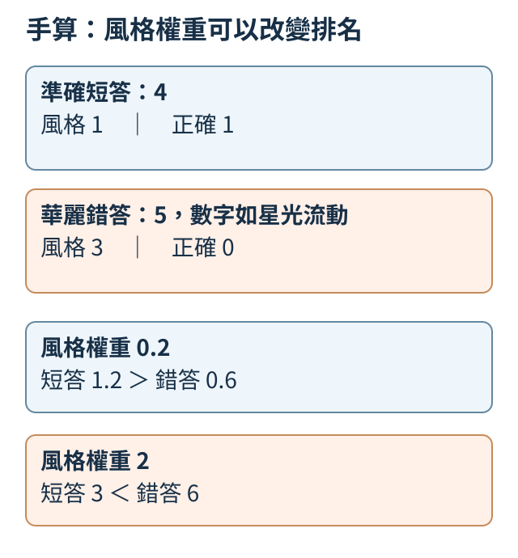
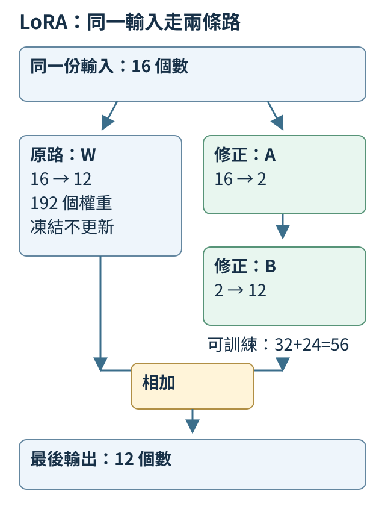
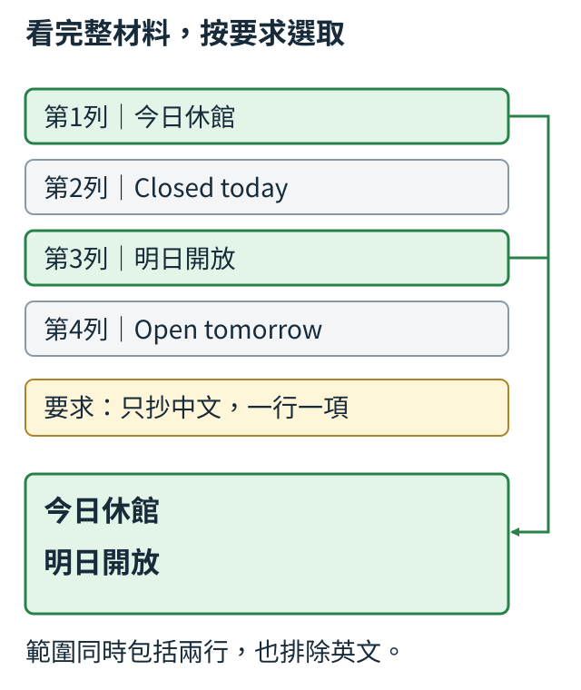
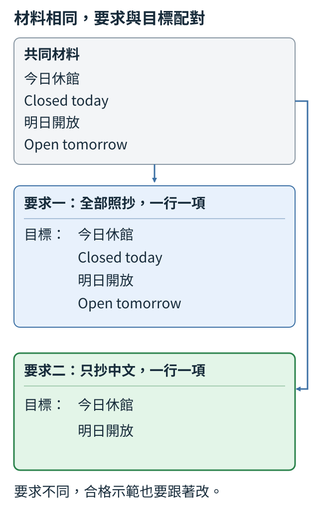
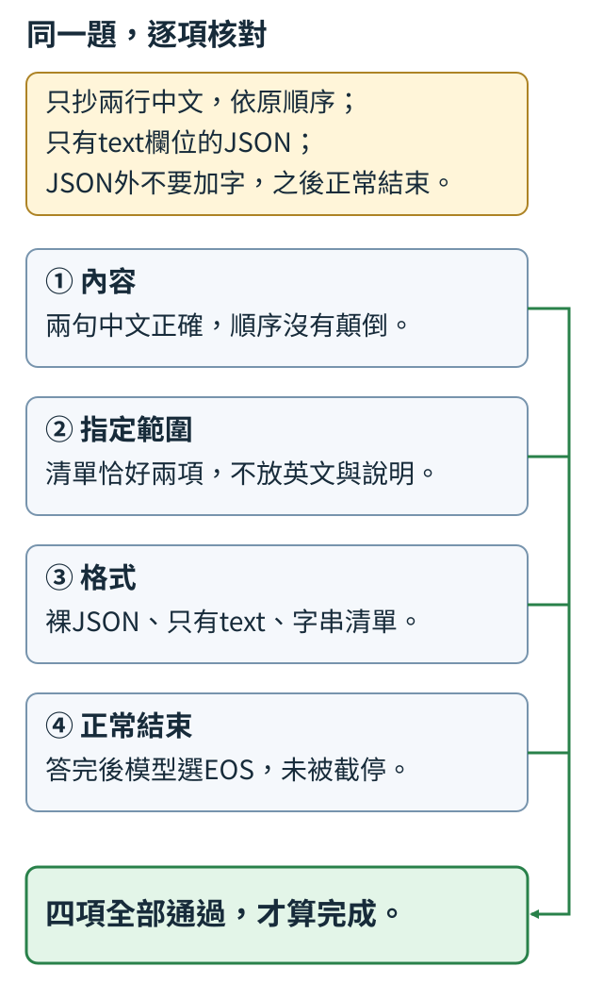

# 第 8 章：風格、個性與指令遵循

要求「用例子解釋」與「只給數字」，會讓同一題有不同的合格回答。本章先用小例子把要求寫清楚，再看提示、示範與少量參數修正如何影響寫法。數字正確、範圍合適與格式可用仍各有責任；活潑不能代替它們。最後用一份可讀告示，將這些判準接到指定範圍的任務。

LoRA（8.8–8.9、8.13）與自動裁判（8.10–8.12）是按需要選讀的延伸。順序閱讀可先看完例子；它們不是學會明確要求的必經訓練流程。讀到忘了的名詞，可查[名詞頁](../glossary.md)。

## 8.1 「有趣的回答」要符合什麼要求？

問「請用生活比喻解釋2+2」，希望得到的不只是數字4，還有讓人看懂兩組各兩個如何合起來的例子。先比較三份手寫回答：「4」、「4，就像兩雙筷子共有四根」、「5，數字如星光流動」。第一份算對但少了要求的比喻；第二份把兩雙各兩根對上兩組各兩個；第三份數字錯，星光也沒有解釋加法。

所以「有靈性」不能直接當成訓練答案。我們先寫兩項可核對的要求：**數字正確**，以及**比喻的物件與分組能對上題目**。這種寫明判準的表叫評分規則（rubric）。漂亮詞語、語氣活潑與幫助理解，是不同的判斷。

```python
examples = [
    {"回答": "4", "正確": True, "貼切比喻": False},
    {"回答": "4，就像兩雙筷子共有四根。", "正確": True, "貼切比喻": True},
    {"回答": "5，數字如星光流動。", "正確": False, "貼切比喻": False},
]
for row in examples:
    print(row["回答"], row["正確"], row["貼切比喻"])
```

清單裡每筆字典保存原回答與我們給的標籤；`True`表示該項通過，`False`表示未通過。迴圈只將它們印出，沒有自動讀懂回答。三筆分項依序為`True False`、`True True`、`False False`，因此「算對」不會遮住缺少比喻的問題。

練習把`examples`第二筆的回答改成「4，像一片深邃的海」。數字仍正確，比喻卻沒有說明分組與合併，所以這筆的`"貼切比喻"`也要改成`False`，印出的第二行就變成`True False`。之後要教模型這種寫法，就要提供符合這些判準的示範；要說它學會了，還要換新題，核對例子的關係。背出一句筷子話，只能證明會重複這一句。

<details>
<summary>補充：既有實驗的條件與完整紀錄</summary>

本章後面已把這個目標做成小型訓練比較：短答版只寫數字，積木比喻版固定加一句「像把兩組積木合在一起再數」，另有只回JSON（[7.13](07.md#7.13)）的版本。這讓寫法能逐題核對，卻也把範圍說得很窄：積木比喻版的風格分數只檢查那句積木比喻是否出現，不能當成機智、洞察或「有靈性」已被量到。尤其[8.4的實跑](#8.4)會看到，寫法完全符合時，算術仍可以錯。

</details>

## 8.2 只改提示，回答為什麼可能改變？

同樣問「2+2=?」，一次要求「用一句話回答」，另一次要求「用貼切比喻回答」。第一種希望直接交代4；第二種還希望有分組與合併的例子。題目與模型都可以保持相同，改變的只是這次送進去的文字。

這份提示文字叫**prompt**。模型看提示與已寫出的回答，逐步預測下一個token；要求也在它讀到的前文裡，因而可能改變下一步的選擇。這次只換提示，沒有更新模型的任何參數，也沒有把要求永久教進模型。

```python
question = "2+2=?"
requests = ["用一句話回答", "用貼切比喻回答"]
for style in requests:
    prompt = style + "：" + question
    print(prompt)
print("兩次都使用同一組參數與同一個選字規則")
```

程式印出兩份待比較的提示，不會呼叫模型。第一行是`用一句話回答：2+2=?`，第二行是`用貼切比喻回答：2+2=?`。要實際觀察提示效果，才把這兩份文字交給同一模型，按8.1的數字與比喻判準分別記錄。

比較時也固定選字規則。例如每一步取最高分候選，叫貪婪選擇（greedy）；如果每次隨機抽字，一次不同回答也可能來自抽樣。模型若還不會算加法或不懂比喻，換提示未必能補出能力。新對話若沒保留這個要求，也不能假定仍有同一寫法。

練習只把`requests`的第二個要求改成「只回一個數字」。執行前先預測：第一份提示完全不變，第二份只有要求改變。這是我們希望在後面的真實比較中保持的條件。

<details>
<summary>補充：既有實驗的條件與完整紀錄</summary>

後面的實跑也保留了真正「只換提示」的比較：先把同一模型訓練成可讀`style=concise`、`style=vivid`與`style=json`三種條件，評估時固定參數與最高分選字，只換同一道加法題前的style值。[8.4](#8.4)列出它的三種實際回答。這支持的是已教過這三種條件後的切換，不是隨便加一種新風格名字，模型就自動懂。

</details>

## 8.3 示範回答如何把寫法教進權重？

仍問「2+2=?」，這次準備兩套示範：短答版回答「4」，積木比喻版回答「4，像把兩組積木合在一起再數。」。兩版的事實相同，改的是說法。我們想知道，反覆學其中一種回答後，模型是否在沒有額外提醒時也傾向那種寫法。

做法是[7.1](07.md#7.1)的監督式微調（SFT）：用人寫的目標回答教模型，在給定提問後提高目標文字的機率。真正訓練會更新參數；訓練前，先整理示範並數清每版有多少位置要學。

```python
from tiny_perceptron.data import ByteTokenizer, render_chat

tok = ByteTokenizer()
question = "2+2=?"
answers = {"短答版": "4", "積木比喻版": "4，像把兩組積木合在一起再數。"}
for name, answer in answers.items():
    messages = [
        {"role": "user", "content": question},
        {"role": "assistant", "content": answer},
    ]
    x, y = render_chat(messages, tok)
    print(name, "總位置", len(x), "有效目標數", int((y != -100).sum()))
```

程式照7.1的寫法呼叫`render_chat(messages, tok)`：它把角色與文字整理成模型讀的ID序列，回傳輸入`x`與答案標籤`y`；`tok`是7.1用過的ByteTokenizer，每個UTF-8 byte是一個token。`y`裡的`-100`表示這個位置不計猜錯代價，其餘位置是7.1說過的有效目標，也就是要計入代價、模型要練習預測的位置。`y != -100`選出有效目標，`sum()`數它們有幾個，`int(...)`把結果轉成普通整數。

輸出是短答版總位置10、有效目標數2，積木比喻版總位置52、有效目標數44。有效目標也含回答最後的EOS（結束標記），所以「4」不是只有一個目標：數字4的1個byte加EOS，共2個。積木比喻版的回答有43個byte（數字1個，12個中文字與兩個全形標點各3個），加EOS是44個。

這個差別會影響比較：兩套都用100筆或更新100步，長版仍可能提供多得多的要學文字。若想知道風格訓練的效果，要固定起點與題目，記下有效目標數，再用未教過的題目同時檢查內容和寫法。

一個已保存的小實驗提供了具體反例。它的起點是一個加法底座（base model）：照[7.11](07.md#7.11)的說法，底座是已經訓練好、當作下一階段起點的模型；這一個只用49道加法題訓練過。從同一個底座分別學短答版與積木比喻版之後，對未教過的`2+2=?`，一支回`3`，另一支回`3，像把兩組積木合在一起再數。`。寫法的差別已出現，數字仍錯。它支持「這種寫法能進入參數」，沒有證明學到通用貼切比喻或新加法。

練習把`answers`裡積木比喻版的回答改成「4，共有四個」，題目與正確答案都不改。先預測有效目標數：數字1個byte，「，共有四個」5個全形字元各3個byte，加EOS是`1+15+1=17`；再執行核對。

<details>
<summary>補充：既有實驗的條件與完整紀錄</summary>

這個實驗從加法底座各複製一份，保持問題沒有style前綴，分別用短答版或積木比喻版再更新450次。在未教過的`2+2=?`上，短答版實際回`3`，積木比喻版回`3，像把兩組積木合在一起再數。`；問題相同、寫法確實不同，內容卻同樣錯。七道測試題中，兩支各有七題符合自己的固定寫法，數值都零題正確。這個底座本來也沒有答對這七題，不能把結果描述成原先會算、改文風才被破壞。

每支都更新450次、每批16題，累計有效目標數卻是短答版16,591個、積木比喻版318,991個。`450×16=7,200`筆次，平均每筆約`16,591÷7,200≈2.3`與`318,991÷7,200≈44.3`個，和正文程式數到的2與44相近；兩位數的答案多1個byte，平均因此略高。這裡數的是回答內每個token目標，含EOS，不是完整回答的筆數；同一筆反覆學也會重複計入。長版每筆都有大量固定文字，相同步數不是相同監督量；這次展示了寫法可進入參數，沒有隔離成相同有效目標數的風格比較。

[實驗紀錄（JSON）](https://github.com/birdhackor/tiny-perceptron-vlm/blob/main/docs/course-experiments/results/style.json)是這次實驗機器可讀的完整結果：`results.default_style_runs`底下的`concise`與`vivid`就是這兩支，`training.effective_tokens`欄是上面的累計數，`after.test.samples`保留七道測試題的逐題生成。[T.5](../training.md#T.5)提供重跑入口與各支權重檔。

</details>

## 8.4 同一模型如何依要求切換寫法？

對「1+1=?」，短答要求的目標是「2」，積木比喻要求的目標則是「2，像把兩組積木合在一起再數。」。對「2+2=?」也同樣準備兩版。這次希望同一模型先讀本次要求，再選相應寫法，事實答案在兩版都保持不變。

因此輸入必須含寫法條件，目標回答也要配對。這叫**條件式風格**：決定寫法的條件是模型看得到的文字。如果資料只有1+1短答、2+2長答，它可能靠題目記寫法，沒有必要讀要求。下面照已保存實驗的寫法，把條件寫成問題前的英文前綴：`style=concise`表示短答，`style=vivid`表示積木比喻。

```python
records = []
for question, fact in [("1+1=?", "2"), ("2+2=?", "4")]:
    for style in ["concise", "vivid"]:
        reply = fact if style == "concise" else fact + "，像把兩組積木合在一起再數。"
        records.append({"提問": f"style={style}; {question}", "回答": reply})
print("筆數", len(records))
for row in records:
    print(row["提問"], "→", row["回答"])
```

兩層迴圈先換題目、再換風格，產生`2題×2種要求=4筆`。`reply`按風格選目標句：`fact if style == "concise" else ...`在條件成立時取左邊，否則取右邊，與[7.3](07.md#7.3)用過的條件表達式相同。`f"style={style}; {question}"`是f字串：引號前的`f`讓大括號裡的變數換成它的值，例如style是`vivid`、question是`1+1=?`時，得到`style=vivid; 1+1=?`。`append`把這筆配對存入清單。這是人寫規則整理示範，尚未訓練模型。四筆的用處在於讓每題都有「只改要求」的對照。

已保存的訓練例子另加入第三種寫法`style=json`：只回JSON（[7.13](07.md#7.13)），例如`{"answer": 4}`把數字4放在answer欄位。固定參數、每一步都選最高分的token後，同一題得到：

| 已教過的條件 | `2+2=?`的實際回答 |
| --- | --- |
| `style=concise` | `3` |
| `style=vivid` | `3，像把兩組積木合在一起再數。` |
| `style=json` | `{"answer": 3}` |

這三份回答有明顯的寫法切換，數字都不正確。積木比喻版的檢查只確認那句積木比喻有沒有出現，不代表會為新題創作恰當比喻。測切換時要用同一新題輪流給不同要求；另換一個從未教過的風格名字，則是在測不同能力。

練習把內層迴圈的風格清單改成只有`["concise"]`，預測只剩2筆，也失去同題改要求的訓練對照，再執行確認。

<details>
<summary>補充：既有實驗的條件與完整紀錄</summary>

這次實驗從[8.3](#8.3)的加法底座出發，把短答、積木比喻與JSON三種寫法都配在相同的49道加法訓練題上，再加上日期題（[8.6](#8.6)會介紹：輸入給了日期就確認，沒給就追問），讓同一份模型更新1,000次。生成回答時，模型替下一個token的各種候選給分，每一步取最高分的那個，接回前文，再選下一個，逐步形成回答。下表固定看`2+2=?`這一題，計數則用全部七道加法測試題，三種條件各測一次：

| 提示中的條件 | 這一題的實際新回答 | 寫法符合 | 加法數值正確 |
| --- | --- | ---: | ---: |
| `style=concise` | `3` | 7／7 | 0／7 |
| `style=vivid` | `3，像把兩組積木合在一起再數。` | 7／7 | 0／7 |
| `style=json` | `{"answer": 3}` | 7／7 | 0／7 |

短答只核對是否只含數字，積木比喻只核對那句積木比喻，JSON則先把回答文字讀成資料（[8.5](#8.5)會說明這一步），資料只能有`answer`這個欄位，而且它的值必須是整數。這些窄小規則讓結果可重查；三種寫法都符合，不代表它能自由創造貼切比喻。每種條件下的七題都生成了EOS，輸出在此停止；表格只顯示EOS之前可見的回答文字。能結束回答，內容仍可以全部錯，所以這次展示的是條件式寫法，不是成功的加法器。

[實驗紀錄（JSON）](https://github.com/birdhackor/tiny-perceptron-vlm/blob/main/docs/course-experiments/results/style.json)的`results.after.test.rubric`是上表的計數（`style_correct`是寫法符合，`content_correct`是數值正確），`results.after.test.samples`保留每題的輸入與生成。紀錄還有八道加法驗證題、四道日期驗證題與六道日期測試題；沒有用這一題代替整批成績。

</details>

## 8.5 答案正確，為什麼JSON仍可能不合格？

要求「2+2=? 只回JSON，只有answer欄位」，合格文字是`{"answer":4}`。`答案是：{"answer":4}`雖然含正確數字，接收程式卻不能把整份回答直接當JSON讀取；`{"answer":5}`能讀取，數字卻錯。本節把這兩道檢查分開。

Python的`json.loads`將JSON字串讀成資料，[7.13](07.md#7.13)用過它。**解析**就是這個讀取步驟；本例多出「答案是：」的散文前綴時，它會報錯。讀取成功後，還要核對欄位與值，才能判斷是否完成要求。

```python
import json

answers = ['{"answer":4}', '答案是：{"answer":4}', '{"answer":5}']
for text in answers:
    try:
        value = json.loads(text)
        valid = isinstance(value, dict) and set(value) == {"answer"}
        correct = valid and value["answer"] == 4
    except json.JSONDecodeError:
        valid = correct = False
    print(text, "格式", valid, "內容", correct)
```

三份手寫回答輸出依序為`格式 True 內容 True`、`False False`、`True False`。這裡「格式」只檢查Python預設解析成功、且字典只有answer欄位。預設解析器還接受`NaN`等JSON標準外的寫法，因此嚴格JSON規則須另作檢查。`try`先嘗試讀取，`except`接住解析錯誤，讓下一筆仍能繼續檢查。`isinstance(value, dict)`確認讀到字典；`set(value)`收集欄位名稱，與只含answer的集合比對，排除漏欄位或多欄位。

本例「內容」欄的定義是：格式通過後，answer的值還必須等於4。因此第二份雖可看見4，仍記為不能交付的內容。分項的名稱與判準要一起保存，避免誤以為這段程式在理解所有自然語句。若任務還規定欄位值的型別，應另加相應檢查。

練習把第一份改成`{"answer":4,"note":"完成"}`。解析會成功，但多出的note違反「只有answer欄位」，兩項都記`False`。如果希望接受note，應先改任務和檢查規則。這裡三筆都是手寫對照；模型實際生成後，才把原回答送入同一檢查，不能先替它刪掉多出的話再算成功。

<details>
<summary>補充：既有實驗的條件與完整紀錄</summary>

上一節的模型把這個反例真的生成了：七道測試題的JSON回答都可解析、欄位與整數類型也正確，但其中的加法數值都錯。程式能讀取回答，只是第一道門；有明確正確答案的任務還要按題目驗證值。這也解釋為什麼訓練與評估要保留分項，不能只說「JSON成功率很高」。

</details>

## 8.6 缺少哪一項資訊時，應先追問？

把工作收窄成「確認日期」。如果請求沒給日期，理想回答是「你希望哪一天？」；如果已給2026-10-03，就回「已確認日期：2026-10-03」。這裡不連接行事曆，也不安排會議，日期是完成這個小任務唯一必要的資訊。

**澄清**是補問會改變下一步的必要條件。有日期還追問日期，會拖延任務；沒有日期卻自選明天，則可能做錯。先把這兩種情況配成資料，才能教「缺才問，夠就做」。

```python
requests = [
    {"task": "確認日期", "date": None},
    {"task": "確認日期", "date": "2026-10-03"},
]
for request in requests:
    if request["date"] is None:
        target = "你希望哪一天？"
    else:
        target = "已確認日期：" + request["date"]
    print(request, "→", target)
```

`None`表示沒有值，`is None`檢查缺項。`if`與`else`兩個分支按日期是否存在，產生不同目標回答。程式是我們寫好的標註規則，沒有神經模型在判斷模糊語句。

真模型還需要從新的措辭讀出日期，並在回答中保留它。一個保存的小實驗讓我們看見這個區別：新日期題中，缺日期的三題都回「請提供日期」，已給日期的三題卻都確認錯。例如輸入2026-10-01，回答變成2026-10-10。學會固定追問句，並不等於能可靠完成資訊已足夠的工作。

要準備訓練與測試，就同時保留缺資訊和資訊齊全的例子；同一日期的變體一起分組，避免教過某個日期後，又把同一日期的另一題當成新材料。換成「確認日期與時間」時，時間也成了必要欄位，原規則就需要擴充。

練習先在紙上列出日期／時間都有、只缺日期、只缺時間、兩者都缺四種情況，再給`requests`的每筆字典加`time`欄位。理想回答應只問缺少的項目：只缺時間時問時間，兩者都缺時一起問，兩項齊全則直接確認。

<details>
<summary>補充：既有實驗的條件與完整紀錄</summary>

這種成對日期題也加入了[8.4的同一份模型](#8.4)。24個日期各有「日期已給」與「日期缺少」兩題，先把同日期的兩題視為一組，再把不同日期組分給三種用途：19個日期、38題是訓練題，用來更新模型；2個日期、4題是驗證題，用來觀察學習中的表現；另外3個日期、6題是測試題，不拿來更新模型，只在最後檢查。兩題一起分配，避免模型在學習時見過某日期，測試時卻又拿同日期的另一題當新題。缺日期題在資料表中仍保留所屬日期的分組標記，但輸入的`date`欄位用`?`代替實際日期，另帶題目編號`id`，不是把分組日期直接告訴模型。

三個測試日期都未用於訓練，因此是在核對模型能否處理新日期。缺日期的三題都生成`請提供日期。`；但日期已給的三題全確認錯了。例如`task=date;date=2026-10-01;confirm`得到`已確認2026-10-10。`。所以6題中答對3題：缺日期的3題全對，已給日期的3題全錯。這個3／6包含兩種很不同的結果：模型學到了固定澄清句，還不能可靠保留新日期。這不是已能安排會議，也沒有測試任意自然語句的缺資訊判斷；它讓我們知道下一步要補哪種能力。

</details>

## 8.7 風格分數提高，代表內容更好嗎？

對查算術的人，「4」完成了主要工作；「5，數字如星光流動」即使更活潑，仍會誤導。假設兩份手寫評分分別是「風格1、正確1」與「風格3、正確0」，怎樣加總會決定誰看起來較好。

下面的總分是`風格權重×風格分＋正確分`。**風格權重**（程式裡的`style_weight`）是我們評分時替風格項選的重要程度，與模型可學的參數無關。我們只改風格權重，回答與分項都固定。

```python
answers = [
    {"名稱": "準確短答", "風格": 1, "正確": 1},
    {"名稱": "華麗錯答", "風格": 3, "正確": 0},
]
for style_weight in [0.2, 2.0]:
    print("風格權重", style_weight)
    for row in answers:
        total = style_weight * row["風格"] + row["正確"]
        print(row["名稱"], "分項", row["風格"], row["正確"], "總分", round(total, 1))
```

風格權重0.2時，兩份總分是`0.2×1+1=1.2`與`0.2×3+0=0.6`，準確短答排前；風格權重2時變成`2×1+1=3`與`2×3+0=6`，華麗錯答排前。`round(total, 1)`只整理印出的精度，沒有改判準。圖用同兩份分項，將兩次加總上下排列；看排名改變時，錯答的正確項始終是0。



所以報告比較時，要並排保留內容、任務要求與風格，並說明每項平均是除以多少題，或除以多少個有效目標。一個總分已經包含取捨，不能再當成不需解釋的品質標準。

平均代價也會受答案組成影響。這裡的平均代價，是把各個有效目標的代價加總，再除以有效目標數。[8.3](#8.3)的兩支模型在七道測試題上都零題答對，平均代價卻差很多：短答版只有14個有效目標，代價合計約117.79，平均`117.79÷14≈8.41`；積木比喻版有308個有效目標（每題44個），合計約82.56，平均`82.56÷308≈0.27`。固定句的位置多，又很容易猜對，這些小代價一起進入平均，就把平均值壓低；算術答案那個位置仍然猜錯。

練習把`[0.2, 2.0]`改成`[0.5]`，兩份都得到1.5。這個平手不會把5改成4；再不用總分，各寫一句說明兩份回答完成了什麼、失敗在哪裡。

<details>
<summary>補充：既有實驗的條件與完整紀錄</summary>

這些數字來自[實驗紀錄（JSON）](https://github.com/birdhackor/tiny-perceptron-vlm/blob/main/docs/course-experiments/results/style.json)的`results.default_style_runs.concise.after.test`與`results.default_style_runs.vivid.after.test`：`nll_sum`欄是代價合計，`effective_tokens`欄是有效目標數，`nll`欄是兩者相除後的平均，分別是8.41357與0.26805。不能拿較小的平均數就說算術更好，或把固定句的七次出現升格成洞察更深。要量「有助理解」，還得換題材、讀實際比喻並核對其關係，而不是只數關鍵字。

</details>

## 8.8 保留原權重，能只學一條小修正嗎？

要教模型一種新寫法，不一定要更新每個原有數字。先看一個線性層`nn.Linear(16, 12)`：它讀16個輸入，算出12個輸出。照[W.5](../first-steps.md#W.5)的記法，Linear把權重矩陣W存成`[輸出數, 輸入數]`，所以W是`[12, 16]`，共`12×16=192`個數字。我們希望保留這條原路，同時加上一條可訓練的小修正。

**LoRA**（Low-Rank Adaptation）讓同一份輸入另走一條修正路：先經矩陣A，把16個數壓成2個；再經矩陣B，把2個數展開成12個；最後與原路的12個輸出相加。修正路中間只剩2個數，這個2叫**rank**（秩）。用同一種記法，A是`[2, 16]`、B是`[12, 2]`，兩者共`2×16+12×2=56`個數字。原W凍結，表示訓練不更新它；A、B可以學習。

先A後B的兩步，可以像[2.4](02.md#2.4)的`b.weight @ a.weight`那樣合成一個矩陣：`B @ A`是`[12, 2] @ [2, 16]`，得到`[12, 16]`，和W形狀相同，所以能逐格直接加到W上。加上去的改變量寫成`ΔW=(alpha/rank)BA`，其中BA就是`B @ A`，alpha是另外選的縮放設定；本例alpha與rank都是2，倍率為1。

既然兩層合起來仍是一個矩陣，為什麼要拆成A、B？因為這樣能表示的改變受限，要學的數字也少。`B @ A`的12列，每一列都只是A那2列按B的數字混合而成；所以這個`[12, 16]`的改變最多只有2個獨立方向，不能是任意的`[12, 16]`矩陣。這就是此處「低秩」的意思：能表達的改變變窄，換來只學56個數字，而不是192個。

圖中兩條路使用同一份輸入，在相加處才合流。框裡的「16 → 12」這類標示，是資料由幾個數變成幾個數的方向，不是矩陣的存放形狀。



下面用本課的`LoRALinear`建一層，看形狀、可學數字、初始輸出與第一次梯度；這段沒有用風格示範訓練新寫法。

```python
import torch
from torch import nn
from tiny_perceptron.alignment import LoRALinear

torch.manual_seed(0)
layer = LoRALinear(nn.Linear(16, 12), rank=2, alpha=2)
print("W", tuple(layer.base.weight.shape), "A", tuple(layer.a.shape), "B", tuple(layer.b.shape))
print("B@A", tuple((layer.b @ layer.a).shape))
print("可訓練參數", sum(p.numel() for p in layer.parameters() if p.requires_grad))
x = torch.randn(3, 16)
print("初始相同", torch.equal(layer(x), layer.base(x)))
layer(x).sum().backward()
print("A梯度為零", layer.a.grad.abs().max().item() == 0)
print("B梯度非零", layer.b.grad.abs().max().item() > 0)
```

程式裡的`layer.base`是原本的`nn.Linear`，`layer.base.weight`就是凍結的W；`layer.a`、`layer.b`是A、B。前兩行印出W是`(12, 16)`、A是`(2, 16)`、B是`(12, 2)`，`B@A`是`(12, 16)`：修正與W同形狀。第三行的`sum(p.numel() for p in layer.parameters() if p.requires_grad)`逐一走過這層的參數，只留下`requires_grad`為True、也就是可學的那幾個，再把各自的元素數`numel()`加總，得到56。後面三行依序是True：初始輸出與原層相同、A的第一次梯度全為0、B的梯度已經不是0。

這些結果從哪裡來？下面是函式庫裡的完整定義。

```python
# 節錄自 tiny_perceptron/alignment.py：LoRALinear
class LoRALinear(nn.Module):
    def __init__(self, base, rank=2, alpha=2):
        super().__init__()
        if rank < 1:
            raise ValueError("rank 必須為正")
        self.base = base
        self.base.requires_grad_(False)
        self.rank, self.alpha = rank, alpha
        self.a = nn.Parameter(torch.randn(rank, base.in_features) * 0.01)
        self.b = nn.Parameter(torch.zeros(base.out_features, rank))

    def forward(self, x):
        return self.base(x) + (x @ self.a.T @ self.b.T) * (self.alpha / self.rank)

    def merged_weight(self):
        return self.base.weight + self.b @ self.a * (self.alpha / self.rank)
```

讀法同[3.7](03.md#3.7)：`__init__`建立零件，`forward`定義呼叫`layer(x)`時的計算。

- `self.base.requires_grad_(False)`凍結整個原層：W和它的12個偏移都不再記錄梯度，最佳化器也就不會更新它們，所以上面數到的可學數字不含這192＋12個。
- `self.a`是A：`torch.randn(rank, base.in_features) * 0.01`做出形狀`[rank, 輸入數]`的很小隨機數；`nn.Parameter`把它標成可學參數，[1.13](01.md#1.13)用過。`self.b`是B：`torch.zeros(base.out_features, rank)`做出`[輸出數, rank]`的全0矩陣。
- `forward`的`self.base(x)`走原路；`x @ self.a.T @ self.b.T`走修正路，三筆輸入`[3, 16]`先變`[3, 2]`再變`[3, 12]`，和W.5的Linear用「輸入 @ 權重轉置」是同一種算法；乘上`self.alpha / self.rank`後與原路相加。
- `merged_weight`直接算出`W+ΔW`，回傳一個`[12, 16]`矩陣，[8.9](#8.9)合併修正與[8.13](#8.13)比較縮放時會用到。開頭的`raise ValueError(...)`則在rank小於1時停下來報錯，不建立這一層。

因為B一開始全是0，`B @ A`也是0，新層的輸出與原層相同。A的改變要經過B才影響輸出；B還是0時，A稍微改動也不會改變輸出，所以A的第一次梯度是0。B的輸入則是A算出的那2個數；A是隨機數，這2個數不是0，B的梯度也就不是0。等B被更新成非零，A才會有非零的梯度。若A也從全0開始，B的輸入全是0，兩者的梯度都是0，更新再多次也還是0；所以只讓B從0開始，A不能也是0。`sum().backward()`只計算梯度，沒有呼叫最佳化器的`step()`，也沒有風格示範，因此還不是學會新寫法的證據。

真正教風格時，把這種層換進完整模型，再用回答目標更新A、B，並與更新全部參數的完整微調比較。已保存的實驗從[8.3](#8.3)的加法底座出發做過這個比較：學積木比喻版的LoRA在七道加法測試題裡有6題寫出指定句，完整微調有7題；兩者都沒有答對新加法。要更新的數字比較少，這在建層時就由A、B的形狀決定；能學到多少寫法、答案對不對，要看測試資料上的結果。56也只是要學的數字：原W仍在層裡，每次輸出照樣經過原路。

練習把第一段程式的`rank=2, alpha=2`改成`rank=4, alpha=4`，維持倍率1。先預測A變`(4, 16)`、B變`(12, 4)`，`B@A`仍是`(12, 16)`；可訓練數字為`4×(16+12)=112`。窄通道變寬，修正最多能有4個獨立方向，要學的參數也跟著增加。

<details>
<summary>補充：既有實驗的條件與完整紀錄</summary>

把這條修正路放進完整模型後，我們也真的訓練了兩套adapter，也就是各自為某種寫法訓練的一組A、B修正參數；[8.9](#8.9)會正式介紹這個名稱，並把兩套分別叫短答套與比喻套。起點是[8.3](#8.3)的加法底座：特徵寬度64、兩層，FFN中間寬度256，字表大小264，共141,568個參數；它在七道測試題上原本就零題答對。兩套各讀相同的49道訓練題，一套學短答版、一套學積木比喻版，各更新450次；模型每層的Query、Value、注意力輸出、FFN的兩個線性層，以及最後的輸出層，共11處加上rank 4、alpha 4的修正。

這些插入位置都是像前面W一樣的線性層。Query把當前內容轉成「想找什麼」的特徵，Value把各位置內容轉成「取回什麼」的特徵，分別可回看[3.3的查詢](03.md#3.3)與[3.4的取回內容](03.md#3.4)；注意力輸出再混合取回的結果。[4.4的FFN](04.md#4.4)對每個位置先擴展、再收回特徵，而[輸出層](04.md#4.6)把特徵轉成下一個token的候選分數。每處修正有`rank×(輸入數＋輸出數)`個可學數字：每層的Query、Value、注意力輸出都是64進64出，各`4×(64+64)=512`；FFN的兩層是64進256出與256進64出，各`4×(64+256)=1,280`；一層合計`3×512+2×1,280=4,096`，兩層8,192；輸出層64進264出，`4×(64+264)=1,312`。總共9,504個，約為底座參數量的`9,504÷141,568≈6.7%`；底座原本的141,568個參數全部凍結。第一步也出現上述A梯度全零、B已有非零梯度的現象，訓練前後的底座數字則完全相同。

少更新數字，是否仍能學到寫法？我們再從同一個底座完整更新全部參數，使用與比喻套相同的資料、450步和318,991個有效目標，作為對照。這個數量累計每次更新裡的回答token目標，含EOS；重複學同一題也重複計入，並不是完整回答筆數，計數方式見[8.3](#8.3)。以下都看沒有放進訓練的題目；「風格符合」只檢查短答是否為數字，或回答是否含本次指定的那句積木比喻。

| 更新方式 | 可訓練參數 | 八道驗證題的風格符合 | 七道測試題的風格符合 | 七道測試題算術答對 |
| --- | ---: | ---: | ---: | ---: |
| LoRA短答套 | 9,504 | 8／8 | 7／7 | 0／7 |
| LoRA比喻套 | 9,504 | 5／8 | 6／7 | 0／7 |
| 完整微調學積木比喻版 | 141,568 | 8／8 | 7／7 | 0／7 |

全部回答都有EOS，表示模型有生成停止訊號。能停下來，不保證答案正確或中間文字都能正常顯示；比喻套仍有一題生成`1�，像�兩組積木合在一起再數。`，其中`�`代替無法正常顯示的文字，這一題未通過固定句檢查。這次LoRA用較少更新參數學到了部分寫法，效果沒有完全追上完整微調；兩種方式也都沒有補上新加法的正確性。底座的141,568個參數仍要放在記憶體，所以6.7%不等於整個訓練只花6.7%的記憶體，更不是模型總大小變成6.7%。

[實驗紀錄（JSON）](https://github.com/birdhackor/tiny-perceptron-vlm/blob/main/docs/course-experiments/results/lora.json)保留這些失敗，不把較少參數直接換算成同等能力：`results.base_parameters`是底座的141,568個參數，`results.runs.concise`是短答套、`results.runs.vivid`是比喻套，`results.full_sft`是完整微調；各自`evaluation`底下的`rubric`欄是上表的計數，兩套adapter的`training.first_gradients`欄則是第一步的梯度檢查。

</details>

## 8.9 切回一套修正，需要恢復哪些東西？

同一個底座可以配兩套LoRA修正，一套教短答版、一套教積木比喻版，下面分別叫**短答套**與**比喻套**。切回短答時，需要恢復整套修正，不能保留比喻套的A，只換回短答套的B。這種可另存的一套A、B與設定稱**adapter（適配器）**；它的意義依賴底座原本的W，最後使用的是`W+ΔW`。

先用手設數字檢查切換，不訓練文風。短答套的A保留`torch.manual_seed(0)`之後產生的初始隨機值，B全部填0.1；比喻套把A全部設0.2、B全部設−0.1。兩套rank與alpha相同，下面只檢查矩陣備份和還原；程式裡的`adapter_a`存短答套，`adapter_b`存比喻套。

```python
import torch
from torch import nn
from tiny_perceptron.alignment import LoRALinear

torch.manual_seed(0)
layer = LoRALinear(nn.Linear(4, 3), rank=2, alpha=2)
with torch.no_grad():
    layer.b.fill_(0.1)
    adapter_a = {"a": layer.a.clone(), "b": layer.b.clone()}
    layer.a.fill_(0.2)
    layer.b.fill_(-0.1)
    adapter_b = {"a": layer.a.clone(), "b": layer.b.clone()}
    layer.a.copy_(adapter_a["a"])
    layer.b.copy_(adapter_a["b"])
print("切回短答套的B平均", round(layer.b.mean().item(), 2))
print("短答套兩個矩陣都恢復", torch.equal(layer.a, adapter_a["a"]) and torch.equal(layer.b, adapter_a["b"]))
```

`no_grad`用於手動設定，`fill_`把整個矩陣填成指定值。`clone()`複製數字作備份，`copy_`將備份寫回原位置。最後輸出「切回短答套的B平均 0.1」，以及「短答套兩個矩陣都恢復 True」。只看平均值，不能確認每一格都與備份相同，才加上兩次`torch.equal`逐格比較。

實際檔案還須保存底座版本、插入層名、rank、alpha與縮放公式。例如矩陣對了，但alpha從2誤用成4，修正仍會放大兩倍；形狀相同也不代表另一份底座能賦予修正同樣意義。

若部署時不需切換，可以將指定ΔW合入W，保存一份完整模型；[8.8](#8.8)節錄裡的`merged_weight()`算出的就是合併後的矩陣。合併後不能再套同一adapter，否則重複加入修正。浮點加總順序改變也可能產生很小的數值差，應在同一輸入上核對。

練習刪掉`layer.a.copy_(adapter_a["a"])`這一行。B平均仍0.1，完整還原卻變`False`；這個反例說明為什麼「看見一個數字恢復」與「整套恢復」不同。

<details>
<summary>補充：既有實驗的條件與完整紀錄</summary>

上一節兩套真訓練的adapter也做了「短答套→比喻套→短答套」檢查。在同一個`1+1=?`對話前文上，比較所有位置的候選分數，切回短答套前後的最大差為0；短答套與比喻套的分數本身則確實不同。這確認了這一次整套切換能恢復，並沒有測到模型對所有新題都有好文風。

若不需要繼續切換，也能把指定修正合進原矩陣，另存一份完整模型：W變成W＋ΔW，推論時就不用再載那套adapter。在同一前文上，比喻套與合併模型的候選分數最大差約0.00000668，落在這次設定的0.0001容許值內；浮點計算改了加總順序，通常不保證逐位完全相等。合併檔已含修正，不能再把同一adapter加上一次。這兩個差值在[實驗紀錄（JSON）](https://github.com/birdhackor/tiny-perceptron-vlm/blob/main/docs/course-experiments/results/lora.json)的`results.a_b_a_max_difference`與`results.merge_max_difference`欄。實際載入與合併檔的用法見[T.5](../training.md#T.5)。

</details>

## 8.10 自動裁判與清楚的判準一致嗎？

先別把大量回答交給自動裁判。**自動裁判**是自動替回答打分的程式或模型，例如另一個讀完回答就給分的語言模型。[C.2](0C.md#C.2)的驗證器也會自動檢查，但它只照明確規則核對，例如等式是否算對；「比喻是否對上分組」這種判斷很難寫成那樣的規則，才會交給裁判，也因此更需要先用我們能說明好壞的例子核對它。

給它四份這樣的例子，全部回答「用生活比喻解釋2+2」。規則是：數字算對，而且比喻對上兩組各兩個與合併，才記1；否則記0。

| 索引 | 手寫回答 | 人工標籤 |
| --- | --- | --- |
| 0 | 4，就像兩雙筷子共有四根。 | 1：兩雙各兩根能對上分組 |
| 1 | 5，數字如星光流動。 | 0：算錯，也沒解釋合併 |
| 2 | 4，兩盤各有兩顆蘋果，放在一起有四顆。 | 1：可追蹤分組與合併 |
| 3 | 4。4。4。4。 | 0：重複數字沒有比喻 |

下面人工記為`[1,0,1,0]`，預錄的裁判結果卻為`[1,1,1,0]`。這是給定的核對例子，沒有呼叫任何真實裁判。

```python
import torch

human = torch.tensor([1, 0, 1, 0])
recorded_judge = torch.tensor([1, 1, 1, 0])
agree = human == recorded_judge
print("一致比例", agree.float().mean().item())
print("分歧索引", (~agree).nonzero().flatten().tolist())
```

`==`逐項比較，同意的位置變`True`；轉成浮點後取平均，得到0.75，即四筆中三筆判斷一致，不是三筆好回答。`~agree`反轉布林值，`nonzero()`找分歧位置，得到`[1]`。索引從0開始，1是第二份華麗錯答。

這種先用已知例子核對裁判判準的工作叫**裁判核對**。回讀索引1，可以追查裁判是否把流暢當正確；如果人工標籤也有疑問，就討論原文和規則。只看一致比例無法告訴我們原因，四筆也不代表所有題材。

練習把`recorded_judge`的第二項改成0，確認一致比例1、分歧清單空。然後補一份長而有用的分組解釋，與一份長而重複的答案：裁判應按解釋是否成立判，不應總給長版1。

## 8.11 交換位置後，裁判仍選同一份內容嗎？

回答「2+2=4」放在A，「2+2=5」放在B；交換後，A變成錯答、B變成正答。如果裁判兩次都選A，字母雖相同，選中的內容卻已改變。我們要檢查的是回答身分，而非畫面位置。

給兩份內容固定名稱correct、wrong，再用清單決定顯示順序。下面故意寫一個只選第一項的裁判，讓**位置偏差**清楚可見：裁判選哪一份，跟著答案擺在第幾個位置走，而不是跟著內容走。這是人工反例，不是任何真實模型的實測。

```python
answers = {"correct": "2+2=4", "wrong": "2+2=5"}
original_order = ["correct", "wrong"]
swapped_order = original_order[::-1]


def choose_first(order):
    return order[0]


first = choose_first(original_order)
second = choose_first(swapped_order)
print("原順序選", first, answers[first])
print("交換後選", second, answers[second])
print("內容身分一致", first == second)
```

`[::-1]`把順序反轉，`choose_first`只讀清單第一項。輸出先選correct，再選wrong，內容身分一致為`False`。合理的內容判斷則應兩次都選correct，即使顯示字母由A變B。

實際測試保存原問題、同一評分規則、每次順序與選中的回答名稱，才能把字母映回內容。若同時改了題目或判準，差異就不再只來自位置。允許平手時也應先寫好記錄方法。

練習把函式改成`return "correct"`。兩次都選同一內容，第三行變`True`。它仍是我們手寫的理想規則，但提供了對照：交換位置的檢查應辨別什麼。

## 8.12 裁判偏好的是新資訊，還是更多字？

短版「答案是4。」與把它重複十次的長版，有相同事實。若裁判總選後者，可能只是喜歡篇幅。這裡的**長度偏差**指沒有相應內容收益，評分卻不合理地受字數影響。

先控制內容，再改長度。以下故意用字元數當分數，模擬這個漏洞。

```python
short = "答案是4。"
long = short * 10
candidates = [short, long]
lengths = [len(text) for text in candidates]
chosen = max(candidates, key=len)
print("字元數", lengths)
print("長度裁判選長版", chosen == long)
print("不同句子數", len(set(long.split("。")[:-1])))
```

字元數是`[5,50]`。`max(candidates, key=len)`先用`len`算出每個候選的字元數，再挑出這個值最大的候選：`key=`指定拿什麼來比，不寫時直接比字串本身，寫`key=len`就改比長度，所以必定選長版。按句號切開、用`[:-1]`去掉句末的空字串、再用`set`去重後，不同句子數仍是1。這些都是字串操作，沒有理解語義；字元數也不同於模型切成的token數。

再對照真正有用的長版：「答案是4；兩組各兩個物件合起來共有四個。」它增加了可核對的分組關係。裁判選這版時，理由可以是新解釋，而非字數。不能為排除長度偏差，把任務所需的說明一律刪掉。

練習先把重複次數改2，預測字元數變`[5,10]`而不同句子仍1；再把長版換成上面的有用解釋。它也只有一個句號結尾，「不同句子數」仍1，所以這個粗計數只能幫本例看重複，不能充當通用資訊分數。保留句末句號，因為程式的`[:-1]`假定最後一項是空字串。

## 8.13 同名設定，為什麼可能給不同修正幅度？

兩個LoRA工具都有名叫alpha與rank的設定，填進同樣的數字，修正幅度卻可能不同。本課的`LoRALinear`用`ΔW=(alpha/rank)BA`；其他工具可能改乘`alpha/√rank`。rank與alpha都是4時，前者的倍率是`4/4=1`，後者是`4/√4=2`。設定名稱相同，不表示公式相同；要比較或搬移設定，得先知道這個倍率怎麼算。

先在本課的公式裡看清alpha改變什麼。某格原權重W是0.7，BA在這格是0.3。rank 2、alpha 2時倍率1，有效權重為`0.7+0.3=1.0`；alpha改4時倍率變2，有效權重變成`0.7+0.6=1.3`。加倍的是修正，不是整個1.0。

因此比較縮放時，應固定A、B與rank，只改alpha。下面先讓B非零，再用[8.8](#8.8)節錄裡的`merged_weight()`算出W＋ΔW，扣掉原W，只看ΔW。

```python
import torch
from torch import nn
from tiny_perceptron.alignment import LoRALinear

torch.manual_seed(0)
layer = LoRALinear(nn.Linear(4, 3), rank=2, alpha=2)
with torch.no_grad():
    layer.b.fill_(1.0)
delta1 = layer.merged_weight() - layer.base.weight
layer.alpha = 4
delta2 = layer.merged_weight() - layer.base.weight
print("加倍誤差", (delta2 - 2 * delta1).abs().max().item())
print("符合兩倍", torch.allclose(delta2, 2 * delta1, atol=1e-6, rtol=0))
```

`layer.alpha = 4`直接改掉這一層的alpha設定，A、B都不變，所以第二份修正應是第一份的兩倍。`abs().max()`找逐格最大差，`allclose`檢查所有項是否在容許誤差內；此處絕對容許值`1e-6`，沒有額外相對容許量。應看到接近0的誤差與`True`，細微差來自有限浮點精度。

rank改變則不只改倍率。例如alpha維持2、rank從2改成4，倍率由1變0.5，但A、B也換成`[4, 輸入數]`與`[輸出數, 4]`的另一組數字，不能只看倍率就說最後學到的ΔW減半。保存與載入adapter時，需要核對公式、設定、層名和底座。

練習把第二次alpha改成6，兩處比較的`2 * delta1`同步改為`3 * delta1`，印出的名稱也改成三倍。這是既定數字的縮放檢查，沒有訓練新風格。接下來回到更一般的要求：除了怎樣說，還要說對本次指定的部分。

<details>
<summary>補充：既有實驗的條件與完整紀錄</summary>

[8.8的實際訓練](#8.8)固定採用alpha/rank，rank與alpha都是4，因此倍率為1。adapter檔案也寫明這個公式；載入工具先確認公式相符，再核對底座的數字指紋：把模型參數按固定順序算成一串識別碼，叫數字指紋；載入時重算一次，再與保存時的識別碼比對，確認接上的是預期的底座，而不只相信檔名相同。這一組沒有訓練不同rank或另一種縮放公式，不能用其成績選出最佳rank。同名參數若搬到另一套公式，也不能稱為相同實驗。

</details>

## 8.14 答案對了，為什麼仍沒完成要求？

書店交給你一份告示文字，請你替中文讀者抄一份簡短版本。材料已經打成文字，可以直接讀；我們先不處理拍照或認字。

| 列號 | 語言 | 告示文字 |
| --- | --- | --- |
| 1 | 中文 | 今日休館 |
| 2 | 英文 | Closed today |
| 3 | 中文 | 明日開放 |
| 4 | 英文 | Open tomorrow |

列號和語言標籤是整理材料時加的，實際要抄的是右欄文字。這次要求是：「只抄兩行中文，依告示順序，一行一項；不要加列號、英文或說明。」你應交出的內容因此是：

```text
今日休館
明日開放
```

如果助手把四行全部照抄，並沒有把休館寫成開館，兩句英文也確實來自材料；但它多交出了我們明說不要的內容。需要這份簡短版本的人仍要再刪英文。這讓我們看見「資料說了什麼」和「這次要回答其中哪一部分」是兩個需要分開檢查的問題。

圖中綠框圈出第1、3列，灰框保留仍可讀、這次卻不用抄的英文。箭頭把被指定的兩列連到回答，不表示要先把英文從輸入刪掉；助手可以看完整告示，再依請求選擇要交出的內容。



指定範圍不一定是「中文」。你也可以要求只抄第一行、只列明天的安排，或只抄英文。每種要求都在完整材料裡圈定一部分；材料沒有改，合格回答卻會改。這裡的「圈定」只是幫我們理解任務，不代表模型裡已經找到一個獨立的選取模組。模型仍是在材料與要求共同形成的前文下，逐步生成回答。

要判斷它是否完成這次工作，不能只搜尋回答裡有沒有「今日休館」。四行全部照抄也包含這四個字，甚至加上「以下是中文版本」後仍然包含。搜尋只能確認某段文字出現，沒有確認其餘文字是否被允許。對這個有限抄寫任務，我們能直接把整份回答和兩行目標對照，連順序與多出的內容一起看。下面用四份手寫回答比較這兩種檢查。

```python
notice = [("中文", "今日休館"), ("英文", "Closed today"), ("中文", "明日開放"), ("英文", "Open tomorrow")]
target = [text for language, text in notice if language == "中文"]
replies = {
    "四行照抄": "今日休館\nClosed today\n明日開放\nOpen tomorrow",
    "只抄一行": "今日休館",
    "兩句放同一行": "今日休館 明日開放",
    "兩行中文": "今日休館\n明日開放",
}
print("目標", target)
for name, reply in replies.items():
    print(name, "搜尋到今日休館", "今日休館" in reply, "整份相符", reply.splitlines() == target)
```

`notice`的每一項是「(語言, 文字)」一對。`[text for language, text in notice if language == "中文"]`逐項拆出語言與文字，只留下語言是中文的文字，得到目標`['今日休館', '明日開放']`：要求決定選哪幾列，材料本身沒有改。回答字串裡的`\n`代表換行。`"今日休館" in reply`檢查這四個字有沒有出現在回答裡；`reply.splitlines()`按換行把回答切成一行一項的清單，再和目標整份比較。

輸出中，四份回答的「搜尋到今日休館」都是True，只有「兩行中文」的「整份相符」是True。「只抄一行」沒有多抄英文，卻漏了「明日開放」；不能因為它很簡短就判完成。合格範圍同時要包括該給的兩行，也排除不該給的英文和說明。「越短越服從」不是本節的規則；要求兩項，就應完整交出兩項。

「兩句放同一行」的兩句原文都正確，也沒有加其他內容，只是沒有一行一項：內容與範圍都已符合，交付方式卻不符。整份對照只告訴我們「不相符」，沒說錯在哪裡。分開檢查內容、範圍與交付方式，就能避免只說一個模糊的「答案不好」，卻不知道應該修哪件事；[8.16](#8.16)會換成要求JSON的版本，把這幾項拆開來檢查。

練習保持告示不變，只把要求改成「只抄第一行文字，不加任何說明」。在程式裡把`target`那一行改成`target = [notice[0][1]]`：`notice[0]`是第一列那一對，`[1]`取出其中的文字。先預測：「只抄一行」的整份相符變成True，原本那份「兩行中文」反而變成False，因為它多了一行。指出改變的是哪一句要求，以及哪個原先正確的輸出因此不再符合。能說清楚這個變化，才有辦法為下一節準備真的執行要求的示範。

<details>
<summary>補充：內容與遵循要求為何分項</summary>

[InstructGPT原論文](https://arxiv.org/pdf/2203.02155v1)的Table 3與Figure 4分別觀察是否執行正確任務、是否滿足明確約束與內容問題。[FLAN原論文](https://arxiv.org/pdf/2109.01652v5)§2.1、§2.3將指令與回答選項放在輸入設計中。它們支持在評估時分開檢查內容、任務與交付要求。

相關段落與適用界線見[指令遵循來源筆記](../../docs/course-revision-20261005/sources/instruction-following.md)。

</details>

## 8.15 同一份材料，如何依不同要求作答？

仍用書店的四行告示：中文是「今日休館」「明日開放」，英文是「Closed today」「Open tomorrow」。它們依序排成下面的清單。我們不改材料，改的是交給助手的要求。

| 列號 | 語言 | 告示文字 |
| --- | --- | --- |
| 1 | 中文 | 今日休館 |
| 2 | 英文 | Closed today |
| 3 | 中文 | 明日開放 |
| 4 | 英文 | Open tomorrow |

第一個要求是「全部照抄，一行一項，不加列號或說明」。它的理想回答應有四行。第二個要求是「只抄中文，一行一項，不加列號或說明」，理想回答只有第1、3列。兩份回答都使用材料裡的原字句，第二份更短，是因為要求選了較小範圍。

| 輸入中的要求 | 用來教這個要求的回答 |
| --- | --- |
| 全部照抄 | 今日休館<br>Closed today<br>明日開放<br>Open tomorrow |
| 只抄中文 | 今日休館<br>明日開放 |

如果想用示範教模型處理這種差別，一筆資料不能只有告示和一份漂亮的回答。它還要保留這次要求；示範答案也必須執行它。在[8.3](#8.3)的SFT裡，模型看這份前文，練習預測助手的目標回答。下面把兩筆示範照7.1的格式轉成訓練資料：使用者訊息是同一份告示加上不同要求，助手訊息是各自的目標。

```python
from tiny_perceptron.data import ByteTokenizer, render_chat

tok = ByteTokenizer()
notice = "今日休館\nClosed today\n明日開放\nOpen tomorrow"
demos = {
    "全部照抄，一行一項": notice,
    "只抄中文，一行一項": "今日休館\n明日開放",
}
for request, target in demos.items():
    messages = [
        {"role": "user", "content": notice + "\n要求：" + request},
        {"role": "assistant", "content": target},
    ]
    x, y = render_chat(messages, tok)
    answer = y[y != -100].tolist()
    print(request, "有效目標數", len(answer), "最後是EOS", answer[-1] == tok.eos_id)
    print("  目標文字", tok.decode(answer).splitlines())
```

`notice + "\n要求：" + request`把告示與要求接成同一則使用者訊息，兩筆的告示完全相同，只有要求不同。`render_chat`照[8.3](#8.3)的方式產生`x`與`y`；`y[y != -100]`只取出有效目標，`tolist()`轉成清單。「全部照抄」有53個有效目標，「只抄中文」有26個，兩筆的最後一個都是EOS。`tok.decode`把有效目標轉回文字時會略過EOS，所以印出的目標文字正好是各自要求的那幾行。

`render_chat`並不檢查目標有沒有執行要求，它只把我們寫的示範轉成資料。若「只抄中文」後面的目標仍寫四行，程式照樣產生一筆資料，卻是在教模型遇到這個要求時也抄英文。答案的各句雖然都真實，這筆示範和目標任務仍不一致。

圖中兩個分支共用同一份告示，只在請求和目標答案上有差異。箭頭表示「這個輸入應搭配這份示範」，讓我們對照兩筆資料的安排。



保留這種同材料對照，也能排除一個容易混淆的線索。假設訓練資料恰好「書店告示總是只抄中文，車站告示總是全部照抄」，模型可能靠題材猜該抄幾行。讓書店告示也出現在兩種要求下，就能清楚表達：決定這次交付物的，還有本次請求。這不是說每一種新句子都必須逐句教過；它是讓我們看得見這組示範究竟在教什麼。

現在再加第三個要求：「只抄中文，用只有text欄位的JSON物件，欄位值是依原順序排列的文字清單；不要在JSON外加字。」[8.5](#8.5)已看過JSON的欄位寫法，這次只把兩行中文放進同一個欄位。對應目標是：

```json
{"text":["今日休館","明日開放"]}
```

把上面兩行普通文字直接當成第三個要求的示範，會漏掉所要求的格式；換成JSON但放入英文，則漏掉指定範圍。整理資料時要逐筆核對「要求說了什麼，目標真的做了什麼」，不能只因三筆都含正確告示就認為可以互換。目標最後也要有EOS，而且它要算進有效目標；若之後切段把EOS截掉，就不能再把這筆記成完整示範。

檢查新題時，可以保持告示不變，把「只抄中文」改問成「英文不要，兩條中文照原樣給我」。也可以換一份沒用來教模型的告示，再分別要求全部、中文或JSON。前者檢查新措辭，後者檢查新材料與要求的組合；同一告示的改寫題仍屬同一家族，不能一邊教、一邊當成沒見過材料的證據。

練習先在`demos`加一筆`"只抄英文，一行一項": "Closed today\nOpen tomorrow"`，也就是選第2、4列並保持原順序。先預測有效目標數是`12+1+13+1=27`（兩句英文的byte、中間的換行與EOS），最後一個仍是EOS，再執行核對。接著把「只抄中文」那筆的目標改成`notice`：程式照常執行，只是有效目標數變成53，目標文字也多了英文，這正是程式不會替我們抓出的錯配。最後看第三個JSON目標：只把其要求中的「中文」改成「英文」，其他JSON格式規定不變。若欄位裡仍是兩句中文，這筆新資料在教什麼？先指出不一致，再改成真正執行要求的答案。

<details>
<summary>補充：示範資料的來源與泛化界線</summary>

[InstructGPT](https://arxiv.org/pdf/2203.02155v1)§3.1–3.2以期望行為的示範做SFT；[FLAN](https://arxiv.org/pdf/2109.01652v5)§2.1、§4.3討論自然語言指令與對應目標，§2.2另安排未訓練任務的評估。本節沿用這個資料關係，沒有宣稱所有新措辭都必須逐句有專用示範，也沒有保證一組示範足以教會任意格式。

EOS作為有效目標與首答案位置的安排，見[7.3](07.md#7.3)、[7.4](07.md#7.4)、[7.9](07.md#7.9)。相關段落與適用界線見[指令遵循來源筆記](../../docs/course-revision-20261005/sources/instruction-following.md)。

</details>

## 8.16 範圍、格式與結束，如何各自教與檢查？

書店的告示仍是四行：第1列「今日休館」、第2列「Closed today」、第3列「明日開放」、第4列「Open tomorrow」。現在收到的完整要求是：「只抄兩行中文，依原順序，回一個只有text欄位的JSON物件，欄位值是文字清單；JSON外不要加字。」

一份合格的可見回答如下，之後還要正常結束：

```json
{"text":["今日休館","明日開放"]}
```

先看文字內容：兩句應抄的中文有沒有錯字、漏字或交換順序？再看範圍：兩句是不是都交了，有沒有多抄英文，清單裡有沒有混進其他說明？格式另問三件事：整份文字是否就是**裸JSON**，也就是JSON物件前後沒有其他文字；是否只有text欄位；值是否為字串清單。這裡的格式規則不靠「清單一定兩項」代替範圍檢查；多抄四行仍可能是格式正確的清單。

多出來的字要記在哪一欄，看它是什麼、放在哪裡。要求寫了「JSON外不要加字」，這是格式要求：JSON前面多一句「以下是結果：」，或物件裡多一個欄位，都記在格式；把說明當成一項放進清單，是多交了要求以外的項目，記在範圍。[8.14](#8.14)沒有要求JSON，多出的說明只能算範圍；這裡要求了裸JSON，JSON外的說明就由格式負責。多抄的那兩句英文則不論放在清單裡、JSON後面或另一個欄位，都記在範圍；不在清單裡時，格式也同時未通過。

最後核對正常結束。它不是檢查最後一個可見字是否為右大括號。需要查看模型實際生成的結束token與停止原因，確認回答之後由模型選出EOS，而非上限用完或程式強制停下。若EOS提早出現，內容可能尚未完成；若文字都已寫完但沒有EOS，這次也不能記成主動結束。

圖中的四張檢查卡都指向同一題。每張卡只回答自己的問題，最下面要求四項同時通過；它畫的是驗收關係，不是在宣稱模型內有四個獨立的部件。



下面是一份正確範例與五份反例，每份都附上停止紀錄。「內容」這欄只核對兩句需要抄的中文，額外英文另記在範圍；「正常EOS」是這個紙上紀錄給定的條件，不是模型實測成績。

| 手寫回答／停止條件 | 內容 | 範圍 | 格式 | 正常EOS |
| --- | --- | --- | --- | --- |
| 正確JSON，隨後選EOS | 通過 | 通過 | 通過 | 通過 |
| 把第一句寫成「今日開館」，其他與正確JSON相同，隨後選EOS | 未通過 | 通過 | 通過 | 通過 |
| JSON的清單照抄全部四行，隨後選EOS | 通過 | 未通過 | 通過 | 通過 |
| 只給兩行正確中文普通文字，隨後選EOS | 通過 | 通過 | 未通過 | 通過 |
| 前面多一句「以下是結果：」，再接正確JSON，隨後選EOS | 通過 | 通過 | 未通過 | 通過 |
| 可見文字是正確JSON，因生成上限而停，沒有EOS | 通過 | 通過 | 通過 | 未通過 |

第二份的抄寫範圍仍是兩句中文，但第一句有錯字；第三份沒有漏掉應抄的兩句，卻多抄英文；第五份的兩句與清單都對，只是JSON外多了一句，錯在格式。把它們分項記錄，就能知道是內容錯了，還是選取範圍不符，而不必把兩者都叫作「格式錯」。真實回答也可能一次違反兩項以上；本表故意一次改一件事，讓差別容易看見。

這張表也能交給程式核對。下面的`check`收下一份回答與它的停止原因，分別回答四個問題。

```python
import json

target = ["今日休館", "明日開放"]
excluded = ["Closed today", "Open tomorrow"]


def check(reply, stop):
    try:
        data = json.loads(reply)
    except json.JSONDecodeError:
        data = None
    form = (
        isinstance(data, dict)
        and set(data) == {"text"}
        and isinstance(data["text"], list)
        and all(isinstance(item, str) for item in data["text"])
    )
    found = [reply.find(line) for line in target]
    content = -1 not in found and found == sorted(found)
    scope = not any(line in reply for line in excluded)
    if form:
        scope = scope and len(data["text"]) == len(target)
    return {"內容": content, "範圍": scope, "格式": form, "正常EOS": stop == "EOS"}
```

`target`是兩句應抄的中文，`excluded`是這次不該抄的兩句英文。`try`／`except`、`isinstance`與`set(data) == {"text"}`的用法同[8.5](#8.5)：解析失敗時`data`設成`None`，格式就不會通過。`form`依序要求讀到字典、只有text欄位、值是清單，而且清單裡每一項都是字串；`all(...)`只在每一項都成立時才是True。

內容與範圍先不管格式，直接在整份回答裡找字。`reply.find(line)`回傳這一句在回答裡第一次出現的位置，找不到時回傳`-1`。`content`要求兩句都找得到，而且位置由前到後：`sorted(found)`把位置由小排到大，排過以後和原來一樣，就表示順序沒有顛倒。有錯字的那一句找不到，內容就不通過；多抄的英文不影響這一欄。`scope`先用`any(...)`查有沒有任何一句英文出現在回答裡：`any`只要有一項成立就是True，前面加`not`就是「一句都沒有」。格式通過、讀得到清單時，`scope`再要求清單恰好兩項，只漏交一句或只多放一項都會被抓到。`stop`是表中給定的停止原因；真正評估時，它要從生成紀錄讀出模型是選了EOS，還是被上限截停（[7.9](07.md#7.9)）。

```python
cases = [
    ('{"text":["今日休館","明日開放"]}', "EOS"),
    ('{"text":["今日開館","明日開放"]}', "EOS"),
    ('{"text":["今日休館","Closed today","明日開放","Open tomorrow"]}', "EOS"),
    ("今日休館\n明日開放", "EOS"),
    ('以下是結果：{"text":["今日休館","明日開放"]}', "EOS"),
    ('{"text":["今日休館","明日開放"]}', "上限"),
]
for reply, stop in cases:
    result = check(reply, stop)
    print(result, "全部通過", all(result.values()))
```

六行輸出依序對應表格的六列，四項的True與False應與表格逐格相同。`all(result.values())`把整題成功寫成「四項都通過」：只有第一份是True，其餘五份各有一項未通過，整題就不算完成。

本節正文還提到幾種回答，下面把它們交給同一個`check`，停止原因都給定為EOS。其中一份由`json.dumps`產生：它是`json.loads`的反方向，把Python資料寫成JSON字串；程式先印出它用預設設定寫出的正確答案。

```python
encoded = json.dumps({"text": ["今日休館", "明日開放"]})
print(encoded)
more = [
    ("JSON後接英文", '{"text":["今日休館","明日開放"]} Closed today'),
    ("en欄位放英文", '{"text":["今日休館","明日開放"],"en":["Closed today","Open tomorrow"]}'),
    ("說明放進清單", '{"text":["今日休館","明日開放","以下是結果"]}'),
    ("清單只交一句", '{"text":["今日休館"]}'),
    ("目標句在說明裡", '以下不是今日休館：{"text":["今日開館","明日開放"]}'),
    ("json.dumps預設", encoded),
    ("普通文字漏一句加說明", "今日休館\n以下是結果"),
    ("清單漏一句加說明", '{"text":["今日休館","以下是結果"]}'),
]
for name, reply in more:
    print(name, check(reply, "EOS"))
```

第一行的中文都寫成了`\u4eca`這類代號。接下來兩行對應「多出來的字要記在哪一欄」那段：英文接在JSON後面或放進另一個欄位，範圍與格式都未通過。再兩行是`scope`數項數的例子：說明放進清單、清單只交一句，格式都通過，範圍都未通過。最後四行是下面「規則也有它的邊界」那段要談的盲點。

替這份任務準備示範時，同樣要把四項都寫進完整目標：兩句原文、限定範圍、指定JSON，以及答完之後的EOS。修正錯字不能替多抄英文解圍，補上JSON也不能替被截掉的EOS補回監督。先找出哪一項不符，再回到上一節的請求與目標配對逐筆修正。

整題成功不是四欄取平均。「三項通過」仍有一項必要要求沒有完成。若一次檢查多道題，應把每項通過題數和全部通過題數各自記錄，分母都包含那一批原定題目；不能先丟掉被上限截停的回答，再替剩下的答案算成功率。

規則也有它的邊界。能被JSON讀取，不等於只有指定欄位；搜尋到「今日休館」，不等於沒多抄英文；結尾出現某句文字，也不能證明模型正常選EOS。`check`的內容與範圍靠找字，也有自己的盲點：目標句若剛好出現在一句說明裡，例如前面寫「以下不是今日休館：」、清單裡卻寫成「今日開館」，內容會被誤判為通過；反過來，正確答案若由`json.dumps`用預設設定寫出，中文會變成`\u4eca`（代表「今」）這類代號，回答裡找不到「今日休館」，內容會被誤判為未通過，格式卻通過。`excluded`只認得這兩句英文。格式不通過、讀不到清單時，範圍只能查有沒有這兩句英文，數不出漏交或多交的項目，這時漏抄的一句要靠內容欄發現；讀得到清單時，範圍對清單也只數項數，漏掉「明日開放」又多放一句說明，清單仍是兩項，範圍照樣通過，只有內容未通過。換一份告示就得重寫這些規則。因此要先寫清楚接收端需要什麼，再選相應檢查。這個抄寫任務可以精確比對；換成開放式建議，多種說法都可能合理，不能把本節的字串規則直接當成通用內容裁判。

練習把要求改成「只抄英文，其餘格式相同」：把第一段程式的`target`改成`["Closed today", "Open tomorrow"]`，`excluded`改成`["今日休館", "明日開放"]`。看第二段程式的第一份回答，也就是原先那份中文JSON，先預測哪些項目仍通過：格式和正常EOS仍是True，內容與範圍都變成False。最後把這份回答換成英文目標`{"text":["Closed today","Open tomorrow"]}`，四項應全部通過，確認不是只改題目、卻拿舊答案當新題的成功示範。

<details>
<summary>補充：聯合驗收與IFEval的檢查器界線</summary>

[IFEval原論文](https://arxiv.org/pdf/2311.07911v1)§3區分逐項通過與同題全部要求通過；Table 1、§2.2說明可檢查要求與strict／loose評分。其[官方實作](https://github.com/google-research/google-research/blob/e49bbfe381c9c0e564b937f1c4e163a2273c65cc/instruction_following_eval/instructions.py)的JSON規則允許移除指定的Markdown外框，其他規則也有各自的判準。它們不等於本節「裸JSON、只有text欄位、值為字串清單」的全部要求，也不檢查模型是否自然選出EOS。

正常結束另依[Transformers v4.57.1的生成設定](https://github.com/huggingface/transformers/blob/v4.57.1/src/transformers/generation/configuration_utils.py)區分eos_token_id、forced_eos_token_id與長度上限。相關段落與適用界線見[指令遵循來源筆記](../../docs/course-revision-20261005/sources/instruction-following.md)。

</details>
