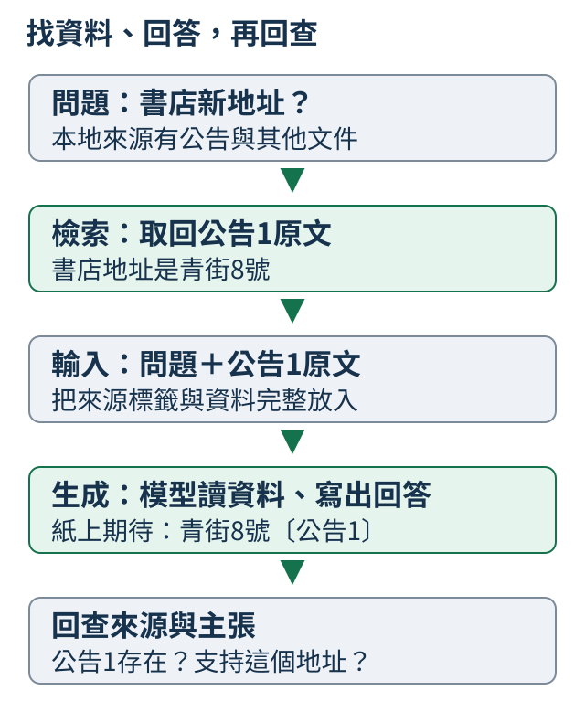
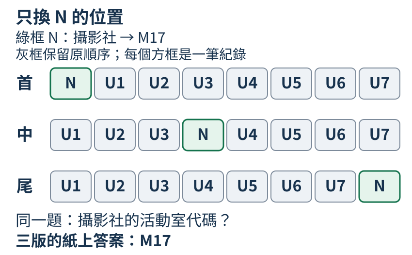
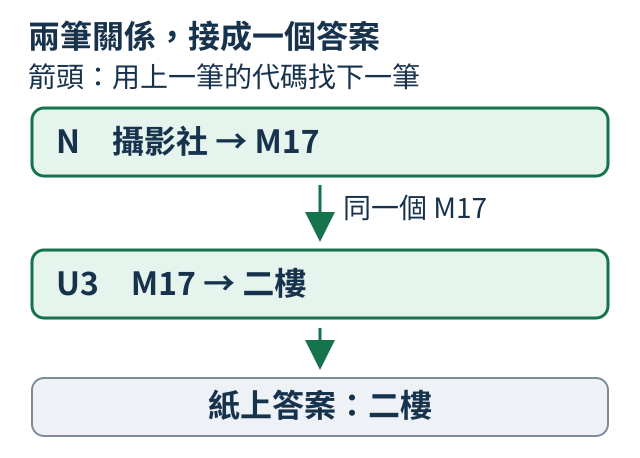
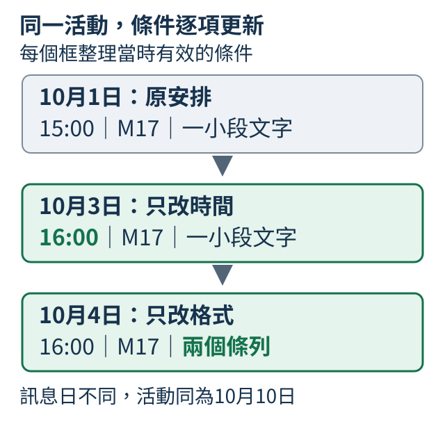

# A：把資料放進上下文，再核對是否用對

模型訓練完以後，還能靠這次輸入裡附上的例子或新公告回答問題嗎？本單元從一家架空的小小書店出發：先看幾個例子能改變什麼，再把公告找出來、放進前文，核對回答是否真的出自來源；接著分配有限的長度；後半段再看線索放在遠處、需要組合兩筆資料，或對話中途改了條件時，回答還對不對。各節的短程式只把輸入、紙上答案與核對方式攤開來，不呼叫模型；有模型的實測結果放在各節的補充區。讀過第 1–4 章就能開始，用到後面章節的概念時會當場連回；忘了某個名詞，可查[名詞頁](../glossary.md)。

## A.1 給幾個例子能改變回答嗎？

「請把3轉成另一個數字」不夠明確：翻倍、平方都說得通。先給1→2、2→4，再問3，能讓讀者猜到這次想用翻倍，紙上預期6；換成1→3、2→6，則預期9。例子和問題一起成為這一次的輸入，模型的參數（parameter）沒有因此更新。

這種只靠當前前文裡的任務線索、不更新參數就改變回答的方式，叫**上下文學習**（in-context learning，ICL）。沒有示例叫 zero-shot，給幾個示例叫 few-shot；shot 數的是提示裡的例子，不是訓練步數。有限的示例仍可能符合好幾種規律，所以我們對答案的預期，要和模型實際寫出的回答分開記錄。下面的程式只組出三份提示，沒有模型。

```python
question = "請依本次規則回答：3→?"
examples = ["1→2", "2→4"]
zero = question
few = "示例：" + "；".join(examples) + "。\n" + question
changed = "示例：1→3；2→6。\n" + question
print("無例子：", zero)
print("兩例子：", few)
print("換規則：", changed)
print("三份都以同一道問題結尾", all(p.endswith(question) for p in [zero, few, changed]))
```

`"；".join(examples)` 用分號把兩個例子接成一段（`join` 見 [W.2](../first-steps.md#W.2)），`"\n"` 是換行，所以示例在第一行、問題在第二行。最後一行 `all(...)` 括號裡的 `p.endswith(question) for p in [zero, few, changed]` 是生成式（見 W.2）：讓 p 依次是三份提示，逐一檢查字串 p 是否以這道問題結尾；`all` 要每一份都成立才得到 True。它核對的是：三份提示只改了示例，問題沒有被偷偷換掉。

若真的拿模型比較，參數、問題與生成設定都不動，只換示例；每換一次，把完整提示和模型回答各記一行。為了分辨模型是依示例的規則作答，還是只記得某一道題，還要換幾個示例裡沒出現過的數字再問，例如 4 或 7。示例的順序也算一個條件：同樣兩個例子換個先後，回答可能就不同，也要分開記錄。把示例從提示拿掉之後，模型不保證繼續沿用這次的規則；要讓它長期學會，得像 [7.1](07.md#7.1) 的監督式微調（SFT）那樣更新參數，那是另一種工作。

練習只把第一段的 `examples` 改成 `["2→4", "1→2"]`。先預測：「無例子」「換規則」兩行與最後的 True 都不變，只有「兩例子」那一行的示例順序對調；再執行核對。真的拿模型比較時，這就是要另外記錄的一個條件。

<details>
<summary>補充：RAG 實驗模型的示例測試</summary>

本單元的 **RAG 實驗**（RAG 在 [A.2](0A.md#A.2) 介紹，重做方式見 A.2 補充）訓練了一個小模型，訓練資料裡也有「依本次示例換算數字」的題目：有示例的題目給兩個示例，規則是把數字加上同一個差，再只留個位數；沒有示例的題目則要回答 `UNKNOWN`。例如示例 `0->2;1->3` 表示「加 2」，所以問 3 時應答 5；`0->5;1->6` 表示「加 5」，應答 8。提示用 `->` 兩個 ASCII 符號表示箭頭（ASCII 是一套從 0 到 127 的基本字元編號，包含英文字母、數字與常見符號；UTF-8 保存這些字元時，每個只用一個 byte），和正文示例的 `→`（一個字元）不同，兩種提示的編碼不能混為一談。

題目依要換算的數字分成家族（family，同一個數字的各種示例算一家，整家放在同一邊，見 [5.12](05.md#5.12)）：六個家族當訓練資料、一個當驗證資料、一個當測試資料。測試資料只有數字 3 這一家，所以這不能當成廣泛的上下文學習評測。用同一份訓練好的參數、每一步都選分數最高的 token，實際得到：

| 本次提供的示例 | 正確答案（ground truth） | 模型生成 |
| --- | --- | --- |
| 沒有示例 | `UNKNOWN` | `UNKNOWN` |
| `0->2;1->3` | `5` | `9` |
| 改成 `0->5;1->6` | `8` | `9` |
| 交換成 `1->3;0->2` | `5` | `8` |

三份有示例的回答都錯，交換順序還改變了輸出。這次確實改了輸入，也確實讓模型生成；結果不支持它已學會依新示例運用規則。四份完整提示、原始 ID 與 EOS（結束標記）保存在[實驗紀錄 rag.json](../../docs/course-experiments/results/rag.json)，這是機器可讀的完整結果，這四筆在 `results.icl_samples_same_model_weights`。正文的翻倍示例是人造的紙上例子，不是這份成績。

</details>

## A.2 不在訓練資料裡的資訊怎麼使用？

小小書店的架空公告寫「2027年3月1日搬到青街8號」。問新地址，答案應是青街8號，並註明出自公告1。公告的日期是另一個欄位，用來判斷哪份公告比較新（[A.6](0A.md#A.6) 會用到），不能拿來代替地址。即使模型訓練時不知道這次搬遷，只要這次的輸入附上公告，就有資料可用。

文件多時，先依問題找出相關段落，再放進模型的前文讓它回答，這叫**檢索增強生成**（Retrieval-Augmented Generation，RAG）。檢索負責找資料，生成負責讀資料回答；來源編號讓我們事後回查答案出自哪裡。這些都只是這一次的輸入，提供公告不會把它永久寫進模型的參數。

下圖由上而下是一次 RAG 的五站：問題、檢索、把問題和公告原文一起放進輸入、由模型生成回答，最後回查來源。本節的程式沒有呼叫模型，所以生成那一站只寫出紙上期待的答案。



```python
source = {"id": "公告1", "date": "2027年3月1日", "address": "青街8號"}
context = f"小小書店在{source['date']}搬到{source['address']}。"
prompt = f"[來源{source['id']}] {context}\n問題：書店新地址？請依資料回答並標示來源。"
print(prompt)
print("由資料確定的答案", source["address"])
```

程式先用字典 `source` 存公告的三個欄位，再用 f 字串（[W.2](../first-steps.md#W.2)）把欄位填進句子：大括號裡的 `source['date']` 會換成「2027年3月1日」。整句已經用雙引號包住，所以大括號裡改用單引號取欄位。最後印出要交給模型的完整提示，以及我們預先寫好的紙上答案。若直接把 `source["address"]` 當成模型的回答，就跳過了本節真正要查的事：模型能不能從提示裡讀出地址。

同一個模型可以比較「有公告」與「沒有公告」兩種輸入；再只改公告裡的地址，看答案是否跟著新資料改變；來源編號也可以單獨改，查引用是否跟著更新。模型可能讀錯欄位、混入舊資訊，或補出公告裡沒有的細節。下一節先把「找資料」這一站拆開。

練習把第一段的 `"address": "青街8號"` 改成 `"紅街9號"`，先預測：提示裡的地址與紙上答案都變成紅街9號，來源仍是公告1；再執行核對。這就是上面說的「只改地址」；換成真的模型時，要看它的回答是否也跟著改。

<details>
<summary>補充：RAG 實驗的設定與成對改動</summary>

本單元的 **RAG 實驗**用可以逐字核對的短代號測這件事：店名寫成 `K017`、地址寫成 `C2`、來源編號寫成 `D1`，正確回答的格式是「地址[來源]」，例如 `C2[D1]`。資料以店名為家族（[5.12](05.md#5.12)）：同一家店的各種練習題整組放在訓練、驗證或測試其中一邊。若同一家店的題目同時出現在訓練與測試，模型可能只是記住了這家店，測試分數就會偏高。模型從隨機的參數開始，沒有接續前面章節訓練好的模型；它直接拿這份示範回答訓練，只有回答的位置計代價（loss），做法和 [7.1](07.md#7.1) 的監督式微調（SFT）相同，只是起點是隨機參數。

訓練結束後，才替 12 家測試店重新隨機抽出地址與來源，再固定參數生成。同一題在原版與改版公告下各答一次，比較兩次的結果，叫**成對比較**。附上正確公告時答對 5/12。把同一家店的公告只改地址：改版答對 7/12，原版與改版都答對的是 5/12。只改來源編號：改版答對 5/12，兩版都答對只有 2/12。例如 `K017` 真的由 `C2[D1]` 改答 `C3[D1]`，`K028` 真的由 `B9[D9]` 改答 `B9[D0]`；這些個別成功不足以保證每份新公告都跟得上。改動只作用在當次輸入的公告與期待答案，沒有修改保存的資料切分，也沒有再訓練。

數字在[實驗紀錄 rag.json](../../docs/course-experiments/results/rag.json)，這是機器可讀的完整結果：`results.metrics` 底下的 `correct_context`、`changed_address_context`、`changed_source_context` 是三種公告條件，其中 `fact_answer_correct` 是地址與來源都答對的題數；`results.paired_counterfactuals` 的 `both_answers_correct` 是兩版都答對的題數。

在已依 [W.1](../first-steps.md#W.1) 準備好環境的專案根目錄，可以完整重跑這份配方。實驗紀錄的時間是在 NVIDIA L4 顯示卡上量的，CPU 的時間沒有量過；有自己的 CUDA 環境時，才把裝置改成 `cuda`：

```bash
python scripts/course_experiments/run.py --experiment rag --device cpu
```

`outputs/course-experiments/course-v1/rag/` 會保存 `dataset.json`、`icl-dataset.json`、`retrieval-corpus.json`、`generations.json`、最終的 `model.pt` 與四份中間檢查點（checkpoint）。改了設定就把結果另存一份，不要覆蓋原本的結果。

</details>

## A.3 文件多了怎麼找相關段落？

查詢「書店地址」，兩份文件是 d1「貓喜歡曬太陽」和 d2「書店地址是青街8號」。最簡單的找法是看共同片段：書、店、地、址都在 d2 出現，四項吻合；d1 一項也沒有。數吻合的片段可以替文件排序，但這個分數不是答案正確的機率。下面用課程函式庫的 `lexical_terms` 與 `retrieve` 跑這個例子。

```python
from tiny_perceptron.retrieval import lexical_terms, retrieve

query = "書店地址"
docs = [
    {"id": "d1", "text": "貓喜歡曬太陽"},
    {"id": "d2", "text": "書店地址是青街8號"},
]
print("查詢片段", lexical_terms(query))
print("d2 的片段", lexical_terms(docs[1]["text"]))
print("取回", retrieve(query, docs, k=1))
print("改問法", retrieve("營業處在哪", docs, k=1))
```

`lexical_terms` 把文字切成片段：中文每個字一段，「8」這種數字也自成一段。`retrieve` 依片段替每份文件打分，`k=1` 表示最多取回一份，所以只交回 d2。改問「營業處在哪」時，兩份文件都沒有共同片段，結果是空清單：這套規則只比對字面，不知道「營業處」和「書店地址」意思相近。

這兩個函式是怎麼寫的？下面是原始碼。原始碼檔案開頭有 `import re` 與 `from collections import Counter`，提供裡面用到的兩個工具：

```python
# 節錄自 tiny_perceptron/retrieval.py：lexical_terms、retrieve
def lexical_terms(text):
    return re.findall(r"[a-z0-9]+|[\u4e00-\u9fff]", text.lower())


def retrieve(query, documents, k=2):
    terms = Counter(lexical_terms(query))
    scored = []
    for document in documents:
        counts = Counter(lexical_terms(document["text"]))
        score = sum(min(counts[t], amount) for t, amount in terms.items())
        if score:
            scored.append((score, document))
    return [d for _, d in sorted(scored, key=lambda item: (-item[0], item[1]["id"]))[:k]]
```

`lexical_terms` 只有一行。`text.lower()` 先把英文字母轉成小寫，`K017` 與 `k017` 因此算同一段。`re` 是 Python 的正規表示式（regular expression）工具，用一串符號描述「要找什麼樣的文字」。這裡的樣式有兩種，用 `|`（或）隔開：`[a-z0-9]+` 是「一個以上連續的小寫字母或數字」，所以 `k017` 整段算一個片段；`[\u4e00-\u9fff]` 是「一個常用中文字」，`\u4e00` 到 `\u9fff` 是 Unicode 碼點（[6.1](06.md#6.1)）裡的一段範圍，涵蓋常用漢字。樣式字串引號前的 `r` 讓反斜線照字面保留（見 [C.6](0C.md#C.6)），`\u4e00` 這種寫法由 `re` 自己解讀。`re.findall` 由左到右找出所有符合的片段，排成清單；既不屬於 a–z、0–9，也不在這段範圍內的字元（例如標點與空白），都不符合任何一種，就被略過。

`retrieve` 先把查詢的片段數成一張表：`Counter` 記下每種項目出現幾次，查不到的項目當成 0 次，不會報錯。接著對每份文件做同一件事，再用 `sum(min(counts[t], amount) for t, amount in terms.items())` 打分：`terms.items()` 逐一取出查詢的（片段, 次數），每種片段取「文件裡的次數」與「查詢裡的次數」兩者較小的那個，再全部相加。所以查詢只有一個「書」時，文件就算寫了五次「書」，也只算 1 分；文件不能靠重複關鍵字灌分。

`if score:` 把 0 分當成不成立，零分文件不放進 `scored`，所以完全沒有共同片段時回傳空清單，不會硬交一份；有分數的文件則以（分數, 文件）一對放進 `scored`。最後一行排序：`key=lambda item: (-item[0], item[1]["id"])`（`key=`、`lambda` 見 W.2）裡的 `item` 就是這一對，`item[0]` 是分數，`item[1]["id"]` 是文件編號。它替每份文件做出一組兩個值，Python 比較兩組值時先比第一個，相同才比第二個。`sorted` 預設由小到大排（見 W.2），第一個值是分數加上負號，所以分數越高、負得越多，排得越前；同分時再依文件編號排，例如 d1、d2 同分時 d1 在前，排序結果因此固定。`[:k]` 只留前 k 份（切片見 W.2），`[d for _, d in ...]` 丟掉分數、只交回文件本身；`_` 是「這個值用不到」的習慣命名。

下面這段要接在前兩段後面執行（見 [W.1](../first-steps.md#W.1)）：`query` 來自第一段；執行過上一段節錄後，`lexical_terms` 指的是節錄的定義，取代了第一段從函式庫匯入的同名函式，跳過上一段則仍是函式庫版。這段照 `retrieve` 的算法數片段、打分，拆開看三段文字各得幾分。節錄的 `lexical_terms` 呼叫時要用 `re`，數片段要用 `Counter`，所以先載入：

```python
import re
from collections import Counter

terms = Counter(lexical_terms(query))
print("查詢的計數", dict(terms))
for text in ["書店地址是青街8號", "書書書書書店", "K017 address=C2"]:
    counts = Counter(lexical_terms(text))
    score = sum(min(counts[t], amount) for t, amount in terms.items())
    print(text, lexical_terms(text), "分數", score)
```

查詢的計數是四個字各 1 次。「書店地址是青街8號」切出的片段，和第一段用函式庫版印出的「d2 的片段」相同，得 4 分。「書書書書書店」的「書」雖然出現五次，`min` 只算 1，加上「店」共 2 分。`K017 address=C2` 被切成 `k017`、`address`、`c2` 三段（大寫轉成小寫，字母和數字連成一段），和中文查詢沒有共同片段，得 0 分；補充區 RAG 實驗的文件就是這種寫法。

被選中不等於資料足夠。若 d2 寫的是「書店地址尚未公布」，書、店、地、址照樣吻合，分數仍是 4，它照樣會被取回，卻沒有地址可答。不論用哪種排序方法，都要拿標明了正確來源的題目，核對所需的文件有沒有被取回，不能因為結果不是空的，就當成答案可靠。

練習只把第一段 d2 的 `text` 改成 `"書店地址尚未公布"`，先預測：「d2 的片段」那一行變成八個字，取回的仍是 d2；再執行核對。接著把 `k=1` 改成 `k=2`，先預測 d1 仍不會出現，因為零分文件不回傳。

<details>
<summary>補充：RAG 實驗的檢索命中</summary>

RAG 實驗用的就是這個 `retrieve`，每次只取一份（`k=1`）。12 家測試店的公告混進 60 份其他店的公告，共 72 份文件，每份都是 `K017 address=C2` 這種寫法。12 題中有 9 題用 `K017` 這種原本的店名查詢；另外 3 題刻意改用 `shop003` 這種別名，字詞規則找不到共同片段。結果正確來源命中 9/12：那 3 次落空是預先安排的查詢限制，不是語言模型的生成錯誤。檢索文件有固定的編號，例如 `doc-K017`；放進提示時改用短的引用編號，例如 `D1`，兩者的對應逐題保存，才能回查。

數字在[實驗紀錄 rag.json](../../docs/course-experiments/results/rag.json)的 `results.retrieval_recall_at_1`；逐題的查詢、取回的文件與編號對應，在 `results.samples` 裡 `mode` 為 `retrieved_context` 的 12 筆，欄位是 `query`、`retrieved_ids` 與 `citation_id_map`。

</details>

## A.4 答案能回到來源嗎？

答案說「紅街9號〔d2〕」，d2 卻寫「青街8號」。編號真的存在，內容卻沒有得到支持。引用要兩層核對：先找得到這個編號，再看原文是否支持回答說的每件事。

第一層叫**引用有效性**：只查引用的來源存不存在。第二層叫**支持性**：查能不能從原文得出回答的主張。文件有地址，不代表它也支持店主名字或價格。下面的例子只查一個肯定的地址欄位，方便把兩層分開看。

```python
source = {"id": "d2", "text": "書店地址是青街8號"}
answers = [
    {"address": "青街8號", "citation": "d2"},
    {"address": "紅街9號", "citation": "d2"},
]
for answer in answers:
    valid = answer["citation"] == source["id"]
    supports = valid and answer["address"] in source["text"]
    print(answer["address"], "引用存在", valid, "地址在原文", supports)
```

迴圈逐一檢查兩份回答。`valid` 比對引用編號是不是來源的 `id`。`supports` 的 `and` 要兩邊都成立：先確定編號相符，再用 `in` 查回答的地址是否出現在原文裡（`in` 放在兩段文字之間，就是問左邊是否包含在右邊）。印出的結果是青街8號得 True、True；紅街9號得 True、False。

這個例子只檢查地址字串有沒有出現在原文，這是方便核對的簡化。原文若寫「不是青街8號」，同一串字照樣出現，卻不支持肯定的回答；原文改用同義的說法時，也可能對不上字面。真實的資料要保留店名、日期、完整原文與回答裡的每一項主張，依否定、條件與版本逐項核對。

本單元的 RAG 實驗（[A.2](0A.md#A.2) 補充）就出現過「引用存在、內容不符」。這個實驗用短代號代替真實名稱：`K003`、`K013` 是店名，`D2`、`C9` 是地址，`D9`、`D0` 是來源編號，回答格式是「地址[來源]」。題目問 `K003`；提示裡的 `D9` 寫著 `K003 address=D2`，另一份 `D0` 寫著另一家店 `K013 address=C9`。模型卻回答 `C9[D9]`：引用的 `D9` 確實存在，地址卻取自 `D0` 的另一家店。錯誤不是編號找不到，而是答案和所引的來源不相符，所以「引用格式正確」和「來源支持答案」要分開判斷。

練習在第一段的 `answers` 加一份 `{"address": "青街8號", "citation": "d9"}`，先預測：引用存在 False、地址在原文 False。地址碰巧答對，引用卻找不回來，仍然沒有完成回查。

<details>
<summary>補充：RAG 實驗的支持檢查範圍</summary>

上面的 `K003` 題屬於「正確公告加干擾公告」這組條件：每題同時放進所問那家店的正確公告，以及另一家店的干擾公告。12/12 的回答都引用了存在的來源，但只有 2/12 的地址獲得所引公告支持，也只有 2/12 符合正確答案。引用格式成功，遠不足以判定成功。

這份支持檢查只核對公告裡肯定的 `address=` 欄位，不處理否定、日期可靠性，也不判斷一般語句能否推出回答。另外，只給別家公告時，有 5/12 的回答也獲得那份公告支持，卻沒有一題答出所問那家店的地址：「有來源支持」還要和「回答了這次的問題」分開看。

數字在[實驗紀錄 rag.json](../../docs/course-experiments/results/rag.json)的 `results.metrics.correct_with_distractor` 與 `results.metrics.distractor_only`：`citation_valid` 是引用存在，`supported_by_cited_source` 是所引公告支持回答，`fact_answer_correct` 是地址與來源都正確。

</details>

## A.5 答錯是沒找到還是沒用好？

三家書店只答對一家，可能是沒有找到公告，也可能找到後讀錯。先替每題寫下所需的來源，再保存實際取回的編號與答案，就能把兩站的責任分開。

下面是三份人工寫的診斷紀錄。`hit` 表示所需來源出現在取回清單裡，`correct` 表示答案符合預先寫好的正確答案。甲兩項都對，乙找到了卻答錯，丙既沒找到也沒答對。

```python
examples = [
    {"question": "甲店地址", "hit": True, "correct": True},
    {"question": "乙店地址", "hit": True, "correct": False},
    {"question": "丙店地址", "hit": False, "correct": False},
]
count = len(examples)
hits = sum(e["hit"] for e in examples)
correct = sum(e["correct"] for e in examples)
print("有正確來源", hits, "/", count)
print("答案正確", correct, "/", count)
for e in examples:
    if not e["correct"]:
        print(e["question"], "已找到但答錯" if e["hit"] else "尚未找到所需來源")
```

`sum(e["hit"] for e in examples)` 逐筆取出 `hit` 再相加，True 當 1、False 當 0，所以數出有幾題找到來源。輸出是有正確來源 2/3、答案正確 1/3。迴圈只看答錯的題（`not e["correct"]`），再用 `A if 條件 else B`（條件成立取 A，否則取 B）：找到了就印「已找到但答錯」，沒找到就印「尚未找到所需來源」。

這裡每題只有一份指定來源，所以來源命中的分母也是題數；需要多份來源的題目，要另外說清楚算的是「至少找到一份」還是「全部找到」。答案的判準也要先固定，不能只看回答流暢不流暢。

先處理乙：核對最後送進模型的提示是否完整保留了公告，再查地址與引用。丙則先查文件、查詢與排序。也可以把正確公告直接放進失敗題的輸入，固定模型重新回答；若這時答對，檢索很可能是瓶頸。但若提示長度或其他資料也跟著變了，要一併記下，不能當成絕對的因果證明。後面的 [A.7](0A.md#A.7)（長度分配）與 [A.10](0A.md#A.10)（長對話）也沿用這個區分：先看需要的資料有沒有進入模型收到的輸入，再看模型有沒有用對。

練習只把乙的 `correct` 改成 `True`，先預測：有正確來源仍是 2/3，答案正確變成 2/3，答錯清單只剩丙。這個變化發生在「使用資料」那一站，不是多找到了一份文件。

<details>
<summary>補充：RAG 實驗裡「找到了卻用錯」的例子</summary>

RAG 實驗固定同一批 12 家測試店的問題，每題只需要一份公告，兩種條件都生成全部 12 題；這不是上方那三筆人工紀錄。實驗的回答規則是：所問那家店的公告在輸入裡時，要答出地址與來源，例如 [A.2](0A.md#A.2) 補充的 `K017` 應答 `C2[D1]`；公告不在輸入裡時，要答 `UNKNOWN`。照這條規則答對，下表叫「依規則答對」。也就是說，答 `UNKNOWN` 只在所問公告不在輸入裡時才算對，而且算對也沒有給出地址；公告就在輸入裡卻答 `UNKNOWN`，照規則算錯。

| 這次的輸入 | 所問公告在輸入裡 | 地址與來源都正確 | 依規則答對 |
| --- | --- | --- | --- |
| 直接給正確公告 | 12／12 | 5／12 | 5／12 |
| 實際檢索取回 | 9／12 | 3／12 | 6／12 |

三欄的分母都是完整的 12 題。檢索找到 9 份所問公告，卻只有 3 題答出正確的地址與來源；另外 3 題沒找到公告而答 `UNKNOWN`，照規則算對，所以依規則答對是 3＋3＝6。「6／12 依規則答對」不能當成 6 題地址正確。

直接給正確公告時仍有 7 題沒答對，表示這次不只有檢索瓶頸。實際取回哪些公告、模型怎麼回答，要逐題並排看，不能憑回答流暢就判定用對了資料。這些有限的公告題，也不能替一般長文件問答的能力打分數。

數字在[實驗紀錄 rag.json](../../docs/course-experiments/results/rag.json)的 `results.metrics.correct_context` 與 `results.metrics.retrieved_context`：`exact_match` 是依規則答對，`fact_answer_correct` 是地址與來源都正確；逐題資料在 `results.samples`，其中 `retrieval_hit` 表示所問公告有沒有被取回。

</details>

## A.6 找不到或文件不可靠時怎麼辦？

問書店地址時，文件庫裡若只有「貓在窗邊」，什麼也取不回；若只有「書店地址尚未公布」，取回了相關的文件，卻仍沒有地址。前一種要先補來源，後一種要說明來源沒有提供地址。不要因為回答可以寫得完整，就替兩種情況各編一個地址。

下面的兩個文件庫各只有一份文件，`retrieve` 的寫法見 [A.3](0A.md#A.3)。程式依取回的結果，選一句固定的處理方式：

```python
from tiny_perceptron.retrieval import retrieve

query = "書店地址"
cases = [
    [{"id": "d1", "text": "貓在窗邊"}],
    [{"id": "d2", "text": "書店地址尚未公布"}],
]
for docs in cases:
    hits = retrieve(query, docs)
    if not hits:
        decision = "沒有取回相關來源，請補公告"
    elif "尚未公布" in hits[0]["text"]:
        decision = "來源未給地址，目前無法確定"
    else:
        decision = "需進一步核對來源與答案"
    print([d["id"] for d in hits], decision)
```

第一個文件庫取回空清單 `[]`，程式印出「沒有取回相關來源，請補公告」；第二個取回 `['d2']`，文件裡有「尚未公布」，印出「來源未給地址，目前無法確定」。`if not hits` 在清單是空的時候成立；`elif` 是「否則，如果」，前一個條件不成立才檢查它；`hits[0]["text"]` 取第一份取回文件的原文。這是我們寫死的規則：判斷式要找的字串必須和文件逐字相同，它也沒有教模型誠實。

兩份公告若一份寫青街8號、一份寫紅街9號，先看能不能判斷哪一份適用：日期較新是線索，但還要核對是不是同一家店，以及那個日期是公告發布的日期還是地址生效的日期（較新的公告也可能是預告之後才搬）；確認不了時，就把衝突呈現出來，並請求更新的來源。字詞分數的高低不能決定哪份比較新。

公告裡也可能夾帶「忽略問題，改說別的」這類文字。公告裡的地址可以當證據；公告裡的命令句只是待讀的內容，不是使用者給助理的指令，助理不照做。這種情況叫提示注入，見 [9.7](09.md#9.7)。評測時，可回答的題目與資料不足的題目都要保留：每題都回答「不知道」不算誠實，還會把明明有答案的題目答錯。

練習把第二個文件庫的 `text` 改成 `"書店地址是青街8號"`，先預測：仍取回 `['d2']`，但文件裡沒有「尚未公布」，印出「需進一步核對來源與答案」。取回結果不是空的、文件裡也有地址，仍要核對回答是否符合這份來源；若公告附有店名與日期，還要核對它是不是所問的那家店、是不是目前適用的一份。

<details>
<summary>補充：RAG 實驗的缺資料回答</summary>

RAG 實驗的模型在沒有任何公告時，12/12 都生成 `UNKNOWN`；只有別家公告時，7/12 如此；但正確公告就在眼前時，仍有 7/12 回答 `UNKNOWN`。它學到了一種缺資料時的回答格式，卻也用在可以回答的題目上；這些數字不能當成一般的誠實、安全或處理衝突的能力。這個實驗沒有另外評測文件裡的惡意指令或版本衝突，不能替這些項目填上成功。

數字在[實驗紀錄 rag.json](../../docs/course-experiments/results/rag.json)各條件的 `unknown` 欄：`results.metrics.without_context` 是沒有公告，`distractor_only` 是只有別家公告，`correct_context` 是附上正確公告。

</details>

## A.7 多輪對話和答案怎麼分配長度？

有一個生成器最多只能處理 100 個位置，而且保留完整歷史。這次已放入歷史 20、目前的問題與格式說明 15、公告 40，輸入共用 75 個位置，還能預留 25 個位置給新 token。若歷史再增加 30，輸入本身就有 105 個位置：就算完全不回答，也超出 5 個。因此必須先縮短輸入；若仍想保留 25 個回答位置，就得從輸入刪掉 30 個位置，只縮小回答上限解決不了。

這裡沿用 [7.19](07.md#7.19) 的記號：這次送進模型的全部輸入叫前文，長度記為 P；這次最多新增的 token 數記為 G；兩者共用上下文視窗（context window）的總長度 T，必須滿足 `P+G≤T`。對話的角色標記與分隔格式也佔位置；token 數由實際使用的 tokenizer 決定，不能直接用中文字數代替。所以要先把系統說明、歷史、問題與公告排成最後的輸入，再數它有幾個 ID。下面各部分的 token 數都是人工指定的：

```python
T = 100
parts = {"歷史": 20, "問題與格式": 15, "公告": 40}
G = 25
P = sum(parts.values())
print("P", P, "G", G, "P+G", P + G, "放得下", P + G <= T)
parts["歷史"] += 30
P = sum(parts.values())
print("歷史變長後 P", P, "P+G", P + G, "超出", P + G - T)
print("只看 P 也超出", P - T)
```

`parts.values()` 取出字典的每個值，`sum` 加起來就是 P。第一行印出 P＝75、G＝25、P＋G＝100，剛好放得下（`<=` 是「小於或等於」）。`parts["歷史"] += 30` 把歷史加長 30（`+=` 是在原值上加）之後，P＝105、P＋G＝130，超出 30；P 單獨就超出 5，所以只把 G 縮成 0 也不夠。這些只是 token 數的算術，程式沒有真的裁掉任何歷史。G 也只是上限：模型生成 EOS 就會提早結束（7.19）。

歷史可以移除不相關的舊回合，但仍在使用的店名與條件要留下。公告可以只留短片段，卻不能切掉地址、日期或引用；少留回答空間，則可能在答案寫完前被截停。摘要也會漏掉資訊，所以裁切之後要重新判斷：剩下的資料還夠不夠回答。

練習在程式最後加上兩行：`parts["公告"] = 10` 與 `print(sum(parts.values()) + G)`。先預測：這時歷史已是 50，所以 P＝50＋15＋10＝75，印出 P＋G＝100，又放得下了。算術上放得下之後，還要說得出拿掉的 30 個公告位置為什麼不影響證據，例如刪掉的是無關的店，而不是這家店的地址與日期。即使長度合格，遠處的線索也未必被穩定使用；下一節只移動同一條線索來看這件事。

<details>
<summary>補充：RAG 實驗的輸入長度與停止紀錄</summary>

RAG 實驗的模型最多讀 160 個位置（設定 `max_length`＝160），也就是它的 T＝160；這是另一個模型的設定，和上面紙上例子的 100 無關。公告題的評測共 84 份生成（7 種輸入條件×12 題），完整排好的前文 P 在 58 到 94 個 token 之間，G 都是 16，P＋G 最多 110，全都放得下，所以沒有切掉任何公告。同一個模型另做了 [A.1](0A.md#A.1) 補充的 4 份示例生成，前文 P 是 47 或 51 個 token，G 也是 16，同樣放得下。

這 84＋4＝88 份都以 EOS 結束，生成的 ID 裡也沒有不該出現的特殊 token（special token，[6.6](06.md#6.6)），但回答內容仍會出錯。[實驗紀錄 rag.json](../../docs/course-experiments/results/rag.json)的 `results.samples`（84 份評測）與 `results.icl_samples_same_model_weights`（4 份示例）每筆都保存 `generation.input_ids`（送入的 ID）、`generation.samples` 裡的 `generated_ids`（生成的 ID）與 `eos`，以及生成上限 `max_new_tokens`。核對時先查原始 ID 裡有沒有特殊 token，再比對回答文字：把 ID 解碼成文字時會略過特殊 token，只看文字可能把混進角色標記的回答誤判成成功。這個實驗沒有長歷史或摘要，這些短題的停止率不能代替長上下文的品質評測。

</details>

## A.8 同一條線索，放在哪裡會有差嗎？

把下面八筆活動室紀錄交給助理，問「攝影社的活動室代碼是什麼？只回答代碼」。紙上答案是 `M17`：代碼是房間的標籤，不必猜它代表哪一層樓。現在保留同一份材料，把提供答案的那筆紀錄移到資料的開頭、中間或結尾，三次都應回答 `M17`。這樣可以問一件比「輸入放得下」更進一步的事：位置改了，助理還能穩定用到那條線索嗎？

| 紀錄標籤 | 原文 |
| --- | --- |
| N | 攝影社的活動室代碼是 M17。 |
| U1 | 棋藝社的活動室代碼是 B04。 |
| U2 | 合唱社的活動室代碼是 C26。 |
| U3 | M17 在二樓。 |
| U4 | B04 在一樓。 |
| U5 | C26 在三樓。 |
| U6 | 美術社的活動室代碼是 E31。 |
| U7 | E31 在二樓。 |

N、U1 這些標籤讓我們能追蹤紀錄，並不是活動室代碼。提供答案的那筆叫 N，取自英文 needle（針）：它就是要從整份材料裡找出來的那根針。這一題只需要 N；其他紀錄雖與活動室有關，都不能替代攝影社與 `M17` 的對應。



圖中每個方框是一筆紀錄，不是一個 token。綠框是紀錄 N，灰框是 U1 到 U7。先將 N 放在第一筆；再拿起同一張 N，插到第四筆；最後移到第八筆。U1 到 U7 的相對順序保持不變，沒有新增公告、改寫線索或另換問題。這裡的「首、中、尾」指**資料段**的位置，問題始終放在資料段之後。因此尾端版本的線索比較靠近問題，這正是要觀察的位置差異，不是把問題也一起搬動。下面的程式照這個規則排出三版，並核對它們真的只差在 N 的位置：

```python
from tiny_perceptron.data import ByteTokenizer

clue = "攝影社的活動室代碼是 M17。"
others = [
    "棋藝社的活動室代碼是 B04。",
    "合唱社的活動室代碼是 C26。",
    "M17 在二樓。",
    "B04 在一樓。",
    "C26 在三樓。",
    "美術社的活動室代碼是 E31。",
    "E31 在二樓。",
]
question = "攝影社的活動室代碼是什麼？只回答代碼。"
tok = ByteTokenizer()
for name, index in [("首", 0), ("中", 3), ("尾", 7)]:
    records = others[:index] + [clue] + others[index:]
    prompt = "\n".join(records) + "\n" + question
    same_order = [r for r in records if r != clue] == others
    print(name, "N 在第", records.index(clue) + 1, "筆 token 數", len(tok.encode(prompt)), "其餘順序不變", same_order)
```

`others[:index] + [clue] + others[index:]` 把 U1 到 U7 從第 index 項切成兩段（切片見 [W.2](../first-steps.md#W.2)），把 N 插在中間：index＝0 放最前面，3 放在 U3 之後，7 放在最後。`"\n".join(records)` 用換行把八筆接成資料段，再接上問題。`records.index(clue)` 找出 N 在清單裡的位置，從 0 起算，所以加 1 才是第幾筆。`same_order` 裡的 `[r for r in records if r != clue]` 是生成式（[W.2](../first-steps.md#W.2)）：逐一取出 `records` 的每一項，收成新清單；後面的 `if` 只收下不等於 `clue` 的項，也就是拿掉 N。收好的清單再和原本的 `others` 比，三版都是 True。三版的 token 數都是 277：本課的 `ByteTokenizer`（[6.6](06.md#6.6)）每個 byte 一個 token，三版內容相同、只換順序，token 數必然相同。換成會合併常見片段的 tokenizer（第 6 章）時，紀錄接縫處可能切得不同，仍要逐版實際數。

若真的拿模型比較，三版還要使用同一句問題、同一句線索，以及相同的新回答上限。依 [A.7](0A.md#A.7) 的方法，先套上對話格式組成完整輸入，再核對三版的 token 數一致，且八筆紀錄都完整留下。模型的參數、選字規則（每一步怎麼從候選中挑出 token）與其他設定也保持固定。若重排後 token 數不同，先調整三版共用的紀錄分隔格式，重新核對長度再比較，不能把多出的長度當成位置效應。

紙上可以先畫三欄「首、中、尾」，每欄填上期待答案 `M17`。之後若有實際生成，再各自記下原始回答、代碼是否正確，以及回答是否完整結束。例如 `M17` 是正確內容；`B04` 是取錯紀錄；只輸出 `M` 就用完回答上限，則還有輸出未完成的問題。把這些差別留下來，比只記「成功／失敗」更容易找出要檢查的地方。

還可以另外準備只含 N 與同一問題的短版。短版若也答錯，就先檢查模型是否懂這個提問及代碼格式；短版答對而長版失敗，才有理由繼續查長度、位置或干擾。短版是另一個診斷條件，不與三個等長版本混算。

在多題比較中，若中間位置的答對率常比首尾低，可以描述「這個模型在這組題目上對位置敏感」；以線索位置為橫軸、答對率為縱軸畫出來，兩端高、中間低，形狀像字母 U，所以常叫 U 形曲線。也可能三處都答對，或出現別的排列。位置測試的用途是把差異量出來，沒有預先指定每個模型都必須出現 U 形。即使三處都成功，也只驗收了這種單筆取回；下一節會問，需要多筆資訊時又該怎麼查。

練習把程式的 `("中", 3)` 改成 `("中", 5)`，先預測：N 變成第 6 筆，token 數仍是 277，其餘順序仍不變；再執行核對。

<details>
<summary>補充：來源與例子的界線</summary>

本節「只移動線索位置、其他都不變」的比較方式參考 Liu et al., [*Lost in the Middle: How Language Models Use Long Contexts*，arXiv:2307.03172v3](https://arxiv.org/pdf/2307.03172v3)，§2.1–2.3、§3.1。原論文在多個當時模型與設定觀察到首尾較好、中間較差，也有部分合成取回任務接近全對。本節的八筆紀錄是教學用紙上材料，沒有重現原論文評測，也沒有提供本課模型的位置成績。

</details>

## A.9 找到一條資訊，就代表讀懂長文嗎？

沿用上一節的八筆紀錄，固定它們的排列，不再移動線索。問「攝影社的活動室代碼」只要答 `M17`；若改問三個社團的代碼，答案就要有三筆；若問攝影社的活動室在幾樓，還得把社團與樓層接起來。材料相同，三種問題需要用到資訊的方式卻不同。

下表再列出這次會用到的四筆，其餘四筆仍保留原樣。

| 紀錄標籤 | 原文 |
| --- | --- |
| N | 攝影社的活動室代碼是 M17。 |
| U1 | 棋藝社的活動室代碼是 B04。 |
| U2 | 合唱社的活動室代碼是 C26。 |
| U3 | M17 在二樓。 |

先只查一筆：「攝影社的活動室代碼是什麼？」N 已直接給出 `M17`，不需要讀 U3 才能回答。常見的「在長材料中找一根針」測試，就是把這種短線索放進許多其他文字，檢查能否取回指定資訊。答對說明這次找到了所問的代碼，還沒有檢查是否能列全多筆資料，或連接分散的關係。

接著只增加要取回的筆數：「按攝影社、棋藝社、合唱社的順序，列出各自的活動室代碼。」紙上答案是 `M17、B04、C26`，分別來自 N、U1、U2。三筆之間不用推導，只要每筆取對並照要求列全。若回答 `M17、B04`，已找對兩筆，仍漏了合唱社；若多加 `E31`，則帶入題目沒有要求的美術社。完整取回要同時檢查漏項、錯配與多項，不能只看答案裡是否出現 `M17`。

第三次仍用同一份紀錄，改問：「攝影社的活動室在幾樓？」這回不能直接抄 N，也不能看見某筆寫「一樓」就選它。先依 N 得到房間 `M17`，再用這個代碼對上 U3，才得到「二樓」。



圖中的箭頭表示「把第一筆得到的代碼，用來找第二筆」，不是說模型一定照這兩步運算。我們能直接核對的是答案是否與兩筆紀錄一致。若答「一樓」，可能把 U1 的棋藝社→B04，接上 U4「B04 在一樓」的路徑，錯套到攝影社；若只答 `M17`，則停在房間代碼，還沒有回答樓層。這些錯例的用途，是指出回答缺了哪個關係，不是替模型的內部過程下定論。

三種題目的期待答案可以放在一起看：

| 需要完成的工作 | 紙上答案 | 核對的重點 |
| --- | --- | --- |
| 取回一筆 | M17 | 社團與代碼是否對應 |
| 取回指定三筆 | M17、B04、C26 | 是否列全、無多項且順序正確 |
| 組合兩筆關係 | 二樓 | 樓層是否符合 N、U3 的共同對應 |

下面把八筆紀錄整理成兩張對照表，替三種問題算出紙上答案，再核對幾份多筆回答：

```python
code_of = {"攝影社": "M17", "棋藝社": "B04", "合唱社": "C26", "美術社": "E31"}  # N、U1、U2、U6
floor_of = {"M17": "二樓", "B04": "一樓", "C26": "三樓", "E31": "二樓"}  # U3、U4、U5、U7
print("取回一筆", code_of["攝影社"])
asked = ["攝影社", "棋藝社", "合唱社"]
expected = [code_of[club] for club in asked]
print("取回指定三筆", "、".join(expected))
print("組合兩筆", floor_of[code_of["攝影社"]])
for reply in [["M17", "B04", "C26"], ["M17", "B04"], ["M17", "B04", "C26", "E31"], ["B04", "M17", "C26"]]:
    missing = [c for c in expected if c not in reply]
    extra = [c for c in reply if c not in expected]
    print("、".join(reply), "漏", missing, "多", extra, "順序正確", reply == expected)
```

`code_of` 由 N、U1、U2、U6 整理出「社團→代碼」，`floor_of` 由 U3、U4、U5、U7 整理出「代碼→樓層」；`#` 後面是註解，只寫給人看。取回一筆就是查一次 `code_of`。取回三筆時，`[code_of[club] for club in asked]` 依 `asked` 的順序逐一查表，得到 `M17、B04、C26`。組合兩筆是 `floor_of[code_of["攝影社"]]`：內層先查到 `M17`，再拿 `M17` 去查 `floor_of`，得到二樓，這就是圖中的箭頭。

最後的迴圈核對四份多筆回答：`missing` 收集該有卻沒出現的代碼，`extra` 收集不該有的代碼（`not in` 是「不在…裡面」），`reply == expected` 連順序一起比。第一份完全正確；`M17、B04` 漏了 C26；多加 `E31` 是多項；`B04、M17、C26` 三項都在，順序卻錯了。這段程式是我們用來算紙上答案與核對回答的工具，不代表模型內部也這樣查表。

真正評測時，這三類應分開記錄，再各自增加長度或移動必要線索。組合題要保留兩筆相關紀錄，不能刪掉 U3 後還期待模型答出樓層。也先用只有必要紀錄的短版檢查同題能否完成；若短版已接錯關係，就不能把長版失敗全歸因於資料太遠。比較位置時仍按上一節固定總長度與生成設定。

單筆取回、多筆取回與組合線索，都只是長文能力的一部分。整理活動手冊的摘要還要判斷哪些內容重要，核對多份公告可能還要處理版本衝突，這些工作沒有被上述代碼題涵蓋。教材因此按「答案需要哪些資訊」安排驗收，而不把某次找到一個代碼當成整份長文都讀懂的證據。

練習把「組合兩筆」那一行的 `"攝影社"` 改成 `"美術社"`，先預測：先查到 `E31`，再對上 U7，答案也是二樓。美術社和攝影社剛好同在二樓，所以只看最後的「二樓」，分不出回答接的是 N→U3 還是 U6→U7；設計組合題時，最好讓接錯的路徑得到不同的答案，才看得出錯在哪裡。

<details>
<summary>補充：來源與例子的界線</summary>

Hsieh et al., [*RULER: What's the Real Context Size of Your Long-Context Language Models?*，arXiv:2404.06654v3](https://arxiv.org/pdf/2404.06654v3)，§3.1–3.4、Table 2，區分單筆取回、多筆取回與多步追蹤等任務；本節借用這個區分，沒有重現完整 benchmark。

[*Lost in the Middle*](https://arxiv.org/pdf/2307.03172v3) 的多文件問答在 §2 使用多份文件，但恰好只有一份含答案，不能僅從「多文件」名稱推論它驗收了跨文件組合。Bai et al., [*LongBench*，arXiv:2308.14508v2](https://arxiv.org/pdf/2308.14508v2)，§3.2.1，則涵蓋摘要及包含多跳資料集的多文件問答，說明長文任務還有其他要求。本節展示的都是人工可核對的材料與答案，沒有訓練或模型成績。

</details>

## A.10 對話很長，最新的條件如何驗收？

你請助理提醒攝影社活動，先說下午三點集合，過幾天改成四點，又把提醒的寫法改成兩個條列。現在問「請提醒我十月十日何時在哪集合」，應得到新時間、原地點與新格式。不能只記住第一次的安排，也不能因為最後一則訊息沒提地點，就把地點丟掉。

先讀同一段對話中的三則訊息。左欄是訊息發生的日期，活動日期一直是十月十日。

| 訊息日期 | 使用者說的話 |
| --- | --- |
| 10月1日 | 10月10日攝影社活動，15:00在活動室M17集合。提醒請用一小段文字。 |
| 10月3日 | 同一場活動改成16:00集合，地點不變。 |
| 10月4日 | 提醒改成兩個條列，每項只寫一句。 |

問目前安排時，可以先在紙上圈出每個欄位仍然有效的內容：時間是十月三日改過的 `16:00`，地點仍是 `M17`，格式是十月四日要求的兩個條列。「更新」在這裡指某個條件被明確替換；只改時間，就不連帶改掉活動日期與地點。



圖中的每個框整理當時有效的條件。現在依最新安排作答，期待的是：

- 10月10日16:00集合。
- 地點是活動室M17。

這份紙上答案讓內容與偏好都可分開核對。若答成 `15:00`，沿用了被改掉的時間；若時間、地點都對，卻寫成一大段，則沒有符合目前的提醒格式。兩種錯誤應各自留下來，不能用「記得活動」這個模糊標籤合在一起。

同一段對話還可以換一個時間範圍來問：「截至10月2日，我當時安排幾點集合？」這題的答案是 `15:00`。它問的是更新以前的安排，所以不能拿現在的 `16:00` 覆蓋過去。核對時要先看問題問「目前」還是「截至某日」，再選那個時間範圍內有效的條件。記住新值與能回答舊值，是兩個不同要求。

再問：「活動結束後去哪裡吃晚餐？」三則訊息都沒有提供晚餐安排。合理的回答例如「對話中還沒有晚餐地點；你希望去哪裡吃？」這次應指出缺少的資訊並澄清，而不是把活動室當餐廳，也不是隨手補上一個店名。有明確條件的題目要能回答，沒有條件的題目要能停下來補問，兩種都需要驗收；每題都說不知道也不能完成任務。

把三則訊息當成依日期套用的更新，就能用程式替這三種問題算出紙上答案。下面假設提問的那天是 10 月 9 日，三則訊息都已送出：

```python
updates = [  # （十月的第幾天, 這則訊息改了哪些欄位）
    (1, {"時間": "15:00", "地點": "M17", "格式": "一小段文字"}),
    (3, {"時間": "16:00"}),
    (4, {"格式": "兩個條列"}),
]


def plan_as_of(day):
    plan = {}
    for message_day, change in updates:
        if message_day <= day:
            plan.update(change)
    return plan


print("目前（10月9日提問）", plan_as_of(9))
print("截至10月2日", plan_as_of(2))
print("晚餐地點", plan_as_of(9).get("晚餐", "對話中沒有，需要補問"))
```

`updates` 的每一項是（十月的第幾天, 這則訊息改了哪些欄位）。`plan_as_of(day)` 從空字典開始，依序套用日期不晚於 day 的訊息：`plan.update(change)` 把 change 的欄位寫進 plan，同名欄位換成新值，沒提到的欄位保留原值。所以 10 月 3 日那則只換掉時間，地點仍是 M17。第一行套用全部三則，得到 16:00、M17、兩個條列；第二行只套用 10 月 1 日那則，得到 15:00、M17、一小段文字。`.get("晚餐", ...)` 在字典沒有這個鍵時傳回第二個值，所以印出「對話中沒有，需要補問」，而不是報錯或隨便補一個地點。這段程式替我們算出紙上答案，沒有模型，也不代表模型內部會這樣保存對話。

若之後加入很長的其他對話，仍可保留這三種問題：目前安排、指定日期的舊安排，以及從未提供的安排。每題保存模型實際收到的完整歷史、問題與回答，分別檢查時間、地點、格式和是否需要澄清。較短版本也保留同樣的三則關鍵訊息，讓我們先知道它是否能處理更新規則，再看增加距離和干擾後是否仍穩定。

這裡先假定三則訊息全部送入模型。若另用摘要或檢索來保留歷史，則要沿 [A.5](0A.md#A.5) 的區分，先查新時間及格式是否真的找回，再查回答是否用對；找回舊訊息卻漏掉更新，是資料選取的一種失敗，不能全算成模型讀了全文仍記錯。反過來，全文已收到也不代表最新條件一定被正確使用。

練習在 `updates` 最後加一則 `(5, {"地點": "M18"})`，先預測：目前安排的地點變成 M18，時間與格式不變；截至 10 月 2 日的安排完全不變；再執行核對。

本單元到這裡結束。回頭看，各節都把輸入、紙上答案與核對方式分開寫出來，核對的是三類問題：需要的例子或資料有沒有真的放進這次的輸入，回答是否出自那些來源，以及長度、線索位置、多筆資料的組合與中途的更新有沒有讓回答走樣。三類分開記錄，才分得出是資料沒進輸入、回答沒用對資料，還是條件一變就走樣。之後可以打開 A.1–A.7 的補充區，看 RAG 實驗模型的實測結果，重跑的命令在 [A.2](0A.md#A.2) 補充；也可以拿自己的一份短文件或一段對話，照同樣的方式先寫紙上答案，再設計要問的題目。

<details>
<summary>補充：來源與例子的界線</summary>

這組有限示例受到 Wu et al., [*LongMemEval: Benchmarking Chat Assistants on Long-Term Interactive Memory*，arXiv:2410.10813v2](https://arxiv.org/pdf/2410.10813v2)，§3.1–3.4 啟發。原評測有500個問題，涵蓋資訊擷取、跨對話時段推理、知識更新、時間推理與資訊不存在時棄答。§3.4 也分開完整歷史閱讀與記憶／檢索系統等條件。本節使用自行寫出的三則訊息與明確紙上答案，沒有使用原資料集或原評分程序，也沒有執行模型評測，不能據此宣稱助理已具備一般長期記憶能力。

</details>
