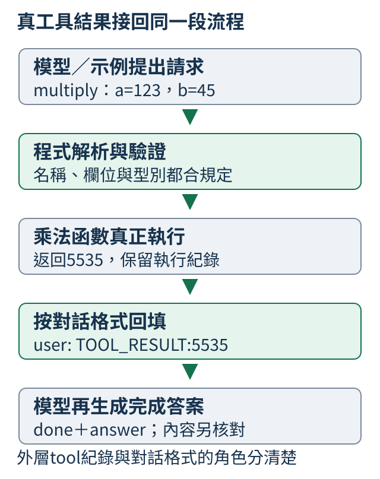

# B：選擇工具、真正執行，再讀結果回答

「123乘45」這種題目，交給計算器比讓模型心算可靠。本單元先看模型怎麼用文字提出工具請求、外層程式怎麼檢查並真正執行，再把結果送回對話，由模型寫出最後回答；完成訊號、工具次數與答案內容各有判準。後半段換成自然語言的問題：該直接回答、借用工具，還是先請使用者補資訊？挑出下一步的動作，和整個「請求、執行、回答」的流程，要分開驗收。需要的前置是 [7.1](07.md#7.1) 的對話格式與 [7.9](07.md#7.9) 的結束標記 EOS；忘了某個名詞，可查[名詞頁](../glossary.md)。

## B.1 模型怎麼要求程式幫忙？

「123乘45」可以寫成一份工具請求：要用的工具叫 multiply，參數 a＝123、b＝45，答案先空著，等工具算。本單元說「工具的參數」時，指交給工具的輸入值（JSON 裡的 `arguments`），和模型裡可學的參數（parameter）是兩回事。只在回答裡寫「已使用計算器」沒有任何執行效果；模型要生成外層程式讀得懂的名稱與參數，再由外層真正運算。人看的時候常簡寫成 `multiply(a=123,b=45)`，但模型實際要生成的是下面這種 JSON 文字。**JSON** 是用文字寫資料的通用格式：大括號包住一組組「欄位名: 值」，寫法和 Python 字典很像，但它是一段字串，可以在程式之間傳遞。

```python
import json

request = {"name": "multiply", "arguments": {"a": 123, "b": 45}}
training_example = {"user": "123乘45", "assistant_tool_request": request}
text = json.dumps(request)
print("訓練例子", training_example)
print("可傳遞的請求文字", text)
print("目前只有請求，尚未執行乘法")
```

`request` 是人工寫的字典，有 `name` 與 `arguments` 兩個欄位。`json.dumps` 把字典轉成 JSON 文字：印出來時欄位名一律用雙引號，這段文字才是模型要生成、外層要讀的東西。`training_example` 只是展示一筆示範資料的樣子，程式沒有訓練，也沒有呼叫工具。JSON 只是資料格式，寫出它不會讓 Python 自動執行乘法。

請求適合精確運算；問「乘法是什麼」則需要概念回答。兩種都示範，模型才學得到什麼時候該用工具。若把 45 錯寫成 54，外層照樣能合法算出 6642，卻不是原題的答案。留下原題和模型生成的原始請求，格式錯、選錯工具、參數錯才分得出來。

本單元的**工具實驗**另外從頭訓練了一個小模型，只學兩種題目：`CALC:add(2,3)` 這種 0 到 9 的兩數加法或乘法，要先提出工具請求；`COPY:3` 則是照抄數字，要直接回答 `{"done":true,"answer":3}`，不呼叫工具。它沒有學過正文的 123×45，也沒有學過一般中文問句。B.5 之後的**選卡實驗**是另一個模型，只學挑下一步的動作；兩個模型沒有串成同一個助理。

練習把 `request` 的 `"b": 45` 改成 `"b": 54`，先預測：JSON 文字照樣合法，只有參數變了；外層之後會算出 6642，卻不是原題的答案。這種錯，只有對照原題才抓得到。

<details>
<summary>補充：工具實驗的資料與重做方式</summary>

工具實驗的模型從隨機的參數開始，只用示範資料學會動作格式，沒有載入其他已訓練模型的參數。訓練題是 `CALC:add(2,3)` 或 `CALC:multiply(2,3)` 這類 0 到 9 的兩數運算，另有 `COPY:3` 這類照抄數字、直接回答的題目。

同一對數字的加法、乘法與交換順序的題目，例如 2+3、3+2、2×3、3×2，算同一個家族（family，[5.12](05.md#5.12)），整組只分到訓練、驗證或測試其中一邊；每個 COPY 的數字另成一個家族。這只測固定格式的 ASCII 指令與小數字。ASCII 是英文字母、數字和常見標點用的基本字元編碼；CALC、COPY 都沒有測中文的自然問句，也沒有測正文的 123×45。

每一步的請求，以及工具結果送回對話（叫回填，[B.3](0B.md#B.3) 會講）之後的回答，都由模型實際生成，沒有拿資料集的答案替它改正請求裡的 a、b。完整配方與原始結果在[實驗紀錄 tools.json](../../docs/course-experiments/results/tools.json)，這是機器可讀的完整結果，逐題結果在 `results.samples`。要重做時，在已依 [W.1](../first-steps.md#W.1) 準備好環境的專案根目錄執行：

```bash
python scripts/course_experiments/run.py --experiment tools --device cpu
```

這個指令用 CPU，輸出存在 `outputs/course-experiments/course-v1/tools/`。實驗紀錄裡的成績是在 NVIDIA L4 顯示卡上跑出來的；網站上的短程式沒有重跑這個實驗。

</details>

## B.2 文字怎麼變成有效呼叫？

模型生成了一段 JSON：工具 add，參數 a＝2、b＝3。外層程式先把文字讀成欄位，這叫**解析**；再依工具規則核對內容，這叫**驗證**；兩關都通過才執行。解析只確認結構讀得出來，驗證才確認內容被允許：一份格式完整的 `delete_all` 請求解析得出來，但它不在本例允許的工具清單裡。

本例只允許 add 與 multiply；最外層只能有 `name`、`arguments` 兩個欄位，參數只能有數字 a、b。允許的工具名稱清單叫 **allowlist**（允許清單）；事先規定請求要有哪些欄位、每個欄位是什麼型別，這份規定叫 **schema**。下面把三份請求交給課程函式庫的 `call_tool`：

```python
from tiny_perceptron.retrieval import call_tool

requests = [
    '{"name":"add","arguments":{"a":2,"b":3}}',
    '{"name":"delete_all","arguments":{"a":2,"b":3}}',
    '{"name":"add","arguments":{"a":true,"b":3}}',
]
for text in requests:
    try:
        print("結果", call_tool(text))
    except ValueError as error:
        print("拒絕", error)
```

第一份真的算出 5；第二份是未知工具，被拒絕；第三份的 a 是 JSON 的 `true`，也被拒絕。`try` 底下的呼叫若丟出 `ValueError`，程式就跳到 `except`，印出拒絕的理由（`try`／`except` 見 [W.2](../first-steps.md#W.2)）。`call_tool` 的原始碼如下，原始碼檔案開頭有 `import json`：

```python
# 節錄自 tiny_perceptron/retrieval.py：call_tool
def call_tool(request):
    if isinstance(request, str):
        request = json.loads(request)
    if set(request) != {"name", "arguments"} or request["name"] not in ("add", "multiply"):
        raise ValueError("只接受 add/multiply 與明確 arguments")
    args = request["arguments"]
    if not isinstance(args, dict) or set(args) != {"a", "b"}:
        raise ValueError("arguments 需要且只接受 a、b")
    if any(type(v) not in (int, float) for v in args.values()):
        raise ValueError("a、b 必須是數字，bool 或程式字串都不接受")
    a, b = args["a"], args["b"]
    return a + b if request["name"] == "add" else a * b
```

`isinstance(request, str)` 問「收到的是不是字串」：是的話先用 `json.loads` 把 JSON 文字解析成 Python 字典；已經是字典（[B.3](0B.md#B.3) 會這樣用）就直接往下。接著是三道驗證，每道不通過都用 `raise ValueError(...)` 丟出錯誤並停止，括號裡的文字就是上面印出的拒絕理由。

第一道：`set(request)` 取出字典所有的鍵（`set` 見 W.2），必須恰好是 `{"name", "arguments"}`，多一個或少一個欄位都不行；`request["name"] not in ("add", "multiply")` 要求名稱在允許清單裡。第二道：`arguments` 必須是字典，而且只有 a、b 兩個鍵。第三道：`args.values()` 取出所有參數值；`any(...)` 括號裡的 `type(v) not in (int, float) for v in args.values()` 是生成式（見 W.2）：讓 v 依次是每個參數值，逐一檢查；只要有一項成立，`any` 就是 True。`type(v)` 是值的確切型別；只要有一個參數的型別不是 int 或 float，就拒絕。三道都通過後，`a, b = args["a"], args["b"]` 同時取出兩個值；最後一行的 `A if 條件 else B` 在條件成立時取 A、否則取 B，所以名稱是 add 就相加，否則相乘。

為什麼要用 `type` 比對確切型別？下面把第三份請求解析開來看。這段要用 `json.loads`，所以先載入 `json`：

```python
import json

parsed = json.loads(requests[2])
a = parsed["arguments"]["a"]
print("第三份的 a 解析成", a, type(a))
print("isinstance(a, int)", isinstance(a, int), "type(a) in (int, float)", type(a) in (int, float))
```

JSON 的 `true` 解析成 Python 的 `True`，型別是 bool。Python 把 bool 當成 int 的一種（True 可以當 1 用），所以 `isinstance(a, int)` 是 True；若 `call_tool` 用 `isinstance` 檢查，true 就會被當成 1 而通過。改用 `type(a) in (int, float)` 比對確切型別，得到 False，才擋得下。字串 `"2"` 的型別是 str，同樣被擋下，不會被偷偷當成數字。

通過驗證只說明請求合乎規定，還要回查原題。原題是 2+3，請求若寫 2+4，照樣合法地傳回 6：這是模型選錯參數，不是程式算錯。解析、驗證、實際執行各自留下紀錄，才能分清錯在哪一站。

通過驗證也不保證結果可用。兩個合法的大數相乘，可能超出 Python 小數（float）能保存的範圍，這叫**溢位**（overflow）：例如 `1e308 * 1e308` 得到 `inf`（無限大），`1e308` 是 1×10³⁰⁸ 的寫法。正文的 `call_tool` 不檢查結果，照樣傳回 `inf`；工具實驗的外層程式在 `call_tool` 傳回之後才檢查，結果不是有限的數字（例如 `inf`）就記下「工具已執行」並停止，不把它當成功。這個外層程式在呼叫 `call_tool` 之前，還多做一道更嚴格的 JSON 檢查，它多擋了哪些輸入，見補充區。

練習把第一段 `requests` 第三項裡的 `true` 改成 `2.5`，先預測：通過驗證，結果是 5.5，第三段印出的型別是 float；再改成 `"2"`，那一項變成 `'{"name":"add","arguments":{"a":"2","b":3}}'`，預測會被拒絕，理由和 true 相同，第三段印出的型別是 str。

<details>
<summary>補充：特殊數值與故障注入</summary>

先說明幾個特殊數值。`1e308` 是科學記號，表示 1×10³⁰⁸；Python 的 float 存得下它，但能保存的範圍有限。`1e999` 表示 1×10⁹⁹⁹，超出 float 的範圍，Python 讀進來會變成 Infinity（無限大），常印成 `inf`。`NaN` 是 Not a Number 的縮寫，表示「不是有效數字」的特殊值。**有限**的 float 指既不是正負無限大、也不是 NaN 的數。

工具實驗的外層程式在 `call_tool` 之前，另做嚴格的 JSON 解析（[applications.py](../../scripts/course_experiments/applications.py) 的 `_parse_json_action`）：拒絕 `NaN`、`Infinity`、會變成非有限 float 的 `1e999`，也拒絕任何一層出現重複的欄位名。單用正文那段 `call_tool`，沒有這些檢查：`json.loads` 會把 `1e999` 讀成 `inf`，而 `inf` 的型別是 float，照樣通過。只有解析成功、內容也符合 add／multiply 的允許清單，才真正執行。模型生成的文字若混進特殊 token（special token，[6.6](06.md#6.6)），例如 user 的角色標記，它不是 JSON 文字的一部分，會在解析前就被拒絕；正常結束時生成的 EOS 則是停止標記（[7.9](07.md#7.9)）。

實驗紀錄另外保存七份人工的故障注入：不完整的 JSON、最外層是陣列（如 `[]`）、未知工具、bool、`NaN`、`1e999` 與重複的 name，全部被拒絕。這裡的一份工具請求必須是帶 name、arguments 的 JSON 物件，不能把一個陣列當成一份請求；這和正文程式用來依次試三份文字的 `requests` 清單是兩回事。這七份測的是外層的檢查程式，沒有算進 20 題的模型成績，結果在[實驗紀錄 tools.json](../../docs/course-experiments/results/tools.json)的 `results.injected_protocol_checks_not_model_scores`。

有限的輸入也可能乘到溢位：`1e308×1e308` 的兩個輸入都有限，結果卻是 `inf`。工具實驗遇到這種情況，會記下 `executed=true`（已執行）、`finite_result=false`（結果不是有限數）與字串 `"inf"`，以 `invalid_tool_result` 停止；真正的呼叫次數仍算一次，也不會把非有限的數字寫進 JSON。這條分支由 [CPU 回歸測試](../../tests/test_application_protocols.py)檢查；工具實驗的小數字題目沒有遇到溢位。

</details>

## B.3 工具結果怎麼回到對話？

工具已算出 123×45＝5535，下一站要把這個**真正的返回值**交給模型，讓它生成最後的回答。請求與結果的來源不同：assistant 提出要做什麼，外層程式實際傳回了什麼。這份按順序留下的紀錄叫 **trace**。

```python
from tiny_perceptron.retrieval import call_tool

request = {"name": "multiply", "arguments": {"a": 123, "b": 45}}
result = call_tool(request)
trace = [
    {"role": "assistant", "tool_request": request},
    {"role": "tool", "result": result},
]
print("返回值", result)
print("將送回對話的兩筆紀錄", trace)
assert result == 5535
```

請求是人工指定的，`result` 則來自真正執行的 `call_tool`（實作見 [B.2](0B.md#B.2)；這次傳入的是字典，跳過解析）。第一行印出 5535，`assert` 核對乘法沒錯。這段只建立外層的紀錄，還沒有最後的模型回答。



圖由上而下是五站：提出請求、解析與驗證、真正執行、回填、模型再生成答案。**回填**就是把工具結果送回對話，讓模型讀得到。回填時要用模型認得的對話格式：上面的 `"role": "tool"` 只是外層 Python 的紀錄；`render_chat`（實作見 [7.1](07.md#7.1)）只替 system、user、assistant 三種角色準備了角色標記，遇到其他角色就報錯。下面直接試試看：

```python
from tiny_perceptron.data import render_chat

final = {"role": "assistant", "content": '{"done":true,"answer":5535}'}
for role in ["tool", "user"]:
    try:
        x, _ = render_chat([{"role": role, "content": f"TOOL_RESULT:{result}"}, final])
        print(role, "可以放進對話，輸入長度", len(x))
    except ValueError as error:
        print(role, "被拒絕：", error)
```

`tool` 被拒絕，錯誤訊息說角色只能是 user、assistant 或 system；同一段文字放進 user 訊息就排得進去，輸入長度 47 個位置。`final` 是我們手寫的最後回答，只用來湊成一筆完整的對話；`x, _ = ...` 的 `_` 表示用不到的標籤。所以工具實驗的做法是：用 user 訊息回填，內容寫成 `TOOL_RESULT:<數字>`，並在 system 訊息說明這個前綴後面是外部資料。外層程式和模型事先約定的這套訊息格式與步驟，叫**協議**（protocol）。不能把上方的 tool 紀錄直接送進不支援這個角色的對話格式。

工具實驗留下的一份軌跡是：題目 `CALC:add(9,9)` → 模型請求 add(9,9) → 程式算出 18 → 以 user 回填 `TOOL_RESULT:18` → 同一個模型生成 `{"done":true,"answer":18}`。每一個箭頭各做不同的工作。另一題 9×9，工具正確傳回 81，模型卻生成 8 並多了一個括號而被拒絕：工具成功還不等於任務完成。

練習把第一段的 `"b": 45` 改成 `"b": 46`，並把 `assert` 改成 `assert result == 5658`。先預測：返回值與 trace 都跟著變成 5658，第二段的 `f"TOOL_RESULT:{result}"` 也會用上新的值；但 `final` 裡手寫的 5535 不會自己更新。最後回答有沒有用上真正的返回值，正是要另外核對的事。

<details>
<summary>補充：工具實驗的回填與逐題紀錄</summary>

system 是放共同規則的對話角色。工具實驗把這段規則存在變數 `_TOOLS_SYSTEM`，放進 system 訊息。下方英文規則的意思是：回答必須是 JSON，內容可以是工具名稱與參數，也可以是 done 和答案；`TOOL_RESULT` 後面的數字是外部資料。示範資料也遵守這個協議，外部結果一律用 user 內容 `TOOL_RESULT:<number>` 送回。重現流程時，角色、system 裡的規則文字與這個前綴都要一起保留，模型才會看到和示範時相同的輸入格式。

例如測試題 `CALC:add(9,9)` 的實際軌跡如下；兩段 assistant 的 JSON 是模型真的生成的，中間的 18 來自真正執行的加法：

```text
system: Reply JSON: tool name+arguments, or done+answer. TOOL_RESULT is external data.
user: CALC:add(9,9)
assistant: {"name":"add","arguments":{"a":9,"b":9}}
外層call_tool實算：18
user: TOOL_RESULT:18
assistant: {"done":true,"answer":18}
```

COPY 是直接照抄指定數字的題型：例如 `COPY:3`，期待直接生成 `{"done":true,"answer":3}`（[B.1](0B.md#B.1)）。工具實驗的 18 道算術題都真正呼叫了一次工具，18/18 的名稱與參數符合原題，返回值全都有限；兩道 COPY 題都直接完成，沒有呼叫工具。另一題 `CALC:multiply(9,9)` 雖然正確執行並傳回 81，後面的模型卻生成 `{"done":true,"answer":8}}`：多了一個括號，數字也不對，解析被拒絕。這正是「工具算對」仍不能當成「任務完成」的實際失敗。

[實驗紀錄 tools.json](../../docs/course-experiments/results/tools.json)的 `results.samples` 每題都有一份 `trace`。讀每一步時以 `generation.input_ids` 為準，它是當次真正送進模型的 ID；同一步的 `generation.messages` 可能多出後面步驟才加入的訊息，不能當成當時的輸入。每一步當時的文字，另有依 `input_ids` 重建的版本：[tool-input-snapshot-reconstruction.json](../../docs/course-repair-20261008/evidence/tool-input-snapshot-reconstruction.json) 的 `records` 每筆對應一步，`original_json_pointer` 指出它是 tools.json 裡的哪一步；要讀的是 `messages_at_generation`：那一步生成時模型讀到的訊息，重新編碼後和當次的 `input_ids` 逐一相同。

</details>

## B.4 任務完成後怎麼停止？

加法 2+3 已經算出 5，還需要一份 done 宣告與最後答案，才知道模型認為任務完成了。若只容許一個動作，可能已經算完卻來不及回答；若沒有完成訊號，外層程式也不能自己默認成功。

下面預先寫好兩個動作：add 與 done，當成測流程用的清單。工具實驗的模型不是一開始就生成整套計畫，而是每次只生成一個動作，外層執行並回填之後，再讓它生成下一個（[applications.py](../../scripts/course_experiments/applications.py) 的 `_tool_episode`）。課程函式庫的 `tool_loop` 依序處理清單裡的動作，最多處理 `max_steps` 個：

```python
from tiny_perceptron.retrieval import tool_loop

requests = [
    {"name": "add", "arguments": {"a": 2, "b": 3}},
    {"done": True, "answer": 5},
]
runs = [
    tool_loop(requests, max_steps=3),
    tool_loop(requests, max_steps=1),
    tool_loop(requests[:1], max_steps=3),
    tool_loop([{"name": "unknown", "arguments": {"a": 2, "b": 3}}]),
]
for run in runs:
    print(run["status"], "工具執行筆數", len(run["trace"]), "答案", run.get("answer"))
```

四次執行的狀態依次是 done、step_limit、needs_more_model_output、invalid_request，真正執行工具的次數是 1、1、1、0，只有第一次有答案 5。`run.get("answer")` 在字典沒有 answer 這個鍵時傳回 `None`（表示沒有值），不會報錯。這裡的 trace 每次成功的工具呼叫記一筆，請求與結果放在同一筆，和 B.3 那種「請求、結果」各一筆的對話紀錄不同。為什麼會有這四種結局？看原始碼：

```python
# 節錄自 tiny_perceptron/retrieval.py：tool_loop
def tool_loop(requests, max_steps=3):
    trace = []
    for step, request in enumerate(requests):
        if step >= max_steps:
            return {"status": "step_limit", "trace": trace}
        if request.get("done"):
            return {"status": "done", "answer": request.get("answer"), "trace": trace}
        try:
            result = call_tool(request)
            trace.append({"request": request, "result": result})
        except (ValueError, TypeError, json.JSONDecodeError) as error:
            return {"status": "invalid_request", "error": str(error), "trace": trace}
    return {"status": "needs_more_model_output", "trace": trace}
```

`for step, request in enumerate(requests)` 逐一取出動作，`step` 從 0 起算（`enumerate` 見 [W.2](../first-steps.md#W.2)）。每個動作先檢查 `step >= max_steps`：已處理的動作數到了上限，就以 step_limit 結束。`request.get("done")` 在動作寫著 `"done": True` 時成立，傳回 done 與答案。其餘的動作交給 `call_tool`（[B.2](0B.md#B.2)）：成功就把請求與結果記進 trace；三道驗證有一道不通過，`call_tool` 就丟出 `ValueError`，由 `except` 接住，以 invalid_request 結束，`str(error)` 把錯誤訊息存成文字。清單全部處理完卻沒遇到 done，就落到最後一行：needs_more_model_output，表示還要模型再生成。

`except` 只接得住 `try:` 底下那兩行（呼叫 `call_tool`、寫進 trace）丟出的錯誤，而且要是括號裡列出的種類；其他錯誤會讓程式停下。`if request.get("done"):` 寫在 `try:` 之前，所以 `tool_loop` 收的每個動作都要是字典：若把 B.2 那種 JSON 文字直接放進清單，這一行就丟出 `AttributeError`（字串沒有 `get`），`except` 接不到，程式就此中斷，不會以 invalid_request 結束。括號裡的 `TypeError` 與 `json.JSONDecodeError`，要 `call_tool` 收到 JSON 文字這類不是字典的輸入才可能出現（B.2 的用法）；這裡的動作都是字典，碰不到它們。

下面這段要接在前兩段後面執行（見 [W.1](../first-steps.md#W.1)）：`requests` 來自第一段；執行過上一段節錄後，`tool_loop` 指的是節錄的定義，取代了第一段從函式庫匯入的同名函式，跳過上一段則仍是函式庫版。節錄的定義會用到同一個原始碼檔案裡的 `call_tool` 與檔案開頭 import 的 `json`，所以先載入：

```python
import json

from tiny_perceptron.retrieval import call_tool

for limit in [1, 2, 3]:
    print("max_steps", limit, tool_loop(requests, max_steps=limit)["status"])
```

上限 1 是 step_limit，2 與 3 都是 done；上限 1、3 的狀態和第一段用函式庫版算出的相同。`max_steps` 數的是處理過的動作，done 也算一個：add 用掉一步，done 還需要第二步，所以把上限從 1 改成 2 就能完成。清單用完卻沒有 done，表示還需要模型再生成；未知工具則在執行前就被拒絕。四種結局要分開保存，不能都叫「已回答」。

done 只是一個宣告：若寫成 `"answer": 6`，照樣回傳 done，答案卻是錯的。完整的評分要核對工具與參數是否符合原題、最後答案是否用了真正的返回值、內容是否正確；另外記下每次生成是否以 EOS 正常結束，以及真正呼叫了幾次工具。EOS（End of Sequence）是一次生成的結束標記，和 done 宣告整個任務完成不同（[7.9](07.md#7.9)）。

工具實驗的 20 道測試題裡，18 道算術題都真正執行了工具，2 道 COPY 題（照抄數字，[B.1](0B.md#B.1)）沒有呼叫工具；整題完成且答對的是 19/20。把上限改成一個動作後，18 道算術題全都在工具執行完之後停在 step_limit。這個對照教的是要預留回答的步數，不是計算器不會算。

練習把第一段 `requests` 第二項的 `"answer": 5` 改成 `6`，先預測：第一次執行仍是 done，答案卻變成 6，`tool_loop` 不會發現答錯；第三段三種上限的狀態都不變。

<details>
<summary>補充：工具實驗的 20 題、一步上限與生成次數</summary>

工具實驗每題最多生成三個動作，done 也算一個。下面核對同一批 20 題；「第一個動作解析成 JSON 物件」只代表得到一個 JSON 物件，不能單獨當成允許清單的驗證或任務成功。

| 核對項目 | 完整分母與結果 |
| --- | --- |
| 第一個動作解析成 JSON 物件 | 20/20題 |
| 合法 done、答案正確且完成要求的工具行為 | 19/20題 |
| 真正工具呼叫 | 18次，18/18名稱與參數符合原題 |

算術題要成功，還得真正執行符合原題的工具，而且最後答案等於真正的返回值；即使直接猜對數字，也不算照協議成功。COPY 題則要求沒有執行工具。再將同樣 18 道算術題的上限改成一個動作，模型仍各自真正執行一次，全部 18 題卻都成為 `step_limit`：沒有剩下的步數讓模型生成完成回答。這些是重新生成的 18 份軌跡，沒有拿前一次已完成的答案補進來。

正常流程裡，18 道算術題各生成請求與完成回答，共 36 次；兩道 COPY 題各生成一次，共 2 次。一步上限又讓 18 道算術題各生成一次，所以合計 36＋2＋18＝56 次實際生成。這 56 次全部以 EOS 結束，也沒有混入不該出現的特殊 token（例如角色標記，見 [B.2](0B.md#B.2) 補充）；但 56/56 的正常停止率不能代替 20 道任務的 19/20 成功率。

完整紀錄在[實驗紀錄 tools.json](../../docs/course-experiments/results/tools.json)：正常流程是 `results.samples`，一步上限是 `results.one_step_cap_samples`，成績是 `results.accuracy` 與 `results.status_counts`；每一步的輸入以 `generation.input_ids` 為準（見 [B.3](0B.md#B.3) 補充）。耗時也分開記：每次生成在 `generation.seconds`，整題從頭到尾在 `seconds`。這些實驗沒有一般自然語言選工具、任意程式執行或長程 agent 任務的成績。

</details>

## B.5 同樣有數字，何時需要計算器？

「1加2等於多少」要精確數值，「加法是什麼」要概念說明，「原樣回答3」只要照抄。同樣有數字或「加」字，不代表下一步都要呼叫工具。先訂一份可以核對的**決策規則**，再教模型依問題與工具狀態選擇。

下一步的動作有三種，各用一個固定標記表示：TOOL（請求計算器）、DIRECT（直接回答）、ASK（先請使用者補資訊或做決定）。把每個標記想成一張寫好的**回答卡**：模型的回答就是其中一張，從三張中挑出一張叫**選卡**。下表是本單元採用的規則；最後一欄是人寫的示意，說明拿到這張卡之後助理接著會做什麼，選卡模型本身只輸出卡上的標記。

| 問題與工具狀態 | 回答卡 | 之後的示意 |
| --- | --- | --- |
| 要精確數值，計算器可用 | TOOL | 送出加法請求（B.1–B.4 的流程） |
| 解釋概念，或照抄 | DIRECT | 直接寫出說明或照抄的數字 |
| 缺少必要資訊，例如報價缺購買數量 | ASK | 「請問要買幾個？」 |
| 要精確數值，計算器停用 | ASK | 「計算器目前不能用，要我先心算並註明沒有經過工具核對，還是等計算器恢復再算？」 |

兩種 ASK 缺的東西不同：前者缺題目的資料；後者數字都在，缺的是核對方式，沒有工具能保證算對，要請使用者決定怎麼處理。這是教材選擇的規則，不是說所有小加法永遠只能用工具。TOOL、DIRECT、ASK 是模型可以學的固定標記；模型仍是逐 token 生成，不會因為選動作就變成另一種模型。下面把規則寫成函式，用它核對五筆人工標註：

```python
def rule(kind, calculator):
    if kind == "精確計算":
        return "TOOL" if calculator else "ASK"
    return "ASK" if kind == "缺資訊" else "DIRECT"


examples = [
    ("1加2等於多少？", "精確計算", True, "TOOL"),
    ("請解釋加法的意思。", "解釋", True, "DIRECT"),
    ("請原樣回答數字3。", "照抄", True, "DIRECT"),
    ("每個3元，總價多少？", "缺資訊", True, "ASK"),
    ("1加2等於多少？", "精確計算", False, "ASK"),
]
for question, kind, calculator, action in examples:
    state = "可用" if calculator else "停用"
    check = "符合規則" if action == rule(kind, calculator) else "與規則不符"
    print(question, "計算器" + state, "→", action, check)
```

`rule` 依題目種類與計算器狀態算出規則要求的卡：精確計算在計算器可用時是 TOOL、停用時是 ASK；缺資訊是 ASK；其他（解釋、照抄）是 DIRECT。每筆例子是一組（問題, 種類, 計算器是否可用, 人工標註的卡），`for question, kind, calculator, action in examples` 一次把四個值分別取出來。迴圈比對人工標註和規則的結果，五筆都印出「符合規則」。第一筆和最後一筆問題相同，只換了計算器狀態，卡就從 TOOL 變成 ASK；問概念的那筆雖然有「加」字，仍是 DIRECT；「每個3元」缺的是購買數量，所以是 ASK。

練習只把 `examples` 第一筆的 `True` 改成 `False`，先預測：規則算出 ASK，標註卻仍是人填的 TOOL，所以印出「與規則不符」；程式不會替你改標註。再把同一筆的 `"TOOL"` 改成 `"ASK"`，應回到「符合規則」。下一節才讓模型學這個選擇；工具的參數與執行，仍是 B.1–B.4 另外驗收的工作。

## B.6 模型如何學會選擇下一個動作？

上一節的卡是人填的。現在希望模型看到「1 加 2 等於多少？」與「計算器可用」時，自己生成 TOOL。資料要同時包含計算、解釋、照抄、缺資訊，以及同一題在計算器可用與停用時的對照，才教得到不同的選擇。

下面是一筆訓練資料的樣子，格式與選卡實驗的資料相同：system 只寫工具狀態，user 放問題，assistant 放正確的卡。決策規則本身不寫進 system；模型要從許多示範中學到「什麼問題、什麼狀態配哪張卡」。

```python
from tiny_perceptron.data import ByteTokenizer, render_chat

tokenizer = ByteTokenizer()
messages = [
    {"role": "system", "content": "計算器可用。"},
    {"role": "user", "content": "1 加 2 等於多少？"},
    {"role": "assistant", "content": "TOOL"},
]
inputs, labels = render_chat(messages, tokenizer)
answer_ids = labels[labels != -100].tolist()
print("輸入位置數", len(inputs))
print("有效目標解碼成文字", tokenizer.decode(answer_ids))
print("有效目標數", len(answer_ids))
print("最後一個目標是EOS", answer_ids[-1] == tokenizer.eos_id)
```

`render_chat`（實作見 [7.1](07.md#7.1)）把三則訊息排成模型輸入 `inputs` 與目標 `labels`；`ByteTokenizer`（[6.6](06.md#6.6)）按 UTF-8 位元組（byte）編號，文字與 byte 數的對照見 [6.1](06.md#6.1)。`labels[labels != -100]` 只留下有效目標：−100 標示不計代價（loss）的位置（7.1）。輸入共 51 個位置；有效目標是 T、O、O、L 四個字母加上 EOS，共 5 個。`tokenizer.decode` 解碼時會略過 EOS 這類特殊 token，所以解碼出的文字只有 TOOL，最後一行另外確認最後一個目標確實是 EOS。system 與 user 的內容不計答案代價，但仍留在輸入裡讓模型讀。這段只檢查資料，沒有更新模型。

真正的選卡訓練會更新模型的參數，讓合適的卡更容易被生成。自然問句不加 CALC、COPY 這類前綴，避免模型只靠前綴猜答案。選到 TOOL 之後，請求裡的 a、b 是否正確、工具是否真正執行、最後回答是否正確，都還要另外檢查；只學選卡的模型，還不能自己完成整個流程。

選卡實驗的模型從隨機參數另外訓練，和 B.1 工具實驗的 JSON 模型不是同一份參數。它學到的是人訂的決策規則，不是「我知道自己不會算」的自我認知。

練習把 system 改成 `"計算器停用。"`、assistant 改成 `"ASK"`，先預測：「停用」與「可用」一樣是兩個字，ASK 卻比 TOOL 少一個字母，所以輸入位置數變成 50、有效目標數變成 4，解碼出 ASK；再執行核對。

<details>
<summary>補充：選卡實驗的重做與方法來源</summary>

選卡實驗另外從隨機參數訓練了一個選卡模型，並保存資料、設定、參數與原始生成。它沒有接續 B.1 的工具實驗模型，也沒有和那個 JSON 生成模型串成已驗證的助理。完整流程可以在已依 [W.1](../first-steps.md#W.1) 準備好的專案根目錄執行；網站上的短程式不會偷偷開始長時間的訓練：

```bash
python scripts/course_experiments/run.py --experiment tool_choice --device cpu
```

固定的配方與結果在 [B.7](0B.md#B.7) 一起讀。這類示範教的是看得見的決策規則，不能證明模型有「我不擅長數學」的自我認知。研究中的 [Toolformer](https://arxiv.org/abs/2302.04761) 也研究語言模型如何學會呼叫工具；它的資料建立、篩選與訓練流程都不同，本節沒有重做該論文的方法或成績。

</details>

## B.7 工具選擇怎樣才算可靠？

每題都選 TOOL，在只考計算的題目上也可能拿高分。混合 DIRECT、TOOL、ASK 的題目，才量得到漏用工具、多用工具，以及該問卻直接答。先用六筆人工結果讀這些分母：`gold` 是每題的正確卡，`predicted` 是假設的選卡結果。

```python
gold = ["TOOL", "TOOL", "DIRECT", "DIRECT", "ASK", "ASK"]
predicted = ["TOOL", "DIRECT", "TOOL", "DIRECT", "ASK", "DIRECT"]
correct = sum(a == b for a, b in zip(gold, predicted, strict=True))
needed = sum(a == "TOOL" for a in gold)
missed = sum(a == "TOOL" and b != "TOOL" for a, b in zip(gold, predicted, strict=True))
not_needed = len(gold) - needed
extra = sum(a != "TOOL" and b == "TOOL" for a, b in zip(gold, predicted, strict=True))
print("動作選對", correct, "/", len(gold))
print("需要工具卻沒選", missed, "/", needed)
print("不需要工具卻選了", extra, "/", not_needed)
```

`zip(gold, predicted, strict=True)` 把兩份清單按位置配成一對對（`zip` 見 [W.2](../first-steps.md#W.2)），`strict=True` 要求兩份一樣長，否則報錯，避免少配一題卻沒發現。`sum(a == b for ...)` 把每題的 True 當 1、False 當 0 加總。動作選對 3/6。需要工具的有 2 題，漏選 1 題，所以是 1/2；不需要工具的有 4 題，多選 1 題，所以是 1/4。後兩項的分母不同，不能都除以 6。選對卡也還沒有真正運算；真正的呼叫與最後答案要另外計分。

選卡實驗把同一對數字的加法、解釋、照抄與工具狀態變化歸成一個家族（[5.12](05.md#5.12)）。測試資料有 6 個家族；每個家族有 4 種任務×2 種原本的問法×計算器可用、停用 2 種狀態＝16 題，共 6×16＝96 題。另有一組新問法：每種任務只換成一種沒訓練過的問法，每家族 4×1×2＝8 題，共 6×8＝48 題。原本的問法配上沒訓練過的數字對，得到 96/96；新問法只有 42/48。總數看起來不錯，但新問法裡 6 道該用工具的題全部錯選成 ASK，是 0/6，例如「幫我把 1 與 2 相加，給我答案。」這個錯例指出問法的泛化不足，不是計算器傳回了錯數字。

另外拿完全相同的問題，只把 system 從計算器可用換成停用：測試時分別生成 TOOL 與 ASK，支持模型在有限的句型內會依狀態選擇。ASK 仍只是一張卡，模型沒有寫出求助的原因；資料裡人寫的「缺數量」不能當成模型已經解釋過。

可靠性要逐類、逐條件說明。不能把選卡模型的 96/96 和另一個 JSON 模型的 19/20 拼成端到端的成功率，也不能用 42/48 蓋過新問法下工具選擇全部失敗。端到端的能力，必須由同一個模型、實際串起來的完整軌跡支持。

練習只把 `predicted` 的第二項 `"DIRECT"` 改成 `"TOOL"`，先預測：動作選對 4/6，需要工具卻沒選 0/2，不需要工具卻選了仍是 1/4；再執行核對。

<details>
<summary>補充：選卡實驗的配方、題型與完整分項</summary>

選卡實驗把同一對數字的加法、照抄、解釋及工具狀態變化，放進同一個家族。家族先分成訓練、驗證與測試資料；同一筆問題不會同時出現在兩邊。訓練資料用來更新參數，驗證資料用來觀察，測試資料只在配方固定後做最後檢查，不按它的結果選步數或重訓。另一組新問法則專門檢查：只換措辭，原本的選擇是否仍成立。題目來自有限的模板，這些仍是受控的自然語言小世界，不能外推成任意問題的工具判斷能力。

數字範圍 0 到 9，1 加 2 與 2 加 1 同一個家族，1 加 1 也保留；測的是沒見過的數字組合，每個單獨的數字仍可能出現在訓練資料的其他家族。

每個家族都有以下四種任務；每個問法再配上計算器可用、停用兩種 system 狀態。原本的問法每家族共 4 種任務×2 個問法×2 種工具狀態＝16 筆，新問法則是 4×1×2＝8 筆。

| 任務 | 原本問法數／新問法數 | 計算器可用時的正確卡 | 計算器停用時的正確卡 |
| --- | --- | --- | --- |
| 求加法的精確數值 | 2／1 | TOOL | ASK |
| 用積木等方式解釋加法 | 2／1 | DIRECT | DIRECT |
| 照抄給出的兩個數字 | 2／1 | DIRECT | DIRECT |
| 報價，尚未提供購買數量 | 2／1 | ASK | ASK |

例如「單價 1 元，運費 2 元，總價多少？」在這份報價流程裡還缺購買數量，標為 ASK。測試資料是含「1 與 2」這一家在內的六個家族；每家族原本的問法 16 筆，共 96 題；新問法 8 筆，共 48 題。

選卡模型從隨機參數開始學示範答案，配方在最後檢查之前就固定。完整的更新設定與原始生成保留在本節末的實驗紀錄，沒有依測試結果重訓或改參數。

| 核對項目 | 原本問法、沒見過的數字對 | 新問法 |
| --- | --- | --- |
| 動作選對 | 96/96 | 42/48 |
| 應使用工具且選中TOOL | 12/12 | 0/6 |
| 不該使用工具卻選TOOL | 0/84 | 0/42 |
| 計算器停用卻選TOOL | 0/48 | 0/24 |
| 永遠選DIRECT的對照 | 48/96 | 24/48 |
| 永遠選TOOL的對照 | 12/96 | 6/48 |

表的第一列與最後兩個對照，都以全部題數為分母。每個家族在原本的問法裡有兩道「計算器可用的加法題」該選 TOOL，六個家族共 12 道；其餘 96−12＝84 道不該選。每家族 16 筆中有一半停用工具，所以停用的分母是 6×8＝48。新問法每家族只有一個加法問法，因此相應的分母變成 6、48−6＝42 與 6×4＝24。這些子集彼此重疊，不能把各列分母相加，當成另一批題目。

例如測試題「1 加 2 等於多少？」在 system 只寫「計算器可用。」時生成 TOOL；把 system 換成「計算器停用。」就生成 ASK。決策規則放在示範答案裡，system 只提供工具狀態，和 [B.6](0B.md#B.6) 的資料格式相同。同一數字對的解釋與照抄題則生成 DIRECT。這支持有限句型內已學到區分，不能證明模型先估算了自己算術答對的機率。

新問法沿用測試資料的六個家族，但每種任務換一個新模板，各配可用、停用兩種狀態，共 48 題。計算器可用時，「幫我把 1 與 2 相加，給我答案。」卻生成 ASK。六道該用工具的題全部如此；42/48 的總分其實掩蓋了工具選擇在這個新問法上完全失敗。缺資訊的判定也遵守人訂的「報價先取得購買數量」規則，沒有測量模型能否推導零單價這類特例。

ASK 只是這個實驗的一張卡，模型沒有寫出「請補數量」或「請啟用工具」這類完整的說明。資料另外記下求助原因，方便人查標註，不能把那些人寫的原因當成模型的回答。

完整的[實驗紀錄 tool_choice.json](../../docs/course-experiments/results/tool_choice.json)保留每題的問題、工具狀態、正確卡與實際生成：測試資料在 `results.test`，新問法在 `results.paraphrase_diagnostic`，兩者的 `metrics` 是上表的各項，`baselines` 是兩種永遠選同一張卡的對照。[實驗程式](../../scripts/course_experiments/tool_choice.py)保留資料建立與切分方法。分數只評選卡，不含 JSON 請求的生成、工具運算或最後答案。即使選卡全對，也不能接上 [B.4](0B.md#B.4) 另一個模型的 19/20，拼成一個沒有實際跑過的端到端成功率。

</details>

## B.8 依能力與成本，何時值得藉助工具？

直接回答可能比較快；用工具能得到可核對的結果，卻要多等一會。值不值得用，先量同一類題目兩條路的完整成功率，再定出答錯的成本與額外成本；不能把下一個 token 的高機率當成整題答對的把握。

紙上假設：直接回答的成功率 0.90，工具完整走完一輪的成功率 0.99；答錯一題的成本是 10 點，用工具另外多花 0.02 點。每題的平均成本是 `(1-成功率)×錯答成本+額外成本`。點數是人訂的尺度，不是秒或美元。

```python
direct_accuracy = 0.90
tool_accuracy = 0.99
wrong_cost = 10.0
tool_extra_cost = 0.02
direct_loss = (1 - direct_accuracy) * wrong_cost
tool_loss = (1 - tool_accuracy) * wrong_cost + tool_extra_cost
print("直接回答平均成本", round(direct_loss, 3))
print("工具流程平均成本", round(tool_loss, 3))
print("本例選擇", "TOOL" if tool_loss < direct_loss else "DIRECT")
```

直接回答的平均成本是 `(1-0.90)×10＝1.0`，工具流程是 `(1-0.99)×10+0.02＝0.12`，所以外層規則選 TOOL。程式裡的 `direct_loss`、`tool_loss` 存的就是這兩個平均成本，`round(..., 3)` 只是把小數縮短到三位。若直接回答的成功率改成 0.999，平均成本變成 0.01，就改選 DIRECT。這些數值都是假設，程式沒有估計信心、計時，也沒有訓練選卡模型。

工具的成功率要包括：選對工具與參數、真正執行、回填後的回答正確，不能只用函數計算無誤替整條路打分。前面工具算出 81、模型卻寫成 8 的錯例正說明這點。

要變成實際的決策規則，先用獨立的驗證題量兩條路的品質與等待時間，固定錯答成本與工具的額外成本，再依本節的算法：工具的平均成本比直接回答低，才選 TOOL。最後在沒有參與規則選擇的題目上檢查。改了問法、數字範圍或工具條件後，要重新檢查適用性；不能看最後哪題錯了才替那題另設門檻。這是固定決策規則的延伸，不是已經訓練出逐題判斷信心的能力。

練習只把 `tool_extra_cost` 改成 `1.5`，先預測：工具流程的平均成本變成 `0.1+1.5＝1.6`，比直接回答的 1.0 高，改選 DIRECT；再執行核對。等待的成本太高時，即使工具更準，也不一定值得用。
