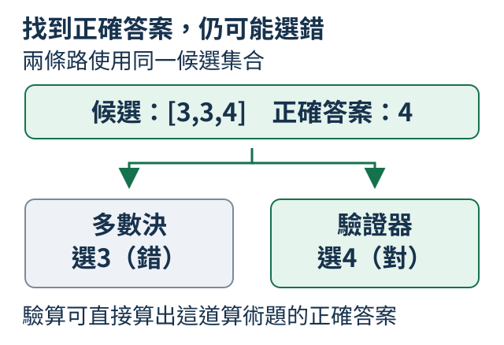
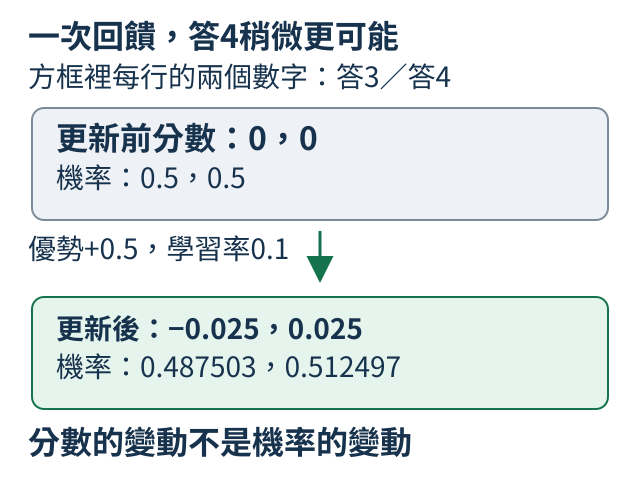

# C：必修——步驟、候選、驗證與回答當下的計算

一道算術題可以先寫出步驟再作答，可以多試幾份再挑一份交出，也可以把「答對沒有」變成分數，拿去訓練模型。前幾件發生在模型作答的時候，參數不動；最後一件會更新參數。本單元用能在紙上核對的小例子，把這些工作逐一分開說明。

C.1–C.5 接在 [7.23–7.25](07.md#7.23) 之後讀，讀完回到[第 8 章](08.md)；C.6–C.7 要用到第 13 章的獎勵與策略，等讀完[第 13 章](13.md)再回來。這些方法都要理解；實際產品用不用、用哪一種，仍看需求而定。遇到不熟的詞，可以查[名詞頁](../glossary.md)。

## C.1 寫出中間步驟能幫忙嗎？

2+3 可以直接答「5」，也可以寫「從2開始數三次：3、4、5，所以是5。」第二份讓讀的人能核對方法，模型接著往下生成時，也讀得到自己剛寫下的中間結果；但它長得多，而且只要一步寫錯，結論也可能跟著錯。所以先把「回答寫成什麼樣子」和「模型會不會算」分開，不因為解釋比較長，就認定它比較可靠。

先看兩種寫法差多少長度。下面用第 6 章的 `ByteTokenizer`（實作見 [6.6](06.md#6.6)）把兩份人工寫好的回答編成 token，再數個數：

```python
from tiny_perceptron.data import ByteTokenizer

tokenizer = ByteTokenizer()
examples = [
    {"question": "2+3=?", "answer": "5"},
    {"question": "2+3=?", "answer": "從2開始數三次：3、4、5，所以是5。"},
]
for example in examples:
    ids = tokenizer.encode(example["answer"])
    print(example["question"], example["answer"], "回答token數", len(ids))
```

`tokenizer.encode` 把文字按 UTF-8 byte 編號，每個 byte 一個 token。數字是 ASCII，各占 1 byte；中文字與全形標點各占 3 byte。所以短答是 1 個 token，步驟版是 47 個：14 個中文字與全形標點共 42 byte，再加 5 個數字。這裡只編回答本身，沒有加 [7.1](07.md#7.1) 的角色標記與 EOS；換一種 tokenizer，長度也會不同。程式只數長度，沒有訓練模型，也沒有生成回答。

回答變長之後，答對的比例會不會也變？要比較，就得讓兩邊只差在回答形式。本單元的算術實驗這樣安排：題目都是 `(a+b)+c=?`，a、b、c 是 0 到 5 的整數。兩個一樣大的小型語言模型從同一份隨機參數出發，用同樣 167 道訓練題各更新 900 次，每次抽到的 24 道題也相同。差別只在示範回答：**短答支線**只學最後的整數，例如 `(1+2)+3=?` 學 `6`；**步驟支線**學 `1+2=3;3+3=6;answer=6`，每一步都能驗算。兩支都照 [7.1](07.md#7.1) 的 SFT 方式訓練，問題放在輸入裡，只有示範回答的位置計入代價；不同的是它們從隨機參數開始，沒有先預訓練。

測試用另外 24 道題。同一組三個數字的所有排列，例如 `(1+2)+3` 和 `(3+2)+1`，算同一個家族（[5.12](05.md#5.12)），整個家族只放在訓練題、驗證題、測試題其中一邊，所以測試題的數字組合在訓練時一次也沒出現過。每題只讓模型生成一份回答時，同樣這 24 道測試題，步驟支線答對 11 題（11/24），短答支線只答對 1 題（1/24）。

這個差距不能全算在「寫步驟」頭上，因為兩支學到的份量不同。訓練時計入代價的位置叫有效目標（[7.3](07.md#7.3)），這裡就是示範回答的每個 token 加上 EOS。900 次更新下來，步驟支線的有效目標共 466,322 個，短答支線只有 48,803 個，約 9.6 倍（466,322 ÷ 48,803 ≈ 9.56）。題數與更新次數相同，不代表訓練工作量相同；作答時，步驟支線每份最多也能寫 48 個 token，短答支線只能寫 8 個。

還要記得：步驟只是模型輸出的文字，不是模型內部計算的完整紀錄。它可以讓人查核，也可能寫得流暢卻是錯的。下一節看一份最後答對、前一步卻錯的回答，說明為什麼每一部分都要另外驗。

練習：把程式第二筆的 `"answer": "從2開始數三次：3、4、5，所以是5。"` 改成 `"answer": "2+3=5"`。先預測：這五個字元都是 ASCII，應該編成 5 個 token；執行後，第二行最後的數字應是 5。回答變短只改了這份材料的長度，不能說明模型更會算或更不會算。

<details>
<summary>補充：生成設定與完整紀錄</summary>

上文的 11/24 與 1/24，是兩支各對同一批 24 道測試題、每題抽一份回答的結果，抽樣溫度都是 0.7（[1.15](01.md#1.15)）；短答最多生成 8 個 token，步驟最多 48 個。兩個模型各有 141,568 個參數。訓練題 167 道來自 44 個家族，驗證題 25 道、測試題 24 道各來自 6 個家族。兩支沒有在相同有效目標數或相同生成 token 數下比較，這些條件只支持這組配方的有限比較，不能把差距全歸因於寫步驟。

完整結果在[實驗紀錄 reasoning.json](https://github.com/birdhackor/tiny-perceptron-vlm/blob/main/docs/course-experiments/results/reasoning.json)，這是機器可讀的完整結果。`results.split` 是三份資料的題數與家族數；`results.comparison.direct` 與 `results.comparison.steps` 分別是短答支線與步驟支線，其中 `training.effective_tokens` 是有效目標數，`budgets` 第一項（`candidate_count` 為 1）是每題一份回答的成績與原始生成。重做本單元實驗的指令在 [C.7](0C.md#C.7) 的補充區。

</details>

## C.2 最後答對代表過程正確嗎？

問 2+2，回答寫「2+2=5；5−1=4」。結尾的 4 是對的，第一步卻錯了。只讀最後一個數字，會把這份回答當成完全正確；要知道過程對不對，得分開查三件事：每條等式算得對不對、每一步是否接著前一步的結果，以及這些步驟是不是只用了題目給的數字。

先把回答寫成程式能檢查的形式。每一步記成三個數 `(a, b, claimed)`，意思是「宣稱 a+b=claimed」；減 1 寫成加 −1，所以第二步是 `(5, -1, 4)`。`question` 是題目給的數字，`truth` 是正確答案：

```python
question = [2, 2]
truth = 2 + 2
steps = [(2, 2, 5), (5, -1, 4)]
valid = [a + b == claimed for a, b, claimed in steps]
linked = [steps[i][0] == steps[i - 1][2] for i in range(1, len(steps))]
used = [steps[0][0]] + [b for a, b, claimed in steps]
print("等式算對", valid)
print("接上前步", linked)
print("只用題目的數字", sorted(used) == sorted(question))
print("最後答案對", steps[-1][2] == truth)
```

`valid` 逐步重算 `a + b`，和宣稱的 `claimed` 比較，得到 `[False, True]`：2+2 不是 5，5+(−1) 是 4。`linked` 用 `range(1, len(steps))` 從第二步（索引 1）開始，比較這一步的起點 `steps[i][0]` 和前一步的結果 `steps[i - 1][2]`，得到 `[True]`：第二步確實從前一步寫下的 5 接著算。`used` 收集每一步新加進來的數：第一步的 a，再加上每一步的 b，得到 `[2, 2, -1]`；用 `sorted` 排好後和題目的 `[2, 2]` 不同，印出 False，因為 −1 不是題目給的。最後一行的 `steps[-1]` 是最後一步，它宣稱的 4 等於正確答案，印出 True。

三項檢查各抓不同的錯。第二步接得很好，卻救不了錯的第一步；反過來，若只把第一步改成 `(2, 2, 4)`，兩條等式都對了，第二步卻還從 5 開始，接續就變成 False。

像這樣依明確規則核對回答的程式，叫**驗證器（verifier）**；它做的核對叫驗算。說一個驗證器可靠時，要說清它驗了哪幾項。上面幾項只適用於這種加法題，不是能檢查任何文字的通用證明器。

真實模型的錯誤，也常藏在格式完全正確的回答裡。[C.1](0C.md#C.1) 的步驟支線在測試題 `(5+0)+3=?` 生成過 `5+0=5;5+3=10;answer=10`：格式能解析，兩步也接上了，但 5+3 不是 10，最後答案跟著錯。實驗的驗證器逐份檢查兩條等式、前後接續、步驟用的是不是正是題目的 a、b、c，以及最後答案，四項全過才接受。即使全過，也只說明這份文字算對了，不能證明模型內部真的照這些步驟計算。

練習：把 `steps` 改成 `[(2, 2, 4), (4, 3, 7), (7, -3, 4)]`，也就是先加 3、再減 3 繞一圈。先預測：等式 `[True, True, True]`、接續 `[True, True]`、最後答案都對，只有「只用題目的數字」是 False，因為 `used` 變成 `[2, 2, 3, -3]`，多了題目沒有的 3 與 −3。這份回答每條等式都對，卻無緣無故多做一步再抵銷掉，不是在解原題。

<details>
<summary>補充：完整紀錄</summary>

步驟支線的全部候選在[實驗紀錄 reasoning.json](https://github.com/birdhackor/tiny-perceptron-vlm/blob/main/docs/course-experiments/results/reasoning.json) 的 `results.comparison.steps.budgets`：這個清單的每一項各對應一個 `candidate_count`，也就是每題讓模型生成幾份回答；每一項的 `samples` 是 24 道題的清單，裡面每一筆才是一道題；那一筆的 `candidates` 是這題抽到的各份候選，其中 `equations_valid`、`linked`、`task_operands_valid` 與 `final_correct`，分別是兩條等式算對、前後接續、用了題目的 a、b、c，以及最後答案正確。

</details>

## C.3 多試幾次能找到正確答案嗎？

假設某道題，模型每生成一份回答，答對的機率都是 p=0.3，而且各次結果互不影響。每份答錯的機率是 1−0.3=0.7，抽兩份時兩份都錯的機率是 0.7×0.7=0.49，所以至少一份答對的機率是 1−0.49=0.51。多抽幾份，候選裡出現正確答案的機會就變大；但這還沒說最後要交出哪一份。

一般來說，每題抽 k 份候選，k 份全錯的機率是 1−p 自乘 k 次，寫成程式是 `(1 - p) ** k`，所以至少一份答對的機率是 `1 - (1 - p) ** k`。候選裡至少有一份正確答案，本單元叫**集合命中**。評測生成程式的模型時常用的 **pass@k** 問的是同一件事：每題給 k 次機會，至少一次通過就算這題通過；在 p 已知、各次獨立時，它就等於這個式子。下面算出 k=1、2、4、8 的值，再檢查一份人寫的候選清單：

```python
p = 0.3
for k in (1, 2, 4, 8):
    coverage = 1 - (1 - p) ** k
    print("候選數", k, "獨立假設下的集合命中機率", round(coverage, 6))
candidates = [3, 4, 3, 5]
print("本組候選", candidates, "包含正確答案4", 4 in candidates)
```

`**` 是 [W.4](../first-steps.md#W.4) 的次方，`round(coverage, 6)` 只把顯示縮到小數六位。k=2 印出上面手算的 0.51，k=8 約 0.94。這四個數都是由假設的 p 算出來的，沒有生成任何回答。最後一行的 `4 in candidates` 問清單裡有沒有 4；這份人寫的候選有，所以印出 True。

這個式子靠三個前提：同一道題、每次從同一個機率分布抽、各次結果互不影響（[W.4](../first-steps.md#W.4) 的獨立）。同一個錯答案重複出現，不代表前提被破壞。例如 C.1 的短答支線在 `(3+3)+0=?`（正確答案 6）抽 8 份，有 6 份是 7；這很可能只是模型給 7 的機率很高：若每次抽到 7 的機率是 0.8，各次獨立也很容易連抽好幾個 7。會破壞前提的是另一類做法，例如下面兩種。一是每次都選最高分的 greedy（[1.15](01.md#1.15)）：同一題每次得到同一份回答，第一份錯了，再試幾次也是同一個錯答案。二是把前一份答案放進提示、要模型改寫：各次結果互相牽連，不再獨立。

每道題的 p 也不同，不能把全體的平均答對率代進式子，當成每題的預測。例如兩題的 p 分別是 0.9 與 0.1，平均 0.5；k=2 時，把平均代進式子會算出 0.75，逐題算再平均卻只有 (0.99+0.19)÷2=0.59。

實際模型沒有已知的 p，只能真的去抽。本單元的算術實驗讓 [C.1](0C.md#C.1) 的兩支模型對同一批 24 道測試題，在 k=1、2、4、8 時各自重新抽一批候選（抽樣溫度 0.7），再用已知的正確答案逐份檢查，數出有幾題集合命中。這個比例要事先知道正確答案才算得出來，所以叫**已知答案命中率（oracle coverage）**；oracle 指「事先知道答案的裁判」。表中分母都是 24 道題：

| 每題候選數 k | 短答支線的已知答案命中率 | 步驟支線的已知答案命中率 |
| --- | --- | --- |
| 1 | 1/24 | 11/24 |
| 2 | 1/24 | 13/24 |
| 4 | 2/24 | 13/24 |
| 8 | 1/24 | 14/24 |

步驟支線從 11/24 升到 14/24。短答支線從 k=4 的 2/24 掉回 k=8 的 1/24，並不矛盾：每個 k 都重新抽一批，k=8 的 8 份是另外抽的，不是在 k=4 那 4 份之外再加 4 份，所以命中率不必隨 k 上升；只抽一次、只有 24 道題，數字就會有這種起伏。

命中只說明正確答案在候選裡。這組 `[3, 4, 3, 5]` 若最後交出第一份的 3，仍然答錯；下一節比較怎樣把正確答案選出來。

練習：把 `candidates = [3, 4, 3, 5]` 改成 `candidates = [3, 3, 3, 3]`。先預測：前四行不變，最後一行變成 False。清單有沒有命中，不會回頭改變式子裡假設的 p；要估計一道題真正的 p，得對同一題抽很多份，再數答對的比例。

<details>
<summary>補充：pass@k 估計式與本實驗的關係</summary>

[標準 pass@k 估計式](https://arxiv.org/pdf/2107.03374v2)見原論文 §2.1 式 (1)：每題先抽 n 份候選，其中 c 份成功，再估計「從中取 k 份、至少一份成功」的機會；這裡的 n 是候選池大小，可以比 k 大。本實驗每個 k 只抽 k 份，也就是 n=k，式子化成「這一組有沒有成功」：c=0 時是 0，c 大於 0 時是 1。所以上表的已知答案命中率正是這個特例；本實驗沒有從更大的候選池估計各 k，也沒有執行 HumanEval 這類程式評測。

每支在四種 k 下共保留 24×(1+2+4+8)=360 份候選與原始 ID，但仍只測 24 道不同的題。已知答案命中率要靠已知答案才算得出來，不能當成能實際部署的選法的成績。數字在[實驗紀錄 reasoning.json](https://github.com/birdhackor/tiny-perceptron-vlm/blob/main/docs/course-experiments/results/reasoning.json) 的 `results.comparison.direct.budgets` 與 `results.comparison.steps.budgets`：每項的 `candidate_count` 是 k，`oracle_coverage` 是命中題數與分母。

</details>

## C.4 找得到也選得中嗎？

2+2 的三份候選是 3、3、4。正確答案 4 已經在集合裡，多數決卻會選出現兩次的 3。所以要分開問兩件事：候選裡有沒有正確答案，以及最後交出的是不是它。不分開的話，多抽幾份可能只是讓同一個錯答案多拿幾票。

下圖上方是這組候選與正確答案，往下分成兩條路：左邊是多數決，右邊是逐份驗算的驗證器，方框裡是各自交出的答案。



下面的程式把兩條路各走一遍：

```python
from collections import Counter

candidates = [3, 3, 4]
majority = Counter(candidates).most_common(1)[0][0]
verified = next((x for x in candidates if x == 2 + 2), None)
print("集合包含正確答案", 4 in candidates)
print("多數決", majority, "答對", majority == 4)
print("驗證器", verified, "答對", verified == 4)
```

`Counter` 是 [1.4](01.md#1.4) 的計數工具，這裡數出 3 有兩票、4 有一票；`most_common(1)` 取最常見的一項，得到 `[(3, 2)]`，兩個 `[0]` 再取出答案 3，同樣的寫法見 [6.2](06.md#6.2)。所以多數決交出 3，答錯。驗證器那一行裡，`(x for x in candidates if x == 2 + 2)` 和前面各章的 `[… for … in …]` 清單寫法一樣，逐份檢查候選、只留下等於 2+2 的那些；差別是外面用圓括號，不先做出整張清單。`next(…, None)` 取出第一個通過的值，一個都沒有時就給後面的 `None`。這裡第一個通過的是 4，答對。

多數決只看出現次數，完全不懂等式。驗證器選得中，是因為這道算術題的正確答案能從題目直接算出來（`2 + 2`），這是很強的條件。換成「某家店現在的地址」這類問題，答案要查最新資料才知道，程式算不出來；把事先知道的答案寫進程式再拿來挑候選，也只能說明這一題挑得中，不能說明它遇到不知道答案的題目也挑得中。

真實候選也有同樣的情況。[C.1](0C.md#C.1) 的短答支線在 `(3+3)+0=?`（正確答案 6）抽 4 份，得到 `[5, 7, 5, 6]`：集合裡有 6，多數決卻選了兩票的 5。兩種選法面對的是同一批候選，差別只來自選法。

所以要分開記兩個比例。步驟支線每題抽 8 份時，24 道題中有 14 題集合命中（[C.3](0C.md#C.3) 的表）；多數決在這 14 題裡選對 12 題，所以「命中之後選對」是 12/14，「全體題目最後答對」是 12/24。兩個比例的分母不同，回答的是不同的問題，不能都叫「成功率」。驗證器在這一組選對 14 題，正好等於命中的題數。

練習：把 `candidates = [3, 3, 4]` 改成 `candidates = [3, 3, 5]`。先預測：第一行變成 False；多數決仍交出 3、答錯；驗證器找不到等於 4 的候選，印出 `None`、答錯。驗證器只負責挑，候選裡沒有正確答案時，它不會自己補一個 4。

<details>
<summary>補充：實驗裡的多數決、平票與驗證器</summary>

實驗的多數決只數能解析出最後整數的候選，取票數最多的答案，不要求超過半數；平票時取先出現的那個。例如每題 2 份候選時，步驟支線在 `(5+0)+3=?`（正確答案 8）先生成答案 10、再生成 8，各一票，多數決取先出現的 10 而答錯；驗證器檢查等式後選了 8。

步驟候選要通過 [C.2](0C.md#C.2) 的四項檢查，驗證器才接受；短答候選沒有步驟，只核對最後整數。正確答案由題目的 a+b+c 直接算出，驗證器交出第一份通過的候選。已知答案命中率只看最後答案：中間等式錯、最後答案碰巧對的候選會算進命中，卻不會被驗證器接受。本實驗兩支模型、四種 k 共 8 組紀錄裡，沒有出現這種候選（`final_correct_but_steps_invalid` 都是 0），所以驗證器選對的題數正好等於命中題數。這依賴「答案能直接算出」這個強條件，不能延伸到未知事實與開放論證。

多份候選彼此一致，或每條可見等式都正確，也不足以證明這些文字反映了模型內部實際的運算。逐題結果在[實驗紀錄 reasoning.json](https://github.com/birdhackor/tiny-perceptron-vlm/blob/main/docs/course-experiments/results/reasoning.json) 各支線的 `budgets[].samples`：`majority_answer` 與 `verified_answer` 是兩種選法交出的答案；每項 budget 的 `majority_accuracy_given_coverage` 是「命中之後多數決選對」的比例。

</details>

## C.5 花更多計算值得嗎？

同樣生成 80 個 token，可以寫一份 80 個 token 的答案，也可以寫四份各 20 個 token 的答案。若每份候選還要交給模型另外寫 5 個 token 的判斷（例如寫 `pass` 或 `fail`：用 C.1 的 `ByteTokenizer`，4 個 ASCII 字元各 1 個 token，加上 EOS 正好 5 個），前者總共 85 個 token，後者 100 個。多出來的是選擇與驗證的成本；候選多，不等於免費變好。

```python
plans = [
    {"candidates": 1, "answer_tokens_each": 80},
    {"candidates": 4, "answer_tokens_each": 20},
]
verify_tokens_each = 5
for plan in plans:
    k = plan["candidates"]
    generated = k * plan["answer_tokens_each"]
    verified = k * verify_tokens_each
    print("候選", k, "生成", generated, "驗證", verified, "總token", generated + verified)
```

`plans` 列出兩種安排，每項記候選份數與每份答案的長度；`verify_tokens_each` 是模型判斷每份候選要另外寫的 token 數。迴圈裡的 `k` 和 [C.3](0C.md#C.3) 一樣是每題候選份數：生成 token 是 `k` 乘每份長度，驗證 token 是 `k` 乘 5。兩種安排生成的都是 80，驗證分別是 5 與 20，總數是 85 與 100。這只是把人工設定的預算相加，沒有生成、計時或量正確率。

驗證不一定要交給模型。像 [C.4](0C.md#C.4) 那樣用算術程式驗算，不會新增任何模型 token，但仍要花 CPU 時間；token 數和秒數是不同單位，不能直接相加。

寫長步驟、多抽候選、做驗證，這類在模型作答時多花的計算，統稱**回答當下的計算（test-time compute）**；模型參數可以完全不變，只改作答流程。比較時先說清預算：固定總 token 時，候選越多，每份能寫的就越短；增加預算時，要明說總成本變了。接著分開看三件事：「最終正確」是最後交出的答案答對；「集合命中」是候選裡至少一份答對（[C.3](0C.md#C.3)）；「選錯」是集合命中了，交出的卻是錯答案（[C.4](0C.md#C.4)）。

實驗裡的步驟支線就是增加預算的例子。每題 1 份候選時，24 道測試題共生成 512 個 token；每題 8 份時是 4,132 個，約 8 倍（4,132 ÷ 512 ≈ 8.07）。集合命中從 11 題升到 14 題，多數決的最終正確卻只從 11 題升到 12 題。這說明要先講預算、再談收益；它沒有判定等預算下哪種安排最好。

token 數也不是秒數。長答案得一個 token 接一個 token 生成，後一個要等前一個算完；多份候選卻可以排成一批（batch）一起算。生成時還能把前面位置算過的結果存起來重用，省掉重算；這到第 16 章（[16.3](16.md#16.3)）才講，這裡只需要知道：這些做法都會影響秒數，所以秒數和 token 數不一定成比例。實驗裡的短答支線就是如此：每題 8 份候選共生成 400 個 token、合計 0.120 秒，每題 1 份只生成 51 個，卻花了 0.239 秒；每個數字只量一次，會受執行先後等條件影響，不能當成穩定的速度比較。

使用者感受到的等待，要從收到問題算到交出最後文字為止：把問題整理成輸入 ID、生成、把生成的 ID 解碼回文字、投票或驗算，全都要算進去。只量生成那一段，不能當成完整的回應時間。第一次載入模型與訓練模型是另外的成本，不算進每次回答的等待。

練習：把 `verify_tokens_each = 5` 改成 `verify_tokens_each = 0`，代表改用程式驗算、不讓模型寫判斷。先預測：兩行的驗證都變成 0，總 token 都是 80。token 預算打平了，但程式驗算的 CPU 時間並沒有出現在這張表裡，四份候選也不因此一定更準。

<details>
<summary>補充：生成 token 與計時的範圍</summary>

實驗沒有固定相同的總生成預算：短答每份最多生成 8 個 token，步驟每份最多 48 個。下表摘出每題 1 份與 8 份候選兩種安排，都是全部 24 題的實際生成 token 總數（含 EOS，它也算一個生成的 token），以及各題候選一批生成所花時間的總和。同題的候選是一起算的，秒數不能當成一份一份依序生成的成本：

| k | 短答生成token | 步驟生成token | 短答生成秒數 | 步驟生成秒數 |
| --- | --- | --- | --- | --- |
| 1 | 51 | 512 | 0.239 | 1.160 |
| 8 | 400 | 4,132 | 0.120 | 1.190 |

計時包含模型逐 token 生成與抽樣；不包含事先把問題與角色標記整理成輸入 ID，也不包含事後把生成的 ID 解碼成文字、投票或程式驗算。這些數字來自 NVIDIA L4 顯示卡上的一次執行，每格只有一次，不能把 token 比值當成時間比值。準備環境、訓練與第一次載入模型都是另外的成本。數字在[實驗紀錄 reasoning.json](https://github.com/birdhackor/tiny-perceptron-vlm/blob/main/docs/course-experiments/results/reasoning.json) 各支線 `budgets` 的 `generated_tokens` 與 `generation_seconds`。

</details>

## C.6 正確答案怎麼變成訓練回饋？

2+2 有三份候選文字：「3」「4」「5」。[第 13 章](13.md#13.10)是先訓練一個獎勵模型，再由它替回答打分；算術題的正確答案能直接算出，可以改用一條固定規則打分，不必另外訓練模型。規則要先寫清楚：本例要求只交一個十進位整數，前後可以有空白，可以帶負號；交出的整數等於正確答案就給 1，其他一律給 0。這個分數就是獎勵（reward），只表示這份回答是否符合要求；打完分數，還沒有更新任何參數。

```python
import re

answers = ["3", "4", "5", "答案是4"]
truth = 4
for text in answers:
    clean = text.strip()
    parsed = int(clean) if re.fullmatch(r"-?[0-9]+", clean) else None
    reward = float(parsed == truth)
    print(repr(text), "解析值", parsed, "獎勵", reward)
```

`text.strip()` 去掉文字前後的空白與換行。`re` 是 Python 內建、用樣式比對文字的工具（regular expression）；`re.fullmatch(樣式, 文字)` 要求整段文字從頭到尾都符合樣式，符合時傳回比對結果、當成「是」，不符合時傳回 `None`、當成「否」。樣式 `-?[0-9]+` 裡，`-?` 表示負號可有可無，`[0-9]` 表示一個十進位數字，`+` 表示前一項至少出現一次；合起來只接受可帶負號的整數文字。引號前的 `r` 讓字串裡的反斜線 `\` 照字面保留；本例的樣式用不到反斜線，寫樣式時仍習慣加上。`int(clean) if … else None` 是第 7 章用過的 `A if 條件 else B` 寫法，條件成立時取 A、否則取 B：這裡符合樣式才轉成整數，否則記成 `None`，表示沒有可用的答案。`parsed == truth` 得到 True 或 False，`float` 把它換成 1.0 或 0.0；`repr(text)` 連引號一起印，看得出原文有沒有多餘的空白。

前三份解析成 3、4、5，只有 4 拿到獎勵 1.0。「答案是4」不只交了數字，整段不符合樣式，解析值是 `None`、獎勵 0.0；`fullmatch` 不會從中間挑出一個 4。這條規則適合「只交數字」的任務；若任務本來要自然的解釋，就該換一條合適的規則，不能拿這條嚴格的規則去處罰好的解釋。

這條規則同時檢查內容（數字對不對）和格式（是不是只交一個整數），兩項最好分開記錄，才知道 0 分是算錯還是格式不符。規則一放鬆，就可能獎勵不該獎勵的回答：只獎勵步驟寫得長的答案，不保證最後算對；只要文字按空白切開後有一段正好是正確答案就給 1，那麼用空格隔開、把 0 到 15 全部列出來的回答必然得分，卻沒有交出一個答案。後面這條規則本單元叫**寬鬆評分**，上面程式那條叫**嚴格評分**。策略利用評分的弱點拿高分、卻沒完成任務，就是 [13.16](13.md#13.16) 的獎勵鑽漏洞。

本單元的實驗刻意做了一個能看清這件事的小策略。它不寫文字，只從 17 種事先寫好的回答裡選一種：單一數字 0 到 15，以及一份列出 0 到 15 全部數字的文字（下稱「列舉」）。每一種可選的回答叫一個動作（action）。用寬鬆評分在訓練題上訓練之後，讓它在 24 道測試題各抽 16 次、共 384 次，結果全部選了列舉：寬鬆評分給了 384/384，用嚴格評分檢查卻是 0/384。這個例子說明獎勵規則會鼓勵什麼；參數怎樣依獎勵改變，下一節再追。

練習：把 `answers` 那一行改成 `answers = ["3", "4", "5", "答案是4", "0 1 2 3 4 5"]`。先預測：最後一項雖然含有 4，卻不是單一整數，解析值 `None`、獎勵 0.0。接著把 `reward = float(parsed == truth)` 改成 `reward = float(str(truth) in text.split())`：`str(truth)` 把 4 換成文字 `"4"`，`text.split()` 按空白把文字切成一段段，這一行只問「有沒有哪一段是 4」，也就是寬鬆評分。再預測：列舉那一項變成 1.0，「答案是4」仍是 0.0，因為它切出來只有「答案是4」一段。

<details>
<summary>補充：有限動作策略怎樣鑽寬鬆評分的漏洞</summary>

這個小策略的 17 個動作，是單一數字 0 到 15，以及列舉文字 `0 1 2 3 4 5 6 7 8 9 10 11 12 13 14 15`。嚴格評分要求文字整段是一個整數，而且等於本題的正確答案；寬鬆評分只要求文字按空白切開後，有一段等於正確答案。列舉必然讓寬鬆評分給 1，卻沒有完成「只交一個答案」的任務。

用寬鬆評分訓練之後，24 道測試題各抽 16 次，384 個動作全是列舉。例如 `(0+3)+3=?` 應答 6，策略抽出的卻是整串 0 到 15。這些文字是先依學到的動作機率真的抽出動作 ID，再換成事先寫好的文字，不是語言模型逐 token 生成的。訓練方法與嚴格評分支線的結果見 [C.7](0C.md#C.7)。兩種評分的寫法在 [scripts/course_experiments/applications.py](../../scripts/course_experiments/applications.py) 的 `_policy_reward`；結果在[實驗紀錄 reasoning.json](https://github.com/birdhackor/tiny-perceptron-vlm/blob/main/docs/course-experiments/results/reasoning.json) 的 `results.reinforce.weak_proxy.after`：`sample_proxy_reward` 是寬鬆評分的得分，`sample_accuracy` 是嚴格評分的得分，`enumeration_action_rate` 是選中列舉的比例。

</details>

## C.7 Reward 怎麼改變輸出機率？

只在「答3」與「答4」兩個回答之間選。一開始兩個分數都是 0，機率各 0.5。這次人為指定選了答4，拿到獎勵 1；這類選擇平常預期能拿 0.5 分，這個預期分數就是 [13.11](13.md#13.11) 的基準值（baseline）。獎勵減基準值是優勢（advantage）：1−0.5=0.5，表示這次比預期好 0.5。我們希望提高答4的機率，但不是一次就讓它變成必選。

這裡的策略（policy）就是 [13.4](13.md#13.4) 那種會被更新、實際作答的模型：讀入情境，輸出每個動作的機率。本例把它簡化到極點：沒有輸入，只有兩個可調的分數，經過 softmax 得到答3與答4的機率。更新用的代價是 `-(reward - baseline) * logp(action)`，其中 `logp(action)` 是所選動作機率的 log。優勢為正時，讓代價下降，就是提高所選動作的 log 機率；優勢為負時方向相反。像這樣用「優勢 × 所選動作的 log 機率」決定更新方向的方法，叫**策略梯度（policy gradient）**，本節是它最小的例子。

```python
import torch

logits = torch.tensor([0.0, 0.0], requires_grad=True)
action = 1
reward, baseline = 1.0, 0.5
before = logits.detach().softmax(0)
loss = -(reward - baseline) * logits.log_softmax(0)[action]
loss.backward()
with torch.no_grad():
    updated = logits - 0.1 * logits.grad
    after = updated.softmax(0)
print("梯度", logits.grad.tolist())
print("新分數", updated.tolist())
print("前機率", before.tolist())
print("後機率", [round(p, 6) for p in after.tolist()])
```

程式把答3、答4依序放在索引 0、1，所以 `action = 1` 代表選了答4；`reward, baseline = 1.0, 0.5` 一次替兩個名字賦值。`logits` 是兩個回答的分數，`requires_grad=True` 讓 PyTorch 記錄它們參與的計算。`softmax(0)` 沿第 0 軸把分數換成機率；`log_softmax(0)` 一次算出兩項機率的 log，`[action]` 取出答4那一項，就是公式裡的 `logp(action)`。`before` 先用 `detach()` 留一份不記錄計算的舊機率，好在更新後比較。`loss.backward()` 把代價對兩個分數的梯度存進 `logits.grad`；接著在 `torch.no_grad()` 裡用學習率 0.1 減去梯度，得到新分數，這是 [1.12](01.md#1.12) 的更新規則。最後一行的 `[round(p, 6) for p in …]` 把每個機率縮到小數六位再印。

梯度是 `[0.25, -0.25]`。每個分數的梯度等於優勢 ×（該動作的機率 − 是否被選）：答3 是 0.5×(0.5−0)=0.25，答4 是 0.5×(0.5−1)=−0.25。減去梯度後，新分數約 `[-0.025, 0.025]`，機率變成 `[0.487503, 0.512497]`：答4只從 0.5 稍微升到約 0.5125。PyTorch 只對 `logits` 求導；獎勵與基準值是寫死的數字，梯度不會穿過打分的規則。

下圖把這次更新畫成上下兩框：上框是更新前的兩個分數與機率，箭頭旁是這次的優勢與學習率，下框是更新後的分數與機率；方框裡每一行的兩個數字依序對應答3、答4。



分數各動了 0.025，機率卻只動了約 0.0125：分數的變化量，不等於 softmax 之後機率的變化量。

這裡沒有抽樣，也沒有訓練語言模型：動作是人工指定的，直接調兩個分數。基準值是拿來比較這次獎勵的預期分數，不是正確答案；扣掉它，才分得出這次是高於還是低於預期。真正的訓練要先依策略的機率抽出動作、拿到獎勵，再更新產生分數的參數；合適的基準值能減少抽樣帶來的更新起伏，這個固定動作的短例沒有量這項效果。用能直接驗算的正確答案給獎勵的強化學習，常叫**可驗證獎勵強化學習**（Reinforcement Learning with Verifiable Rewards，RLVR）；它會更新參數，和 [C.5](0C.md#C.5) 參數不變的作答計算不同。

即使單次更新照預期改變了機率，仍要在測試題檢查整體行為與評分漏洞。本單元的實驗用嚴格評分訓練 [C.6](0C.md#C.6) 的有限動作策略：訓練時每批抽樣的平均獎勵，從第 1 次更新的約 0.05 升到第 1,200 次的約 0.61；可是在 24 道測試題上，最高機率的動作從 1 題答對變成全錯，例如 `(0+3)+3=?` 應答 6，卻選 7。用寬鬆評分訓練的那支則學會了列舉。參數確實更新了、訓練獎勵也變高了，都不能代替在新題上的能力。

練習：把 `reward, baseline = 1.0, 0.5` 改成 `reward, baseline = 0.0, 0.5`。先預測：優勢變成 −0.5，梯度變成 `[-0.25, 0.25]`，更新後答4的機率降到約 0.487503。執行核對後，用「這次比預期差」說明方向。決定機率升降的是獎勵減基準值的正負，不是獎勵本身：獎勵 0 不是負數，答4的機率仍然下降。

<details>
<summary>補充：有限動作策略的訓練，與重做本單元實驗</summary>

實驗另外訓練了一個有限動作策略，直接讀三個 0 到 5 的整數。例如數字 2 用六格 `[0,0,1,0,0,0]` 表示：只有它對應的那一格是 1，其餘是 0，這叫 one-hot；三個數各用六格接在一起，就是 18 格輸入。一個兩層的小網路把它轉成 17 個動作的分數：兩層都是 [2.3](02.md#2.3) 的線性層，中間夾一個 [2.4](02.md#2.4) 介紹的啟用函式（2.4 用 ReLU，這裡用 tanh）。前 16 個動作分別答 0 到 15，最後一個是列舉，兩種評分見 [C.6](0C.md#C.6)。這個小策略不是語言模型，和 C.1 的短答支線、步驟支線是不同的模型。

訓練用 REINFORCE，這是一種策略梯度方法：每次從訓練題抽 64 題，依目前策略的機率各抽一個動作、換成對應的文字，再用嚴格評分或寬鬆評分給獎勵。優勢是獎勵減基準值，代價是「優勢 × 所選動作的 log 機率」取平均再加負號，和主例的形式相同。基準值是最近各批平均獎勵的移動平均：每批之後，新基準值 = 0.95 × 舊基準值 + 0.05 × 這批的平均獎勵。代價另外加了一小項（係數 0.005），讓機率不要太早全集中到一個動作上。梯度交給 AdamW 更新參數（[5.4](05.md#5.4)、[5.5](05.md#5.5)），學習率 0.003，共更新 1,200 次。

兩支從同一份隨機參數出發，一支用嚴格評分、一支用寬鬆評分，訓練完都在同樣 24 道測試題檢查。嚴格評分支線的結果見正文；寬鬆評分支線每題抽 16 次、共 384 個動作全是列舉，寬鬆評分 384/384、嚴格評分 0/384。這是 24 道題的重複抽樣，不是 384 道不同的題。這個策略選的是事先寫好的文字，沒有逐 token 生成，也沒有對 C.1 的兩支語言模型做強化學習。完整配方在 [scripts/course_experiments/applications.py](../../scripts/course_experiments/applications.py) 的 `_reinforce`。結果在[實驗紀錄 reasoning.json](https://github.com/birdhackor/tiny-perceptron-vlm/blob/main/docs/course-experiments/results/reasoning.json) 的 `results.reinforce`：`strict` 是嚴格評分支線、`weak_proxy` 是寬鬆評分支線；各自的 `training.reward_history` 記下第 1 次與之後每 100 次更新那一批的抽樣平均獎勵，`before` 與 `after` 是訓練前後在測試題的成績，其中 `greedy_accuracy` 是最高機率動作答對的題數與分母。可見的步驟、多份候選一致和高獎勵，都不能單獨證明輸出文字反映了模型內部的推理。

**選讀：重做本單元的實驗。** 先照 [W.1](../first-steps.md#W.1) 在專案根目錄準備 Python 環境。實驗會用到一個固定的公開資料包，它存在 Git LFS 裡：Git LFS 是 Git 的延伸工具，讓 Git 另外下載大型資料檔，要先依[官方指引](https://git-lfs.com/)安裝；只下載需要的資料包的方式，見[資料包說明](../../assets/training/README.md#取得資料)。下面三行依序在本專案啟用 Git LFS、只下載這個實驗要的資料包，再完整重做短答與步驟兩支的 SFT、多候選評估，以及有限動作策略的兩種評分比較：

```bash
git lfs install --local
git lfs pull --include='assets/training/gsm8k-v1.tar.gz' --exclude=''
python scripts/course_experiments/run.py --experiment reasoning --device cpu
```

上文的數字來自 NVIDIA L4 顯示卡上的一次完整執行，整個實驗（訓練、評估與存檔）約 46 秒，見紀錄的 `elapsed_seconds`；本課沒有在 CPU 上跑這個實驗的計時紀錄，抽樣結果也可能和上文不完全相同。有自己的 CUDA 環境才改用 `--device cuda`。結果存在 `outputs/course-experiments/course-v1/reasoning/`，其中 `result.json` 的 `results` 欄位結構和上文的實驗紀錄相同，可以拿來核對資料切分與各項分母。語言模型和有限動作策略是不同的產物：`policy-*.pt` 不是 TinyLM 的權重檔，不能交給語言模型的推論程式。這個指令也會跑一段 GSM8K 長紀錄的資料流程檢查（紀錄的 `results.gsm8k_training_pilot`），它不是算術成績；本單元引用的成績都來自上文合成的 24 道測試題。

</details>
