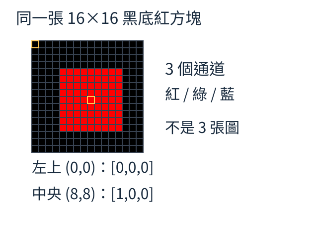
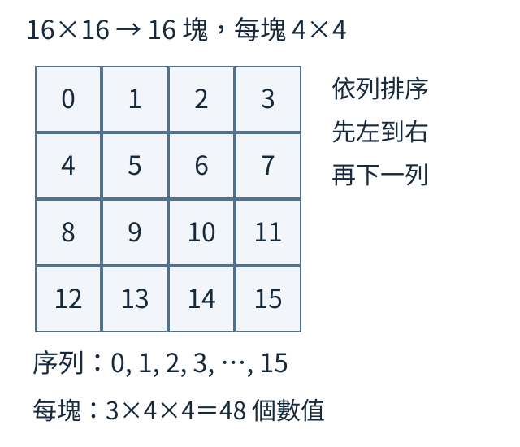
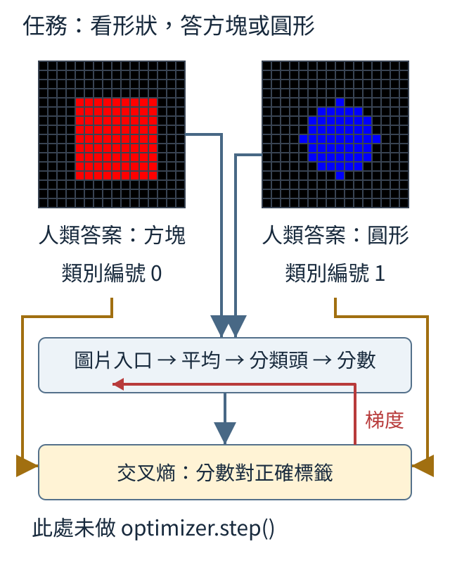
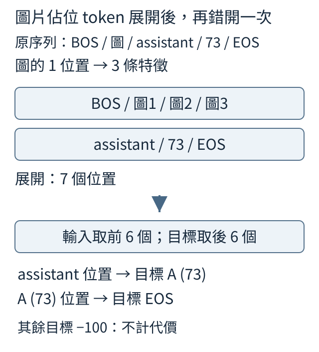

# 第 10 章：圖片如何進入文字模型

從一張黑底紅方塊開始，先把像素、圖塊與位置變成數字，再接進文字序列。這一章的零件都很短，所以每一步都直接讀本課函式庫 `tiny_perceptron/multimodal.py` 裡的實作：畫合成圖的 `scene`（[10.1](10.md#10.1)）、切塊的 `patchify`（[10.2](10.md#10.2)）、圖片入口 `VisionEncoder`（[10.5](10.md#10.5)）、展開圖片位置的 `expand_modalities`（[10.7](10.md#10.7)），最後在 [10.8](10.md#10.8) 把它們和文字模型接成 `MultiModalLM`。程式接得通，不等於模型學會看圖，兩件事要用不同證據確認。最後三節改問圖文配對：從現成的候選說明裡選出相配的一段，這和自己生成句子是不同的工作。忘了前面章節的名詞，可以查[名詞頁](../glossary.md)。

## 10.1 一張紅色方塊，怎麼存成圖片 tensor？

看一張黑底紅方塊：中央像素是紅色，左上角是黑色。希望程式讀出中央的 `[1,0,0]` 與左上的 `[0,0,0]`，還要說清楚這些數字屬於哪一張圖、哪個位置。



RGB 是紅、綠、藍三個通道。一個像素的三個亮度合在一起才是它的顏色；本例 0 是沒有該色亮度，1 是最大亮度。tensor 是帶形狀的數字陣列，圖片用 `[C,H,W]` 排列：通道、高、寬。所以 `[3,16,16]` 表示一張圖的三種顏色通道，不是三張圖。

這張圖由本課自己寫的函式 `scene` 畫出。它和第 10–12 章處理圖片、聲音的其他零件一起放在專案 `tiny_perceptron` 資料夾的 `multimodal.py`（[W.7](../first-steps.md#W.7) 說的共用零件），所以寫成 `from tiny_perceptron.multimodal import scene` 載入。先看它畫出什麼：

```python
from tiny_perceptron.multimodal import scene

image = scene("red", "square")
print("形狀", tuple(image.shape))
print("中央RGB", image[:, 8, 8].tolist())
print("左上RGB", image[:, 0, 0].tolist())
print("加入筆數軸", tuple(image.unsqueeze(0).shape))
```

`scene("red", "square")` 產生 16×16 的黑底紅方塊。`image[:, 8, 8]` 的冒號表示通道全取，再取第 8 列、第 8 欄；索引從 0 開始。前三行印出 `(3,16,16)`、`[1.0,0.0,0.0]`、`[0.0,0.0,0.0]`；`.tolist()` 只是把選出的數值轉成清單，沒有更動圖片。`unsqueeze(0)` 在最前面增加筆數軸（batch 軸），得到 `(1,3,16,16)`，第一個 1 表示只有一筆，也就是一張圖。增加軸不會新增像素。

`scene` 怎麼把紅色放到中央？下面是它的完整實作：

```python
# 節錄自 tiny_perceptron/multimodal.py：scene
def scene(color="red", shape="square", size=16, offset=0):
    """固定規則的合成圖片；屬性 label 是生成規則，不是模型猜測。"""
    colors = {"red": [1.0, 0.0, 0.0], "green": [0.0, 1.0, 0.0], "blue": [0.0, 0.0, 1.0]}
    image = torch.zeros(3, size, size)
    yy, xx = torch.meshgrid(torch.arange(size), torch.arange(size), indexing="ij")
    center = size // 2 + offset
    region = (xx - center).abs() <= size // 4
    region &= (yy - size // 2).abs() <= size // 4
    if shape == "circle":
        region = (xx - center).square() + (yy - size // 2).square() <= (size // 4) ** 2
    elif shape != "square":
        raise ValueError("合成形狀只接受 circle/square")
    image[:, region] = torch.tensor(colors[color])[:, None]
    return image
```

第一行參數裡的等號是預設值：呼叫時沒給的參數就用它，所以 `scene()` 也是 16×16 的紅方塊。三引號那行是給人看的說明，提醒顏色和形狀是用規則畫出來的，不是模型猜的。`colors` 是一本字典（[W.2](../first-steps.md#W.2)），用顏色名字查出 RGB 三個數。`torch.zeros(3, size, size)` 先準備一張全 0 的 `[3,16,16]`：三個通道都沒有亮度，就是全黑。

接著決定哪些像素要塗色。`torch.meshgrid(...)` 產生兩張 16×16 的表：`yy` 的每一格記著自己在第幾列，`xx` 記著在第幾欄（`indexing="ij"` 指定第一張是列號）。`center = size // 2 + offset` 的 `//` 是只留整數的除法，16//2＝8；`offset` 能把圖形左右平移，本章都用預設的 0。`(xx - center).abs() <= size // 4` 對每一格問「和第 8 欄相差不超過 4 嗎？」（`.abs()` 是絕對值，左右兩側都算），得到一張真／假表，每格是 True 或 False；符合的是第 4 到 12 欄，共 9 欄。`region &=` 再要求列也在第 4 到 12 列之間，兩個條件都成立的格子才保持 True。所以方塊是 9×9＝81 個像素。形狀是 `"circle"` 時，改用「離中心的距離平方不超過 16」來選；`elif` 是「否則，如果」，形狀既不是圓也不是方時，`raise ValueError(...)` 停下並顯示錯誤，不默默畫出錯的圖。

最後一行把顏色寫進去。`image[:, region]` 選出三個通道在 True 位置的像素；右邊的 `torch.tensor(colors[color])` 是 `[1.0,0.0,0.0]`；`[:, None]` 的冒號保留原本放這 3 個數的軸，`None` 在它後面補一個長度 1 的新軸（和第一段程式的 `unsqueeze` 一樣是加軸），排成三列一欄的 `[3,1]`，每個通道一個值。PyTorch 會把長度 1 的那一軸自動重複，讓每個通道的值套到該通道所有被選中的像素上；這種自動重複叫**廣播**（broadcasting）。結果紅通道的 81 個像素變成 1，綠、藍通道仍是 0。

照片常用整數 0–255 保存亮度，轉成浮點數後可以除以 255；這裡的合成圖已經是 0–1，不要再除一次。若讀檔工具給的是 `[H,W,C]`，需要交換軸，不能只改形狀名稱而讓內容排錯。通道順序與亮度尺度都要和後續模型的約定一致。

練習在第一段程式最後加一行 `print("角落RGB", image[:, 4, 4].tolist())`，先預測紅方塊的左上角（第 4 列、第 4 欄）是什麼顏色，再把 `"square"` 改成 `"circle"` 重跑一次。預期方塊時是 `[1.0,0.0,0.0]`：第 4 列、第 4 欄都在 4 到 12 之間。圓形時變成 `[0.0,0.0,0.0]`：距離平方 `(4−8)²+(4−8)²＝32`，超過 16。中央仍是紅色，形狀也仍是 `(3,16,16)`；改變的只是哪些像素被選中。

<details>
<summary>回顧與查證</summary>

可回顧：[W.3 的 tensor 與軸](../first-steps.md#W.3)、[W.2 的字典](../first-steps.md#W.2)、[W.7 的專案資料夾](../first-steps.md#W.7)。

</details>

## 10.2 圖片切成小塊後，如何排成序列？

沿用上一節的 16×16 黑底紅方塊圖，要排成一串可依序處理的材料。先切成邊長 4 的小方塊，英文叫 **patch**：每列 4 塊，共 16 塊；依列從左到右、再到下一列排列。每塊仍保存 RGB 的 3×4×4＝48 個數值。



圖中的 0–15 是小塊在序列裡的位置，不是圖片類別。文字序列的每個位置放一個 token；圖片序列的每個位置放一整塊圖的 48 個數值，而不是每個像素各佔一個位置。

```python
import torch
from tiny_perceptron.multimodal import scene, patchify, unpatchify

image = scene("red", "square")[None]
patches = patchify(image, 4)
restored = unpatchify(patches, 3, 16, 16, 4)
print("小塊序列", tuple(patches.shape))
print("拼回相同", torch.equal(image, restored))
```

`scene("red", "square")[None]` 生成同一張圖，`[None]` 和上一節的 `unsqueeze(0)` 一樣，在最前面加筆數軸。`patchify` 切塊並攤平每塊，得到 `(1,16,48)`：一張圖、16 個位置、每位置 48 個數。`unpatchify` 按通道 3、高寬 16、塊邊長 4 放回原位；`torch.equal` 印出 True，表示往返後每個數值都相同。

兩個函式各只有幾行：

```python
# 節錄自 tiny_perceptron/multimodal.py：patchify、unpatchify
def patchify(images, patch_size=4):
    b, c, h, w = images.shape
    if h % patch_size or w % patch_size:
        raise ValueError("圖片高寬必須能整除 patch_size")
    p = patch_size
    return images.reshape(b, c, h // p, p, w // p, p).permute(0, 2, 4, 1, 3, 5).reshape(b, -1, c * p * p)


def unpatchify(patches, channels, height, width, patch_size=4):
    b, _, _ = patches.shape
    p = patch_size
    return (
        patches.reshape(b, height // p, width // p, channels, p, p)
        .permute(0, 3, 1, 4, 2, 5)
        .reshape(b, channels, height, width)
    )
```

`patchify` 先用 `b, c, h, w = images.shape` 一次取出四個軸的長度（本例 1、3、16、16）。`if h % patch_size or w % patch_size:` 問的是「高或寬除以塊邊長有沒有餘數」：`%` 是取餘數，16 除以 4 餘 0；只要有一邊的餘數不是 0，就用 `raise` 報錯，因為邊緣會剩下不完整的塊。真正的工作在最後一行，分三步：

1. `reshape(b, c, h // p, p, w // p, p)` 把高 16 拆成「第幾列塊、塊內第幾列」兩個軸，寬也同樣拆開，形狀變成 `(1,3,4,4,4,4)`。數字沒有搬動，只是換一種分組看法（[W.3](../first-steps.md#W.3) 的 `reshape`）。
2. `permute(0, 2, 4, 1, 3, 5)` 重排軸的順序：新的六個軸依序取舊的第 0、2、4、1、3、5 軸，也就是筆數、列塊、欄塊、通道、塊內列、塊內欄，形狀變成 `(1,4,4,3,4,4)`。和 `reshape` 不同，`permute` 會改變數字被讀出的先後順序。以 2×2 的 `[[1,2],[3,4]]` 為例：`reshape(4)` 攤平是 1、2、3、4；先 `permute(1, 0)` 交換兩個軸（二維時就是 [3.7](03.md#3.7) 的 `.T`），得到 `[[1,3],[2,4]]`，再 `reshape(4)` 就是 1、3、2、4。這一步不能省：若直接把 `(1,3,16,16)` reshape 成 `(1,16,48)`，第一個位置的 48 個數會是紅色通道最上面三列的像素，一條橫帶，而不是一個 4×4 方塊。
3. `reshape(b, -1, c * p * p)` 把「列塊×欄塊」併成 16 個位置，把每塊的 3×4×4 攤成 48 個數；`-1` 讓 PyTorch 自己算出 16。列塊排在欄塊前面，所以合併時先走完同一列的 4 塊，才換到下一列，這就是「依列排序」。

`unpatchify` 照相反順序做一次：先拆回 `(1,4,4,3,4,4)`，用 `permute(0, 3, 1, 4, 2, 5)` 把軸排回「通道、列塊、塊內列、欄塊、塊內欄」，最後併回 `(1,3,16,16)`。`b, _, _ = patches.shape` 裡的 `_` 表示那兩個值用不到。

往返成功只核對了兩個函式彼此相容，還不能證明排序符合「依列」的約定：若切和拼都改成依欄排序，照樣能還原原圖。所以還要直接看某個位置裝的是哪一塊。下面用一張 4×4、只有一個通道的小圖，格子依列寫上 0 到 15，切成邊長 2 的四塊；左上、右上、左下、右下應依序在位置 0、1、2、3。

```python
grid = torch.arange(16.0).reshape(1, 1, 4, 4)
print(grid[0, 0])
print(patchify(grid, 2)[0])
```

第一個輸出是小圖本身：第一列 0、1、2、3，第二列 4、5、6、7，依此類推。第二個輸出有 4 列，每列是一塊的 4 個數：位置 1 是 `[2,3,6,7]`，正是右上那塊（第 0、1 列的第 2、3 欄）。若排序錯成依欄，位置 1 會是左下的 `[8,9,12,13]`。真圖也能這樣核對：在圖上找一塊已知顏色的區域，看它的數值出現在序列的第幾個位置。

練習把第一段程式的兩個塊邊長都改成 8，也就是 `patchify(image, 8)` 和 `unpatchify(patches, 3, 16, 16, 8)`。先預測：每列 2 塊，共 4 塊，每塊 3×8×8＝192 個值，所以形狀是 `(1,4,192)`，而且仍能拼回。切塊沒有丟掉任何像素；下一節把每塊壓成短特徵時，才會碰到哪些差異被保留的問題。

<details>
<summary>回顧與查證</summary>

可回顧：[10.1 的筆數軸與 RGB 軸](10.md#10.1)、[W.3 的 reshape](../first-steps.md#W.3)。

</details>

## 10.3 每塊 48 個像素值，如何變成 8 個特徵？

上一節每塊有 48 個像素值，接下來希望每個位置改用 8 個數字表示。做法是對每塊的 48 個值各乘權重、加總，再加偏移（bias，見 [2.3](02.md#2.3)），一套配方產生一個輸出；準備 8 套配方，就得到 8 個輸出。這一排數字叫向量；8 套配方合起來，就是可以訓練的線性層。

```python
import torch
from torch import nn
from tiny_perceptron.multimodal import scene, patchify

torch.manual_seed(0)
patches = patchify(scene()[None], 4)
embedding = nn.Linear(48, 8)
features = embedding(patches)
print("輸入", tuple(patches.shape))
print("輸出", tuple(features.shape))
print("矩陣", tuple(embedding.weight.shape))
```

`scene()` 不給參數，用預設的紅方塊（[10.1](10.md#10.1)）。`nn.Linear(48, 8)` 建立 48 進、8 出的線性層；權重矩陣 `(8,48)` 的每一列是一套配方，負責一個輸出。固定種子 0，讓亂數初始化可以重做。程式印出 `(1,16,48)`、`(1,16,8)`、`(8,48)`：16 個位置都保留，只把每位置的特徵寬度從 48 改成 8。這個把每塊像素算成特徵的線性層叫 **patch embedding**；[10.5](10.md#10.5) 的圖片入口切完塊之後，第一步就是它（程式裡叫 `projection`）。

16 個位置共用同一張配方表，表示每個位置遇到相似像素時做相同計算，不表示 8 個數字已經懂顏色；它們的用途要由訓練目標建立。名字裡雖然也有 embedding，它和文字的 embedding 表（[2.1](02.md#2.1)）做法不同：文字是用 token ID 查出表中的一列；patch embedding 沒有表可查，是直接拿像素亮度做加權和算出來。

例如兩個亮度 `[1,0]` 和 `[0,1]`，都經權重 `[0.5,0.5]`、偏移 0，得到同樣的 0.5。這個特定配方抹掉了兩者的差異。48 轉 8 同樣可能壓掉資訊，訓練要尋找保留任務線索的配方；特徵寬度變小本身不是理解的證據。

練習把程式的 `nn.Linear(48, 8)` 改成 `nn.Linear(48, 16)`，預期特徵 `(1,16,16)`、矩陣 `(16,48)`。特徵形狀裡的兩個 16 分別是位置數與特徵寬度，不能因數值相同就當成同一件事。

<details>
<summary>回顧與查證</summary>

可回顧：[10.2 的 patch 形狀](10.md#10.2)、[2.3 的權重與偏移](02.md#2.3)、[W.5 的矩陣配方](../first-steps.md#W.5)。

</details>

## 10.4 相同圖塊，如何知道它在左邊還是右邊？

兩塊像素內容相同的紅圖，一塊在左、一塊在右；只看內容向量，分不清它們各在哪個位置。要回答「左邊是什麼」，就得把位置也留下。做法像替每塊貼上座位號碼：準備和內容向量等寬的位置向量，加進內容向量。

下面另設一份手算式材料：1 張圖、4 個位置、每位置 3 個特徵，用全 1 向量代表相同內容。位置提示先只用位置編號 0、1、2、3；加法會把每個位置的編號加到該位置的三個特徵上，靠的就是 [10.1](10.md#10.1) 介紹的廣播。這是方便手算的提示；正式的位置向量可以在同一個位置提供三個不同的數。

```python
import torch

patches = torch.ones(1, 4, 3)
position = torch.arange(4.0)[None, :, None]
x = patches + position
print("形狀", tuple(x.shape))
print("位置0", x[0, 0].tolist())
print("位置3", x[0, 3].tolist())
print("仍相同", torch.equal(x[:, 0], x[:, 3]))
```

`arange(4.0)` 產生 0、1、2、3；`[None, :, None]` 的 `:` 保留原本的軸，兩個 `None` 在前後各補一個軸，成為 `(1,4,1)`。最後一軸長度 1，與 `patches` 的 3 個特徵相加時會自動重複。輸出仍是 `(1,4,3)`，位置 0 得 `[1,1,1]`，位置 3 得 `[4,4,4]`，最後的相同比較是 False。

正式模型使用可訓練的位置向量：[10.5](10.md#10.5) 的圖片入口替 16 個位置各準備一排可學的數字（程式裡的 `position`），一開始是很小的亂數。模型不會天生知道哪個位置在哪裡。例如 [10.2](10.md#10.2) 那張 4×4 小圖切成四塊後，位置 3 是右下那塊；但「帶著位置 3 的提示就是右下」這個意義，要靠固定的切塊順序和訓練一起建立。這裡的四個位置也不能直接套到十六塊的圖上。

還要分清兩種重排。設左、右兩個位置的內容各只有一個數：紅塊記 1、黑塊記 0，位置提示左 0、右 10。原圖紅塊在左，相加得 `[1+0, 0+10]＝[1,10]`。若只交換內容、提示留在原位，得到 `[0+0, 1+10]＝[0,11]`：數字變了，代表紅塊真的搬到右邊。若內容帶著自己的提示一起換位，得到 `[0+10, 1+0]＝[10,1]`：還是原來那兩個數，只是存放順序換了，代表的仍是「紅塊在左」。前者改變圖的內容，後者只改變儲存順序。

練習把程式的 `x = patches + position` 改成 `x = patches`，預期位置 0 和位置 3 都是 `[1,1,1]`，最後一行變成 True。它確認少掉的是位置區別，不是圖片張數或特徵寬度。

<details>
<summary>回顧與查證</summary>

可回顧：[10.2 切成四塊的 4×4 小圖](10.md#10.2)、[10.3 每個 patch 的特徵](10.md#10.3)、[4.1 文字序列的位置](04.md#4.1)。

</details>

## 10.5 形狀答案如何把梯度送回圖片入口？

看下面兩張合成圖：左邊是紅色方塊，右邊是藍色圓形。這次任務是回答形狀，所以人的答案先是「方塊」「圓形」。程式需要數字標籤，才約定方塊為 0、圓形為 1；因此兩張圖的正確標籤依序是 `[0,1]`。



前三節的切塊、patch embedding 與位置向量，再加上一段逐位置的加工，就組成把圖片變成特徵的**圖片入口**（image encoder，也叫編碼器）。圖的下半是計算順序：圖片入口 → 平均 → 分類頭 → 分數。**分類頭**（classification head）是接在特徵後面、為每一類各算一個分數的輸出層；這裡是一個 `Linear(8,2)`，方塊、圓形各一個分數。交叉熵比較分數與正確標籤，得到代價（loss）；梯度描述每個參數小幅改變時，代價會怎樣變。本節要核對的是：這條影響能不能一路傳回圖片入口。

```python
import torch
from torch import nn
from torch.nn import functional as F
from tiny_perceptron.multimodal import VisionEncoder, patchify, scene

torch.manual_seed(0)
encoder = VisionEncoder(width=8)
classifier = nn.Linear(8, 2)
images = torch.stack([scene("red", "square"), scene("blue", "circle")])
features = encoder(images)
logits = classifier(features.mean(1))
loss = F.cross_entropy(logits, torch.tensor([0, 1]))
loss.backward()
print("切塊", tuple(patchify(images, 4).shape), "特徵", tuple(features.shape), "分數", tuple(logits.shape))
print("圖片入口收到梯度", encoder.projection.weight.grad.norm().item() > 0)
```

`torch.stack` 把兩張 `(3,16,16)` 的圖疊成一批 `(2,3,16,16)`。第一行印出三個形狀：切塊後是 `(2,16,48)`；經過圖片入口變成 `(2,16,8)`，也就是兩張圖、各 16 個位置、特徵寬度 8；`mean(1)` 把每張圖的 16 條特徵平均成一條，分類頭再算出 `(2,2)`，每張圖兩個候選分數。

`backward()` 做反向傳播（backpropagation，[1.10](01.md#1.10)），把代價對每個參數的梯度存進 `.grad`。最後一行看圖片入口裡 `projection` 的梯度：`.norm()` 把整張梯度表縮成一個總長度，大於 0 就表示其中有數字不是 0，預期印出 True。程式沒有 `optimizer.step()`，參數尚未更新；這裡展示的是梯度通路，不是訓練後辨認形狀的成績。

為什麼看 `projection`？打開圖片入口的實作就知道：

```python
# 節錄自 tiny_perceptron/multimodal.py：VisionEncoder
class VisionEncoder(nn.Module):
    def __init__(self, width=16, image_size=16, patch_size=4):
        super().__init__()
        self.patch_size, self.image_size = patch_size, image_size
        self.projection = nn.Linear(3 * patch_size**2, width)
        self.position = nn.Parameter(torch.randn(1, (image_size // patch_size) ** 2, width) * 0.02)
        self.feature = nn.Sequential(nn.LayerNorm(width), nn.Linear(width, width), nn.GELU())

    def forward(self, images):
        if images.shape[1:] != (3, self.image_size, self.image_size):
            raise ValueError("先把圖片轉成這個 encoder 配置的 RGB 高寬")
        return self.feature(self.projection(patchify(images, self.patch_size)) + self.position)
```

`nn.Module` 類別的讀法和 [3.7](03.md#3.7) 相同：`class VisionEncoder(nn.Module)` 定義一種新零件；`__init__` 建立可學的零件，它的第一行 `super().__init__()` 先讓 PyTorch 做好登記參數的準備；`forward` 寫計算順序，呼叫 `encoder(images)` 時執行的就是 `forward`。

`__init__` 先用 `self.patch_size, self.image_size = patch_size, image_size` 一行同時記下兩個設定，`forward` 會用到；接著建三樣零件。`projection` 是 [10.3](10.md#10.3) 的 patch embedding：輸入 `3 * patch_size**2`＝3×4²＝48 個數（`**` 是次方），輸出特徵寬度 `width`。`position` 是 [10.4](10.md#10.4) 說的可訓練位置向量，形狀 `(1,16,width)`：`(image_size // patch_size) ** 2`＝(16÷4)²＝16 個位置，每個位置一排數字；`nn.Parameter` 把這個 tensor 登記成可學的參數；乘 0.02 讓起始值很小，免得一開始隨機的位置向量蓋過 `projection` 從像素算出的特徵。`feature` 用 `nn.Sequential` 把三步依序接起來：層正規化（LayerNorm，[4.3](04.md#4.3)）、寬度不變的 Linear、GELU（[4.4](04.md#4.4)）。

`forward` 先檢查去掉筆數軸後的形狀 `images.shape[1:]` 是不是 3 通道、16×16，不是就報錯。最後一行要由內往外讀：`patchify` 切塊 → `projection` 算特徵 → 加上 `position` → `feature` 再加工。`projection` 是第一個用到參數的步驟，離代價最遠；梯度要先經過分類頭、平均、`feature` 和位置相加，才到得了它。所以 `projection` 收到梯度，就表示整條路都通。圖中的紅色箭頭畫的就是這條路：從交叉熵往上回到分數，再往左經過分類頭、平均，一路回到圖片入口。

這兩張圖還有一個資料陷阱：紅色總是方塊，藍色總是圓形。即使後續練到兩張全對，模型也可能只用顏色。若要教形狀，應讓紅圓、藍圓同標圓形，紅方、藍方同標方塊；若要教顏色，則讓同色不同形狀共享顏色標籤。目標變了，資料與判準也要一起改。

平均也是一種選擇：它留下顏色這類全圖共有的線索，卻可能丟掉「紅塊在左還是右」這種排列資訊。同一份平均表示不會自動適合所有看圖問題。

練習把第一段程式的 `torch.tensor([0, 1])` 改成 `torch.tensor([1, 0])`，也就是故意給相反的形狀答案。先預測最後一行還是不是 True。預期仍是 True：梯度照樣傳得回去。有梯度只表示通路接通，不能證明標籤正確。

<details>
<summary>回顧與查證</summary>

可回顧：[10.3 的 patch embedding](10.md#10.3)、[10.4 的位置向量](10.md#10.4)、[3.7 的 nn.Module 類別](03.md#3.7)、[1.8 分類的交叉熵代價](01.md#1.8)、[1.10 反向傳播](01.md#1.10)、[W.6 梯度](../first-steps.md#W.6)。

本課另有一個真正更新參數的小實驗：同樣的圖片入口（特徵寬度 16）接分類頭，學六類「顏色＋形狀」答案（紅、綠、藍各配方塊、圓形）。更新 250 步後，測試題 6/6、驗證題 5/6（一張藍圓被判成藍方）；驗證題和測試題的圖形都放在訓練沒用過的位置。完整數字在[實驗紀錄（JSON）](../../docs/course-experiments/results/encoders.json)，這是機器可讀的完整結果：看 `results.vision` 底下 `validation` 與 `test` 的 `count`（題數）和 `correct`（答對數）。重做方式見[實驗說明](../../docs/course-experiments/README.md)的「重跑一組實驗」，實驗名稱是 `encoders`。

</details>

## 10.6 寬度 8 的圖片特徵，如何接到寬度 12 的文字核心？

圖片入口每個位置給 8 個數字，但要接上的文字模型每個位置需要 12 個。能同時讀文字、圖片這類不同模態（modality，資料的種類，見 [6.6](06.md#6.6)）的模型叫多模態模型；其中負責讀寫文字的那一部分，就是前面各章訓練的語言模型（例如 [4.6](04.md#4.6) 的 `TinyLM`），叫**文字核心**（language backbone）。兩邊的特徵寬度不同，中間要加一個線性層，把每位置的 8 個數重新組合成 12 個；這個線性層叫**接頭**（projector）。它改的是每位置的特徵寬度，不是把 16 塊圖變成 12 塊。

```python
import torch
from torch import nn

torch.manual_seed(0)
vision = torch.randn(1, 16, 8)
projector = nn.Linear(8, 12)
language_features = projector(vision)
print("圖片特徵", tuple(vision.shape))
print("接頭輸出", tuple(language_features.shape))
print("接頭矩陣", tuple(projector.weight.shape))
```

`vision` 是用 `torch.randn` 隨機造出的 `(1,16,8)` 圖片特徵，代替圖片入口的輸出。`Linear(8,12)` 的權重矩陣是 `(12,8)`：每一列是一套配方，把 8 個輸入加權成 1 個輸出，共 12 套。16 個位置共用這 12 套配方，所以輸出 `(1,16,12)`。

輸出比輸入多，不代表多出資訊。用一個小例子算：輸入 `[1,2]`，接頭 `Linear(2,3)` 的權重是 `[[1,0],[0,1],[1,1]]`、偏移 0。三套配方依序算出 `1×1+0×2＝1`、`0×1+1×2＝2`、`1×1+1×2＝3`，得到 `[1,2,3]`。第三個數只是前兩個的和：多出來的輸出是重新組合，不是新的知識。

尺寸相容讓後面的計算能執行，含義合不合用還要學。圖片特徵也許分得出紅與藍，文字核心卻是用自己的特徵區分詞義。拿成對的圖片與正確描述訓練接頭，讓圖片的差異變成文字核心生成答案時能用的線索，這叫**模態對齊**（modality alignment）。第 11 章會用完整回答檢查它是否做到。

若圖片入口已把紅、藍壓成完全相同的特徵，接頭再怎麼學也無法從相同輸入還原不同顏色。若接頭輸出寬度設成 10，文字核心仍要求 12，則先遇到尺寸不符。這兩種失敗分別是資訊不足與尺寸不符，不能都靠改圖片大小處理。[10.8](10.md#10.8) 的 `MultiModalLM` 會把接頭的輸出寬度直接設成文字核心的寬度。

練習把程式的 `nn.Linear(8, 12)` 改成 `nn.Linear(8, 10)`，先算出輸出 `(1,16,10)` 和矩陣 `(10,8)`，再說明它為何不能直接接到寬度 12 的文字核心：文字核心的每一步都以每位置 12 個數為前提，例如要把自己的位置向量逐格加上去，10 個數和 12 個數對不起來。

<details>
<summary>回顧與查證</summary>

可回顧：[10.3 的特徵寬度](10.md#10.3)、[W.5 的矩陣變換](../first-steps.md#W.5)、[4.6 的 TinyLM](04.md#4.6)。

</details>

## 10.7 圖片展開後，答案目標如何跟著移動？

一串訊息裡，圖片原本只佔一個位置，用一個特殊 token 代表：ID 5，也就是 [6.6](06.md#6.6) 列出的 `<image>`，本章叫它圖片佔位 token。真正送進模型時，這一個位置要換成圖片入口算出的多條特徵；[10.5](10.md#10.5) 的圖片入口會給 16 條，本節為了好數，假設只有 3 條。替換後，後面的助手角色與回答都往後移兩個位置。除了移輸入，也要移對應的目標，讓助手位置仍然預測答案的第一個 token。

[7.4](07.md#7.4) 用問題 Q、回答 A 的例子，完整序列是 BOS（開始標記）、user、Q、EOS（結束標記）、assistant、A、EOS。圖片放在使用者那一段，也就是把 Q 換成圖片佔位 token。為了讓位置好數，本節再拿掉 user 角色（3）和圖片後的 EOS（2），剩下五個 token：BOS（1）、圖片佔位 token（5）、assistant（4）、答案 A（73）、EOS（2）。A 的 ASCII byte 是 65，照 6.6 的規則加 8 得 73。拿掉的兩個 token 在完整序列裡也不是答案，目標都是 −100；換成完整序列，下面的展開與錯開步驟相同，只多了兩個不計代價的位置。

交給函式的 `labels` 還沒錯開，和 `ids` 一個位置對一個位置：A 的位置標 73、EOS 的位置標 2，表示這兩個 token 要計分，還不是「這個位置要猜什麼」；其餘標 `IGNORE`，是函式庫裡表示不計代價的常數 −100。這和 [7.1](07.md#7.1) 的 `render_chat` 不同，它回傳的 Y 已經錯開。這裡的下一位置對齊（[7.4](07.md#7.4)）由 `expand_modalities` 在展開之後自己做一次，因為答案的前一個位置要看最後真正送進模型的序列。

```python
import torch
from torch import nn
from tiny_perceptron.data import IGNORE
from tiny_perceptron.multimodal import expand_modalities

embedding = nn.Embedding(264, 8)
ids = torch.tensor([1, 5, 4, 73, 2])
labels = torch.tensor([IGNORE, IGNORE, IGNORE, 73, 2])
features = {5: torch.randn(3, 8)}
x, y = expand_modalities(ids, labels, embedding, features, {5})
print("輸入特徵", tuple(x.shape))
print("下一位置目標", y.tolist())
```

`embedding` 是寬度 8 的文字 embedding 表，負責圖片佔位 token 以外的 token（本例是 BOS、assistant、A、EOS）；264 列對應 ByteTokenizer 字表的 264 個 ID。`features` 是一本字典：鍵 5 對到 `torch.randn(3, 8)` 造出的 3 條隨機特徵，代替圖片入口與接頭的輸出。`{5}` 告訴函式哪些 ID 是要展開的佔位 token；大括號裡只放值、沒有冒號，是 Python 的集合。輸出是六個輸入位置 `(1,6,8)`，目標是 `[[-100,-100,-100,-100,73,2]]`：只有 73 與 2 兩個有效目標。

函式怎麼做到？

```python
# 節錄自 tiny_perceptron/multimodal.py：expand_modalities
def expand_modalities(ids, labels, embedding, features, marker_ids):
    """一筆無 padding 資料：marker 展開成多向量，新增位置不直接算 loss。

    ids 與 labels 在此都尚未 shift。展開後才 shift，第一個答案的對齊才正確。
    """
    pieces, targets = [], []
    for token, label in zip(ids.tolist(), labels.tolist(), strict=True):
        if token in marker_ids:
            modal = features[token]
            pieces.append(modal)
            targets += [IGNORE] * len(modal)
        else:
            pieces.append(embedding(torch.tensor([token], device=embedding.weight.device)))
            targets.append(label)
    expanded = torch.cat(pieces)
    target = torch.tensor(targets, device=expanded.device, dtype=torch.long)
    return expanded[:-1].unsqueeze(0), target[1:].unsqueeze(0)
```

三引號說明裡的 marker 是佔位 token，shift 是錯開，padding 是 [7.6](07.md#7.6) 說的補 PAD。`for token, label in zip(ids.tolist(), labels.tolist(), strict=True):` 一次走一個位置：`zip` 把兩份清單逐項配對，`strict=True` 要求兩份一樣長，長度不同就報錯，避免 `labels` 沒對好卻默默算下去。遇到佔位 token（`token in marker_ids`）時，`features[token]` 取出那 3 條圖片特徵，整份放進 `pieces`；`[IGNORE] * len(modal)` 是把 −100 重複 3 次的清單，`+=` 把它接到 `targets` 後面。圖片特徵不是要生成的字，所以不計代價，但後面的位置仍能讀它們。遇到圖片佔位 token 以外的 token 時（包括 BOS、assistant 這些特殊 token），查 embedding 表得到一條向量（`device=` 只是讓 ID 和表放在同一個計算裝置上），目標用 `append` 照抄傳進來的 `label`。

迴圈結束時，`torch.cat(pieces)` 把各段接成 7 條向量，`targets` 也有 7 個：

| 展開後的位置 | 0 | 1 | 2 | 3 | 4 | 5 | 6 |
| --- | --- | --- | --- | --- | --- | --- | --- |
| 放的內容 | BOS | 圖1 | 圖2 | 圖3 | assistant | A | EOS |
| 同位置的目標 | −100 | −100 | −100 | −100 | −100 | 73 | 2 |

最後一行才做下一位置對齊：`expanded[:-1]` 去掉最後一條輸入（切片 `[:-1]` 取到倒數第一個之前），`target[1:]` 去掉第一個目標（從索引 1 取到最後），兩者都剩 6 個，再用 `unsqueeze(0)` 加上筆數軸。於是位置 4 的輸入是 assistant、目標是 73；位置 5 的輸入是 A、目標是 EOS 的 2。若傳進來的 `labels` 已經錯開過，這一行會再錯開一次，每個位置都去猜再下一個 token，就是 [4.7](04.md#4.7) 提醒過的重複錯開。



圖把前四個位置合成一行顯示，仍是 BOS 加三條圖片特徵；這四個位置的目標都是 −100，猜什麼都不計代價。

文字核心接著算的位置編號和因果遮罩（[3.6](03.md#3.6)），也都按這六個輸入位置建立：位置編號是 0–5，遮罩是 6×6 的許可表，每列一個查詢位置、每欄一個候選位置。不能沿用原來的五個位置，也不能把錯開前的七個當成實際輸入長度。

練習把第一段程式的 `torch.randn(3, 8)` 改成 `torch.randn(5, 8)`，也就是圖片佔 5 條特徵。先預測：展開後 1＋5＋3＝9 個位置，錯開後輸入長度 8；目標前六個是 −100，最後兩個仍是 73 與 2。回答內容沒變，改變的是它在序列中的位置。

<details>
<summary>回顧與查證</summary>

可回顧：[6.6 特殊 token 的 ID](06.md#6.6)、[7.1 完整對話格式](07.md#7.1)、[7.4 下一位置的答案對齊](07.md#7.4)、[4.7 重複錯開的錯誤](04.md#4.7)、[10.6 接頭輸出](10.md#10.6)。

</details>

## 10.8 沒附圖時，包裝會改變原文字計算嗎？

前三節的零件——圖片入口、接頭、展開——要和文字核心組成一個能讀圖的模型。本課把它們包成 `MultiModalLM`：裡面放著原本的文字模型，外加圖片用的零件。包好之後先核對一件事：沒附圖時，包裝是否原封不動地使用文字核心？同一份文字模型、同一串三個 token ID，直接交給文字核心，和經過包裝交給它，候選分數應該逐項相同。這核對的是包裝有沒有改動計算，不是模型會不會寫文章。

函式庫的 `MultiModalLM` 同時處理圖片和聲音；本章只走圖片路線，下面是只保留圖片的精簡版。省略的是聲音入口（`audio`）、聲音接頭（`audio_projector`）和對聲音佔位 token 的檢查，第 12 章把聲音接進同一個 `MultiModalLM` 時才用到（[12.9](12.md#12.9)）。參數名稱和函式庫一致，兩者才能載入同一組參數值。

```python
# 精簡自 tiny_perceptron/multimodal.py：MultiModalLM（省略聲音入口、聲音接頭與聲音佔位 token 的檢查）
import torch
from torch import nn
from tiny_perceptron.data import IGNORE, ByteTokenizer
from tiny_perceptron.multimodal import VisionEncoder, expand_modalities


class MultiModalLM(nn.Module):
    def __init__(self, language_model, vision_width=16):
        super().__init__()
        self.language = language_model
        self.vision = VisionEncoder(vision_width)
        self.image_projector = nn.Linear(vision_width, language_model.config.width)

    def forward(self, ids, labels=None, *, image=None):
        tok = ByteTokenizer()
        if image is None:
            if (ids == tok.image_id).any():
                raise ValueError("placeholder 缺少配對圖片")
            return self.language(ids.unsqueeze(0))
        features = {tok.image_id: self.image_projector(self.vision(image.unsqueeze(0)))[0]}
        if labels is None:
            labels = torch.full_like(ids, IGNORE)
        x, y = expand_modalities(ids, labels, self.language.embedding, features, {tok.image_id})
        result = self.language(embeddings=x)
        result["labels"] = y
        return result
```

`__init__` 收下已建好的文字模型，存成 `self.language`；再建 [10.5](10.md#10.5) 的圖片入口 `self.vision` 和 [10.6](10.md#10.6) 的接頭 `self.image_projector`。接頭的輸出寬度直接讀文字核心的設定 `language_model.config.width`，兩邊因此接得上。

`forward` 參數列裡的 `*` 表示後面的參數只能寫名字傳，例如 `image=scene()`，避免把圖片誤當成 `labels`。`tok = ByteTokenizer()` 只是為了取得特殊 token 的 ID，例如 `tok.image_id` 就是 5。沒附圖時（`image is None`），`(ids == tok.image_id).any()` 先查 `ids` 裡有沒有圖片佔位 token：`==` 得到一串真／假，`.any()` 問其中是否有任何 True。有的話報錯，因為佔位 token 沒有配對的圖片，不能默默拿它去查 embedding 表、當成一般文字算下去；沒有的話，`return self.language(ids.unsqueeze(0))`——和直接呼叫文字核心完全一樣，只多加了筆數軸。這一行就是本節問題的答案。

附圖時，圖片先加上筆數軸，經過圖片入口與接頭，`[0]` 再取出這張圖的 16 條特徵，用字典交給 [10.7](10.md#10.7) 的 `expand_modalities`。沒給 `labels` 時，`torch.full_like(ids, IGNORE)` 做出和 `ids` 一樣長、全是 −100 的目標。`self.language.embedding` 是文字核心自己的 embedding 表，圖片佔位 token 以外的 token 都用它查。最後的 `self.language(embeddings=x)` 用到函式庫 `TinyLM` 的另一種輸入：不給 token ID，直接給已經算好的向量，跳過查 embedding 表那一步，位置向量與後面的計算照舊；[4.6](04.md#4.6) 的精簡版省略了這個參數。錯開好的目標放進回傳字典的 `"labels"`，訓練時拿它算代價。

下面核對精簡版與函式庫版本，也回答本節的問題：

```python
from tiny_perceptron.model import ModelConfig, TinyLM
from tiny_perceptron.multimodal import MultiModalLM as LibraryMultiModalLM, scene

torch.manual_seed(0)
lm = TinyLM(ModelConfig(width=8))
ours = MultiModalLM(lm)
library = LibraryMultiModalLM(lm)
loaded = ours.load_state_dict(library.state_dict(), strict=False)
print("精簡版缺少的參數", loaded.missing_keys)
print("函式庫多出的參數", loaded.unexpected_keys)
ids = torch.tensor([1, 20, 30])
same_text = torch.equal(lm(ids[None])["logits"], ours(ids)["logits"])
print("沒附圖：與直接呼叫文字核心相同", same_text)
sequence = torch.tensor([1, 5, 4, 73, 2])
same_image = torch.equal(ours(sequence, image=scene())["logits"], library(sequence, image=scene())["logits"])
print("附圖：與函式庫版本相同", same_image)
assert same_text and same_image and loaded.missing_keys == []
```

兩個包裝包住同一個 `lm`，文字核心本來就共用；圖片入口與接頭則各自從亂數開始。`state_dict()` 把模型每個參數的名字和數值收成一本字典，`load_state_dict` 依名字把數值抄進另一個模型；`strict=False` 允許兩邊的名字不完全相同，並回報差在哪裡。第一行印出空清單 `[]`：精簡版的每個參數，在函式庫版本都找得到同名的一份。第二行列出的名字全以 `audio.` 或 `audio_projector.` 開頭：函式庫版本多出來的只有聲音的零件。

`ids` 裡沒有圖片佔位 token：1 是 BOS，20、30 是一般的 byte ID。`lm(ids[None])` 直接交給文字核心，`ours(ids)` 經過包裝；`torch.equal` 比的是整份 `logits`，一筆、三個位置、每個位置 264 個候選分數，要逐項相同才印 True。結果是 True：包裝沒有改變文字計算。即使權重是隨機的、兩邊都答不好，一致性仍然成立；它和答案正確是兩個問題。附圖的 `sequence` 是 10.7 那串序列，圖片換成 `scene()` 的紅方塊，展開成 16 條特徵；精簡版與函式庫版本算出的候選分數也完全相同。最後的斷言把這三項比較一起核對。

訓練之後若開放文字權重更新，文字計算可能合理地改變；是否保住舊技能，要用固定的文字題核對答案。若一換包裝分數就不同，先查輸入、位置與運算路徑；若只在訓練後退步，再查更新範圍與資料。

練習在第二段程式最後加一行 `ours(torch.tensor([1, 5, 4]))`：序列裡有圖片佔位 token，卻沒有附圖。先預測會發生什麼。預期出現 `ValueError: placeholder 缺少配對圖片`，而不是默默拿 5 去查 embedding 表、照常算下去。

<details>
<summary>回顧與查證</summary>

可回顧：[4.6 的 TinyLM 與候選分數](04.md#4.6)、[10.5 圖片入口](10.md#10.5)、[10.6 接頭](10.md#10.6)、[10.7 展開與錯開](10.md#10.7)。後續延伸：[16.8](16.md#16.8) 把手寫注意力換成另一種寫法時，也是先核對兩者輸出相同。

</details>

## 10.9 怎麼從向量方向比較圖文配對？

有兩張圖和兩段說明文字，先只問「哪段說明最配這張圖」，不要求生成句子。下面用手設向量代表它們：第一張圖 `[1,0]` 和第一段說明 `[2,0]` 同方向，第二張圖 `[0,1]` 和第二段說明 `[0,3]` 同方向。

`[1,0]` 和 `[2,0]` 方向一樣、長度不同，應該算一樣相配。所以先把每個向量除以自己的長度，讓長度都變成 1，比較時就只看方向、不受倍率影響。例如 `[3,4]` 的長度是 √(9+16)＝5，除完得到 `[0.6,0.8]`。這叫 **L2 正規化**（L2 normalization）；它只改一個向量的長度，和 [4.3](04.md#4.3) 會減平均、還帶可學倍率的層正規化不是同一件事。長度為 1 的兩個向量做點積（[3.2](03.md#3.2)：對應項相乘再相加），結果叫**餘弦相似度**（cosine similarity）：同方向是 1、垂直是 0、反方向是 −1。這是數字空間裡的方向，不是圖上的左右。

```python
import torch
from torch.nn import functional as F

image = torch.tensor([[1.0, 0.0], [0.0, 1.0]])
text = torch.tensor([[2.0, 0.0], [0.0, 3.0]])
similarity = F.normalize(image, dim=-1) @ F.normalize(text, dim=-1).T
print(similarity)
print("每張圖選文字欄", similarity.argmax(-1).tolist())
```

`F.normalize(..., dim=-1)` 對每一列向量各做一次 L2 正規化。文字矩陣轉置後，矩陣乘法一次算出每張圖對每段文字的點積，得到 `[[1,0],[0,1]]`。每一橫列是一張圖，每一直欄是一段文字；`argmax(-1)` 在每列選出最大的那一欄，得到 `[0,1]`，與本例預先安排的配對一致。

相似度不是機率，一列不必加總為 1。`[1,1]` L2 正規化成約 `[0.707,0.707]` 後，和 `[1,0]` 的相似度約 0.707；兩個候選可以同時得到這個值。之後用分類代價學配對時，才把候選分數轉成機率（[10.10](10.md#10.10)）。

這個手算只核對了比較方式，沒有用到真的圖片入口或文字模型。真圖與真文字需要各自學出有用的向量；同寬的隨機特徵不會自動有配對意義。這種從候選中找出相配內容的工作叫**檢索**（retrieval），和寫出新的描述不同。

練習把程式的 `text` 兩列對調，改成 `torch.tensor([[0.0, 3.0], [2.0, 0.0]])`，預期矩陣變成 `[[0,1],[1,0]]`、選中欄 `[1,0]`。配對關係不變，只是文字的欄順序換了。數值寫成 `2.0` 這種浮點數，是因為 `F.normalize` 要算長度，只接受浮點數；整個 tensor 都寫成整數（例如 `[[0, 3], [2, 0]]`）會報錯。

<details>
<summary>回顧與查證</summary>

可回顧：[3.2 點積](03.md#3.2)、[W.5 矩陣乘法](../first-steps.md#W.5)、[10.5 圖片入口的特徵](10.md#10.5)。本課實際訓練過的圖文配對小實驗，結果在 [10.11](10.md#10.11) 討論。

</details>

## 10.10 配對標籤怎麼決定分數的調整方向？

兩張圖的正確描述依序放在文字欄 0、1。把每張圖對每段文字的分數排成一張表，正確配對落在從左上到右下的**對角線**上（圖 0 對文 0、圖 1 對文 1），其他格是錯誤配對。希望每張圖的正確欄分數比另一欄高。把同批文字當候選、正確欄當標籤，就能算交叉熵代價；這種拿正確配對和其他候選比較的學習叫**對比學習**（contrastive learning）。

本例另用手設分數 `[[2,0],[0,2]]`，只計算代價與梯度，觀察配對標籤要求的調整方向。

```python
import torch
from torch.nn import functional as F

scores = torch.tensor([[2.0, 0.0], [0.0, 2.0]], requires_grad=True)
targets = torch.arange(2)
loss = F.cross_entropy(scores / 0.5, targets)
loss.backward()
print("代價", round(loss.item(), 4))
print("梯度", scores.grad)
```

`targets` 是 `[0,1]`：第 0 張圖的正確欄是 0、第 1 張是 1。分數先除以 0.5 再交給交叉熵，這個除數就是 [1.15](01.md#1.15) 的溫度 τ：除以 0.5 等於乘 2，兩欄的差距從 2−0＝2 放大到 4−0＝4，softmax 後正確欄的機率更集中（約 0.982）。代價約 0.0181，梯度約 `[[-0.0180,0.0180],[0.0180,-0.0180]]`。

梯度下降用舊值減去學習率乘梯度（[1.12](01.md#1.12)）。正確欄是負梯度，若學習率是 0.1，2 會變成約 2−0.1×(−0.0180)＝2.0018；錯誤欄是正梯度，0 會變成約 −0.0018。這是從符號追到調整方向的手算；程式只做 backward，沒有真正更新。

實際模型裡，分數由圖片入口和文字模型的特徵算出，梯度會沿計算傳回兩端。兩端的參數同時影響表中許多格，所以更新的是參數，更新後要重新算整張表；不能直接把表裡的兩個正確格改大，就說訓練完成。

還要先確認候選確實不配。兩張圖若都是紅圓、兩段描述也都是「紅圓」，對角線以外的格子同樣是正確配對；硬把它當成錯誤，就是假負例（false negative）。可以允許多個正確描述，或在入門階段的每一批裡只放屬性不同的配對。

練習把程式的 `targets = torch.arange(2)` 改成 `targets = torch.tensor([1, 0])`，也就是把配對告訴模型反了。預期對角線以外的格子收到負梯度（約 −0.9820），代價升到約 4.0181。這不是合理的資料增強，而是錯誤標籤。

<details>
<summary>回顧與查證</summary>

可回顧：[10.9 相似度矩陣](10.md#10.9)、[1.8 交叉熵](01.md#1.8)、[1.12 梯度下降更新](01.md#1.12)、[1.15 溫度](01.md#1.15)。本課實際訓練的圖文配對小實驗也用這種代價，溫度 τ 設為 0.1（見[實驗紀錄（JSON）](../../docs/course-experiments/results/contrastive.json)的 `results.config.temperature` 欄），結果在 [10.11](10.md#10.11) 討論。

</details>

## 10.11 圖找文和文找圖，為什麼要分開算？

同一張配對分數表可以從兩個方向查：拿一張圖找文字時，在那張圖的橫列裡選候選；拿一段文字找圖時，在那段文字的直欄裡選候選。先看手設表 `[[2.0,0.1],[0.4,1.8]]`：橫列代表圖，直欄代表文字，正確配對仍在對角線上。

```python
import torch
from torch.nn import functional as F

scores = torch.tensor([[2.0, 0.1], [0.4, 1.8]], requires_grad=True)
labels = torch.arange(2)
image_to_text = F.cross_entropy(scores, labels)
text_to_image = F.cross_entropy(scores.T, labels)
loss = (image_to_text + text_to_image) / 2
loss.backward()
print("圖找文", round(image_to_text.item(), 4))
print("文找圖", round(text_to_image.item(), 4))
print("平均", round(loss.item(), 4))
print("梯度符號", torch.sign(scores.grad).tolist())
```

原表算「圖找文」：每列一題，從兩段文字中選。轉置 `scores.T` 讓文字變成橫列、圖變成直欄，同樣的 `cross_entropy` 就變成算「文找圖」。兩個交叉熵約 0.1799、0.1758，平均約 0.1779；梯度符號是 `[[-1,1],[1,-1]]`。同一格分數同時參與兩個方向的候選競爭，收到的梯度合併了兩個方向的影響。

兩項不必相等：圖找文比較同一列的 2.0 對 0.1、0.4 對 1.8；文找圖比較同一欄的 2.0 對 0.4、0.1 對 1.8，差距不同。如果表剛好沿對角線對稱，例如 [10.10](10.md#10.10) 的 `[[2,0],[0,2]]`，兩個方向會算出同樣的值，容易誤以為圖找文和文找圖是同一個式子算了兩次；本節特地用不對稱的表，讓差別看得見。

雙向平均表示兩種查詢都重要，但不保證效果一定勝過單向。本課的圖文配對小實驗用紅、綠、藍各配圓形、方形，共六種描述；訓練題 18 張圖，驗證題和測試題各 6 張，圖形放在訓練沒用過的位置，但顏色和形狀的組合仍是已知的六種。實驗訓練了兩個版本，各更新 250 步：只算圖找文的「單向版」，和本節做法的「雙向平均版」。測試題上，兩個版本、兩個方向都是 6/6；驗證題上，兩個版本的圖找文都是 5/6（藍圓被配成藍方），文找圖都是 6/6。這次沒有觀察到雙向版答對更多；結果只能支持這個有限的六選一配對，不能當成大型檢索的比較。完整數字在[實驗紀錄（JSON）](../../docs/course-experiments/results/contrastive.json)，這是機器可讀的完整結果：`results.variants` 底下的 `one_way` 是單向版、`two_way` 是雙向平均版，各看 `validation` 與 `test` 的 `image_to_text_accuracy`（圖找文）和 `text_to_image_accuracy`（文找圖）；這兩欄記的是答對比例，0.8333 就是 5/6。

檢索是從現成的候選中選一個，生成描述則要逐 token 寫出文字。兩者可以共用特徵，能力證據仍要分開。同一段描述可配多張圖時，也要沿用 [10.10](10.md#10.10) 的多正確配對處理。

練習把程式的 `loss = (image_to_text + text_to_image) / 2` 改成 `loss = (2 * image_to_text + text_to_image) / 3`，先預測代價。預期約 (2×0.1799＋0.1758)÷3≈0.1785，比 0.1779 更靠近圖找文的 0.1799；`scores.grad` 仍是 2×2，四格的正負號不變。改的是兩個方向的重視程度，沒有增加新的圖片資訊。

<details>
<summary>回顧與查證</summary>

可回顧：[10.10 把配對當分類](10.md#10.10)、[W.5 矩陣轉置](../first-steps.md#W.5)。重做這個實驗的方式見[實驗說明](../../docs/course-experiments/README.md)的「重跑一組實驗」，實驗名稱是 `contrastive`。

</details>
