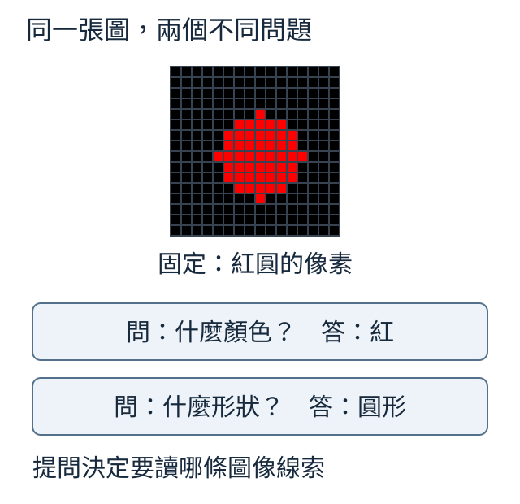
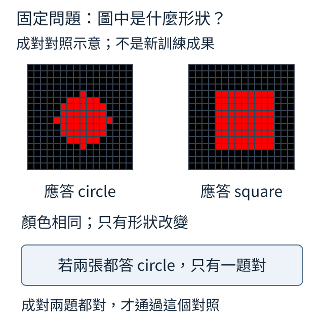
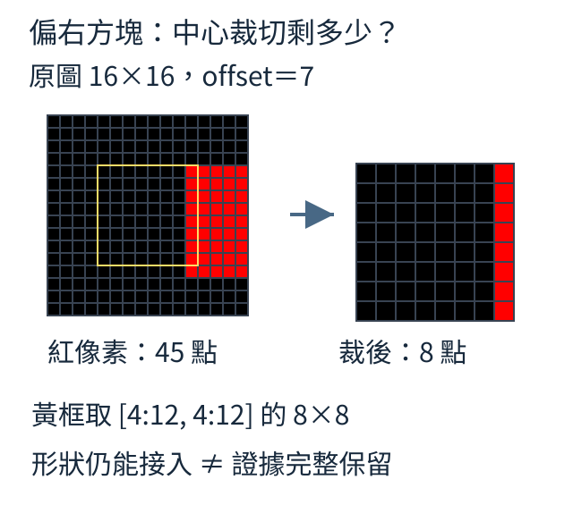
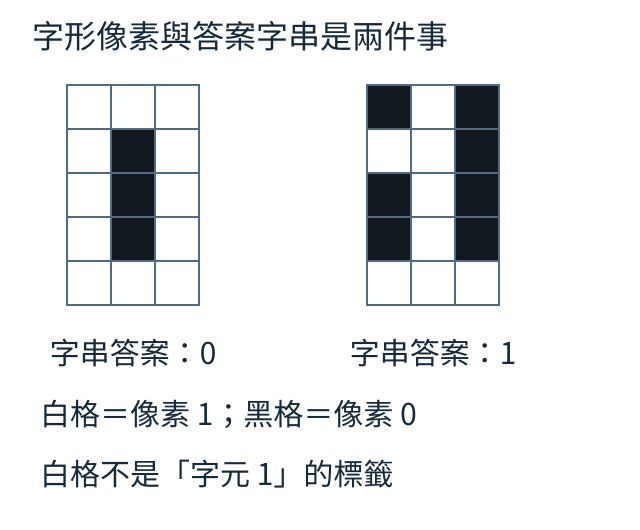
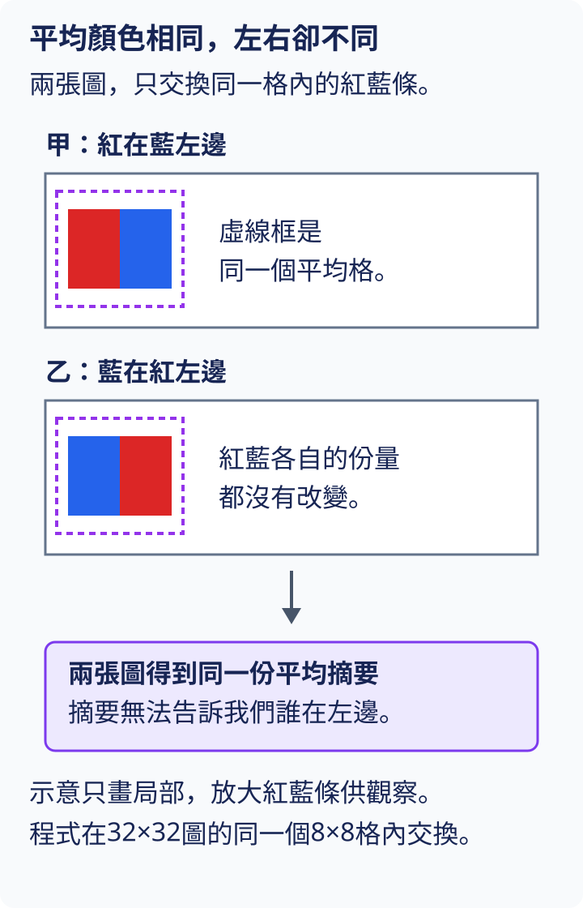
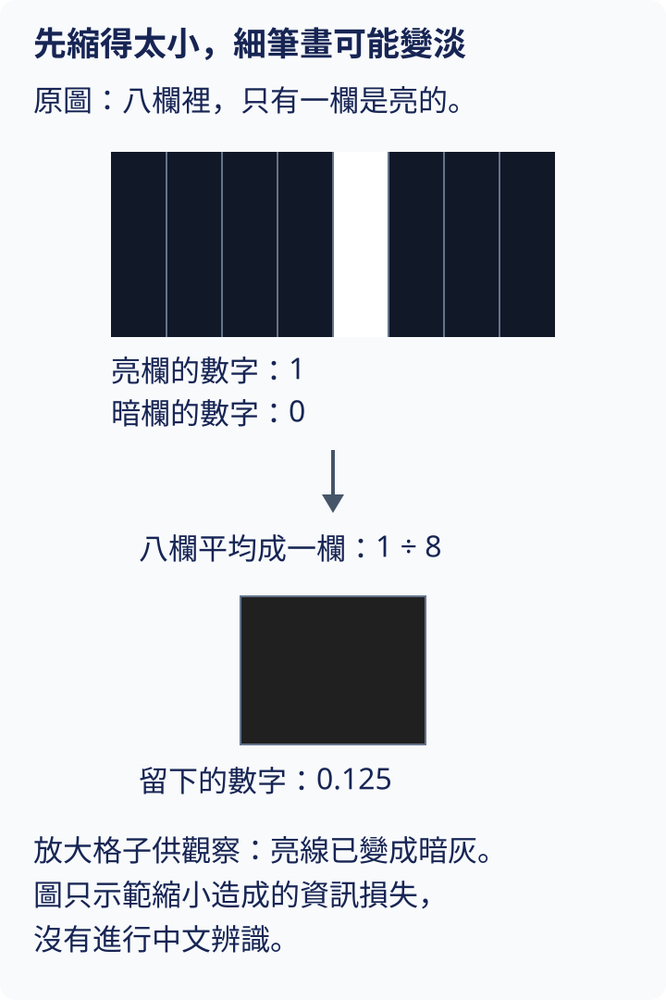
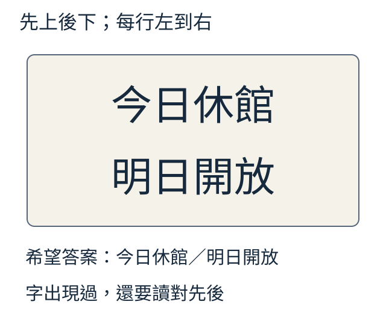
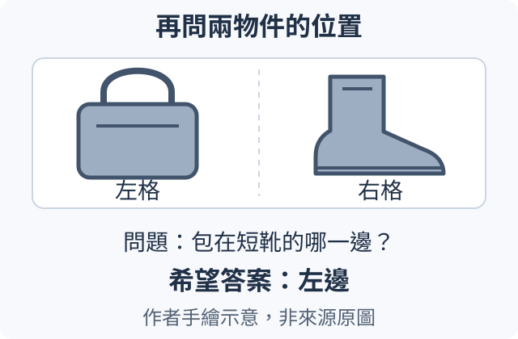
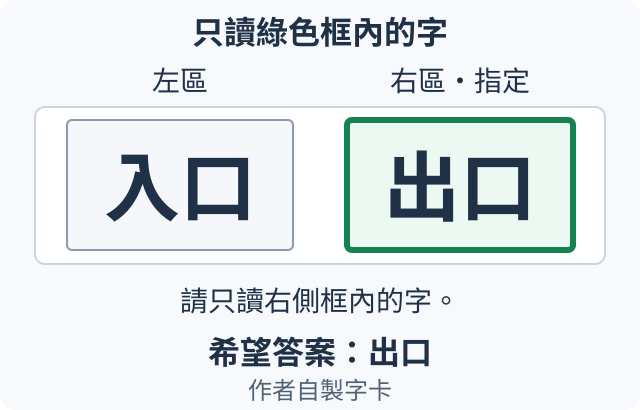

# 第 11 章：對齊、問答與語言能力保留

第 10 章把圖片特徵接到文字核心（language backbone，多模態模型裡負責讀寫文字的語言模型部分）之後，還要確認圖片真的能讓答案跟著改對。章名的「對齊」指模態對齊（modality alignment）：讓圖片特徵變成文字核心用得上的線索（見 [10.6](10.md#10.6)）。本章先分開「接通」「收到梯度」「參數真的更新」三件事，再用同圖多問、換圖重測與原文字題對照，檢查新能力與舊能力。後半段檢查前處理之後還看得見哪些像素、讀字與讀序怎麼評分，最後用少量服飾圖和短字詞，設計可以核對的看圖任務。遇到不熟的詞，可以查[名詞頁](../glossary.md)。

## 11.1 接頭輸出不同，就算理解圖片了嗎？

文字描述「紅色圓形」時能回答紅，換成紅圓圖片時也應回答紅，再換成藍圓圖片時應改答藍。這三個對照分別檢查原文字能力、圖片接入，以及圖片內容的作用。只知道兩個輸出分數不同，還不夠。

先看一個更小的算例：兩份輸入各有 4 個特徵，一份全 0、一份全 1，經同一個接頭（projector）各變成 8 個特徵。

```python
import torch
from torch import nn

torch.manual_seed(0)
projector = nn.Linear(4, 8)
a, b = torch.zeros(1, 4), torch.ones(1, 4)
difference = (projector(a) - projector(b)).norm()
print("輸出形狀", tuple(projector(a).shape))
print("對輸入差異敏感", difference.item() > 0)
```

輸出形狀是 `(1,8)`；兩個輸出相減後的向量長度大於 0，所以印 True。`Linear` 用權重乘輸入，再加偏移（bias）：例如只看一個輸出、權重 `[1,2,0,0]`、偏移 0.5，全 0 輸入得 0.5，全 1 輸入得 1＋2＋0＋0＋0.5＝3.5。隨機權重同樣會讓不同輸入得到不同輸出，但這裡既沒有正確答案（ground truth），也沒有文字模型，所以不能證明它懂紅藍。

「尺寸相容」只說每位置的特徵數對得上；「模態對齊」還要確認這些線索能被文字核心用來生成正確內容。原文字題先失敗，就不能把後面所有失敗歸給圖片接頭；文字題成功而圖片題失敗，才進一步查圖片特徵與接頭。

練習把下面兩行插進第一段程式，放在 `difference = ...` 那一行之前，再從頭執行。先預測「對輸入差異敏感」會印什麼：

```python
with torch.no_grad():
    projector.weight.zero_()
```

`zero_()` 把權重全部改成 0，放在 `torch.no_grad()` 裡，這次修改就不記入梯度計算。所有輸入都乘上 0，輸出只剩同一組偏移，所以差向量長度是 0，「對輸入差異敏感」印 False，形狀仍是 `(1,8)`。這是手動設定的對照，不是訓練；若在 `difference` 算完之後才清零，已算好的 `difference` 不會自己重算。這個對照能找出「通路不傳遞差異」的情況，但仍不能單獨判斷是否懂圖片。

<details>
<summary>回顧與查證</summary>

可回顧：[10.6的projector接頭](10.md#10.6)、[10.5的視覺梯度通路與訓練](10.md#10.5)。

</details>

## 11.2 怎麼確認真正被更新的是哪一批參數？

只想教圖片接頭，就先把它的名字與數量列出，再確認最佳化器（optimizer）收錄的是同一批參數。接頭得到梯度、被列入更新名單、數值真的改變，是三個不同的檢查；本節先做第二個。

```python
import torch
from tiny_perceptron.model import TinyLM, ModelConfig
from tiny_perceptron.multimodal import MultiModalLM

model = MultiModalLM(TinyLM(ModelConfig(width=8)))
model.requires_grad_(False)
model.image_projector.requires_grad_(True)
trainable = []
parameters_to_update = []
for name, p in model.named_parameters():
    if p.requires_grad:
        trainable.append((name, p.numel()))
        parameters_to_update.append(p)
optimizer = torch.optim.AdamW(parameters_to_update, lr=0.001)
print("可訓練", trainable)
print("更新參數總數", sum(p.numel() for group in optimizer.param_groups for p in group["params"]))
```

`MultiModalLM` 把圖片入口（image encoder）、接頭與文字核心包成一個模型，實作見 [10.8](10.md#10.8)。程式先用 `model.requires_grad_(False)` 把整個模型的參數都設成不追蹤梯度，也就是凍結；再用 `model.image_projector.requires_grad_(True)` 只打開接頭。`requires_grad` 決定這個參數會不會收到新的梯度；`named_parameters()` 逐一給出每個參數的名字與參數本身，`numel()` 數它有幾個數字。文字核心的特徵寬度是 8（`ModelConfig(width=8)`），圖片入口輸出的特徵寬度是 16（`MultiModalLM` 的預設），所以接頭的權重有 8×16＝128 個、偏移 8 個，共 136。

迴圈把打開的參數同時放進兩份清單：`trainable` 記名字和數量，方便印出來核對；`parameters_to_update` 交給 AdamW。最後的 `print("更新參數總數", ...)` 從最佳化器那一側再數一次：`optimizer.param_groups` 是最佳化器保存的參數分組清單，每組是一個字典，用 `group["params"]` 取出這組的參數。`sum(...)` 裡有兩個 `for`：外層走過每一組，內層走過組裡的每個參數，把數字個數加總。本例只有一組，印出 136，和名單一致。這裡沒有算代價（loss），也沒有執行 step，只確認名單，不宣稱已經更新。

凍結文字核心的參數，不等於禁止它參與計算。只要計算仍被記錄，答案的代價可以穿過固定的文字運算，傳回接頭；若把整段文字計算放在 `no_grad()` 中，就可能切斷這條路。`eval()` 改變的是訓練模式的行為，也不等於凍結（見 [5.17](05.md#5.17)）。

分階段訓練時，名單也要跟著換。假設先只訓練接頭，下一階段改成只訓練最後一個文字區塊：只把接頭的開關改成 False，原本的最佳化器仍握著接頭，也還保存它的最佳化器狀態（Adam 的 m、v）；新打開的文字區塊則不會自動加入原本的最佳化器。最穩妥的做法是每個階段先決定範圍，再為這個範圍建立新的最佳化器。若沿用舊的，至少要把凍結參數的 `.grad` 設成 None，不能只設成 0：[5.5](05.md#5.5) 示範過，AdamW 會跳過 `.grad` 是 None 的參數，但一份全是 0 的梯度仍算參與這一輪，權重衰減照樣把它縮小，保存的 m 也可能讓它繼續移動（見 [5.3](05.md#5.3)）。

練習在第一段程式的 `model.image_projector.requires_grad_(True)` 之後、`trainable = []` 之前，加入一行 `model.language.blocks[-1].requires_grad_(True)`，再重新執行。`[-1]` 選最後一個文字區塊；這個預設模型只有一個區塊，所以預期名單多出名字以 `language.blocks.0` 開頭的參數，總數由 136 變成 976，多出的 840 個就是這個區塊的參數。這次只核對名單與數量；[11.3](#11.3) 接著檢查梯度通路，[5.1](05.md#5.1) 示範 step 前後的數值更新。真正訓練時，三件事都要核對。

<details>
<summary>回顧與查證</summary>

可回顧：[W.6梯度與更新](../first-steps.md#W.6)、[10.6接頭](10.md#10.6)、[5.17](05.md#5.17)。

</details>

## 11.3 只調圖片接頭，梯度怎麼穿過固定文字核心？

給一張紅方塊，目標短描述是 `red square`。如果圖片特徵能分出相關屬性，文字核心也會用這些詞，就可以先只調接頭，讓視覺線索接到文字行為。本節先確認答案的代價能穿過固定的文字核心，回到接頭。

```python
import torch
from tiny_perceptron.data import ByteTokenizer
from tiny_perceptron.model import TinyLM, ModelConfig, masked_loss
from tiny_perceptron.multimodal import MultiModalLM, scene

torch.manual_seed(0)
tok = ByteTokenizer()
model = MultiModalLM(TinyLM(ModelConfig(width=8)))
model.requires_grad_(False)
model.image_projector.requires_grad_(True)
answer = tok.encode("red square") + [tok.eos_id]
prefix = [tok.bos_id, tok.user_id, tok.image_id, tok.eos_id, tok.assistant_id]
ids = torch.tensor(prefix + answer)
labels = torch.tensor([-100] * len(prefix) + answer)
out = model(ids, labels, image=scene())
loss = masked_loss(out["logits"], out["labels"])
loss.backward()
print("接頭收到梯度", model.image_projector.weight.grad.norm().item() > 0)
print("文字embedding表未累積梯度", model.language.embedding.weight.grad is None)
```

這段用到的零件前面都展示過：`ByteTokenizer` 見 [6.6](06.md#6.6)，`masked_loss` 見 [5.2](05.md#5.2)，`scene` 見 [10.1](10.md#10.1)。答案是 `red square` 的 10 個 ASCII 位元組加 EOS（結束標記），共 11 個有效目標，也就是 labels 不是 −100、會計入代價的位置（見 [7.3](07.md#7.3)）。前綴依序是 BOS（開始標記）、使用者角色標記、圖片佔位 token、使用者段的 EOS 與助手角色標記，labels 把前綴全設成 −100。模型先把圖片佔位 token 展開成圖片特徵，再做下一位置對齊（見 [10.7](10.md#10.7)）；`masked_loss` 只對回答與結束算交叉熵，圖片仍是上下文。

兩行預期都印 True：接頭收到非零梯度，凍結的文字 embedding 表沒有自己的 `.grad`。固定的文字運算仍把代價對接頭的影響傳回去；但程式沒有呼叫最佳化器的 step，所以這個短例只證明梯度通路存在，不是生成成功率。

專案另外真的訓練過一個接頭，模型比上面的例子大（規模見 [11.5](#11.5)）：文字核心與圖片入口都固定，只更新接頭 300 步。材料是紅、綠、藍各配圓形、方形的六種合成圖，訓練圖把圖形向左移 2 或 1 像素，或不移（11.5 會詳細介紹同一組材料）。6 題測試題是這六種組合各一張、都向右移 2 像素的圖，要求說出完整描述，例如 `red square`。訓練後，把正確描述放進前文時算出的平均代價，由約 4.10 降到 1.32；讓模型自己生成時，完整描述卻是 0/6：紅方塊只生成 `red`，缺了空白與 square；綠圓生成 `reeeeeeeeen`，一直重複 e。

這兩個數字量的是不同的事。訓練時，以及上面那個由 4.10 降到 1.32 的代價，都在每個位置拿正確答案當前文來預測下一字，這串前文叫標準序列，這種做法叫 teacher forcing（見 [5.8](05.md#5.8)）；生成時，模型要接上自己剛寫的字，前面一錯，後面可能跟著偏離。

因此要分開核對兩端能力、接頭更新、完整回答與 EOS。這次的底座（base model，當作起點的已訓練模型）是 [7.13](07.md#7.13) 的屬性 SFT 模型，它在自己的 10 題文字測試題只答對 5 題；不能拿這次失敗推出所有接頭方案都無效。接頭也無法補回圖片入口已經丟掉的資訊。

練習把第一段程式的 `model.image_projector.requires_grad_(True)` 改成 `False`，從頭重新執行，並在 `loss.backward()` 前加一行 `print(sum(p.numel() for p in model.parameters() if p.requires_grad), loss.requires_grad)`。先預測：可訓練總數 0、`loss.requires_grad` 為 False；接著 backward 會報錯，因為代價沒有任何一條通往可訓練參數的路。這是在前向計算之前就關掉全部梯度來源的反例，應在啟動訓練前攔下。若改在 `out = model(...)` 之後才關，backward 不會報錯，接頭的 `.grad` 卻仍是 None，所以下一行的 `model.image_projector.weight.grad.norm()` 會因為 `.grad` 是 None 而報 `AttributeError`；想直接看到這件事，可以把那一行改成印 `model.image_projector.weight.grad is None`，預期 True。

<details>
<summary>回顧與查證</summary>

可回顧：[11.1尺寸與理解的區別](11.md#11.1)、[11.2凍結名單](11.md#11.2)、[10.7展開後才錯位](10.md#10.7)、[W.6梯度與更新](../first-steps.md#W.6)。

接頭實驗的資料切分、更新設定與逐題結果見[實驗紀錄（JSON）](../../docs/course-experiments/results/projector.json)，這是機器可讀的完整結果：6 題測試題各自生成的描述在 `results.test.samples` 的 `generated` 欄；訓練前、後的平均代價在 `results.before.mean_token_nll` 與 `results.test.mean_token_nll`。重做指令見[實驗說明](../../docs/course-experiments/README.md)，實驗名是 `projector`。

</details>

## 11.4 同一張圖片，換問題後應怎麼改答案？

同一張紅圓圖，問顏色希望答「紅」，問形狀希望答「圓形」。圖片沒變，問題決定要取哪項資訊；這才是圖片問答，而不只是每次念出完整描述。



```python
records = [
    {"image": "red_circle", "question": "什麼顏色？", "answer": "紅"},
    {"image": "red_circle", "question": "什麼形狀？", "answer": "圓形"},
]
for row in records:
    print(row["image"], row["question"], "→", row["answer"])
print("同圖", records[0]["image"] == records[1]["image"])
print("答案不同", records[0]["answer"] != records[1]["answer"])
```

兩筆記錄的 image 相同、答案不同，兩項比較都印 True。image 欄的 `red_circle` 只是資料名稱，不是已送進模型的像素；實際資料要同時保存圖，或保存可以重建它的生成條件，不能只教問答文字就宣稱模型看圖。

訓練時把圖、問題與正確短答保持成對，只在回答位置算代價。若生成器有隨機選擇，也要記下種子、版本與參數，才能重建材料。分成訓練資料與測試資料時，同一張原圖的所有問答都要放在同一邊；否則圖片可能已在訓練中出現過，換個問法的題目卻被當成新圖來測。

再固定問題、換圖片：紅圓與藍圓都問顏色，答案應分別是紅與藍。同圖多問檢查模型會不會按問題挑資訊，同問換圖檢查圖片有沒有作用。若只有紅圓多問，模型可能靠「顏色題就答紅」猜中。

回答「紅色圓形」雖然包含正確的詞，對只問顏色的問題仍多答了內容。所以先訂短答規則：問什麼就只答什麼，再按這個規則評內容與範圍。

練習在第一段程式的 `records` 清單最後加第三筆 `{"image": "red_circle", "question": "什麼顏色和形狀？", "answer": "紅色圓形"}`。先預測：迴圈會多印一行；「同圖」與「答案不同」只比較第 0、1 筆，仍印 True、True。這一筆的問題同時要顏色與形狀，「紅色圓形」才是符合短答規則的正確答案；同樣四個字放在只問顏色的第一筆，就是多答。

<details>
<summary>回顧與查證</summary>

可回顧：[11.3圖片描述目標](11.md#11.3)、[7.1對話資料](07.md#7.1)。

圖片問答實驗的資料切分、更新設定與逐題結果見[實驗紀錄（JSON）](../../docs/course-experiments/results/vqa.json)：`results.data.splits` 列出訓練、驗證、測試三組題目，`family` 欄相同的題目來自同一張原圖，都在同一組。重做指令見[實驗說明](../../docs/course-experiments/README.md)，實驗名是 `vqa`。

</details>

## 11.5 多開一些文字層，怎麼比較成本與效果？

圖片問答可以只調接頭，也可以連最後一個文字區塊一起調，或開放整個模型。先數每種方案允許改幾個數字，再用相同資料與預算比較答案；參數多，不代表新題一定更好。

```python
from tiny_perceptron.model import TinyLM, ModelConfig
from tiny_perceptron.multimodal import MultiModalLM

model = MultiModalLM(TinyLM(ModelConfig(width=8)))
for mode in ["projector", "partial", "all"]:
    model.requires_grad_(mode == "all")
    model.image_projector.requires_grad_(True)
    if mode == "partial":
        model.language.blocks[-1].requires_grad_(True)
    count = sum(p.numel() for p in model.parameters() if p.requires_grad)
    print(mode, count)
```

`for mode in [...]` 依序試三種方案。每輪先用 `model.requires_grad_(mode == "all")` 重設全部開關：只有 all 時括號裡是 True，其餘兩種先全部凍結，避免上一輪留下的開關；再打開接頭，partial 另外打開最後一個文字區塊。特徵寬度 8 的預設模型印 projector 136、partial 976、all 8296。

all 的 8,296 個裡，有 712 個屬於聲音入口與聲音接頭。第 12 章才講聲音（聲音入口的實作見 [12.8](12.md#12.8)），這裡只需要知道 `MultiModalLM` 也帶著這兩個零件；純圖片題的前向計算不經過它們，所以開放了也收不到梯度，不會被更新。

可訓練參數的數量是成本線索：訓練時，每個真的收到梯度、參與更新的參數還要存一份梯度，AdamW 再為它存兩份最佳化器狀態（m、v，見 [5.4](05.md#5.4)）。效果則要從相同起點、用同樣的題目與相同數量的有效目標比較，並另外測原文字任務。

[專案實際訓練過的小對照](../../docs/course-experiments/results/vqa.json)用的是文字核心特徵寬度 64、兩個區塊，圖片入口特徵寬度 16 的模型，與上面特徵寬度 8 的計數例不同。材料是紅、綠、藍各配圓形、方形的六種合成圖，每張圖各問顏色與形狀，答案分別是 `red`／`green`／`blue` 與 `circle`／`square`。訓練圖把圖形中心向左移 2 或 1 像素，或不移；驗證圖向右移 1，測試圖向右移 2；同一張原圖的兩題放在同一組。所以驗證題與測試題考的是沒練過的位置，顏色與形狀組合仍是已知的六種。

三版都從同一個起點開始：[11.3](#11.3) 那個只訓練過接頭、學過完整描述的模型。接著各練圖片問答 160 步，每版計入代價的有效目標都是 3,830 個。驗證題與測試題各 12 題，是分開的兩組：

| 更新範圍 | 可訓練參數 | 驗證題答對 | 測試題答對 |
| --- | ---: | ---: | ---: |
| 只訓練接頭 | 1,088 | 3/12 | 3/12 |
| 接頭＋最後文字區塊 | 50,816 | 10/12 | 12/12 |
| 全部 | 145,664 | 12/12 | 9/12 |

參數最多的「全部」沒有拿到最高的測試題成績，中間方案的驗證題也有錯。這批只有十二題，不能據此選出所有模型的最佳範圍；比較的是這份資料與配方，而不是單看參數排名。

練習把第一段程式的 `ModelConfig(width=8)` 改成 `ModelConfig(width=8, layers=2)`，先預測三行：接頭仍 136；partial 仍只開最後一個區塊，所以還是 976；all 多一個區塊的 840 個，變成 9136。寬度、深度與更新範圍是三種不同的選擇。

同一個名字在不同工具裡可能指不同範圍：本節程式與上表的 partial 都是「接頭＋最後一個文字區塊」；[T.6](../training.md#T.6) 的訓練指令 `--freeze partial` 則開放接頭加第一個與最後一個文字區塊。重做實驗時，要照所用指令的說明確認更新範圍。

<details>
<summary>回顧與查證</summary>

可回顧：[11.2參數凍結與最佳化器](11.md#11.2)、[4.5一個模型區塊](04.md#4.5)。

表中數字來自[實驗紀錄（JSON）](../../docs/course-experiments/results/vqa.json)：`results.variants` 下的 `projector_only`、`partial`、`all` 依序是表中三列；各版的 `training.trainable_parameters` 是可訓練參數、`training.effective_targets` 是有效目標數，`validation.correct` 與 `test.correct` 是驗證題、測試題答對數。重做指令見[實驗說明](../../docs/course-experiments/README.md)，實驗名是 `vqa`。

</details>

## 11.6 先對齊再問答，怎麼和直接問答公平比較？

一個方案先用圖片描述（例如 `red square`）教接頭，讓圖片特徵接上文字核心的用詞；這是模態對齊，本節叫它「描述對齊」。接著再用圖片問答資料做監督式微調（SFT，見 [7.1](07.md#7.1)），本節叫「問答 SFT」。另一個方案不經描述，直接用問答資料學接頭與回答。如果第一個方案多花一整段訓練，最後較好可能只是多用了資料。所以先把兩者的總有效目標排成相同預算。

```python
budget = 10000
plans = {
    "兩階段": {"描述對齊": 4000, "問答 SFT": 6000},
    "直接問答": {"描述對齊": 0, "問答 SFT": 10000},
}
for name, plan in plans.items():
    total = sum(plan.values())
    print(name, plan, "總有效目標", total, "符合預算", total == budget)
```

兩階段分成 4,000＋6,000，直接問答全給 10,000；`plan.values()` 取出每一段的數量，兩行都印總數 10,000 與 True。有效目標指真正計入答案代價的位置，不是問題字數，也不是樣本筆數；長答與短答混在一起時，相同步數不一定代表相同的量。

這張表只是預算核對。實際比較還要同一個初始模型、明確的更新範圍、同一批圖文測試題，以及底座原本就會做的文字題。第一階段學好的接頭要帶到第二階段，不能花完預算又從隨機接頭重新開始。

專案實際做過的小對照沿用[上一節的六種合成圖與位置切分](11.md#11.5)。兩階段方案的描述階段只更新圖片接頭，就是 [11.3](#11.3) 那個接頭實驗，用了 14,408 個有效目標；問答階段開放整個模型，就是 11.5 表中「全部」那一版，用了 3,830 個。所以 11.5 的 3,830 只是第二階段，兩階段合計 14,408＋3,830＝18,238。直接方案從沒練過的接頭開始、開放整個模型，一直練到有效目標達到同一預算；最後一批結束時是 18,256 個，多出 18 個。兩方案的 12 題測試題分別答對 9 題與 10 題；一題的差距不支持誰普遍較好，也不能說前段的描述對齊完全沒影響。直接方案沒有另外測原文字測試題，所以這個比較不支持文字保留的結論。

描述對齊與問答 SFT 都用文字預測代價訓練，差在材料、任務與開放的參數。兩者是可以比較的兩種安排，不是規定每個成品都必須先後做完。

練習只把第一段程式兩階段的 `"描述對齊": 4000` 改成 2000，先預測：總數變 8,000，`符合預算` 印 False；要把同一行的 `"問答 SFT"` 同時改成 8000 才回到 True。預算表只是計畫；改了計畫，既有的測試成績不能跟著改寫，要重新訓練、重新測量。

<details>
<summary>回顧與查證</summary>

可回顧：[11.3描述對齊](11.md#11.3)、[11.4圖片問答](11.md#11.4)、[7.3有效目標](07.md#7.3)。

數字來自[實驗紀錄（JSON）](../../docs/course-experiments/results/vqa.json)：`results.two_stage_alignment_training.effective_targets` 是描述階段的 14,408；`results.direct_vs_two_stage_budget` 的 `target_effective_tokens` 與 `direct_effective_tokens` 是兩方案的 18,238 與 18,256；兩方案的測試題答對數在 `results.variants.all.test.correct` 與 `results.variants.direct_vqa.test.correct`。重做指令見[實驗說明](../../docs/course-experiments/README.md)，實驗名是 `vqa`。

</details>

## 11.7 新圖文能力進步時，舊文字能力有沒有退步？

手寫的成績表裡，圖文題從 2/10 變成 7/10，原文字題卻從 8/10 變成 6/10。新技能進步，可以和舊技能退步同時發生。把兩類並排，才知道學習共享文字參數的代價。

```python
recipe = {"文字有效目標": 750, "圖文有效目標": 250}
recorded = {
    "訓練前": {"文字答對": 8, "圖文答對": 2},
    "訓練後": {"文字答對": 6, "圖文答對": 7},
}
total_positions = sum(recipe.values())
ratios = {}
for category, positions in recipe.items():
    ratios[category] = positions / total_positions
print("示例訓練比例", ratios)
for phase, scores in recorded.items():
    print(phase, "文字", scores["文字答對"] / 10, "圖文", scores["圖文答對"] / 10)
```

recipe 把 1,000 個有效目標分成文字 750、圖文 250，印出比例 0.75、0.25；recorded 是人工示例成績，兩類各除以固定的十題，印出前後的正確率。這段只示範報告方式，不是真的用 75% 文字回放訓練出來的結果。

能力保留是指固定一批原文字題，在訓練前後各核對一次答案。訓練前確認包裝前後計算一致（[10.8](10.md#10.8)），不能代替這項檢查。舊的文字題可以混回訓練，這叫回放（見 [7.16](07.md#7.16)）；但拿來測量的文字測試題不能混進訓練。

專案實際做過的小實驗接續 [11.5](#11.5) 的三版，另加第四版「全部＋文字回放」：開放整個模型，訓練時每一筆有 0.5 的機率改抽一筆原文字訓練題，否則照常抽圖片問答題。原文字題是底座在第 7 章學過的純文字屬性題，例如問 `color=blue;shape=circle;pitch=low;pitch?` 應答 `low`；這裡用的是它的 10 題文字測試題。圖文題與文字題的分母不同：

| 更新範圍 | 有效目標 | 圖片測試題 | 原文字測試題 |
| --- | ---: | ---: | ---: |
| 只訓練接頭 | 3,830 | 3/12 | 5/10 |
| 接頭＋最後文字區塊 | 3,830 | 12/12 | 2/10 |
| 全部 | 3,830 | 9/12 | 1/10 |
| 全部＋文字回放 | 4,214 | 9/12 | 4/10 |

四版訓練前的原文字題都是 5/10。回放版較能保住這批文字題，但沒有完全回到起點。四版都練 160 步、每步 4 筆，回放版的有效目標卻多了 384 個，表示這次抽到的文字題答案平均比圖片題長；所以它不是嚴格隔離回放比例的因果比較。0.5 是每一筆抽到文字題的機率，不表示有效目標或計算時間各占一半。

實測時要逐題看哪個答案改對、哪個改錯，並固定生成方式，不能只看淨變化。例如回放版由 5/10 變成 4/10，淨變化只少一題；逐題看卻是兩題由對變錯、一題由錯變對：問 `color=red;shape=square;pitch=high;pitch?` 原本答對 `high`，訓練後答 `cire`；同一組的 `joint?` 原本答對 `square,high`，訓練後只答 `red`；`color?` 則由錯誤的 `blow` 改成正確的 `red`。混合代價下降，也可能只是較容易的那組佔比變大。

練習只把第一段程式的 recipe 改成 `{"文字有效目標": 500, "圖文有效目標": 500}`，預期兩個比例都印 0.5；recorded 保持原值，因為改計畫不會自行產生成績。

<details>
<summary>回顧與查證</summary>

可回顧：[7.15舊技能遺忘](07.md#7.15)、[7.16舊資料回放](07.md#7.16)、[10.8沒附圖時的計算一致性](10.md#10.8)。

數字來自[實驗紀錄（JSON）](../../docs/course-experiments/results/vqa.json)：`results.variants` 下各版（`projector_only`、`partial`、`all`、`all_replay`）的 `text_before` 與 `text_after` 是訓練前、後的原文字測試題，`matches` 是答對數，`samples` 逐題列出 `expected`（正確答案）、`generated`（生成）與 `exact`（是否答對）；回放機率在 `replay_probability_per_example`。重做指令見[實驗說明](../../docs/course-experiments/README.md)，實驗名是 `vqa`。

</details>

## 11.8 換圖後答對新圖，才能說用了圖片嗎？

四張圖是兩圓兩方；完全不看圖、永遠猜圓，只能答對一半。若資料改成九圓一方，同一個猜法就能得九成。先算這個固定猜測的基準，才知道高分是否真的需要圖片。

```python
truth = ["circle", "square", "circle", "square"]
text_only = ["circle"] * len(truth)
accuracy = sum(a == b for a, b in zip(truth, text_only)) / len(truth)
print("平衡資料的固定猜測", accuracy)
imbalanced = ["circle"] * 9 + ["square"]
print("九比一資料的固定猜測", imbalanced.count("circle") / len(imbalanced))
```

`["circle"] * len(truth)` 把同一項重複 4 次，做出永遠答 circle 的預測；`zip` 逐位置配對正確答案與預測，`a == b` 相同時是 True，`sum` 把 True 當 1 來數（同 [7.3](07.md#7.3)）。`imbalanced.count("circle")` 數清單裡有幾個 circle。前一組印 0.5，後一組印 0.9；變的是資料比例，不是模型。

真模型還需要成對檢查：問題固定為「什麼形狀」，把圓換成方時，希望答案由 circle 改成 square，並按換入圖的正確答案評分。



圖中只畫一對示意：同色的圓與方，各自應答 circle 與 square。若兩張都答 circle，這一對只對一題，沒有通過；同一對的兩題都答對，才算通過這個成對對照。

像這樣只改輸入裡的一樣東西（這裡是換圖），其他保持不變，再看答案怎麼變，叫介入（intervention）。專案拿 11.5 表中「全部」那一版、再用同一批訓練題多練 100 步的模型，做了幾種介入；不做任何更動時，它的 12 題測試題答對 9 題（9/12）。其中六題形狀題各換成同色、同位置的另一種形狀，正是圖中那種成對對照：模型一直答 circle，原圖題與替圖題各對 3/6，同一對兩題都對卻是 0/6。只看前後同樣是一半，會漏掉它根本沒有跟著形狀改答。

遮圖是另一種檢查：移除像素、仍按原圖的正確答案評分，觀察成績有多依賴圖片，這叫消融（ablation）；把 12 張圖全換成黑圖後，只剩 5/12。錯配圖片時則要分清兩種評分：仍按原圖的正確答案評分，量的是答案和原圖有多一致；改按換入圖的正確答案評分，才是對新圖的正確率，兩者不能混報成同一能力。實驗把 12 題的圖片兩兩錯配（題目不變，圖換成另一題的），按原圖的正確答案只對 3 題，按換入圖的正確答案卻對 9 題：6 題顏色題都跟著換入圖改答，例如紅圖題換入綠圖後回答 green；形狀題仍一律答 circle。

所以原圖的 9/12 其實是顏色 6/6 加形狀 3/6，總數掩蓋了模型只會用顏色線索。遮圖後分數下降可以提供線索；成對回答按規則改對，則是更直接的證據。替換要改和問題相關的屬性：紅圓換藍圓，形狀答案本來就不必變，不能把「沒變」一律算成沒看圖。

練習把第一段程式的 `truth` 改成 `["circle", "circle", "circle", "square"]`，先預測固定猜 circle 的正確率，再執行核對（預期 0.75）。資料偏向某個答案時，固定猜測的基準跟著變高；報告模型成績時，要和這個基準一起看。

<details>
<summary>回顧與查證</summary>

可回顧：[11.4答案依圖與問題](11.md#11.4)、[11.1敏感不等於正確](11.md#11.1)。

介入實驗的資料切分、更新設定與逐題結果見[實驗紀錄（JSON）](../../docs/course-experiments/results/vision_ablation.json)：`results.training` 是多練的 100 步；`results.interventions` 下的 `none` 是原圖，`shape_swap_relabelled` 是形狀替圖並改用新圖的正確答案，`blank` 是黑圖，`shuffle` 是錯配且仍按原圖的正確答案評分。`shuffle` 每題的 `donor_row` 標出換入的是哪一題的圖，拿它的正確答案和 `generated` 比，就得到上面的 9 題。重做指令見[實驗說明](../../docs/course-experiments/README.md)，實驗名是 `vision_ablation`。

</details>

## 11.9 裁切後，模型還收得到作答線索嗎？

紅方塊靠在原圖右邊，中心裁切只留下一條紅色窄帶。問顏色可能仍有線索，問完整形狀卻可能缺資料。先看前處理後的圖，再判斷是哪一段出問題。



```python
from tiny_perceptron.multimodal import scene

image = scene("red", "square", offset=7)
crop = image[:, 4:12, 4:12]
print("原圖形狀", tuple(image.shape), "裁切形狀", tuple(crop.shape))
print("原圖紅色格", int((image[0] > 0).sum()))
print("裁切紅色格", int((crop[0] > 0).sum()))
```

`scene` 把方塊中心放在第 8 列、第 8＋offset 欄（16 的一半是 8），方塊從中心向上下左右各延伸 4 格，所以 offset＝0 時是完整的 9×9＝81 個紅色像素。offset＝7 把中心移到第 15 欄，方塊本該佔第 11 到 19 欄，但圖只有第 0 到 15 欄，只剩第 11 到 15 這 5 欄、每欄 9 個像素：5×9＝45。

`image[:, 4:12, 4:12]` 保留全部通道，列與欄都取索引 4 到 11（切片 `4:12` 不含 12），得到中央的 8×8；`image[0] > 0` 只看紅通道哪些位置亮，`.sum()` 數 True 的個數，也就是程式印的「紅色格」。程式印出原圖 `(3,16,16)`、裁切 `(3,8,8)`，紅色格由 45 剩 8：方塊在裁切範圍裡只剩第 11 欄的 8 個像素。

圖中的黃框是實際裁切範圍，不是模型自動找出的物件。補空白或放大，可以把裁切結果恢復成圖片入口要的尺寸，卻不能還原被切掉的像素。縮圖則是把較多像素合成較少像素，也可能把小字與背景混在一起（[11.15](#11.15) 再看）。

專案也做過這種裁切介入：12 題測試題的圖都先把圖形移到 offset＝7，再做中心裁切、放大回 16×16。結果仍答對 9 題，和沒裁切的原圖同樣是 9/12，但不能因此說資訊完整保留：殘留的色帶仍能辨色，而形狀原本就一律猜 circle（見 [11.8](#11.8)）。原本不會辨形狀的模型，測不出裁切造成多少形狀退步。

排錯時保存原圖、裁切設定與處理後的圖。若目標完全消失，答案也應允許「看不見」，不能強迫模型照原圖的正確答案猜。

練習把第一段程式的 `offset=7` 改成 `offset=0`，先預測兩行紅色格：方塊回到正中央，原圖 81 個；中心裁切取第 4 到 11 列與欄，切掉方塊最外側的第 12 列與第 12 欄，剩 8×8＝64 個。這次只改前處理的材料，沒有改模型。

<details>
<summary>回顧與查證</summary>

可回顧：[10.1像素與坐標](10.md#10.1)。

裁切介入的逐題結果見[實驗紀錄（JSON）](../../docs/course-experiments/results/vision_ablation.json)的 `results.interventions.edge_cropped`，原圖成績在同一層的 `none`。重做指令見[實驗說明](../../docs/course-experiments/README.md)，實驗名是 `vision_ablation`。

</details>

## 11.10 切得更細，圖片會佔多少序列空間？

16×16 的圖把塊邊長從 4 改成 2，上下、左右的塊數都加倍，總位置從 16 變成 64。切得更細可能保住小物件，但也佔用更多上下文。先算圖片與二十個文字位置合起來有多長。

這裡也數完整注意力表的格子：每列是一個要讀取資訊的位置，每欄是一個提供資訊的位置，兩邊都包含圖片與文字位置。總長若是 T 個位置，每個讀取位置對每個來源位置各有一格，所以有 T×T 格；程式的 `total**2` 就是在數這張完整表。

```python
height = 16
text_tokens = 20
for patch_size in [8, 4, 2]:
    visual_tokens = (height // patch_size) ** 2
    total = text_tokens + visual_tokens
    print("邊長", patch_size, "視覺位置", visual_tokens, "總長度", total, "注意力格數", total**2)
```

`height // patch_size` 的 `//` 是整除，只留商的整數部分，例如 16 // 4＝4，表示每邊切成 4 塊；再平方得到總塊數。邊長 8、4、2 分別有 4、16、64 個視覺位置；總長 24、36、84，完整注意力表的格數 576、1296、7056。這裡的一個視覺位置是一塊圖的特徵，不是一個中文字；平方格數是成本線索，不等於精確的秒數。

若模型的上下文視窗（context window）只有 64 個位置，最後一種的 84 已經放不下。截掉文字可能連答案目標一起截掉；設定更大的上限，也不保證相關任務已經學好。需要同時看容量、可見材料與答案。

改切法還會改圖片入口的矩陣：RGB 邊長 4 的塊有 3×4×4＝48 個值，邊長 2 只有 3×2×2＝12 個。原本讀 48 個值的權重不能直接接 12 個值，必須用對應的配置重新訓練，不能只改推論時的參數就比較效果。

專案實際的小對照只做了塊邊長 4 與 8，兩者的 12 題圖片測試題都答對 9 題，沒有測出細切的優勢，也沒有測小字。較大的塊位置少，但每塊像素多，圖片入口的矩陣反而較大（總參數 147,776 對 145,664）；位置成本與參數量是不同的帳。

練習把第一段程式的 `height = 16` 改成 32，先預測三種切法的視覺位置成為 16、64、256；最後一種總長 276、注意力格數 76176。它幫助先規劃可用空間，並未證明增加位置就增加理解。

<details>
<summary>回顧與查證</summary>

可回顧：[10.2切塊數量](10.md#10.2)、[3.1多位置注意力](03.md#3.1)。

兩種塊邊長的結果見[實驗紀錄（JSON）](../../docs/course-experiments/results/vision_ablation.json)的 `results.patch_variants`：`4` 與 `8` 底下的 `test.correct` 是測試題答對數，`training.parameters` 是總參數。重做指令見[實驗說明](../../docs/course-experiments/README.md)，實驗名是 `vision_ablation`。

</details>

## 11.11 平均九成，為什麼稀少題仍可能全錯？

常見組 90/90、稀少組 0/10，全部合計仍是 90%。稀少需求的使用者卻一次也沒成功。材料已經給出每組答對與總數，先用兩種平均，看它們各給每組多少比重。

```python
groups = {"常見": {"correct": 90, "count": 90}, "稀少": {"correct": 0, "count": 10}}
micro = sum(g["correct"] for g in groups.values()) / sum(g["count"] for g in groups.values())
macro = sum(g["correct"] / g["count"] for g in groups.values()) / len(groups)
for name, group in groups.items():
    print(name, "答對/總數", group["correct"], group["count"])
print("按題平均", micro, "按組平均", macro)
```

`groups.values()` 依序取出每一組的字典。按題平均（micro）把分子 90＋0、分母 90＋10 合起來，得 0.9；按組平均（macro）先各算 1 與 0，再給兩組同樣的比重，得 0.5。這個人工反例沒有改模型，只改了看成績的方式。

平均方式不會自動揭露所有弱點。[11.8](#11.8) 的 12 題圖片測試題中，顏色 6/6、形狀 3/6，兩組一樣大，micro 和 macro 都是 75%；再把形狀分成圓 3/3、方 0/3，才看出固定猜 circle 的問題。

因此每組的定義、分子、分母與具體答案都應保存。組別可以按題型、目標大小或沒見過的組合預先安排；組別重疊時，不能讓 micro 把同一題算兩次。小組只有一題，即使 1/1，也不足以說穩定可靠。

兩個模型都答對 90/100：一個是 90/90 與 0/10，另一個是 81/90 與 9/10。總數相同，使用經驗卻不同。哪種平均重要，要看你關心的是實際使用比例，還是各類表現；不能只挑好看的那個。

練習把第一段程式稀少組的 `"count": 10` 改成 20、`correct` 仍 0，先預測：micro 變成 90/110，約 0.8182；macro 仍 0.5。測試題的組成改了，不代表模型學壞。

<details>
<summary>回顧與查證</summary>

可回顧：[11.8資料分布影響成績](11.md#11.8)。

顏色題、形狀題各自的答對數見[實驗紀錄（JSON）](../../docs/course-experiments/results/vision_ablation.json)的 `results.interventions.none.groups`；圓、方各自的對錯要看同一層 `samples` 逐題的 `target` 與 `generated`。重做指令見[實驗說明](../../docs/course-experiments/README.md)，實驗名是 `vision_ablation`。

</details>

## 11.12 像素寫的0與標籤字串0，怎麼對應？

下面兩張五列、三欄的字形，左邊寫數字 0，右邊寫數字 1。希望讀字的結果是字串 `"0"`、`"1"`。先把這些真正看得見的筆畫與標籤配好，再談辨識器。



```python
import torch

glyphs = {"0": ["111", "101", "101", "101", "111"], "1": ["010", "110", "010", "010", "111"]}
for label, rows in glyphs.items():
    image = torch.tensor([[int(c) for c in row] for row in rows], dtype=torch.float32)
    print("文字標籤", label, "像素形狀", tuple(image.shape))
    print(image)
```

字典的鍵是正確的文字標籤，值是五列字形。`[[int(c) for c in row] for row in rows]` 對每一列的每個字元做 `int(c)`，把 `"101"` 變成 `[1, 0, 1]`：`"1"` 成為像素亮度 1，`"0"` 成為背景 0，五列疊成形狀 `(5,3)` 的 tensor。因此「像素 0」表示暗，「標籤 0」表示應讀的字，角色不同。

從圖片讀出字元，稱為**光學字元辨識**（Optical Character Recognition，OCR）。可以用分類頭選 0 或 1，也可以讓文字核心逐 token 生成答案。分類只要選對類別就算對；生成若要求完整字串，`"00"` 比標籤多一字仍算錯。這段只建立資料，沒有更新辨識器。

字形與標籤要人工核對，梯度不會發現畫圖器把 1 畫成 0。只改位移或粗細、沒有改字元時，答案標籤仍相同。本例每個字只畫了一種字形，以下叫原形，指沒有位移、加粗等變化的原始畫法。若把數字 0 的原形與它的所有變體整組放進測試資料，訓練資料裡就沒有 0 這個類別。要檢查模型認不認得熟悉類別的新原圖，需要為每類準備多張獨立的原圖，再把同一張原圖及其變體當成一個家族（family），整組放在訓練或測試的同一邊。若要送進 [10.5](10.md#10.5) 那種 RGB 圖片入口，要先把 `(5,3)` 的單通道小圖放到固定大小的黑色底圖上，再把這一層明確複製成紅、綠、藍三個通道；不能把 `(5,3)` 直接當成 `(3,16,16)`。

專案實際訓練過一個讀數字的小模型（以下叫 OCR 實驗）：把 0 到 99 這 100 個字串用固定的點陣字形（每個數字寬 5、高 7 個像素）畫在 16×16 的黑底圖上，每個字串再畫成左移 1、不移、右移 1 三個版本。100 個字串打亂後，80 個當訓練、10 個當驗證、10 個當測試，同一字串的三個版本一定放在同一邊，所以測試題是 10 個字串×3＝30 題。訓練資料已用到 0–9 全部字元，測試考的是熟悉字元組成的新字串，例如 `13`、`86`。同一批訓練題的代價由約 9.28 降到 0.81，30 題測試題卻只完整讀對 2 題，留下「熟悉的練習改善，不等於新組合讀對」這個例子。這個實驗沒有測新的字元類別、另一套字體或手寫。下一節再看整串與逐字的評分。

練習把第一段程式中 `"1"` 的第一列 `"010"` 改成 `"110"`，先預測印出的第一列變成 `[1., 1., 0.]`，標籤仍是 1。改變字體外觀和改變需要辨識的字，是不同的資料操作。

<details>
<summary>回顧與查證</summary>

可回顧：[10.1像素tensor](10.md#10.1)、[10.5分類監督](10.md#10.5)。

OCR 實驗的資料切分、更新設定與逐題結果見[實驗紀錄（JSON）](../../docs/course-experiments/results/ocr.json)：`results.data.splits` 是三組字串，`results.training.initial_loss` 與 `final_loss` 是訓練前後的代價，`results.test.correct` 是 30 題測試題完整讀對的題數。重做指令見[實驗說明](../../docs/course-experiments/README.md)，實驗名是 `ocr`。

</details>

## 11.13 四個字對三個，整串編號就正確嗎？

材料寫 `1010`，預測寫 `1000`。第三位的 1 被讀成 0，四位對了三位，整串卻不相同。查驗編號要用完整字串，所以要把逐位正確與整串成功分開。

```python
truth = "1010"
predicted = "1000"
assert len(truth) == len(predicted)  # 本實驗只比較等長且對齊的字串
matched = sum(a == b for a, b in zip(truth, predicted))
print("等長逐位正確率", matched / len(truth))
print("整串正確", truth == predicted)
print("本例一次替換的CER", 1 / len(truth))
print("獨立錯誤假設下五位全對", round(0.9**5, 4))
```

本例等長且逐位對齊，`matched` 是 3，印出逐位正確率 0.75、整串 False。字元錯誤率（Character Error Rate，CER）的一般算法是：把預測改成正確答案，最少需要幾次插入、刪除或替換——這個次數叫編輯距離（edit distance）——再除以正確答案的字數（文獻也把正確答案叫參考，reference）。本例只有一次替換，所以 CER 是 1/4＝0.25。程式只算這個已知一次替換的例子，沒有用 `zip` 假裝算出通用的編輯距離；編輯距離怎麼用程式算，[11.16](#11.16) 再看。

若預測 `10100`，刪掉多的一個 0 就對了，仍是 1/4；若預測 `010`，在開頭補一個 1，也只要一次編輯，不能把錯位之後的逐位差異全部算成錯字。分母仍是正確答案的長度 4，不是預測的長度。

`round(0.9**5, 4)` 假設每位的正確率都是 0.9，而且互相獨立，五位全對約 0.5905。這只是乘法直覺；真實的裁切或字序錯誤可能一起發生，仍要直接量完整字串，不能由逐字平均推算。

完整的有序答案最後加 EOS，通知生成停止；它不是圖片上的字。[11.12](#11.12) 的 OCR 實驗中，30 題測試題全都以 EOS 結束，完整內容卻只對 2/30；30 題的編輯距離合計 40 次，正確答案共 57 個字，CER＝40/57，約 70.2%。會停止和讀對，仍是兩個能力。

練習把第一段程式的 `predicted` 改成 `"1010"`，預期逐位 1.0、整串 True；CER 那行仍按「一次替換」寫死，要自己改成零次編輯（`0 / len(truth)`）。再把 `predicted` 改成 `"101"`：少了末尾的 0，編輯距離是 1，CER 仍是 1/4；但程式的等長 `assert` 會先停下來，拒絕直接拿它做逐位比較。

<details>
<summary>回顧與查證</summary>

可回顧：[11.12字形與文字標籤](11.md#11.12)、[W.2清單與迴圈](../first-steps.md#W.2)。

OCR 實驗的整串與逐字結果見[實驗紀錄（JSON）](../../docs/course-experiments/results/ocr.json)的 `results.test`：`eos_rate` 是以 EOS 結束的比例，`character_edits`、`reference_characters` 與 `character_error_rate` 是編輯距離合計、正確答案總字數與 CER。重做指令見[實驗說明](../../docs/course-experiments/README.md)，實驗名是 `ocr`。

</details>

## 11.14 平均物件線索，還能知道左右順序嗎？

紅條在藍條左邊，交換後紅條在右邊。兩張圖的紅藍總量相同，但「紅在藍哪邊」的答案不同。如果圖片入口只平均同一區的像素，這項位置線索可能消失。



```python
from tiny_perceptron.natural_concepts import picture_order_report

report = picture_order_report()
print("不同的數值個數（RGB分開計）", report["different_pixels"])
print("4乘4平均摘要相同", report["same_4_by_4_summary"])
print("完整像素序列相同", report["same_pixel_sequence"])
```

`picture_order_report` 是本課的報告輔助函式，放在 [tiny_perceptron/natural_concepts.py](../../tiny_perceptron/natural_concepts.py)；11.15、11.16 也用同一個檔案的函式。它不需要輸入，回傳一個字典，三個鍵依序就是上面印的三件事。它先用同檔的 `swapped_picture()` 畫出兩張 32×32 的 RGB 圖：甲在第 8 到 15 列、第 0 到 3 欄放紅條，緊接著在第 4 到 7 欄放藍條；乙把前 8 欄左右翻轉，變成藍左紅右。接著把每張圖平均成 4×4 的摘要，每格平均原圖 8×8 個像素；最後比較兩張圖逐值有幾個不同、摘要是否相同、攤平成一長串的完整像素是否相同。

程式印出 128、True、False。字典的鍵名 `different_pixels` 字面上是「不同的像素」，這個名字取得不精確：它實際數的是 RGB 三個通道分開計的數值，所以上面的程式把標籤寫成「不同的數值個數（RGB分開計）」。交換的範圍是 8 列×8 欄＝64 個像素位置，每個位置的紅、藍兩個通道都改變了（綠通道沒變），所以有 64×2＝128 個數值不同。這 64 個位置都落在摘要的同一格裡，也就是圖中虛線框的「平均格」。交換後格內紅與藍各自的總和不變，所以平均也不變；保留完整序列，則仍能分辨位置。這是資訊流的反例，沒有載入模型，也不證明保留了序列就會懂自然照片。

知道圖裡有「人、杯子、桌子」也類似，不足以回答誰拿著杯子、杯子在哪邊。關係問答需要相應的材料與答案；標出物件框是提供位置的一種方法，整張圖的特徵序列也可以學著利用關係。

練習想一想：若把甲的紅條移到另一個平均格（例如第 8 到 11 欄），移動前後的兩張圖，摘要還會一樣嗎？答案思路：不會。紅色的量從原來的格搬到新的格，兩格的紅色平均都改變；平均摘要只對「同一格裡」的交換看不見。接下來 [11.17](#11.17) 的服飾關係圖會用到這個問題：明確保留物件與位置，不把物件命名直接當成關係理解。

<details>
<summary>回顧與查證</summary>

可回顧：[11.4圖片問答](11.md#11.4)、[10.2圖片序列](10.md#10.2)、[10.5平均匯整會丟掉什麼](10.md#10.5)。

</details>

## 11.15 筆畫已被縮掉，較大的模型能確定補回嗎？

「未」和「末」只差一小段筆畫；若縮圖把差異平均掉，後面的模型只收到縮完的數字。先用一條一像素寬的亮線，單獨看縮小之後到底留下什麼。



```python
from tiny_perceptron.natural_concepts import thin_stroke_report

report = thin_stroke_report()
print("原圖與縮圖尺寸", report["original_shape"], report["small_shape"])
print("最亮的數字", report["original_brightest"], report["small_brightest"])
print("至少半亮的數字個數", report["pixels_at_least_half_bright_before"], report["pixels_at_least_half_bright_after"])
```

`thin_stroke_report` 也在 [tiny_perceptron/natural_concepts.py](../../tiny_perceptron/natural_concepts.py)，不需要輸入，回傳一個字典。它建立一張 32×32 的全黑圖，把第 15 欄整欄 32 個像素設成 1，再用面積平均（`mode="area"`）把每 8×8 個像素合成一格，得到 4×4 的縮圖；字典記下前後的尺寸、最亮的值，以及至少半亮（≥0.5）的數字個數。

亮線所在的那一格平均 8 欄，只有一欄是亮的，所以最亮的值從 1 變成 1/8＝0.125。原圖有 32 個像素至少半亮，就是整欄的那 32 個 1；縮圖的 16 格裡，一格也沒有達到 0.5，所以「至少半亮的數字個數」印 32 與 0。

0.5 是為了讓變化看得見而手設的門檻，不是 OCR 必然的判準；這個計算也沒有測認字。它說明前處理會改變模型能用的證據。更大的文字模型或許能憑上下文猜字，卻無法可靠地從同樣模糊的數字還原出不同的原筆畫。

可以保留較高的解析度，或裁出小窗放大來讀，同時記下小窗在原圖中的位置。這裡說的圖片特徵位置，是共同序列裡每一小塊圖所佔的位置，不是原圖的座標。如果每塊的像素大小不變，保留更大的圖或增加小窗，就需要處理更多塊，序列更長、計算量也增加，見 [11.10](#11.10)。原圖本來就模糊或被遮住時，也應允許回答「看不清」，不強迫補字。

第 19 章自行訓練的 MoE 助理，要讀的是有限的中文字卡；它還需要中文字形的圖和正確答案，數字字形的訓練不能代替中文材料。

練習比較三種改法各作用在哪一段：①換一個更大的文字模型（例如更多區塊、更寬），②保留像素細節（提高解析度，或裁小窗放大後再讀），③多給字形示範（增加含這些字的訓練圖與正確答案）。先想：縮圖已經把筆畫平均掉之後，哪一種能讓模型重新拿到這條筆畫？答案思路：只有②，它改的是進模型之前的前處理；①只能憑上下文猜，③能教模型認得看得到的字形，但補不回已被平均掉的筆畫。

<details>
<summary>回顧與查證</summary>

可回顧：[11.9縮圖與裁切](11.md#11.9)、[11.12讀字任務](11.md#11.12)。

第 20 章另外使用上游已訓練好的成熟圖文底座，是延伸路線；它的讀字能力來自上游訓練，不能拿來證明本課自行訓練的讀字任務已經學會。

</details>

## 11.16 字都出現了，為什麼仍可能讀錯順序？

下面的告示先寫「今日休館」，再寫「明日開放」。希望按橫排規則先上後下、每行由左到右，讀成「今日休館／明日開放」。如果先念第二行，字的種類一樣，訊息的順序卻變了。



再把「今天去臺北」當作正確答案，把「今天去台北」當作預測結果，看逐字的評分。[11.13](#11.13) 說過，編輯距離是把預測變成正確答案所需的最少插入、刪除或替換次數，CER 再除以正確答案的字數。

```python
from tiny_perceptron.natural_concepts import text_error_report

reference = "今天去臺北"  # 正確答案
prediction = "今天去台北"  # 預測結果
report = text_error_report(reference, prediction)  # 先正確答案、後預測
print("完全相同", report["exact"])
print("最少編輯次數", report["edits"])
print("正確答案字數與CER", report["reference_characters"], report["cer"])
```

`text_error_report(reference, prediction)` 同樣在 [tiny_perceptron/natural_concepts.py](../../tiny_perceptron/natural_concepts.py)：第一個參數是正確答案、第二個是預測，回傳的字典裡，`exact` 是兩串是否完全相同，`edits` 是編輯距離，`reference_characters` 是正確答案的字數，`cer` 是 `edits` 除以這個字數。輸出 False、1，以及 5 與 0.2：正確答案五個字，一字替換。

「臺」和「台」在日常使用裡意思相同，但這個指標只比對字元：它們是兩個不同的字元，所以算一次替換。這裡按字元（Unicode 碼點，見 [6.1](06.md#6.1)）計，不按 UTF-8 bytes。若希望把「臺」「台」當成相同，要在比較之前先訂好文字正規化規則（例如一律把「臺」換成「台」），並保留沒轉換的結果；不能看到錯字才改規則。

`edits` 是怎麼算出來的？下面是 `text_error_report` 呼叫的 `edit_distance`：

```python
# 節錄自 tiny_perceptron/natural_concepts.py：edit_distance
def edit_distance(reference, prediction):
    """Levenshtein distance on Python Unicode code points, not byte tokens."""
    previous = list(range(len(prediction) + 1))
    for i, original in enumerate(reference, 1):
        current = [i]
        for j, guessed in enumerate(prediction, 1):
            current.append(min(current[-1] + 1, previous[j] + 1, previous[j - 1] + (original != guessed)))
        previous = current
    return previous[-1]
```

`def` 下一行用三個引號包住的英文是函式的說明文字（docstring），不影響計算：Levenshtein distance 就是編輯距離的另一個名字，取自提出它的 Levenshtein；後半句說它逐一比對 Python 字串裡的 Unicode 碼點（也就是一個個字元），不是 byte token。函式本身像在填一張表：第 i 列、第 j 欄記「把預測的前 j 個字改成正確答案的前 i 個字，最少要幾次」，程式一次只保留兩列。`previous = list(range(len(prediction) + 1))` 是第 0 列 `[0, 1, 2, …]`：`range(n)` 依序產生 0 到 n−1，`list(...)` 把它變成清單；意思是正確答案一個字都還沒有時，要把預測的前 j 個字全刪掉，需要 j 次。`for i, original in enumerate(reference, 1)` 逐一取正確答案的字；`enumerate` 在 [1.1](01.md#1.1) 用過，第二個參數 1 讓編號從 1 開始。新的一列 `current = [i]` 從 i 開始：預測一個字都沒有時，要補上 i 個字。

內層迴圈對預測的每個字 `guessed` 算一格，用 `min` 從三個數裡取最小：`current[-1] + 1` 是左邊那格再加一次，表示刪掉預測多出的這個字；`previous[j] + 1` 是上面那格再加一次，表示補上預測漏掉的字；`previous[j - 1] + (original != guessed)` 是左上那格，兩字相同時 `(original != guessed)` 是 False、當成 0，不同時是 True、當成 1，表示替換一次。每算完一列，就用 `previous = current` 換成新的一列；最後的 `previous[-1]` 是整串對整串的答案。每格只看左、上、左上三格，所以不必試遍所有改法。

```python
print("多一個 0", edit_distance("1010", "10100"))
print("開頭少了 1", edit_distance("1010", "010"))
print("臺換成台", edit_distance("今天去臺北", "今天去台北"))
```

三行都印 1：[11.13](#11.13) 的兩個例子各只要一次刪除或插入，「臺北」的例子是一次替換，和 `text_error_report` 的 `edits` 相同。若預測是「今天去臺」，「臺」抄對了，只漏掉末尾的「北」，也是一次編輯，分母仍是正確答案的 5 個字，CER＝1/5＝0.2；若預測是「今天去台」，「臺」寫錯又漏掉「北」，就要兩次編輯，CER＝2/5＝0.4。前後字序不同時，也要用整串比較，不能只數全部的字有沒有出現。

有沒有文字、逐字內容與讀序，要分別核對。空白圖不應憑常見句子補字；直排、多欄的讀序則另訂規則，不用本例的橫排約定硬套。

練習在最後一段程式加一行 `print("兩行互換", edit_distance("今日休館明日開放", "明日開放今日休館"))`。先預測：八個字都在，編輯距離會不會是 0？執行後應看到 6，CER＝6/8＝0.75。即使忽略換行，兩行整段互換後，仍不等於原本有序的字串。下一節再把有限的物件與短字詞任務安排清楚。

<details>
<summary>回顧與查證</summary>

可回顧：[11.13整串與字元錯誤](11.md#11.13)。

</details>

## 11.17 有限物件與短字詞，如何做成可學的看圖問答？

先看下圖的一個包，問題是「圖片裡是什麼？」我們希望答案只有「包」。如果材料再加上一隻短靴，問題改成「包在短靴的哪一邊？」，希望答案就變成「左邊」。物件名稱沒有變，但第二題還需要位置。設計小型看圖助手，先要說清楚這種材料、問題與答案的對應。


可以用 Fashion-MNIST 的褲子、包、短靴三類商品圖來設計這個有限任務。Fashion-MNIST 是公開的服飾商品圖資料集，每張是 28×28 的灰階小圖（來源與授權見補充區）。因為是灰階小圖，這一步先問類別，不問衣服顏色、材質或使用者穿起來是否合適。範圍小，才能讓「答對」有清楚的意思。

單物件題需要保留能分辨類別的輪廓與局部形狀。圖片入口把像素轉成一列數字特徵，接頭再把這些特徵接成文字核心可以使用的輸入位置；文字核心同時讀到問題，生成「包」。這些數字不是老師先寫好的物件名稱，而是由可調參數算出來的表示。第 19 章的 MoE 助理是本課自行訓練的成品之一，它的圖片入口、接頭與文字核心都要自己訓練。

現在只增加一個變化：把包和短靴放在同一張關係圖，包在左，短靴在右。



可以把兩張來源商品圖放進固定格位，製成自己的關係場景。讀「包在短靴哪一邊」時，文字核心需要把物件特徵和所在格位一起使用。如果圖片入口只留下「有包、有短靴」，交換左右之後仍得到相同摘要，就不夠回答這一題。這正接續 [11.14](#11.14) 的平均摘要：留下哪些資訊，要由問題決定。

教這個任務時，可以提供圖片、問題及正確短答，讓模型把預測和答案比較，再更新參數。推論時則只提供圖片與問題。若程式把「包在左」直接附在問題後面，模型讀到的是答案線索，不能拿來說明它會看圖。

檢查時也要沿用同一個變化。先把兩個物件對調，原問題的希望答案應改成「右邊」；再保留原圖，改問「短靴在包的哪一邊？」，希望答案仍是「右邊」。前一題看是否使用位置，後一題看是否使用問題裡的物件次序。只會對所有圖回答「左邊」，即使碰巧答對第一圖，也沒有完成關係問答。

還要換成訓練時沒有用過的原始商品影像。同一個包的裁切、縮放或不同配對，都屬於同一個家族，不能一部分放訓練、一部分放測試，然後宣稱能認出陌生商品。

中文字也可以採相同的安排：先限定字表、短詞與答案形式，再決定圖片入口必須保留哪些筆畫。下一節用真正看得見的「入口／出口」字卡，單獨處理「指定哪一區」與「讀出哪些字」，不把物件分類、關係判斷和讀字混成同一項成績。

<details>
<summary>材料來源與前文連結</summary>

Fashion-MNIST 的[官方 README](https://github.com/zalandoresearch/fashion-mnist/blob/b2617bb6d3ffa2e429640350f613e3291e10b141/README.md)說明 28×28 灰階商品圖及各類名稱，[LICENSE](https://github.com/zalandoresearch/fashion-mnist/blob/b2617bb6d3ffa2e429640350f613e3291e10b141/LICENSE)明列 MIT 授權。使用或散佈來源影像時需保留相應聲明。本節插圖由作者繪製，沒有取用該資料集的影像；希望答案為人工指定的設計例，不是模型執行結果。

前文的[11.14](11.md#11.14)已說明平均摘要可能丟掉左右資訊；本節把它接到有限商品與關係問題。[MoE 助理的來源筆記](../../docs/course-revision-20261005/sources/selftrained-capstone.md)另記錄範圍與資料分組條件。

</details>

## 11.18 指定哪一塊文字，如何只讀那一塊？

這張字卡左邊寫「入口」，右邊寫「出口」。如果問題是「只讀右側框內的字」，希望答案是「出口」，不需要把左邊一起抄出來。先看清兩區的內容，再看綠色框指定了哪一區。



字卡是作者製作的可見材料。「入口」和「出口」都只用到 MoE 助理有限字表裡的字，這一題也不用先會讀任意街景招牌。框線提供位置，不提供字詞答案：把右框裡的內容換成「開關」，同一條「只讀右側框內的字」就應得到「開關」。

這個工作可以拆成兩個理解步驟：先選出使用者指定的區域，再辨認該區的字。選區回答「我要看哪裡」，讀字回答「那裡寫了什麼」。假如選到左區，卻完整讀出「入口」，辨字可能沒錯，指定範圍仍然錯了。假如選到右區，卻寫成「出入」，選區正確，字詞內容或次序仍然錯了。

讓模型只讀指定的一塊，有兩種安排。第一種是先裁切再讀：使用者給框，固定的裁切步驟按框的座標取出框內像素，只把這塊像素送給自行訓練的讀字入口（專門把字卡像素轉成特徵的圖片入口），再交給文字核心生成字串。裁切只按座標拿出一塊圖，不會認字。第二種是整張圖加框：模型看整張字卡和框的位置，自己學會只使用框內的區域。本節採用第一種：它把「指定哪一區」交給已知的框，讓我們先專心教少量字形和字序。不要把固定位置的裁切說成「會自動找到任何圖片裡的文字」；自動尋找文字位置是另一個任務，需要相應的材料與檢查。

下面用 [11.12](#11.12) 的兩個數字字形代替「入口」「出口」：中文字形要靠字型檔才能畫成像素，而框與裁切的作用和字的種類無關。程式把兩個字形左右排成一張小卡，中間隔一欄空白，再按框的欄位裁切。

```python
import torch

glyph = {
    "0": torch.tensor([[1, 1, 1], [1, 0, 1], [1, 0, 1], [1, 0, 1], [1, 1, 1]]),
    "1": torch.tensor([[0, 1, 0], [1, 1, 0], [0, 1, 0], [0, 1, 0], [1, 1, 1]]),
}
gap = torch.zeros(5, 1, dtype=torch.long)
card = torch.cat([glyph["0"], gap, glyph["1"]], dim=1)  # 左區寫 0、右區寫 1
swapped = torch.cat([glyph["1"], gap, glyph["0"]], dim=1)  # 兩區內容互換
box = {"左框": (0, 3), "右框": (4, 7)}  # 每個框記起訖欄：start 到 end-1
print("字卡形狀", tuple(card.shape))
for title, image, name in [("原卡", card, "右框"), ("原卡", card, "左框"), ("互換後", swapped, "右框")]:
    start, end = box[name]
    crop = image[:, start:end]  # 固定裁切：只按座標取像素，不認字
    matched = [label for label, pixels in glyph.items() if torch.equal(crop, pixels)]
    print(title, name, "框內是字形", matched)
```

`torch.cat([...], dim=1)` 沿欄的方向，把左字形、一欄空白、右字形接在一起，得到 5 列×7 欄的字卡。`box` 用起訖欄記兩個框：右框是第 4 到 6 欄，切片 `start:end` 不含 end（同 [11.9](#11.9)）。迴圈依序做三個對照，`image[:, start:end]` 取出框內像素，這就是固定的裁切步驟，它只看座標。下一行逐一取出字典裡的字形，只留下和 `crop` 完全相同（`torch.equal`）的標籤。這個核對只是讓我們看見「送給讀字入口的是哪些像素」，不是讀字入口；真正的讀字入口要從這塊像素學出字串。

「字卡形狀」印 `(5,7)`；之後的三行輸出就是三個對照：原卡的右框是字形 1，左框是字形 0；兩區內容互換後，同一個右框變成字形 0。框只決定取哪裡，內容換了，送出去的像素也跟著換，所以正確答案必須跟著改。

採用先裁切再讀時，每筆訓練示範就是「裁切後的框內像素＋正確字串」，例如右框裁出的「出口」像素配答案「出口」。選整張圖加框時，示範才要把整張字卡、框的位置和正確字串放在同一筆裡。可以先用已知字表的單字與短詞，讓模型學字形對應，再增加少量字的組合。若總把左右文字一起寫進答案，模型學到的就會是整張抄寫；答案範圍必須和要求一致。

真正的字卡也用同樣三個對照檢查，每個對照抓一種不同的毛病。指定右框時應只得到「出口」：若答成「入口出口」，表示模型把整張抄下來，沒有守住指定範圍。改指定左框時應得到「入口」：若仍答「出口」，表示模型只學會一律答「出口」，沒有理會框。保持右框不動、把兩區內容互換時應改讀「入口」：若仍答「出口」，表示它靠的是「右框就答出口」這種位置捷徑，沒有看字形。位置捷徑主要出現在整張圖加框的安排，因為模型看得到框在哪裡；先裁切再讀時，讀字入口看不到框的位置，這個對照只再確認裁切確實按座標取到換過的內容，就像上面程式「互換後」那行輸出。

這些對照也讓錯誤更容易解讀。「入口出口」包含正確字詞，卻多抄了框外內容；「出口」符合內容與範圍；「口出」用了相同兩個字，次序仍不符合原圖。按 [11.16](#11.16) 的算法，「入口出口」要刪兩個字、「口出」要換兩個字，CER 都是 2/2＝1。前面已學過逐字與字序的檢查，這裡多加的是選取範圍，而不是重新發明一種讀字分數。

驗收有限字卡時，還要準備沒練過的字體或版面變體當測試題，並試已知字元組成的新短串。這樣才知道模型是否只記住一張「出口」圖。讀過這張清晰字卡，也不足以推出它能閱讀模糊、傾斜或沒見過的字組成的真實招牌。

練習把程式中右框的 `(4, 7)` 改成 `(3, 6)`，也就是往左偏一欄，先預測兩個右框的輸出：框裡變成一欄空白加右字形的前兩欄，不等於任何一張完整字形，所以印空清單 `[]`；左框不受影響，仍是 `['0']`。框畫偏了，即使讀字入口很強，送進去的也是不完整的字。

<details>
<summary>字型來源與前文連結</summary>

字卡短詞與希望答案由作者選寫，是教材設計例；SVG 指定 Noto Sans CJK TC 並提供系統中文字型作備援。Noto CJK 的[官方字型授權](https://github.com/notofonts/noto-cjk/blob/main/Sans/LICENSE)是 SIL OFL 1.1。使用字型產生文件與重新散佈字型檔，是不同的授權情況；本節沒有打包字型檔。

[11.15](11.md#11.15)說明筆畫資訊，[11.16](11.md#11.16)說明逐字與順序；本節再問指定框是否改變應讀的內容。

</details>
