# 第 12 章：聲音特徵、有限語音意圖與共享對話

聲音先是一串帶時間的振幅，再經固定的頻譜處理，交給自行訓練的聲音入口（audio encoder）。本章先用合成單音看清這條資料流，並檢查回答是否真的受聲音影響；後半段分開兩種目標：把語音轉成文字的語音辨識（ASR），以及直接回答需求。最後讓真人短句的有限需求和打字共用同一段對話。讀到忘了的名詞，可以查[名詞頁](../glossary.md)。

## 12.1 一段聲音，怎麼存成一串數字？

先看一個振幅 0.5、每秒振動 440 次的合成單音。它不是人說的句子；希望用一串數字表示聲音隨時間的變化，並分清一個數字與一個完整週期。

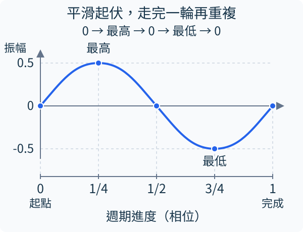

聲音的波形在這裡是一維 tensor，每個位置是一個時間點的振幅。正負表示相對零點的方向，和聲音聽起來高或低無關。圖中從 0 上升到 0.5、下降到 −0.5 再回到 0，是一個**週期**；週期重複得越快，這種單音的頻率越高，聽起來也越高；聽起來的高低叫**音高**（pitch）。圖下方的橫軸是「週期進度」，也叫**相位**（phase）：0 是起點，走到 1/4 時到最高點，1/2 回到 0，3/4 到最低點，1 完成一圈。圖上只標出這五個進度；程式則每隔固定時間記下一次振幅，每個記下的點叫**取樣點**，也叫樣本（sample）。下面的程式每秒取 16000 個（每秒幾點叫取樣率，見 [12.2](12.md#12.2)），440 Hz 的一個週期約有 16000÷440≈36 個點。

```python
import math

import torch
from tiny_perceptron.multimodal import tone

wave = tone(440.0)
print("樣本形狀", tuple(wave.shape))
print("前三個值", [round(v, 3) for v in wave[:3].tolist()])
print("最小最大", round(wave.min().item(), 2), round(wave.max().item(), 2))
```

`tone(440.0)` 預設每秒取 16000 個點、長 0.1 秒，產生 1600 個樣本。`wave[:3].tolist()` 取前三個數轉成 Python 清單，`round(v, 3)` 取到小數第三位：約為 `[0.0,0.086,0.169]`；最小與最大約 −0.5、0.5。440 Hz 表示每秒 440 個週期，和第幾個樣本無關。開頭匯入的 `math` 與 `torch`，是下面這個函式要用的工具。

`tone` 的原始碼只有三行：

```python
# 節錄自 tiny_perceptron/multimodal.py：tone
def tone(frequency=440.0, seconds=0.1, sample_rate=16000):
    times = torch.arange(round(seconds * sample_rate)) / sample_rate
    return 0.5 * torch.sin(2 * math.pi * frequency * times)
```

- `times = torch.arange(round(seconds * sample_rate)) / sample_rate`：先算 0.1 秒×每秒 16000 點＝1600，`round` 取成整數當作樣本數；`torch.arange(1600)` 產生 0、1、…、1599，除以 16000 就是每個樣本的時間（秒）：0、1/16000、2/16000…。
- `0.5 * torch.sin(2 * math.pi * frequency * times)`：`frequency * times` 是到這個時間點已走了幾個週期，例如 1/440 秒時剛好 1、2/440 秒時是 2；它的小數部分才是圖上 0 到 1 的週期進度。乘上 `2 * math.pi`（2π，`math.pi` 是圓周率）換成 `torch.sin` 要的弧度，一整圈是 2π 弧度；`sin` 每過 2π 重複一次，所以每走完一個週期，波形就重複一次。最前面的 `0.5` 是振幅：`sin` 在 −1 到 1 之間起伏，乘 0.5 後成為 −0.5 到 0.5。

振幅與頻率是不同變化。把 `0.5` 倍增，數字起伏變大而週期不變；把頻率倍增，同樣時間內起伏更密。真實聲音通常不是單一頻率，可以看成許多**頻率成分**疊在一起：每個成分是以某一個頻率規則起伏的波形，有強有弱。波形因此不像本圖這麼規則，不能只找振幅最高的一點就辨認說了什麼。

一次處理多段聲音時，可在最前面加一個筆數軸（batch 軸，見 [10.1](10.md#10.1)），把兩段等長聲音排成 `[2,1600]`。若錄音長度不同，短的可以補零到同樣長，並另外記下每段原本有多長；補上的零是程式加的，不是錄到的靜音。

練習把第一段程式的 `wave = tone(440.0)` 改成 `wave = tone(440.0, seconds=0.2)`，其中 `seconds` 指時長。先預測樣本形狀，再執行核對：應為 `(3200,)`，前三個值不變；頻率仍是 440 Hz，不表示音高變成兩倍。

<details>
<summary>回顧與查證</summary>

可回顧：[W.3的一維tensor](../first-steps.md#W.3)。

</details>

## 12.2 同樣 1600 個數字，為什麼可能長短不同？

拿到 1600 個聲音樣本，還不能知道錄了多久。若每秒取 16000 點，它長 0.1 秒；每秒取 8000 點，則長 0.2 秒。這個「每秒多少點」叫**取樣率**（sample rate），是讀懂時間軸的必要資料。

```python
samples = 1600
for rate in [16000, 8000]:
    print("取樣率", rate, "時長", samples / rate, "奈奎斯特界線", rate / 2, "440Hz每週期樣本", round(rate / 440, 2))
```

程式並列兩種取樣率。時長是 `樣本數／取樣率`：0.1 與 0.2 秒。440 Hz 每週期的樣本數是 `取樣率／440`：每秒 16000 點時約 36.36 點，每秒 8000 點時約 18.18 點。這一欄假設兩份錄音各自正確記錄了同一個 440 Hz 單音；若只是把同一個陣列換一個取樣率標籤，聲音並沒有被重新記錄。

取樣率也限制能分清多快的起伏：它的一半稱**奈奎斯特界線**（Nyquist frequency），上面印出 16000 Hz 的界線是 8000 Hz、8000 Hz 的界線是 4000 Hz。高於界線的頻率成分，取樣後的點會和某個較低頻率的單音重合，只看這串樣本分不出原來是哪一個。下面每秒取 16000 點，記錄 9000 Hz 與 7000 Hz 各 0.001 秒：

```python
import torch
from tiny_perceptron.multimodal import tone

high = tone(9000.0, seconds=0.001)
low = tone(7000.0, seconds=0.001)
print("樣本數", len(high))
print("9000Hz前四點", [round(v, 3) for v in high[:4].tolist()])
print("7000Hz前四點", [round(v, 3) for v in low[:4].tolist()])
print("每一點都只差正負號", torch.allclose(high, -low, atol=1e-5))
```

兩段各 16 點。9000 Hz 的前四點是 `[0.0,-0.191,0.354,-0.462]`，7000 Hz 是 `[0.0,0.191,-0.354,0.462]`。`torch.allclose(high, -low, atol=1e-5)` 逐點比較 `high` 與 `-low`：每點的差距不超過 `atol`（這裡設 1e-5）加上 `-low` 那一點大小的 1e-5 倍（`rtol` 沒寫，用預設值 1e-5），就算相同，印 True。只差正負號，等於同一個 7000 Hz 的起伏從相反方向出發（相位差半個週期）。9000 Hz 比界線高 1000 Hz，取樣後就冒充成比界線低 1000 Hz 的 7000 Hz。這種高頻在取樣後冒充低頻的現象叫**混疊**（aliasing）。

既然兩個不同的聲音可以留下同一串數字，增加模型大小也不能把它們可靠分開：模型只收得到這串數字，資訊在取樣時就已混在一起。要避免混疊，得在取樣前處理原聲音。

若原本按 16000 Hz 記錄的數字，直接以 8000 Hz 播放，同樣週期會花兩倍時間，440 Hz 聽起來變 220 Hz。正確改取樣率需要**重取樣**（resampling）。降低取樣率時，先把新奈奎斯特界線以上的頻率成分減弱或濾除，這種保留低頻、壓低高頻的動作叫低通處理；否則它們會像上面的 9000 Hz 一樣，在新樣本中冒充較低的頻率。接著在新的時間點計算數值，維持時長與保留下來那些成分的頻率。

提高取樣率時，新界線較高，不必因此刪除原本可表示的頻率；新增樣本只是改用較密的時間點，不會找回錄音時已失去的高頻資訊。

真人錄音資料因此要先核對取樣率與振幅尺度，不能只看副檔名。本課的真人數字錄音實驗就有一段 8000 Hz、4591 點的錄音，重取樣成 16000 Hz 後是 9182 點；兩者時長都是 4591÷8000＝9182÷16000＝0.573875 秒。

練習：8000 點、8000 Hz 是 1 秒；若改為 16000 Hz 並維持同一秒，應有多少點？答案 16000，不能只修改檔案中的取樣率標籤。再把第二段程式的 `9000.0` 改成 `9500.0`，先預測它會冒充哪個頻率：比界線高 1500 Hz，應對上 6500 Hz；把 `7000.0` 改成 `6500.0`，核對最後一行仍印 True。

<details>
<summary>回顧與查證</summary>

可回顧：[12.1的波形樣本](12.md#12.1)。

4591 與 9182 來自[服飾圖片與真人數字錄音的實驗紀錄（JSON）](../../docs/course-experiments/results/real_modal.json)，這是機器可讀的完整結果：看 `results.fsdd.resampling` 第一筆 `0_jackson_5.wav` 的 `samples_before`、`samples_after`，`method` 欄記錄重取樣的方法。要用自己的錄音訓練或提問時，[T.6](../training.md#T.6) 的補充區列出檔案要符合的格式（非空、單聲道、每秒 16000 點）；重做實驗的方式見[實驗說明](../../docs/course-experiments/README.md)。

</details>

## 12.3 短聲音如何分成重疊的時間框？

一段 1600 點、0.1 秒的單音，想分段看局部變化。取前 400 點作第一框，往右移 160 點再取 400 點作第二框；相鄰兩框重疊 240 點，同一段聲音會在兩框中出現。這樣切出的每一段叫**時間框**（frame）。

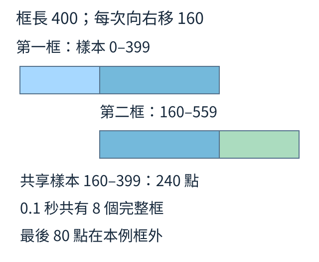

```python
import torch
from tiny_perceptron.multimodal import tone

wave = tone()
frames = wave.unfold(0, 400, 160)
print("框形狀", tuple(frames.shape))
print("框秒數", 400 / 16000, "移動秒數", 160 / 16000)
print("重疊相同", torch.equal(frames[0, 160:], frames[1, :240]))
```

`wave.unfold(0, 400, 160)` 的三個數字依序是：沿第 0 軸（這段聲音唯一的時間軸）、每框 400 點、每次往右移 160 點；它只切出框，不改振幅。輸出 `(8,400)` 表示 8 框、每框 400 點；每框 400÷16000＝0.025 秒，框起點每次前進 0.01 秒。最後一行的 `frames[0, 160:]` 取第一框從第 160 點到最後的 240 點，`frames[1, :240]` 取第二框開頭的 240 點；兩者相同，印 True，直接核對它們來自同一段原資料。

為什麼是 8 框？八框起點為 0、160、…、1120，最後一框到 1519。用算式寫是 (1600−400)÷160＝7.5，捨去小數得 7，再加上第一框共 8 框。末尾 80 點不足再放一個完整框，這個 `unfold` 例子便留在框外。若補零或先在兩端加資料，框數會不同；後面的頻譜函式有自己的邊界約定，不能只看「400、160」就以為所有框數必相同。

短框方便表示局部頻率，但框太短時很難分清接近的頻率；框太長又把較長時間混在一起。重疊讓框邊附近的短聲音比較有機會完整落在某一框裡，但能不能完整落入，仍要看聲音多長、落在哪裡；成本是要多算幾框，不是多了一份獨立錄音。

資料拆分也要守住這點：同一錄音的所有時間框應跟原錄音放在同一邊，不能把第一框放進訓練資料、第二框放進測試資料，便稱測到新聲音。

練習把 `wave.unfold(0, 400, 160)` 改成 `wave.unfold(0, 400, 400)`：先用上面的算式預測框數，(1600−400)÷400＋1＝4；框形狀應為 `(4,400)`，兩框不再重疊，最後一行改印 False。

<details>
<summary>回顧與查證</summary>

可回顧：[12.2樣本到時間的換算](12.md#12.2)。

</details>

## 12.4 截取時間框時，為什麼要讓兩端變小？

上一節取出的 400 點不一定剛好裝下整數個週期。頻率計算會把這一框當作可以首尾相接、一直重複的一段；框裡若不是整數個週期，從最後一點接回第一點時就和原本的波形接不上，突然跳一下。這個接點跳變也會被算進頻率，帶出原本不屬於這個單音的額外頻率成分。要看的是接回去能不能延續原波形，不是首尾兩個數字是否相等：它們隔著一個取樣間距，本來就不必相同。本例的 440 Hz 在 400 點（25 毫秒）裡正好是 11 個週期，接得上；450 Hz 是 11.25 個週期，就接不上。

可以讓首尾數字逐漸接近零、中間保留較大比重。這排乘數叫**窗函數**（window function）；本例用 Hann 窗，每個波形樣本乘以所在位置的權重。

```python
import torch
from tiny_perceptron.multimodal import tone

frame = tone()[:400]
window = torch.hann_window(400)
weighted = frame * window
print("起點權重", window[0].item(), "中間權重", window[200].item())
print("最後權重", round(window[-1].item(), 6))
print("原能量", round(frame.square().sum().item(), 2))
print("加窗能量", round(weighted.square().sum().item(), 2))
```

起點權重為 0，中間為 1，最後約 0.000062。PyTorch 預設採供週期延續使用的版本，所以最後一點很接近零卻不是正好零。若改用包含兩端的對稱版本，公式與最後一點會稍有不同。

這裡的**能量**是一框所有振幅平方後相加：原框約 50，乘窗後約 18.75。這只是同一框經過加權，沒有模型學習，也不表示音源變小了。加窗減少的是接點跳變帶出的額外頻率成分，不會讓單音的強度只集中在一個頻率上；本例的 440 Hz 本來就接得上，這裡只看加權對能量的影響。它也有缺點：主要頻率附近的高峰會因加窗而變寬，兩個相近頻率的高峰就比較難分開；下一節算出各頻率的強弱後，補充區有比較加窗與不加窗的做法。

窗長 400、取樣率 16000 仍表示 25 毫秒，乘窗不更動時間點。後續若要比較不同錄音的能量，必須使用相同的窗與相同的數值尺度約定，不能把不同配方的數字直接當成同一尺度。

要確認能量變小確實來自窗的權重，可以只換掉窗、其他都不變，再算一次。這種只改一個條件、其他保持不變的比較，叫**對照**（control）；本章之後判斷模型是否用了聲音，也會一再用它。

練習把 `window = torch.hann_window(400)` 改成 `window = torch.ones(400)`，也就是 400 個權重都設成 1。先預測：`weighted` 會等於 `frame`，兩個能量都約 50。和 Hann 窗的約 18.75 相比，就知道能量變小來自窗的權重。本例是整數週期，沒有接點跳變要緩和；想看加窗對額外頻率成分的影響，要換成 450 Hz 這類不是整數週期的頻率，見下一節的補充區。

<details>
<summary>回顧與查證</summary>

可回顧：[12.3時間框](12.md#12.3)。

</details>

## 12.5 怎麼找出一段單音的主要頻率？

仍用 440 Hz 單音，這次長 0.2 秒。希望每個時間框都能指出「哪些頻率較強」，並核對最強的是否就是 440 Hz。把每個時間框分解成各頻率強弱的計算叫**短時傅立葉轉換**（Short-Time Fourier Transform，STFT）。

怎麼從一排振幅算出某個頻率的強弱？可以把每個候選頻率想成一組規則起伏的樣板波形：與聲音逐點相乘，再把乘積加起來。起伏互相配合時，乘積較能累積；不配合時，正負乘積會互相抵消。每個頻率用兩份錯開四分之一週期的樣板分別計分，再把兩份分數的平方相加，當作這個頻率的強弱。

先看另一組只有四點、未加窗的人工波形 `[1,0,-1,0]`。對每四點一週期的樣板 `[1,0,-1,0]`，乘積和為 2；錯相樣板 `[0,1,0,-1]` 得 0。兩份合起來是 `2²+0²=4`。每四點兩週期的樣板 `[1,-1,1,-1]` 則得 0；在這組取樣點上，它的錯相樣板也全為 0，所以本例能分開這兩種頻率。若把原波形錯開一個取樣點，成為 `[0,1,0,-1]`，一週期的兩份樣板分別得 0 與 2，平方相加仍為 4：同一種起伏從週期的不同地方開始，強弱不變，所以需要兩份樣板才不會漏掉。

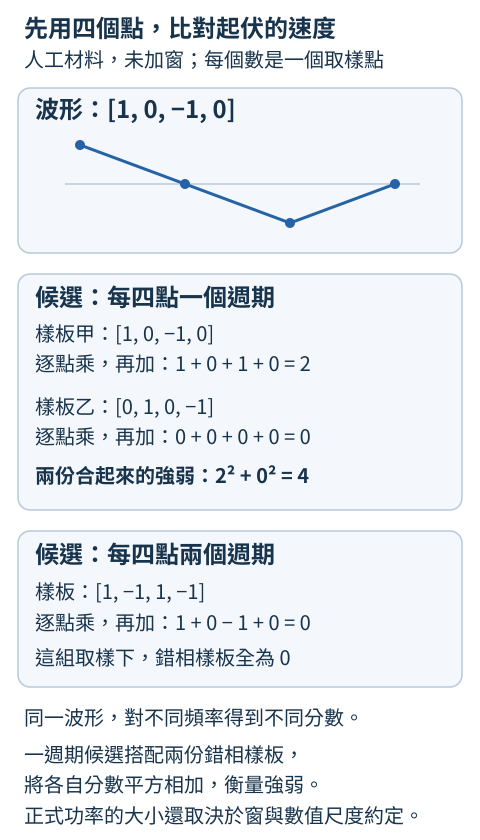

正式 STFT 對每個時間框重複這種比對：先乘[上一節的窗權重](12.md#12.4)，再對每個候選頻率算兩份分數。PyTorch 把一個頻率的兩份分數存成一個**複數** `a+bj`：實部 `a` 放第一份樣板的分數，虛部 `b` 放錯相樣板的分數（正負號相反，平方後沒有差別；Python 用 `j` 表示虛數單位）。`abs()` 取複數的大小 √(a²＋b²)，`.square()` 再平方，得到的 a²＋b² 就是上面「兩份分數平方相加」，稱為**功率**（power）。例如 `3+4j` 的大小是 5，功率是 3²＋4²＝25。樣板只由頻率與取樣位置決定，不是模型從資料學出的參數。

```python
import torch
from tiny_perceptron.multimodal import tone

wave = tone(440.0, seconds=0.2)
spectrum = torch.stft(wave, 400, 160, window=torch.hann_window(400), return_complex=True)
power = spectrum.abs().square()
peak = power.mean(-1).argmax().item()
print("頻率格、時間框", tuple(power.shape))
print("最強頻率格", peak, "對應Hz", peak * 16000 / 400)
```

`torch.stft` 的 400 與 160 是 12.3 的框長與移動點數，`window` 是 12.4 的 Hann 窗，`return_complex=True` 要它回傳上面的複數。功率表 `(201,21)` 的兩軸是：

- 201 個**頻率格**（frequency bin），每格是一個候選頻率：從 0 Hz 起每 40 Hz 一格（16000÷400＝40），到奈奎斯特界線 8000 Hz 為止，共 400÷2＋1＝201 格。
- 21 個時間框：`torch.stft` 預設先在聲音兩端各補 200 點，讓第 n 框的中心落在第 160×n 點；3200 點因此有 3200÷160＋1＝21 框，比 12.3 那樣直接切出的完整框多。

`power.mean(-1)` 沿最後一軸（時間框）平均，每個頻率格留下一個數；`argmax()` 找出最大的是第幾格，`.item()` 取出這個整數。程式印出第 11 格、對應 11×40＝440.0 Hz，符合這個單音的來源。

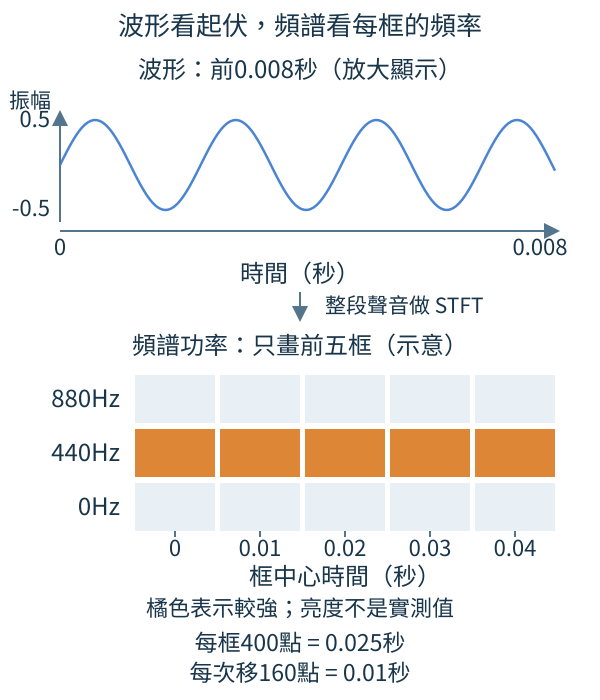

把功率表畫成圖，縱軸是頻率格、橫軸是時間框，亮度表示功率，這種圖叫頻譜圖（spectrogram）。圖上半部只放大顯示波形的前 0.008 秒；下半部畫出前五框，框中心從 0 秒開始，正是上面說的兩端補點。真人語音含多種頻率，同一框可能有好幾格同時亮起：頻譜不是音高列表，最強一格也只描述當下的功率，不能當成某個字的編號。

練習把 `tone(440.0, seconds=0.2)` 改成 `tone(480.0, seconds=0.2)`，預期最強頻率格是 12、對應 480.0 Hz。若改成 450 Hz，450÷40＝11.25 不是整數，最強的仍是第 11 格，但功率會分給兩旁：在程式最後加一行 `print(power.mean(-1)[9:14])`，印出第 9 到第 13 格，和 440 Hz 時比較，第 12 格明顯變大。

<details>
<summary>回顧與延伸</summary>

可回顧：[12.2取樣率](12.md#12.2)、[12.3時間框](12.md#12.3)、[12.4加窗](12.md#12.4)。

- 兩份分數的比例記錄這種起伏從週期哪裡開始，也就是 [12.1](12.md#12.1) 的相位。功率把它丟掉了；本課的聲音特徵只用功率。
- `torch.stft` 預設的兩端補點是鏡射：把開頭附近的 200 點倒過來接在前面，結尾同理，不是補零。不補點、像 12.3 那樣直接 `unfold` 時，3200 點只有 (3200−400)÷160＝17.5，捨去小數再加 1，共 18 個完整框。
- 想親眼看加窗的取捨，可把 `window=torch.hann_window(400)` 換成 `window=torch.ones(400)`（等於不加窗），用 450 Hz 比較 `power.mean(-1)` 的各格：不加窗時，最強頻率格旁邊的頻率格相對較低，離它較遠的頻率格卻分到較多功率；加 Hann 窗則反過來。

</details>

## 12.6 相鄰頻率怎麼合成少量頻帶？

12.5 的頻譜每框有 201 個頻率格，想改用 16 個較寬的頻帶表示功率。每個頻帶用一排非負權重，把一段相鄰頻率格的功率加權相加：本課配方中間權重最大、兩側逐漸降至 0，畫成三角形；相鄰三角形可以重疊，共同接收同一頻率格。

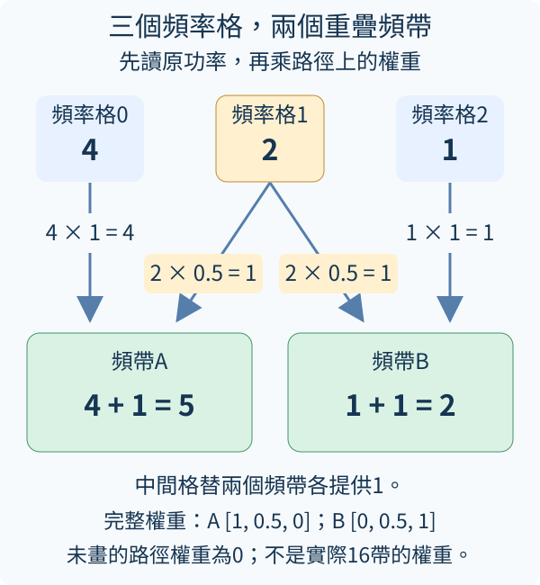

先看圖中只有三個頻率格的小例子。功率 `[4,2,1]`；頻帶 A 的權重是 `[1,0.5,0]`，得到 4×1＋2×0.5＋1×0＝5；頻帶 B 的權重是 `[0,0.5,1]`，得到 2。同一個中間格 2 各以一半貢獻給兩帶，兩帶便有重疊。這個小例子只展示加權相加，不是實際 16 帶的權重值。

三角形放在哪裡？本課依 **mel 尺度**配置，得到的頻帶叫 **mel 頻帶**。mel 是依人對音高的感受訂出的刻度：同樣聽起來「隔一段」的兩個音，在低頻只差幾十 Hz，在高頻要差好幾百 Hz。所以 mel 頻帶在低頻窄而密、在高頻寬而疏。常用換算為 `mel＝2595×log10(1＋f／700)`，其中 `log10` 是以 10 為底的對數，和 [1.8](01.md#1.8) 的自然對數不同。代入 700 Hz：2595×log10(2)≈2595×0.301≈781 mel；照此算，0、700、2100 Hz 約為 0、781、1562 mel。Hz 間隔越往上越大，mel 間隔仍可相同。

本課希望讓聲音入口逐框讀到少量 mel 頻帶的功率摘要，減少每框需要接收的數字，所以用 16 帶示範。沿用常見的 mel 配置，也方便把這份從零實作與其他採用 mel 的聲音前處理對照。這是本例採用的表示約定，16 不是最佳帶數的結論，答題效果仍要由後續訓練與檢查判定。

先用函式庫的 `mel_filter_bank` 建出權重表，再拿全 1 的示範功率表（201 個頻率格、3 個時間框）核對合成後的形狀。

```python
import math

import torch
from tiny_perceptron.multimodal import mel_filter_bank

bank = mel_filter_bank(bands=16)
power = torch.ones(201, 3)
mel_power = bank @ power
print("權重表", tuple(bank.shape))
print("合成後", tuple(mel_power.shape))
print("權重非負", bool((bank >= 0).all()))
print("每帶涵蓋的頻率格數", (bank > 0).sum(1).tolist())
```

權重表 `(16,201)`，每列負責一個 mel 頻帶；功率表 `(201,3)` 的每欄是一個時間框。矩陣相乘得到 `(16,3)`，時間框沒有被平均掉。權重非負印 True：每帶只把功率加進來、不會減掉，合成後也不會出現負的功率。最後一行先用 `bank > 0` 標出大於 0 的權重，再用 `sum(1)` 沿第 1 軸（頻率格）數出每帶有幾格：從第一帶的 6 格逐漸增加到最後一帶的 55 格，正是低頻窄、高頻寬。第一行的 `import math` 是下面的原始碼要用的。

`mel_filter_bank` 怎麼排出這些三角形？

```python
# 節錄自 tiny_perceptron/multimodal.py：mel_filter_bank
def mel_filter_bank(sample_rate=16000, n_fft=400, bands=16, device=None):
    """三角濾波器：先在 mel 軸等距，再換回 Hz 頻率軸。"""
    if bands < 1 or sample_rate < 1:
        raise ValueError("bands/sample_rate 必須為正")
    max_mel = 2595 * math.log10(1 + (sample_rate / 2) / 700)
    mels = torch.linspace(0, max_mel, bands + 2, device=device)
    hz = 700 * (10 ** (mels / 2595) - 1)
    frequencies = torch.linspace(0, sample_rate / 2, n_fft // 2 + 1, device=device)
    left = (frequencies[None] - hz[:-2, None]) / (hz[1:-1] - hz[:-2])[:, None]
    right = (hz[2:, None] - frequencies[None]) / (hz[2:] - hz[1:-1])[:, None]
    return torch.minimum(left, right).clamp(min=0)
```

- 開頭的 `if` 檢查帶數與取樣率都是正數，否則報錯。
- `max_mel = 2595 * math.log10(1 + (sample_rate / 2) / 700)`：把最高頻率 8000 Hz（[12.2](12.md#12.2) 的奈奎斯特界線）換成 mel，約 2840。
- `mels = torch.linspace(0, max_mel, bands + 2, device=device)`：`torch.linspace(起點, 終點, 個數)` 取包含兩端的等距點，這裡在 0 到約 2840 mel 之間取 18 個。每個三角形要左端、頂點、右端三點；相鄰兩帶中，前一帶的頂點和右端就是後一帶的左端和頂點，所以 3 帶要 5 點，16 帶要 16＋2 點。`device` 指定這些數字放在 CPU 或 GPU：上面的示範沒有指定，用 PyTorch 的預設裝置（通常是 CPU）；12.8 的 `log_mel` 則傳入聲音所在的裝置，讓權重表和功率在同一裝置上才能相乘。
- `hz = 700 * (10 ** (mels / 2595) - 1)`：把前面的 mel 公式反過來解出 Hz，18 點換回 0、112、242、…、6801、8000 Hz，越往高頻相隔越遠。
- `frequencies = torch.linspace(0, sample_rate / 2, n_fft // 2 + 1, device=device)`：`n_fft` 是 12.5 的框長 400，`n_fft // 2 + 1`＝201（`//` 是捨去小數的除法），算出 201 個頻率格各自代表的 Hz：0、40、…、8000。
- `left` 與 `right`：`hz[:-2]`、`hz[1:-1]`、`hz[2:]` 三個切片分別取「去掉最後兩點」「去掉頭尾各一點」「去掉前兩點」，正好是 16 個三角形的左端、頂點與右端。`left`＝(頻率−左端)÷(頂點−左端)，在左端是 0、頂點是 1，左端以左是負數；`right`＝(右端−頻率)÷(右端−頂點)，在頂點是 1、右端是 0，右端以右是負數。`frequencies[None]` 補成 `(1,201)`，`hz[:-2, None]` 補成 `(16,1)`，相減時靠 [10.1](10.md#10.1) 的廣播一次算出 `(16,201)`。
- `torch.minimum(left, right).clamp(min=0)`：每格取兩條線中較小的值，形狀就是三角形；三角形以外的負數夾成 0。

頻帶變少會合併差異，因此不能由 16 帶唯一還原全部 201 格。mel 配方是固定的聲音前處理；後面自行訓練的入口才學如何利用它答題。

練習把第一段的 `mel_filter_bank(bands=16)` 改成 `mel_filter_bank(bands=32)`，預期權重表 `(32,201)`、輸出 `(32,3)`，時間框仍是三個。也先預測每帶涵蓋的格數會變多還是變少，再看最後一行：第一帶剩 2 格、最後一帶 30 格。

<details>
<summary>回顧與查證</summary>

可回顧：[12.5頻率格與功率](12.md#12.5)、[W.5加權矩陣](../first-steps.md#W.5)。

</details>

## 12.7 功率相差很大，取 log 有什麼效果？

四個頻率格的功率為 `[0,10⁻¹⁰,10⁻⁴,1]`。若直接用同一亮度尺度，前三格可能幾乎都看不見。取自然對數能壓縮跨度，但零不能直接取 log，所以先設最小值 10⁻⁸。

```python
import torch

power = torch.tensor([0.0, 1e-10, 1e-4, 1.0])
floor = 1e-8
compressed = power.clamp(min=floor).log()
scaled = (4 * power).clamp(min=floor).log()
print("log功率", [round(x, 2) for x in compressed.tolist()])
print("放大後差", [round(x, 2) for x in (scaled - compressed).tolist()])
print("皆為有限值", bool(compressed.isfinite().all()))
```

`clamp(min=floor)` 把小於 `floor` 的數改成 `floor`，`.log()` 取自然對數。結果約為 `[-18.42,-18.42,-9.21,0]`，全都是有限值。前兩格低於下限，都先變成 10⁻⁸；這兩格原本的差異已被捨棄。負值只表示原功率小於 1，不表示功率為負。

功率乘 4 後，未被下限夾住的兩格增加 `ln(4)≈1.39`；前兩格仍在下限，差為 0。乘法變成加法，有助於讓大尺度變化比較平緩。若波形振幅乘 2，功率才乘 4，不能混用振幅與功率的倍數。

把頻率格的功率合成 mel 頻帶後再取 log，就得到 **log-mel 特徵**。這是固定算式整理聲音，而不是成熟辨識模型的辨識結果。它仍保留每一時間框，以便後續入口學會利用局部變化。

比較不同錄音時，要使用相同的下限。若後續還會調整特徵的數值尺度，也要對各段採用同一套調整規則，尤其比較安靜片段時。過大的下限會讓不同的弱聲音得到相同數值。

練習把 `floor = 1e-8` 改成 `floor = 1e-12`：零仍需替代，log 功率的第一格變成約 −27.63；10⁻¹⁰ 不再被夾住，第二格變成約 −23.03，「放大後差」的第二格也變成 1.39。說明「避免無限值」與「保留弱聲音差異」為何需要同時考慮。

<details>
<summary>回顧與查證</summary>

可回顧：[W.4機率與log](../first-steps.md#W.4)、[12.6的mel功率](12.md#12.6)。

</details>

## 12.8 每個時間框，如何變成一條聲音特徵？

一段 0.1 秒單音經 log-mel 處理，得到 16 個 mel 頻帶、11 個時間框。現在希望每框用 8 個數字表示（特徵寬度 8），依先後排成 11 條特徵，供後面的模型逐位置讀取；這一步不把整段平均成一個數字。負責這一步的可訓練零件，就是**聲音入口**（audio encoder）。

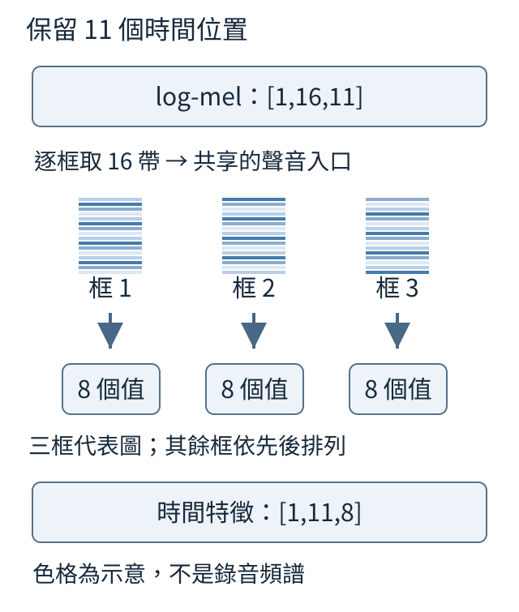

```python
import torch
from torch import nn
from torch.nn import functional as F
from tiny_perceptron.multimodal import AudioEncoder, log_mel, mel_filter_bank, tone

torch.manual_seed(0)
wave = tone()[None]
spectrogram = log_mel(wave)
encoder = AudioEncoder(bands=16, width=8)
features = encoder(wave)
print("頻譜", tuple(spectrogram.shape))
print("時間特徵", tuple(features.shape))
```

`tone()` 產生 1600 點的一維波形；`[None]` 在最前面加一個大小為 1 的筆數軸，表示只有一筆，也就是一段聲音。`log_mel(wave)` 印出 `(1,16,11)`：一段聲音、16 個 mel 頻帶、11 個時間框（1600÷160＋1＝11，和 12.5 一樣先在兩端補點）。`AudioEncoder(bands=16, width=8)` 的 `bands` 是每框輸入的 mel 頻帶數，`width` 是每框輸出的特徵寬度。`encoder(wave)` 收的是波形，印出 `(1,11,8)`：11 個位置仍代表時間框，不是 11 個字。開頭也匯入了下面原始碼要用的 `nn`、`F`（`torch.nn.functional`）與 12.6 的 `mel_filter_bank`。

`log_mel` 與 `AudioEncoder` 的原始碼如下：

```python
# 節錄自 tiny_perceptron/multimodal.py：log_mel、AudioEncoder
def log_mel(waveform, sample_rate=16000, n_fft=400, hop_length=160, bands=16):
    if waveform.shape[-1] <= n_fft // 2:
        waveform = F.pad(waveform, (0, n_fft // 2 + 1 - waveform.shape[-1]))
    window = torch.hann_window(n_fft, device=waveform.device, dtype=waveform.dtype)
    spectrum = torch.stft(waveform, n_fft, hop_length, window=window, return_complex=True)
    power = spectrum.abs().square()
    bank = mel_filter_bank(sample_rate, n_fft, bands, waveform.device).to(power.dtype)
    return (bank @ power).clamp(min=1e-8).log()


class AudioEncoder(nn.Module):
    def __init__(self, bands=16, width=16):
        super().__init__()
        self.bands = bands
        self.projection = nn.Linear(bands, width)
        self.feature = nn.Sequential(nn.LayerNorm(width), nn.Linear(width, width), nn.GELU())

    def forward(self, waveform):
        features = log_mel(waveform, bands=self.bands).transpose(-1, -2)
        return self.feature(self.projection(features))
```

`log_mel` 把 12.4 到 12.7 串成一個函式：加窗、STFT 求功率、合成 mel 頻帶、取 log。

- `if waveform.shape[-1] <= n_fft // 2:`：聲音不到 201 點時，`F.pad` 的 `(0, …)` 在左邊補 0 個、右邊補零到 201 點。因為 [12.5](12.md#12.5) 的 STFT 會把緊挨著最邊上那一點的 200 點（不含那一點本身）倒過來接在兩端外面，聲音至少要有 201 點。
- `window`、`spectrum`、`power` 三行是 12.4 的 Hann 窗與 12.5 的 STFT 功率（`hop_length`＝160 是 12.3 每次移動的點數）；`device`、`dtype` 讓窗和聲音放在同一裝置、用同一種數字型別。
- `bank @ power` 是 12.6 的 mel 合成，`.to(power.dtype)` 讓權重表和功率的數字型別一致，才能相乘；`.clamp(min=1e-8).log()` 是 12.7 的下限與 log。

`AudioEncoder` 和 [10.5 的 `VisionEncoder`](10.md#10.5) 寫法相同：`__init__` 建立可學的零件，`forward` 寫計算，呼叫 `encoder(wave)` 時執行的就是 `forward`。資料依序經過：

1. `log_mel(waveform, bands=self.bands)`：`(1,16,11)`，按「mel 頻帶、時間框」排列。
2. `.transpose(-1, -2)`：交換最後兩軸，成為 `(1,11,16)`，每個時間框一列。
3. `self.projection`：`nn.Linear(16, 8)` 對每框的 16 個值做同一個線性變換，得到 `(1,11,8)`。
4. `self.feature`：依序做層正規化（LayerNorm，[4.3](04.md#4.3)）、另一個 `Linear(8,8)` 與啟用函式 GELU（[4.4](04.md#4.4)），形狀仍是 `(1,11,8)`。

`nn.Linear` 與 LayerNorm 都只沿最後一軸計算，所以每個時間框各自計算、共用同一組參數。下面核對這件事：把第一框的 16 個值單獨送進同一組零件。

```python
first_frame = spectrogram[0, :, 0]
alone = encoder.feature(encoder.projection(first_frame))
print("第一框單獨算", tuple(alone.shape))
print("和整段的第一條相同", torch.allclose(alone, features[0, 0]))
```

`spectrogram[0, :, 0]` 取第一段聲音、全部 16 個 mel 頻帶、第 0 個時間框。單獨算出的 8 個數字，和整段一起算出的第一條特徵相同，印 True（`allclose` 容許極小的浮點誤差）。

16 轉 8 是每框的摘要，與把 11 框全部平均掉不同：前者仍保留哪種變化先來，後者可能只留整體多寡。共用同一組參數表示每框使用同一個入口，不表示隨機初始化的 8 個數字已經認得聲音。

入口要從任務材料學出有用特徵。單音任務可以教「頻率高於 300 Hz 回 high，否則 low」；真人短句的有限需求則需要真人錄音與需求標註。兩種答案不是同一件事：前者只驗證單音高低，不能據此宣稱聽懂中文問句。

下一節先用單音檢查接到文字核心後的梯度通路；[12.15](12.md#12.15) 再設計真人短句的語音入口。這樣頻譜轉特徵是共同機制，各任務仍有各自材料與判準。

練習把第一段的 `AudioEncoder(bands=16, width=8)` 改成 `width=12`，預期時間特徵 `(1,11,12)`，頻譜仍是 `(1,16,11)`。再改成 `bands=32, width=8`，並在第一段最後加一行 `print("投影權重", tuple(encoder.projection.weight.shape))`。先讀 `forward` 的 `log_mel(waveform, bands=self.bands)` 再預測：時間特徵仍是 `(1,11,8)`，投影權重印 `(8,32)`（Linear 的權重形狀是 `[輸出數, 輸入數]`，見 [W.5](../first-steps.md#W.5)）；但第一段另外算的 `spectrogram` 沒有改帶數，仍是 16 帶，所以最後那段核對第一框的程式會因為 16 個值對不上 32 個輸入而報錯。自己先算好 log-mel 再交給入口時，兩邊的帶數必須一致。

<details>
<summary>回顧與查證</summary>

可回顧：[12.7的log-mel](12.md#12.7)、[10.3的共享線性變換](10.md#10.3)、[W.3軸順序](../first-steps.md#W.3)。

正文提到的單音高低任務，曾用來單獨訓練聲音入口：入口後面接一個二選一的分類頭，把各時間框的特徵平均後判斷 low 或 high。結果在[入口訓練的實驗紀錄（JSON）](../../docs/course-experiments/results/encoders.json)，這是機器可讀的完整結果：`results.audio.data.splits` 列出訓練、驗證、測試各用哪些頻率，`results.audio.test` 是逐題結果。12.9 與 12.12 的實驗都從這個訓練過的聲音入口開始。重做方式見[實驗說明](../../docs/course-experiments/README.md)。

</details>

## 12.9 聲音特徵怎麼接進文字模型的回答位置？

用 440 Hz 單音做一題：規則是頻率高於 300 Hz 回 `high`，否則回 `low`，所以本題希望答案 `high`。先檢查聲音入口能否接到文字核心，讓答案的代價沿這條路徑傳回。

文字序列中放一個聲音佔位 token `<audio>`（[6.6](06.md#6.6) 列出的特殊 token，ID 為 6），實際計算時以聲音的 11 條特徵取代它；接頭把聲音特徵的寬度轉成文字核心的特徵寬度。這個佔位 token 只提供放入聲音的位置，裡面沒有預先寫 `high`。

做這件事的是 `MultiModalLM`。它怎麼包住文字模型、怎麼走圖片路線，見 [10.8 的精簡版](10.md#10.8)。函式庫版本的聲音路線和圖片路線一一對應，關鍵是下面三行：

- `__init__` 裡的 `self.audio = AudioEncoder(width=audio_width)`：12.8 的聲音入口，每框輸出 `audio_width`（預設 16）個數字。
- `__init__` 裡的 `self.audio_projector = nn.Linear(audio_width, language_model.config.width)`：聲音接頭，把每條聲音特徵從 16 個數字轉成文字核心的特徵寬度。
- `forward` 裡的 `features[tok.audio_id] = self.audio_projector(self.audio(waveform.unsqueeze(0)))[0]`：波形 `(1600,)` 經 `unsqueeze(0)` 補上筆數軸，成為 `(1,1600)`；聲音入口輸出 `(1,11,16)`，接頭轉成 `(1,11,8)`，`[0]` 取出這段聲音的 `(11,8)`，記在 `features` 字典裡 `<audio>` 的 ID 底下。之後和圖片一樣，由 [10.7 的 `expand_modalities`](10.md#10.7) 把佔位 token 換成這 11 條特徵，再錯開一位。

函式庫版本也檢查聲音佔位 token：序列裡有 `<audio>`、卻沒有給 `waveform` 時直接報錯，和 10.8 對圖片的檢查相同。

```python
import torch
from tiny_perceptron.data import ByteTokenizer
from tiny_perceptron.model import TinyLM, ModelConfig, masked_loss
from tiny_perceptron.multimodal import MultiModalLM, tone

torch.manual_seed(0)
tok = ByteTokenizer()
model = MultiModalLM(TinyLM(ModelConfig(width=8)))
audio_features = model.audio_projector(model.audio(tone(440).unsqueeze(0)))[0]
print("換入<audio>的特徵", tuple(audio_features.shape))
prefix = [tok.bos_id, tok.user_id, tok.audio_id, tok.eos_id, tok.assistant_id]
answer = tok.encode("high") + [tok.eos_id]
ids = torch.tensor(prefix + answer)
labels = torch.tensor([-100] * len(prefix) + answer)
out = model(ids, labels, waveform=tone(440))
loss = masked_loss(out["logits"], out["labels"])
loss.backward()
print("分數形狀", tuple(out["logits"].shape))
print("聲音接頭收到梯度", model.audio_projector.weight.grad.norm().item() > 0)
```

第一行印 `(11,8)`：11 個時間框，各 8 個數字，就是上面那一行要換入的特徵。原序列有 5 個前綴位置、`high` 的 4 個 ASCII bytes 與 EOS，共 10 個位置。聲音佔位 token 的 1 個位置換成 11 條特徵，成為 20；再為下一個 token 的預測錯開一位，分數形狀是 `(1,19,264)`。264 是 tokenizer 的字表大小，不是聲音類別數。

前綴的標籤為 −100，換入的聲音位置也不計代價；只有四個字母與 EOS 是有效目標。計算訓練代價時放入正確前文（teacher forcing，見 [5.8](05.md#5.8)），和真正生成時只能接自己的前一個輸出不同。

反向傳播（`backward()`）後，接頭的梯度大於零，表示代價與聲音路徑相連。本程式沒有呼叫最佳化器的 `step()`，沒有把這題教會模型。

真正更新參數的既有實驗也用同一個 `MultiModalLM`。聲音入口先用「高於 300 Hz 為 high」的單音分類單獨訓練過（見 12.8 的補充區），文字核心以第 7 章 SFT 後的模型為底座（base model）；這兩個起點都是本課自己從隨機初值訓練出來的，不是外部的預訓練模型。聲音入口、接頭與文字核心再一起訓練 300 步。它另用 14 道測試題，由 7 個沒拿來訓練的頻率組成：200、280、290、300 Hz 應回 low，310、320、400 Hz 應回 high；每個頻率有兩版，一版振幅 0.25、長 0.1 秒，一版振幅 0.5、長 0.12 秒。模型生成的回答對 11/14。答錯的三題是 290 Hz 的振幅 0.25 版與 300 Hz 的兩版，都是緊貼 300 Hz 分界、應回 low 卻回了 high。290 Hz 的兩版只錯一版，但兩版同時改了振幅與時長，無法分辨是哪一項造成差別。這是另一個實驗的成績，不是上面這段梯度示範的結果。

練習把 `waveform=tone(440)` 改成 `waveform=tone(200)`，並把 `tok.encode("high")` 改成 `tok.encode("low")`，讓答案與有效目標一起改成 low。先預測分數形狀：low 只有 3 個 bytes，原序列 9 個位置，換入聲音後 19 個，錯開一位後應為 `(1,18,264)`。接通相同通路之後，還要用換聲音的對照確認模型不是固定回 high，這是下一節的問題。

<details>
<summary>回顧與查證</summary>

可回顧：[12.8時間特徵](12.md#12.8)、[10.7展開與標籤錯位](10.md#10.7)、[11.3梯度檢查](11.md#11.3)。

14 道測試題的逐題結果在[單音問答的實驗紀錄（JSON）](../../docs/course-experiments/results/audio.json)，這是機器可讀的完整結果：`results.test.samples` 每題的 `target` 是正確答案、`generated` 是模型回答；`results.data.splits` 列出各組題目的頻率、振幅與時長；`results.training` 記錄訓練步數。重做方式見[實驗說明](../../docs/course-experiments/README.md)。

</details>

## 12.10 怎樣判斷回答真的受聲音影響？

四題單音為 200、220、440、660 Hz，規則仍是高於 300 Hz 回 high。正確答案依序為 low、low、high、high。假如完全不聽，每題都回 high，也能對 2/4；有分數不等於有使用聲音。

```python
frequencies = [200, 220, 440, 660]
truth = ["high" if f > 300 else "low" for f in frequencies]
no_audio = ["high"] * len(frequencies)
accuracy = sum(a == b for a, b in zip(truth, no_audio)) / len(truth)
print("頻率", frequencies)
print("正確答案", truth)
print("不聽聲音的固定猜測", accuracy)
```

`truth` 對每個頻率套用「高於 300 就 high，否則 low」。`zip(truth, no_audio)` 把兩份清單逐題配對，`a == b` 在兩者相同時為 True，`sum` 把 True 當成 1 加總，再除以題數。這個固定猜測的對照印出 0.5。測試資料若高低音不平衡，這個基準也跟著變：12.9 的 14 道測試題中低音 8 題、高音 6 題，固定回 low 可對 8/14。必須報分母與各類題數，才能判斷模型的 11/14 好在哪裡。

接著固定提問，替換聲音。例如 200 Hz 的正確答案是 low，換成 310 Hz 的聲音後，正確答案變成 high。替換後要按換入聲音的正確答案判斷對錯；若仍拿原題的正確答案來比，看到模型的回答改變，只能說它受替換影響，不能直接說答錯。

既有實驗對 12.9 那 14 道測試題做了兩種替換：

- **靜音**：把每題的聲音換成全為 0 的波形。模型 14 題都回 high，按原題的正確答案算對 6/14，也就是那 6 道高音題。靜音沒有可判斷的單音頻率，也就沒有換入聲音的正確答案；這個分數只是拿模型回答和原題的正確答案相比的對照，不是「靜音本應 high」的規則。
- **交換來源**：14 題依序是 8 道低音、6 道高音，第 i 題改放第 i＋7 題的聲音（超過 14 就從頭數）。這樣多數低音題拿到高音、高音題拿到低音：

| 原題 | 換入的聲音 | 正確答案：原題 → 換入聲音 | 題數 | 按原題的正確答案算對 | 按換入聲音的正確答案算對 |
| --- | --- | --- | ---: | ---: | ---: |
| 第 1 題（200 Hz） | 第 8 題（300 Hz） | low → low | 1 | 0 | 0 |
| 第 2–7 題（200–300 Hz） | 第 9–14 題（310–400 Hz） | low → high | 6 | 0 | 6 |
| 第 8 題（300 Hz） | 第 1 題（200 Hz） | low → low | 1 | 1 | 1 |
| 第 9–14 題（310–400 Hz） | 第 2–7 題（200–300 Hz） | high → low | 6 | 2 | 4 |
| 合計 | | | 14 | 3 | 11 |

按原題的正確答案只對 3/14，按換入聲音的正確答案仍對 11/14：模型的回答跟著換入的聲音改變，支持聲音確實被利用。這也說明回答有沒有改變和回答對不對要分開看：有 2 題換入的聲音和原題同為 low，兩個正確答案相同，不能要求每題的回答都一定翻轉。既有實驗每題的提問都是同一句 `pitch?`（問音高），所以同一段聲音放到哪一題，模型都給同樣的回答；按換入聲音的正確答案答錯的 3 題，換入的正是原測試答錯的那 3 段聲音（290 Hz 一段、300 Hz 兩段）。這些仍只涉及合成單音，不推出真人需求辨識。

練習把程式的 `frequencies` 改成九個 200 與一個 440（`[200] * 9 + [440]`），`no_audio` 改成全回 low（`["low"] * len(frequencies)`），預期印出 0.9；這個高分只來自資料比例。再列出三個對照各能回答什麼：原音、換入聲音（按換入聲音的正確答案評分）、靜音。安排訓練資料與測試資料時，把同一段原聲音和由它製作的變體算作同一家族：原聲音若放進測試資料，變體也都放進測試資料，避免把訓練音訊的改版當作陌生聲音。

<details>
<summary>回顧與查證</summary>

可回顧：[12.9聲音訓練接口](12.md#12.9)、[11.8替圖檢驗](11.md#11.8)。

兩種替換的逐題結果在[單音問答的實驗紀錄（JSON）](../../docs/course-experiments/results/audio.json)：`results.blank` 是靜音，`results.shuffle` 是交換來源。每題的 `donor_row` 是換入哪一題的聲音，從 0 起算，所以正文的第 i 題寫成 i−1；`generated` 是模型回答，`target` 是原題的正確答案；`results.text_only_majority_accuracy` 是固定回多數類的 8/14。重做方式見[實驗說明](../../docs/course-experiments/README.md)。

</details>

## 12.11 把聲音轉成文字後，哪些問題仍答不了？

兩段聲音都說「你好」，一段低音、一段高音。若問題是「說了什麼」，兩段轉成的文字同樣是「你好」，可以回答；若問題是「哪段音高較高」，這兩個相同字串就不足以區分。

```python
examples = [
    {"transcript": "你好", "pitch": "low"},
    {"transcript": "你好", "pitch": "high"},
]
print("轉寫相同", examples[0]["transcript"] == examples[1]["transcript"])
print("音高相同", examples[0]["pitch"] == examples[1]["pitch"])
for row in examples:
    print("只看轉寫", row["transcript"], "實際標籤", row["pitch"])
```

這是手寫的兩筆條件，印出轉寫相同 True、音高相同 False，沒有執行任何語音辨識模型。只看轉寫字串、同樣輸入一定給同樣輸出的回答規則，收到同一個字串只能給同一個回答，不可能一次回 low、一次回 high；改成隨機回答也沒用，它仍無法憑相同的轉寫判斷哪段音高較高。

把語音轉成文字的任務叫**語音辨識**（Automatic Speech Recognition，ASR，也叫自動語音辨識），輸出的文字叫**轉寫文字**（transcript）。如果任務只需要知道使用者說了哪些字，例如照抄或找關鍵字，轉寫文字通常就夠用。但純文字通常不完整保留語氣、音高、先後事件與非語音聲響。若轉寫另帶時間戳、說話者或音高資料，輸入條件已經不同，不能再說它只用了相同兩個字。

直接的聲音特徵能提供這些沒有轉成字的線索，但模型仍要用相應材料學會判斷。多接一條聲音入口不保證會辨識語氣，也不表示所有任務都應繞過 ASR。若只需把短句記成文字，先做語音辨識、再把轉寫文字交給文字核心，是清楚的分工。

練習將問題改成「請照抄這段話」，兩筆相同的轉寫文字是否足夠？再改成「前半段比後半段高嗎」，列出純文字遺失的條件。下一節把圖與聲音一起用時，同樣先問答案到底需要哪條線索。

<details>
<summary>回顧與查證</summary>

可回顧：[12.1頻率與振幅](12.md#12.1)、[12.8聲音特徵](12.md#12.8)。

</details>

## 12.12 一個答案同時需要圖與聲音，怎麼檢查兩條線索？

圖片是紅圓，聲音是 440 Hz 單音。提問「形狀與音高是什麼」，希望回 `circle,high`：circle 由圖決定，high 由高於 300 Hz 的聲音規則決定。單看任一路都不足以確定完整答案。

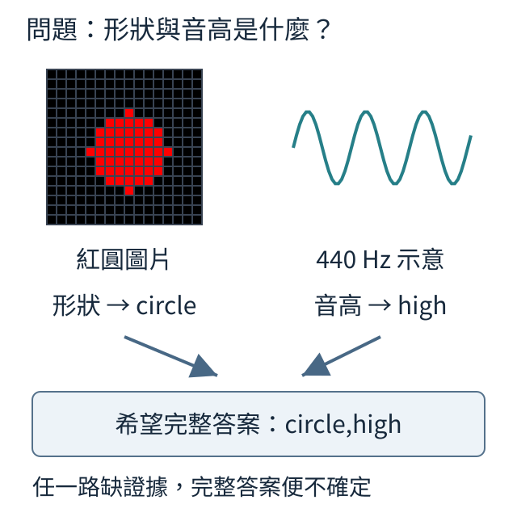

先做一次反向傳播（`backward()`），不更新參數，檢查答案的代價是否連到圖、聲音兩個接頭；這一步尚未測試模型是否答對。

```python
import torch
from tiny_perceptron.data import ByteTokenizer
from tiny_perceptron.model import TinyLM, ModelConfig, masked_loss
from tiny_perceptron.multimodal import MultiModalLM, scene, tone

torch.manual_seed(0)
tok = ByteTokenizer()
model = MultiModalLM(TinyLM(ModelConfig(width=8)))
prefix = [tok.bos_id, tok.user_id, tok.image_id, tok.audio_id, tok.eos_id, tok.assistant_id]
answer = tok.encode("circle,high") + [tok.eos_id]
ids = torch.tensor(prefix + answer)
labels = torch.tensor([-100] * len(prefix) + answer)
out = model(ids, labels, image=scene("red", "circle"), waveform=tone(440))
masked_loss(out["logits"], out["labels"]).backward()
print("圖路徑梯度", model.image_projector.weight.grad.norm().item() > 0)
print("音路徑梯度", model.audio_projector.weight.grad.norm().item() > 0)
```

前綴有 `<image>`、`<audio>` 兩個佔位 token，各以自己的特徵序列替換，再交同一文字核心：圖片換成 16 條（16 個圖塊），聲音換成 11 條。圖接頭、音接頭都收到梯度，印兩個 True，表示這個答案的代價連到兩條路徑；程式沒有更新參數，不能由此判斷是否已會同時辨識。

材料也要交叉配對：圓低、圓高、方低、方高都出現。如果圓永遠配高音，模型可能只看圖就把兩部分都答出來。測試時固定圖換聲，只有音高部分應隨新聲改；固定聲換圖，只有形狀部分應隨新圖改。

既有的受控合成實驗照這個原則安排資料。它和 12.9 的實驗一樣從單獨訓練過的入口開始，這次圖片入口與聲音入口都用上，再和接頭、文字核心一起訓練。訓練題、驗證題、測試題各用不同的圖形位置與頻率；測試題是 3 種顏色×2 種形狀×2 個頻率（260、340 Hz），共 12 題。下表按原題的正確答案評分；拿掉一路後，它負責的部分退回 6/12，另一路仍對 12/12：

| 輸入條件 | 形狀正確 | 音高正確 | 完整回答正確 |
| --- | ---: | ---: | ---: |
| 圖與聲音都有 | 12/12 | 12/12 | 12/12 |
| 空白圖，聲音保留 | 6/12 | 12/12 | 6/12 |
| 圖保留，聲音靜音 | 12/12 | 6/12 | 6/12 |
| 空白圖加靜音 | 6/12 | 6/12 | 3/12 |

替換一路後改按換入材料的正確答案評分，模型的完整回答也對 12/12：圖換成另一種形狀時，回答只有形狀部分跟著改；聲音換到 300 Hz 的另一邊時，只有音高部分跟著改。這支持這個有限對照確實用了兩路。

但這張表不是「所有線索都沒見過」的測試。同一份紀錄還有 12 道驗證題，圖形放在另一個位置、頻率是 200 與 400 Hz；它們的完整回答只對 8/12：音高 12/12，形狀 8/12，錯的 4 題都是把紅圓與藍圓答成 square。測試題的 260、340 Hz 雖然沒出現在這個實驗的訓練題中，卻在聲音入口單獨訓練時用過。圖形換個位置，形狀就可能答錯；測試題的頻率，聲音入口又早已見過。只憑表中的 12/12，不能宣稱模型能處理全新的圖與聲音。

練習：「空白圖加靜音」一行的形狀與音高都是 6/12，為何不能讀成「空白圖應有某形狀」或「靜音應 high」？提示：紀錄裡空白圖時 12 題都回 circle，靜音時 12 題都回 high，兩者都拿掉時 12 題都回 `circle,high`；拿掉證據後，分數量的只是這個固定回答碰巧和原題的正確答案相同的比例。

<details>
<summary>回顧與查證</summary>

可回顧：[10.7圖片展開](10.md#10.7)、[12.9聲音展開](12.md#12.9)、[11.8按規則替換](11.md#11.8)。

表格、驗證題與測試題的逐題結果都在[圖音聯合的實驗紀錄（JSON）](../../docs/course-experiments/results/joint.json)，這是機器可讀的完整結果：`results.evaluations` 下的 `none`、`blank_image`、`blank_audio`、`blank` 是表格四行，`swap_image`、`swap_audio` 是換圖與換聲；`results.validation` 是驗證題的 8/12（`shape_correct` 8、`pitch_correct` 12）；`results.data.splits` 列出三組題目的圖形位置（`offset`）與頻率。聲音入口單獨訓練時用的頻率，見[入口訓練的實驗紀錄（JSON）](../../docs/course-experiments/results/encoders.json)的 `results.audio.data.splits.train`，其中包括 260 與 340。重做方式見[實驗說明](../../docs/course-experiments/README.md)。

</details>

## 12.13 整段平均後，還分得出哪個聲音先來嗎？

先有 440 Hz、再有 880 Hz，與把兩段順序交換不同；「哪段先來」的正確答案會變。先用已提取的時間框看這個問題：把框序列倒過來，框的集合不變，先後卻不同。

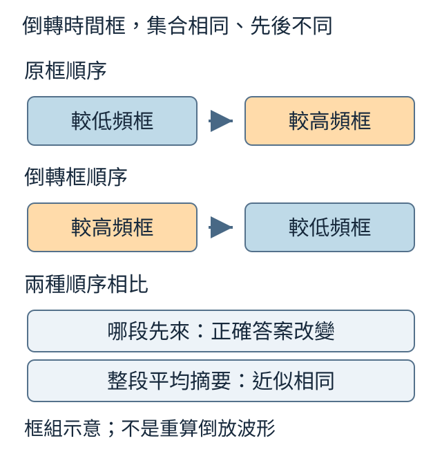

```python
from tiny_perceptron.natural_concepts import audio_order_report

report = audio_order_report()
print("時間框與頻帶", report["time_frames"], report["bands"])
print("先後序列相同", report["same_time_sequence"])
print("平均摘要近似相同", report["same_mean_with_roundoff_tolerance"])
```

`audio_order_report` 在 [tiny_perceptron/natural_concepts.py](../../tiny_perceptron/natural_concepts.py)。它把 0.1 秒的 440 Hz 與 0.1 秒的 880 Hz 接成 0.2 秒，用 12.8 的 `log_mel` 算出特徵並轉成「時間框、mel 頻帶」排列，再用 `flip(0)` 把時間框的順序倒過來。回傳的是一個字典，程式用 `report["…"]` 取出其中幾項：`time_frames` 與 `bands` 是 21 個時間框、16 個 mel 頻帶；`same_time_sequence` 用 `torch.equal` 比較倒轉前後的整份序列，印 False；`same_mean_with_roundoff_tolerance` 用 `torch.allclose` 比較兩份沿時間平均後的 16 個數，容許加總順序不同造成的極小浮點誤差，印 True。這裡倒的是已取得的特徵框，不是重新合成另一段真人錄音，也不聲稱倒放波形後重算的頻譜逐格相同。

平均不管框在哪個位置，倒轉前後便得到同一摘要；它保留每個 mel 頻帶的平均 log 特徵，卻失去「先低後高」的順序。若回答需要先後，入口與後續模型要保留時間位置；用監督式訓練教模型回答先後時，還要提供帶有先後答案的資料，訓練目標才會要求模型利用這些位置。

語音辨識一句話更依賴有序的聲音：同一批音節換了位置，轉寫文字就可能不同。回答需求則不一定要逐字照抄。兩者都可能需要時間線索，但目標不同，要分開判斷。倒轉單音框的反例只說明平均會丟掉順序，不能證明模型會語音辨識；反過來，轉寫錯了一個字，也不能直接判定需求的回答一定錯。

練習把問題改成「是否出現過較高的單音」，平均摘要是否可能足以幫忙？再改成「較高的先來嗎」，指出缺少的條件。接下來先介紹轉成文字的聊天路線，再設計保留聲音特徵的有限需求路線。

<details>
<summary>回顧與查證</summary>

可回顧：[12.8沿時間保留特徵](12.md#12.8)、[12.11先轉文字的取捨](12.md#12.11)。

</details>

## 12.14 先用語音辨識轉成文字，怎麼共用聊天歷史？

使用者打字「我不吃辣」，或說出同樣需求。若採先語音辨識的路線，希望兩種輸入方式都把文字放進同一段對話，再由同一個文字核心根據這個條件推薦餐點。

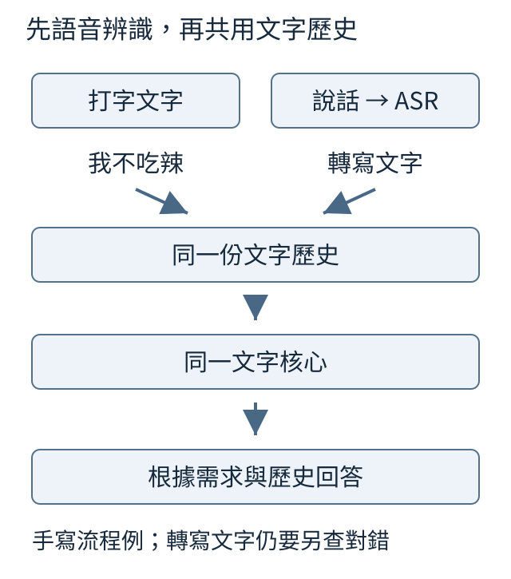

ASR 負責把聲音轉成轉寫文字，文字核心負責根據文字與歷史回答。共用核心不等於每段文字都正確；要先分別檢查轉寫文字與回答。

下面手寫一組轉寫與回覆，讓兩項判準分開看：正確文字是「我不吃辣」，假設轉寫文字為「我不吃拉」，兩路回答都填「選清淡的湯麵。」。

```python
from tiny_perceptron.natural_concepts import speech_stages

report = speech_stages("我不吃辣", "我不吃拉", "選清淡的湯麵。", "選清淡的湯麵。")
print("轉寫的字元錯誤率", report["transcription"]["cer"])
print("兩路回答完全相同", report["answers_identical"])
print("相同是否足以證明正確", report["answers_correct"])
```

`speech_stages` 也在 [tiny_perceptron/natural_concepts.py](../../tiny_perceptron/natural_concepts.py)。四個參數依序是正確文字、轉寫文字、打字路線的回答、語音路線的回答；回傳一個字典：`transcription` 是 [11.16](11.md#11.16) 的 `text_error_report` 逐字比較結果，其中 `cer` 是字元錯誤率；`answers_identical` 比較兩路回答是否完全相同；`answers_correct` 固定是 `None`，因為函式不判斷回答對不對。

「我、不、吃、辣」共四字，有一字替換，CER 為 1/4＝0.25。兩路回答相同印 True，但正確性欄是 None：函式沒有檢查湯麵配方或是否符合使用者條件。相同與正確仍是不同問題。

若語音辨識把「不要加辣」轉成「要加辣」，文字核心收到的條件已改變，無法只靠相同的聊天程式補救。要報轉寫錯誤，也要用獨立的判準檢查回答是否滿足需求；保留文字歷史，可讓下一輪追問「還有別的嗎」沿用已記錄的條件。

這種共用歷史可以搭配自行訓練的有限語音辨識，或延伸到第 20 章的成熟 ASR。接下來的 [12.15](12.md#12.15) 改走真人語音需求的路線：不先產生轉寫文字，而把聲音特徵直接交給同一個文字核心；[12.16](12.md#12.16) 會讓這些聲音位置也留在跨輸入方式的歷史中。

練習把程式的第二個參數 `"我不吃拉"` 改成 `"我不吃辣"`，CER 應為 0；若兩路仍回相同、但不合條件的餐點，回答對不對仍要另外判斷。

<details>
<summary>例子與延伸的界線</summary>

本節的轉寫與回覆是手寫的判準示例，圖解是流程示意，沒有以某段錄音或 ASR 的實際輸出作證。第 20 章沿用現成的成熟模型（Whisper 轉寫、Qwen 回答），沒有啟用本課的微調修正；它是延伸，不作自行訓練主線的驗收。

</details>

<details>
<summary>回顧與查證</summary>

可回顧：[12.13語音辨識與回答的分工](12.md#12.13)、[7.1對話表示](07.md#7.1)、[12.11](12.md#12.11)。

</details>

## 12.15 幾種真人語音問題，如何從零學會回應？

有人說「我的銀行 App 打不開」，我們希望助手回一個短提示，例如「先檢查網路，再重新啟動 App。」這裡想教的是聽懂幾種需求後回應，不要求把任何人說的每個字都完整轉寫下來。

適合這個方向的公開材料是 MInDS-14 的中文真人錄音。它收集少數銀行情境的口語需求：參與者看到意圖說明與例句，再自己說出新的問法。**意圖**（intent）在這裡就是需求種類，例如更新地址、App 出問題、卡片無法使用。本節用這三種來設計短而一般的回覆；本節設計的助理沒有連接銀行帳戶，不能回報未知餘額或完成帳戶操作。

聲音怎麼接到文字回答？先沿用前面學過的 log-mel 特徵：把錄音切成時間框，算出各 mel 頻帶的功率，再做固定的 log 轉換，得到按時間排列的一列數字。這一步整理聲音的變化，沒有寫出「App」兩個字，也沒有決定應回哪一句話。

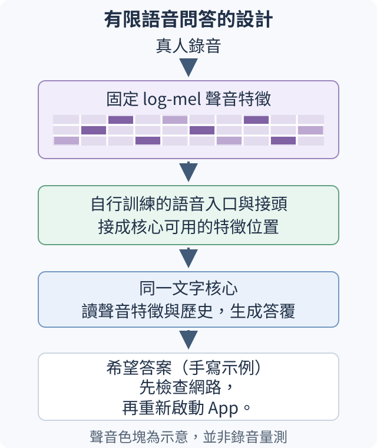

接著，**語音入口**（speech encoder）用可學的參數，從這列聲音數字算出需求線索；它要從真人說話學出需求種類，而不是單音的高低。接頭把線索轉成文字核心能接收的特徵位置，也就是放進模型序列中的一組數字表示。核心讀到這些位置與對話歷史，生成中文答覆。

語音入口和 12.8 的聲音入口都從逐框的 log-mel 出發，但不是一個時間框換一條特徵。真人錄音長短不一，本課實際訓練的語音入口（[tiny_perceptron/selftrained/model.py](../../tiny_perceptron/selftrained/model.py) 的 `AudioEncoder`，和 12.8 那個同名類別不是同一份程式）分三步整理時間：先把相鄰幾框合起來算、每次往後跳 2 框，連做兩層，序列約縮成四分之一長；再沿時間正反各讀一遍，讓每個位置都參考前後的聲音；最後沿時間順序切出 16 個區間，各自取平均（`adaptive_avg_pool1d`；區間邊界取整，相鄰區間可能重疊）。不論錄音多長，它都交出 16 條有先後順序的特徵，所以聲音特徵在模型序列中固定佔 16 個位置，不是有幾個時間框就佔幾個。這個 16 是時間上切出的段數，和 12.6 的 16 個 mel 頻帶無關；第 19 章的 MoE 助理用的就是這個入口，見 [19.6](19.md#19.6)。

下面只看形狀：用隨機初值建立這個語音入口，再用隨機數代替三段錄音的 log-mel，分別有 173、600、1000 個時間框，每框 40 個 mel 頻帶（這個入口只收 40 帶）。

```python
import torch
from tiny_perceptron.selftrained.model import AudioEncoder

torch.manual_seed(0)
encoder = AudioEncoder(64)
for frames in [173, 600, 1000]:
    mel = torch.randn(frames, 40)
    shortened = encoder.temporal(mel.T[None]).shape[-1]
    features, _ = encoder(mel)
    print("輸入", tuple(mel.shape), "第一步後", shortened, "輸出", tuple(features.shape))
```

`encoder.temporal` 是第一步的兩層，`mel.T[None]` 把特徵排成它要的「筆數、頻帶、時間框」；印出的 44、150、250 是第一步後的時間長度，約為原本的四分之一。`encoder(mel)` 跑完三步，三段的第一個回傳值都是 `(16,64)`，也就是 16 條特徵、每條 64 個數字；64 是建立時指定的特徵寬度，第 19 章的 MoE 助理用 256。第二個回傳值是三種需求各自的分數，本節用不到，用 `_` 接住。

若要從零建立這條路，語音入口、接頭與文字核心的參數都從隨機初值開始，並需要各自的訓練安排。分階段訓練並不違反「從零」：12.9 的單音實驗也是先單獨訓練聲音入口，再接上文字核心一起訓練。固定的 log-mel 計算可以使用一般工具，因為它不是已經學會中文的神經模型。辨識需求與產生答覆的部分，則由這些自行訓練的元件處理。

訓練材料需要把錄音與這個任務的正確短答配在一起。MInDS-14 提供需求種類，沒有提供我們要教的客服答覆，因此答案要另外撰寫、核對。訓練可以分兩步。第一步用打字版的問法（例如作者為每種需求寫的幾句文字）配上這些答案，讓文字核心先學會回應三種需求。第二步再訓練語音入口與接頭，讓真人錄音送進核心後，引出和打字版相同的回應。分兩步的好處是出錯時查得出在哪一段：打字版也答錯，先查文字核心；打字版答對、語音版答錯，先查語音入口與接頭，也要確認核心能用語音送來的特徵。訓練時用正確答案和預測比較、調整參數；推論時只送入錄音與對話，不把正確答案一起送進去。

要看是否使用了聲音，可以做對照：保留相同背景與提問方式，只改用另一類需求的錄音，檢查回覆主題是否跟著改變。還要把一部分原始錄音與新問法留作測試資料，不拿來更新參數。同一段聲音的裁切或加噪版本仍屬同一家族（由同一段原始錄音衍生），不能分散到訓練與測試兩邊，再算成陌生錄音。如果所有問題都得到「請聯絡客服」，雖然語句合理，也不足以說明模型分清了這三種需求。

這和 12.14 的語音辨識路線有不同目標。ASR 要回答「他說了哪些字」；此處直接問答要回答「這個已教過的需求，該怎麼回應」。沒有產生轉寫文字，不能稱作通用 ASR；能分清三種需求，也不推出能聽懂新數字、物件名或任意中文問題。

聲音特徵經過自行訓練的語音入口，可以成為同一文字核心的另一種輸入。下一節只增加對話歷史，看看文字與聲音如何接續同一段需求。

<details>
<summary>公開材料、方法與例子的性質</summary>

PolyAI 的[MInDS-14 官方資料卡](https://huggingface.co/datasets/PolyAI/minds14/blob/40ce77cb32a384e4d50a568e1ec39ac804019d33/README.md)標示 CC BY 4.0，中文有 502 條，各類可用短句仍需核對；沒有公開說話者 ID，不能據此宣稱跨說話者驗收。[原論文](https://arxiv.org/abs/2104.08524)說明真人口語收集，也說明其實驗使用現成 ASR 與預訓練文字編碼器。本節借用的是合法來源與有限需求設計，不引用那些成績當從零訓練的證據。

本文沒有讀取、播放或轉寫某段公開錄音。問句、希望答案與聲音色塊都是作者設計示例。直接語音需求辨識可參考[端到端語音理解研究](https://arxiv.org/abs/1904.03670)，但該研究涉及預訓練，不能拿其結果保證本課隨機初值模型的能力。

</details>

## 12.16 說話和打字，如何保留同一段對話？

先打字說「接下來請用兩點回答」，接著用語音提出「我的銀行 App 打不開」這個需求，再打字說「改成一句」。我們希望中間的回覆分成兩點，最後的回覆縮成一句，而且仍然在回應 App 的問題。換輸入方式，不應把原先的格式要求或談到的主題清掉。

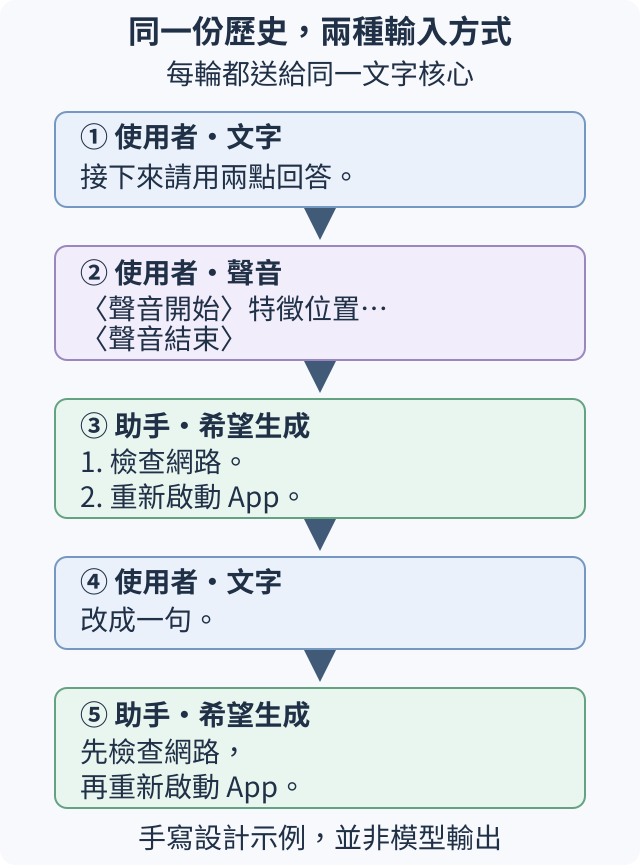

圖是手寫的設計例，不是模型輸出。第②張訊息卡就是說「我的銀行 App 打不開」的那一輪，但卡上沒有寫出這句話：模型收到的是〈聲音開始〉與〈聲音結束〉之間的聲音特徵位置，不是轉寫文字。

上一節讓自行訓練的語音入口，把聲音變成核心能接收的一組特徵位置。這一節沿用它，新增的是「把各輪保存在同一份歷史」。文字那輪有使用者角色和文字位置；聲音那輪也有使用者角色，內容則是一段聲音特徵位置，前後標出起點與終點。這兩個邊界告訴模型這段輸入從哪裡開始、到哪裡結束，不提供它的文字答案。

圖中的〈聲音開始〉〈聲音結束〉是教學寫法，實作可以用別的方式標出邊界，例如 [12.9](12.md#12.9) 的 `MultiModalLM` 只在原處放一個 `<audio>` 佔位 token，再換成 11 條特徵；第 19 章的 MoE 助理則在語音那一輪預留 16 個聲音佔位 token，正好放進語音入口交出的 16 條特徵。無論哪種寫法，特徵位置放的都是語音入口算出的數字，並非把「聲音特徵」四個字打給模型。這和圖片特徵接進序列的觀念相同：入口不同，核心接收與利用的仍是一段排列好的輸入。

照 12.9 的寫法把這段對話排成一條序列時，沿用的是換入聲音那一步：`<audio>` 的 1 個位置換成這段聲音的特徵序列，這些位置不計代價；其他位置照 [7.1](07.md#7.1) 依角色決定計不計分，有效目標只有兩段助手答覆與各自的 EOS。

處理語音那輪時，核心應一起讀到先前的文字要求「用兩點回答」。所以希望答覆是「1. 檢查網路。2. 重新啟動 App。」這段助手答覆也要加入歷史，下一輪才知道自己剛剛說過什麼。當使用者再說「改成一句」，核心收到的是整段已保留的對話，加上這個新要求，可以知道「改」的是前一個答覆，而不是突然換了一個新問題。

共享歷史需要兩件事合作。系統要把角色、各輪內容與先後順序保存並送入；模型也要學會使用它們。只有保存記錄，不能保證模型會遵守格式；如果模型沒有收到前文，再強的語音入口也補不出已被清掉的要求。訓練示範因此需要包含這種跨輪對話，而不只是一段聲音對一段固定答案。

要檢查舊要求與舊主題有沒有參與回答，可以做兩組對照，每組只改一輪：

| 對照 | 第①輪（打字） | 第②輪（語音） | 第④輪（打字） | 看哪一輪的答覆 | 希望看到 |
| --- | --- | --- | --- | --- | --- |
| 換格式要求 | 「用兩點回答」與「用一句回答」各做一次 | 同一段「App 打不開」 | 不需要 | 第③輪 | 主題都是 App，格式跟著第①輪改變 |
| 換需求 | 「用兩點回答」 | 「App 打不開」與另一種需求（例如更新地址）各做一次 | 「改成一句」 | 第⑤輪 | 都是一句，主題跟著第②輪改變 |

第一組讓格式線索發揮作用，第二組讓主題線索發揮作用；兩組都不用把兩路回答逐字相同當作唯一判準。

前面的 12.14 已介紹另一種共享方式：語音先經 ASR 變成轉寫文字，再把文字寫進共同歷史。本節改用 12.15 的語音入口，所以語音那輪保留的是聲音特徵位置。兩條路都要保存對話，差別在於核心收到的內容；不能畫成聲音特徵路線，實際卻先用隱藏的 ASR 換成正確文字。

練習把第①輪改成「請用一句回答」，第④輪改成「改成兩點」，語音需求保持相同。希望答覆應在哪一輪改成兩點？核心需要保留哪些訊息，才知道修改的是同一個 App 問題？

<details>
<summary>前文與設計範圍</summary>

[12.14](12.md#12.14)保留語音辨識的轉寫文字路線；[12.15](12.md#12.15)說明有限需求的語音入口。這裡接續[7.1 的角色與對話表示](07.md#7.1)，只把其中一輪的內容換成聲音特徵。

本節沒有取用特定公開錄音；語音來源與自訓練元件的範圍見[主線來源筆記](../../docs/course-revision-20261005/sources/selftrained-capstone.md)。

</details>
