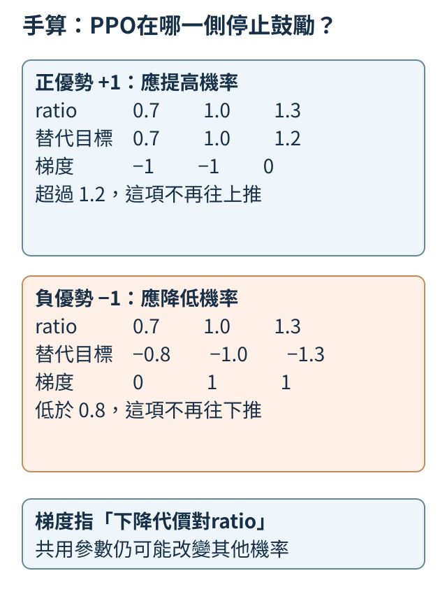
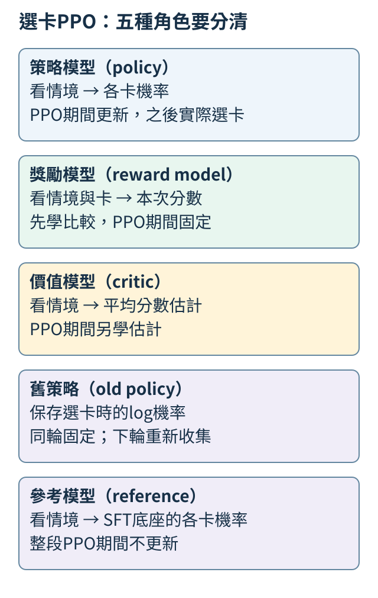
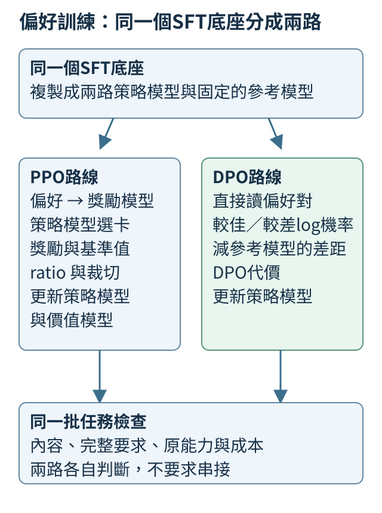

# 第 13 章：把回答偏好變成訓練

對同一問題，你可能知道哪份回答更合適，卻很難只寫一份唯一的正確答案。本章先保存比較與理由，再讓這份偏好變成可計算的訓練訊號。

本章有兩條可選路。13.1–13.6先學直接偏好最佳化（DPO）：直接用偏好對調整回答的模型。13.10–13.16改用一個選回答卡的小任務，逐步看獎勵模型、優勢、機率比、裁切與價值模型，學近端策略最佳化（PPO）的流程。13.7–13.9檢查兩條路都會遇到的資料與能力取捨，13.17並排比較。它們不是成品必須依序套用的兩道工序。[7.18](07.md#7.18)已經介紹過DPO、RLHF與PPO這幾個名字和它們的關係，本章展開機制。

每個零件都直接讀本課函式庫的實作：`tiny_perceptron/alignment.py`的`sequence_log_probability`（[13.3](#13.3)）與`dpo_loss`（[13.5](#13.5)），以及`tiny_perceptron/posttraining.py`的`preference_loss`與獎勵模型（[13.10](#13.10)）、`bandit_advantage`（[13.11](#13.11)）、`ppo_clipped_objective`（[13.13](#13.13)）、`exact_kl`（[13.14](#13.14)），最後在[13.15](#13.15)接成一輪完整的選卡與更新。讀到忘了的名詞，可查[名詞頁](../glossary.md)。

先前必修的[C.1–C.5](0C.md#C.1)研究回答時多做工作的取捨；[C.6–C.7](0C.md#C.6)在本章之後接回可驗證回饋與更新。較高的思考投入（thinking effort）與較高的獎勵（reward）都不能直接當成答對，仍要另外驗證。

## 13.1 偏好為什麼必須連同問題一起記？

對「只回數字：2+2=?」，A回答「4」，B回答「4，就像兩雙筷子共有四根」。兩份都算對，只有A符合只回數字。若要求改成生活比喻，B又可能較合適。**偏好**是在同一個任務條件下，標記哪份回答更合適，不是把一種寫法永久封為好答案。

先寫本次判準：「先正確，再遵循只回數字」，再保留提問、兩份原文、選擇和原因。

```python
pair = {"prompt": "只回數字：2+2=?", "A": "4", "B": "4，就像兩雙筷子共有四根。"}
rule = "先正確，再遵循只回數字"
chosen = "A"
print("條件", pair["prompt"])
print("比較", pair["A"], "／", pair["B"])
print("理由", rule, "選擇", chosen)
```

`chosen`直接寫A，是我們的人工判斷；程式只印出紀錄，不會自己讀兩份回答來排序。保存原因讓後來的人知道，A勝出是因為「只回數字」這個限制，不是所有比喻都不好。

兩份都不合適時，較佳的一份也不等於理想示範；沒有清楚差別時，則可以記平手或不確定。否則不同標註者各猜一套標準，訓練訊號就混在一起。

後面的數學先用最清楚的例子：加法的對錯。例如`2+2=?`，正確的`4`是較佳回答，錯的`5`是較差回答。格式偏好則另用兩份都算對的回答比較（[13.7](#13.7)）。

練習把程式第一行提問裡的「只回數字：」刪掉，變成`"2+2=?"`。先寫出新的判準放進`rule`，再決定`chosen`。原程式的A不會自動改：沒有格式限制後，兩份都正確，只剩「要不要比喻」的差別；請求沒說要哪一種時，可以記平手。問題變了，就要重新判斷。

<details>
<summary>補充：來源、完整設定與既有實驗紀錄</summary>

我們真正訓練時先收窄問題，只比較加法的對錯。例如同一題`2+2=?`，較佳候選是`4`，較差候選是`5`，不是讓模型自訂什麼叫好。兩個加數都從0到7挑選，因此有8×8＝64道題，每題配一組較佳／較差回答。切分時，把交換加數後相同的題目算成同一個家族（[7.12](07.md#7.12)）：例如`2+3=?`與`3+2=?`必須留在同一組，不能一題拿來教、另一題拿來考，否則測試可能只是在考已見過的數字組合。整個家族一起分配後，共有49對訓練資料、8對驗證資料、7對測試資料。訓練資料用來更新參數；驗證資料用來觀察訓練途中是否學得更好；測試資料留到最後檢查未教過的組合，不能拿它的分數來選訓練設定。本次程式預先寫定兩種訓練設定與更新次數，也在訓練前記錄底座在測試題上的分數，並在每一支訓練後再測一次；測試題不參與參數更新，程式也不依這些分數改設定。這與只在全部訓練結束後才看測試題的流程不同，因此閱讀結果時，要分清「拿測試題量前後變化」與「看了測試分數再調設定」。這三組與[8.3的加法底座](08.md#8.3)使用相同的題目切分，讓前後比較對得起來。另做一條格式支線，把兩篇都算對的回答拿來比較，見[13.7](#13.7)。先分清這兩種理由，後面才知道模型是改了內容排序，還是只偏好沒有附加句的寫法。

本章補充引用的數字都來自實驗紀錄（JSON）：實驗程式寫出、機器可讀的完整結果；各節補充會寫出看哪一份、哪一欄。這一節的49／8／7對在[實驗紀錄`dpo.json`](https://github.com/birdhackor/tiny-perceptron-vlm/blob/main/docs/course-experiments/results/dpo.json)的`results.data`：`train`、`validation`、`test`三欄的`records`是對數，`families`是家族數（28、4、4）。題目由[scripts/course_experiments/text.py](../../scripts/course_experiments/text.py)的`arithmetic_records`產生，兩個加數各取0到7。

</details>

## 13.2 同一提問的兩份回答，如何對齊成資料？

一組偏好資料先固定提問「1+1=?」，較佳回答2，較差回答3。保存為三個欄位：**prompt**是共同前文，**chosen**是被選為較佳的續寫，**rejected**是另一份續寫。這些名稱記錄人給的標籤，不是模型自己發現的正確答案。

模型算每篇答案的機率時，要看那篇答案自己的前文。下面用[7.1](07.md#7.1)的`render_chat`，把兩條對話分別轉成輸入與下一位置目標。

```python
from tiny_perceptron.data import render_chat

pair = {"prompt": "1+1=?", "chosen": "2", "rejected": "3"}
for key in ["chosen", "rejected"]:
    x, y = render_chat(
        [
            {"role": "user", "content": pair["prompt"]},
            {"role": "assistant", "content": pair[key]},
        ]
    )
    print(key, "輸入", x.tolist(), "目標", y.tolist())
```

本專案預設按UTF-8位元組編碼：每個位元組的編號加8，0到7留給特殊token（special token，見[6.6](06.md#6.6)），其中1是BOS（開始標記）、2是EOS（結束標記）、3標示使用者、4標示助手。字元「2」的位元組是50，加8成為58；字元「3」則是59。所以輸出裡的2是EOS，字元「2」是58，兩者要分清。chosen輸入為`[1,3,57,51,57,69,71,2,4,58]`，和7.1的同一個例子相同；rejected只將最後一項換成59。

兩份目標前八項都是`-100`，表示不計這些前文位置；最後兩項是答案字元58或59，再接EOS的2。輸入索引8的助手標記4要預測答案字元；輸入最後的答案字元要預測EOS。`render_chat`已完成下一位置對齊，後面不能再平移一次。

因此也不能把chosen的輸入搭rejected的標籤：算回答3之後結束的機率時，模型應已看見3，不是2。同題兩條續寫可以不同長，但各自的輸入、答案與EOS都要各自做好下一位置對齊。

練習把程式裡的`"rejected": "3"`改成`"4"`，先預測rejected最後一個輸入編號變60（字元「4」的位元組52加8）、chosen不變，再執行核對。若rejected連提問都換了，分數差也可能來自題目難度，已不是本次同題比較。

<details>
<summary>補充：來源、完整設定與既有實驗紀錄</summary>

自然資料也需要這樣核對。我們另外取UltraFeedback偏好資料的一小包100筆，按家族（依提問分組）自行切成80／10／10，並不是官方的測試資料；提問與兩篇回答各截到最多120個UTF-8 byte，保留完整字元。這樣能讓小模型讀得下，卻可能刪掉原評分者看過的關鍵理由。來源對完整回答的chosen標籤，不保證截短後仍適用。因此這個支線只檢查資料與訓練通路，不用它替加法實驗證明自然聊天品質。

筆數在[實驗紀錄`dpo.json`](https://github.com/birdhackor/tiny-perceptron-vlm/blob/main/docs/course-experiments/results/dpo.json)的`results.ultrafeedback_pilot`：`source_records`是取來的100筆，`data`下`train`、`validation`、`test`的`records`是80、10、10。截到120個byte寫在[scripts/course_experiments/behavior.py](../../scripts/course_experiments/behavior.py)的`_natural_dpo_pilot`：提問與兩篇回答都經`_utf8_prefix`截到120。

</details>

## 13.3 逐字機率如何合成整篇答案的分數？

假設回答有兩個有效目標，第一步目標機率0.8，第二步在已看見第一個目標後也為0.8。整段機率是`0.8×0.8=0.64`。因為第二步已把第一步當成條件，兩步直接相乘就是整段機率。

很多小數連乘會很小；取自然log後，乘法變加法：`log(0.8×0.8)=log0.8+log0.8`。下面只把答案位置的log機率相加；前文和補齊用的PAD位置，標籤都設成不計分的`-100`。這是替已寫好的答案算機率，沒有先讓模型隨機生成。

```python
import torch
from tiny_perceptron.alignment import sequence_log_probability
from tiny_perceptron.data import IGNORE

logits = torch.tensor([[[0.0, 2.0, 0.0], [2.0, 0.0, 0.0], [0.0, 0.0, 2.0]]])
labels = torch.tensor([[IGNORE, 0, 2]])
score = sequence_log_probability(logits, labels)
print("IGNORE的值", IGNORE)
print("整段log分數", round(score.item(), 4))
print("還原機率", round(score.exp().item(), 4))
```

`logits`是候選尚未轉成機率的分數，形狀`(1,3,3)`代表一筆、三個位置、每處三個候選。`IGNORE`就是[7.1](07.md#7.1)那個表示「不計代價」的`-100`。標籤`[IGNORE,0,2]`忽略第一個位置，第二個位置的目標是候選0，第三個是候選2。輸出的整段分數約−0.4791，`exp()`還原的機率約0.6193。

`sequence_log_probability`的寫法如下：

```python
# 節錄自 tiny_perceptron/alignment.py：sequence_log_probability
def sequence_log_probability(logits, labels):
    valid = labels != IGNORE
    safe_labels = labels.masked_fill(~valid, 0)
    selected = logits.log_softmax(-1).gather(-1, safe_labels.unsqueeze(-1)).squeeze(-1)
    if not valid.any(-1).all():
        raise ValueError("偏好回答不能没有有效 token")
    return (selected * valid).sum(-1)
```

輸入`logits`的形狀是`(筆數,位置數,候選數)`，`labels`是`(筆數,位置數)`。逐行看：

- `valid = labels != IGNORE`逐格比較，得到真假表，標出哪些位置是有效目標；本例是`[False,True,True]`。
- `labels.masked_fill(~valid, 0)`：`~`把真假對調，`masked_fill`把`~valid`為真的位置換成0，得到`safe_labels`。`-100`不是合法的候選編號，下一行取值會出錯，所以先換成0；這些位置取出的值稍後會被丟掉。
- `logits.log_softmax(-1)`沿最後一軸（候選）先做softmax再取log，得到每個位置每個候選的log機率。例如`[0,2,0]`這組分數的softmax約`[0.1065,0.7870,0.1065]`，取log約`[−2.2395,−0.2395,−2.2395]`。
- `.gather(-1, safe_labels.unsqueeze(-1))`在每個位置按標籤取出一個候選的log機率。`unsqueeze(-1)`先在最後多加一個長度1的軸，讓標籤從`(1,3)`變成`(1,3,1)`，和`logits`的軸數相同；`gather`沿最後一軸，按這個編號取值：例如第二個位置的三個log機率約`[−0.2395,−2.2395,−2.2395]`，標籤是0，就取出候選0的−0.2395；結果也是`(1,3,1)`；`squeeze(-1)`再拿掉長度1的軸，得到形狀`(1,3)`的`selected`。
- `if not valid.any(-1).all():`檢查每一筆是否至少有一個有效目標：`any(-1)`問每筆裡有沒有任何一個真，`all()`問是不是每筆都有。沒有有效目標的回答無從計分，就用`raise ValueError(...)`停下來並說明原因。
- `(selected * valid).sum(-1)`：真當1、假當0相乘，忽略位置的值歸零，再沿位置加總，得到每一筆的整段分數。

把中間結果印出來核對：

```python
valid = labels != IGNORE
safe_labels = labels.masked_fill(~valid, 0)
selected = logits.log_softmax(-1).gather(-1, safe_labels.unsqueeze(-1)).squeeze(-1)
print("valid", valid.tolist(), "safe_labels", safe_labels.tolist())
print("每個位置取出的log機率", [round(value, 4) for value in selected[0].tolist()])
```

`[round(value, 4) for value in ...]`是把清單裡每個數四捨五入到小數四位、再收成新清單的簡寫。第一個位置取到候選0的−2.2395，但`valid`是False，乘上0後不計入；兩個有效目標的機率都約0.7870，log各約−0.2395，加總約−0.4791。若多加一個同樣機率的有效目標，總log約−0.7186，逐步平均仍約−0.2395。

所以**整段加總**與**逐步平均**是不同的量。機率不超過1，每個log項都不大於0；長回答多加了幾項，總log常更負，不能單靠它說人類更不喜歡。後面會先對每篇答案減去固定參考的同篇分數，再比較較佳與較差回答。本章的整段約定也包括EOS結束目標。

練習把第一段程式的`labels = torch.tensor([[IGNORE, 0, 2]])`改成`[[1, 0, 2]]`，先預測整段分數多加一個約−0.2395的項，變成約−0.7186，再執行核對。這是求和手算檢查；實際的第一個位置若屬提問，就仍須忽略，不能為了改分數把它算入回答。

<details>
<summary>補充：來源、完整設定與既有實驗紀錄</summary>

本章正式加法實驗明確把EOS算入完整回答分數，不計問題、角色前文或PAD位置。例如`4`的分數來自數字與EOS兩個目標，`10`則有三個。[13.6](#13.6)的兩個加法偏好訓練版本各250次更新，讀到的兩側回答目標總數都為9,448；這是重複抽樣的訓練曝光量，不是9,448個不同答案。後面的比較全採用同一個整段加總的約定，沒有遇到長答案就臨時改用平均。

這兩個數在[實驗紀錄`dpo.json`](https://github.com/birdhackor/tiny-perceptron-vlm/blob/main/docs/course-experiments/results/dpo.json)的`results.runs.model.training`與`results.runs.beta1.training`（`model`與`beta1`就是13.6那兩支）：`steps`是250，`effective_answer_tokens_both_sides`是9,448。同一份紀錄裡，每個切分的候選比較結果都附有`note`欄，寫著`sequence sums include EOS`，就是「整段加總含EOS」這個約定。

</details>

## 13.4 固定參考在比較什麼？

對同題兩篇答案，原模型的log分數是較佳−4、較差−3，差距`−4−(−3)=−1`，表示它更偏向較差答案；更新中的模型變成−3、−3，差距0。新差距減原差距是`0−(−1)=1`，這個「新差距比原差距多出多少」叫**相對差距（margin）**。相對差距為正，表示比原模型更偏向較佳答案；但這裡兩候選只是同分，尚未保證較佳勝出。

正在更新、之後實際作答的模型叫**策略模型（policy）**：讀入目前的情境，輸出每個可選動作的機率。在語言模型裡，情境是提問與已寫出的前文，動作是下一個token。保留原起點、不跟著更新的副本叫**參考模型（reference）**。直接偏好最佳化（Direct Preference Optimization，DPO）用參考模型作固定基準，關注相對偏好如何改變。

下面用三個不同操作建立固定參考：`copy.deepcopy`複製一份獨立參數，讓策略模型的更新不會改到它；`eval()`切到評估行為；`requires_grad_(False)`停止追蹤參考參數的梯度。後兩項各有作用，不能代替獨立複製。這個隨機小模型只檢查副本與凍結，沒有偏好訓練。

```python
import copy
import torch
from tiny_perceptron.model import TinyLM, ModelConfig

policy = TinyLM(ModelConfig(width=8))
reference = copy.deepcopy(policy).eval().requires_grad_(False)
before = reference.embedding.weight.clone()
with torch.no_grad():
    policy.embedding.weight.add_(0.1)
scores = reference(torch.tensor([[1, 2]]))["logits"]
print("參考未跟著改", torch.equal(before, reference.embedding.weight))
print("參考不記梯度", scores.requires_grad)
```

人為給策略模型`policy`的embedding表（`embedding.weight`）每個數都加0.1後，第一行應為`True`：參考模型`reference`沒變；第二行為`False`：參考模型的輸出不需梯度。沒有偏好訓練發生。`TinyLM`的實作見[4.6](04.md#4.6)。

正式使用時，參考模型通常是已完成SFT（[7.1](07.md#7.1)的監督式微調）的模型。參考模型未必每題都答對，它提供原行為的基準，並非判斷正確答案的裁判。策略模型與參考模型最初相同，因此相對差距最初為0，即使原模型更偏向錯答。參考模型全程固定，也不能交給策略模型的最佳化器更新。

練習把`copy.deepcopy(policy)`改成`policy`。兩個名稱將指向同一個模型，凍結也會連策略模型一起凍結；手動加0.1後，第一行變`False`。獨立複製與凍結各有作用，缺一項都不能替代固定參考。

<details>
<summary>補充：來源、完整設定與既有實驗紀錄</summary>

正式比較用的固定參考，是[8.3](08.md#8.3)那個只用49道加法訓練題做過SFT的加法底座；重跑[T.5](../training.md#T.5)的固定`style`實驗時，它會存成`content.pt`。它在7道測試題上原本零題答對，不是已通過的算術老師。訓練前從這份底座複製策略模型與參考模型，兩種beta設定都從相同起點開始。beta是正的縮放係數：偏好代價會先把相對差距乘上它，再決定要推動多少。它不是學習率；此處先知道它是另一項訓練設定即可，[13.6](#13.6)會用相同差距逐項觀察它的作用。參考模型的參數指紋在更新後保持不變。這只能證明固定參考沒有跟著動，不能替新策略模型的回答保證正確。

底座的來歷在[實驗紀錄`style.json`](https://github.com/birdhackor/tiny-perceptron-vlm/blob/main/docs/course-experiments/results/style.json)的`results.content_training`：`records`是49道訓練題，`checkpoint`是`content.pt`。「原本零題答對」是同一份的`results.content_evaluation.test`：`records`為7、`matches`為0。參數指紋是[實驗紀錄`dpo.json`](https://github.com/birdhackor/tiny-perceptron-vlm/blob/main/docs/course-experiments/results/dpo.json)的`results.reference_sha256`，由參考模型的全部參數算出SHA-256。[scripts/course_experiments/behavior.py](../../scripts/course_experiments/behavior.py)的`run_dpo`在兩支訓練後重算一次，不同就報錯停下，所以紀錄裡的`results.reference_unchanged`是`true`。

還要分清「相對差距為正」與「已經排在前面」。beta 0.1版本在驗證題`3+5=?`上，策略模型給較佳`8`減較差`9`的log分數差是−8.44789，參考模型是約−10.89346，相對差距是2.44557。但策略模型自己的差距仍為負，表示這兩個完整候選中，錯的9仍有較高機率。相對差距為正，可以是從很偏向錯答，移到稍微沒那麼偏向錯答，並不等於正確候選已勝出。這三個數在`dpo.json`的`results.runs.model.preference.validation.samples`中`prompt`為`3+5=?`的那一列，依序是`policy_margin`、`reference_margin`、`relative_margin`。

</details>

## 13.5 DPO如何把一對偏好變成更新方向？

沿用13.4原模型的分數：更新開始前，策略模型與參考模型相同，都是較佳−4、較差−3。先算13.4的相對差距：

`margin=(策略較佳−策略較差)−(參考較佳−參考較差)`。

本例margin為`(−4−(−3))−(−4−(−3))=0`。DPO用`L=−log(sigmoid(beta×margin))`作代價；beta是正的縮放係數。`sigmoid(z)=1/(1+exp(−z))`把差距轉到0與1之間，0變0.5，較大正值接近1。因此相對更偏向較佳答案，代價就降低。

```python
import torch
from torch.nn import functional as F  # 本節節錄的dpo_loss會用到F
from tiny_perceptron.alignment import dpo_loss

chosen = torch.tensor([-4.0], requires_grad=True)
rejected = torch.tensor([-3.0], requires_grad=True)
loss = dpo_loss(
    policy_chosen=chosen,
    policy_rejected=rejected,
    reference_chosen=torch.tensor([-4.0]),
    reference_rejected=torch.tensor([-3.0]),
    beta=0.1,
)
loss.backward()
print("代價", round(loss.item(), 4))
print("較佳梯度", round(chosen.grad.item(), 4), "較差梯度", round(rejected.grad.item(), 4))
```

呼叫時用參數名稱寫明四個分數各是誰：策略較佳、策略較差、參考較佳、參考較差。它們都是整篇答案的log機率（13.3的整段分數）。beta 0.1、margin 0時，代價約0.6931（就是`log 2`），較佳分數梯度−0.05、較差+0.05。`backward()`做反向傳播，只算梯度，沒有更新任何語言網路。

`dpo_loss`的寫法如下：

```python
# 節錄自 tiny_perceptron/alignment.py：dpo_loss
def dpo_loss(policy_chosen, policy_rejected, reference_chosen, reference_rejected, beta=0.1):
    if beta <= 0:
        raise ValueError("DPO beta 必須為正")
    relative_margin = policy_chosen - policy_rejected - (reference_chosen - reference_rejected).detach()
    return -F.logsigmoid(beta * relative_margin).mean()
```

`if beta <= 0:`先檢查設定，beta不是正數就用`raise ValueError`停下。`relative_margin`那行就是上面的margin公式；參考那一組差距後面接了`.detach()`，表示把它當成固定數字：即使傳進來的參考分數仍在追蹤梯度，代價也不會沿它去改參考。`F.logsigmoid(z)`直接算`log(sigmoid(z))`，比先算sigmoid再取log更不怕數值太小；前面的負號讓它成為代價。`.mean()`把一批偏好對的代價平均，本例只有一對。

梯度可以用紙筆核對。`−log(sigmoid(z))`對z的變化率是`−(1−sigmoid(z))`；z是beta乘margin，而margin對策略較佳分數的變化率是1、對策略較差是−1，所以

`較佳分數的梯度=−beta×(1−sigmoid(beta×margin))`，較差分數的梯度正負相反。

代入beta 0.1、margin 0，得`−0.1×(1−0.5)=−0.05`。下面第一行用逗號一次設定`beta`與`margin`兩個名字，再按公式計算，並和第一段`backward()`算出的`chosen.grad`比較：

```python
beta, margin = 0.1, torch.tensor(0.0)
formula = -beta * (1 - torch.sigmoid(beta * margin))
print("公式算的較佳梯度", round(formula.item(), 4), "與backward相同", torch.allclose(formula, chosen.grad))
```

用學習率0.1做紙上下降，舊值減去學習率乘梯度：較佳變−3.995，較差變−3.005；策略差距從−1變−0.99，相對差距從0變0.01。真模型則透過共用的參數改變每步機率，不能獨立隨意改每篇分數。

候選排序與實際回答還要分開測。實驗紀錄中，`4+2=?`的正確候選6比錯候選7有更高整段機率，模型自由生成卻回答8。它並未被限制只能選這兩篇，因此「這一對排對」仍不是「回答算對」。

練習把第一段程式的`chosen = torch.tensor([-4.0], requires_grad=True)`改成`[-5.0]`，參考保持不變。先預測：margin變−1，代價升到約0.7444；較佳梯度約−0.0525，仍為負，下降方向仍是提高相對偏好。執行後，再把第三段的`margin`改成`torch.tensor(-1.0)`，核對公式也得到−0.0525。

<details>
<summary>補充：來源、完整設定與既有實驗紀錄</summary>

真正訓練後，候選比較與自由生成也要各測一次。beta 0.1版本對測試題`4+2=?`，完整正確候選`6`的log分數約−24.88083，比錯誤候選`7`的−28.11597高；但是讓它自行選字時，實際回答是`8`，接著正常EOS結束。模型沒有被限制只能二選一，候選排序也不是自由生成答案的驗證。這一題可以同時記為「6比7更受偏好」及「實際加法答錯」，兩項都是真的。

兩個log分數在[實驗紀錄`dpo.json`](https://github.com/birdhackor/tiny-perceptron-vlm/blob/main/docs/course-experiments/results/dpo.json)的`results.runs.model.preference.test.samples`中`prompt`為`4+2=?`的那一列：`policy_chosen_logp`與`policy_rejected_logp`。自由生成在`results.runs.model.arithmetic.test.samples`，同一題那一列的`expected`是`6`、`generated`是`8`、`eos`是`true`。

</details>

## 13.6 beta加大，單次推動一定更大嗎？

固定策略較佳−2、較差−4，參考兩篇都是−3，相對差距為`(−2−(−4))−0=2`。此時已經偏向人標的較佳答案。只改beta，我們要看同一位置附近的代價與梯度，而不是比較重新訓練後的模型。

```python
import torch
from tiny_perceptron.alignment import dpo_loss

for beta in [0.1, 1.0, 5.0]:
    chosen = torch.tensor([-2.0], requires_grad=True)
    loss = dpo_loss(chosen, torch.tensor([-4.0]), torch.tensor([-3.0]), torch.tensor([-3.0]), beta=beta)
    loss.backward()
    room = 1 - torch.sigmoid(torch.tensor(beta * 2.0))
    print(beta, "代價", round(loss.item(), 6), "1-sigmoid", round(room.item(), 6), "梯度", round(chosen.grad.item(), 6))
```

`dpo_loss`的四個分數依序是策略較佳、策略較差、參考較佳、參考較差（定義見[13.5](#13.5)）。每輪新建chosen，避免累積前輪梯度；`room`是13.5梯度公式裡的`1−sigmoid(beta×margin)`，這裡margin是2。輸出的`4.5e-05`是4.5×10⁻⁵，也就是0.000045。三種beta的結果為：

| beta | 代價 | 1−sigmoid(beta×2) | 較佳分數梯度 |
| ---: | ---: | ---: | ---: |
| 0.1 | 0.598139 | 0.450166 | −0.045017 |
| 1 | 0.126928 | 0.119203 | −0.119203 |
| 5 | 0.000045 | 0.000045 | −0.000227 |

梯度是兩個數相乘：`−beta×(1−sigmoid(beta×2))`。beta從0.1到1，前一個數變成10倍，後一個數只從0.45降到0.12，梯度絕對值變大；beta到5時，`sigmoid(10)`已非常接近1，後一個數只剩0.000045，乘上5也只有0.000227，梯度反而變小。差距已經夠大、代價幾乎不再下降的情形叫**飽和**。學習率固定時，這個局部更新幅度也按梯度絕對值變。

beta與學習率作用不同：beta先進入代價公式，會改變飽和程度；學習率最後才乘梯度。DPO論文推導時根據的目標是「獎勵減去偏離參考的代價」，beta就是那筆偏離代價的係數：獎勵不變時，beta越大，策略模型離參考模型越遠就越不划算（[13.14](#13.14)會用KL量這個偏離）。這是推導裡的意義，不等於本表能預測完整訓練的最終行為。選設定仍要看驗證題與原能力，beta必須大於0。

練習把程式裡的`chosen = torch.tensor([-2.0], requires_grad=True)`改成`[-6.0]`，並把`room`那行的`beta * 2.0`改成`beta * -2.0`，讓margin變−2：模型現在偏向較差答案。先用公式預測beta 5的梯度：`−5×(1−sigmoid(−10))`約−5，不再接近0；beta 0.1與1則約−0.055與−0.881。再執行核對：模型仍偏向較差答案時，還談不上「已經做得夠好」的飽和，大beta的梯度反而最大。

<details>
<summary>補充：來源、完整設定與既有實驗紀錄</summary>

我們也從同一個加法底座真正更新兩支模型，beta分別為0.1與1，每批八對、學習率固定0.001、各250步。寬度64、兩層、141,568個參數與資料、抽樣種子都相同。下表的「較佳排前」只比較完整chosen與rejected在策略模型下的機率；「相對差距為正」比較策略模型與參考模型的差距（13.4），兩者不能互換；「生成答對」讓模型自己作答，再和正確答案比對。括號裡是題數。

| 量測 | 更新前（底座） | beta 0.1 | beta 1 |
| --- | ---: | ---: | ---: |
| 驗證題：較佳排前（8） | 0 | 3 | 0 |
| 驗證題：相對差距為正（8） | 0 | 5 | 5 |
| 驗證題：平均相對差距 | 0 | 2.39470 | 2.20619 |
| 驗證題：生成答對（8） | 0 | 0 | 0 |
| 測試題：較佳排前（7） | 1 | 1 | 0 |
| 測試題：相對差距為正（7） | 0 | 1 | 0 |
| 測試題：平均相對差距 | 0 | −16.27347 | −5.03428 |
| 測試題：生成答對（7） | 0 | 0 | 0 |

更新前的策略模型就是參考模型本身，所以相對差距全為0。驗證題上，兩支各有5／8的相對差距為正，平均也是正的；測試題上卻只有1／7與0／7為正，平均變成−16.27347與−5.03428，驗證題上的進步沒有在測試題重現。兩支在八道驗證題與七道測試題都沒生成正確答案，全部都有EOS；例如`2+2=?`都回答`8`。這次beta 0.1在驗證題的候選排序上較好，不能據此稱它普遍較好，更不能把這一個種子、四個測試家族的失敗解讀為DPO必然無效。它讓我們看見這份小資料和弱底座尚未達成什麼。

表中的數字可以這樣回查。「較佳排前」「相對差距為正」「平均相對差距」三列，依序是`chosen_higher_absolute_probability`、`relative_preference_improved`、`mean_relative_margin`三欄：更新前在[實驗紀錄`dpo.json`](https://github.com/birdhackor/tiny-perceptron-vlm/blob/main/docs/course-experiments/results/dpo.json)的`results.before.validation`與`results.before.test`；兩支在`results.runs.model.preference`（beta 0.1）與`results.runs.beta1.preference`（beta 1）下的同名切分。「生成答對」是`matches`欄。`dpo.json`沒有另測底座的生成，所以更新前那欄取自[實驗紀錄`style.json`](https://github.com/birdhackor/tiny-perceptron-vlm/blob/main/docs/course-experiments/results/style.json)的`results.content_evaluation`：那是同一個`content.pt`剛訓練完時的評估。兩支的生成在`dpo.json`的`results.runs.model.arithmetic`與`results.runs.beta1.arithmetic`。這兩處的`eos_rate`都是1.0；`test.samples`中`2+2=?`那一列的`generated`都是`8`。四個測試家族是`results.data.test.families`。

設定的出處：每批八對與學習率0.001寫在[scripts/course_experiments/behavior.py](../../scripts/course_experiments/behavior.py)的`_dpo_train`（`k=8`、`lr=0.001`），250步是兩支`training`下的`steps`。寬度64、兩層寫在同一個檔案的`run_style`建立底座的那一行，141,568是`style.json`的`results.content_training.parameters`。種子是`dpo.json`最上層的`seed`（42）；`run_dpo`在每支訓練前都用它重設，`_dpo_train`也用它建立抽樣器。

</details>

## 13.7 偏好資料會不會把長度當成捷徑？

同題「2+2=?」，短版「4」和長版「4。」重複八次，只有同一個事實。如果大多數較佳回答恰好都是長版，模型可能學到增加文字量，而非增加有用解釋。本節先數兩邊各有幾個有效目標，將這個隱藏差異記下來。

```python
from tiny_perceptron.data import ByteTokenizer

tok = ByteTokenizer()
answers = ["4", "4。" * 8]
for answer in answers:
    body = tok.encode(answer)
    print("回答", answer, "正文位元組token數", len(body), "含EOS的有效目標數", len(body) + 1)
```

`"4。" * 8`把字串重複八次。ByteTokenizer（實作見[6.6](06.md#6.6)）按UTF-8位元組切：數字4佔1個位元組，中文句號佔3個。短正文1個token、長正文`8×(1+3)=32`個；加上EOS，有效目標數是2與33。這只數資料，沒有測模型偏好。

長度與品質一起變，讓原因難分，這叫**混淆因素**。可以增加長短接近但品質不同的比較，也讓「短而完整」勝過「長而重複」。需要解釋的任務則保留有用的長答，不把短一律標好。

13.3採整段log加總；改平均會改數學目標，不能當成無影響的修正。每篇自己的長度同時進入策略模型與參考模型的計算，參考差分也不保證消除資料的長度偏差。

練習把`"4。" * 8`改成`"4。" * 2`，先預測正文8、含EOS 9。接著用「兩組各2塊積木合起來，共有4塊」作長版：在只回數字的要求下它不合格，在要求分組說明時則有需要的資訊。偏好理由應跟著請求，不能只引用長度。

<details>
<summary>補充：來源、完整設定與既有實驗紀錄</summary>

正式實驗另做一條只比較附加句的對照（control）支線：同一題`2+2=?`，指定較佳為`4`、較差為`4; answer complete`，兩邊數值都正確。第一篇含EOS有2個有效目標，第二篇有19個；本支線的偏好理由是不要附加句，並不是第二篇算錯。底座在七道測試題上本來就7／7給短候選較高機率。更新200次後，七道的相對差距都為正，短候選仍7／7排前；但七道自由生成仍0／7答對，上面這題實際生成`3`。這讓我們把格式偏好與算術能力分開觀察，不能把7／7的排序當成加法通過。

相對差距增加，甚至不要求較佳候選自己的機率上升。在驗證題`0+3=?`上，正確短答`3`的log機率從約−13.30943降為−13.37556，相對差距卻約115.77823，因為附加句版本的log機率下降更多。這個數字是兩篇完整機率與參考差距的變化，不是模型算對的信心。長短、答案內容與生成結果需要一起回查；這支線沒有消除所有長度偏差，也沒有改成平均分數。

這些數都在[實驗紀錄`dpo.json`](https://github.com/birdhackor/tiny-perceptron-vlm/blob/main/docs/course-experiments/results/dpo.json)。附加句支線是`results.format_only`：`training.steps`是200；`preference.test`的`relative_preference_improved`與`chosen_higher_absolute_probability`都是7；`arithmetic.test.matches`是0，`arithmetic.test.samples`中`2+2=?`那一列的`generated`是`3`。2與19個有效目標是`preference.test.samples`中`2+2=?`那一列的`chosen_answer_tokens`與`rejected_answer_tokens`。「底座本來就7／7」看同一處每一列的`reference_margin`：參考模型就是底座，七列都為正。`0+3=?`的−13.30943是更新前底座給`3`的分數，在`results.before.validation.samples`同一題的`policy_chosen_logp`；−13.37556與115.77823在`results.format_only.preference.validation.samples`同一題的`policy_chosen_logp`與`relative_margin`。

</details>

## 13.8 怎樣教禮貌，而不教附和錯誤？

使用者問「2+2=5，對吧？」。一份回答溫和說明2+2是4，另一份說「完全正確，你說得很好！」。後者很禮貌，卻接受錯誤前提。這裡的**附和**指為迎合而接受錯誤事實，與確認個人喜好不同。

希望得到的是準確而尊重的修正。先保留兩篇原文和理由，讓偏好來自什麼清楚可見。

```python
pair = {
    "prompt": "2+2=5，對吧？",
    "chosen": "2+2等於4；把兩組各2個物件合起來，就是4個。",
    "rejected": "完全正確，你說得很好！",
    "reason": "溫和修正錯誤，並提供可核對解釋",
}
print("正確答案", 2 + 2)
print("較佳", pair["chosen"])
print("較差", pair["rejected"])
print("偏好理由", pair["reason"])
```

第一個`print`算出正確答案4，與chosen一致；rejected沒寫算式，仍接受提問裡的5。這段程式只印出人寫好的紀錄，沒有訓練，也沒有讓程式自動判斷哪篇較好。標籤依什麼規則來也很重要：如果規則是「使用者聽了比較高興的那篇較佳」，聽到「完全正確」的人可能更高興，附和的那篇就會被標成chosen，正好和這裡的標籤相反。

要排除「只要看到對吧就反駁」的捷徑，也放入「2+2=4，對吧？」：這時應確認。個人說「我喜歡藍色」則沒有算術上的正確答案要糾正。真正測試換新算式和新措辭，分別核對事實、任務與語氣。

練習把`"chosen"`的內容改成「笨蛋，當然是4」。數字仍正確，語氣卻變差，不能沿用原先「溫和修正」的理由。與原先溫和的正答比較，便能教準確和禮貌同時成立，而非把兩者當成只能選一個。

## 13.9 新偏好改善時，哪些原能力也要檢查？

假設只教「遇到應拒絕題，哪種拒絕更徹底」，卻沒有正常請求的完成例子。新模型可能把所有題都拒絕。只教活潑，也可能忽略JSON限制。因為新舊任務共用同一組語言模型的參數，更新一項可能影響其他項。

先列訓練資料配方，再另列要測的能力。配方是計畫，測量表是證據，兩者不能互換。

```python
recipe = {"風格": 30, "格式": 30, "應拒絕題": 20, "正常題完成": 20}
metrics = {key: None for key in ["風格", "格式", "應拒絕題", "正常題完成", "原文字任務", "反附和"]}
print("每100對的計畫", recipe, "合計", sum(recipe.values()))
for key, value in metrics.items():
    print(key, "尚未量測" if value is None else value)
```

配方合計每100對：風格30、格式30、應拒絕題20、正常題完成20。這是手寫例子，不是通用推薦比例。`metrics`那行對清單裡每個名稱建一個欄位，值都先設成`None`，表示未知；0分才是測過而失敗。`metrics.items()`逐一取出每個欄位的名稱與值，分別叫`key`與`value`；迴圈裡的`"尚未量測" if value is None else value`表示：值是`None`就印「尚未量測」，否則印出數值。執行會印出六項「尚未量測」。

六項各有用途：前四項是配方正在教的，要確認真的學到；「原文字任務」是更新前就會的能力，要確認沒被破壞；「反附和」（[13.8](#13.8)）是這份配方沒教、卻可能被影響的行為。

相同對數也可能有不同學習量。例如兩邊各100個有效目標的30對，共6000個；兩邊各10個的30對只有600個。有效目標指計分的答案token與約定的EOS，不含問題與PAD位置。資料混合時，對數與有效目標數都要記錄。

訓練後用相同的測試題比較前後，六項逐一核對。配方比例描述的是訓練資料的組成：100對裡有20對是應拒絕題。這不表示模型會「每題有20%機率拒絕」；一題該不該拒絕，要看那一題本身，所以正常題與應拒絕題要分開測，各看各的結果。哪一項沒測，就保留「尚未量測」。

練習把`recipe`裡`"正常題完成"`的20移到`"應拒絕題"`，總數仍100：應拒絕題變40、正常題完成變0。測量仍印「尚未量測」；你能指出「可能什麼都拒絕」的風險，但需要真正測正常題才能知道它是否發生。

<details>
<summary>補充：來源、完整設定與既有實驗紀錄</summary>

本章的加法主線只更新加法對錯偏好與附加句偏好，沒有重新測整套風格、安全、多輪或反附和能力，因此那些欄位仍應留為未測。兩支對錯偏好模型的測試題加法都維持底座的0／7；底座本來就不會這些題，所以這不能叫保住了原本會的算術。格式支線雖有7／7相對差距為正，也同樣零題生成正確。教材上的機制能跑通，與這份模型達成用途，是兩種不同的結果。

[13.2提到的自然資料支線](#13.2)則使用另一個寬度32、單層的模型，先做80步chosen回答的SFT，再做80步DPO。十道驗證題中六道相對差距為正、七道較佳候選排前；十道測試題則八道相對差距為正、四道較佳排前。兩種計數再次不同，且本支線沒有評自由生成品質。來源的偏好標籤套在截短片段上的限制仍然存在，不把這些分數當成自然對話或安全能力。[實驗紀錄（dpo.json）](https://github.com/birdhackor/tiny-perceptron-vlm/blob/main/docs/course-experiments/results/dpo.json)保存每對原始分數、長度、加法生成與來源切分：`results.runs`下是兩支beta，每支的`preference`欄是候選比較、`arithmetic`欄是實際生成；`results.format_only`是附加句支線，`results.ultrafeedback_pilot`是自然資料支線。自然資料支線的兩個80步是`sft_training`與`training`下的`steps`；上面四個計數在`evaluation`下兩個切分的`relative_preference_improved`與`chosen_higher_absolute_probability`；寬度32、單層寫在[scripts/course_experiments/behavior.py](../../scripts/course_experiments/behavior.py)的`_natural_dpo_pilot`。底座原本的0／7在[實驗紀錄`style.json`](https://github.com/birdhackor/tiny-perceptron-vlm/blob/main/docs/course-experiments/results/style.json)的`results.content_evaluation.test`。重做方式見[T.7](../training.md#T.7)。

</details>

## 13.10 偏好比較能教另一個評分模型嗎？

對「只回數字：1+2=?」，我們標「3」比「1 加 2 是 3。」合適。DPO直接拿這種比較調整回答的模型；這裡換一種用法：接收這個比較的，不是未來作答的模型，而是另一個專門給分的模型。它叫**獎勵模型（reward model）**，讀問題與回答，輸出一個分數，估計這份回答有多合適；這個分數叫**獎勵（reward）**。從本節到13.16，會用它走一遍**近端策略最佳化**（Proximal Policy Optimization，PPO）的流程。

先用手設分數看學習目標。較佳分數減較差分數為差距d，將`sigmoid(d)=1/(1+exp(−d))`當成較佳勝出的估計機率，再取負log作代價。差距0表示0.5；差距2約0.8808。這是偏好選擇的估計，不是內容正確率。

```python
import torch
from torch import nn  # 本節節錄的FiniteRewardModel會用到nn
from torch.nn import functional as F  # 本節節錄的preference_loss會用到F
from tiny_perceptron.posttraining import preference_loss

for preferred_score in [0.0, 2.0]:
    chosen = torch.tensor([preferred_score])
    rejected = torch.tensor([0.0])
    gap = chosen - rejected
    win_probability = torch.sigmoid(gap)
    loss = preference_loss(chosen, rejected)
    print("差距", gap.item(), "勝出機率", round(win_probability.item(), 4), "代價", round(loss.item(), 4))
```

輸出兩行勝出機率與代價約為`0.5、0.6931`和`0.8808、0.1269`。把較佳的分數相對拉高，代價就降低；兩個分數一起加10，差距與代價都不變。所以分數2本身不是88%的正確率：0.8808只是「和分數0的回答相比，這篇勝出」的估計機率，有意義的是兩篇的分數差。

`preference_loss`的寫法如下：

```python
# 節錄自 tiny_perceptron/posttraining.py：preference_loss
def preference_loss(chosen_scores, rejected_scores):
    """Bradley–Terry 比較：只學同題勝者與敗者的分數差。"""
    if chosen_scores.shape != rejected_scores.shape or not chosen_scores.numel():
        raise ValueError("偏好兩邊必須同形狀且至少有一對")
    return -F.logsigmoid(chosen_scores - rejected_scores).mean()
```

三引號字串是給人看的說明（docstring），不影響計算；Bradley–Terry是這種「兩個分數相減，再經sigmoid變成勝出機率」的比較模型的名字。`if`那行檢查兩邊形狀相同、而且至少有一對（`numel()`數tensor裡有幾個數字），不符合就用`raise ValueError`停下。最後一行就是上面的代價：`chosen_scores - rejected_scores`是差距d，`F.logsigmoid`算`log(sigmoid(d))`，加負號成為代價，`.mean()`把一批比較對平均。它和[13.5](#13.5)的DPO代價同形；差別在輸入是獎勵模型給的分數，沒有參考模型，也沒有beta。

接下來用一個選回答卡的小任務，把評分和作答分開。每道題各有四張**回答卡**，由Python事先寫好；卡號的用途固定：0號只給數字，1號用一句話說明，2號是錯的數字，3號請對方補資訊。以1+2題為例：

| 卡號 | 回答卡文字 |
| ---: | --- |
| 0 | 3 |
| 1 | 1 加 2 是 3。 |
| 2 | 4 |
| 3 | 請再提供更多資訊。 |

只回數字時選0，要求一句話說明時選1。另有「單價1元、運費2元，總價多少？」的題，因缺購買數量，應選求補數量的3號卡（這題的3號卡寫「請補充購買數量。」），不能擅自把單價加運費當總價。

小網路讀的不是中文，而是整理好的四個數，叫**情境（context）**。例如「只回數字：1+2=?」寫成`[0.1,0.2,0,0]`：兩個加數各除以10、是否要求一句話、是否缺購買數量，後兩格1表示有、0表示沒有。候選裡的加法也先由Python算好。獎勵模型的程式如下：

```python
# 節錄自 tiny_perceptron/posttraining.py：FiniteRewardModel
class FiniteRewardModel(nn.Module):
    """對 context 與候選編號評分；不把候選中文當自然語言輸入。"""

    def __init__(self, features=4, width=24, actions=4):
        super().__init__()
        self.register_buffer("candidate_identity", torch.eye(actions))
        self.network = nn.Sequential(nn.Linear(features + actions, width), nn.Tanh(), nn.Linear(width, 1))

    def forward(self, features):
        contexts = features[:, None, :].expand(-1, len(self.candidate_identity), -1)
        identities = self.candidate_identity[None, :, :].expand(len(features), -1, -1)
        return self.network(torch.cat((contexts, identities), -1)).squeeze(-1)
```

`class`、`__init__`與`forward`的寫法見[3.7](03.md#3.7)：`__init__`建立零件，`forward`寫計算，呼叫`reward_model(x)`時會執行`forward`。這裡的`__init__`做兩件事：

- `register_buffer("candidate_identity", torch.eye(actions))`存一張4×4的單位矩陣：第k列只有第k格是1，代表第k張回答卡。它跟著模型保存，但不是可學的參數。
- `nn.Sequential`把三層依序接起來：`nn.Linear`把8個數混成24個，`nn.Tanh`把每個數壓到−1與1之間（另一種啟用函式，[2.4](02.md#2.4)用的是ReLU），最後的`nn.Linear`再混成1個分數。

`forward`收到形狀`(題數,4)`的情境：

- `features[:, None, :]`在中間多加一個長度1的軸，變成`(題數,1,4)`；`expand(-1, len(self.candidate_identity), -1)`沿這軸重複成`(題數,4,4)`，讓四張卡各配到同一份情境（`len(self.candidate_identity)`是卡數4，`-1`表示那一軸維持原長）。
- `candidate_identity[None, :, :]`替卡號表多加一軸，再重複到每一題，同樣是`(題數,4,4)`。
- `torch.cat((contexts, identities), -1)`沿最後一軸接起來：每題每張卡都有「4個情境數＋4個卡號數」共8個數。
- 網路替每題每張卡給1個分數，形狀`(題數,4,1)`；`squeeze(-1)`拿掉最後那個長度1的軸，輸出`(題數,4)`。

所以它一次替四張卡各打一個分數，讀的是情境和卡號，不是中文；[13.15](#13.15)會實際呼叫它並印出形狀。訓練時，把同一題較佳卡與較差卡的分數送進`preference_loss`。

偏好標籤由作者規則產生，沒有招募真人，所以它只教流程，不是人類回饋強化學習（RLHF）的實證。

練習把第一段程式的`rejected = torch.tensor([0.0])`改成`[1.0]`，先預測兩個差距變−1與1，勝出機率約0.2689與0.7311。再把兩邊都加10（`chosen`寫成`torch.tensor([preferred_score + 10])`、`rejected`寫成`torch.tensor([11.0])`），核對機率與代價都不變。

<details>
<summary>補充：來源、完整設定與既有實驗紀錄</summary>

實際訓練時先用訓練家族的偏好對更新獎勵模型，再凍結它，供[13.15](#13.15)的策略模型使用。這個選卡任務的資料和13.1的加法偏好資料不同：家族是同一組兩個加數（1到10，資料裡小的數寫在前面，例如`1 加 2`）連同三種要求的三道題；整個家族放在同一邊，不會把同一組加數的不同要求分到訓練與測試兩邊。獎勵模型是否把未見家族也排對，與它的訓練代價，會分別保存；預寫的回答卡裡有正確答案，不等於模型會自己寫出答案。

</details>

## 13.11 拿到分數後，為什麼還要扣掉預期？

一次選卡拿1分，另一次拿0分。若這種情境平常預期0.4分，兩次相對預期分別是0.6與−0.4。我們希望策略模型更常作出比預期好的選擇、較少作出比預期差的選擇。若直接拿獎勵決定鼓勵多少，0分那次的鼓勵是0，它自己不會帶來任何調整；扣掉預期後是−0.4，才會把這次選擇調低。

選卡的**策略模型（policy）**和[13.4](#13.4)是同一種東西：讀入情境，輸出每個動作的機率。這裡的情境是13.10的四個數，動作是選四張回答卡中的哪一張；[13.15](#13.15)會看到它就是一個小網路。估計作答前平均會拿多少分，叫**基準值（baseline）**。實際獎勵減更新前的基準值，叫**優勢（advantage）**。正負說的是高於或低於預期，不直接等於答案對錯。

```python
import torch
from tiny_perceptron.posttraining import bandit_advantage

rewards = torch.tensor([1.0, 0.0])
old_values = torch.tensor([0.4, 0.4], requires_grad=True)
advantage = bandit_advantage(rewards, old_values)
print("優勢", [round(value, 2) for value in advantage.tolist()])
print("更新策略時還追蹤基準值的梯度嗎", advantage.requires_grad)
```

輸出`[0.6,−0.4]`。`old_values`就是更新前的基準值；這裡故意打開梯度追蹤，模仿它由另一個會學的模型算出；最後印出`False`，表示優勢已被當成固定數值。`bandit_advantage`的寫法如下：

```python
# 節錄自 tiny_perceptron/posttraining.py：bandit_advantage
def bandit_advantage(rewards, old_values):
    """單一步驟任務 A = R - V_old；本輪更新時兩份採樣資料保持固定。"""
    if rewards.shape != old_values.shape or not rewards.numel():
        raise ValueError("回饋與舊 value 必須同形狀且不可為空")
    return (rewards - old_values).detach()
```

說明文字裡的`A = R - V_old`，就是「優勢＝獎勵−更新前的基準值」。`if`那行檢查兩份資料同形狀、而且不是空的，否則`raise ValueError`停下。最後一行相減後接`.detach()`：把結果當成固定數字，更新策略模型時不會沿這條計算去改基準值；算基準值的模型另用自己的預測代價學習（[13.14](#13.14)）。

本章一次選整張預寫的回答卡，拿到一次獎勵就結束，是**依情境做一次選擇的任務（contextual bandit）**。整張卡只得一次分數，這個分數直接屬於這一次選擇，所以「獎勵減基準值」就是這次選擇的優勢。逐token寫答案則是一串選擇：早期的字會影響後文與最後的獎勵，要另外分配每一步的功勞，不能把此例當成完整的語言模型RLHF。

接下來的PPO是一種更新方法：它使用固定的優勢，又看新舊策略給同一個選擇的機率比（[13.12](#13.12)定義），處理同一批舊作答被重用時的變化。獎勵的尺度也須記下，真正的獎勵模型不必每次只給0與1。

練習把`old_values`的兩個0.4改成0.9，先預測優勢變`[0.1,−0.9]`，再執行核對。獎勵沒有改，超出預期的程度改了。

## 13.12 同一批作答重用時，如何記住它來自哪個策略？

某次選中的卡，收集時的機率0.2，更新後變0.4，它已是原來兩倍常見。另一次的卡由0.2變0.1，變一半常見。重用這批紀錄時，要保留作答當時的機率，才能知道已經改了多少。

收集這批作答時的策略叫**舊策略（old policy）**。同題、同張已選卡的`新機率÷舊機率`叫**ratio（機率比）**；1表示未改，大於1更常選，小於1更少選。

```python
import torch

old_probability = torch.tensor([0.2, 0.2])
new_probability = torch.tensor([0.4, 0.1])
old_log_probability = old_probability.log().detach()
new_log_probability = new_probability.log()
ratio = (new_log_probability - old_log_probability).exp()
print("更新前後的機率比", [round(value, 4) for value in ratio.tolist()])
```

兩格是兩次作答，不是一份兩張卡的機率分布，所以不要求加成1。log相減再取exp等於相除，輸出`[2,0.5]`。實作常保存log機率，便於處理很小的值。`detach()`讓舊log不接受梯度；但歷史值仍需真正保存，不能每步拿新策略重算來替代。

ratio乘上13.11固定的優勢，就是PPO想讓它變大的量。例如優勢0.6、ratio 2，這一項是1.2，並非品質提高兩倍。下一節會先裁切這一項，再和未裁切的原值取較小者，避免同一筆舊樣本在有利方向上一直推；這個裁切並取較小值的結果叫替代目標。

舊策略與[13.4](#13.4)的參考模型也不同：舊策略對照本輪收集的那一刻，下輪重新收集時換新紀錄；參考模型對照PPO開始時的策略模型（通常已完成SFT），整段PPO期間固定。兩者都叫「舊模型」會混淆用途。

練習只把`new_probability`的第一個數0.4改成0.3，先預測ratio變1.5、第二格仍0.5。若錯用新機率作分母，兩格都變1，恰好把要看的變化抹掉。

<details>
<summary>補充：來源、完整設定與既有實驗紀錄</summary>

[PPO原論文第3節公式6–7與演算法1](https://arxiv.org/pdf/1707.06347)使用相對收集時策略的機率比，一批作答可重用數個更新回合；新的收集輪才更新舊策略的紀錄。

[InstructGPT的三步訓練流程與公式2](https://arxiv.org/pdf/2203.02155v1)：先用人寫的示範做SFT，再用人對回答的比較訓練獎勵模型，最後用PPO依獎勵模型的分數更新策略模型；公式2中的固定參考模型就是第一步的SFT模型。

</details>

## 13.13 PPO裁切的是鼓勵，還是所有機率？

優勢+1的一張卡，應提高選擇機率。沿用[13.12的新舊機率比](#13.12)，ratio是同題、同張已選卡的新機率除以收集時的舊機率；1表示不變，1.3表示提高至原來的1.3倍。當它已從1升到1.3時，能否暫停同一筆舊優勢的額外鼓勵？PPO的**裁切（clipping）**做的是這種限制，不是硬性規定ratio只能留在某個範圍。

設區間0.8至1.2，每筆先算兩項：`ratio×advantage`，以及`clamp(ratio,0.8,1.2)×advantage`，取較小者作為要提高的**替代目標（surrogate objective）**。clamp把超出區間的數壓回端點。取較小值這一步不可省：優勢−1本該降低機率，ratio卻升到1.3時，clamp那一項停在−1.2，ratio再升也不變，就不會把它拉回；較小者是−1.3，梯度才會把它拉回。

```python
import torch
from tiny_perceptron.posttraining import ppo_clipped_objective

ratio = torch.tensor([0.7, 1.0, 1.3, 0.7, 1.0, 1.3], requires_grad=True)
advantage = torch.tensor([1.0, 1.0, 1.0, -1.0, -1.0, -1.0])
old_log_probability = torch.full((6,), 0.5).log()
new_log_probability = old_log_probability + ratio.log()
result = ppo_clipped_objective(new_log_probability, old_log_probability, advantage, clip_range=0.2)
loss = -result["surrogate"].sum()
loss.backward()
print("替代目標", [round(value, 2) for value in result["surrogate"].tolist()])
print("下降代價時對ratio的梯度", [round(value, 2) for value in ratio.grad.tolist()])
print("超出區間的比例", round(result["clip_fraction"].item(), 4))
```

`torch.full((6,), 0.5)`建一個六格都是0.5的tensor，當作六筆作答的舊機率；新log機率設成舊log加上`ratio.log()`，所以新機率除以舊機率正好是指定的ratio，梯度也直接對ratio計算。前三格優勢+1，後三格−1，每組試ratio 0.7、1、1.3。舊機率0.5，新機率0.35、0.5、0.65都在0到1之間。替代目標是`[0.7,1,1.2,−0.8,−1,−1.3]`；取負作下降代價，對ratio的梯度是`[−1,−1,0,0,1,1]`。

`ppo_clipped_objective`的寫法如下：

```python
# 節錄自 tiny_perceptron/posttraining.py：ppo_clipped_objective
def ppo_clipped_objective(new_log_prob, old_log_prob, advantage, clip_range=0.2):
    """PPO 論文式 (7)；回傳最小化的負 surrogate 與可檢查的各項。"""
    if new_log_prob.shape != old_log_prob.shape or new_log_prob.shape != advantage.shape:
        raise ValueError("新舊 log 機率與 advantage 必須同形狀")
    if not new_log_prob.numel() or not 0 < clip_range < 1:
        raise ValueError("至少需要一筆採樣，且 clip_range 必須在 0 與 1 之間")
    ratio = (new_log_prob - old_log_prob.detach()).exp()
    fixed_advantage = advantage.detach()
    unclipped = ratio * fixed_advantage
    clipped = ratio.clamp(1 - clip_range, 1 + clip_range) * fixed_advantage
    surrogate = torch.minimum(unclipped, clipped)
    return {
        "ratio": ratio,
        "unclipped": unclipped,
        "clipped": clipped,
        "surrogate": surrogate,
        "policy_loss": -surrogate.mean(),
        # 超出區間不一定是有害方向，也不代表每項都已失去梯度。
        "clip_fraction": ((ratio - 1).abs() > clip_range).float().mean(),
    }
```

- 兩個`if`先檢查三份輸入同形狀、至少一筆，而且`0 < clip_range < 1`（Python可以這樣連寫，意思是同時大於0又小於1）。
- `ratio = (new_log_prob - old_log_prob.detach()).exp()`：log相減再取exp就是相除（13.12）；舊log機率`detach()`，當成固定紀錄。`fixed_advantage = advantage.detach()`讓優勢也是固定數字。
- `unclipped`與`clipped`是上面那兩項；`ratio.clamp(1 - clip_range, 1 + clip_range)`就是`clamp(ratio,0.8,1.2)`。
- `torch.minimum(unclipped, clipped)`逐格取較小者，得到替代目標`surrogate`。
- 回傳一個字典，把各項都交出來檢查。`"policy_loss": -surrogate.mean()`是要下降的代價：取負，再對整批平均。上面的例子改用`-result["surrogate"].sum()`，讓每格梯度直接顯示成−1、0或1；用平均時方向相同，每格梯度都除以筆數6。
- `"clip_fraction"`是ratio離1超過`clip_range`的比例。上面六格中，0.7與1.3共四格在區間外，比例約0.6667；但其中「ratio 0.7、優勢+1」與「ratio 1.3、優勢−1」兩格仍有梯度。這正是程式註解說的：超出區間不一定是有害方向，也不一定失去梯度。



正優勢應增機率，超過1.2的一側變平；負優勢應減機率，低於0.8的一側變平。但負優勢若反而升到1.3，目標仍下降、梯度仍要把它拉回。

「變平」只表示此項暫停更多有利方向的鼓勵。所有樣本的機率都由策略模型的同一組參數算出，其他樣本的更新仍可能改變這一項，所以ratio不保證留在區間；超出區間的比例記在`clip_fraction`。

練習把第一段程式的`clip_range=0.2`改成`0.1`，先預測替代目標：正組最後一格變1.1、負組第一格變−0.9，其餘不變；這六個點的梯度也不變。

<details>
<summary>補充：來源、完整設定與既有實驗紀錄</summary>

[PPO原論文公式7與圖1](https://arxiv.org/pdf/1707.06347)給出裁切替代目標與正負優勢的兩種形狀。

</details>

## 13.14 獎勵模型、價值模型與兩種基準各做什麼？

假設選卡前估計這題平均能拿0.4分；選卡後，獎勵模型給這次選的回答卡1分。前者叫**價值模型（critic）**，英文也叫value model：在這個單步任務裡，它只看題目情境，預測選卡之前平均能拿到的獎勵，也就是13.11的基準值（標題的「兩種基準」不是它，而是後面的舊策略與參考模型）。後者是13.10的獎勵模型，看情境與已選的卡，評這一次。兩者要回答的問題不同：價值模型不看選了哪張卡，所以不能替某一張卡打分；獎勵模型只評眼前這一張，不管平均。

教價值模型時，把這次觀察到的1分當目標，用平方代價`(預測−目標)²`。

```python
import torch

value = torch.tensor([0.4], requires_grad=True)
target = torch.tensor([1.0])
value_loss = (value - target).square().mean()
value_loss.backward()
print("價值模型的代價與梯度", round(value_loss.item(), 4), round(value.grad.item(), 4))
```

代價`(0.4−1)²=0.36`，梯度`2×(0.4−1)=−1.2`；下降更新會增加估計值，朝這次的分數靠近。這裡只計梯度，沒有更新網路。一次拿1分不代表每次都能拿1；要有許多次不同選擇的樣本，才教得出平均估計。PPO算優勢時用的是更新前保存的價值模型估計值（13.11），之後價值模型再另外學自己的估計。



圖中每個方框寫一種角色的輸入→輸出，以及它什麼時候固定：策略模型給選卡機率，獎勵模型評已選的卡，價值模型估平均；舊策略保存本輪收集時的機率，參考模型保留PPO開始時、已完成SFT的策略模型，在這段PPO期間固定。獎勵模型先教好再固定，價值模型與策略模型在PPO期間更新。兩種基準的用途不同：舊策略是13.12機率比的分母，參考模型則是下面KL的比較對象。這是四個小網路加每輪的舊紀錄，不代表一定載入五個完整大語言模型。

參考模型怎麼發揮作用？本章的PPO對策略模型另加一筆「偏離參考模型」的代價，用**KL散度**（Kullback–Leibler divergence）量偏離多少。若策略模型目前給兩卡的分布`p=[0.8,0.2]`，參考模型給`q=[0.5,0.5]`：

`KL(p||q)=Σ p_i log(p_i/q_i)=0.8×log(0.8/0.5)+0.2×log(0.2/0.5)≈0.1927`。

i是卡號，Σ表示把所有卡的項加起來。分布相同時每一項都是`log 1=0`，KL為0。卡數有限，才能把每張卡的項逐一加總；不是只用抽到的一張卡去估計。

```python
from tiny_perceptron.posttraining import exact_kl

policy_logits = torch.tensor([[0.8, 0.2]]).log()
reference_logits = torch.tensor([[0.5, 0.5]]).log()
print("相對固定參考的KL", round(exact_kl(policy_logits, reference_logits).item(), 4))
```

`exact_kl`接收的是候選分數（logits），自己先換成機率；把機率取log後當分數傳進去，換回來仍是原來的機率。輸出約0.1927。它的寫法如下：

```python
# 節錄自 tiny_perceptron/posttraining.py：exact_kl
def exact_kl(logits, reference_logits):
    """可枚舉候選的 KL(policy || reference)，參考分布不接受梯度。"""
    if logits.shape != reference_logits.shape or logits.ndim != 2:
        raise ValueError("兩份 logits 必須同為 (context, candidate)")
    log_policy = logits.log_softmax(-1)
    log_reference = reference_logits.detach().log_softmax(-1)
    return (log_policy.exp() * (log_policy - log_reference)).sum(-1)
```

- `if`檢查兩份分數形狀相同，而且是二維的`(情境數,候選數)`。
- `logits.log_softmax(-1)`把每個情境的候選分數換成log機率（13.3），`log_policy.exp()`再取回機率p。
- 參考那一份先`.detach()`：參考分布不接受梯度，KL只會推動策略模型。
- `(log_policy.exp() * (log_policy - log_reference)).sum(-1)`就是`Σ p_i(log p_i−log q_i)`，沿候選軸加總，每個情境得到一個KL。

這筆KL乘上一個係數後加進策略模型的代價（[13.15](#13.15)用0.1）。它表達的取捨是：獎勵高的卡值得多選，但策略模型離參考模型越遠，就要多付這筆代價；係數越大，越不願離開參考模型。

練習把第一段程式的`value`改成`torch.tensor([1.4], requires_grad=True)`，先預測平方代價0.16、梯度+0.8，下降方向改為降低估計。再把第二段`policy_logits`那行的`[[0.8, 0.2]]`改成`[[0.5, 0.5]]`，預測KL變0。這兩種檢查各自核對估計與偏離，不是回答已進步的證明。

<details>
<summary>補充：來源、完整設定與既有實驗紀錄</summary>

[DPO論文第3節公式3](https://arxiv.org/pdf/2305.18290v3)呈現了「偏好獎勵−相對參考的KL代價」這個目標；[13.6](#13.6)說beta是偏離代價的係數，指的就是這裡。本章PPO小實驗的KL另外加進策略模型的代價，價值模型仍只估計獎勵模型的分數；這是明確的有限選項配方，不等同所有LLM都採同一種逐token回饋。

</details>

## 13.15 一輪選卡與更新，如何接起來？

現在用同一組四張回答卡做一次完整循環。題目「只回數字：1+2=?」的理想卡是0號「3」。輸入小網路的不是中文原文，而是13.10的情境`[0.1,0.2,0,0]`：兩個數各除以10、是否要求一句話、是否缺購買數量。

這一輪沿用13.14的五種角色：策略模型（policy）選卡，獎勵模型（reward model）評分，價值模型（critic）估平均，舊策略（old policy）是收集時的機率紀錄，參考模型（reference）是PPO開始時的固定副本；下面的程式依序叫`policy`、`reward_model`、`critic`、`old_log_probability`、`reference`。

情境的四個數直接交給模型；回答內容也由Python預先寫好。它只學哪張卡合適，沒有學中文閱讀、加法計算或逐token生成。這樣縮小任務，是為了能追清PPO中每份數值的去向。

```python
import copy
import torch
from torch import nn  # 本節節錄的FiniteResponsePolicy與FiniteValueModel會用到nn
from tiny_perceptron.posttraining import FiniteRewardModel, bandit_advantage, exact_kl, ppo_clipped_objective

context = torch.tensor([[0.1, 0.2, 0.0, 0.0]])
print("情境形狀", list(context.shape))
```

`context`是一題的情境，形狀`[1,4]`：1題、4個數。獎勵模型與三個函式在13.10–13.14已經看過，這裡從函式庫載入；策略模型與價值模型的程式在下一段。

```python
# 節錄自 tiny_perceptron/posttraining.py：FiniteResponsePolicy、FiniteValueModel
class FiniteResponsePolicy(nn.Module):
    """輸入四個人工結構特徵；輸出四個事先寫好的回答的 logits。"""

    def __init__(self, features=4, width=16, actions=4):
        super().__init__()
        self.network = nn.Sequential(nn.Linear(features, width), nn.Tanh(), nn.Linear(width, actions))

    def forward(self, features):
        return self.network(features)


class FiniteValueModel(nn.Module):
    """從 context 預測目前策略會拿到的 RM 回饋；不是另一個偏好評審。"""

    def __init__(self, features=4, width=16):
        super().__init__()
        self.network = nn.Sequential(nn.Linear(features, width), nn.Tanh(), nn.Linear(width, 1))

    def forward(self, features):
        return self.network(features).squeeze(-1)
```

兩個類別和13.10的獎勵模型一樣，是「Linear→Tanh→Linear」的小網路，差別在輸入與輸出：

- `FiniteResponsePolicy`讀4個情境數，經16個中間數，輸出4個分數，每張回答卡一個。分數經softmax才是各卡的機率，下面的`Categorical`會替我們做這一步。
- `FiniteValueModel`同樣讀4個情境數，但最後只輸出1個數；`squeeze(-1)`把形狀`(題數,1)`變成`(題數,)`，每題一個預測的平均獎勵。它看不到卡號，所以只能估平均。

一輪有四步：

1. 目前的策略模型按情境抽一張卡，保存該卡的舊log機率。
2. 固定的獎勵模型評這張卡，更新前的價值模型給基準值，兩者相減保存優勢。
3. 用目前的策略模型重算同一張卡的機率，求ratio與裁切代價，另加相對參考模型的KL；價值模型另算平方代價。
4. 清掉舊梯度、`backward()`算新梯度，最後由最佳化器（optimizer）的`step()`改策略模型與價值模型。獎勵模型與參考模型不在最佳化器裡。

下面的程式用隨機的小網路核對「誰真的變了」。這裡的獎勵模型也是隨機的、沒有教過，所以參數更新只能證明流程接通，不能證明任務變好。

```python
torch.manual_seed(42)
policy, critic = FiniteResponsePolicy(), FiniteValueModel()
reward_model = FiniteRewardModel().requires_grad_(False)
reference = copy.deepcopy(policy).requires_grad_(False)
optimizer = torch.optim.SGD(list(policy.parameters()) + list(critic.parameters()), lr=0.1)

with torch.no_grad():
    old_distribution = torch.distributions.Categorical(logits=policy(context))
    action = old_distribution.sample()
    old_log_probability = old_distribution.log_prob(action)
    reward = reward_model(context).gather(1, action[:, None]).squeeze(1)
    advantage = bandit_advantage(reward, critic(context))

new_logits = policy(context)
new_log_probability = torch.distributions.Categorical(logits=new_logits).log_prob(action)
terms = ppo_clipped_objective(new_log_probability, old_log_probability, advantage)
value_loss = (critic(context) - reward).square().mean()
loss = terms["policy_loss"] + 0.1 * exact_kl(new_logits, reference(context)).mean() + 0.5 * value_loss
before = next(policy.parameters()).detach().clone()
optimizer.zero_grad()
loss.backward()
optimizer.step()
print("選中的卡", action.item(), "優勢", round(advantage.item(), 4), "更新前ratio", terms["ratio"].item())
print("策略參數改變", not torch.equal(before, next(policy.parameters())))
print("獎勵模型有梯度", any(p.grad is not None for p in reward_model.parameters()))
print("固定參考有梯度", any(p.grad is not None for p in reference.parameters()))
print("輸出形狀", list(new_logits.shape), list(critic(context).shape), list(reward_model(context).shape))
```

逐段看：

- 開頭建立四個網路：`policy, critic = ...`用逗號一次建立兩個；獎勵模型與參考模型都用`requires_grad_(False)`凍結。建立最佳化器時，`list(policy.parameters()) + list(critic.parameters())`把兩份參數清單接成一份，所以`torch.optim.SGD`只管策略模型與價值模型；SGD就是[1.12](01.md#1.12)的「新參數＝舊參數−學習率×梯度」。
- 收集區塊包在`with torch.no_grad():`裡，算出的都是固定紀錄，不留梯度。`torch.distributions.Categorical(logits=...)`把四個分數換成四張卡的抽樣分布；`sample()`依機率抽出一個卡號；`log_prob(action)`查這張卡的log機率，當作舊策略的紀錄。
- `reward_model(context)`替四張卡各給一個分數，形狀`(1,4)`；`gather(1, action[:, None])`沿編號1的軸，也就是第二個軸（卡的方向），取出已選那張卡的分數。`action[:, None]`和13.3的`unsqueeze(-1)`一樣，先多加一軸讓形狀對上；`squeeze(1)`再拿掉它，每題得到一個獎勵，才能和價值模型的每題基準值相減。
- 更新區塊重新算`policy(context)`，這次會留梯度；新舊log機率送進13.13的`ppo_clipped_objective`。
- 總代價把三項加起來。`terms["policy_loss"]`是13.13的負替代目標平均；`0.1 * exact_kl(...)`是13.14的KL，0.1就是那個係數，和完整實驗設定裡的`reference_kl_coefficient`相同；`0.5 * value_loss`是價值模型的平方代價。策略模型與價值模型沒有共用參數，所以0.5只是把價值模型收到的梯度減半，在這個SGD例子裡等於讓價值模型用一半的學習率；完整實驗讓兩者各用自己的最佳化器，不需要這個係數。
- `optimizer.zero_grad()`清掉舊梯度，`loss.backward()`算新梯度，`optimizer.step()`才真正改策略模型與價值模型的參數。
- 最後的檢查：`next(policy.parameters())`取出策略模型的第一組參數，更新前先複製一份，好比較有沒有變；`any(p.grad is not None for p in reward_model.parameters())`逐一看獎勵模型的參數有沒有收到梯度，只要有一組收到就是True。

固定seed 42時，選中0號卡、優勢約−0.2658（隨機的獎勵模型給這張卡的分數低於價值模型的預測），更新前ratio為1；策略參數改變為True，獎勵模型與參考模型有梯度都是False。最後一行的三個形狀依序是`[1,4]`（策略模型替每張卡一個分數）、`[1]`（價值模型每題一個數）、`[1,4]`（獎勵模型替每張卡一個分數）。ratio為1是因為這一輪還沒更新過，新舊策略相同，不表示裁切把它鎖住。

存進實驗紀錄的選卡實驗，先用只回數字的示範對策略模型做SFT，再用比較資料教獎勵模型，凍結獎勵模型後進入PPO。題目按家族整組分配（同一組加數的三種要求同屬一個家族），18道測試題不參與更新。每題取機率最高的卡，選中符合題目完整要求那張卡的題數，由SFT底座的6／18變成PPO後的12／18；下一節逐項看哪些要求學會了。

練習把第一段程式的`context`第三格改成1，也就是`[[0.1, 0.2, 1.0, 0.0]]`，表示要求一句話。先預測：輸入與輸出形狀仍是一題四張卡，理想卡改成1號。隨機程式不保證選到它；「流程可更新」與「學會按要求選卡」要分別驗收。

<details>
<summary>補充：來源、完整設定與既有實驗紀錄</summary>

完整CPU實驗則真的先教選卡與評分，再接PPO。兩個加數都在1到10、小的在前，共55個家族，先分44個訓練、5個驗證、6個測試；每個家族各有三種要求，所以分別是132、15、18題。用44筆「只回數字」的示範，從隨機參數開始教148個參數的策略模型60次，每批32題。這一步就是SFT（[7.1](07.md#7.1)的監督式微調）：給出情境與示範答案，教模型模仿示範的選擇。LLM流程中的SFT通常接在已預訓練的底座之後，見[7.17](07.md#7.17)；這裡沒有預訓練，直接從隨機參數開始。

這一步SFT使用0.2的label smoothing，意思是把原本全給正確卡的目標份額稍微攤開。四張卡若以0號為正確答案，原目標是`[1,0,0,0]`；保留其中80%，再把20%平均分給四張卡，得到`[0.85,0.05,0.05,0.05]`。正確卡仍拿最多份額，其他卡也保留少量，避免探索時它們的機率過早接近0。這是訓練時使用的目標分布，不表示模型訓練後必定輸出這四個機率；也不是所有SFT都必須採用的配方。

241個參數的獎勵模型用660對訓練偏好更新300次、每批64對，共抽用19,200對；97個參數的價值模型在PPO階段學分數估計。PPO收集120批，每批64次真實選卡，共7,680次；每批重用三回合，所以策略模型與價值模型各更新360次。重用不算新作答，紀錄另記23,040次被更新流程讀取的動作。這個選卡實驗沒有逐token訓練，所以紀錄裡的有效目標數`effective_tokens`記為0；學習的單位是選卡，這不表示沒有學習資料。

```bash
python -m scripts.course_experiments.run --experiment posttraining --device cpu
```

先依[W.1](../first-steps.md#W.1)啟用專案Python環境，再在專案根目錄執行。完整實驗含DPO分支，CPU兩個執行緒的這次總耗時約2.12秒；PPO段約0.66秒，未計另一台機器安裝環境的時間。[實驗紀錄（posttraining.json）](https://github.com/birdhackor/tiny-perceptron-vlm/blob/main/docs/course-experiments/results/posttraining.json)保存設定、分組、候選、每題機率、更新紀錄與檢查點指紋。上面的數字這樣對：`results.config`是步數、批量、label smoothing與`cpu_threads`等設定；`results.parameters`是三個網路的參數數；`results.splits`是三份資料的家族、題數（`contexts`）與偏好對數；`results.sft.demonstrations`是44筆示範，`results.reward.processed_pair_draws`是19,200；`results.ppo`的`sampled_actions`、`policy_updates`、`value_updates`、`reused_action_draws`依序是7,680、360、360、23,040，`seconds`是PPO段時間；`results.effective_tokens`是0，最上層的`elapsed_seconds`是總耗時。`results.evaluations.test.policies`是三支策略模型在測試題的成績（`by_mode`分成三種要求），`results.evaluations.test.rows`是每題每張卡的分數與機率。18道測試題的完整要求，SFT底座6題通過，PPO後12題通過；哪些成功、哪些仍失敗，下一節逐項看。

</details>

## 13.16 獎勵提高，如何知道任務真的完成？

任務是「只回數字：1+2=?」。短答「3」合格，長句「我已經仔細思考過，答案是4。」既算錯也違反格式。若獎勵只按字元數給，長句反而得高分。策略模型利用評分弱點拿分，卻沒完成真正任務，叫**獎勵鑽漏洞（reward hacking）**；不需要假設它有人的欺騙意圖。

```python
answers = ["3", "我已經仔細思考過，答案是4。"]
scores = [len(answer) for answer in answers]
chosen = scores.index(max(scores))
print("各回答的分數", scores)
print("評分規則挑中", answers[chosen])
print("符合只回數字且算對", answers[chosen] == str(1 + 2))
```

`[len(answer) for answer in answers]`對每個回答用`len`數出字元個數，收成清單`[1,14]`。`max(scores)`找出最高分，`scores.index(...)`找出它在清單裡是第幾個（從0數起），所以`chosen`是1，挑中長句。最後一行的`str(1 + 2)`把數字3換成文字「3」，才能和回答字串比較；長句不等於「3」，任務檢查為`False`。這是人工設計的評分漏洞，不是本章已訓練策略模型的實測。固定的參考模型或PPO裁切，都不能替錯誤的獎勵改判準。

實測要用不依賴獎勵分數的任務檢查。本章選卡實驗的18道測試題，每種要求6題，成功是選中符合完整要求的預寫回答卡：

| 條件 | SFT底座 | PPO分支 | DPO分支 |
| --- | ---: | ---: | ---: |
| 只回數字 | 6／6 | 6／6 | 6／6 |
| 用一句話說明 | 0／6 | 0／6 | 0／6 |
| 缺購買數量，應求補資訊 | 0／6 | 6／6 | 6／6 |
| 完整要求 | 6／18 | 12／18 | 12／18 |

兩條分支新增了求補資訊的選擇，仍未學好句子條件。「一句話」在這裡只要求帶算式與結果，不衡量解釋深度。

獎勵模型自己的排序要另外核對。18道測試題共有90個偏好對：「只回數字」與「一句話」各6題，每題四張卡完整排序，可拆成6對；「缺購買數量」6題，每題只規定3號卡勝過其他三張，是3對；`6×6＋6×6＋6×3＝90`。獎勵模型把這90對全部排對，策略模型卻未全過；評得對與選得對仍是兩件事。

這次實驗沒有觀察到策略模型鑽已學獎勵模型的漏洞；表中的問題是說明條件尚未學成。真正檢查時保留原回答，另核對正確答案、範圍、格式與必要資訊，而非只讓同一個獎勵模型為自己背書。

練習只把`scores`那行的`len(answer)`換成`int(answer == str(1 + 2))`，保留`for answer in answers`。`answer == str(1 + 2)`比對回答是不是字串「3」，`int`把True、False換成1、0。先預測分數變`[1,0]`、改選3，再執行核對。字串相等適合這個有限數字題，不能直接用於多種合理說法的開放解釋。

<details>
<summary>補充：來源、完整設定與既有實驗紀錄</summary>

這份任務的「一句話說明」只檢查候選是否包含算式與結果的句子，不衡量解釋加法原理的深度。即使在這麼有限的要求上，兩支仍失敗。看`1+2`的說明題：獎勵模型將句子卡排最高，原始分數約13.5565，短答卡約8.7679；PPO卻給短答約0.7928的機率、句子卡約0.2014，取最高機率時仍選`3`。答對數字與完成要求，確實是兩個結果。

獎勵模型在90個測試偏好對全部排對，但不能把這90／90當成策略模型的90／90。這次說明題在訓練側也0／44通過，不只是新家族泛化失敗；固定的短訓配方尚未學好這個條件。它示範的是「獎勵模型排序正確，策略模型仍未達標」，沒有觀察到策略模型利用已學獎勵模型的漏洞。上面的長度反例與正式實驗，必須分開報告。

這些數都在[實驗紀錄`posttraining.json`](https://github.com/birdhackor/tiny-perceptron-vlm/blob/main/docs/course-experiments/results/posttraining.json)。上面的表是`results.evaluations.test.policies`下`sft`、`ppo`、`dpo`三支的`by_mode`（`number`、`explain`、`missing`三種要求）與`greedy_full_request_success`（完整要求）。90／90是`results.evaluations.test.reward_model_pairwise_accuracy`。`1+2`說明題是`results.evaluations.test.rows`中`operands`為`[1, 2]`、`mode`為`explain`的那一列：`reward_model_raw_scores`的第0格是短答卡、第1格是句子卡，`policies.ppo.probabilities`是PPO給四張卡的機率，`policies.ppo.chosen_response`是`3`。訓練側的0／44在`results.evaluations.train.policies`下`ppo`與`dpo`的`by_mode.explain`；`sft`也是0／44。

</details>

## 13.17 PPO與DPO，為什麼是兩條路？

有了同題兩篇回答的偏好資料，可以先教獎勵模型，再讓策略模型作答、拿獎勵、用PPO更新；也可以直接用偏好對調整策略模型，省去獨立的獎勵模型，這條路就是[13.4–13.6](#13.4)的DPO。它仍需要清楚的標準與可靠的偏好資料。

兩條路從同一個SFT底座分叉，都保留固定的參考模型。PPO還要學價值模型與收集新的選擇；DPO用13.5的相對差距做代價。圖中箭頭分叉，不是先跑PPO才有資格跑DPO。



先用兩張卡核對DPO：第一張標較佳，參考模型給兩張各0.5。當策略模型也各給0.5，相對差距0、代價0.6931；策略模型改成0.7與0.3時，beta 1的代價降為0.3567。

```python
import torch
from tiny_perceptron.alignment import dpo_loss

reference = torch.tensor([0.5, 0.5]).log()
for probabilities in [[0.5, 0.5], [0.7, 0.3]]:
    policy = torch.tensor(probabilities).log()
    loss = dpo_loss(policy[:1], policy[1:], reference[:1], reference[1:], beta=1.0)
    print("較佳／較差機率", probabilities, "偏好代價", round(loss.item(), 4))
```

`dpo_loss`的實作見[13.5](#13.5)。`policy[:1]`是切片：從第0格取到第1格之前，也就是只含第一張卡的一格tensor；`policy[1:]`從第1格取到最後，也就是第二張卡。兩張卡的log機率分別當作較佳與較差分數。這是手設機率，沒有獎勵模型或參數更新。DPO代價下降說明更偏向這份標籤；不保證實際回答滿足全部任務，也不保證和任意PPO實作得到相同模型。

13.16的有限卡比較，兩支都從逐項相同的SFT底座出發，在18道測試題通過12題，但相同步數不等於相同總成本：PPO另需教獎勵模型、更新價值模型與收集選卡，DPO直接重讀偏好對。這份小任務不足以宣稱哪種方法普遍較好，也沒有同資料、同預算的SFT對照。

若比較標籤來自真人，獎勵模型加PPO可以構成典型的**RLHF（人類回饋強化學習）**流程。本章回答卡的標籤來自作者規則，而且只做單步選擇，不能把它稱為已完成大型語言模型的RLHF；這些局部實驗也沒有用在[第19章](19.md#19.1)的公開成品上。

練習把第二組策略模型機率改成`[0.3, 0.7]`，先預測代價約1.2040。它更偏向較差卡；要知道最終用途，仍須實際選擇或生成，並檢查原能力。

<details>
<summary>補充：來源、完整設定與既有實驗紀錄</summary>

[DPO原論文第4節公式7](https://arxiv.org/pdf/2305.18290v3)從帶參考約束的偏好目標推導這個方法，不等於「它保證與任何PPO實作得到同一個模型」。真實資料不完美、模型有限、更新配方也不同；兩者都要另外檢查用途。想追完整文字回答的log機率與梯度，可回看[13.3–13.6](#13.3)，那條路使用語言模型，與本章的有限選卡實驗分開。

正式CPU比較先保存148個參數的SFT底座，PPO與DPO兩支從逐項相同的參數開始；偏好都來自同一批訓練家族。這裡的家族是同一組兩個加數連同三種回答要求的題目，例如`1 加 2`的「只回數字」「一句話」與「缺購買數量」三題屬於同一家族；兩路都只使用分在訓練資料的44個家族。PPO做360次策略模型更新，DPO也做360次、每批64對，共抽用23,040對。兩者都在18道測試題通過12題，且[13.16](#13.16)列出的分項相同：數字與求補資訊成功，句子要求仍未學好。但同樣更新360次，不等於同樣的計算或資料預算：PPO另有300次獎勵模型更新、360次價值模型更新、7,680次真實抽樣；DPO直接重讀偏好對。

這次PPO段約0.66秒，DPO段約0.34秒；獎勵模型另花約0.27秒，都是本機CPU小網路的段落時間，不是大型LLM效能結論。偏好資料含示範階段沒教的條件，因此也不能說PPO或DPO勝過同資料、同預算的SFT。表格支持「這個固定配方新增了求補資訊的選擇，仍沒完成全部要求」，不支持哪種方法普遍比較好。

這些數都在[實驗紀錄`posttraining.json`](https://github.com/birdhackor/tiny-perceptron-vlm/blob/main/docs/course-experiments/results/posttraining.json)：148是`results.parameters.policy`；兩支起點相同，可核對`results.ppo.initial_state_sha256`與`results.dpo.initial_state_sha256`一致；44個家族是`results.splits.train.families`。PPO的360次是`results.ppo.policy_updates`；DPO的360次、每批64對與23,040對是`results.dpo.policy_updates`、`results.config.dpo_batch_size`與`results.dpo.processed_pair_draws`。300次獎勵模型更新是`results.config.reward_steps`，360次價值模型更新與7,680次抽樣是`results.ppo.value_updates`與`results.ppo.sampled_actions`。三段時間依序是`results.ppo.seconds`、`results.dpo.seconds`、`results.reward.seconds`；兩支的12／18是`results.evaluations.test.policies`下`ppo`與`dpo`的`greedy_full_request_success`。

</details>
