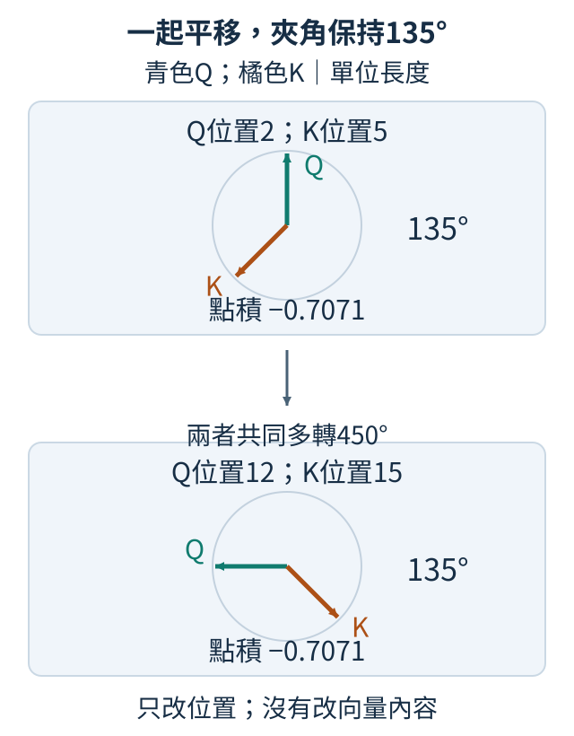
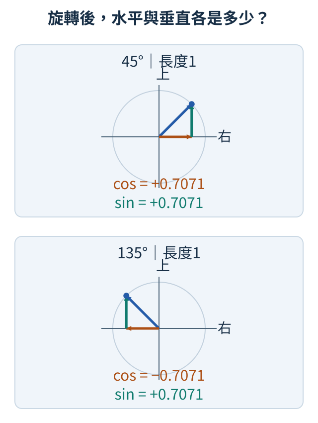
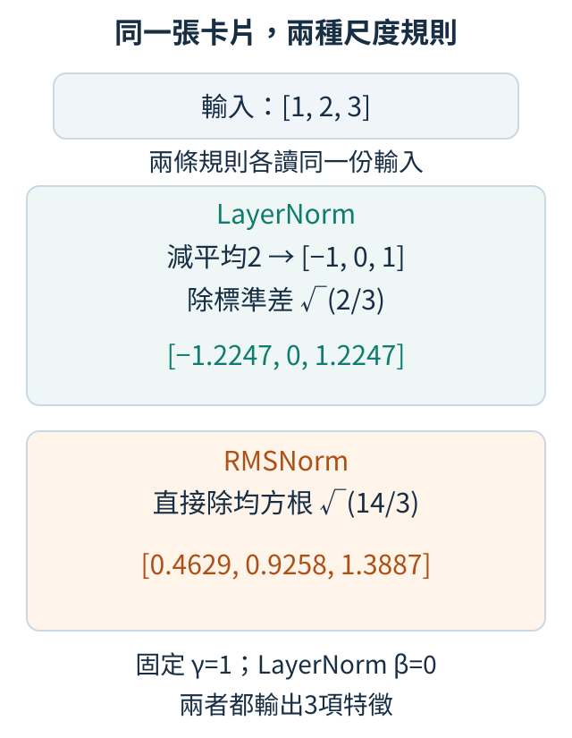
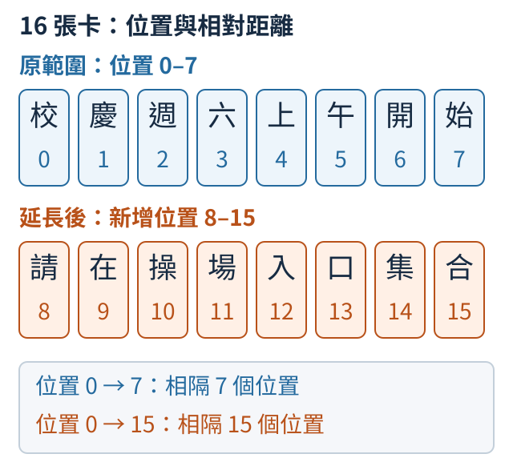
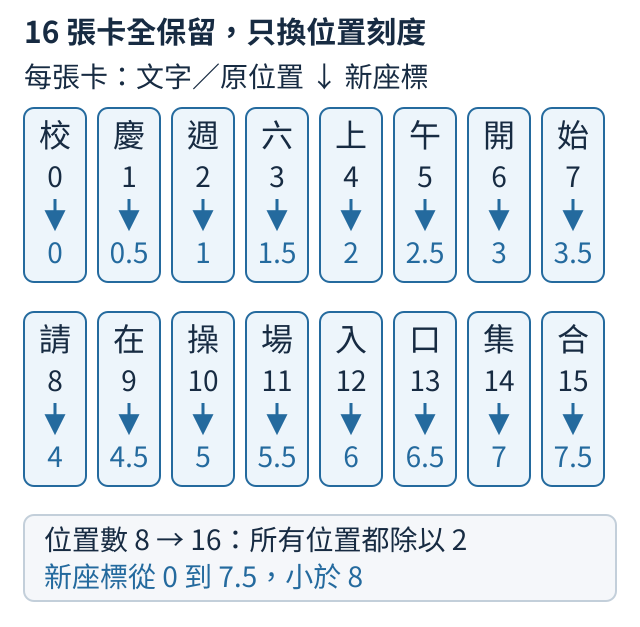
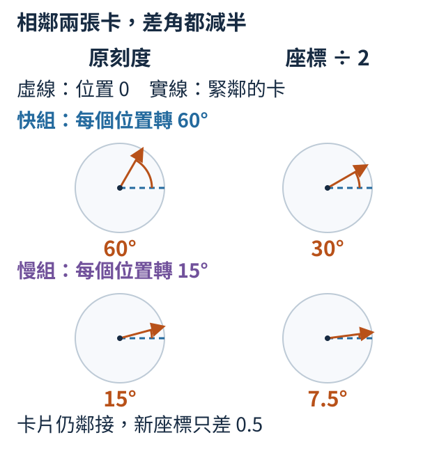
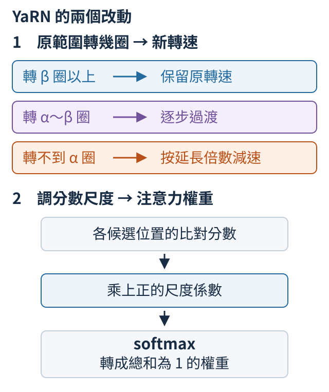
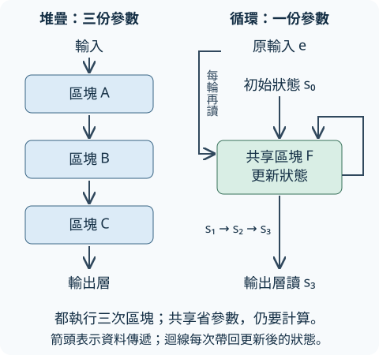
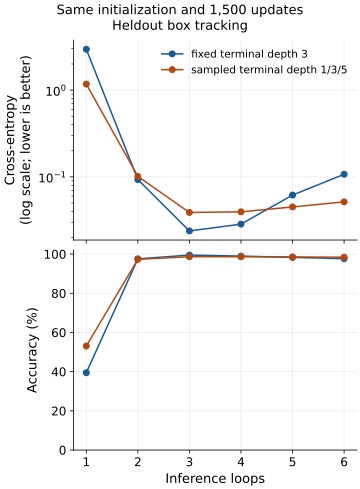

# 第 14 章：逐項理解現代文字模型的設計

「小貓追小狗」換成「小狗追小貓」，詞沒變，意思卻變了。完成[一層文字模型](04.md#4.5)後，我們從這種小差別重新檢查設計：位置怎麼進入比對、數值尺度怎麼控制、哪些特徵通過，以及字的 embedding 表能否和輸出層共用一張表。每節先用固定數字追蹤一個改動，再打開本課函式庫的實作，看 [4.5](04.md#4.5) 的 `Block` 與 [4.6](04.md#4.6) 的 `TinyLM` 換上這個零件時改了哪一行。接著把位置範圍拉長，沿著16張卡片理解位置插值與不同轉速的調整；能算出座標，和模型能讀懂長文，仍是需要分別回答的問題。

本章依節號順讀：[14.1–14.6](14.md#14.1)檢查區塊零件與權重共享，[14.7–14.10](14.md#14.7)討論位置範圍與延伸，最後在[14.11–14.18](14.md#14.11)學 Looped Transformer，了解共享區塊如何反覆更新狀態、怎樣訓練才能在不同輪數交出答案，以及多跑一輪為何不一定更好。讀到忘了的名詞，可以查[名詞頁](../glossary.md)。

## 14.1 兩個詞一起往後移，位置比對能保持嗎？

「小貓追小狗」與「小狗追小貓」包含同樣的詞，意思卻不同。注意力需要知道詞的先後，也常需要知道兩個詞相隔幾個位置。如果在句首加上「今天」，貓與狗的位置編號都增加一，但彼此距離並沒有變；我們希望用來比較兩者的某部分規則仍然相同。先回顧[注意力中的比對](03.md#3.2)與[位置資訊](04.md#4.1)：Query（Q）是當前位置提出的查詢向量，Key（K）是另一位置供它比對的向量，兩者點積提供注意力分數。

這裡先固定Q、K的內容，只改它們所在的位置。一個做法是把向量中的數字兩兩分組，當成平面上的箭頭。例如 `[1,0]` 是朝右、長度為一的箭頭。位置每往後一個，就把箭頭旋轉固定角度。假設每個位置轉45度，位置2的Q與位置5的K相差三個位置，旋轉角度差就是135度。若兩者都往後移十個位置，共同多轉450度，角度差仍是135度。箭頭長度也沒有變，因此兩者點積保持相同。這種把位置寫進旋轉的方式叫**旋轉位置嵌入**（Rotary Position Embedding，RoPE）。

下圖沿用位置2的Q與位置5的K，兩箭頭夾135度。把兩個位置各加10後，它們共同多轉450度，夾角與點積仍相同。實際模型有許多對數字，不同對使用不同轉速，並不是每一對都用每個位置45度這一種轉速。



先把旋轉用到的數學名字對上箭頭。這一段只要記住一件事：箭頭轉到某個角度後，水平座標叫這個角度的餘弦（cos），垂直座標叫正弦（sin）。例如長度為一、朝右的 `[1,0]` 轉90度得到 `[0,1]`，所以這時cos為0、sin為1；轉45度得到約 `[0.7071,0.7071]`，轉135度則得到約 `[-0.7071,0.7071]`。Python的 `math.cos`、`math.sin` 幫我們求這些座標，不必先背三角函數表。它們接受的角度單位叫弧度：半圈180度記成π弧度，`math.pi` 是圓周率π，所以45度就是 `pi / 4` 弧度。

下圖的圓標出長度為一的箭頭可以到達的終點；橘色水平箭頭是cos，青色垂直箭頭是sin。上下兩圖使用相同尺度：45度時水平向右為正，135度時水平向左為負，而兩者都向上，所以垂直值都是正的0.7071。



一般箭頭 `[x,y]` 可看成水平方向的x份加垂直方向的y份。旋轉後，原本水平的一份變成 `[cos,sin]`，原本垂直的一份變成 `[-sin,cos]`；把兩者分別乘上x、y再相加，新座標就是 `[cos*x-sin*y, sin*x+cos*y]`。例如 `[1,0]` 轉90度，代入cos=0、sin=1便得到 `[0,1]`。下面的 `rotate` 正是這兩行四則運算；它接受箭頭與位置，先把位置乘上每個位置的轉角 `pi / 4`，再求新座標。`score(q_position, k_position)` 先把q轉到Q所在的位置、把k轉到K所在的位置，再把兩支箭頭逐項相乘再相加，也就是點積；所以 `score(2, 5)` 就是位置2的Q對位置5的K。

```python
import math
import torch


def rotate(x, position):
    angle = position * math.pi / 4
    c, s = math.cos(angle), math.sin(angle)
    return torch.tensor([c * x[0] - s * x[1], s * x[0] + c * x[1]])


q = torch.tensor([1.0, 0.0])
k = torch.tensor([1.0, 0.0])


def score(q_position, k_position):
    return torch.dot(rotate(q, q_position), rotate(k, k_position)).item()


print(round(score(2, 5), 4))
print(round(score(12, 15), 4))
print(round(score(3, 5), 4))
```

前兩行都是 `-0.7071`，正是135度的餘弦；第三行是 `0.0`，因為只移Q，相隔三個位置變成兩個，角度差變成90度。負點積是比對分數，不是負機率，後續仍要透過softmax轉成注意力權重。這個實驗證明共同平移保留旋轉點積，不能證明模型在訓練未見過的超長文章上仍答得好：多種轉速與內容一起作用，還需要長度測試（[14.7](14.md#14.7)）。

上面一次只轉一支箭頭，轉速也是人選的45度。本課函式庫的 `rope`（在 [tiny_perceptron/modern.py](../../tiny_perceptron/modern.py)）一次轉完注意力裡整批的Q或K：輸入 `x` 的形狀是 [3.7](03.md#3.7) 的 `[筆數, 頭, 位置, 每頭格數]`，`positions` 是這些位置的編號，`base` 決定各對的轉速。函式庫版還有一個分支，處理每筆資料各有一列位置編號的情況，例如 [7.7](07.md#7.7) 補上PAD後，每筆的真實token仍從0編號。本節的位置都是同一列 `0,1,2,…`，所以下面的精簡版省略那個分支，也省略換裝置與換數字格式的兩步。

```python
# 精簡自 tiny_perceptron/modern.py：rope（省略每筆各有一列位置的分支，以及裝置與數字格式的轉換）
from tiny_perceptron.modern import rope as library_rope


def rope(x, positions, base=10000):
    d = x.shape[-1]
    if d % 2:
        raise ValueError("RoPE 需要偶數 feature 維度")
    frequency = base ** (-torch.arange(0, d, 2) / d)
    angle = positions[:, None] * frequency[None, :]
    angle = angle[None, None]
    cosine, sine = angle.cos(), angle.sin()
    a, b = x[..., 0::2], x[..., 1::2]
    return torch.stack((a * cosine - b * sine, a * sine + b * cosine), -1).flatten(-2)
```

函式庫版用 `as` 換名成 `library_rope`，免得蓋掉這裡寫的版本，做法和 3.7 相同。逐行看：

- `d = x.shape[-1]` 是每個頭的特徵數。`if d % 2:` 檢查能不能兩兩成對，不能就用 `raise ValueError` 停下。
- `frequency = base ** (-torch.arange(0, d, 2) / d)` 替每一對算一個轉速，單位是「每往後一個位置轉幾弧度」。`torch.arange(0, d, 2)` 是0、2、4…；d=8時四對的轉速依序是 `10000**0=1`、`10000**(-2/8)=0.1`、0.01與0.001。第一對最快，每個位置轉1弧度，約57.3度；越後面的對轉得越慢。
- `angle = positions[:, None] * frequency[None, :]`：`[:, None]` 把位置立成一欄，`[None, :]` 把轉速排成一列，兩者相乘時靠 [1.5](01.md#1.5) 的廣播自動配對，得到形狀 `[位置數, 對數]` 的角度表，第m列第i欄就是位置m在第i對要轉的弧度。下一行的 `angle[None, None]` 和 [3.6](03.md#3.6) 一樣在前面補兩個長度1的軸，讓同一張角度表套到每一筆、每一個頭。
- `a, b = x[..., 0::2], x[..., 1::2]`：`...` 表示前面的軸全部照留；`0::2` 是從0開始、每次跳兩格的切片（[1.3](01.md#1.3) 的切片再加第三個數：步長），取第0、2、4…格當水平座標；`1::2` 取第1、3、5…格當垂直座標。所以每一對是相鄰的兩格。
- 最後一行的 `a * cosine - b * sine` 與 `a * sine + b * cosine` 就是 `rotate` 那兩個式子，只是一次算完所有位置、所有對。`torch.stack(..., -1)` 把新的水平、垂直座標並排成最後一軸的兩格，`.flatten(-2)` 再把「對數×2」攤回原本的d格，順序和輸入一樣。

下面讓十六個位置都放同樣的八個1，差別只來自位置；再用函式庫版本核對：

```python
x = torch.ones(1, 1, 16, 8)
positions = torch.arange(16)
r = rope(x, positions)[0, 0]
print("2對5", round((r[2] @ r[5]).item(), 4), "12對15", round((r[12] @ r[15]).item(), 4))
print("3對5", round((r[3] @ r[5]).item(), 4))
check = torch.randn(2, 4, 16, 8)
same = torch.equal(rope(check, positions), library_rope(check, positions))
print("與函式庫版本相同：", same)
assert same
```

`r` 取出第一筆、第一個頭，形狀 `[16, 8]`，每列是一個位置旋轉後的八個數；`r[2] @ r[5]` 是位置2與位置5的點積。四對的轉速就是上面算過的1、0.1、0.01與0.001。位置2對5與位置12對15都是3.9298：前後一起平移十個位置，分數不變，和45度的手算同一個道理；位置3對5相隔兩個位置，分數變成5.1274。這個分數是四對各自點積的和：每一對 `[1,1]` 的長度平方是2，相隔三個位置時，最快那對轉了3弧度、方向幾乎相反，最慢那對幾乎沒轉，所以和是 `2×(cos 3+cos 0.3+cos 0.03+cos 0.003)`，約3.9298。最後的核對另用一組隨機數字 `check`（兩筆、四個頭、十六個位置），因為全是1的輸入裡每對的水平與垂直座標相同，就算把兩者放反也看不出差別；`torch.equal` 核對兩版逐格相同，印出 True。

這個函式接在 [4.5](04.md#4.5) `Block` 的注意力上。設定 `ModelConfig(rotary=True)` 時，函式庫的 `CausalAttention` 先照 [3.7](03.md#3.7) 算出Q、K、V並拆成頭，再執行 `q, k = rope(q, pos), rope(k, pos)`（`pos` 是各位置的編號），之後才比對：只轉Q與K，V不轉，因為位置要影響的是誰和誰比較，取回的內容不必跟著轉。[4.6](04.md#4.6) 的 `TinyLM` 也要跟著改兩處（函式庫裡的 `c` 就是 `config`）。`__init__` 建位置表的那行改成 `self.position = None if c.rotary else nn.Embedding(c.max_length, c.width)`，開了旋轉就不建位置表；`forward` 在加上位置表查出的向量之前先判斷 `if self.position is not None:`，有位置表才執行 `x = x + self.position(positions)`。只改第一處的話，`forward` 仍會呼叫已經是 `None` 的 `self.position`，丟出 `TypeError`。兩處都改，位置就只從旋轉進入。

練習把第一段程式最後一個 `print` 內的 `score(3, 5)` 改成 `score(22, 25)`，保留外面的 `print` 與 `round`，也就是 `print(round(score(22, 25), 4))`。先預測是否等於前兩行，再執行核對；接著只把其中的引數改成 `score(22, 26)`。你應能用「相隔三個或四個位置」解釋結果，而不用重新記一個位置表。再把第三段的 `torch.ones(1, 1, 16, 8)` 改成 `torch.ones(1, 1, 16, 2)`：只剩轉速1的一對，先預測「2對5」是 `2×cos 3`，約−1.98，再執行核對。

<details>
<summary>選讀：來源、量測條件與實驗紀錄</summary>

旋轉與相對點積的原始推導可讀[RoFormer第3.2節、式14–16](https://arxiv.org/pdf/2104.09864v5)。我們也另做了真正更新參數的比較：同一批TinyStories、特徵寬度64、兩層、四個注意力頭，基準之外的五組各只換一個零件，各更新240次。條件與六組結果記在[實驗紀錄](../../docs/course-experiments/results/modern.json)（JSON，機器可讀的完整結果）：`results.variants` 下的 `baseline`、`rope`、`rmsnorm`、`relu2`、`swiglu`、`tied` 各是一組，驗證與測試代價看 `heldout.validation.nll` 與 `heldout.test.nll`，同一處的 `effective_tokens` 是有效目標數，參數數看 `model.parameters`。重做命令是[T.8](../training.md#T.8)摺疊區的 `--experiment modern`；T.8正文那三條200步、特徵寬度32的命令是另一組練習。

一個[注意力頭](03.md#3.7)是用自己一組Q、K、V尋找關聯的單位，四頭表示同一層並排做四組這樣的查詢。這次文字按UTF-8編碼拆成byte，每個byte是0至255的數值單位；字表共264項，是256種byte加上8個特殊token（[6.4](06.md#6.4)、[6.6](06.md#6.6)），故事結尾的EOS（結束標記）是其中之一。英文常用字母通常佔一byte，中文字通常需要多個byte，所以分母不是中文字數。基準與RoPE的驗證代價分別為2.26331與1.74158，測試代價為2.29163與1.77812；兩個模型在驗證資料各有39,256個有效目標（下一個byte或EOS），在測試資料各有41,914個。平均代價越低，表示這批原文更容易預測。

此RoPE組移除128×64的位置表（最多128個位置，每個位置64個特徵），總參數由141,568減為133,376，並未保持參數量相同。它在這次短訓的驗證與測試代價都較低，但測試資料第一個提示 `Once upon a time, there ` 的續寫仍是 `was a loked there was a bough a `。一次小模型比較既沒有證明故事寫得好，也沒有測試超過128位置的外推。

</details>

## 14.2 正規化能否簡化？

同一位置的三個特徵是 `[2,2,2]`。我們想控制它的數值尺度，卻有兩種可能的答案：先拿掉共同平均，會得到 `[0,0,0]`；只按共同大小縮小，會接近 `[1,1,1]`。前者抹掉「一起偏向正值」的資訊，後者保留它，因此兩種正規化不是同一個規則少做一行運算。這裡的特徵是同一位置向量的各項數字；尺度沿這三項計算，不把其他位置混進來，做法可回顧[4.3](04.md#4.3)。

LayerNorm先算平均，逐項減掉平均，再除以標準差。對 `[2,2,2]` 而言，平均是2，減完得到全零；雖然標準差也是零，分母的小常數能避免除以零。**均方根正規化（RMSNorm）**採用另一規則：把每項平方，求平均，再開平方根，所得稱為均方根（Root Mean Square，RMS）。此例平方都是4，均方根為2，直接用原數字除以2便得到 `[1,1,1]`。它保留三項一起偏大的部分，不先把平均搬到零。

圖中的卡片 `[1,2,3]` 表示同一位置的三個特徵。上下兩塊分別列出先減平均再除標準差，以及直接除均方根的結果。完整層還可學習逐項縮放：γ（gamma）是每項乘上的倍率，β（beta）是每項加上的偏移，和4.3的γ、β相同；標準LayerNorm兩者都有，常見RMSNorm只有γ。這裡都固定γ為1，LayerNorm的β為0，先看兩條規則本身。



下列輸入每一列代表一個位置，三欄代表三項特徵。`mean(..., keepdim=True)`保留一欄，方便將同一個分母除到該列三個數字上。`-1`指定最後一個軸，也就是三個特徵；`(3,)`則告訴LayerNorm對最後三項特徵做正規化。`eps`是避免全零輸入除以零的小常數，並不是要把正常數字改成零。`from torch import nn` 留給後面節錄的 `RMSNorm` 使用。

```python
import torch
import torch.nn.functional as F
from torch import nn

x = torch.tensor([[2.0, 2.0, 2.0], [1.0, 2.0, 3.0]])
eps = 1e-5
ln = F.layer_norm(x, (3,), eps=eps)
rms = x / torch.sqrt(x.square().mean(-1, keepdim=True) + eps)
print("LN", ln.round(decimals=4))
print("RMS", rms.round(decimals=4))
```

LN第一列為全零，第二列約 `[-1.2247,0,1.2247]`：1和3位於平均2的兩側。RMS第一列約全一，第二列約 `[0.4629,0.9258,1.3887]`，因為分母是 `sqrt(14/3)`，約2.1602。兩者形狀相同，數值與意義卻不同；把訓練好的LayerNorm直接換成RMSNorm，後面的參數未必能適應。省去平均與偏移可能簡化運算，但品質與速度需要在相同模型條件下量測。

函式庫的 `RMSNorm` 把 `rms` 那一行包成一個零件，另加上可學的γ：

```python
# 節錄自 tiny_perceptron/modern.py：RMSNorm
class RMSNorm(nn.Module):
    def __init__(self, width, eps=1e-5):
        super().__init__()
        self.weight = nn.Parameter(torch.ones(width))
        self.eps = eps

    def forward(self, x):
        scale = (x.float().square().mean(-1, keepdim=True) + self.eps).rsqrt()
        return x * scale.to(x.dtype) * self.weight
```

怎麼讀零件類別見[3.7](03.md#3.7)。`__init__` 只建立一個可學的部分：`self.weight = nn.Parameter(torch.ones(width))` 是每個特徵一個倍率，也就是上面的γ，初值都是1；`nn.Parameter` 把這排數字登記成模型的參數，訓練時會被更新。它沒有β，所以比同寬的LayerNorm少一排偏移。`self.eps` 記下防止除以零的小常數。

`forward` 的第一行算每個位置的縮放倍數：`.square().mean(-1, keepdim=True)` 沿最後一軸求平方的平均，加上 `self.eps` 後，`.rsqrt()` 取平方根的倒數 `1/sqrt(...)`。第二行把 `x` 乘上這個倍數，等於除以均方根，再逐項乘上 `self.weight`。`x.float()` 與 `scale.to(x.dtype)` 處理數字格式：第16章（[16.7](16.md#16.7)）才講較短的數字格式，這裡只需要知道，平方與平均先用32位元浮點數算，算完再換回輸入原本的格式；本節的輸入本來就是32位元，這兩步不改結果。

```python
from tiny_perceptron.model import ModelConfig, TinyLM

norm = RMSNorm(3)
print("可學的參數", list(norm.state_dict()), "初值", norm.weight.tolist())
print("與手算的 rms 相同：", torch.allclose(norm(x), rms))
for kind in ("layer", "rms"):
    model = TinyLM(ModelConfig(width=64, layers=2, heads=4, norm=kind))
    print(kind, model.blocks[0].norm1, "總參數", model.description()["parameters"])
```

`state_dict()` 列出零件的參數名（3.7）：只有 `weight`。`RMSNorm(3)` 對第一段的 `x` 算出與手算 `rms` 相同的結果，印出 True；這裡用 `torch.allclose` 而不是逐位元比較的 `torch.equal`，因為函式庫乘 `rsqrt()`、手算除以 `sqrt`，兩種算法在浮點數的最後幾位可能差一點點。

接回 [4.5](04.md#4.5)：精簡版 `Block` 寫的是 `nn.LayerNorm(config.width)`，函式庫版那裡是 `norm = nn.LayerNorm if config.norm == "layer" else RMSNorm`，所以 `ModelConfig(norm="rms")` 會把每個block的 `norm1`、`norm2` 換成RMSNorm；[4.6](04.md#4.6) 的 `TinyLM` 也照同一個設定換掉最後LN。迴圈裡的模型用補充區那次實驗的大小（特徵寬度64、兩層、四頭），印出的 `norm1` 從 `LayerNorm((64,), …)` 變成 `RMSNorm()`。兩層各兩處、再加最後一處，共五處正規化，每處少64個偏移，總參數從141,568減為141,248，差 `5×64=320`；`description()` 回傳設定與參數總數，見 [4.8](04.md#4.8)。

練習在第一段程式 `x = torch.tensor(...)` 那一行下面加一行 `x = x + 10`，先預測LN與RMS哪一行不變。重跑後比較：LayerNorm會消去新增的共同平均，第二列仍約 `[-1.2247,0,1.2247]`；RMSNorm只調尺度，第二列變成約 `[0.9146,0.9977,1.0808]`。第三段的 `RMSNorm(3)` 跟著手算一起變，仍印出 True。這能說明「正規化」這個名字並不保證各種方法等價。

<details>
<summary>選讀：來源、量測條件與實驗紀錄</summary>

[RMSNorm原論文第4節、式4](https://arxiv.org/pdf/1910.07467v1)給出只使用均方根的規則；論文中的速度結果仍取決於其模型與硬體。[14.1補充](14.md#14.1)那份實驗紀錄是在L4 GPU上的短訓；其中LayerNorm與RMSNorm（`baseline` 與 `rmsnorm` 兩組）的驗證代價為2.26331與2.25913，測試代價為2.29163與2.28631。bias就是前面的可學偏移β；此模型五處正規化各有64個偏移，移除它們後RMSNorm少 `5×64=320` 個參數。暖機後每步的中位數（`training.warm_step_median_seconds`）卻是13.062與13.952毫秒，這輪沒有測到速度收益；計時含前向計算、反向傳播、梯度核對與更新，不是只量一個正規化函式。這個很小的代價差也只有一個隨機種子：種子是產生隨機數的起始設定，固定它可重現模型初始化及抽樣的隨機序列；換種子可能換掉起點與看到例子的次序，結果也可能改變。這次只跑一個種子，還不能把小差距當成穩定的品質優勢，需換種子重跑才能檢查。

</details>

## 14.3 Q／K 的尺度怎麼影響注意力？

取一個查詢 `Q=[1,1]`，候選是水平的 `[1,0]` 與垂直的 `[0,100]`。Q與兩個方向都夾45度，我們想比較方向是否合適，第二個候選卻可能因長度大而獨占注意力。原因是[Q與K的比對](03.md#3.3)用點積：對應數字逐項相乘再相加，既反映方向，也受向量長度影響。本節先讓兩個候選回到相同長度，再看分配是否改變。

取 `Q=[1,1]`，兩個K分別是 `[1,0]` 和 `[0,100]`。Q位在對角方向，與水平、垂直方向的夾角都45度；但點積分別為1和100。softmax把分數轉成總和為一的非負權重：先對每個分數s求 `exp(s)`，也就是以約2.718的數e為底、取s次方，再除以這些結果的總和。例如分數 `[1,0]` 先變成約 `[2.718,1]`，各除以3.718，就得到約 `[0.7311,0.2689]`。`[1,100]` 的第二項取指數後大得多，第二個位置便幾乎獨占注意力。這是長度改變造成的偏好，不是我們改了查詢或候選的方向。

可以先將Q、K各自除以自己的長度。例如Q的長度是 `sqrt(1²+1²)=sqrt(2)`，會變成 `[0.7071,0.7071]`；兩個K則變成 `[1,0]` 與 `[0,1]`。這個把向量長度縮成1的做法叫**L2正規化**（L2 normalization）：它只除以長度，不減平均，也沒有可學的倍率，和[4.3](04.md#4.3)、[14.2](14.md#14.2)那種整理尺度的層是不同規則。長度都是1之後，點積就是夾角餘弦。兩個分數現在同為0.7071，softmax得到各0.5。這只是QK正規化（先整理Q、K的尺度再比對）的一種選擇：其他模型可能採用[均方根尺度](14.md#14.2)，應清楚說明實際規則。

```python
import torch
import torch.nn.functional as F

q = torch.tensor([[1.0, 1.0]])
k = torch.tensor([[1.0, 0.0], [0.0, 100.0]])
raw = q @ k.T
unit = F.normalize(q, dim=-1) @ F.normalize(k, dim=-1).T
print("原分數", raw)
print("原權重", raw.softmax(-1).round(decimals=4))
print("正規化分數", unit.round(decimals=4))
print("正規化權重", unit.softmax(-1).round(decimals=4))
print("有方向差的權重", torch.tensor([1.0, 0.0]).mul(4).softmax(-1).round(decimals=4))
```

輸入是一列Q與兩列K，`k.T`把K轉置，讓矩陣乘法一次比較兩個候選。`dim=-1`指定沿最後一軸：在 `F.normalize` 收到的q、k裡，最後一軸是每個向量的兩項特徵，所以各向量除以自己的長度；若沿候選軸正規化，就變成另一個問題。乘完得到的raw與unit形狀卻是 `[1,2]`，這裡一列列出兩個候選的分數，所以 `softmax(-1)` 的最後一軸是候選，不再是特徵。同樣寫 `-1`，仍要先看目前這張表各軸代表什麼。前三種結果應對照上述手算：原分數 `[1,100]`，原權重印成 `[0,1]`，正規化後權重 `[0.5,0.5]`。`round(decimals=4)` 取到小數第四位；原權重的第一項其實約 `e^(1−100)`，小到四捨五入成0。

最後一行另外示範「控制分數尖銳程度」：假設兩方向分數為1與0，乘4後softmax約 `[0.9820,0.0180]`，比不乘4時的 `[0.7311,0.2689]`更集中。這個乘數常稱scale；若用除數表達，便稱temperature（溫度），溫度越低越集中。正規化拿掉長度差後，仍能另行設定或學習這個尺度，讓模型調整選擇強度。

這個局部例子把向量長度的影響拿掉，讓兩個相同夾角得到相同比例。整個模型是否需要長度傳達訊息，則是設計與訓練問題；不能只由這兩個候選替不同正規化方法排名。

練習只把 `k` 那一行的 `100.0` 改成 `0.1`，先預測原權重如何變、正規化權重是否變。核對後應看見原分數變成 `[1,0.1]`，而兩個候選與Q的夾角仍都是45度，正規化仍各0.5。不要把這個例子推成「長度一定無用」；模型可能學會用長度表達訊息，改規則需要重新訓練與比較。

<details>
<summary>選讀：這個局部例子與整模型比較的範圍</summary>

本節只有局部方向與尺度的CPU示範。[14.1補充](14.md#14.1)那份現代零件的實驗紀錄沒有QK正規化組；TinyLM也沒有對應的整模型開關。因此不能由本節的兩候選數字，宣稱整個模型訓練更穩、速度更快或文字品質更好。

</details>

## 14.4 逐項改數字，為何能增加表達方式？

一個輸入先乘2、再乘3，和中間插入平方，差在哪裡？先只看一個數字x：先乘2、再乘3，總能改寫成一次乘6，輸入1與2時輸出6與12，始終按同一倍數變化。如果在中間平方，輸出卻變成 `3×(2x)²`，輸入1與2時是12與48；第一個輸入需要乘12，第二個需要乘24，已不能用同一倍數描述。前者叫線性，後者叫非線性，畫出輸入與輸出的關係也不再是原來那種直線。模型中矩陣乘法只是把這種乘係數、再相加的規則擴展到一列數字；若各層都只有矩陣乘法，連續兩次仍可合成一次，增加層數也不能提供這種新關係。[4.4](04.md#4.4)讀完前文後加工特徵的FFN（前饋網路），就是在兩次矩陣乘法之間加入非線性；這個逐項改數字的步驟叫**啟用函式**（activation function），4.4用的是GELU。

用三個容易追蹤的輸入 `[-1,0,2]` 看兩種選擇。ReLU先把負數改成零、保留正數，因此得到 `[0,0,2]`；ReLU²再平方，得到 `[0,0,4]`。GELU則平滑地縮小數字。它可寫成 `x × Φ(x)`：把標準常態分布想成以0為中心、左右對稱的鐘形分布，Φ(x)是落在x及其左邊的比例，所以介於0和1。x很負時左邊只剩很少比例，Φ接近0；x很正時幾乎全在左邊，Φ接近1。對x=-1，Φ約0.1587，輸出約-0.1587；對x=2，Φ約0.9772，輸出約1.9545。這個公式用來理解通過的比例，實際數值交給下面的 `F.gelu` 計算。負值沒有整段硬切成零，而大正值接近原值。

下面擴成五個固定輸入，避免隨機值讓重點難辨。`F`是PyTorch提供常用函式的模組；`F.gelu`實作上述GELU，`F.relu(x).square()`清楚分成截掉負值、再平方兩步。所有函式都逐項工作，輸入與輸出形狀相同。

```python
import torch
import torch.nn.functional as F

x = torch.tensor([-2.0, -1.0, 0.0, 1.0, 2.0])
print("輸入", x.tolist())
print("GELU", F.gelu(x).round(decimals=4).tolist())
print("ReLU平方", F.relu(x).square().tolist())
```

GELU約輸出 `[-0.0455,-0.1587,0,0.8413,1.9545]`；ReLU²為 `[0,0,0,1,4]`。觀察x=-2與-1：GELU並不是把所有負值乘同一個常數，更大的負值反而更接近零。觀察正側：ReLU²在x=2時變成4，比x=1時的1大四倍，因此對大正值更敏感。這些數字說明函式如何處理訊號，還沒有說明它們在文字任務上誰比較好。

把啟用函式換到訓練好的模型，會改變下一層收到的尺度和負值分布。即使新函式不增加參數，也可能需要讓參數重新適應。公平比較應固定訓練資料、層數、特徵寬度與訓練步數，分別訓練後再比較驗證代價（在沒有拿來更新參數的驗證資料上，預測答案的平均代價）及耗時。單看函式名字、單次輸出或省一個運算，不能替整個模型排名。

函式庫的 `DenseFFN`（[4.4](04.md#4.4)）用 `activation` 參數切換這一步：4.4精簡版保留的 `h = F.gelu(h)`，在 `activation="relu2"` 時換成 `h = F.relu(h).square()`，前後兩個Linear不變。`ModelConfig(activation="relu2")` 讓每個block的FFN都這樣建立，所以換成ReLU²不增加參數。

練習把建立`x`的清單改成 `[-4.0,-2.0,0.0,2.0,4.0]`，保留小數寫法，讓PyTorch建立浮點數表；若全部寫成整數，預設會得到整數表，`F.gelu`不能接受。執行前先預測ReLU²最後一項是16，GELU最後一項接近4；再核對負側是否依然保留很小的負數。第一項可能印成`-9.999999747378752e-05`，這個科學記號寫法在這裡約等於`-0.0001`，因此仍是很小的負值。若畫圖，橫軸應是輸入，縱軸應是各函式輸出，不能把這條曲線當作訓練品質圖。

<details>
<summary>選讀：來源、量測條件與實驗紀錄</summary>

[14.1補充](14.md#14.1)那份實驗紀錄（`baseline` 與 `relu2` 兩組）保持全部141,568個參數與抽題順序，分別用GELU、ReLU²更新240次。驗證代價為2.26331與2.23590，測試代價為2.29163與2.26438；每步中位數13.062與12.893毫秒。ReLU²在這輪略低、略快，但測試資料第一個提示的續寫仍是 `was a was the the the the ar and`，不能把更低的代價換成「已能寫好故事」。小時間差與單一種子（產生隨機初始化與抽樣序列的起始設定）也需要更多重複測量才適合外推。

</details>

## 14.5 怎麼讓特徵控制另一組特徵？

內容路徑算出 `[2,2,2]`，但我們想讓三項分別反號、關閉、放大，要怎麼控制？一個特徵很強，不代表在每段文字裡都應使用它。例如模型辨認出「可能是人名」的訊號，但上下文顯示這是商品名稱，便需要另一組訊號調整它。普通FFN先算出內容，再經[啟用函式](14.md#14.4)改變大小；我們也能準備兩條路，一條產生內容，另一條根據同一個輸入決定每項內容要放大、縮小或反號。後者叫gate（閘門），逐項相乘的組合叫gating。

先用確定的數字把這件事拆開。內容路徑輸出 `[2,2,2]`，閘門路徑輸出 `[-2,0,2]`。我們先對閘門套**SiLU**（Sigmoid Linear Unit，Sigmoid線性單元，也稱Swish）：它把x乘上 `sigmoid(x)`，而sigmoid把任意數字變成0到1之間。-2的sigmoid約0.1192，SiLU約-0.2384；0變0；2變1.7616。再與內容逐項相乘，得到約 `[-0.4768,0,3.5232]`。第一項反號、第二項消失、第三項變大。

這個組合稱為**SwiGLU**。名字由Swish與GLU組成；GLU是Gated Linear Unit，閘門式線性單元。本例用SiLU來做閘門。名稱裡的閘門容易讓人誤以為最後係數是0到1的機率；其實SiLU仍含原來的x，輸出可以負、也可以大於1。完整層先把特徵寬度d的輸入投影成中間寬度h的閘門和內容，兩者相乘後，再投影回d，讓後面的模型維持原形狀。

```python
import torch
import torch.nn.functional as F

from tiny_perceptron.modern import DenseFFN

content = torch.tensor([2.0, 2.0, 2.0])
gate = torch.tensor([-2.0, 0.0, 2.0])
factor = F.silu(gate)
print("閘門係數", factor.round(decimals=4))
print("調節內容", (content * factor).round(decimals=4))
d, h = 8, 16
print("普通FFN權重數", d * h + h * d)
print("SwiGLU權重數", d * h + d * h + h * d)
layer = DenseFFN(d, h, activation="swiglu")
print("函式庫的三張權重表", [list(m.weight.shape) for m in (layer.up, layer.gate, layer.down)])
```

前三個tensor是可追蹤的小例子；`content * factor`是相同位置逐項乘，不是矩陣乘法。前兩行輸出應是上述係數和內容。接著兩行不建立隨機模型，而直接數矩陣裡的數字：普通FFN有 `d×h` 和 `h×d` 兩張權重表，得到256；SwiGLU多了一張 `d×h` 的閘門表，得到384。這裡只數權重表，不數偏移（bias，每項額外加的常數）。

最後兩行建立函式庫的 `DenseFFN(d, h, activation="swiglu")`（[4.4](04.md#4.4)），列出 `up`、`gate`、`down` 三張權重表的形狀 `[16, 8]`、`[16, 8]`、`[8, 16]`；`nn.Linear` 的權重是 `[輸出格數, 輸入格數]`，見 [2.3](02.md#2.3)。它在 `activation="swiglu"` 時多建一個 `self.gate = nn.Linear(width, hidden)`，`forward` 裡4.4的 `h = F.gelu(h)` 那一步改成 `h = F.silu(self.gate(x)) * h`：閘門路徑算出係數，逐項乘上 `up` 算出的內容，最後一樣由 `down` 縮回。這三個Linear另各帶一排偏移，所以函式庫版實際的參數比這裡數的多。

同樣的中間寬度h不等於同樣的模型大小。若要公平比較，可把SwiGLU的h減到普通FFN的約三分之二，讓三張表的總數接近原來兩張表，再分別訓練並量測。這也說明架構設計常需要同時考慮「函式做了什麼」與「花多少參數和計算」，不能只把零件換上去就宣稱有收益。

練習把 `gate` 改成全零的 `torch.tensor([0.0, 0.0, 0.0])`，先預測「調節內容」那一行，也就是 `content * factor` 的結果，是否仍為 `[2,2,2]`，再核對輸出：SiLU(0)=0，三項都變成0，整排內容被關掉。接著只把第一項改成2，也就是 `[2.0, 0.0, 0.0]`，確認只有第一項被放大成約3.5232，其餘仍是0。你不需要訓練模型，就能先分辨逐特徵控制與把整個向量乘同一音量的差別。

<details>
<summary>選讀：來源、量測條件與實驗紀錄</summary>

這個三表結構見[GLU Variants Improve Transformer第2節、式5–6](https://arxiv.org/pdf/2002.05202v1)；原文也明確縮小中間寬度以匹配參數與計算。[14.1補充](14.md#14.1)那份實驗紀錄（`swiglu` 組）則保留各組中間寬度256，SwiGLU連偏移共174,848個參數，基準為141,568。相同240次更新後，SwiGLU驗證代價2.25444、測試代價2.28009，略低於基準2.26331與2.29163；每步13.336毫秒，基準13.062毫秒。這回答的是固定資料與更新預算下換上較多參數的閘門，並非重現論文的等參數比較。

</details>

## 14.6 輸入輸出權重應該共享嗎？

模型讀到「貓」時，要從 embedding 表查出代表貓的一列；準備輸出下一字時，又要用當前向量替「貓、狗、車」等候選打分。這兩件事都需要一張「每個token對應一列數字」的表，能否只存一張？把[輸入查表](02.md#2.1)和[輸出打分](04.md#4.6)放在一起看：token是tokenizer切詞後的單位（[6.1](06.md#6.1)），字表是所有可用token的清單，embedding表替字表裡每個token存一列數字；輸入取一列，輸出拿當前向量與各列做點積。

假設字表只有三項、每項用兩個特徵，輸入表E是三列兩欄，共六個參數。若輸出再存一張同形狀的表，就多六個。**權重共享**（weight tying）把輸出層的權重設成同一張E，輸出分數就是 `h @ E.T`，h是當前兩個特徵；`@`是矩陣乘法，`.T`將E的列與欄對調，讓h一次與各候選做點積。點積就是同位置的數字先相乘，再把乘積相加：若E三列為 `[1,0]`、`[0,1]`、`[1,1]`，h為 `[2,1]`，三個分數分別是 `2×1+1×0=2`、`2×0+1×1=1`、`2×1+1×1=3`。`h @ E.T` 是一次完成這三列同樣的運算，並沒有多一條打分規則。這個點積仍是分數，還沒有轉成機率。

關鍵在於「同一張」。複製E的初值到另一張表，只是此刻數字相同；日後兩張表收到不同學習訊號，仍會各自改變。共享則是兩個模組引用同一個Parameter，Parameter是PyTorch用來記錄可學數字的物件，因此更新時只更新這一份。下面刻意建立共享、複製兩種輸出，直接觀察差別。

```python
import torch
from torch import nn

embedding = nn.Embedding(3, 2)
with torch.no_grad():
    embedding.weight.copy_(torch.tensor([[1.0, 0.0], [0.0, 1.0], [1.0, 1.0]]))
tied = nn.Linear(2, 3, bias=False)
tied.weight = embedding.weight
copied = nn.Linear(2, 3, bias=False)
with torch.no_grad():
    copied.weight.copy_(embedding.weight)
h = torch.tensor([[2.0, 1.0]])
print("原分數", tied(h).tolist(), copied(h).tolist())
print("同一物件", tied.weight is embedding.weight, copied.weight is embedding.weight)
with torch.no_grad():
    embedding.weight[0, 0] += 1
print("改表後", tied(h).tolist(), copied(h).tolist())
```

輸入h是一列兩欄，`nn.Linear(2,3)`將它轉成三個候選分數。`bias=False`省去額外偏移，使結果只看權重表。`no_grad`暫停記錄學習用的導數，讓我們直接設初值和手動改數字。第一行兩者都是 `[[2,1,3]]`，第二行是 `True False`。修改第一列第一項之後，共享輸出變成 `[[4,1,3]]`，複製輸出仍是 `[[2,1,3]]`，因為只有共享版本真的讀到被改的同一份數字。

真實模型共享可省 `字表大小×D` 個參數（D是特徵寬度）；但輸入表和輸出表也失去各自調整的自由度。這是模型設計選擇，不能單憑省參數斷言品質更好。函式庫的 `TinyLM`（[4.6](04.md#4.6)）在 `ModelConfig(tied=True)` 時做的就是上面那一行：`self.output.weight = self.embedding.weight`，輸出層不再有自己的一份表。模型儲存、載入或量化（第17章，改用較少位元保存參數）後，也應再次核對共享關係，以免轉換程序建立了兩份表。

練習只把 `embedding.weight[0, 0] += 1` 改成 `embedding.weight[1, 1] += 1`，也就是第二列第二項加1。先用h第二項是1預測共享的第二個分數只增加1，再執行核對。若只看兩個表最初數字相等，會漏掉這節最重要的物件共享差別。

<details>
<summary>選讀：來源、量測條件與實驗紀錄</summary>

[Press與Wolf的原論文第3節](https://arxiv.org/pdf/1608.05859v3)說明輸入與輸出表的綁定。[14.1補充](14.md#14.1)那份實驗紀錄（`tied` 組）的共享組有124,672個參數，比基準少264×64=16,896個，也就是字表264項、特徵寬度64的一整張輸出表。240次更新後，驗證代價2.36276、測試代價2.38422，這輪高於基準2.26331與2.29163。

還要看起點：共享組把原本獨立的輸出表改成embedding那份初值，訓練前代價43.87647（`training.initial.nll`），基準只有5.76007。共有形狀的其他表雖然沿用同一初值，輸出分布已不同，所以不能用這次短訓斷言共享本身傷害品質。省下的參數數是可核對的結構事實；需要多少訓練適應、最後品質如何，仍是另一個實驗問題。

</details>

## 14.7 為什麼位置公式算得出，長文章卻未必讀得好？

把「校慶週六上午開始請在操場入口集合」依序寫成十六張卡片，每張卡放一個字。這裡為了只看位置，約定一張卡就是一個token；真實文字如何切成token，仍由所用的tokenizer決定（[第6章](06.md)）。卡片從0編到15。假設一個模型訓練時，每段文字最多八張卡，它收到的位置便只有0到7。現在我們希望它連後面的八張也一起讀，位置公式算得出8到15，是否就表示它能讀好整段？

位置公式做的是替卡片提供位置資訊。回想[14.1](14.md#14.1)用旋轉表示位置的RoPE：Query是某位置用來查找關聯的向量，Key是其他位置供它比對的向量；把其中成對的數字依位置旋轉，兩者的點積便會包含相對位置的影響。旋轉可以繼續算下去，轉到位置15也不需要多查一張位置表。但這只是算出一組數字，模型還要學會在這組數字下，怎樣利用文字內容找出關聯。

在我們每段最多八張卡的假設裡，兩張卡最遠相隔7個位置，例如位置0和7；位置0和15卻相隔15個位置，這種距離沒有出現在原來的訓練段落中。即使在訓練過的位置範圍內，詞句之間的關係也有很多種，不是每一種都學會了；把文章拉長，又增加了原先根本遇不到的距離與位置組合。

下圖藍色卡片是原來可能出現的位置，橘色是延長後才會出現的位置。兩列只是把同一段文字折成兩行，第二列沒有重新從0編號。圖底把0到7、0到15的距離並排，請比較新增的是哪些位置關係。



下面用程式核對兩件事：位置公式真的算得出位置8到15，以及延長後多出哪些距離。`table` 是[4.1](04.md#4.1)那種位置表，只有八列；`rope` 是14.1介紹的函式庫版本。

```python
import torch
from torch import nn

from tiny_perceptron.modern import rope

table = nn.Embedding(8, 4)
positions = torch.arange(16)
print("位置表查得到嗎", (positions < table.num_embeddings).tolist())
print("RoPE 輸出形狀", list(rope(torch.ones(1, 1, 16, 4), positions).shape))
for length in (8, 16):
    print(length, "張卡：相隔0到", length - 1, "個位置的卡片各有幾對", [length - d for d in range(length)])
```

`table.num_embeddings` 是位置表的列數8；`positions < table.num_embeddings` 逐項比較，前八個是True、後八個是False：位置8到15在表裡沒有那一列，拿去查表會出錯。`rope` 卻照公式替16個位置都算出旋轉後的特徵，輸出形狀 `[1, 1, 16, 4]`。最後的迴圈數卡片對：在[因果注意力](03.md#3.6)裡，每張卡讀自己和前面的卡，所以一段 `length` 張卡中，相隔d個位置的卡片有 `length - d` 對（d=0是卡片和自己）。八張卡時，相隔7個位置只有位置0和7這一對，相隔8到15的一對也沒有；十六張卡則每種距離都有。遠距離在原本的訓練段落裡本來就少見，延長後還多出八種沒見過的距離。

這類把計算用到訓練範圍以外的做法，叫長度外推。它可能有用，但相對位置的公式本身沒有承諾外推後的品質。模型在熟悉範圍學到的比對方式，遇到新的旋轉組合時可能不再合適；後續還有把比對分數轉成注意力權重、混合內容和產生答案等步驟。因此，能算出長序列的向量，與能從長序列取出答案，中間仍有學習與驗收的工作。

這裡要分開三件事。訓練長度描述模型當時看過多長的片段；執行上限描述軟體這次允許送入多長的序列；任務能力則要看它能否完成問題。例如軟體接受十六張卡，表示輸入沒有因上限被丟掉；若要說它能取回遠處線索，還要提供答案明確的題目，核對完整回答。僅將上限從八改為十六，不會同時完成這三件事。

所以延長上下文視窗（context window，[2.5](02.md#2.5)）時，先問位置規則怎麼處理新增範圍，再問模型如何適應，最後才問它在指定任務上有沒有讀好。下一節的做法是保留十六張卡，將位置刻度縮回原來八個位置所配置的座標範圍。

練習把假設改成「訓練每段最多十二張卡」，仍讓輸入有十六張：把程式的 `nn.Embedding(8, 4)` 改成 `nn.Embedding(12, 4)`、迴圈的 `(8, 16)` 改成 `(12, 16)`。先預測哪些位置查不到、哪些距離在十二張卡裡一對也沒有，再執行核對：位置12到15查不到；原來最遠相隔11個位置，現在仍可相隔15個，相隔12到15的卡片對只出現在十六張卡裡。

<details>
<summary>回讀與權威來源</summary>

旋轉與相對點積可回讀[14.1](14.md#14.1)。原始推導見[RoFormer，arXiv:2104.09864v5，§3.2及式14–16](https://arxiv.org/pdf/2104.09864v5)。直接外推的限制見[Position Interpolation，arXiv:2306.15595v2，§2.2](https://arxiv.org/pdf/2306.15595v2)；「允許長度」與任務上的有效長度之別，可讀[RULER，arXiv:2404.06654v3，§4](https://arxiv.org/pdf/2404.06654v3)。更多查證在[來源筆記](../../docs/course-revision-20261005/sources/context.md)。本節的程式只算位置與距離，沒有訓練或測試模型。

</details>

## 14.8 位置插值如何延長視窗？

沿用十六張文字卡片，原模型為八個位置配置了位置刻度。我們想保留整段內容，又希望位置旋轉不要直接一路延到位置15。可以先把座標尺縮小：卡片仍有十六張，第一張的座標是0，第二張變成0.5，第三張變成1，後面每張再加0.5。這種在算位置資訊前縮放座標的做法，叫位置插值，英文是Position Interpolation。

八個位置延到十六個，所以每個原位置都乘上8除以16，也就是除以2。原位置2變成1，位置14變成7，位置15變成7.5。注意最後一張沒有映到7：這個方法用的是八與十六的長度比例，不是強迫兩端的編號完全重合。

原來八個位置的座標範圍是大於等於0、小於8，訓練真正使用的則是整數0到7。縮放後十六張卡的座標是0到7.5，都沒有到達8；但0.5、7.5等分數座標，不等於原來用過的整數位置。插值的意思正是讓同一個位置函數也在這些新刻度上求值，而不是宣稱模型早已見過每個新刻度。

下圖每張卡保留同一個字。字下第一個數字是原位置，向下箭頭表示除以2，最下面是交給旋轉公式的新座標。0到15的卡片仍各有自己的內容，只是位置刻度更密。



把做法寫成算式，若原長度是T、新長度是T′、卡片原位置是m，新座標便是`m × T / T′`。這三個字母只是本次長度與位置的名字；在例子裡T是8、T′是16。接著用這個新座標計算RoPE的轉角，例如某組每往後一個位置轉60度，原位置2本來轉120度，插值後以座標1計算，便轉60度。被縮放的是位置帶來的轉角，卡片內容沒有被刪除或合併。

可以用下面幾行Python核對座標。程式裡的 `L`、`L_prime` 就是T、T′。`range(16)`列出0到15，`coordinates` 那一行把每個位置按同一比例換算；這段只計算位置座標。

```python
L, L_prime = 8, 16
positions = list(range(L_prime))
coordinates = [m * L / L_prime for m in positions]
print("卡片數", len(positions), "座標數", len(coordinates))
for m in (0, 1, 2, 14, 15):
    print(m, "→", coordinates[m])
```

第一行輸出應顯示卡片數與座標數都是16。接著五組對應是0到0.0、1到0.5、2到1.0、14到7.0、15到7.5。兩個數量相同，提醒我們每張卡仍有一個位置座標；不能把座標7當成只剩八張卡的證據。

這樣做讓原本相隔15個位置的兩張卡，在旋轉公式裡只相隔7.5，減少直接超出原座標範圍的部分。可是鄰近位置的角度也一起改變了，既有參數未必立刻會使用這種新刻度。實際延長模型時，通常要用縮放後的較長片段繼續訓練，讓參數適應，再同時驗收較長任務與原本的短任務。換成14.1的 `rope`，位置插值就是把縮放後的座標當成 `positions` 傳進去，例如 `rope(x, torch.arange(16) * L / L_prime)`；`rope` 接受0.5這類非整數位置，下一節就用它看轉角的變化。

練習把`L_prime`改成24，保留L為8，再把`for`要列印的位置改成`(5, 23)`。先預測位置5與最後位置23會映到哪裡，再執行核對。此時每個位置除以3，所以得到約1.6667與7.6667；二十四張卡仍有二十四個座標。下一節要看「全部除以同一個數」會如何改變鄰近兩張卡的旋轉差。

<details>
<summary>權威來源與方法條件</summary>

位置變換依[Position Interpolation，arXiv:2306.15595v2，§2.3式4](https://arxiv.org/pdf/2306.15595v2)；微調、長序列語言建模、取回線索與原上下文視窗內能力的檢查見§3.1–3.4。論文支持位置插值配合其訓練與評測設定延長上下文視窗，沒有保證任意模型只改一個設定便能保持品質。更多查證在[來源筆記](../../docs/course-revision-20261005/sources/context.md)。本節只核對座標算式。

</details>

## 14.9 所有位置都壓近，會遇到什麼取捨？

上節把十六張卡的位置除以2，讓它們落在較短的座標範圍。代價是原本相鄰的兩張卡，新座標只差0.5。如果位置是靠轉角表示，這0.5的差會讓指針少轉多少？先把RoPE裡的指針與實際數字對起來，就能看清這個取捨。

模型替每張卡算出的Query和Key，都是一排用來比對內容的數字。RoPE將其中的特徵成對處理。例如四個數字`[1,0,1,0]`，可分成`[1,0]`與`[1,0]`兩組。每組用第一個數當水平座標、第二個數當垂直座標，就得到一支朝右的箭頭。這支箭頭可以像指針一樣繞原點旋轉；它是特徵的示意，不是卡片裡另外藏著一座鐘。

不同組使用不同轉速。在這個方便讀圖的手算例子，第一組每往後一個位置就轉60度，第二組轉15度。轉一整圈是360度，所以第一組六個位置轉完一圈，第二組要二十四個位置。旋轉頻率描述的就是相同位置增加量下，轉動得多快；每個位置轉角較大的組較快，叫**快組**，轉角較小的叫**慢組**。實際RoPE用許多組轉速，這裡先挑兩組看差異。

現在只比較位置0與1，並把兩支原始特徵都固定為朝右，隔離位置本身的作用。原來快組相差60度、慢組相差15度。位置插值後，兩張卡的座標是0與0.5，所以快組差角變成`0.5 × 60 = 30`度，慢組變成`0.5 × 15 = 7.5`度。兩組的速度雖然不同，差角卻都被同一比例減半。

下圖每個鐘面的虛線都朝右，代表位置0；實線代表原文字中緊鄰它的第二張卡。左欄使用原刻度，右欄把刻度除以2。上排先看快組60度變30度，再看下排慢組15度變7.5度。虛線只是共同起點，不代表模型一定把這個位置選成答案。



上面的60度、15度是方便讀圖的手算轉速。函式庫的 `rope` 也一樣：每頭四個特徵時有兩對，照14.1的 `frequency` 公式，轉速是每個位置 `10000**0=1` 弧度與 `10000**(-2/4)=0.01` 弧度。下面把朝右的兩支箭頭 `[1,0,1,0]` 放在位置1，先照原刻度轉，再把位置除以2轉一次：

```python
import torch

from tiny_perceptron.modern import rope

x = torch.tensor([1.0, 0.0, 1.0, 0.0]).reshape(1, 1, 1, 4)
for scale in (1, 2):
    turned = rope(x, torch.tensor([1.0]) / scale)[0, 0, 0]
    degrees = torch.rad2deg(torch.atan2(turned[1::2], turned[0::2]))
    print("位置1除以", scale, "：兩對轉了", degrees.round(decimals=3), "度")
```

`reshape(1, 1, 1, 4)` 排成 `[筆數, 頭, 位置, 每頭格數]`，只有一個位置。`torch.tensor([1.0]) / scale` 是傳給 `rope` 的位置：原刻度是1，插值後是0.5。`turned[0::2]`、`turned[1::2]` 照14.1的切片取回兩對的水平與垂直座標；`torch.atan2(垂直, 水平)` 由兩個座標反推箭頭轉了幾弧度，`torch.rad2deg` 再換成度。位置0的箭頭沒有轉，所以印出的就是相鄰兩張卡的差角：原刻度約57.296度與0.573度，除以2後約28.648度與0.286度，快慢兩對一起減半。

較小差角並沒有把兩張卡變成同一張。它們的文字特徵仍可不同，多組旋轉也會一起提供位置資訊。但模型在訓練中學過的比對關係，可能使用原來的近距離差角；換成更密的刻度後，這些關係需要適應。若為了放進更多文字而縮得更多，近處原本相差一個位置的兩張卡，在位置數字中就靠得更近。不能只因為最遠的座標回到原來的範圍，就忽略近處也被改動了。

快組與慢組一起使用，也提供了設計的方向。快組在很短的位移內就出現明顯角度變化；慢組在較長的範圍仍緩慢改變。單支指針轉完整圈會回到相同方向，所以不能單靠快組那一支判斷所有遠近；模型還要結合其他轉速與內容。延長範圍時，可以思考讓某些組保留較多原轉速，而由另一些組承擔較多縮放，而非所有組一律減速。

練習把位置縮放改成除以4，仍比較原位置0與1。先預測兩組差角，再用每個位置的轉角乘0.25核對：快組是15度，慢組是3.75度。接著把程式的 `(1, 2)` 改成 `(1, 4)`，核對函式庫的兩對也變成原來的四分之一：約14.324度與0.143度。下一節的YaRN就從不同轉速應承擔不同縮放開始。

<details>
<summary>回讀與權威來源</summary>

座標與旋轉可回讀[14.1](14.md#14.1)。成對旋轉與多組頻率見[RoFormer，arXiv:2104.09864v5，§3.2](https://arxiv.org/pdf/2104.09864v5)；統一插值對不同旋轉組的影響與局部距離取捨，見[YaRN，arXiv:2309.00071v3，§3.1–3.2](https://arxiv.org/pdf/2309.00071v3)。更多查證在[來源筆記](../../docs/course-revision-20261005/sources/context.md)。本節60度與15度是人為挑選的示意轉速，不是某份模型的實際設定；程式裡的1弧度與0.01弧度是本課 `rope` 在每頭四個特徵時的轉速。本節沒有訓練或能力成績。

</details>

## 14.10 YaRN如何兼顧近處與遠處？

同一把位置尺縮小，快組和慢組指針的差角都跟著變小。延長文章時，我們希望較遠的位置仍落在合適範圍，也希望近處的差異不要全被一起壓小。**YaRN**（Yet another RoPE extensioN method，另一種RoPE延伸方法）的做法是讓不同轉速的組承擔不同程度的縮放，再調整比對分數轉成注意力權重時的數值尺度。

先看第一個改動：依各組在原訓練長度裡能轉過多少圈來分組。沿用14.9的手算轉速與原來的八個位置：快組每個位置轉60度，八個位置共轉 `8×60=480` 度，約1.33圈，超過一圈；慢組只轉 `8×15=120` 度，是三分之一圈，連一圈也沒轉完。在原訓練範圍裡就轉過一圈以上的組，指針已經轉過每個方向；連一圈都沒轉完的組，延長後才會轉到原範圍以外的角度。所以快慢要相對原訓練範圍判斷，不能只看一個角度數字就替所有模型劃同樣界線。

連一圈都沒轉完的組，例如慢組，採完整插值，把延長後的轉角壓回原範圍。轉過一圈只表示這組不必完整插值，還不足以保留原轉速：YaRN另設一條較高的圈數界線，在原範圍轉到這條線以上的組才保留原轉速，讓近處位置仍有較明顯的差角；圈數介於一圈與這條線之間的組，不突然在兩種規則之間切換，而是逐步過渡，圈數越少越靠近完整插值，越多越靠近原轉速。因而不是所有指針都除以同一個數。下面把這條線設在兩圈，再加一個每個位置轉90度、八個位置正好轉兩圈的組，算出三組的新轉角，並核對不到一圈的組延長後還在不在原範圍：

```python
L, L_prime = 8, 16
s = L_prime / L
alpha, beta = 1.0, 2.0
for theta in (90.0, 60.0, 15.0):
    turns = L * theta / 360
    gamma = min(max((turns - alpha) / (beta - alpha), 0.0), 1.0)
    new_theta = (1 - gamma) * theta / s + gamma * theta
    print(theta, "度：原範圍轉", round(turns, 3), "圈", "γ =", round(gamma, 3), "新轉角", round(new_theta, 2), "度")
    if turns < 1:
        print("  延長後最遠轉", (L_prime - 1) * new_theta, "度", "原範圍不到", L * theta, "度")
```

程式沿用14.8的 `L`、`L_prime`（就是T、T′），`s` 是延長倍數2；`theta` 是這組每個位置轉幾度，`turns` 是它在原來八個位置裡轉幾圈。`alpha`、`beta` 是兩條圈數界線，下文寫成α、β：不到α圈的完整插值，β圈以上的保留原轉速。α=1就是上一段的一圈；β=2是為了讓八個位置的例子也有一組轉得夠多圈而自訂的。`gamma` 那行把 `(turns - alpha) / (beta - alpha)` 夾在0到1之間：`max(…, 0.0)` 把負數改成0，`min(…, 1.0)` 把超過1的改成1。`new_theta` 就是補充區的式子 `(1−γ)×θ/s+γ×θ`：γ為1保留原轉速，γ為0完整插值、除以s，中間按比例混合。輸出是：90度那組轉2圈、γ=1，保留90度；快組轉1.333圈、γ印成0.333（就是1/3），新轉角 `(2/3)×30+(1/3)×60=40` 度，介於完整插值的30度與原轉速60度之間；慢組只轉0.333圈、γ=0，變成 `15/2=7.5` 度。

`if turns < 1:` 那段只核對不到一圈的組。照14.8，原座標從0到不到8，所以慢組在原範圍的轉角是0到不到 `8×15=120` 度；完整插值後，最後一張卡（位置15）轉 `15×7.5=112.5` 度，仍在範圍內。若讓慢組的γ為0.5，每個位置轉 `0.5×7.5+0.5×15=11.25` 度，位置15就轉到 `15×11.25=168.75` 度，超出原範圍；這就是不到一圈的組要完整插值的原因。另兩組不必比：它們在原範圍已轉滿一圈，轉角超過360度只是繞回轉過的方向。和14.8一樣，這裡比的是範圍，不表示每個新角度都恰好出現過。

論文對LLaMA系列也用圈數劃界：α=1，和這裡相同；β=32，也就是要在它自己的原訓練長度裡轉滿32圈，才保留原轉速。可見轉滿一圈只表示不必完整插值，並不表示可以保留原轉速；若照論文的β，上面轉1.333圈的快組γ只有約0.011，幾乎完整插值。

下圖上半部依各組在原訓練長度裡轉幾圈分成三列，α、β就是上面的兩條界線，箭頭通往各自的新轉速。下半部是另一個改動：先算出各候選位置的比對分數，再調整它們的尺度，最後交給softmax換成總和為一的注意力權重。上下兩部分一起使用，才是這裡介紹的YaRN。



為什麼還有下面那一步？延長文章後，我們仍希望模型利用讀到的內容，維持下一token的預測品質。分頻縮放處理了位置轉角，混合回來的內容卻還取決於各位置分到多少注意力權重。YaRN作者固定長文章與分頻規則，再比較不同注意力尺度的預測代價：適當尺度比不調整時低，於是按這個結果選尺度，讓內容的混合強度配合延長後的文字預測工作。

尺度如何改變混合？注意力會比較很多位置的分數，分數彼此差多少，會影響權重集中在少數位置還是分散到更多位置。例如兩個候選分數是1與0，softmax的權重約為0.73與0.27；若先都乘2，分數變成2與0，權重約為0.88與0.12。較高的一項仍是第一項，但它分到更大的比例。這個乘2只是展示尺度的作用，不是YaRN的預設值；下面一併算出論文的建議值：

```python
import math

import torch

for c in (1.0, 2.0, (0.1 * math.log(s) + 1) ** 2):
    weights = torch.tensor([1.0, 0.0]).mul(c).softmax(-1)
    print("分數乘", round(c, 4), "權重", weights.round(decimals=4))
```

前兩列就是上面的手算：乘1時約0.7311與0.2689，乘2時約0.8808與0.1192。第三個乘數來自YaRN論文替LLaMA擬合的建議：`√(1/t)=0.1×ln(s)+1`，分數再乘 `1/t`；`math.log` 是自然對數ln，`s` 沿用上一段的延長倍數2，所以 `1/t=(0.1×ln 2+1)²≈1.1434`，權重變成約0.7583與0.2417，只比不調整時稍微集中。這個值屬於論文的模型與配方，換了模型要重新選。

YaRN在改變位置規則之外，也調整這種注意力尺度。分頻縮放決定每組指針怎麼轉，尺度調整決定比對分數換成權重時有多集中，兩者處理不同部分。較集中不一定較正確：如果原本最高分的位置就不合適，放大分數仍可能偏向它。因此尺度要與模型的訓練及驗收配合，不能把它理解成把正確答案的權重直接調高。

實際採用這套設計時，要按原訓練長度選分組界線與縮放，讓模型適應改過的計算，再檢查較長文章與原短任務。分頻處理保留了近處與遠處不同的旋轉特性，尺度調整則控制權重的分布；最後能使用多長的文章，仍由指定任務的回答決定。

練習把第二段程式的 `[1.0, 0.0]` 改成 `[0.0, 0.0]`，先預測三種乘數下的權重會不會偏向其中一個，再核對：三列都是各0.5。尺度能放大既有分數差，卻不會在相同分數之間憑空產生偏好。再把第一段的 `beta` 改成論文的 `32.0`，先預測三組：慢組不受影響，仍是7.5度；快組的γ是 `(1.333−1)/(32−1)≈0.011`，新轉角約30.32度；90度那組的γ是 `1/31≈0.032`，約46.45度。八個位置裡沒有一組轉到32圈，所以三組都接近完整插值。

<details>
<summary>選讀：把兩個改動寫成算式與查來源</summary>

設延長倍數為s，某組原本每個位置的轉角為θ。完整位置插值的新轉角是θ/s，原轉速仍是θ。用介於0與1的係數γ連接兩者，可寫成`新轉角 = (1−γ) × θ/s + γ × θ`。γ為0表示完整插值，為1表示保留原轉速，中間值表示過渡。γ用來決定旋轉規則，並不是某個文字位置的注意力權重。論文的分組依據是這組在原訓練長度T裡轉了幾圈，`r=T/λ`，λ是轉一整圈需要的位置數（式10；論文把原訓練長度寫成L），也就是程式裡的 `turns`；r小於α時γ為0，大於β時γ為1，介於兩者之間時線性過渡（式11）。作者對LLaMA系列用α=1、β=32。

另一個改動可以寫成`新分數 = c × 原分數`，c是正的尺度係數，再將新分數交給softmax。論文把它寫成 `softmax(qᵀk/(t√|D|))`（式14），也就是 `c=1/t`，並建議 `√(1/t)=0.1 ln(s)+1`（式15）。相關的尺度直覺可回讀[14.3](14.md#14.3)。以上是概念表示，完整實作還須按原訓練長度與旋轉頻率計算分組界線和尺度。

原始定義見[YaRN，arXiv:2309.00071v3，§3.2 Definition 1與§3.3 Definition 2](https://arxiv.org/pdf/2309.00071v3)。§3.3按不同延長倍數下較低的文字預測代價擬合尺度；附錄A.3固定LLaMA 7B、延長倍數8、896篇各16k token的RedPajama文章，比較不同尺度與不調整尺度的結果。這裡的代價依文章實際下一token的機率計算，目的和[5.1的下一字預測](05.md#5.1)相同。訓練與不同任務的驗收見§4.1–4.4。作者的模型結果屬於其指定配方；更多查證在[來源筆記](../../docs/course-revision-20261005/sources/context.md)。本節的分數、圖與程式是手工機制算例，沒有新訓練成果。

</details>

## 14.11 同一個區塊多跑幾次，省下的是什麼？

想把一份訂單材料處理三次，最直接的做法是一個接一個排三個 Transformer 區塊，這種排法叫**堆疊**（stacking）。每個區塊就是[4.5](04.md#4.5)的block，有注意力與FFN；三個區塊各有自己的參數，模型可以在不同深度學不同工作。

另一個安排是只保留一份區塊參數，把前一次輸出的狀態再交回它。這叫 **Looped Transformer（循環式 Transformer）**，也稱具有 recurrent depth（循環深度）的模型。三輪共用的是**同一組區塊參數**，每次處理的狀態可以不同，所以不是把完全相同的輸入重算三遍。

先用明確標為假設的數字算儲存與工作量。假設字的embedding表與輸出層共20萬參數，一個區塊100萬參數；先忽略其他開銷，每跑一個區塊記一單位工作。

| 設計 | 區塊參數份數 | 總參數 | 處理三次的區塊工作 |
| --- | ---: | ---: | ---: |
| 三個不共享區塊（堆疊） | 3 | 320萬 | 3單位 |
| 一個共享區塊跑三輪（循環） | 1 | 120萬 | 3單位 |

下圖左邊的區塊A、B、C各存一份參數；右邊共享區塊F的迴線帶回更新後的狀態，原輸入e每輪都再送進F（圖中的「每輪再讀」）。右邊跑滿三輪後，輸出層才讀s₃。



下面用4.5的 `Block` 實際建兩種安排，數參數，也數區塊執行幾次。這裡先不另外送入原輸入e，[14.12](14.md#14.12)再加。

```python
import torch
from torch import nn

from tiny_perceptron.model import Block, ModelConfig

torch.manual_seed(0)
config = ModelConfig(width=8)
stacked = nn.ModuleList([Block(config) for _ in range(3)])
shared = Block(config)
looped = nn.ModuleList([shared, shared, shared])
for name, blocks in [("堆疊", stacked), ("循環", looped)]:
    state = torch.randn(1, 3, 8)
    for block in blocks:
        state, _, _ = block(state)
    count = sum(p.numel() for p in blocks.parameters())
    print(name, "參數", count, "區塊執行", len(blocks), "次", "輸出形狀", list(state.shape))
```

`stacked` 用[4.6](04.md#4.6)的清單寫法造出三個彼此獨立的block；`looped` 把同一個 `shared` 放進清單三次。內層迴圈讓狀態依序經過清單裡的每一個block，`state, _, _ =` 只留新的表示（4.5）。`p.numel()` 是一張參數表裡有幾個數字，`sum(p.numel() for p in blocks.parameters())` 把每張表的個數加起來，寫法和[1.1](01.md#1.1)的清單寫法相同，只是直接交給 `sum`；`parameters()` 遇到同一張表只列一次，所以循環版放了三次 `shared`，也只算一份。輸出是堆疊2,520個參數、循環840個，正好三比一；兩邊都執行三次區塊，輸出形狀都是 `[1, 3, 8]`。

省下的是參數的儲存，以及最佳化器替每個參數另存的狀態（Adam 的 m、v，[5.9](05.md#5.9)），不是把三輪計算變成一輪。訓練時的反向傳播要用到前向計算途中算出的中間特徵（activation，5.9提過）；若保留每一輪的中間特徵，訓練記憶體仍會隨輪數增加。相同參數量下可多做幾輪，但多做工作需要時間，也未必改善答案。

這與[14.6](14.md#14.6)的權重共享有共同想法：讓同一份參數用在不止一處。14.6讓字的embedding表與輸出層共用一張表；這裡是同一個區塊在不同輪次共用一組參數，沿深度反覆更新狀態。它也不等於第15章的MoE（Mixture of Experts，專家混合，[15.4](15.md#15.4)）：MoE把FFN換成好幾份專家FFN，每個token只交給其中幾份計算，選的是「誰來算」；循環選的是同一區塊反覆幾次。兩種設計可以組合。

為什麼值得研究？當部署受參數記憶體限制、但不同題目可容許不同計算時，固定一份參數再調輪數，提供另一種安排資源的方式。Huginn 論文展示了大型循環深度語言模型；論文中的效果屬於它的資料、架構與訓練設定。這個可能性不構成所有小模型、每一道題或更長輪數的保證。

練習把共享區塊改跑五輪：程式裡 `looped` 的清單寫五次 `shared`。先預測參數仍是840、區塊執行變成5次；換成表中的假設數字，參數仍是120萬，區塊工作變五單位。若三輪答案已最好，五輪便可能只增加成本；後面會用評估曲線而不是名稱決定輪數。

延伸閱讀：[Scaling up Test-Time Compute with Latent Reasoning，v2，2025](https://arxiv.org/abs/2502.05171v2)。

## 14.12 每輪到底把什麼交回去？

訂單文字沒有變，第二輪為何能做不同的事？因為區塊讀的不只是原文字，還有上一輪留下的**隱藏狀態**：每個輸入位置的一排向量。向量是可變的工作材料，參數則在一次推論期間固定。

令 `e` 是原文查embedding表得到的向量序列，`s_r` 是第 r 輪後的狀態。最小示意寫成 `s_(r+1)=F(e,s_r;θ)`，θ 是共享區塊的參數。每輪把 e 再送入，讓更新仍可參照原問題；模型不用完全依賴上一輪把所有線索留住。輸出層 `head(s_r)` 才把狀態轉成答案分數。不同架構可以在循環前後另加不共用的區塊，或把輪數也當成輸入；本課先把共享關係看清楚。

下面是**手工狀態更新**，沒有注意力、參數學習或訓練成果。把要接近的答案向量簡化成數字4，每輪補上目前差距的一半；目的是看出輸入不變，狀態仍能改變。

```python
e, state = 4.0, 0.0
for round_id in range(1, 5):
    state = state + 0.5 * (e - state)
    print(round_id, state)
```

狀態依序是2、3、3.5、3.75。這個人寫的更新規則會靠近4，因為每次差距恰好減半。訓練出來的 Transformer 並沒有自動繼承這項性質；把「反覆處理」畫成箭頭，不能證明它也在朝正確答案收斂。

還要分清兩條軸：輸入 token 軸是「訂單、增加、取消」這些位置；loop 軸是對**同一批位置的狀態**反覆處理。跑四輪不代表新增四個輸出 token。逐 token 生成的語言模型（每次生成一個 token，接回輸入再算下一個，[7.20](07.md#7.20)）仍可在產生每個 token 前做多輪；本課第19章的 Looped 解題器則讀完一整份題目後直接分類出最後答案，省去逐 token 生成的干擾，讓輪數容易量測。

原問題應否每輪再注入，也是一項可檢查的設計。若只剩已被改寫的狀態，早期丟掉的細節可能難以恢復；保留 e 讓區塊每輪都能再讀原問題，但沒有保證區塊真的使用它。真正訓練出來的模型還要用改問題、改關鍵事件的測試來確認。

練習把程式的補差距係數 `0.5` 改成 `2`。狀態會在0與8之間來回，不再接近4。相同的循環形式可以收斂，也可以振盪；下一步要看訓練目標到底監督哪一輪。

## 14.13 只在第三輪算 loss，其他輪會怎樣？

現在固定跑三輪，把第三輪的答案和正確答案比較。問題是「先有2件，加3件，再拿走1件」，目標是4。三輪都屬於同一題的內部計算，不需要替第一輪捏一個較差答案、第二輪捏一個半成品答案。

以最後答案分類為例，訓練代價（loss）是 `CE(head(s_3), y)`：`head` 是輸出層，y 是正確答案的類別4，CE 是[1.8](01.md#1.8)的交叉熵。把三輪展開後，第三輪的代價透過第三、第二、第一輪的計算回傳梯度；共享參數收到各次使用的貢獻，再由最佳化器更新一次。這是沿展開後的計算做[反向傳播](01.md#1.10)（程式裡的 `backward()`），常稱 **BPTT（backpropagation through time）**；此處的「time」是循環步驟，不是文字的實際時鐘。

下面只做一次梯度檢查。人工設計一個共享加法 `state=state+w`，w 初值0.2，跑三輪後得到0.6，離目標1還差0.4；代價取兩者差的平方。它沒有 Transformer，也沒有更新參數。

```python
import torch

w = torch.tensor(0.2, requires_grad=True)
state = torch.tensor(0.0)
for _ in range(3):
    state = state + w
loss = (state - 1).square()
loss.backward()
print("狀態", round(state.item(), 4), "代價", round(loss.item(), 4), "梯度", round(w.grad.item(), 4))
```

狀態0.6、代價0.16、梯度−2.4。因為三次加的都是同一個 w，最後狀態是3w，所以導數是 `2*(3w-1)*3`，代入得 `2×(−0.4)×3=−2.4`：三次使用各貢獻 `2*(3w-1)`，都加在同一個 `w.grad` 上。同一參數用三次並不是有三份獨立參數。

這樣訓練只直接要求第三輪的讀出好。第一、二輪的狀態確實參與運算及梯度，卻沒有要求當時的輸出層就能答對；第四輪甚至沒有參與這次展開。讀出答案的那一輪叫**終止深度**（exit depth），本節的終止深度固定是3。事後換成二輪或四輪，效果沒有保證：程式能接受一個新的終止深度，和該深度受過合適訓練，是兩件事。

大模型可能為了記憶體只對最後幾輪做反向傳播，稱為**截斷反向傳播**；這改變哪些展開路徑保留梯度，不能寫成與完整 BPTT 完全一樣。本課短實驗先用完整的反向傳播，避免把截斷與輪數差異混在一起。

練習把程式的 `range(3)` 改成 `range(2)`，先算二輪的狀態與代價：0.4和0.36，再執行核對。這些是手工參數下的結果；不能據此推論所有三輪訓練模型都一定在二輪較差。要促進多輪都可用，下一節改的是訓練配方。

## 14.14 怎樣讓多種終止深度都能使用？

希望使用者可選一輪、三輪或五輪，就要讓訓練真的關心這些終止深度。資料仍然可以是同一問題和同一個正確答案；要改的是模型在哪一輪交出答案（交卷），以及哪裡被計分。

第一種配方是**抽終止深度**。每次拿到訓練題，從集合抽 R，展開 R 輪，僅在 `head(s_R)` 算交叉熵。若 R 抽自1、3、5，每個終止深度都會在部分更新中被直接監督。最佳化的是這些深度代價的加權平均；抽樣機率越高，它在長期期望目標裡的比重越高。

第二種配方是**逐輪監督**（deep supervision）。一次展開到最大輪數，在多個中間狀態各算代價，再加權成一個總代價，例如 `(L_1+L_2+L_3)/3`，L_r 是第 r 輪的代價。它用更多讀出與代價計算，鼓勵早期也能交卷。下面是兩種目標的寫法示意，數字是人工設定的代價，不是實驗結果：

```python
import random

loss_by_depth = {1: 1.2, 2: 0.8, 3: 0.7, 4: 0.9, 5: 0.6}
rng = random.Random(42)
R = rng.choice([1, 3, 5])
sampled_loss = loss_by_depth[R]
deep_loss = sum(loss_by_depth[r] for r in range(1, 6)) / 5
print("本次終止深度", R, "末端代價", sampled_loss, "逐輪平均代價", round(deep_loss, 4))
```

`loss_by_depth` 是[字典](../first-steps.md#W.2)，鍵是輪數，值是那一輪的代價。`random.Random(42)` 建立一個自己的抽樣工具，種子42固定它的起點，所以每次執行都抽到同一個 R；`rng.choice([1, 3, 5])` 從清單裡隨機挑一項。`sum(loss_by_depth[r] for r in range(1, 6)) / 5` 把第1到5輪的代價加起來再除以5，寫法和14.11數參數時相同。這次抽到 R=5，末端代價就是第5輪的0.6；逐輪平均是 `(1.2+0.8+0.7+0.9+0.6)/5=0.84`。`round(deep_loss, 4)` 只是取到小數第四位，避免印出浮點捨入的尾數。

在真正的 PyTorch 訓練裡，代價必須是保留求導記錄的 tensor，不能像這段展示程式換成 Python 浮點數後再做反向傳播。這裡只讓讀者核對「哪些項進入目標」；第19章的 Looped 解題器用的是逐輪監督，見[19.15](19.md#19.15)。

同一個正確答案不奇怪：老師要求不同時間交卷都答同一題，並沒有要求內部狀態完全相同。早期輪數可能只能處理簡單題，後期可再處理複雜題；這是值得測試的學習結果，並不是代價寫下去就會出現。多個深度也會競爭共享參數，過度偏重一輪可能犧牲另一輪。

輪數多也會增加每次更新的工作，不能只把「更新步數相同」當成相同訓練成本。若做效果比較，記抽樣分布、平均展開輪數、監督位置、有效題數與實際時間；若只教機制，短配方足夠，不宣稱已重現研究規模效益。

練習：若抽到 R=5 的那一題，除第5輪外，又在第2、4輪各算一次交叉熵，還能叫「只在奇數終止深度監督」嗎？先回答再往下讀：不能，第2、4輪也被直接計分了。這正是下一節要守住的實驗界線。

## 14.15 只練1、3、5輪，可以在2、4輪交卷嗎？

可以把推論程式設成二輪或四輪，但是否答得好要測。這個問題最有意思的地方，是**可執行**和**可泛化**並不相同。

要做乾淨的機制實驗，訓練時只抽1、3、5作終止深度，每次只在末端算代價；不要在中間所有輪都計分。訓練到五輪時，第二、四輪仍然是通往第五輪的內部狀態，也收到間接梯度，所以應稱它們為「**未直接監督的終止深度**」。不能說完全沒有見過第二、四輪的狀態。

凍結模型後，在相同的測試題上測1、2、3、4、5、6輪。二、四在訓練終止深度範圍內，叫深度**插值**；六超出最大終止深度，叫**外推**。這些詞標示測試位置，沒有承諾連續平滑。固定三輪的訓練也要另做一份對照，才能看出變動終止配方改了什麼。

下面是反例：用手工更新每輪把狀態變號，正確類別總是正號。它沒有學習，也不是 Transformer 效果，只證明「所有奇數輪好」在邏輯上推不出「偶數輪也好」。

```python
state = -1
for r in range(1, 7):
    state = -state
    probability_correct = 0.9 if state > 0 else 0.1
    print(r, probability_correct)
```

奇數輪答對的機率0.9，偶數輪0.1。共享更新可以產生這種週期，因此不能只憑共享參數或奇數輪訓練來保證偶數表現。實際網路未必這樣振盪，但要用完整曲線排除，而不是只挑表現最好的幾個點。

為了實際檢查，我們改用有限的「兩盒追蹤」任務。例如輸入「A=2；B=6；事件=交換；查詢=B」，正確答案是2：交換後A變6、B變2；若查詢A，正確答案則是6。資料也有把某盒設為指定值的事件；核心題包含1–4個事件，須按順序追到最後，只把預測整數與正確答案完全相同的題目算對。每一輪都處理同一份完整題目，並不是每輪另收到一個新事件；因此可以固定問題，比較不同交卷輪數。

本課實際從同一組隨機初始參數訓練兩份模型：固定3輪末端CE，與抽1／3／5輪末端CE。兩者的種子8159、每批128題、資料與1500次更新都相同，最後比較的是兩者實際第1500步的參數，不拿各自驗證最好的那一步混用。工作量以「一題經過一次共享區塊」為單位：固定3輪是 `1500次更新×128題×3輪=576,000` 次；抽1／3／5輪那份每次更新抽一個終止深度，同一批128題都跑那麼多輪；紀錄裡共580,096次，等於 `128×4532`，也就是1500次更新抽到的輪數加總是4532、平均每次約3.02輪，比固定3輪多 `580,096÷576,000−1≈0.71%`。這是相同更新次數的比較，並非相同算力。

以下是同一份兩盒追蹤測試資料的實測：共2956題，來自1478個家族。這裡的家族（[5.12](05.md#5.12)）是同一組初始盒值與事件，分別問A、問B兩題，所以 `1478×2=2956`。切分時同一家族整組放在同一邊，所以沒有一個測試家族的「初始盒值加整串事件」原樣出現在訓練資料；但拆開來看並不全新：初始盒值只有 `8×8=64` 種，訓練資料全都有；1478個測試家族中，有829個的事件序列也原樣出現在訓練資料，只是配上別的初始盒值。事件越多，事件序列越少見過：一、二個事件的508個家族全都見過，三個事件的473個有299個見過，四個事件的497個只有22個見過。所以這裡說測試題是新的，指的是整組搭配，不是每一部分都沒見過。每格先列CE，再列答案正確率；越低的CE與越高的正確率分別回答不同問題。

| 推論輪數 | 固定3輪訓練：CE／正確率 | 抽1／3／5訓練：CE／正確率 |
| --- | --- | --- |
| 1 | 2.9575／39.45% | 1.1735／53.08% |
| 2 | 0.0931／97.56% | 0.1011／97.33% |
| 3 | 0.0238／99.49% | 0.0389／98.65% |
| 4 | 0.0285／98.99% | 0.0395／98.65% |
| 5 | 0.0618／98.31% | 0.0450／98.55% |
| 6 | 0.1072／97.67% | 0.0515／98.41% |

下圖由繪圖程式產生，標籤是英文。對照如下：最上方兩行標題 Same initialization and 1,500 updates 與 Heldout box tracking，是「同一初始化、各1500次更新」與「兩盒追蹤的留出題（這裡是測試資料）」；上圖縱軸 Cross-entropy (log scale; lower is better) 是「交叉熵（對數刻度，越低越好）」，下圖縱軸 Accuracy (%) 是「正確率（%）」，橫軸 Inference loops 是「推論輪數」；圖例 fixed terminal depth 3 是「固定3輪訓練」，sampled terminal depth 1/3/5 是「抽1／3／5輪訓練」。



藍線是固定3輪，橘線是抽1／3／5輪。上圖CE越低越好，縱軸用對數刻度，避免第一輪的大值把後面的差異壓扁；下圖正確率越高越好。沿橘線看2、4輪：本次確實能在未直接監督的終止深度交卷；看第6輪則是在已訓練終止深度外的表現。這是一個種子和有限任務的結果，不是偶數輪或外推必然成功的定理；固定3輪模型在第3輪的成績也更高。

這兩份是機制對照。[19.15](19.md#19.15)的 Looped 解題器另用種子7421，直接監督1–5輪；它不是本表的同起點對照。表中的CE與正確率記在[實驗紀錄](../../docs/lesson-products/results/final-report-v1.json)的 `mechanisms`：`fixed3` 是固定3輪、`odd` 是抽1／3／5輪，`evaluation` 下依推論輪數列出 `boxes` 的 `cross_entropy`、`accuracy`、`count` 與 `families`。種子、每批題數、更新次數與工作量記在 [mechanism-fixed3-runner-result.json](../../docs/lesson-products/results/mechanism-fixed3-runner-result.json) 與 [mechanism-odd135-runner-result.json](../../docs/lesson-products/results/mechanism-odd135-runner-result.json) 的 `execution.training`，工作量看其中的 `work.block_sequence_work`。測試家族和訓練資料的重疊，是用 [data.py](../../tiny_perceptron/lesson_products/data.py) 的 `write_dataset` 重建資料（設定與SHA-256都和[資料manifest](../../docs/lesson-products/data-v2-manifest.json)的 `config`、`files` 相同），再取 `b.jsonl` 裡 `task` 為 `boxes` 的列數出來的：`split` 分出訓練與測試，`world` 裡的 `a`、`b` 是初始盒值，`events` 是事件序列。

練習：如果加入第2輪監督而仍不監督第4輪，該如何標示？要完整寫監督集合與抽樣規則，第2輪不再是未直接監督；不要只用「跳躍式訓練」一個名稱掩蓋差異。

## 14.16 能保證多一輪，loss 就下降嗎？

假設同一份驗證資料上的代價在1到5輪依序是1.2、0.8、0.6、0.7、0.9。若部署目標就是這批任務，第三輪目前最好，繼續算可能浪費工作。這不是違反循環架構：共享區塊沒有被定義成「每次都朝正確答案下降」的最佳化器。

有幾種辦法能**促進**改善。逐輪監督讓每輪都對答案負責；也可以在總目標加上 `λ*max(0,L_(r+1)-L_r)`，懲罰後一輪比前一輪差的情況。λ 是這一項的權重係數，這是軟限制：最佳化器在多個目標、題目及參數之間取捨，仍可能保留違反項，對新題更沒有逐題保證。

下面用人工代價檢查一個陷阱。只看「後輪比前輪差多少」的懲罰，模型甚至可以把早一輪變差，使差額縮小；因此還要監督各輪本身的品質。

```python
def penalty(before, after):
    return max(0.0, after - before)


for before, after in [(0.2, 0.4), (0.5, 0.4)]:
    print("早輪", before, "後輪", after, "懲罰", penalty(before, after))
```

兩組的後輪都是0.4；早輪從0.2惡化成0.5，懲罰卻從0.2變0。把懲罰變小不等於每輪能力提高。若加上各輪 CE，這條退路會付出其他代價，但仍是要實際平衡的訓練目標。

上一節的實測正好顯示這個界線：固定3輪模型的CE從第3輪0.0238升到第6輪0.1072，正確率也從99.49%降到97.67%。抽奇數模型的第3、4輪正確率同為98.65%，CE卻略升。多一輪可以有成本而沒有品質收益；CE與答案對錯也不必同時改變。

要談「保證」，須先說保證什麼：訓練資料的平均代價、每個訓練樣本、任意新題，還是正確率？這些要求不同。交叉熵下降也不一定讓 argmax 改成正確答案；正確率可以不變。即使限制狀態更新、讓它收斂到某個固定狀態，也只說明狀態不再變化，還不能證明那個狀態答對。

研究中有多深度監督、替各輪代價加限制的正則化，以及自適應停止等方向；例如 LoopUS 把訓練正則化與停止設計放在一起研究。這類軟目標提供工程工具，不能改寫成所有新題的單調定理。一般部署可先在驗證資料上選定固定輪數；想逐題早停（看到某個訊號就提前結束，不跑滿固定輪數），還要有使用時拿得到的訊號，下一節討論。

練習：若第三輪代價最低但第四輪正確率最高，哪輪最好？先看產品目標；若任務按最後答案對錯驗收，不能只照代價排序。報告兩條曲線並保留差異，比要求它們一致更有用。

研究例：[LoopUS](https://arxiv.org/abs/2605.11011)。

## 14.17 使用時沒有正確答案，怎麼知道該停？

剛才我們畫代價曲線，是因為評估題有正確答案。真正來了一道新題，服務拿不到正確答案，就不能現算每輪 CE，再挑最低的一輪。那樣的停止規則偷偷使用了評估答案。

最簡單的合法做法，是在驗證資料上選一個固定輪數並凍結。另一個做法是讓使用者選[思考投入](07.md#7.23)的 low／medium／high 檔位，各對應一個已驗過的輪數。兩者都不需要每題知道何時最好，但平均上可能多算或少算；它們應保留為 Auto（服務先根據輸入替每題選預算，[7.25](07.md#7.25)）的比較對照。

要逐題選，可以在開始前讀問題特徵，預測預算；也可以每輪檢查可觀測訊號，例如最大預測機率、前後答案是否一致、狀態改變量。這些是**代理訊號**：能觀察到它們，不等於知道答案對。連續兩輪選同一類，只說明答案穩定了，不說明答對；模型錯得很肯定時也會這樣。

下面是人工機率序列。兩輪 argmax 都是類別0，但正確答案是類別1；它只供本例離線核對，部署時的停止規則拿不到。

```python
import torch

predictions = [torch.tensor([0.95, 0.05]), torch.tensor([0.97, 0.03])]
for r, p in enumerate(predictions, start=1):
    print(r, "選類別", int(p.argmax()), "最大機率", round(float(p.max()), 4))
print("離線核對用的正確答案類別", 1)
```

`enumerate(predictions, start=1)` 和[1.1](01.md#1.1)的 `enumerate` 一樣逐項提供「編號、內容」，`start=1` 讓編號從1開始，對上輪數。所以「機率超過0.9就停」在這個例子立即錯。用較高門檻不能解決所有失準，需要另外做[機率校準](09.md#9.9)與停止規則評估，記下每個規則答錯幾題、用了幾輪及多少時間。也可以學一個停止機率並在訓練中加入計算代價；ACT（Adaptive Computation Time，自適應計算時間）是早期研究之一。完整學習停止器還涉及離散動作或可微近似，本課列為進階，不要求學生先實作才能理解固定輪數。

第19章的 Auto 因而先做**開始前選預算**：先用另一個自己訓練的小模型**機率判斷器**，判斷題目屬於哪類、必要資訊是否齊全（[19.16](19.md#19.16)），再依[決策資料](09.md#9.14)（policy split，專門拿來選規則的一份資料）上選定的規則決定 Looped 解題器跑幾輪（[19.17](19.md#19.17)）；它不假裝能讀到隱藏的正確答案。若改成 low 失敗再重跑 high，兩次工作都要記成本。若想從 low 跑完的狀態接著多跑幾輪，而不是從頭重算，模型與服務程式就得能把那份隱藏狀態存下來再接回去；第19章的 Looped 解題器每次都從原題目重新開始跑，沒有這種接續，改檔就是從頭重跑。

練習說明「先看過正確答案再選最好的一輪」有什麼用途。它可作固定評估紀錄上的回看上界，也就是[7.25](07.md#7.25)的離線理想上界，提示尚有多少選擇空間；不代表一個能部署、免費且一定找得到好輪數的控制器。

來源：[ACT，2016](https://arxiv.org/abs/1603.08983)。

## 14.18 怎樣公平比較堆疊與循環模型？

一個120萬參數模型多跑五輪，贏過一個120萬參數只跑一輪的模型，可以說「同參數下較準」。但不能因此說「同計算下較準」；新模型花了不同工作量。比較前要先決定要回答哪個問題。

**固定參數**的比較，適合參數儲存受限的情境，允許計算不同；**固定工作量**的比較，則盡量對齊每題執行的區塊數或估算 FLOPs。FLOPs 是浮點運算次數的計量，不是秒數；共享會改記憶體讀取與裝置利用率，所以最後仍應量測時間。若參數與工作都改了，要完整列出，不能把所有收益歸到共享。

沿用[14.11](14.md#14.11)的假設數字（字的embedding表與輸出層20萬、每個區塊100萬參數），把三種設計的參數與每題區塊執行次數列出來：

```python
other, block = 200_000, 1_000_000
designs = [("共享一個區塊跑一輪", 1, 1), ("共享一個區塊跑五輪", 1, 5), ("堆疊五個區塊", 5, 5)]
for name, copies, rounds in designs:
    print(name, "參數", other + copies * block, "每題區塊執行", rounds, "次")
```

`200_000` 的底線只是分位，等於200000。`designs` 每一項是「名稱、區塊參數份數、每題執行幾輪」，`for name, copies, rounds in designs:` 每次取出一項的三個值。前兩列參數都是1,200,000，只差執行次數：比較它們是固定參數。後兩列每題都執行五次區塊，參數卻是1,200,000對5,200,000：比較它們才接近固定工作量。開頭那句「同參數下較準」比的是前兩列，不能拿來回答後兩列的問題。

做對照（control）實驗還要固定：相同的家族切分、tokenizer、輸入長度、訓練工作與挑選檢查點的規則。隨機種子影響結果；少量種子的短實驗只能支持該次配方，不能推廣成架構排名。若已有訓練好的 MoE 助理，拿來和 Looped 解題器比較用途很有價值，但兩者資料和訓練歷史不同，就不是區塊共用參數的因果實驗。

輪數曲線每一點至少記下四種量：驗證或測試資料上的交叉熵、最後答案正確率、實際推論時間、峰值記憶體。每題都用相同的評估材料；在相同裝置與每批同時處理題數（batch size）下先暖機，再多次量測。GPU 收到工作後會先排進佇列、稍後才真正計算，所以計時前後都要等它算完（同步），否則碼錶只量到把工作交出去的時間；第16章（[16.1](16.md#16.1)）再說明量法。上面的程式只數參數與次數，小CPU機制示範也不能當成GPU加速證據。

| 要問的問題 | 可以固定什麼 | 還須公開什麼 |
| --- | --- | --- |
| 有限記憶體能不能多做工作？ | 參數量 | 輪數、時間、品質 |
| 同工作量哪種安排較好？ | 區塊執行／估算FLOPs | 參數、訓練條件、實際秒數 |
| 產品該選哪個檔位？ | 凍結產品與題目 | 每輪品質、總成本、失敗例 |

這些記錄讓第三輪最好、偶數輪變差或外推失敗都成為可解釋結果。若結果沒有支持多輪收益，機制教學仍然成立；要標成可用的成品，則須另外通過第19章預先訂的能力門檻。兩種驗收不能互相替代。

練習：兩個模型更新次數相同，但一個平均展開一輪、另一個五輪，能否稱訓練預算相同？至少不能只憑更新次數下結論。先記每次做了多少工作，再依研究問題決定要如何配對；不要為了湊出整齊表格隱藏代價。也可以在程式的 `designs` 加一項 `("堆疊兩個區塊", 2, 2)`，先預測它的參數2,200,000、每題執行2次，再判斷它能和哪一列做固定參數或固定工作量的比較：都不行，它的參數和次數都和另外三列不同。
