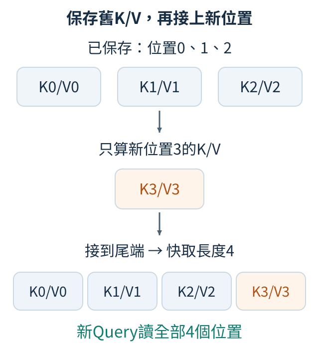
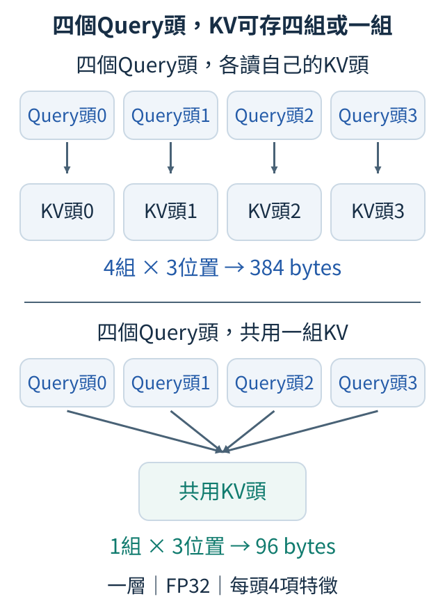
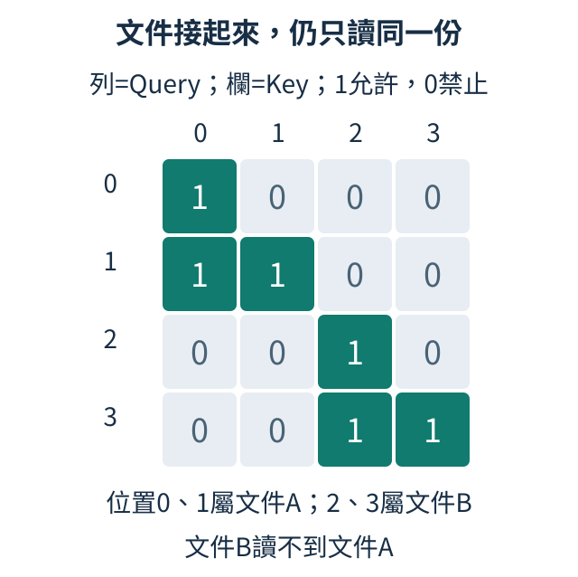
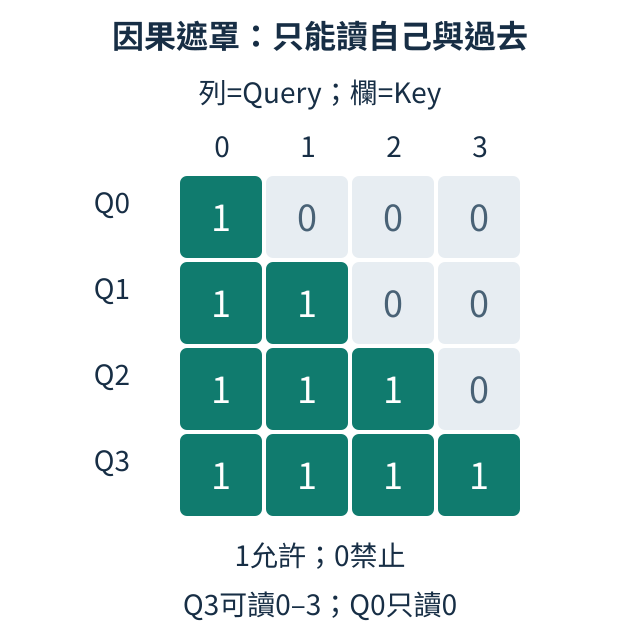
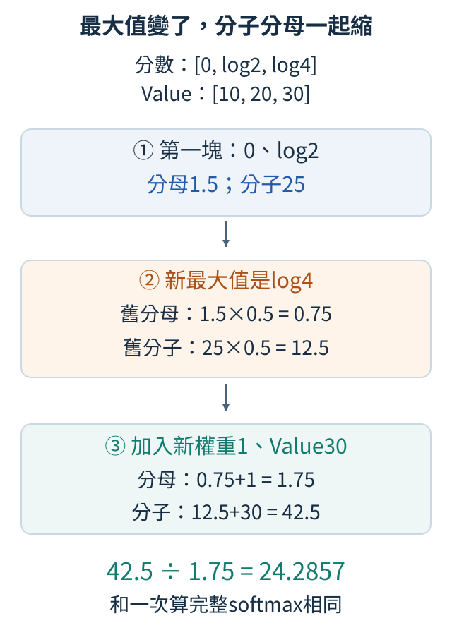
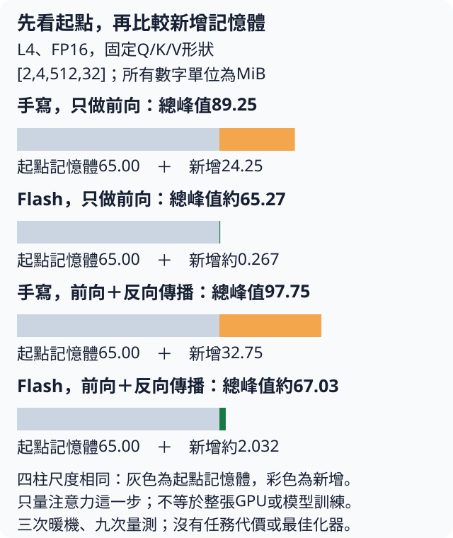
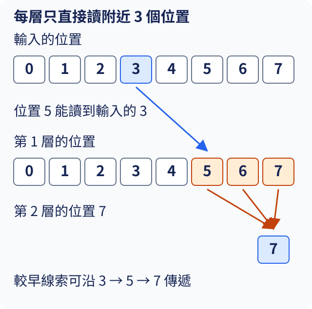
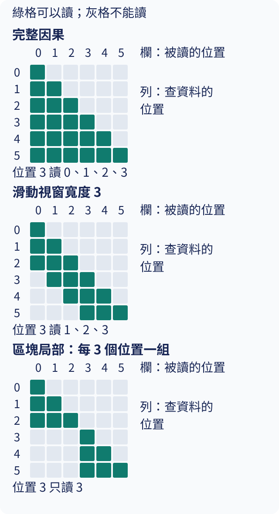
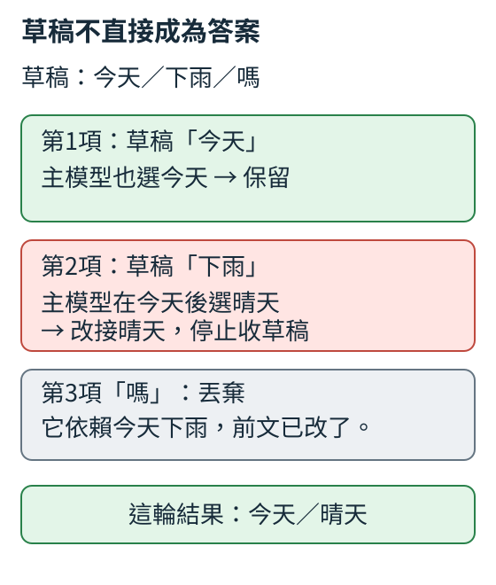

# 第 16 章：先量成本，再選效率做法

模型慢、長對話快取太大，或訓練批次放不下，原因可能不同。本章先讀一種可辨認的運算耗時，再分別檢查生成快取、文件裝填、梯度累積與精度。注意力分塊、中間特徵重算及編譯也各有成本：每個短程式先核對運算關係，速度與最高記憶體則帶著硬體、形狀和量測範圍閱讀。長文部分區分分塊計算與限制連結，章末再問：能否先草擬幾個token，再由原模型一起核對，少花幾輪等待？

本章也直接讀本課函式庫的實作：[16.5](16.md#16.5)節錄產生讀取許可表的`attention_mask`；[16.3](16.md#16.3)、[16.4](16.md#16.4)與[16.8](16.md#16.8)則逐一指出`CausalAttention`（主體見[3.7](03.md#3.7)）裡接續cache、共用KV頭與改用SDPA的那幾行。

[第14章的循環深度](14.md#14.11)能增加每題計算，本章再找哪些工作可省下。[7.23](07.md#7.23)的思考投入（thinking effort）只是對解題資源的偏好，不等於實際秒數；第19章比較固定檔位與Auto時，會把解題的每一輪、另外做的判斷與重試都算進成本，見[19.18](19.md#19.18)。讀到忘了的名詞，可以查[名詞頁](../glossary.md)。

## 16.1 怎麼從一種運算的耗時找下一個瓶頸？

同一個模型讀三個token，和讀十二個token，參數不變，花的時間卻可能不同。我們想知道新增的工作落在哪裡，才知道下一步值得改善什麼。只看「整個模型用了兩秒」還不夠；先把時間對上能辨認的運算，再決定值得改哪一步。

材料是一段ID `[1,2,3]` 和特徵寬度8（`width=8`）的TinyLM。這個[一層模型](04.md#4.5)經查表、注意力與FFN後，替每個位置輸出字表分數；FFN是每個位置各自處理特徵的網路，`TinyLM`的實作見[4.6](04.md#4.6)。profiler（效能剖析器）會記錄各運算的時間與呼叫次數。本節先練習讀出一種矩陣乘法的成本，作為再往下查的線索。

程式先跑三次暖機，避免把第一次初始化當成穩定成本；接著只記錄五輪前向計算。`key_averages()` 把同名運算彙整成一列，`# of Calls` 是這五輪內的總呼叫次數，同一運算每輪出現多次時，這個數會大於5。

時間欄也要先分清：**Self CPU** 只算該運算本身，不包含它呼叫的子運算；**CPU total** 則包含子運算；**CPU time avg** 是這列的CPU total除以呼叫次數，並非五輪模型時間的平均。百分比欄以整份記錄的Self CPU時間合計為參考。父子運算的total可能重複包含同一段工作，不能把所有total相加當成整體時間。下面按Self CPU由大到小列前十種工作，先找直接花時間的運算。

```python
import torch
from torch.profiler import profile, ProfilerActivity
from tiny_perceptron.model import TinyLM, ModelConfig

torch.set_num_threads(1)
model = TinyLM(ModelConfig(width=8)).eval()
ids = torch.tensor([[1, 2, 3]])
with torch.no_grad():
    for _ in range(3):
        model(ids)
    with profile(activities=[ProfilerActivity.CPU]) as p:
        for _ in range(5):
            result = model(ids)
print("分數形狀", tuple(result["logits"].shape))
print(p.key_averages().table(sort_by="self_cpu_time_total", row_limit=10))
print("參數bytes", sum(v.numel() * v.element_size() for v in model.parameters()))
```

輸入一列三個ID，預設字表264項，第一行應為 `(1,3,264)`，可確認確實執行了整個模型而非空迴圈。這裡只開CPU活動，不會替你量到GPU工作。

先找表中涉及矩陣乘法的一列，例如`mm`、`matmul`或`addmm`；它們都含「一列對一欄，逐項相乘再相加」的工作。讀它的Self CPU時間，也就是這種運算本身花的時間；再看`# of Calls`，也就是五輪裡呼叫幾次。時間每次執行都會起伏，排名也可能跟著變；十列裡找不到矩陣乘法時，把`row_limit=10`改成20再找。

呼叫次數不隨機器快慢改變，可以先拿來對照模型。例如`aten::mm`是25次，也就是每輪5次，正好對上不加偏移的5個Linear：注意力的Q、K、V與輸出投影，以及輸出層。FFN的兩個Linear有偏移，PyTorch改用相乘後再加偏移的`aten::addmm`，每輪2次、共10次。哪幾列排得進前十，每次執行都可能不同；想同時看到這兩列，就把`row_limit`改大。不過同一列合併了好幾個零件，看不出時間在它們之間怎麼分，所以這份按名稱彙總的表還不能唯一指出哪一層最花時間。把輸入改長後，若同名運算的時間穩定增加，便值得再查它處理了多少格。

最後一行的`numel()`回報參數表有幾個元素，`element_size()`回報每個元素占幾bytes，兩者相乘才是該表的數字bytes，再沿所有參數表相加。此設定6104個32位元浮點數（FP32）參數、每個4bytes，應得24416bytes；它與表中的微秒是不同單位。執行時還有中間特徵、生成用的cache；訓練更有梯度與最佳化器狀態（Adam的m、v），所以參數大小不能代表最高記憶體占用。profiler本身也會增加開銷，主要用於定位，總耗時應另以重複計時核對。

後文的實測時間分開記推論與訓練；記憶體用MiB，1 MiB=2²⁰ bytes。開始量測時已配置多少（後文稱起點記憶體）、過程增加多少，也分開列出。完整暖機、同步與配置器範圍見[T.8的效率量測方法](../training.md#選讀效率實驗的量測條件)。

練習把程式的 `ids = torch.tensor([[1, 2, 3]])` 改成 `ids = torch.arange(1, 13)[None]`：`torch.arange(1, 13)`產生1到12，`[None]`補上筆數軸，成為一段十二個token。先預測分數形狀變成 `(1,12,264)`、參數bytes不變，再從頭執行。原輸入和新輸入各重複三輪，按相同運算名稱比較Self CPU時間與呼叫次數，不拿兩張表的第一名互比。`aten::mm`這類模型運算的呼叫次數不會變，因為每輪用到的Linear一樣多；變的是每次處理的位置數。想看的列未出現時，把`row_limit=10`改成20，找查表、softmax或矩陣乘法列。

如果某一列在較長輸入下多次都花更久，就值得再查它處理了多少位置；如果時間起伏比差異更大，結論就是這份短例子尚未顯示穩定差距。完成練習只需核對形狀、參數bytes，並用表中一種可辨認的工作說明這兩種結果之一。這樣得到的是下一步量測的線索，不是對整個模型瓶頸的定論。

<details>
<summary>選讀：profiler各列、各欄與底層名稱</summary>

`aten::`前綴是PyTorch底層運算名稱，不是模型層的名稱。

讀到陌生列時，先分清它在做哪種工作。`new_zeros`建立裝滿零的數字容器；`empty`、`new_empty`、`empty_like`準備儲存空間，尚未填好數值。`view`、`unsqueeze`與`as_strided`處理形狀或讀取同一份儲存的方式。`repeat_interleave`來自[16.4](16.md#16.4)要講的KV頭複製：本例只有一個頭，複製成一份也要付呼叫開銷。它們也有執行成本，但排名高不能直接解讀成「注意力算太多」。這個特徵寬度只有8的短例子，準備容器與呼叫運算的開銷就可能佔很大比例。

再找能連回已學內容的列：`index_select`用於字與位置的查表；`softmax`或`_softmax`把注意力分數轉成注意力權重；`gelu`對應FFN中的啟用函式。`mm`、`matmul`與`addmm`則涉及矩陣乘法，可能出現在注意力、FFN或輸出層。`key_averages`會把不同部位的同名運算合在一起，所以這張表先幫我們定位「哪種工作值得再查」，還不能唯一指出哪一層。本節先練習判讀這幾類列，不要求猜出每個底層名稱的唯一來源。

</details>

<details>
<summary>選讀：中位數、GPU同步與記憶體口徑</summary>

GPU收到工作後會在背景執行，程式送出指令就先往下走；計時前後都要等GPU把工作做完，這叫同步，否則量到的只是送出指令的時間。本章的GPU實測也先暖機，再同步量九次、取中位數。中位數先把時間由小到大排序：九次量測取第5個；若量測次數是偶數，則取中間兩個的平均，例如 `[1,2,3,20]` 的中位數是 `(2+3)/2=2.5`。一般平均數則把全部量測值相加再除以次數。訓練另略過前三步取更新中位數，不能把兩種時間混在同一欄。

本章各項實驗的起點記憶體、軟體與記憶體範圍集中在[T.8的效率量測方法](../training.md#選讀效率實驗的量測條件)，需要重跑或追查數字時再閱讀。

</details>

## 16.2 讀提示和生成下一字有何差別？

輸入一段提示後，模型先等待一會才吐出第一個字，接著一個接一個續寫。這兩種等待來自不同工作：一開始要處理整段提示，後面每次只處理剛加入的token。前者叫讀提示階段（prefill），後者叫逐步生成階段（decode）。這裡的decode指逐步生成，和[1.1](01.md#1.1)把ID轉回文字的「解碼」不是同一件事。token是切詞後的一個生成單位，可能是字、詞片段或一個字的部分，[不一定是一個完整字](06.md#6.7)；程式的ID代表這些單位。若只用一個「每秒幾字」平均值，可能掩蓋長提示造成的首字等待，或每一步生成隨前文變長而變慢的情況。

先把兩種工作對到[注意力](03.md#3.4)：Query是目前位置提出的查詢，Key供比對，Value是比對後取回的內容。prefill對提示的每個位置都有Query；decode只對剛加入的位置做新的Query，但仍要讀前面所有Key和Value。把已算好的K、V保存起來供後續使用，叫KV cache（快取）。

假設提示ID是 `[1,2,3,4]`，prefill產生四個位置的分數，其中最後一個位置用來選擇下一個token。為了觀察形狀，下面直接假定接著選到ID5，把它送入decode。此例不宣稱隨機模型真的會選5，也不測語言品質。`eval()`把模型切到評估模式；`torch.no_grad()`讓這次計算不留下反向傳播要用的求導關係，因為這裡只看前向形狀。兩者用途不同，見[eval與梯度](05.md#5.17)。

模型的回傳值是一個字典：`"logits"`是每個位置的候選分數，`"cache"`是每層保存的K、V。程式第二次呼叫時，把prefill回傳的`prefill["cache"]`用`cache=`參數交回模型；模型就把新ID當成接在這段前文之後的位置，只替它算新的Q、K、V。

```python
import torch
from tiny_perceptron.model import TinyLM, ModelConfig

model = TinyLM(ModelConfig(width=8)).eval()
prefix = torch.tensor([[1, 2, 3, 4]])
with torch.no_grad():
    prefill = model(prefix)
    decode = model(torch.tensor([[5]]), cache=prefill["cache"])
print("prefill分數", tuple(prefill["logits"].shape))
print("decode分數", tuple(decode["logits"].shape))
print("第一層K形狀", tuple(prefill["cache"][0][0].shape), tuple(decode["cache"][0][0].shape))
```

預設字表264項，前兩行應為 `(1,4,264)` 與 `(1,1,264)`：一段提示的四個位置，對比一個新位置。`prefill["cache"]`存每層的一對K、V，`[0][0]`取第一層的K。其形狀從 `(1,1,4,8)`變成 `(1,1,5,8)`，四軸依序是一段輸入、一個注意力頭、前文長度、每頭八個特徵。新Query只有一個位置，保存的前文卻從四個位置增加到五個。

所以decode不是與prefill相同長度的前向計算，也不是只看新token、完全忽略前文。前文投影可以重用，注意力比對與加權取回仍須讀cache；生成越長，cache越大，每一步需要讀的內容也可能增加。下一節會核對這條快取路徑與重算整段是否輸出相同。

量服務體驗時，可以分開報TTFT（Time To First Token，從送出請求到第一個token的等待時間）與後續decode的tokens/s。TTFT可能包含切詞、資料傳入及排隊，不等於本例的prefill呼叫時間；也應註明提示長度、輸出長度與同時處理的請求數，才能比較。

練習把程式的 `prefix = torch.tensor([[1, 2, 3, 4]])` 改成六個ID，例如 `[[1, 2, 3, 4, 5, 6]]`，仍只送一個新ID進decode。先預測分數形狀 `(1,6,264)`與 `(1,1,264)`，K長度6與7，再執行核對。你應能指出哪些工作隨提示變長，哪些軸在每步生成時仍只有一個位置。

<details>
<summary>選讀：來源、量測條件與實驗紀錄</summary>

實測設備是NVIDIA L4 GPU，使用提示 `Once upon a time, a girl`；提示前加一個BOS（開始標記，表示序列開始的特殊token），所以含BOS共25個輸入位置，固定產生12個新ID。這裡改用四頭MHA（Multi-Head Attention，多頭注意力）：[每個頭](03.md#3.7)使用自己一組Q、K、V尋找關聯，同一層並排做四組比對，與上面只看單頭形狀的小例子是不同設定。這個四頭模型由[T.4](../training.md#T.4)的對話模型改成四頭、再續訓100次而來，做法見[16.4](16.md#16.4)的補充；後面幾節補充區的實測大多也用它，以下稱效率實驗的四頭模型，不是用它的地方會另外說明。四頭MHA的prefill呼叫中位數2.421毫秒，整段重算路徑29.034毫秒、快取路徑27.915毫秒。後兩個數字都包含prefill，沒有單獨量「第一個token之後」的decode吞吐，也沒有切詞、傳輸或排隊，所以不是服務TTFT。

這個提示不是[7.13](07.md#7.13)那種顏色、形狀、音高的屬性問答，模型生成的文字本來就沒有意義。EOS（結束標記）是表示序列結束的特殊token，正常生成選到它就停止。為了固定計算量，速度測試即使選到EOS也繼續跑滿12步。原始ID與可讀文字都留在[效率實驗的實驗紀錄](https://github.com/birdhackor/tiny-perceptron-vlm/blob/main/docs/course-experiments/results/efficiency.json)（JSON檔，機器可讀的完整結果）：`results.models.mha.cache`底下的`generated_ids_full`與`generated_text`兩欄。正常的驗證與測試問答評估則遇EOS停止。不能把這段固定成本測試的文字當成語言品質，也不能把12除以總秒數標成純decode的tokens/s。

</details>

## 16.3 生成時重算了什麼？

模型讀完 `[1,2,3]`，再加入ID4，最直接的做法是把 `[1,2,3,4]`整段重新送入。可是前面三個位置的Key、Value不是已經算過了嗎？因果注意力只允許每個位置讀到自己和過去，因此加入未來的ID4不會改變前面三個位置在各層的特徵。每個位置的K、V又是由它自己的特徵經Linear投影算出（[3.3](03.md#3.3)、[3.4](03.md#3.4)），特徵不變，K、V也不變；所以可以保留它們各層的K、V，下次只算新位置。本節要先核對這樣重用是否保持結果相同，再談省時間。

沿用[prefill/decode](16.md#16.2)的分工，這次把例子縮成三個前文位置，再接第四個ID。cache保存每層注意力裡的Key與Value，沒有把完整回答存成答案，也沒有免去新位置的所有工作。新token仍要查表、算Query與自己的K/V、對所有過去位置做注意力，再經過[FFN前饋網路](04.md#4.4)，也就是對每個位置各自轉換特徵的兩層網路；省掉的是舊位置重複的投影與特徵處理。

圖中的0、1、2、3是位置編號，並非本例輸入ID；每一格是一個位置的K/V。最上列的K0/V0至K2/V2是已保存的三個位置；中間算出新位置3的K/V，再接到快取尾端，快取長度變成4。最下面的新Query讀這四個位置，不能只比較剛加入的那一個。



```python
import torch
from tiny_perceptron.model import TinyLM, ModelConfig

torch.manual_seed(0)
model = TinyLM(ModelConfig(width=8)).eval()
ids = torch.tensor([[1, 2, 3, 4]])
with torch.no_grad():
    full = model(ids)["logits"][:, -1]
    prefix = model(ids[:, :3])
    step = model(ids[:, 3:], cache=prefix["cache"])
    cached = step["logits"][:, 0]
error = (full - cached).abs().max().item()
print("兩路分數形狀", tuple(full.shape), tuple(cached.shape))
print("最大差異", error)
assert torch.allclose(full, cached, atol=1e-6)
```

`ids[:,:3]`取前三個ID，`ids[:,3:]`只取第四個。重算整段時最後位置索引為-1；快取路徑只有新位置，所以取索引0。兩者都是用讀完ID4後的狀態預測下一個token，不能拿prefill最後位置的分數與它比較，因為那是只讀到ID3時的預測。兩路形狀應同為 `(1,264)`，最大差異通常為零或很小的浮點尾數，assert要求接近到指定容忍範圍。

位置編號也必須接得上。新位置不能重新當成位置0：`TinyLM`先用`offset = 0 if cache is None else cache[0][0].shape[2]`讀出cache已保存幾個位置，也就是第一層K的第2軸長度；再用`positions = torch.arange(offset, offset + t, device=x.device)`替這次新送入的t個位置編號，本例因此自動從3開始。每層的`CausalAttention`（[3.7](03.md#3.7)的精簡版省略了這段）則用`torch.cat((cache[0], k), 2)`把新K接在舊K之後，V也一樣，2就是位置軸。若忘記這個offset（位移），即使K/V形狀正常，新位置也會被當成位置0，結果可能不同。若改了前文、參數或位置規則，舊cache通常要重建，不能繼續沿用。

多段輸入放在同一批一起處理叫batch。若一段ID為 `[1,2,3]`，另一段為 `[4,5]`，為湊成同長度的表，第二段可補成 `[4,5,PAD]`；padding是補齊的動作，PAD是專用佔位ID，第二段的有效長度仍是2，補上的位置不是真實前文。本課的小實作沒有處理同batch內這種不同有效長度的快取：有cache時若又傳入標示PAD的`valid`或[16.5](16.md#16.5)的`segments`，`CausalAttention`會直接報錯，而不是默默算錯。所以本節固定長度的例子不能保證這種輸入也正確。

練習分兩步，每步改完都從頭執行。第一步把 `ids = torch.tensor([[1, 2, 3, 4]])` 改成 `[[1, 2, 3, 5]]`：前三個ID沒變，快取對應的仍是同一段前文，先預測兩路仍接近、assert通過。第二步改回原本的ids，只把重算整段那一行改成 `full = model(torch.tensor([[9, 2, 3, 4]]))["logits"][:, -1]`，快取仍用 `[1,2,3]` 建立：先預測最大差異明顯變大（本例約0.064）、assert失敗。第一個ID不同，前文各位置的K、V就不同，舊快取不能沿用。區分這兩種改動，你就知道快取保存的是哪一段計算，而非一份對所有問題都通用的答案。

<details>
<summary>選讀：來源、量測條件與實驗紀錄</summary>

我們也逐步核對了[16.2](16.md#16.2)的25位置提示與12步生成。兩個模型都有四個Query頭：效率實驗的四頭模型（MHA）各頭使用自己的一組K/V，另一個模型則讓四個Query頭共用一組K/V，所以稱「一個KV頭」，設定詳見[16.4](16.md#16.4)。每個模型各自比較整段重算與快取，兩組的最高logit絕對差都為1.90735×10⁻⁶，12個最高分生成ID逐一相同。以絕對容差10⁻⁵核對這次FP32（每個數用32位元表示的浮點數格式）路徑，差異在範圍內；它不是每個數字逐bit相等，也不是任意提示、精度與長度的保證。模型之間的參數不同，這裡只比較每個模型自己的兩條路。

原始ID中多次出現EOS（ID 2），是速度測試刻意不提早停止的結果。把ID轉回文字時，EOS這類特殊token不會顯示，所以解碼後的 `eueeuare` 與 `eredquare`（兩個模型在這個提示下生成的無意義字串）看不出EOS出現在哪裡。實驗紀錄因此另外保留整串ID：`results.models.mha.cache`與`results.models.gqa.cache`底下的`generated_ids_full`（整段重算）與`generated_ids_cached`（快取路徑）兩欄，不能只看解碼文字一樣就宣布序列相同。若兩個最高分候選非常接近，微小浮點差也可能改變選擇，因此還要同時看分數誤差（同一處的`per_step_logit_max_error`欄，逐步記下的最高logit差）與實際ID。

</details>

## 16.4 KV cache 怎麼縮小？

如果每個注意力頭都保存一份Key、Value，長對話會讓快取占用持續增加。可以保留多個Query頭，讓幾個Query頭共用同一組K、V嗎？一個[注意力頭](03.md#3.7)用一小組特徵做比對；[KV快取](16.md#16.3)則按每層、每頭、每個過去位置保存K、V。現在固定四個Query頭，只改保存的KV組數。多個Query頭共用較少的KV頭，叫Grouped-Query Attention（GQA，分組查詢注意力）。

例如特徵寬度16，Query有四頭，每頭四項特徵。FP32是32位元浮點數，每個數占4 bytes。若KV也有四頭，三個位置、一段輸入，用FP32保存K和V的數字需 `2×4×3×4×4=384` bytes，五個因數依序是2（K與V各一份）、4（KV頭數）、3（位置數）、4（每頭特徵數）與4（每個FP32數字的bytes）。若四個Query頭改共用一個KV頭，只有KV頭數由4變1，快取變成 `2×1×3×4×4=96` bytes。Query仍然各自計算，並不是把四個頭全部合成同一個查詢。

下圖Q0至Q3與KV0至KV3後面的數字是注意力頭編號，不是[16.3](16.md#16.3)圖中K0/V0那種位置編號。上半每個Query讀自己的KV，下半四個Query都讀同一組。連線表示讀取關係，每組仍保存三個位置；96 bytes的條件與上述相同。



```python
import torch
from tiny_perceptron.model import TinyLM, ModelConfig

ids = torch.tensor([[1, 2, 3]])
with torch.no_grad():
    for kv_heads in (4, 1):
        model = TinyLM(ModelConfig(width=16, heads=4, kv_heads=kv_heads)).eval()
        cache = model(ids)["cache"]
        size = sum(t.numel() * t.element_size() for pair in cache for t in pair)
        print("KV頭數", kv_heads, "K形狀", tuple(cache[0][0].shape), "bytes", size)
```

此例只有一層。`cache`中的每個pair是一層的K、V。`for pair in cache for t in pair`是兩層迴圈：先逐層取出一對K、V，再逐一取出其中的tensor。`t.numel()`數出tensor的元素個數，`t.element_size()`給每元素占用的bytes，相乘就是該tensor的數字儲存量，`sum`再把各層的K、V加總。K形狀分別是 `(1,4,3,4)`與 `(1,1,3,4)`，bytes為384與96。

共用是怎麼做到又不多存的？`CausalAttention`的K、V投影只輸出`kv_heads`份特徵（`nn.Linear(width, kv_heads * self.head_dim, bias=False)`）。`forward`先寫`new_cache = (k, v)`，把只有KV頭份數的K、V存進cache，接著才用`k.repeat_interleave(repeat, dim=1)`把每個KV頭複製給共用它的Query頭，V也一樣；`repeat = self.heads // self.kv_heads`是每個KV頭要服務幾個Query頭，本例4÷1＝4。cache只存KV頭的份數，比對前才臨時複製，不先複製到每個Query頭再存；若把複製後的四份存進cache，儲存收益就會消失。

一般分組設定要求Query頭數能被KV頭數整除，例如四個Query、兩個KV，每組有兩個Query；不能整除時，`CausalAttention`會直接報錯。全部Query共用一個KV的情況也常稱Multi-Query Attention（MQA，多查詢注意力）。投影權重的形狀與共享方式會改變，不能隨意把訓練好的四頭KV重排成一頭，就宣稱原模型功能保持不變。

快取縮四倍也不代表整個模型記憶體縮四倍：參數、其他中間特徵仍然存在。它不保證實際耗時或答案品質改善，需要在相容架構上訓練、核對快取路徑與量測。此程式只是同一輸入的結構與儲存比較，兩個模型的參數各自初始化，沒有做品質競賽。

練習把 `ids = torch.tensor([[1, 2, 3]])` 改成六個ID，例如 `[[1, 2, 3, 4, 5, 6]]`。先預測K形狀的位置軸由3變6、bytes變成768與192，比例仍四倍，再執行核對。你應能分辨「前文變長」與「KV頭數減少」分別改了K形狀的哪一軸。

<details>
<summary>選讀：來源、量測條件與實驗紀錄</summary>

正式模型特徵寬度64、兩層、四個Query頭，每頭16項特徵。先把25個位置的提示一次讀入，這個階段叫[prefill](16.md#16.2)；產生的FP32快取，四個KV頭實測25,600 bytes，一個KV頭為6,400 bytes，正好四分之一。照上面的算法是 `2×2×4×25×16×4=25,600`，第二個2是層數。後者是MQA端點，實驗紀錄沿用`gqa`作組別名；沒有另外訓練兩個KV頭的中間設定。

兩個模型都以[T.4](../training.md#T.4)的單頭SFT模型為底座（當作起點的已訓練模型）；SFT是監督式微調，用示範問題與正確回答繼續訓練模型。做法是把底座裡名稱相同、形狀也相同的參數表直接複製成新模型的初值，其餘的表用固定亂數種子重新初始化。四KV版本共29張表：字表、位置表、兩層各自的正規化、Q／K／V／輸出投影與FFN，以及最後的正規化與輸出層。它們的形狀都和底座相同，所以全部複製。一KV版本的K、V投影只輸出一個KV頭的16項特徵，每層的K、V投影各從64×64變成16×64，兩層共4張表無法複製，改為重新初始化，其餘25張照樣複製；總參數因此少了 `4×(64×64−16×64)=12,288` 個。即使四KV版本照抄了全部數字，同一張64×64的Q投影現在被切成四個頭、每頭16項特徵分別比對，計算方式已經和單頭不同。所以兩個模型都再用同一份訓練資料續訓100次，才做下面的品質比較。實驗紀錄`results.models.mha`與`results.models.gqa`底下的`copied_initial_tables`欄逐一列出複製了哪些表。

這份品質比較使用[7.13保存的屬性問答基準](07.md#7.13)：根據短文字中的顏色、形狀與音高標記（high／low）作答，與[16.2](16.md#16.2)只用來計時的英文開頭不同。

下面的代價把模型給每個正確答案ID的機率p換成 `-log(p)`，再沿有效目標取平均；機率越高，代價越低，計算方法可回顧[機率與猜錯代價](../first-steps.md#W.4)。EOS（結束標記）表示回答結束。有效目標是計入代價的位置：本表只計助手回答與EOS，不把問題或補齊的PAD算入。例如正確回答 `[7,8,EOS]`有三個有效目標，若三個正確ID各得到機率0.5，單項代價都約0.6931，三項相加除以3仍為0.6931。這個平均衡量各個答案位置的預測；完整答案匹配則要求整段生成ID都正確。

| 設定 | 總參數 | 100次續訓後的驗證／測試代價 | 完整答案匹配：驗證／測試 |
| --- | ---: | --- | --- |
| 四Query、四KV | 141,568 | 0.97333／0.31474 | 2/5／6/10 |
| 四Query、一KV | 129,280 | 0.16176／0.11392 | 3/5／6/10 |

代價只計助手回答與EOS，驗證與測試的分母各是36與69個有效目標；匹配則按驗證題5題、測試題10題的完整正確答案ID核對，最多生成32個新ID。兩組各更新100次、計11,278個有效訓練目標，都正常EOS結束。這輪一KV組的代價較低，測試答對數卻相同，不能把兩種品質指標互換。

[GQA原論文第2.1–2.2節](https://arxiv.org/pdf/2305.13245v3)把已訓練模型的多組KV投影取平均、合併成較少組後再訓練，我們沒有重現這個轉換配方，也沒有證明原模型功能原封不動。快取確實省bytes；短提示總生成中位數由四KV快取的27.915毫秒到一KV的27.105毫秒，是這個小形狀的一次觀察，不能推成長對話或所有後端的普遍加速。

PyTorch提供SDPA（Scaled Dot-Product Attention，縮放點積注意力）函式介面，負責以Q、K比對、轉成注意力權重，再取回V。後端是執行這套計算的不同實作選項；例如math用一般張量運算組合，其他選項可用專門的GPU運算。支援範圍也要帶版本：[2.14的SDPA文件GQA段落](https://docs.pytorch.org/docs/2.14/generated/torch.nn.functional.scaled_dot_product_attention.html)列出Flash、cuDNN、math及NVIDIA CUDA memory-efficient這些實作選項，但仍有頭數整除與輸入限制。本組GQA訓練與快取都走手寫路線（`backend="manual"`），[16.8](16.md#16.8)的SDPA核對只測四KV的MHA，沒有驗證上述所有GQA後端都可用。

</details>

## 16.5 Padding 花掉多少工作？

訓練設定每段固定四個位置，兩份短文件各只有兩個token，若分別補到四個位置，就有八個位置、只有四個是真實內容。補進去的PAD雖然不計入答案代價，普通矩陣運算仍可能處理它們。把短文件接到同一段、充分使用這四個位置，叫sequence packing（序列裝填）。但我們若想讓兩份文件各自獨立，接起來時還要阻止它們互相讀取，不能只省空間而改了學習問題。

把文件A的兩個位置、B的兩個位置接成四個位置後，先畫出誰能讀誰。PAD是[補齊長度](07.md#7.7)的符號，EOS是文件或回答結束的符號；[因果遮罩](03.md#3.6)只管先後，還不管是不是同一文件。EOS只是模型看到的一個token：看到它，注意力也不會自動停止讀它前面的位置。例如A占位置0、1，B占2、3；普通因果遮罩允許位置3讀0至3，其中就包含A。若需要文件隔離，除了不能看未來，還要限制Query與Key屬於同一文件。

圖的列是Query所在位置，欄是可讀的Key位置。列與欄的標籤A0、A1、B2、B3把文件與位置寫在一起：字母是文件，數字是位置，例如B2是位置2，屬於文件B。綠格（1）代表允許，灰格（0）代表禁止。B的兩列雖然排在A之後，左側兩欄仍為灰色；右上角禁止是因果限制，左下角禁止則來自跨文件隔離，兩者理由不同。



```python
import torch
from tiny_perceptron.attention import attention_mask

position = torch.arange(4)
segment = torch.tensor([[0, 0, 1, 1]])
allowed = attention_mask(position, position, segments=segment)
print("隔離文件", allowed[0, 0].int().tolist())
causal_only = attention_mask(position, position)
print("只用因果的最後一列", causal_only[0, 0, -1].int().tolist())
```

`segment`每項記錄該位置的文件編號；0與1不是數值大小或時間，是兩份文件的身分。`attention_mask`收Query位置、Key位置與可選的條件，返回batch、head、Query、Key四軸的真假表。batch是同時處理的資料筆數，head是[注意力頭](03.md#3.7)；本例這兩軸的長度都為1，完整形狀是 `(1,1,4,4)`。`[0,0]`取第一段、第一頭，`int`把True/False印成1/0。四列應為 `[1,0,0,0]`、`[1,1,0,0]`、`[0,0,1,0]`、`[0,0,1,1]`，正好對應圖。只用因果的最後一列則為 `[1,1,1,1]`：位置3讀得到A的0、1。

這張表怎麼算出來？下面是函式庫的原始碼。函式庫的`CausalAttention`每次前向計算都先用它產生讀取許可表，再交給[3.6](03.md#3.6)的`manual_attention`或[16.8](16.md#16.8)的SDPA；[3.7](03.md#3.7)的精簡版只用`tril`做因果遮罩，省略了這一步。

```python
# 節錄自 tiny_perceptron/attention.py：attention_mask
def attention_mask(query_positions, key_positions, valid=None, segments=None):
    """True 代表可以看：因果、PAD、文件邊界是三個獨立條件。"""
    allowed = key_positions[None, :] <= query_positions[:, None]
    allowed = allowed[None, None]
    if valid is not None:
        allowed = allowed & valid[:, None, None, :]
    if segments is not None:
        allowed = allowed & (segments[:, None, :, None] == segments[:, None, None, :])
    return allowed
```

`attention_mask`收四份輸入：Query與Key各自的位置編號，以及可選的`valid`與`segments`。逐行做的事如下。

- 文件字串寫明規則：True代表可以讀；因果、PAD、文件邊界是三個獨立條件，各自算出一張真假表，最後合在一起。
- `key_positions[None, :] <= query_positions[:, None]`：`[None, :]`把Key位置排成一列，形狀 `(1,4)`；`[:, None]`把Query位置排成一欄，形狀 `(4,1)`。比較時PyTorch用[10.1](10.md#10.1)的廣播把長度1的軸自動重複，得到四乘四的表：第i列第j欄回答「Key位置j是否不晚於Query位置i」，也就是因果遮罩。
- `allowed[None, None]`在前面補兩個長度1的軸，成為 `(1,1,4,4)`，對上batch與head兩軸，和3.6的`[None, None]`相同。
- `valid`是[7.7](07.md#7.7)的非填充位置表，形狀 `[筆數, Key位置數]`，PAD處為False。`valid[:, None, None, :]`把它擺成 `[筆數, 1, 1, Key位置數]`，每個Query列都套用同一排，所以PAD那一欄整欄變成False，誰都不能讀它。`&`用在真假表上是逐格的「而且」：兩邊都是True才得True。
- `segments`是本節的文件編號表，形狀 `[筆數, 位置數]`。`segments[:, None, :, None]`把編號沿Query方向排成一欄，`segments[:, None, None, :]`沿Key方向排成一列，`==`廣播後得到「Query與Key是否屬於同一文件」的四乘四表，再用`&`併入。
- 沒傳的條件直接跳過。回傳的表只有在所有傳入的條件都允許時才是True。

因為比較的是位置編號，而不是像`tril`那樣看表裡的第幾列、第幾欄，同一行也能處理[16.3](16.md#16.3)的接續：有cache時，`CausalAttention`傳入的Query位置是`torch.arange(offset, offset + t, device=x.device)`，在16.3的例子裡只有新位置3；Key位置是0到3，所以這張一列四欄的表全是True，新位置讀得到全部前文。若改用`tril`，這唯一的一列只會留下第0欄。

packing還需處理每份文件的位置編號，以及跨邊界的下一個token答案。例如A的EOS後面雖接著B的第一個token，不應把「預測B的第一個token」當成A的目標，除非你有意訓練跨文件續寫。每份文件可以重新從位置0開始編號（[7.7](07.md#7.7)的`positions`），但遮罩仍要知道接起來後的先後與文件編號：`CausalAttention`交給`attention_mask`的是實際排列順序`torch.arange(...)`，不是模型的位置編號`positions`，所以兩份文件的位置0不會被誤當成同一個位置。這段程式只核對隔離遮罩，沒有悄悄完成資料裝填的所有步驟。

練習只改第一段程式，每次改一處，改完從頭執行。第一步把 `segment = torch.tensor([[0, 0, 1, 1]])` 改成 `[[0, 0, 0, 1]]`，也就是A三個位置、B一個位置：先預測隔離表的四列變成 `[1,0,0,0]`、`[1,1,0,0]`、`[1,1,1,0]`、`[0,0,0,1]`。第二步改回原本的segment，在它下面加一行 `valid = torch.tensor([[True, True, True, False]])`，再把下一行改成 `allowed = attention_mask(position, position, valid=valid, segments=segment)`，假裝位置3是PAD：先預測最後一欄全變成0，四列是 `[1,0,0,0]`、`[1,1,0,0]`、`[0,0,1,0]`、`[0,0,1,0]`。每多傳一個條件，表裡只會多出0、不會多出1，因為各條件是用`&`取交集。

裝填減少PAD不代表同樣比例的速度收益：本課的`attention_mask`仍建立完整的四乘四表，`manual_attention`也照樣算出每一格分數再遮掉，跨文件的配對並沒有少算。其他實作也可能這樣建立完整方陣，需看實際運算；若刻意允許文件互相讀取，也要將它記成另一種訓練設定。

<details>
<summary>選讀：來源、量測條件與實驗紀錄</summary>

實測用NVIDIA L4圖形處理器，對象是效率實驗的四頭模型（見[16.2](16.md#16.2)的補充）。這裡的logit是模型給每個候選token的原始分數，尚未轉成機率；參數梯度則是各個可調數字對答案代價的敏感度，表示接下來更新的方向與強弱，見[梯度暖身](../first-steps.md#W.6)。

先核對語意。從訓練資料取兩段助手回答的文字（不含問題），各有七個輸入位置。兩段一樣長，逐段補齊時不必補任何PAD，所以逐段PAD與隔離packing都是14個位置：這個例子本來就沒有PAD可省，只用來檢查兩種排法算出的東西是否相同。各文件的位置重新從0開始、不增加跨文件目標，logit最高差1.90735×10⁻⁶、參數梯度最高差1.78814×10⁻⁷；差值接近零，支持兩種排法在本次條件下給出相同的分數與學習方向。接著把第一段的每個ID都換掉（加7，超過字表大小就從頭繞回），再看第二段的分數變了多少：有文件隔離時差為0，第二段完全不受第一段影響；只留因果遮罩時最多差5.42937，第二段讀到了被換掉的第一段。這說明EOS或先後順序不能代替文件隔離。

更新實驗另外進行：兩支各更新40次，每次從訓練資料隨機抽三段助手回答文字（每段最多42個位置），一支逐段補PAD、一支隔離packing，兩支抽到的內容相同，均計845個有效目標，更新後參數最大差5.97909×10⁻⁶。略去各路徑前3次暖身後，餘37次模型更新的計時中位數，PAD為10.799毫秒、packing為11.191毫秒，這輪沒有加速。每次計時包括模型前向計算、代價計算、反向傳播、梯度裁剪、參數更新及末尾的GPU同步；抽樣、裝填與清空梯度不計入。這個四頭模型原本用示範問答做監督式微調（SFT，見[T.4](../training.md#T.4)）：問題保留在輸入，依對話角色選出助手答案與結束標記來計算代價，user提問不作為要模仿的答案，見[答案位置](07.md#7.3)。此處則只剩助手文字的續寫，已拿掉問題與原先按角色選答案的設定，不能與完整問答目標混成一次效率比較。

再測原問答，分數寫成「完整答案答對題數／總題數」；驗證題5題用來在訓練時檢查品質，測試題10題留到最後評估，兩組都不拿來更新參數，見[5.10](05.md#5.10)。兩支驗證都0/5、測試都1/10，比續訓前效率實驗四頭模型的2/5、6/10差（[16.4](16.md#16.4)補充的表）；例如同一題測試題問`shape?`，正確答案是`circle`，兩支卻都生成`low`。兩種裝填結果接近，不等於改後的學習任務仍保持問答品質。

</details>

## 16.6 Batch 放不下怎麼辦？

想讓三筆資料一起決定一次更新，記憶體卻只能同時放其中一兩筆，可以分次計算、最後再更新嗎？可以，但每份要先算出代價的總和，再除以整批共同的總數，語言模型裡就是整批的有效目標數；不能先在每份裡平均，再平均這些平均。這種做法叫gradient accumulation（梯度累積）：多次反向傳播都加到同一份梯度，最後只做一次參數更新。[梯度](../first-steps.md#W.6)表示改動參數對代價的影響，PyTorch的backward預設會累加它。本節的目標是讓分批計算與整批計算得到同一個梯度9.3333；先看為何把兩份平均再平均會得到另一個數字。

用一個權重w=1與三個輸入 `[1,2,3]`，希望輸出全為零，代價取各輸出的平方。整批的平均代價是 `(1+4+9)/3=14/3`，對w的梯度是 `2×(1+4+9)/3=28/3`，約9.3333。若拆成一筆與兩筆，第一份代價和1，第二份代價和13；兩份都除以共同總數3，累加仍是原來的14/3。

```python
import torch

x = torch.tensor([1.0, 2.0, 3.0])
whole = torch.tensor(1.0, requires_grad=True)
(whole * x).square().mean().backward()
accumulated = torch.tensor(1.0, requires_grad=True)
wrong = torch.tensor(1.0, requires_grad=True)
for part in (x[:1], x[1:]):
    ((accumulated * part).square().sum() / len(x)).backward()
    ((wrong * part).square().mean() / 2).backward()
print("整批梯度", round(whole.grad.item(), 4))
print("正確累積", round(accumulated.grad.item(), 4))
print("錯誤平均", round(wrong.grad.item(), 4))
```

`x[:1]`取索引1之前，也就是第一筆；`x[1:]`取索引1到結尾，也就是後兩筆，切片終點本身不包含在內。三個權重初值相同但獨立，分別核對三種計算。正確那行先取每份的代價和，再除以共同的3；每次backward會把新貢獻加到accumulated.grad。錯誤那行先對份內求平均，再讓兩份各占一半，相當於第一筆占一半、第二與第三筆各占四分之一，已不是三筆等權。輸出應為9.3333、9.3333與7.5：程式能跑不代表平均方式正確。

真實語言模型通常按有效目標計算代價：有效目標是[確實計入答案代價的位置](07.md#7.3)，[PAD](07.md#7.7)則是補齊長度的符號，不是要學的答案。有的micro-batch（拆出的較小批次）只有一個有效目標，有的有十個，因此分母應是累積範圍內的有效目標總數，不是迴圈次數，也不是包含PAD的表格大小。函式庫的`loss_sum`（[5.2](05.md#5.2)）分別回傳代價總和與有效目標數，就是為了讓分批時自己除以共同總數。每份有效目標數相同時，「各份平均再平均」能保證每個目標占相同份量。數量不同時，兩種平均有時會剛好得到同一數字：例如一份有1個有效目標、另一份有10個，但11個位置的代價全是1，兩種平均都會得到1。這個巧合不能保證換一批資料仍然正確；要保留每個目標原來的份量，仍應把各份代價和除以共同總數。

訓練操作順序也很重要：先清除前一輪梯度，再對各份backward，最後才裁剪梯度（整份梯度過大時一起縮小，避免更新突然太大），再做一次step更新參數。若每份都step，後一份看到的是更新後的參數，就不再是同一個大batch。此例沒有step，只驗證梯度。有些運算依同一批資料共同計算平均值等統計，拆批就可能改變它；dropout則是在訓練時隨機關閉部分特徵，分次計算可能抽到不同遮罩。這些行為需另核對，不能把任何模型分批都視為無條件等價。

練習只改拆法：把 `for part in (x[:1], x[1:]):` 改成 `for part in (x[:2], x[2:]):`，也就是兩筆與一筆。先預測正確梯度仍9.3333，錯誤方式改為11.5，再執行核對。拆法不該改變同一整批算出的梯度；如果結果變了，先檢查每筆資料到底被分配了多少份量。

<details>
<summary>選讀：來源、量測條件與實驗紀錄</summary>

真實文字小核對用效率實驗的四頭模型，把三段助手回答文字拆成一段與兩段，兩份有效目標7與13，都除以20；與整批的參數梯度最大差2.08616×10⁻⁷。正式問答訓練用準備好的問題與示範答案，讓模型學習產生助手答案，採用的拆法不同：每批八題拆為三題、五題，共同分母仍是這批有效助手目標，全部累積後才裁剪與step。

普通批次與累積兩支各完成40次更新、2,328個有效目標。更新後參數最大差1.38730×10⁻⁵，測試代價0.41778與0.41778，完整答案都5/10，沒有逐bit相同的承諾。每步中位數14.070與24.064毫秒；訓練峰值扣掉各自的起點記憶體，新增量為8.824與6.474 MiB，省下同時保留的中間量，但多花時間。完整峰值75.988與74.724 MiB包含不同的起點記憶體67.164與68.250 MiB，範圍按[16.1](16.md#16.1)理解，不能當成兩個模型單獨部署的大小。

</details>

## 16.7 精度能降低嗎？

同一個數字若用四bytes保存，與用兩bytes保存，前者通常能分辨更細的差異；後者省空間，也可能讓支援它的硬體更快。但兩種「兩bytes浮點數」不一定能表示相同範圍。我們用帶小數的矩陣算同一個乘法，觀察結果是否一樣。後續運算既受[尺度](14.md#14.2)影響，也受這些小數能否被表示影響；先不要把較短格式等同於整個模型所有數字都已縮小。

FP32是32位元浮點數，一個數字四bytes；FP16與BF16都是16位元、兩bytes，在PyTorch中分別寫作`torch.float16`與`torch.bfloat16`。浮點表示可粗略想成「有效數字×某個次方」：存較多有效數字的位元，附近刻度更細；存較多次方的位元，可表示的極大與極小數範圍更寬。FP16通常比BF16有更細的相對精度，但最大有限值約65504；BF16保留較寬的次方範圍，最大值約3.39×10³⁸，接近FP32。

用固定輸入做CPU的BF16小實驗。第一個矩陣的數字刻意接近整數，BF16可能把1.001等值捨入到1，讓輸出有可追蹤的差異。`autocast`是PyTorch依運算選擇較低精度的介面；這裡只在包住的矩陣乘法使用，不手動改原輸入的儲存型別。

`a @ b`是矩陣乘法：取a的一列與b的一欄，對應項相乘再相加，得到輸出的同一列、同一欄。例如左上格是 `1.001×0.5 + 2.002×1.5 = 3.5035`；右上格改取b的第二欄，便是 `1.001×1 + 2.002×(-1) = -1.001`。第二列用a的3.003與4.004照同一規則計算。

```python
import torch

a = torch.tensor([[1.001, 2.002], [3.003, 4.004]])
b = torch.tensor([[0.5, 1.0], [1.5, -1.0]])
full = a @ b
with torch.autocast("cpu", dtype=torch.bfloat16):
    low = a @ b
print("原輸入型別", a.dtype, "低精度輸出", low.dtype)
print("FP32", full.round(decimals=4).tolist())
print("BF16", low.float().tolist())
print("最大差異", round((full - low.float()).abs().max().item(), 4))
```

第一行應看到原輸入仍torch.float32，輸出是torch.bfloat16。FP32結果約 `[[3.5035,-1.001],[7.5075,-1.001]]`，BF16約 `[[3.5,-1],[7.5,-1]]`，最大差異約0.0075。`low.float()`把結果轉回FP32，只為方便比較，不能恢復先前已被捨入丟掉的細節。相減得到四格各自的差異，`.abs()`取絕對值、`.max()`選最大一格、`.item()`取出普通Python數字，最後四捨五入到四位小數。這個差異不是哪一層的參數學壞了，而是表示與運算精度改變。

混合精度訓練（PyTorch稱為自動混合精度，automatic mixed precision，AMP）通常讓合適的矩陣運算用低精度，某些代價計算與累加仍用FP32。[梯度](../first-steps.md#W.6)是代價對參數的變化率，由反向傳播沿計算關係求出，用來決定更新方向。FP16計算中的微小梯度可能太小而無法表示，變成零，這叫下溢。GradScaler（梯度縮放器）是管理梯度大小（尺度）的工具：先把代價乘上倍率，例如1024，再反向傳播算出同樣放大1024倍的梯度，更新參數前再除以同一倍率，縮回原尺度。放大是為了減少計算途中小量變成零的情形，不是把學習率任意放大1024倍。這是額外的數值管理，不能只改dtype就假設訓練安全。BF16範圍較寬，也仍會有捨入誤差；每個硬體支援的運算不同，應核對結果與實際耗時。

練習先把a的建立行改成 `a = torch.tensor([[1.001, 2.002], [3.003, 4.004]]) * 10`，從頭執行。先預測最大絕對差異會跟著放大，而非保持0.0075，再看實際捨入結果：本例約0.075，差不多是原來的十倍，因為10.01、20.02這些數在BF16同樣被捨成10、20。第二次則改成 `a = torch.tensor([[1.0, 2.0], [3.0, 4.0]])`：數值都是整數，但用小數點寫法保留FP32儲存型別，讓它仍能與浮點的b相乘；預測BF16能準確表示這些整數與本例結果，最大差異變成0，再從頭執行核對。CPU數字核對能說明精度取捨，不能證明GPU加速或整個模型品質保持不變。

<details>
<summary>選讀：來源、量測條件與實驗紀錄</summary>

我們另以[T.4](../training.md#T.4)的單頭SFT模型為底座，做了L4真實訓練：特徵寬度64、兩層、原本的一個注意力頭、最多128位置，45／5／10題的[家族](05.md#5.12)切分（同一來源衍生出的題目整組放在同一邊）。它沒有接在效率實驗的四頭模型之後：三種精度各訓練一支（從同一起點分開訓練、只改一個條件的版本，第7章稱為[支線](07.md#7.11)），三支各重新載入同一個單頭FP32模型，seed 42、每批16題、AdamW學習率0.003，均完成200次嘗試、計22,493個有效訓練目標。

| 訓練方式 | 成功更新／跳過 | 驗證／測試代價 | 完整答案匹配：驗證／測試 | 毫秒／訓練步 | 毫秒／前向 |
| --- | --- | --- | --- | ---: | ---: |
| FP32 | 200／0 | 0.47748／0.36272 | 2/5／7/10 | 11.673 | 2.444 |
| BF16 autocast | 200／0 | 0.83820／0.32709 | 1/5／6/10 | 14.414 | 2.835 |
| FP16 autocast＋GradScaler | 200／0 | 1.17649／0.71923 | 1/5／4/10 | 14.280 | 2.740 |

三支的模型參數始終是FP32，141,568個參數共566,272 bytes，最佳化器狀態（Adam的m、v）也保留FP32；並沒有把整個模型靜態轉成兩bytes。實際前向輸出的dtype分別是FP32、BF16與FP16，訓練代價皆有限，最後參數與核對logit也有限，FP16使用scaler且本輪沒有跳步。有限值核對是排除兩類特殊值：`inf`表示無窮大，例如數值超出可表示範圍；`NaN`是「不是有效數字」的標記，例如PyTorch浮點tensor中0除以0的結果。它們不同於普通捨入誤差，也不同於下溢得到的有限值0。依[PyTorch 2.14 AMP文件的autocast與Gradient Scaling段落](https://docs.pytorch.org/docs/2.14/amp.html)，scaler遇到inf／NaN梯度會跳過那一次最佳化器更新，所以一般情況下「完成200次嘗試」仍須另核對成功／跳過，不能預設等於200次更新。

表中代價按助手回答與EOS計，驗證36、測試69個有效目標；完整答案則以驗證題5題、測試題10題的正確答案ID匹配，最多生成32個新ID，三支這兩側都正常EOS結束。BF16測試代價比FP32低，答對數卻少一題；FP16不只代價較高，第一題測試題的正確答案是`circle`，FP16生成`circlow`，同一題FP32生成`circle`。有限值與正常結束並不保證答案正確。

時間沿用[16.1](16.md#16.1)的同步範圍：訓練略過前三步取中位數，含梯度有限值核對與更新；前向則取五題驗證題的同一補齊批次，暖機三次、量九次。在這個很小的模型上，兩種AMP都較慢。我們沒有另測大型矩陣，也沒有逐步增加每批資料、檢查每秒處理量何時不再增加；因此不知道充分忙碌的硬體會有什麼結果，不能由這輪直接外推。

下表比較三支訓練的GPU已配置記憶體：起點記憶體是該支開始訓練前已配置的量，訓練峰值是訓練期間的最高量，兩者相減是訓練期間新增的部分。

| 設定 | 起點記憶體MiB | 訓練峰值MiB | 峰值減起點MiB |
| --- | ---: | ---: | ---: |
| FP32 | 33.086 | 79.261 | 46.175 |
| BF16 | 65.374 | 75.882 | 10.509 |
| FP16 | 65.232 | 75.743 | 10.510 |

各欄由原始bytes獨立四捨五入到三位小數。各支都重新reset配置器峰值，但逐支執行的起點記憶體不同，差約32 MiB，不能把新增量差全說成計算時保存的中間特徵與輸出省了多少，更不能宣稱參數占的記憶體減半。數字也不含reserved未使用空間、driver及框架之外的配置。[precision實驗紀錄](https://github.com/birdhackor/tiny-perceptron-vlm/blob/main/docs/course-experiments/results/precision.json)保留排程、scaler history、實際dtype、驗證與測試題的生成與各支數值：上面兩張表的數字在`results.variants`底下`fp32`、`bf16`、`fp16`各一組，例如`training.skipped_updates`是跳過次數、`heldout.test.nll`是測試代價、`training.memory_allocated_before_bytes`是以bytes計的起點記憶體。這輪單種子短續訓只能說明本次取捨。

</details>

## 16.8 手寫 attention 怎麼換成最佳化介面？

手寫注意力讓每一步容易檢查，但矩陣分數、遮罩、softmax與加權取回分開執行，也可能多次配置與搬移中間資料。PyTorch提供把這段運算合在一起的介面，稱scaled dot-product attention（縮放點積注意力，SDPA）。更換時第一件事不是計時，而是確認輸入軸、縮放和遮罩語意相同；否則較快的結果可能已經算了另一個問題。

材料固定成一頭、四個位置、每個位置三項特徵，兩條路都要算相同的[匹配與取回](03.md#3.4)。Query表示目前要找什麼，Key表示各位置可以怎麼匹配，Value是匹配後要取回的內容。每個頭的Query、Key有D項特徵，原分數是 `QKᵀ/√D`，softmax後乘Value。本例一段輸入、一頭、四位置、每位置三項特徵，所以Q/K/V形狀都是 `[1,1,4,3]`，D=3。布林遮罩True在這個SDPA介面表示「允許讀」，不是「遮掉」。

程式的`@`取左邊矩陣的一列、右邊的一欄，對應項相乘再相加。Q與轉置後的K相乘，為每個Query算出四個候選Key分數，所以scores形狀是 `[1,1,4,4]`；`softmax(-1)`沿最後的四個候選分配比例，weights形狀相同。weights再乘V，把四份三項特徵按比例混合，得到每個Query的三項輸出，形狀回到 `[1,1,4,3]`。

圖的列是Query，欄是Key位置，對角線包含自己，左下角是過去，右上角是未來。綠色允許、灰色禁止；下方的最後位置可以讀四個位置，而第一位置只能讀自己。下面程式的 `tril`正是建立這個下三角規則。



```python
import torch
import torch.nn.functional as F

torch.manual_seed(0)
q, k, v = [torch.randn(1, 1, 4, 3) for _ in range(3)]
allowed = torch.ones(4, 4, dtype=torch.bool).tril()[None, None]
scores = q @ k.transpose(-2, -1) / (3**0.5)
weights = scores.masked_fill(~allowed, float("-inf")).softmax(-1)
manual = weights @ v
optimized = F.scaled_dot_product_attention(q, k, v, attn_mask=allowed, dropout_p=0.0)
print("輸出形狀", tuple(optimized.shape))
print("最大差異", (manual - optimized).abs().max().item())
assert torch.allclose(manual, optimized, atol=1e-6)
```

`transpose(-2,-1)`只交換Key的最後兩軸，保留batch和head；`[None,None]`替四乘四遮罩補上前兩軸，以便同一規則套到注意力分數。手寫路徑先縮放一次，把禁止格填成負無窮大，它們softmax後注意力權重為零；這幾行和[3.6](03.md#3.6)的`manual_attention`做的事相同，只少了處理整列都不能讀的那一步。SDPA內部已做相同縮放，傳入q時不要再先除√3，否則會縮放兩次。`dropout_p=0.0`停用隨機丟棄注意力權重，讓兩路比較同一數學問題。[模型的eval評估模式](05.md#5.17)會停用模型層中的某些訓練行為，但這個SDPA函式仍照傳入的`dropout_p`執行；評估時也必須明確傳0.0，不能期待它隨模型模式自動清零。

輸出形狀應為 `(1,1,4,3)`，最大差異通常是零或約10⁻⁷的浮點尾數，assert確認接近。SDPA可能依裝置、精度和形狀選擇不同底層算法；[FlashAttention](16.md#16.9)是一種減少注意力中間資料讀寫的GPU實作，使用SDPA介面不保證選到它，更不保證在CPU小尺寸下加速。模型訓練還要核對梯度，這個例子只隔離前向數值與資料契約。

函式庫的`CausalAttention`也是這樣換：設`backend="sdpa"`時，它用`F.scaled_dot_product_attention(q, k, v, attn_mask=allowed, dropout_p=0.0)`這一行取代`manual_attention`。這裡的`allowed`就是[16.5](16.md#16.5)的`attention_mask`算出的許可表，兩邊都以True表示可以讀，所以同一張表可以直接交給SDPA。

練習只將SDPA的 `attn_mask=allowed` 改成 `attn_mask=~allowed`，保留手寫路徑。先預測兩路不再相同，再執行觀察assert失敗；這不是最佳化介面的數值誤差，而是可見位置完全改變。練習結束改回原遮罩，再把`torch.manual_seed(0)`的0改成1，從頭執行以產生另一組可重現的Q/K/V。先預測輸出形狀不變、兩路仍應接近且assert通過，再核對，確認兩路一致不是只發生在原來那組輸入。

<details>
<summary>選讀：來源、量測條件與實驗紀錄</summary>

[PyTorch 2.14 SDPA文件](https://docs.pytorch.org/docs/2.14/generated/torch.nn.functional.scaled_dot_product_attention.html)明列上述True與`dropout_p`語意，也提醒不同後端的浮點結果可能不同。先說明實測用的數字格式：dtype指儲存數字的型別；FP32是32位元浮點數，FP16與BF16是兩種16位元浮點格式。較少位元與不同格式可能產生不同捨入，因此比較容差需按格式事先設定，詳見[精度小例子](16.md#16.7)。

實際整模型核對用NVIDIA L4圖形處理器，對象是效率實驗的四頭模型：四個Query頭各自保留一組Key與Value（四KV頭）、四題補齊為53位置，數字格式是FP32。logit是模型對每個候選token尚未轉成機率的原始分數；整模型logit最高差3.81470×10⁻⁶，參數梯度最高差1.60071×10⁻¹⁰。梯度表示各個可調數字對代價的敏感度，見[梯度暖身](../first-steps.md#W.6)。以前向絕對容差10⁻⁵、梯度10⁻⁸閱讀這次核對，兩者都在範圍內；不能套用單個CPU例子的10⁻⁶容差去要求所有大型輸出逐bit相同。

運算追蹤工具profiler實際記到`aten::_scaled_dot_product_efficient_attention`與`aten::_efficient_attention_forward`，所以本次是節省中間資料記憶體的memory-efficient實作，沒有觀察到CUDA Flash；CUDA是NVIDIA GPU的運算環境。暖機後前向中位數手寫2.990毫秒、SDPA2.346毫秒，量的是完整TinyLM、不是只有注意力這一步。兩個副本再各更新40次、2,328個有效目標，更新後參數最高差3.51369×10⁻⁵；手寫與SDPA每步14.070、12.849毫秒。這些結果支持此次形狀的接近與較低耗時，不能以API名字替其他dtype或GQA輸入指定後端。GQA讓多個Query頭共用較少組Key與Value，兩邊頭數因而可能不同；共享方式與形狀見[16.4](16.md#16.4)。

我們另做一份只核對注意力這一步的CUDA Flash補驗，結果在[flash_probe實驗紀錄](https://github.com/birdhackor/tiny-perceptron-vlm/blob/main/docs/course-experiments/results/flash_probe.json)。Q/K/V都固定為`[2,4,512,32]`：兩段輸入、每段四頭、512個位置、每頭32項特徵；把控制隨機數起點的seed固定為42建立，再分別轉成FP16與BF16。這次明確只開`SDPBackend.FLASH_ATTENTION`，不提供額外遮罩，以`is_causal=True`限制未來、`dropout_p=0.0`停用隨機丟棄。L4上的profiler在兩種精度都記到CUDA Flash前向與反向傳播運算子，以及真正的GPU計算程式（CUDA kernel），才確認使用了Flash。

先核對再計時。手寫對照路徑裡，QK與PV兩次乘法用和Flash相同的低精度（P指softmax後的注意力權重），分數縮放、遮罩與softmax則用FP32計算；所以這條對照路徑並非全程FP32，不能當成精確答案，只是精度相近的參考。反向傳播要從輸出端開始：先給定代價對每格輸出的敏感度，再往回算出對Q/K/V的敏感度。這次補驗沒有任務代價，就用固定種子產生一份隨機數表，當作輸出端的敏感度；兩路共用同一份，再比較它們算出的Q/K/V梯度，才是在相同輸入條件下核對反向傳播。兩路的輸出與Q/K/V梯度差如下：

| 精度 | 輸出最大絕對差 | Q/K/V梯度中的最大絕對差 |
| --- | ---: | ---: |
| FP16 | 0.001953125 | 0.000244140625 |
| BF16 | 0.015625 | 0.001953125 |

全部數值有限，且在執行前固定的容差內：FP16輸出`atol=rtol=0.01`、Q/K/V梯度各用`atol=rtol=0.03`；BF16輸出`atol=0.06, rtol=0.04`、Q/K/V梯度各用`atol=rtol=0.08`。`atol`是接近零時仍允許的絕對差，`rtol`是隨對照數值大小調整的相對差；兩者共同判斷接近，並沒有要求逐bit相同。實驗紀錄的`results.routes.fp16`與`results.routes.bf16`底下，`correctness.gradients`另列三份梯度各自的誤差，時間與記憶體在下一節閱讀。這份補驗沒有訓練模型，也沒有替上面的整模型更新核對增加一組訓練結果。

</details>

## 16.9 Attention 中間矩陣為何佔空間？

長度T的注意力要比較每個Query與每個Key，分數表有T×T格。T由4增到8，格數由16變64；若T=8192，一個頭就有約6711萬格。即使不增加模型參數，保存分數與softmax權重的中間表也可能很占記憶體。能否分塊讀Key、Value，一邊計算一邊累積結果，不把整張表保存在GPU容量較大的顯示記憶體裡？

[SDPA](16.md#16.8)算的是同一套分數、softmax和Value加權和。FlashAttention把這些工作分塊安排，減少中間資料搬移；我們要讓分塊後仍得到原來的加權答案，不是丟掉候選位置。這裡的log是自然對數，exp是自然指數，兩者互逆：`exp(log(1))=1`、`exp(log(2))=2`、`exp(log(4))=4`，其中log(1)=0、log(2)約0.6931、log(4)約1.3863。程式用`math.log`計算自然對數、`torch.exp`計算自然指數。

先看一個Query、三個候選：分數 `[0,log(2),log(4)]`，Value為 `[10,20,30]`。取指數得到 `[1,2,4]`，加權結果 `(10+40+120)/7=24.2857`。我們要在兩塊內得到同一數字。每個分數減去同一個值，再取指數，相當於所有權重乘上同一係數；例如都減log(4)，權重變成 `[0.25,0.5,1]`。分子170與分母7都乘0.25，變成42.5與1.75，相除的比例不變。一般規則是 `exp(a-b)=exp(a)/exp(b)`，所以 `exp(log(2)-log(4))=2/4=0.5`。

softmax為避免指數太大，會減去本列最大分數。第一塊只有前兩項，最大是log2，指數權重 `[0.5,1]`，分母1.5，加權分子25。第二塊帶來log4，最大值改了；舊分子、分母都要乘 `exp(log2-log4)=0.5`，再加新權重1與新Value30，得到分母1.75、分子42.5。兩者相除仍24.2857。只保留分母或忘記同步縮放分子，都會算錯。

圖中的分子是尚未除以總權重的加權總和，箭頭是處理先後。第二框的「×0.5」把舊統計改到新最大值的基準，再加入第二塊，並不是給第二塊額外折扣。



```python
import math
import torch

scores = torch.tensor([0.0, math.log(2), math.log(4)])
values = torch.tensor([10.0, 20.0, 30.0])
m = torch.tensor(float("-inf"))
denominator = torch.tensor(0.0)
numerator = torch.tensor(0.0)
for start in range(0, 3, 2):
    block = scores[start : start + 2]
    new_m = torch.maximum(m, block.max())
    factor = torch.exp(m - new_m)
    weight = torch.exp(block - new_m)
    denominator = denominator * factor + weight.sum()
    numerator = numerator * factor + (weight * values[start : start + 2]).sum()
    m = new_m
    print("分母/分子", denominator.item(), numerator.item())
print("分塊結果", round((numerator / denominator).item(), 4))
print("完整結果", round((scores.softmax(0) * values).sum().item(), 4))
```

初始最大值是負無窮大，第一次縮放係數為零，沒有舊貢獻。兩輪印出1.5/25與1.75/42.5，最後兩行都是24.2857。`range(0,3,2)`每次讀最多兩項，最後只有一項；沒有保存完整softmax權重。這種依序更新統計的技巧稱online softmax，online指逐塊處理，不是連上網路。

這個CPU標量例子只示範數學。實際FlashAttention還將Query、Key、Value分塊放入GPU較快的片上記憶體，用專用的計算程式處理；反向傳播時也不讀回保存好的整張注意力權重表，而是按需要重算，和[16.10](16.md#16.10)的中間特徵重算是同一種拿計算換記憶體的取捨。Python迴圈本身不具這些速度或訓練記憶體收益；要驗證收益，應在相容硬體使用對應SDPA後端，再量測時間與最高記憶體占用。

論文所用的HBM是high-bandwidth memory（高頻寬記憶體），屬於GPU容量較大的顯示記憶體；前文的片上記憶體則位在運算晶片內，容量較小但更快。分塊讓一小份資料留在片上反覆計算，減少與較大顯示記憶體之間的搬移。分塊、統計合併與少讀寫HBM的原始推導見[FlashAttention第3.1節、Algorithm 1與Theorem 1，第3.2節Theorem 2](https://arxiv.org/pdf/2205.14135v2)。其中exact表示完整注意力的數學問題，並不保證不同運算順序的浮點輸出逐bit一致；上一節補充區的實驗紀錄仍列出數值誤差。

資源收益可由單獨量注意力這一步看出：L4上，FP16的Q/K/V形狀固定為`[2,4,512,32]`，已核驗使用CUDA Flash。只做前向時，手寫／Flash中位數為0.513／0.076毫秒，配置器新增峰值為24.25／0.267 MiB。這些數字量的是注意力這一步的讀寫與暫存，沒有增加模型的訓練長度或長文理解能力。兩條路的起點記憶體也相同；完整總峰值、反向傳播、低精度誤差與後端條件在選讀，不用新增量的倍數代替整張GPU用量。

練習把每塊大小由2改成1：`range(0, 3, 2)`最後的2，以及兩處切片`scores[start : start + 2]`、`values[start : start + 2]`裡的2，都一起改成1。迴圈步長與每次讀取數量要一致，才不會重複讀取候選。先預測中間統計出現三輪，但最終仍24.2857，再執行核對。分塊方式應影響儲存與工作安排，不能改變所計算的加權平均。

<details>
<summary>選讀：實際CUDA後端、誤差與峰值範圍</summary>

[16.8](16.md#16.8)補充的整模型FP32 SDPA實際用了memory-efficient，所以那裡0.644毫秒的差（2.990−2.346）不能稱為Flash加速。[NVIDIA硬體表](https://developer.nvidia.com/cuda-gpus)列L4 compute capability 8.9；compute capability是GPU運算能力的版本號，這裡的SM8.x按8.x版本分類，8.9屬於其中。L4滿足[PyTorch 2.14.1官方選擇程式](https://github.com/pytorch/pytorch/blob/5c4886908584029761b579af026dcfb627c84070/aten/src/ATen/native/transformers/cuda/sdp_utils.cpp#L413)的SM範圍；同檔的`check_dtypes_flash_attention`對SM8.x要求FP16／BF16，還要檢查安裝的PyTorch是否編入Flash支援，以及形狀、遮罩等條件。硬體名稱或API名字本身都不能替代當次後端核驗。

上節的額外Flash補驗已確認兩種低精度的真正CUDA前向與反向傳播，現在才讀成本。每條路線先暖機三次，再量九次、在兩側等待GPU完成，取中位數；記憶體單位MiB是1024×1024 bytes，也就是1,048,576 bytes。下面只是固定Q/K/V的注意力這一步，沒有語言模型、任務代價或最佳化器：

| 精度與運算範圍 | 手寫毫秒 | 強制Flash毫秒 | 手寫新增峰值MiB | Flash新增峰值MiB |
| --- | ---: | ---: | ---: | ---: |
| FP16，只做前向 | 0.513 | 0.076 | 24.25 | 0.267 |
| FP16，前向＋Q/K/V反向傳播 | 1.689 | 0.503 | 32.75 | 2.032 |
| BF16，只做前向 | 0.516 | 0.071 | 24.25 | 0.267 |
| BF16，前向＋Q/K/V反向傳播 | 1.502 | 0.458 | 32.75 | 2.032 |

圖把FP16的起點記憶體也畫出來：灰色是每條路線暖機後已配置的65.00MiB，彩色才是呼叫期間增加的峰值。圖上的「基線」就是起點記憶體，「反傳」是反向傳播，「注意力核心」指單獨的注意力這一步，「更新器」是最佳化器。反向傳播路線總峰值由97.75降到約67.03MiB；不能只把新增32.75與2.032相比，就宣稱整張GPU少用了同樣倍數的記憶體。



這些是PyTorch追蹤的CUDA已配置記憶體，包含當時現存的張量與工作空間；不是整張顯示卡用量，也不含尚未使用的配置器保留區或驅動配置。只做前向時停用梯度；前向加反向傳播包含供反向傳播使用的計算圖（運算關係）、保存值、暫存與Q/K/V梯度。固定輸入建立、數值核對和profiler都在量測區間外。這次注意力這一步較快、新增配置較少，但沒有量整個模型訓練加速或品質；若改長度、頭數、dtype與遮罩，需重新核驗。實際數值、CUDA wheel、driver、每次時間與峰值在[flash_probe實驗紀錄](https://github.com/birdhackor/tiny-perceptron-vlm/blob/main/docs/course-experiments/results/flash_probe.json)的`results.routes.fp16.measurements`與`results.routes.bf16.measurements`，重跑方法見[T.8](../training.md#T.8)。

</details>

## 16.10 怎麼用重算換記憶體？

訓練時，前向計算不只是產生答案，也會留下中間特徵，讓反向傳播知道每個參數怎麼影響代價。如果層很深或輸入很長，這些特徵可能比參數本身更占記憶體。可以少存一些，等反向傳播需要時，再從較早的輸入重算嗎？這叫中間特徵重算（activation checkpointing）：拿額外計算換較少保留的特徵。英文名裡的checkpointing和[5.7](05.md#5.7)把訓練狀態存成檔案的檢查點（checkpoint）不是同一件事。

我們沿用[FFN](04.md#4.4)的結構（Linear、GELU、Linear），只改中間結果何時保存、何時重算。以「四項特徵擴成八項、套GELU、再收回四項」為例，普通訓練會保存求導需要的中間結果；重算版本把這段當作可重算區域，保留必要的邊界資料，反向傳播時再執行區域中的運算。參數沒有刪掉，代價也應保持相同。

```python
import torch
from torch import nn
from torch.utils.checkpoint import checkpoint

torch.manual_seed(0)
layer = nn.Sequential(nn.Linear(4, 8), nn.GELU(), nn.Linear(8, 4))
base = torch.randn(2, 4)
x_plain = base.clone().requires_grad_()
x_recompute = base.clone().requires_grad_()
y_plain = layer(x_plain)
y_recompute = checkpoint(layer, x_recompute, use_reentrant=False)
y_plain.square().sum().backward()
y_recompute.square().sum().backward()
print("輸出形狀", tuple(y_recompute.shape))
print("輸出最大差", (y_plain - y_recompute).abs().max().item())
print("輸入梯度最大差", (x_plain.grad - x_recompute.grad).abs().max().item())
assert torch.allclose(x_plain.grad, x_recompute.grad, atol=1e-6)
```

輸入兩列、每列四項特徵，兩條路共用同一個layer和相同數值的輸入，但x各自獨立，以便比較梯度。`nn.Sequential`把三個零件依序接成一個layer，用法同[10.5](10.md#10.5)。`requires_grad_`使輸入也記錄梯度；`checkpoint`包住整段layer，`use_reentrant=False`選用會記錄前向求導關係、在反向傳播時按需重算中間結果的方式，框架自己管理這些重算，不要求你另寫求導程序。兩個代價都是輸出平方和，沒有更新參數，所以後算的那條路仍使用同一份參數。

輸出形狀應是 `(2,4)`，輸出最大差與輸入梯度最大差應為零或小於容忍範圍的尾數。共享layer的參數梯度會被兩次backward累加，這是本例刻意不拿來直接比較的部分；真正核對參數梯度時，應先清除前一條路的累積或用獨立副本。這裡只確認重算路徑能保持前向結果和輸入導數，沒有量到記憶體節省比例。

重算不是免費收益。選很小區域可能省不了多少，選很大區域則可能重做更多計算；要量實際訓練的最高記憶體與每步時間。dropout是在訓練時隨機把部分特徵設為零的運算，這次保留哪些格、清零哪些格的記錄稱為隨機遮罩。若重算區域含這類運算，就要重現原來的隨機狀態，使用同一個遮罩，才能求出當初那次前向計算的導數；框架通常會管理這件事，但自行改變裝置或在函數內修改外部狀態仍需特別核對。

一輪兩層TinyLM的L4對照，把完整模型層包成重算區域：普通／重算每次更新14.070／20.735毫秒，配置器峰值增量8.824／5.041 MiB；兩支各更新40次、2,328個助手回答及EOS目標，最後參數最大差為0。這是本次以更多時間換較少同時保留資料的例子。兩支的起點記憶體不同，這些增量不能當作模型部署大小或固定節省比例。

練習把 `nn.Linear(4, 8)` 與 `nn.Linear(8, 4)` 改成 `nn.Linear(4, 16)` 與 `nn.Linear(16, 4)`，也就是把中間寬度8改成16，兩個Linear要一起改。先預測輸出仍 `(2,4)`，兩路差異仍接近零，再重跑。它增加可重算的中間特徵，卻不改「兩路結果相同」的要求；此小CPU例子不適合替大型GPU模型宣稱節省了多少記憶體。

<details>
<summary>選讀：來源、量測條件與實驗紀錄</summary>

L4的實測用已訓練的效率實驗四頭模型，也是兩層TinyLM。這裡的一個Transformer block是[4.5的完整模型層塊](04.md#4.5)：先整理特徵尺度、用注意力讀其他位置並加回原輸入，再整理尺度、處理各位置特徵並加回。實驗把每個完整block包在`checkpoint(..., use_reentrant=False)`，所以重算區域比上面單獨的FFN大；輸入查表與最終候選分數的計算在這些區域之外。其重算與前後函式須一致的條件可對照[PyTorch 2.14.1原始程式說明](https://github.com/pytorch/pytorch/blob/5c4886908584029761b579af026dcfb627c84070/torch/utils/checkpoint.py#L435)。

四題的整模型logit（每個候選token尚未轉成機率的原始分數）與參數梯度最大差都為0。普通與重算副本再各更新40次，共計2,328個有效目標；這是納入答案代價的token位置數，包含助手回答與結束標記，排除user提問、角色標記與PAD補齊位置，見[7.3的答案位置](07.md#7.3)。兩路不只更新次數相同，納入代價的答案工作量也相同。最後參數最大差仍0，驗證3/5、測試5/10一致，分數是完整答案答對題數／總題數。這才是此模型、本輪訓練的數值與品質核對，不能由CPU小層替代。

普通每步14.070毫秒，重算20.735毫秒；重算那一支的起點記憶體69.336 MiB、訓練峰值74.377 MiB，新增5.041 MiB，普通為67.164、75.988、新增8.824 MiB。按[16.1](16.md#16.1)的配置器範圍，這輪以時間換到較小的峰值增量，沒有刪除參數或減少更新數。兩者起點記憶體不同，不能直接用峰值比宣稱大型模型可省固定百分比；也沒有dropout或跨裝置函式的核驗。

</details>

## 16.11 編譯有何代價與收益？

同一段模型要反覆執行，系統可以先分析運算，建立一條較適合硬體的執行路徑，之後重用它。這叫編譯，但分析與產生程式本身也花時間。如果只跑十次就結束，開始時省不了幾毫秒的工作，卻可能付出數秒準備成本；長期反覆執行才有機會回本。因此「第一次compiled呼叫多久」與「暖機後每次多久」必須分開量。

先固定一個可手算的成本情境，再回到[暖機計時](15.md#15.11)與[數值核對](16.md#16.8)。假設編譯準備要2秒，原來每次0.01秒，編譯後每次0.006秒，一次省0.004秒，需要500次才能抵過準備成本。跑100次時，原版1秒、編譯版2.6秒；跑1000次時，原版10秒、編譯版8秒。這些是算式示例，並非你的裝置測量結果。

```python
import torch
from torch import nn

layer = nn.Linear(4, 3).eval()
x = torch.ones(2, 4)
compiled = torch.compile(layer, backend="eager")
with torch.no_grad():
    expected, actual = layer(x), compiled(x)
print("輸出形狀", tuple(actual.shape))
print("介面最大差", (expected - actual).abs().max().item())
setup, plain_per_call, compiled_per_call = 2.0, 0.01, 0.006
for calls in (100, 1000):
    print("假設呼叫數", calls, "原版秒數", plain_per_call * calls, "編譯版秒數", setup + compiled_per_call * calls)
```

輸入兩列四項特徵，線性層輸出形狀 `(2,3)`，同一layer的兩條路最大差應為0或很小的尾數。`torch.compile`先建立包住layer的可呼叫物件；真正的準備工作通常延後到第一次`compiled(x)`，依實際輸入依序做三件事：

1. 追蹤：記下這次執行用到哪些tensor運算、彼此怎麼依賴。這份記錄叫運算圖（graph），建立它的動作叫捕捉。
2. 交給backend（後端）：由它決定怎麼執行這份運算圖；正式使用的`inductor`會替硬體產生新的計算程式。
3. 重用：之後輸入形狀等條件不變，就直接沿用準備好的結果，不再重做前兩步。

本例的`backend="eager"`在第2步不產生新程式，仍用PyTorch平常一行行立即執行（eager）的方式，讓CPU小例子能快速核對介面。因此這個最大差只能證明此介面例子一致，不能聲稱已有速度收益。

後兩行則只計算上述假設：100次的1與2.6，1000次的10與8。它們沒有拿 `perf_counter`量到編譯時間；將理論情境寫成程式，是讓你清楚看到呼叫次數如何改變總成本。實際比較應使用適合硬體的backend，記錄首次`compiled(x)`的完整時間，再量暖機後的重複呼叫；只量建立包裝物件那行會漏掉延後發生的準備工作。在GPU還要等待工作完成，才能量出完整執行成本。

輸入形狀變化、Python條件分支或分派邏輯可能讓編譯器建立更多運算圖，也可能回退到普通執行。比如MoE每批路由不同，不能預設和固定尺寸Dense有相同收益。測完一次固定長度並不足以涵蓋真實服務；應選代表性的短長輸入，檢查是否重新編譯及數值是否仍一致。

在一個L4的實測小FFN裡，FP32輸入形狀為`[4,16,64]`，Inductor確實生成了最佳化的kernel（計算程式），輸出最高差7.15256×10⁻⁷。首次呼叫含編譯與執行7.717秒，暖機後eager／compiled中位數為0.125070／0.319508毫秒：這次每次呼叫沒有省時間，就不存在有限的回本次數。這個反例教我們把編譯成功與值得採用分開判斷；長度、後端與工作模式改變後需另量。

練習只把假設準備時間setup由2改成4。先預測回本需要1000次，此時兩路都約10秒，100次的編譯版變4.6秒，再執行核對。你不需要真的等四秒，這是在分析成本條件；要回答你的模型值得不值得編譯，仍要把假設換成真實重複量測。

<details>
<summary>選讀：來源、量測條件與實驗紀錄</summary>

我們另在獨立的L4子程序（另開的一個Python程序）真正使用Inductor：效率實驗四頭模型的第一個Dense FFN、FP32輸入`[4,16,64]`，設定`backend="inductor"`、`fullgraph=True`、`dynamic=False`。[PyTorch 2.14 compile文件的fullgraph、dynamic與backend段落](https://docs.pytorch.org/docs/2.14/generated/torch.compile.html)說明這些設定；此組記到一個運算圖、一個Inductor生成的kernel、沒有graph break（運算圖被迫切成幾段的情形），輸出最高差7.15256×10⁻⁷，所以不是把eager介面示範改名成已最佳化。

首次compiled呼叫含編譯與首次執行7.717秒；兩路各暖機三次、同步量九次後，各自將九次耗時由小到大排列，取第五個值作為中位數。這個操作不同於把九個數全部相加再除以九的平均值。eager中位數0.125070毫秒，compiled反而0.319508毫秒。每次沒有省時間，故實驗紀錄的回本呼叫數（`results.compile.estimated_calls_to_amortize_first_call`）為`null`，不是零次或忘記算。子程序總共16.255秒，還包括啟動、CUDA初始化與載入，不是純編譯耗時。

這個小形狀的結果是「編譯成功，但本輪沒有加速」。它只測單FFN推論，不包含整個LM生成、反向更新、MoE分派或動態長度；子程序的GPU峰值也沒有量，主程序配置器數字無法涵蓋它。未來換形狀或工作模式要重新核對，不能把一個圖的成功當成全部程式都已加速。

</details>

## 16.12 滑動視窗省下什麼，也限制了什麼？

你讀到一封長信的最後一句，想查前面提過的日期。完整的因果注意力允許這個位置比對所有前文。若信很長，這次比對和保留前文的快取也會變大。一種取捨是：每個位置只直接查看附近幾個位置，讓需要比對的範圍有固定上限。

用八個位置看這件事。位置從 0 編到 7；這些數字表示前後次序，並不是字的 ID。我們規定一個視窗包含「自己，加上前面最多兩個位置」，所以視窗寬度為 3。位置 7 在這一層能讀 5、6、7，不能直接讀 4。位置 5 則能讀 3、4、5。這種隨著目前位置一起向前移動的可見範圍，叫作**滑動視窗注意力**（sliding-window attention）。

視窗寬度要先說清楚。有的文件把寬度算成過去幾個位置，有的包含目前位置；本節採後者。知道這個約定，才不會把同一張圖算差一個位置。



圖中最下面的位置 7 是第 2 層的特徵。它直接讀第 1 層的 5、6、7，也就是三個橘框。第 1 層的位置 5 已經讀過輸入的 3、4、5，因此輸入位置 3 的資訊有機會沿著「3 → 5 → 7」傳過來。兩層合起來，最後位置可能受到 3 至 7 的影響，雖然每層直接讀的仍然只有三個位置。

這像把一段話交給旁邊的人，再由他轉述給你。訊息可能傳到更遠，但你收到的是中間特徵帶來的資訊，不能保證保留每個字，也不能把這條傳遞路徑當成模型一定記得日期的證據。視窗外的原文若已從快取移除，後來的位置也不能直接回頭比對它。

我們可以只數可見的配對，先不測模型速度：

程式先用 `visible(position)` 列出該位置直接可讀的來源，再把這個規則用兩次。`visible`回傳一個集合，記錄可讀位置而不重複計數。計算`two_layers`時，`visible(7)`先給出5、6、7；`for p`逐一取這三個位置，再用`visible(p)`得到三個來源集合：3至5、4至6、5至7。外面的`*`把這三個集合展開成`union`的三個參數；`set()`是空集合，`union`把來源合併並去掉重複位置。

```python
length = 8
window = 3  # 包含目前位置


def visible(position):
    return set(range(max(0, position - window + 1), position + 1))


print("位置7直接讀", sorted(visible(7)))
two_layers = set().union(*(visible(p) for p in visible(7)))
print("兩層可能傳來的來源", sorted(two_layers))
print("完整因果配對", sum(p + 1 for p in range(length)))
print("滑動視窗配對", sum(len(visible(p)) for p in range(length)))
```

前兩行分別是 `[5, 6, 7]` 與 `[3, 4, 5, 6, 7]`。八個位置的完整因果配對有 36 組，滑動視窗有 21 組：第一個位置只讀自己，第二個位置讀兩個，其餘六個位置各讀三個，1＋2＋6×3＝21。這是規則的計數，沒有證明任何模型答對，也不是實際耗時的倍數。

當序列很長、視窗寬度固定，單層注意力的配對數便大致隨「長度 × 視窗寬度」增加，完整因果注意力則隨長度的平方增加。若實作也只保留視窗內的 K、V，生成時每層的這部分快取能保持有界。省下的範圍來自運算和儲存方式；只在完整大矩陣上塗掉格子，未必真的省到同樣成本。

因此，滑動視窗的選擇包含兩件事：減少直接比對的範圍，以及接受較早資訊需要經過其他位置傳遞的限制。需要回查久遠細節的任務，要另外驗收，或考慮檢索、部分全域層等設計。延長可接受的輸入長度，和穩定使用那段輸入，是不同的要求。

試著把 `window = 3` 改成 `window = 2`。位置 7 直接讀哪幾個位置？兩層最早可能受到哪一個位置影響？先用圖的走法判斷，再用程式核對。答案：直接讀 6、7；兩層合起來可能受到 5、6、7 的影響，最早是位置 5。滑動視窗配對也從 21 組變成 15 組（1＋7×2）。

<details>
<summary>來源與延伸</summary>

[Mistral 7B 原論文第 2 節](https://arxiv.org/pdf/2310.06825v1)分別說明滑動視窗、滾動快取與分塊讀取。本節用包含目前位置的寬度 3 示範連結，並未重現該模型的設定或成績。實際採用滑動視窗時，需核對視窗定義、位置編號、快取淘汰方式，以及所用的 kernel（計算程式）是否真的減少工作。

</details>

## 16.13 分塊處理，是否代表看不到其他塊？

整理六張卡片時，你可以每次拿三張出來處理，最後仍讀完六張。也可以規定每張卡片只能和同組的卡片互相參照。兩種做法都叫「分塊」，卻改變不同的東西：前者安排工作的先後，後者限制資料之間的連結。

注意力也有這個差別。[逐塊累積加權結果](16.md#16.9)時，我們把候選拆成兩塊，最後仍讓同一個 Query 用到所有允許的 Key、Value。分塊並沒有把後一塊的內容排除。現在把這件事和上一節的滑動視窗放在同一張配對圖中看。

六個位置從 0 編到 5。圖的一列代表「正在查資料的位置」，一欄代表「可以讀的位置」；藍格表示允許讀取，灰格表示不能讀，藍格和 16.5、16.8 圖中的綠格意思相同。三種規則都禁止偷看未來，因此對角線右上方都是灰色。



第一張表採**完整因果注意力**。位置 3 能讀 0、1、2、3。即使把計算安排成先處理 0–2、再處理 3–5，所有藍格仍要算到；完成每一列所需的統計後，才得到這一列的結果。FlashAttention 的分塊運算可以在相同的因果規則下保留這些連結，減少大中間表的保存和記憶體搬移。

第二張表採**滑動視窗**（圖上簡寫為「滑窗」），寬度為 3，包含目前位置。位置 3 只讀 1、2、3；位置 4 只讀 2、3、4。視窗隨著位置移動，因此能跨越我們為計算方便劃出的 0–2 和 3–5 邊界。

第三張表採本節定義的**區塊局部規則**：0–2 是一組，3–5 是另一組，每個位置只讀同組中自己和更早的位置。位置 3 是第二組的開頭，只能讀自己；位置 4 能讀 3、4。這個例子沒有另外加入跨組通路，不能讀取前一組的內容。其他區塊架構可以增加全域位置或交錯分組，必須依其實際規則重新畫圖。

三張表都可以用 [16.5](16.md#16.5) 的 `attention_mask` 組出來：完整因果只傳位置；滑動視窗再加上「往回的距離小於 3」；區塊局部則把每三個位置編成同一組，交給 `segments`。

```python
import torch
from tiny_perceptron.attention import attention_mask

position = torch.arange(6)
query = 3
causal = attention_mask(position, position)[0, 0]
sliding = causal & (position[:, None] - position[None, :] < 3)
group = position // 3
block_local = attention_mask(position, position, segments=group[None])[0, 0]
for name, rule in (("完整因果", causal), ("滑動視窗", sliding), ("區塊局部", block_local)):
    print(name, "允許格數", rule.sum().item(), "位置", query, "可讀", position[rule[query]].tolist())
```

`attention_mask(position, position)` 只用因果條件，`[0, 0]` 取出唯一一段、唯一一頭的六乘六表。`position[:, None] - position[None, :]` 用廣播算出「Query 位置減 Key 位置」，也就是往回的距離；`< 3` 只留距離 0、1、2，對上寬度 3、包含目前位置的約定，`&` 再和因果條件取交集。`position // 3` 是 [W.2](../first-steps.md#W.2) 的整數除法，把位置 0、1、2 編成第 0 組，3、4、5 編成第 1 組；`[None]` 補上筆數軸後交給 `segments`。迴圈對三張表各印兩件事：`rule.sum().item()` 數出 True 的格數（True 算 1），`position[rule[query]]` 用 `query` 那一列（這裡是位置 3）的真假值挑出可讀的位置。輸出依序是 21 格與 `[0, 1, 2, 3]`、15 格與 `[1, 2, 3]`、12 格與 `[3]`，和圖一致。

所以區塊局部和 16.5 的文件隔離是同一種遮罩：因果，而且同組。差別在用途：16.5 的兩組是互不相干的文件；這裡是同一段文字被切開，前一組的內容本來可能有用，只是這個規則不讓直接讀。

同樣看位置 3，三種規則便很容易分辨：

| 規則 | 位置 3 直接讀哪裡？ | 改變了什麼？ |
| --- | --- | --- |
| 完整因果，可逐塊計算 | 0、1、2、3 | 計算安排可以改，這些連結仍保留 |
| 滑動視窗寬度 3 | 1、2、3 | 限制直接查看的距離 |
| 每三個位置一組的區塊局部 | 3 | 限制直接查看的分組 |

第一張表的藍格仍有 21 格要算，滑動視窗只有 15 格，這個區塊局部例子是 12 格。逐塊計算完整因果注意力可以避免保存完整分數表，但並沒有因此把要算的配對數降成後兩者。完整注意力的平方級工作量，和所需中間儲存的大小，也要分開談。

實務上，kernel（計算程式）和可見規則可以各自選擇。支援某種遮罩的 FlashAttention kernel 也可能用來執行滑動視窗；看到「Flash」這個名稱，不能直接判斷模型是不是能讀全部前文。反過來，寫了局部遮罩也不表示程式已用省成本的局部 kernel：上面的 `attention_mask` 仍建立完整的六乘六表。判讀一個設計時，先問「哪些格允許相連」，再問「程式如何計算那些格」，就能把能力範圍和效率分清楚。

練習改這段程式，每步改完都從頭執行。第一步把 `query = 3` 改成 `query = 4`，先預測三種規則下位置 4 各能讀哪些位置；答案分別是 0–4、2–4、3–4。第二步改回 `query = 3`，再把 `group = position // 3` 改成 `group = position // 2`，讓區塊局部每兩個位置一組：先預測只有區塊局部那一行改變，允許格數由 12 變成 9，位置 3 改讀 2、3，完整因果與滑動視窗不變。第三步不必執行：如果只是把計算切成更小的塊，例如 [16.9](16.md#16.9) 練習把每塊改成 1 個候選，三張表會不會變？都不會。計算的分塊只改變工作的先後；可讀範圍只由規則決定，第二步改的正是區塊局部規則本身。

<details>
<summary>來源與延伸</summary>

[FlashAttention 原論文第 3.1–3.2 節](https://arxiv.org/pdf/2205.14135v2)說明完整注意力的分塊、統計合併和記憶體搬移；其區塊稀疏延伸是另一種可見規則。此處的「完整」仍遵守本課的因果遮罩，沒有允許讀未來。不同運算順序可能產生浮點尾數差異，exact 不表示逐 bit 相同。

[Transformers v4.57.1 的遮罩實作](https://github.com/huggingface/transformers/blob/v4.57.1/src/transformers/masking_utils.py)分別定義完整、滑動視窗與分組等規則。本節第三張表是每三個位置一組的簡化設計，不代表所有名稱含 chunk 的實作。

</details>

## 16.14 先草擬幾個token，再核對，能省下什麼？

逐 token 生成像逐字交稿：寫一個token，等主模型算完，再寫下一個。若能先提出幾個候選，再讓主模型一起核對，便可能減少反覆等待主模型的輪數。但草稿寫得快不夠，還要能放心收下它。

這種做法叫 **speculative decoding，推測解碼**。它分工給草稿方和主模型：草稿方便宜地提出候選，主模型決定哪些候選符合原本的生成規則。主模型就是我們原本要用來回答的模型，文獻常叫它目標模型（target model）；草稿方可以是較小模型，也可以是[7.20–7.22的MTP額外分支](07.md#7.20)。目的在加速既有生成，不是請較強評審替模型提升答案品質。

先限定最容易核對的 **greedy生成**：每一步都選機率最大的token，並固定並列第一時的選擇規則。假設主模型讀「天氣如何？」後會接今天；讀「天氣如何？／今天」後會接晴天。這裡指定今天、晴天、下雨、嗎各是一個玩具token，不代表實際切詞。

草稿提出「今天／下雨／嗎」。主模型先確認今天相符，再發現第二項應為晴天。它便保留今天，改接晴天，並丟掉下雨之後的嗎：那個嗎是在錯誤的「今天下雨」前文下提出的，不能移到「今天晴天」後照用。



下面用人工規則代替主模型，追蹤保留與修正。字典的key是前文token組成的tuple（[W.2](../first-steps.md#W.2)），value是該前文下選定的下一token；`〈E〉`代表EOS（結束標記），和[7.20](07.md#7.20)的寫法相同。它不呼叫神經模型，也不量速度。

```python
rules = {(): "今天", ("今天",): "晴天", ("今天", "晴天"): "〈E〉"}
draft = ["今天", "下雨", "嗎"]
accepted = []
for candidate in draft:
    target_next = rules[tuple(accepted)]
    if candidate != target_next:
        accepted.append(target_next)
        break
    accepted.append(candidate)
    if candidate == "〈E〉":
        break
print("這輪接上的token", accepted)
```

迴圈逐一核對草稿：`rules[tuple(accepted)]`查出主模型在目前前文下會選的下一個token，`tuple(...)`先把清單轉成tuple，因為清單不能當字典的key。相同就收下；不同就改收主模型選的那個，再用`break`立刻跳出迴圈。輸出是`['今天', '晴天']`。第一次核對通過，第二次核對不通過，加入主模型的晴天後就結束本輪；沒有繼續拿錯誤草稿的嗎來核對。接下來若再生成，應從新的正確前文「今天晴天」出發。這樣接受前綴、在第一個不符處修正，會保留原greedy序列。

實際加速的關鍵不在這個Python迴圈。草稿已經給定，主模型可以用因果遮罩，一次前向計算各草稿位置的分布：核對下雨時只讀到今天，核對嗎時才讀到今天下雨。先算出來不代表全部收下；第一個不符後，後面基於錯誤前文的結果仍要丟掉。這與[16.2的逐步生成階段（decode）](16.md#16.2)不同，卻不需要讓較早位置偷讀候選的未來。

是否更快，取決於草稿成本、驗證成本與每輪能接受多少項。若草稿常錯，額外工作可能抵銷少跑幾輪的收益；一次核對更多項也會增加運算和快取。MTP提供後續候選，是可以配合的零件，不是「訓練加兩條分支，速度就翻倍」的保證。

練習把 `draft = ["今天", "下雨", "嗎"]` 改成 `draft = ["今天", "晴天", "嗎"]`。前兩項通過，第三項應改成〈E〉，輸出是今天、晴天、〈E〉。比較兩份草稿：主模型的正確序列變了嗎？沒有；改變的是這輪收下多少項，以及在哪裡修正。

<details>
<summary>選讀：隨機抽樣為什麼不能只比第一名？</summary>

本節只展示greedy規則。[Leviathan等人原論文第2.3節與Algorithm 1](https://proceedings.mlr.press/v202/leviathan23a/leviathan23a.pdf)處理隨機抽樣時，還要依主模型與草稿的機率比值做接受檢查，拒絕後從校正分布抽樣，才能保持主模型原本的機率分布。只比較兩邊第一名，不能代替這個程序。這裡的主模型也不像[第18章蒸餾](18.md#18.1)裡的教師：教師在訓練時提供學習目標，用來更新學生的參數；主模型則在生成時核對草稿，草稿方的參數不會因此改變。

[Gloeckle等人的MTP原文第2節與第3.2節](https://arxiv.org/pdf/2404.19737v1)把未來分支用於greedy自我推測解碼；[DeepSeek-V3第2.2節](https://arxiv.org/pdf/2412.19437v2)也允許移除MTP模組、只用主模型正常推論。兩者說明MTP訓練和是否啟用推測解碼，是可以分開決定的事。

</details>
