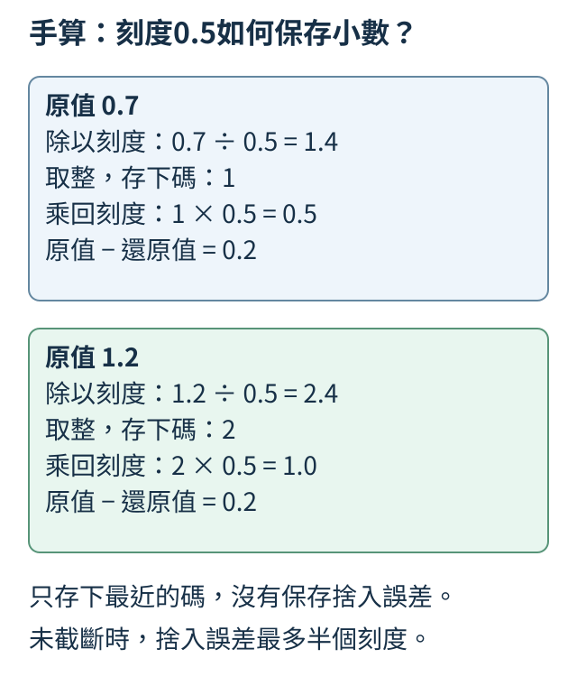
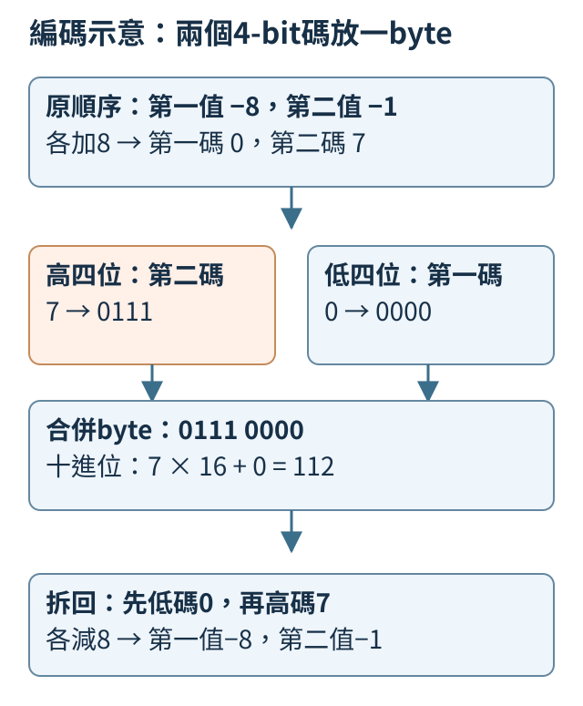
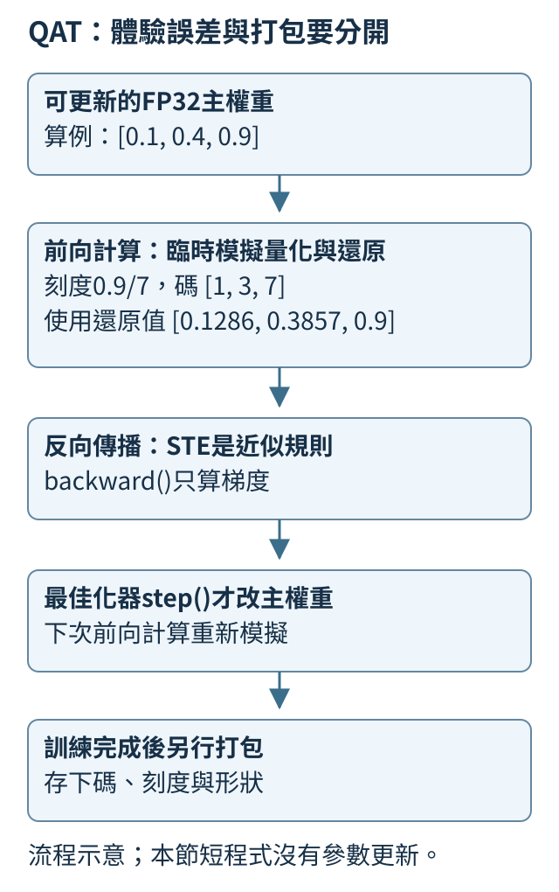

# 第 17 章：量化，用更少位元表示模型

如果每個權重用更少位元保存，同一套模型可以佔較少空間，但也會丟掉部分數值細節。本章從「多少byte」開始，沿著刻度、誤差、分組與打包追到實際運算，再比較訓練後量化（PTQ）、範圍校準與量化感知訓練（QAT）。最後回到生成結果：數值接近與任務行為相同，需要不同證據。

只量化權重是一條較小的入門路線；把中間特徵（activation，層與層之間傳遞的數字，[17.11](17.md#17.11)會定義）也量化、或在訓練時就模擬量化，按需要選用。壓縮與加速也分開看，硬體是否受益要量實際後端。讀到忘了的名詞，可以查[名詞頁](../glossary.md)。

## 17.1 數字個數相同，為什麼空間不同？

一張64列、32欄的權重表有2048個數字。要算它佔多少空間，還要知道每格怎麼存。**bit（位元）**有兩種狀態，八個bit組成一個**byte（位元組）**。FP32每格32bit，即4byte；FP16是[16.7](16.md#16.7)介紹過的16位元浮點格式，每格2byte；**int8**是有正負號的8位元整數，每格1byte，只能存−128到127的整數。

因此同一張表的數值部分分別是8192、4096、2048byte。形狀和參數個數沒變，改的是每個數能表示的範圍與細節。**量化（quantization）**就是把原數值換成少數幾個離散選項之一，目標是減少表示成本，同時把精度的下降控制住。

FP16與FP32都是浮點數，每個數自帶次方，不必另外記錄其他數字，就能存下0.7這種小數（只差極小的捨入）；int8只有整數。本章要把權重改存成整數，所以接下來先解決「整數怎麼代表小數」：另外記一個刻度，把整數換回原來的數值範圍。

```python
import torch

weight = torch.zeros(64, 32)
for dtype in (torch.float32, torch.float16, torch.int8):
    converted = weight.to(dtype)
    count = converted.numel()
    per_value = converted.element_size()
    print(dtype, "元素", count, "每格bytes", per_value, "總bytes", count * per_value)
```

`for dtype in (…)`依序取出圓括號裡用逗號分開的三種型別。`to(dtype)`建立指定型別的新tensor，`numel()`數元素，`element_size()`回報每格byte。三版都有2048格，最後一欄是8192、4096、2048，對上手算。全零表只用來隔離空間問題，不是學好的模型。

這裡尚未寫檔。完整檔案還有名稱、形狀、型別等附帶資訊，低位元版本也須保存還原用的刻度，所以檔案大小不能只用參數數量乘bit。執行時還有中間特徵（activation，層與層之間傳遞的數字，[17.11](17.md#17.11)會定義）與生成用的KV cache（[16.3](16.md#16.3)），訓練時另有梯度和最佳化器狀態（optimizer state）；權重縮小，不表示整臺機器的記憶體同比例縮小。

也不能直接用`.to(torch.int8)`當量化方法：它把小數部分直接捨去，0.7會變成0，而且沒有記下怎麼對回原來的範圍。全零在三種型別都精確，才適合本次的空間比較。下一節補上這份對應規則。

練習把程式的`weight = torch.zeros(64, 32)`改成`weight = torch.zeros(128, 32)`。先預測：三種型別的元素數都變4096，每格byte不變，總byte加倍成16384、8192、4096，再執行核對。

<details>
<summary>補充：既有實驗、來源與完整測量範圍</summary>

本章用一份完整的已訓練模型做過量化實驗，結果在[量化實驗紀錄（JSON）](https://github.com/birdhackor/tiny-perceptron-vlm/blob/main/docs/course-experiments/results/quantization.json)，這是機器可讀的完整結果；儲存大小看`results.runs`下`fp32`、`packed4`、`packed8`各自的`storage`，其中`tensor_bytes`是模型數字的bytes，`file_bytes`是整個檔案。141,568個模型參數的FP32數值合計566,272 bytes，保存成`fp32.pt`則是588,358 bytes。4-bit轉換後參數個數仍相同，數值儲存168,736 bytes，`model.pt`為182,277 bytes；8-bit則是226,336與242,085 bytes。三個檔案都不含最佳化器狀態。原始浮點檔另存續訓用的隨機狀態，記錄隨機過程進行到哪裡，讓之後的隨機操作可以接著進行，它不是模型參數。兩種保存格式也含不同的metadata（附帶說明資料，例如訓練紀錄或量化轉換方式），因此檔案大小的比例不能直接當作純權重的位元比。這些是本次實驗檔的大小；你自己轉出的檔案若少了隨機狀態或附帶資料，大小會不同，要重新量。

4-bit／8-bit在這份紀錄中描述的是Linear層權重的存法：115,200個權重換成低位元，其餘25,728個數字與640個偏移（bias）仍保存為FP32，共26,368個浮點數。偏移是每個輸出在加權和之後再加上的數。量化版本還新增1,416個FP32刻度，用來把碼還原到原來的數值範圍；刻度與碼下一節再展開，本節先把它們的儲存也算進來。

| 數值儲存部分 | 原FP32模型（bytes） | 4-bit版本（bytes） | 8-bit版本（bytes） |
| --- | ---: | ---: | ---: |
| 115,200個Linear權重 | 460,800 | 57,600 | 115,200 |
| 26,368個其餘數字與偏移，保留FP32 | 105,472 | 105,472 | 105,472 |
| 新增1,416個FP32刻度 | 0 | 5,664 | 5,664 |
| 合計 | 566,272 | 168,736 | 226,336 |

兩個4-bit碼放在一byte，所以115,200個需要115,200÷2＝57,600 bytes；保留的FP32數字占26,368×4＝105,472，刻度占1,416×4＝5,664。因此4-bit這一欄是57,600＋105,472＋5,664＝168,736 bytes。這個合計已包括仍用FP32的數字與新增的刻度；檔案的名稱、形狀與其他容器資訊，才是合計之外再加上的部分。要核對壓縮率，先問哪些數字換了存法，再按各部分的存法相加。

</details>

## 17.2 整數格子如何代表0.7這樣的小數？

想用整數保存0.7與1.2，先決定相鄰兩個整數代表的數值相差多少，這個間隔叫**刻度（scale）**。實際存下的整數叫**碼**；標題說的「整數格子」，就是這些可以使用的碼。若刻度是0.5，碼1代表0.5、碼2代表1.0。0.7除以0.5得1.4，取最近整數1，存下碼1；還原時乘0.5得到0.5，比原值少0.2。

把原值換成碼叫量化；用刻度把碼換回浮點數叫**反量化（dequantization）**，換回的數叫**還原值**。原值與還原值的差叫捨入誤差。碼只記住最近的那個整數，沒有記住這個差，所以從碼1找不回0.7。



圖把0.7與1.2各走一次「除以刻度、取整並存下碼、乘回刻度」，兩者的捨入誤差都是0.2。下面的程式對四個數做同樣的事。

```python
import torch

x = torch.tensor([-0.7, 0.2, 0.7, 1.2])
scale = 0.5
q = (x / scale).round().clamp(-127, 127).to(torch.int8)
restored = q.float() * scale
print("碼", q.tolist())
print("還原值", restored.tolist())
print("誤差", (x - restored).round(decimals=4).tolist())
```

`x / scale`把每個數除以刻度，`round()`取最近整數，`clamp(-127,127)`把超出範圍的值壓到兩端，最後`to(torch.int8)`才真的把每個碼存成1byte。int8能存−128到127；本例只用對稱的−127到127，讓正負兩邊的碼一樣多，−128不用。

碼是`[-1,0,1,2]`；`q.float()`轉回浮點數再乘刻度，得到還原值`[-0.5,0,0.5,1]`；原值減還原值約為`[-0.2,0.2,0.2,0.2]`。0.2除以0.5是0.4，離0較近，所以落到碼0。沒有被`clamp`截斷時，誤差最多是半個刻度（這裡是0.25）；超出範圍而被截斷的值，誤差可能更大。剛好在兩個整數正中間時，PyTorch取偶數那一個，例如1.5和2.5都取2。

誤差那一行會印出−0.20000000298023224這類長尾數。`round(decimals=4)`確實已取到四位小數，但結果仍存成FP32，而0.2無法用二進位精確表示；`tolist()`轉成Python數字時，把最接近0.2的那個FP32值完整印出來。這是保存精度造成的尾數，和本例約0.2的量化誤差是兩回事。

練習把程式的`scale = 0.5`改成`scale = 0.25`。先預測：碼變`[-3,1,3,5]`，還原值`[-0.75,0.25,0.75,1.25]`，誤差約0.05。刻度變細，誤差變小；但同樣127個正碼只覆蓋到127×0.25＝31.75，原本是127×0.5＝63.5。刻度越細，可表示的範圍也越小。

## 17.3 每個權重只差0.2，輸出也只差0.2嗎？

同一權重表的兩列是`[0.7,0.2]`與`[-0.7,1.2]`。用刻度0.5還原成`[0.5,0]`與`[-0.5,1]`，每格絕對差都是0.2。現在拿兩筆輸入`[1,1]`與`[1,−1]`作比較：輸出也都只差0.2嗎？

先寫出誤差表`w−還原值`：第一列`[0.2,0.2]`，第二列`[−0.2,0.2]`。線性層的每個輸出，是一列權重與輸入逐項相乘再相加，所以輸出差也是一列誤差與輸入的點積。輸入`[1,1]`時，第一列是`0.2×1＋0.2×1＝0.4`，兩項誤差相加；第二列是`−0.2×1＋0.2×1＝0`，正負抵消。輸入`[1,−1]`時反過來：第一列`0.2−0.2＝0`，第二列`−0.2−0.2＝−0.4`。所以單格權重誤差不能直接當成輸出誤差的上限。

```python
import torch

w = torch.tensor([[0.7, 0.2], [-0.7, 1.2]])
scale = 0.5
restored = (w / scale).round() * scale
x = torch.tensor([[1.0, 1.0], [1.0, -1.0]])
original_output = x @ w.T
compressed_output = x @ restored.T
print("權重平均絕對誤差", round((w - restored).abs().mean().item(), 4))
print("原輸出", original_output.round(decimals=4).tolist())
print("還原權重輸出", compressed_output.round(decimals=4).tolist())
print("逐項輸出差", (original_output - compressed_output).round(decimals=4).tolist())
```

`x @ w.T`讓每筆輸入與每列權重做點積：輸出的第一列屬於第一筆輸入，兩欄分別對應兩列權重。`abs().mean()`先取絕對值再平均，叫**平均絕對誤差（mean absolute error，MAE）**；先取絕對值，正負誤差才不會互相抵消。權重MAE是0.2，逐項輸出差卻約`[[0.4,0],[0,−0.4]]`，正是上面手算的四個點積。

這次restored仍是浮點tensor，沒有存成int8，目的是只看數值誤差。輸出會印出0.8999999761581421這類FP32尾數，先核對正負號與約0、0.4的差別即可。

整理成公式是`輸出差 = x @ (w−restored).T`：輸入的大小與方向都會影響誤差。模型再經過更多層與啟用函式後，還要看最終答案，不能只憑權重MAE保證品質。

練習把程式的`x = torch.tensor([[1.0, 1.0], [1.0, -1.0]])`改成`x = torch.tensor([[1.0, 1.0], [1.0, -1.0]]) * 10`。先預測：權重MAE仍是0.2，非零的輸出差變成±4。同一份壓縮權重，在不同大小的輸入下影響不同。

## 17.4 碼0一定代表浮點零嗎？

4-bit有16種碼。若想覆蓋−1到2，可以把碼0至15均勻放在這段範圍：15個間隔，刻度是3÷15＝0.2。碼0代表−1、碼1代表−0.8……碼15代表2；浮點數0落在碼5，而不是碼0。

代表浮點數0的那個碼叫**零點（zero-point）**。刻度決定相鄰兩碼差多少，零點決定0落在哪個碼。存下碼之後，還原公式是`還原值＝(碼−零點)×刻度`，例如碼10還原成`(10−5)×0.2＝1`。前兩節讓碼0代表0、正負兩邊的碼一樣多，叫**對稱量化（symmetric quantization）**，只需要刻度；本節多了可移動的零點，叫**仿射量化（affine quantization）**。

```python
import torch

x = torch.tensor([-1.0, 0.0, 1.0, 2.0])
low = min(x.min().item(), 0.0)
high = max(x.max().item(), 0.0)
scale = (high - low) / 15
zero = round(-low / scale)
q = (x / scale + zero).round().clamp(0, 15).to(torch.uint8)
restored = (q.float() - zero) * scale
print("刻度與零點", scale, zero)
print("碼", q.tolist())
print("還原值", restored.round(decimals=4).tolist())
print("碼0到15的還原值", [round((code - zero) * scale, 1) for code in range(16)])
```

`x.min().item()`取出最小值變成Python數字，`min(…, 0.0)`再和0比、取較小者；`max(…, 0.0)`同理。這讓選定的範圍一定包含0，零點才找得到對應的碼。本例low是−1、high是2，刻度0.2、零點5；碼是`[0,5,10,15]`，還原值`[−1,0,1,2]`。這四個數剛好都是某個碼的還原值，所以沒有捨入誤差；一般數字仍會有。

最後一行畫出整把刻度尺。`range(16)`依序給出0到15，方括號裡的`for code in range(16)`對每個碼各算一次`(碼−零點)×刻度`，再把結果收成一個清單：從−1每次加0.2，碼5是0，碼15是2。

`torch.uint8`是不帶正負號的8位元整數，可存0到255；這裡只用到0到15，還沒有把兩個碼併進一個byte（[17.8](17.md#17.8)才做）。若x全是0，範圍寬度是0、刻度也是0，除法會出問題，要另外處理；本例只示範寬度不為0的情況。

同樣叫4-bit，本章不同步驟用的整數範圍不同：本節的仿射碼是0到15；[17.5](17.md#17.5)起的`quantize_symmetric`用對稱碼，4-bit只用−7到7（−8不用），8-bit用−127到127；[17.8](17.md#17.8)的打包器接受−8到7，存進byte前各加8，變成0到15。看到「4-bit」時，先問是哪一步的數字。

練習把程式的`x = torch.tensor([-1.0, 0.0, 1.0, 2.0])`改成`x = torch.tensor([-2.0, 0.0, 1.0])`。先預測：範圍寬仍是3，刻度仍是0.2，零點改成10，碼變`[0,10,15]`，最後一行的刻度尺改從−2排到1。刻度管間隔，零點管0的位置，兩者分工不同。

## 17.5 不同大小的權重，應共用一把刻度尺嗎？

兩列權重分別是`[0.01,0.03,0.05,0.08]`與`[10,30,50,80]`。用4-bit對稱碼−7至7時，全表共用一個刻度就要容納80，刻度是80÷7≈11.4286。小列除以它全都接近0，四個權重會一起變成碼0。

若每列自己選刻度，小列用`0.08/7`，大列仍用`80/7`，就能在不改位元數的情況下保留小列的差別。這次比較的是**哪些數共用刻度**。下面先用函式庫的`quantize_symmetric`看結果：迴圈變數`per_row`依序把False、True交給`per_channel`；False時全表共用一個刻度，True時每列各一個。

```python
import torch
from tiny_perceptron.quantization import quantize_symmetric

w = torch.tensor([[0.01, 0.03, 0.05, 0.08], [10.0, 30.0, 50.0, 80.0]])
for per_row in (False, True):
    q, scale = quantize_symmetric(w, bits=4, per_channel=per_row)
    restored = q.float() * scale
    error = (w - restored).abs().mean(-1)
    print("每列獨立", per_row, "碼", q.tolist())
    print("每列MAE", error.round(decimals=4).tolist(), "刻度個數", scale.numel())
```

`per_channel=True`在這張線性層權重表指每個輸出列各一個刻度，不是每個輸入欄。`(w - restored).abs()`取每格誤差的絕對值，`mean(-1)`沿最後一軸取平均；這張2列、4欄表的最後一軸是每列的四個權重，所以得到兩個「每列MAE」。全表共用時，小列的碼全是0，MAE是0.0425；逐列時小列的碼是`[1,3,4,7]`，MAE約0.0025。大列兩種都約2.5。逐列看誤差，才不會讓大列的平均掩蓋小列。

刻度是怎麼選的？`quantize_symmetric`放在[tiny_perceptron/quantization.py](../../tiny_perceptron/quantization.py)，原樣如下：

```python
# 節錄自 tiny_perceptron/quantization.py：quantize_symmetric
def quantize_symmetric(weight, bits=8, per_channel=False):
    if bits not in (4, 8):
        raise ValueError("教材支援 4 或 8 bit")
    maximum = 2 ** (bits - 1) - 1
    if per_channel:
        scale = weight.abs().amax(-1, keepdim=True).clamp(min=1e-8) / maximum
    else:
        scale = weight.abs().max().clamp(min=1e-8) / maximum
    integers = (weight / scale).round().clamp(-maximum, maximum).to(torch.int8)
    return integers, scale
```

開頭兩行只接受4或8bit：`bits not in (4, 8)`檢查bits是不是這兩個值以外的數，是的話`raise ValueError(…)`立刻停下，並顯示括號裡的錯誤訊息。`maximum = 2 ** (bits - 1) - 1`是正碼上限，`**`是次方：4-bit是2³−1＝7，8-bit是2⁷−1＝127。碼只用−maximum到maximum，所以4-bit的−8、8-bit的−128都不會出現。

`per_channel`為真時，`weight.abs().amax(-1, keepdim=True)`沿最後一軸取每列最大的絕對值，本例是0.08與80；`keepdim=True`讓結果保持兩列一欄的形狀，之後`weight / scale`時，每列就除以自己那一列的刻度。否則`weight.abs().max()`取全表最大的絕對值，只得到一個刻度。兩條路都接`.clamp(min=1e-8)`：某列若全是0，最大絕對值是0，刻度會變成0而無法拿來除，所以先把它限制在至少10⁻⁸。最後除以maximum，也就是**刻度＝最大絕對值÷正碼上限**，例如小列是0.08÷7。

`integers = …`這一行和17.2的程式相同：除以刻度、取最近整數、限制在±maximum、存成int8。`return integers, scale`同時交回碼與刻度，所以呼叫時寫`q, scale = quantize_symmetric(…)`，一次接住兩個結果。

逐列的成本是多存刻度：一個FP32刻度占4byte，兩列各一個就是8byte。也可以讓一列內每固定幾個權重共用一個刻度，叫**分組量化（per-group quantization）**；組越小，每個刻度只需遷就組內最大的那個數，誤差通常較小，卻要存更多刻度與分組資訊。若每個權重都配一個FP32刻度，壓縮的好處就消失了。

練習把第一段程式的第一列`[0.01, 0.03, 0.05, 0.08]`改成`[10.0, 30.0, 50.0, 80.0]`，讓兩列範圍相同。先預測：共用與逐列得到相同的碼與MAE，逐列仍多存一個刻度。分組是精度與附帶儲存的取捨，不是免費的改善。

## 17.6 少四個位元，精度與容器各改了什麼？

取33個從−1到1均勻排列的權重，用同一份材料分別做8-bit與4-bit對稱量化。[17.5](17.md#17.5)的`quantize_symmetric`以「最大絕對值÷正碼上限」當刻度，這裡最大絕對值是1，所以8-bit的刻度是1/127≈0.007874，4-bit是1/7≈0.142857。範圍相同，4-bit的刻度粗得多：相鄰兩個還原值相差約0.14。

```python
import torch
from tiny_perceptron.quantization import quantize_symmetric

w = torch.linspace(-1, 1, 33)
for bits in (8, 4):
    q, scale = quantize_symmetric(w, bits)
    restored = q.float() * scale
    error = (w - restored).abs()
    packed_bytes = (w.numel() * bits + 7) // 8
    print("bits", bits, "MAE", round(error.mean().item(), 6), "最大差", round(error.max().item(), 6))
    print("理想碼bytes", packed_bytes, "目前q容器bytes", q.numel() * q.element_size())
```

`linspace(-1, 1, 33)`在−1到1之間取33個等距的數，含兩端。第一行同時看MAE與最大差：8-bit約0.001909、0.003937，4-bit約0.034632、0.071429。兩個最大差都正好是半個刻度，例如0.142857÷2≈0.071429；看最大差，少數較糟的位置才不會被平均藏住。

第二行分開「碼理想上要幾byte」與「目前的容器佔幾byte」。8-bit的33個碼需33byte；4-bit共33×4＝132bit，要17byte，最後半個byte空著。`//`是整數除法，只留商、捨去餘數，例如`139 // 8`是17；先加7再整除，就是「不滿一個byte也算一個」。可是`quantize_symmetric`最後一步`.to(torch.int8)`讓兩次的q都是每個碼1byte，目前都佔33byte：限制數值範圍與真正打包是兩步，理想大小也還沒算入刻度。

較粗不代表每個值都更差：0與兩端在兩種位元下都精確；剛好等於某個4-bit還原值的數，4-bit也沒有誤差，可能比8-bit還準。單一張表的誤差，更不能直接當成文字答對率。

練習把程式的`w = torch.linspace(-1, 1, 33)`改成`w = torch.arange(-7, 8).float() / 7`。`torch.arange(-7, 8)`產生−7到7的15個整數（不含8），除以7之後，每個值都剛好是4-bit的還原值。先預測：4-bit的誤差幾乎是0，8-bit反而不是0。這個例外提醒我們要看數值分布，不能只看位元數。

## 17.7 只量化權重時，輸入與運算用什麼？

先固定兩列權重`[0.7,0.2]`、`[−0.7,1.2]`，輸入`[1,1]`，原輸出是`[0.9,0.5]`。把權重按每列一個刻度存成4-bit，輸入仍保留浮點數，叫**只量化權重（weight-only quantization）**；這樣暫時不必估計各種輸入的中間特徵範圍。

第一列最大絕對值0.7，刻度0.1，0.7與0.2的碼是7與2，還原沒有誤差。第二列最大絕對值1.2，刻度是1.2/7≈0.1714；−0.7÷0.1714≈−4.08，取最近整數−4，還原成−4×0.1714≈−0.6857，所以壓縮後的輸出約`[0.9,0.5143]`。函式庫的`QuantizedLinear`把一個`nn.Linear`換成這種存法，下面固定輸入核對。

```python
import torch
from torch import nn
from tiny_perceptron.quantization import QuantizedLinear

layer = nn.Linear(2, 2, bias=False)
with torch.no_grad():
    layer.weight.copy_(torch.tensor([[0.7, 0.2], [-0.7, 1.2]]))
bits = 4
compressed = QuantizedLinear(layer, bits=bits)
x = torch.tensor([[1.0, 1.0]])
print("碼的型別", compressed.values.dtype, "輸出型別", compressed(x).dtype)
print("原輸出", layer(x).detach().round(decimals=4).tolist(), "壓縮輸出", compressed(x).round(decimals=4).tolist())
print("壓縮buffer bytes", compressed.storage_bytes())
```

第一行顯示碼存成`torch.uint8`，輸出卻是`torch.float32`；第二行是`[0.9,0.5]`與`[0.9,0.5143]`；最後一行是10byte。這些結果怎麼來？看`QuantizedLinear`本身：

```python
# 節錄自 tiny_perceptron/quantization.py：QuantizedLinear
class QuantizedLinear(nn.Module):
    """真正壓縮儲存，forward 仍反量化成浮點作參考。"""

    def __init__(self, layer, bits=4):
        super().__init__()
        q, scale = quantize_symmetric(layer.weight.detach(), bits, per_channel=True)
        self.bits, self.shape = bits, list(q.shape)
        self.register_buffer("values", pack_int4(q) if bits == 4 else q)
        self.register_buffer("scale", scale)
        self.register_buffer("bias", None if layer.bias is None else layer.bias.detach().clone())

    def forward(self, x):
        q = unpack_int4(self.values, self.shape) if self.bits == 4 else self.values
        weight = (q * self.scale).to(x.dtype)
        return F.linear(x, weight, None if self.bias is None else self.bias.to(x.dtype))

    def storage_bytes(self):
        return sum(b.numel() * b.element_size() for b in self.buffers())
```

`QuantizedLinear`是一個PyTorch零件，讀法同[3.7](03.md#3.7)：`__init__`在建立時執行一次，開頭的`super().__init__()`先讓`nn.Module`完成準備；`forward`定義每次的計算，`compressed(x)`這種呼叫就會執行`forward`。

建立時，`quantize_symmetric(…, per_channel=True)`替每個輸出列算一個刻度，`layer.weight.detach()`只取權重數字、不帶求導記錄。`self.bits, self.shape = bits, list(q.shape)`一次存兩個值：位元數，以及拆回時要用的原形狀`[2,2]`。`register_buffer`把一個tensor登記成模組的**buffer**：它會和參數一起被保存、一起搬到其他裝置，但不是參數，最佳化器不會更新它。`pack_int4(q) if bits == 4 else q`的意思是「條件成立取前者，否則取後者」：4-bit時兩個碼打包進一個`torch.uint8`的byte，8-bit時直接存`quantize_symmetric`回傳的int8碼。打包的做法[17.8](17.md#17.8)才講，這裡只需要知道`pack_int4`把碼壓緊、`unpack_int4`拆回原形狀。刻度與偏移（bias）也存成buffer；層沒有偏移時存`None`。

`forward`先拆回碼，`q * self.scale`讓每列的碼乘上自己那列的刻度，得到還原權重，再用`F.linear`做和`nn.Linear`相同的計算`x @ weight.T`（有偏移時再加上）。所以**存成整數與用整數乘法是兩件事**：這裡的輸入、還原權重與輸出都是FP32。`storage_bytes`把每個buffer的元素數乘每格byte再加總：4個4-bit碼打包成2byte，兩個FP32刻度佔8byte，合計10；`None`不佔空間。

```python
from torch.nn import functional as F
from tiny_perceptron.quantization import pack_int4, quantize_symmetric, unpack_int4

codes, scale = quantize_symmetric(layer.weight.detach(), bits, per_channel=True)
print("碼", codes.tolist(), "每列刻度", scale.flatten().round(decimals=4).tolist())
print("還原權重", (codes * scale).round(decimals=4).tolist())
rebuilt = QuantizedLinear(layer, bits=bits)
print("與函式庫版本輸出相同：", torch.equal(rebuilt(x), compressed(x)))
```

第三段先匯入節錄裡用到的`F`、`quantize_symmetric`、`pack_int4`、`unpack_int4`，照`__init__`裡`quantize_symmetric(…)`那一行算出碼`[[7,2],[−4,7]]`與每列刻度約`[0.1,0.1714]`，還原權重約`[[0.7,0.2],[−0.6857,1.2]]`，正是上面手算的結果。最後兩行用第二段節錄的`QuantizedLinear`重建同一層，得到`rebuilt`，再和第一段用函式庫版本建立的`compressed`比較，輸出完全相同。這要在Notebook裡依序執行過第二段才成立：第三段沒有匯入`QuantizedLinear`，跳過第二段時，這個名稱仍指函式庫版本，印出的True就沒有核對到節錄。

這些buffer不交給最佳化器更新，所以轉換後的層是拿來推論與核對的，不能直接沿用原本的最佳化器續訓。雖然存得小，每次`forward`仍會建立一份暫時的浮點權重，所以執行時的記憶體與速度要另外量。

練習把第一段程式的`bits = 4`改成`bits = 8`，從頭執行。先預測：碼不再打包，4個碼各1byte，兩個刻度仍是8byte，合計12；碼的型別變成`torch.int8`，輸出仍是FP32；第三段的碼變成`[[127,36],[−74,127]]`。固定權重與輸入，才能只比較位元數。

<details>
<summary>補充：既有實驗、來源與完整測量範圍</summary>

本章的整模型轉換保留文字與位置的embedding表、各正規化層的FP32參數，合計102,912 bytes；偏移也維持FP32，但跟著被替換的Linear存成buffer。這些選擇列在[量化實驗紀錄（JSON）](https://github.com/birdhackor/tiny-perceptron-vlm/blob/main/docs/course-experiments/results/quantization.json)的`results.runs.packed4.storage`：`retained_float_modules`是沒有轉換的模組，`buffers`逐層列出碼、刻度與偏移的bytes。所以只說「4-bit模型」，並不代表每個數字都只有四位元。

</details>

## 17.8 兩個4-bit值，如何裝進一個byte？

七個4-bit碼若各放進一個int8，仍佔7byte。把兩個碼放進同一個byte，才只需4byte。七個碼兩兩一組，最後一組只有一個，另一半要補一個值；拆回時要記得原本只有七項。

函式庫的打包器`pack_int4`接受有號整數−8至7，先各加8，換成0至15，剛好是4個bit能表示的16種值。一個byte有8個bit：第一碼放在低四位，第二碼放在高四位。放進高四位等於乘16，所以這個byte的值是`第二碼×16＋第一碼`，兩個碼都取加8後的值。例如−8、−1先變成0、7，byte是`0111 0000`，即`7×16＋0＝112`。



圖由上往下：兩個原值各加8；第二碼7寫成二進位`0111`放在高四位，第一碼0寫成`0000`放在低四位，合起來是112；拆回時先取低四位、再取高四位，各減8。

```python
import torch
from tiny_perceptron.quantization import pack_int4, unpack_int4

q = torch.tensor([-8, -1, 0, 1, 7, 2, 3], dtype=torch.int8)
packed = pack_int4(q)
restored = unpack_int4(packed, q.shape)
print("原數字", q.tolist())
print("packed", packed.tolist(), "bytes", packed.numel() * packed.element_size())
print("拆回", restored.tolist())
assert torch.equal(q, restored)
```

packed是`[112,152,175,139]`，佔4byte。第二組0、1加8後是8、9，`9×16＋8＝152`；第三組7、2加8後是15、10，`10×16＋15＝175`；末項3加8是11，另一半補上8（減8後代表0），所以最後一個byte是`8×16＋11＝139`。`assert torch.equal`確認拆回的整數與原本完全相同。兩個函式的原樣如下：

```python
# 節錄自 tiny_perceptron/quantization.py：pack_int4、unpack_int4
def pack_int4(integers):
    flat = integers.flatten().to(torch.int16)
    if ((flat < -8) | (flat > 7)).any():
        raise ValueError("int4 可儲存 -8 到 7")
    values = (flat + 8).to(torch.uint8)
    if values.numel() % 2:
        values = F.pad(values, (0, 1), value=8)
    return values[0::2] | (values[1::2] << 4)


def unpack_int4(packed, shape):
    values = torch.stack((packed & 15, packed >> 4), -1).flatten().to(torch.int16) - 8
    count = 1
    for dimension in shape:
        count *= dimension
    return values[:count].reshape(shape).to(torch.int8)
```

`pack_int4`先`flatten()`攤平成一排，並轉成範圍較寬的整數型別`torch.int16`，再檢查每個數是否落在−8到7。`(flat < -8) | (flat > 7)`逐項標出超出範圍的位置，這裡的`|`是「或」；`.any()`只要有一項為真就成立，於是`raise`報錯。`(flat + 8).to(torch.uint8)`把−8至7換成0至15。`values.numel() % 2`的`%`是取餘數，項數是奇數時餘1，`F.pad(values, (0, 1), value=8)`就在尾端補一個8。

最後一行兩兩合併：`values[0::2]`從第0項起每隔一項取一個，是每組的第一碼；`values[1::2]`從第1項起取，是每組的第二碼。`<< 4`把位元往左移四位，等於乘16；接著的`|`把兩份不重疊的位元合在一起，這裡等於相加。

`unpack_int4`反過來做：`packed & 15`只留下低四位，等於除以16的餘數；`packed >> 4`把位元往右移四位，等於除以16的商。`torch.stack(…, -1).flatten()`把每個byte拆出的「低碼、高碼」依序排回一排，順序與打包前相同，再減8回到−8至7。`for dimension in shape`把形狀各軸的長度相乘，`count *= dimension`是「乘上後存回」，得到原本的項數7；`values[:count]`只取前7項，丟掉補上的那一個，最後`reshape(shape)`恢復原形狀。

```python
from torch.nn import functional as F

print("& 15", (packed & 15).tolist(), "除以16的餘數", (packed % 16).tolist())
print(">> 4", (packed >> 4).tolist(), "除以16的商", (packed // 16).tolist())
same = torch.equal(pack_int4(q), packed)
print("與函式庫版本相同：", same)
assert same
```

第三段用十進位核對拆法：`& 15`與除以16的餘數都是`[0,8,15,11]`，`>> 4`與商都是`[7,9,10,8]`。最後三行用第二段節錄的`pack_int4`重算一次，和第一段用函式庫版本算好的`packed`比較，先印出是否相同（True），再用`assert`確認；節錄的`pack_int4`要用`F.pad`，所以先匯入`F`。這要在Notebook裡依序執行過第二段才成立：跳過它，`pack_int4`仍是第一段匯入的函式庫版本，印出的True就沒有核對到節錄。

這個打包步驟是無損的，但在它之前，浮點數換成碼時已可能有誤差。`quantize_symmetric`只用−7至7，所以打包器雖然裝得下−8，量化時並不會出現。完整的層還要保存刻度、形狀、位元設定與偏移，[17.7](17.md#17.7)的`QuantizedLinear`就是這樣使用這兩個函式。一般乘法也不能把112當成原權重，要先按格式拆開，或交給懂得這種格式的運算。

練習在第一段程式的`q = torch.tensor([-8, -1, 0, 1, 7, 2, 3], dtype=torch.int8)`方括號裡最後加上`, 4`，變成八個數。先預測：八個數仍佔4byte，最後一個byte的高四位從補上的8變成4＋8＝12，byte改成`12×16＋11＝203`，拆回時也不用再丟掉補位。

<details>
<summary>補充：既有實驗、來源與完整測量範圍</summary>

整模型4-bit版本的13個Linear共保存57,600 bytes的碼、5,664 bytes的逐列刻度與2,560 bytes的FP32偏移，合計65,824 bytes的buffer。其他浮點參數還需102,912 bytes，兩邊相加才是[17.1](17.md#17.1)的168,736 bytes。[量化實驗紀錄（JSON）](https://github.com/birdhackor/tiny-perceptron-vlm/blob/main/docs/course-experiments/results/quantization.json)的`results.runs.packed4.storage.buffers`逐層列出這些bytes：名稱結尾`values`是碼、`scale`是刻度、`bias`是偏移，可以核對刻度確實存下來了。它們是實際容器大小，不是用參數個數除以二推估的理想值。

</details>

## 17.9 不更新權重，也能做量化嗎？

手上已有一份訓練好的權重，可以先固定它，選刻度、轉成低位元，再用同樣的輸入檢查。這叫**訓練後量化（Post-Training Quantization，PTQ）**。最基本的、只量化權重的PTQ，依權重本身的範圍選刻度，不必先收集中間特徵。

要看清轉換造成的差別，原版與量化版必須來自同一份數字。下面的短程式用隨機初始化的模型，只核對轉換與比較的方式；真正的PTQ要先載入選定的檢查點，再用同樣流程與任務題檢查品質。程式先用`copy.deepcopy`複製一份完全獨立的模型，再轉換副本裡的Linear層。

```python
import copy
import torch
from tiny_perceptron.model import TinyLM, ModelConfig
from tiny_perceptron.quantization import replace_linear_layers

torch.manual_seed(0)
original = TinyLM(ModelConfig(width=8, tied=False)).eval()
ids = torch.tensor([[1, 2, 3]])
bits = 4
with torch.no_grad():
    before = original(ids)["logits"]
    quantized = replace_linear_layers(copy.deepcopy(original), bits=bits)
    after = quantized(ids)["logits"]
    original_again = original(ids)["logits"]
print("兩版形狀", tuple(before.shape), tuple(after.shape))
print("原版是否被改", (before - original_again).abs().max().item())
print("量化分數MAE", (before - after).abs().mean().item())
```

輸入是3個token，`ModelConfig`預設的字表有264個候選，所以兩版分數的形狀都是`(1,3,264)`。`eval()`切到評估行為，`no_grad()`不記錄反向傳播要用的計算關係。原版前後的最大差是0，量化分數的MAE約0.029，不是0。轉換怎麼找到每一個Linear？看`replace_linear_layers`：

```python
# 節錄自 tiny_perceptron/quantization.py：replace_linear_layers
def replace_linear_layers(module, bits=4):
    """就地替換；tied embedding 的語意要在比較中明示，不自動維持共享。"""
    for name, child in list(module.named_children()):
        if isinstance(child, nn.Linear):
            setattr(module, name, QuantizedLinear(child, bits))
        else:
            replace_linear_layers(child, bits)
    return module
```

`named_children()`逐一給出`module`底下直接相連的子模組，以及它們的屬性名稱；迴圈裡會替換子模組，所以先用`list(…)`抄成一份清單，再逐一處理。`isinstance(child, nn.Linear)`問「這個子模組是不是Linear」。是的話，`setattr(module, name, QuantizedLinear(child, bits))`等於寫`module.<名稱> = QuantizedLinear(child, bits)`，把原層換成[17.7](17.md#17.7)的量化層；不是的話，就對這個子模組再呼叫同一個函式，往裡面一層層找。TinyLM最上層的輸出層`output`本身就是Linear，直接被換掉；`blocks`則要往下經過每個block的`attention`與`ffn`，才找到q、k、v、out、up、down這幾個Linear。

這個函式直接修改傳入的模組，也就是文件字串說的「就地替換」，所以程式先`deepcopy`，原版才保持不變；不能把原版直接傳進去，之後還假設它沒變。它只換Linear，embedding表與正規化層不轉換，所以也不是所有數字都變成4-bit。

```python
from torch import nn
from tiny_perceptron.quantization import QuantizedLinear

again = replace_linear_layers(copy.deepcopy(original), bits=bits)
print("輸出層", type(again.output).__name__, "embedding表", type(again.embedding).__name__)
with torch.no_grad():
    print("與函式庫版本分數相同：", torch.equal(again(ids)["logits"], after))
```

第三段先匯入節錄裡用到的`nn`與`QuantizedLinear`，再用第二段節錄的`replace_linear_layers`轉換另一份副本。`type(…).__name__`取出物件所屬類別的名稱：輸出層已換成`QuantizedLinear`，embedding表仍是`Embedding`；分數和第一段用函式庫版本算好的`after`完全相同。這要在Notebook裡依序執行過第二段才成立：跳過它，`replace_linear_layers`仍是第一段匯入的函式庫版本，印出的True就沒有核對到節錄。

本例`tied=False`，即不做[14.6](14.md#14.6)的權重共享（weight tying）：輸入的embedding表與輸出層各有自己的權重。若原本共享，把輸出層換成量化buffer會切斷共享關係，文件字串說的「不自動維持共享」就是這件事；這必須另外設計，不能默默當成只改精度。

若連中間特徵也要量化，還得選它們的範圍：可以每次看到輸入時當場估計，或先用一批資料做範圍校準。[17.12](17.md#17.12)才講範圍校準，這裡只需要知道它是收集中間特徵的數值範圍，和第9章讓信心對上正確率的機率校準不同。無論哪一種，PTQ本身都沒有更新權重，這是它和[17.14](17.md#17.14)的QAT不同的地方。

練習把第一段程式的`bits = 4`改成`bits = 8`，保持原版、種子與輸入。先預測：形狀與「原版是否被改」的0都不變，量化分數MAE變小；第三段仍印出True。速度則是另一個測量。

<details>
<summary>補充：既有實驗、來源與完整測量範圍</summary>

整模型實驗載入[T.4的直接SFT模型](../training.md#T.4)：特徵寬度64、兩層、不做權重共享，再以原本的45筆訓練題更新120次（batch 16、學習率0.003、seed 42），讀到13,610個有效目標。更新後的FP32模型才是共同來源；4-bit與8-bit各從它直接轉換，沒有再訓練，也沒有先轉8-bit再降成4-bit。訓練、驗證、測試仍是原本的45／5／10筆，分別來自9／1／2個家族（同一組顏色、形狀與音高衍生的題目），三邊沒有交集。兩份打包檔重新載入後才評估；品質檢查與實驗紀錄見[17.15](17.md#17.15)，完整重做指令見[T.9](../training.md#T.9)。以測試10題的答對數來看，T.4的模型原本答對5題（[17.14](17.md#17.14)補充表中的「原FP32」），多更新120次後的FP32答對6題（[量化實驗紀錄（JSON）](https://github.com/birdhackor/tiny-perceptron-vlm/blob/main/docs/course-experiments/results/quantization.json)`results.runs.fp32.test`的`correct`）；兩者之間隔著這120次更新，不能把多答對的那一題歸功於量化。

</details>

## 17.10 檔案變小，為什麼運算不一定更快？

一層64個輸入、32個輸出，有2048個權重和32個偏移。FP32數值共`2048×4＋32×4＝8320`byte。4-bit權重打包成1024byte，32個刻度128byte，偏移128byte，合計1280byte。

數值儲存減少了，但[17.7](17.md#17.7)的`forward`每次都先用`q * self.scale`重建8192byte的浮點權重，再做浮點乘法。拆碼與還原是額外的工作；來源是低位元，不會讓普通乘法自動變成低位元計算。

```python
import torch
from torch import nn
from tiny_perceptron.quantization import QuantizedLinear

layer = nn.Linear(64, 32)
compressed = QuantizedLinear(layer, bits=4)
x = torch.ones(2, 64)
float_bytes = sum(p.numel() * p.element_size() for p in layer.parameters())
print("原層數字bytes", float_bytes)
print("壓縮buffer bytes", compressed.storage_bytes())
print("碼bytes", compressed.values.numel() * compressed.values.element_size())
print("運算結果", tuple(compressed(x).shape), compressed(x).dtype)
```

`sum(… for p in layer.parameters())`對層的每個參數（權重與偏移）各算一次bytes再加總，和`storage_bytes`對buffer的寫法相同。前三行是8320、1280、1024：第一份含原權重與偏移，第二份含碼、刻度與偏移，第三份只有碼。輸出形狀`(2,32)`、型別FP32，表示兩筆輸入各有32個輸出特徵。這是儲存與運算介面的核對，沒有計時。

**kernel（計算程式）**是實際執行底層乘加與資料讀取的程式。專用的低位元kernel可以邊讀小塊權重邊還原，或使用硬體支援的整數／混合精度路徑。是否更快取決於硬體、矩陣形狀、格式與實作，不能保證所有硬體都受益。

比較成本要分別量檔案大小、載入時的最高記憶體、執行時的最高記憶體，以及讀提示的prefill與逐步生成的decode時間（[16.2](16.md#16.2)）。臨時還原的矩陣也算在執行成本內。計時先暖機：用同樣的輸入試跑幾次、不列入平均，再固定生成步數重複測量。

練習把程式的`compressed = QuantizedLinear(layer, bits=4)`改成`bits=8`。先預測：碼2048byte，刻度與偏移各128byte，總共2304byte；輸出仍是FP32。這些數字不能拿來推算速度。本教材在NVIDIA L4 GPU上的小模型實測中，逐層反量化的4-bit路徑反而較慢；量測範圍在補充，不能外推到其他後端。

<details>
<summary>補充：既有實驗、來源與完整測量範圍</summary>

[GPTQ原論文的實用加速段落](https://arxiv.org/abs/2210.17323v2)也把收益歸到專用的量化矩陣／浮點向量kernel與較少的記憶體讀取，沒有把所有乘法改成整數。本課的`QuantizedLinear`採更直白的逐層完整反量化，也沒有實作GPTQ的權重校正。在本次L4測量，46-token提示、暖機後重複三次，FP32／4-bit／8-bit的prefill平均約2.405／4.958／2.768毫秒；固定八步、不因EOS早停的decode平均每步約2.371／4.882／2.814毫秒。這份小模型的參考4-bit路徑較慢，符合拆碼需要額外工作的可能性，不能外推成所有低位元後端都較慢。這些時間在[量化實驗紀錄（JSON）](https://github.com/birdhackor/tiny-perceptron-vlm/blob/main/docs/course-experiments/results/quantization.json)`results.runs`下各版的`timing`：`prefill_seconds`與`decode_seconds_per_token`的單位是秒。

先分清GPU記憶體的幾種計數。PyTorch的分配工具（allocator）負責拿取和重用GPU記憶體區塊；「已配置」計算它已交給tensor等資料、尚未釋放的區塊。「保留」還包括暫時空出、但留著供下一次重用的區塊，所以沒有被目前的tensor使用，也可能仍占GPU空間。CUDA驅動程式（driver）是讓程式與GPU溝通、執行工作的底層軟體，它本身需要的空間也沒有全算在PyTorch的這組數值裡。

三版探針的CUDA已配置記憶體峰值，比探針起點多335,872／376,320／359,936 bytes（`timing`的`cuda_additional_peak_bytes`）。這些是分配工具在本次前向期間的額外峰值；測量時其他版本仍同時留在GPU上，起點已有68,655,616 bytes。它們沒有量隔離程序的模型載入峰值、CUDA driver或所有保留記憶體，也不能用來宣稱4-bit整個執行只需376,320 bytes，或會隨檔案比例省RAM。各次探針會重設峰值計數，所以實驗紀錄最外層的`peak_allocated_bytes`也只量到最近一次重設之後，範圍寫在旁邊的`peak_memory_scope`。

</details>

## 17.11 中間特徵也量化，多了哪一種誤差？

前幾節只量化權重。若連送進層的輸入也換成碼，誤差就多一個來源。用兩筆輸入x與權重w，刻意都取同一組數字`[0.7,0.2]`、`[−0.7,1.2]`，方便對照。第一種比較只量化w；第二種把x與w都量化到刻度0.5。想看清的是：第二種比較多出來的，是輸入特徵的量化誤差。

這裡的**中間特徵（activation）**，指送進一層的輸入，以及模型計算途中產生、再交給下一層的數字。英文activation也用來稱呼[2.4](02.md#2.4)那種讓數字轉彎的**啟用函式（activation function）**，例如ReLU、GELU；本章說的是數值，不是函式。[16.10](16.md#16.10)的中間特徵重算（activation checkpointing）也是指這些數值。權重固定不變，中間特徵卻會隨輸入內容改變。

```python
import torch

x = torch.tensor([[0.7, 0.2], [-0.7, 1.2]])
w = torch.tensor([[0.7, 0.2], [-0.7, 1.2]])
scale = 0.5


def simulate_quantization(t):
    return (t / scale).round() * scale


qx, qw = simulate_quantization(x), simulate_quantization(w)
reference = x @ w.T
weight_only = x @ qw.T
both = qx @ qw.T
print("原輸出", reference.round(decimals=4).tolist())
for name, output in (("只量化權重", weight_only), ("權重與特徵都量化", both)):
    print(name, output.round(decimals=4).tolist(), "MAE", round((reference - output).abs().mean().item(), 4))
```

`simulate_quantization`量化後立即還原，仍回傳浮點tensor，沒有打包，也沒有低位元kernel。刻度固定為0.5是為了只看誤差；實際的權重與中間特徵通常各用自己的刻度。最後的`for name, output in (…)`每次取出一組名稱與輸出，依序印出兩種比較。

原輸出約`[[0.53,−0.25],[−0.25,1.93]]`。只量化權重的MAE是0.19，兩邊都量化是0.24。看非對角的兩格：只量化權重時是−0.15與−0.35，有誤差；兩邊都量化卻剛好回到−0.25。最後一格1.93變成1.25，比只量化權重的1.55更差。多一個誤差來源，不代表每一項一定更糟，有時方向會偶然抵消。

完整任務仍要另外檢查，而且中間特徵的範圍可能隨句子長度、圖片或音量改變。本章既有的整模型PTQ與QAT實驗只量化Linear權重，沒有量化中間特徵，那些分數不能當成本節做法的成績。

練習把程式的`x = torch.tensor([[0.7, 0.2], [-0.7, 1.2]])`第一列改成`[1.0, 0.0]`。1與0都剛好是刻度0.5的還原值，量化後不變，所以兩種比較的第一列相同，都是`[0.5,−0.5]`。

<details>
<summary>補充：既有實驗、來源與完整測量範圍</summary>

本節與接下來兩節的範圍、極端值例子，是CPU上可以核對的數值機制。本章已完成的整模型量化與QAT都只量化Linear權重：[量化實驗紀錄（JSON）](https://github.com/birdhackor/tiny-perceptron-vlm/blob/main/docs/course-experiments/results/quantization.json)的`results.limitations`第一項寫明沒有做中間特徵的範圍校準，[QAT實驗紀錄（JSON）](https://github.com/birdhackor/tiny-perceptron-vlm/blob/main/docs/course-experiments/results/qat.json)的`results.activation_quantization`是false。它們沒有做中間特徵的範圍校準、截斷或低位元中間特徵訓練，不能把那些GPU分數當作本節方法的成績。

</details>

## 17.12 中間特徵的範圍，在何時決定？

中間特徵每次輸入都不同，刻度要依哪個範圍決定？事先收集的材料裡，特徵是`[−0.5,0.2,0.8,1]`，最大絕對值1；新輸入是`[−0.2,0.4,3]`，出現了3。沿用事先的範圍，3會被截到1；按這次輸入重選範圍，刻度又會變粗。

先用一批代表實際使用情境的輸入跑模型、記下中間特徵的範圍，叫**範圍校準（range calibration）**。它本身不更新模型參數，也和第9章讓信心對上正確率的機率校準是兩件事。本節把範圍事先決定的叫**固定範圍（static）**，每次看到輸入才決定的叫**動態範圍（dynamic）**。

```python
import torch

calibration = torch.tensor([-0.5, 0.2, 0.8, 1.0])
evaluation = torch.tensor([-0.2, 0.4, 3.0])
fixed_max = calibration.abs().max()
dynamic_max = evaluation.abs().max()


def simulate(x, maximum):
    scale = maximum / 7
    return (x / scale).round().clamp(-7, 7) * scale


for name, maximum in (("固定範圍", fixed_max), ("動態範圍", dynamic_max)):
    restored = simulate(evaluation, maximum)
    overflow = (evaluation.abs() > maximum).sum().item()
    print(name, "最大絕對值", maximum.item(), "超出項數", overflow, "還原值", restored.round(decimals=4).tolist())
```

`calibration`是事先收集的範圍校準材料，`evaluation`是新輸入。這個算例用4-bit對稱碼−7到7：`simulate`以`maximum/7`當刻度，讓碼7對應正的maximum；除以刻度、取整後，`clamp(-7,7)`把超出範圍的碼壓到兩端，所以還原值最多到±maximum。`(evaluation.abs() > maximum).sum()`數出有幾項超出範圍。

固定範圍是1，超出1項，還原值約`[−0.1429,0.4286,1]`；動態範圍是3，沒有超出，還原值約`[-0.0,0.4286,3]`；`-0.0`就是0，浮點數保留了原本的負號。動態範圍保住了3，卻把−0.2歸零；「沒有超出」不是唯一的品質標準。

固定範圍省去每次估範圍的工作，但範圍校準的資料若低估了實際常見的範圍，就可能頻繁截斷。動態範圍要額外統計當下的特徵，碼的數量仍然有限。範圍校準也可以按百分位數選界線，例如取涵蓋99%已收集絕對值的位置，允許極少數值被截斷，換取較細的刻度。

範圍校準的資料應涵蓋實際會遇到的內容、長度或音量；測試資料另外保留，不參與挑選。若看了測試結果再反覆選範圍，那組分數就已受到挑選的影響。

練習在程式的`calibration = torch.tensor([-0.5, 0.2, 0.8, 1.0])`方括號裡最後多放一個`3.0`，變成五個數；不是把每個數都加3。evaluation不變。先預測：固定範圍也變成3，兩種方法的還原值相同，都是`[0,0.4286,3]`（0會印成`-0.0`）。這是受控算例；實際做範圍校準時，不能先看測試題錯在哪裡，再回頭把那些輸入補進範圍校準的資料，否則測試就不再是沒參與挑選的檢查。

## 17.13 保住大值與保住小值，如何看取捨？

四個特徵`[0.1,0.2,0.3,100]`共用一個4-bit刻度。為了容納100，刻度是100/7≈14.2857，前三項全落到碼0。這種遠大於其他值的少數數字叫**極端值（outlier）**。

先把來源截到−1至1，刻度變成1/7，可以保住小值的更多細節；但100變成1，差了99。要看這項取捨，誤差必須對原本的x計算，不能只和截斷後的來源比。

```python
import torch
from tiny_perceptron.quantization import quantize_symmetric

x = torch.tensor([0.1, 0.2, 0.3, 100.0])
for clip in (False, True):
    source = x.clamp(-1, 1) if clip else x
    q, scale = quantize_symmetric(source, bits=4)
    restored = q.float() * scale
    error = (x - restored).abs()
    print("截斷", clip, "還原值", restored.round(decimals=4).tolist())
    print(
        "小值MAE",
        round(error[:3].mean().item(), 4),
        "極值差",
        round(error[-1].item(), 4),
        "全部MAE",
        round(error.mean().item(), 4),
    )
```

`x.clamp(-1, 1) if clip else x`是[17.7](17.md#17.7)看過的條件寫法：clip為真時用截斷後的版本。關鍵是`error = (x - restored).abs()`，永遠拿原本的x來比。`error[:3]`取前三項，也就是三個小值；`error[-1]`取最後一項，也就是極端值。方括號裡的冒號表示取一段，負數索引從尾端數起。

不截斷時還原值是`[0,0,0,100]`，小值MAE 0.2、極值差0、全部MAE 0.15；截斷後小值MAE約0.0381，極值差99，全部MAE約24.7786。

把全部的平均與「小值、極端值」分開看，結論不同：小值明顯改善，總平均卻變糟。極端值若只是雜訊，截斷可能划算；若它代表任務的重要訊號，就不能丟。本例沒有任務模型，無法替我們決定。

也可以把共用刻度的組切小（[17.5](17.md#17.5)的分組量化），或讓敏感的位置保留較高精度；成本是多存刻度、多做運算。截斷界線設多少、哪些位置保留較高精度，這些設定先用範圍校準資料與驗證資料比較，最後才用沒參與挑選的測試資料檢查完整用途。

練習把程式的`x = torch.tensor([0.1, 0.2, 0.3, 100.0])`裡的`100.0`改成`2.0`。先預測：截斷後極值差變成1（2被截到1），三個小值的還原值不變；不截斷時刻度變成2/7，小值不再全部歸零。這次改的是極端值，不是位元數或截斷界線。

## 17.14 訓練時能先體驗量化誤差嗎？

PTQ在權重固定之後才轉換。另一種做法在訓練期間就讓前向計算使用量化後再還原的數字，讓模型練習適應這些捨入誤差，叫**量化感知訓練（Quantization-Aware Training，QAT）**。它需要訓練資料與參數更新，和只收集範圍的範圍校準不同。

先用`[0.1,0.4,0.9]`看問題。4-bit對稱量化的刻度是0.9/7，碼是`[1,3,7]`，還原值約`[0.1286,0.3857,0.9]`。x稍微變大或變小，只要x÷刻度還沒到達相鄰兩個整數的正中間，round的結果就完全不變，所以直接對round求出的梯度幾乎處處是0；梯度傳不回前面的權重，訓練就沒有訊號可用。

QAT常用**模擬量化（fake quantization）**：前向計算確實使用還原值，反向傳播時卻刻意把這一步當成「直接通過」，梯度原樣往回傳。這個近似叫**直通估計（straight-through estimator，STE）**，它不是round真正的導數。



圖由上往下分成五步：保留可更新的FP32主權重；前向計算時臨時模擬量化與還原；反向傳播時用STE近似算出梯度；第四步由最佳化器的`step()`真正更新主權重，下次前向計算再重新模擬；訓練完成後才另外打包成碼。下面的程式只做第二、三步：算出前向值與梯度，不呼叫第四步的`step()`。

```python
import torch
from tiny_perceptron.quantization import fake_quantize, quantize_symmetric

x = torch.tensor([0.1, 0.4, 0.9], requires_grad=True)
y = fake_quantize(x, bits=4)
y.sum().backward()
print("前向值", y.detach().round(decimals=4).tolist())
print("STE梯度", x.grad.tolist())
codes, scale = quantize_symmetric(x.detach(), bits=4)
hard = x.detach().clone().requires_grad_()
plain = (hard / scale).round() * scale
plain.sum().backward()
print("碼", codes.tolist(), "直接round梯度", hard.grad.tolist())
```

`fake_quantize`的前向值約`[0.1286,0.3857,0.9]`，就是還原值；對y的總和做反向傳播，STE梯度是`[1,1,1]`。對照組先用`quantize_symmetric(x.detach(), bits=4)`算出同一個刻度0.9/7與碼`[1,3,7]`，`.detach()`只取數值，讓刻度成為固定的數。`hard`先用`detach()`斷開x原有的計算關係、`clone()`複製相同數值，再用`requires_grad_()`讓這份新tensor記錄計算關係，梯度另存在`hard.grad`；直接round的梯度是`[0,0,0]`。這段程式只算梯度：沒有呼叫最佳化器的`step()`，不更新任何參數，也不寫出任何檔案。`fake_quantize`的原樣如下：

```python
# 節錄自 tiny_perceptron/quantization.py：fake_quantize
def fake_quantize(x, bits=8):
    q, scale = quantize_symmetric(x.detach(), bits)
    reconstructed = q * scale
    # straight-through estimator：forward 見量化誤差，backward 近似為恒等。
    return x + (reconstructed - x).detach()
```

前兩行和[17.5](17.md#17.5)的做法相同，只是沒有`per_channel`，整個tensor共用一個刻度；`x.detach()`讓刻度與碼不參與求導。關鍵在最後一行，前向與反向要分開看。前向：`x + (reconstructed - x)`裡兩個x相消，算出的值就是`reconstructed`，也就是還原值；以x的第一項0.1為例，括號裡是`0.1286−0.1＝0.0286`，再加回0.1得到0.1286。反向：`(reconstructed - x).detach()`被當成固定的常數（0.1那一項就是0.0286），沒有梯度，對x求導只剩外面那個x，導數是1，所以梯度原樣傳回。註解說的「backward近似為恒等」就是這個意思。

完整QAT仍保存可更新的浮點主權重，每次前向都重新模擬；訓練結束後才另外轉成實際打包格式，再用部署版檢查。模擬規則若和部署規則不一致，模型適應的誤差就可能對不上。

有梯度只說明可以學，效果要靠同起點、同資料、同更新預算的對照。既有實驗用10道測試題比較：題目是留出的顏色、形狀與音高屬性問答，沒有用來更新參數；生成內容的token ID去掉第一個EOS（結束標記，[6.6](06.md#6.6)）與之後的部分，和正確答案的token ID完全相同，才算答對。兩支都從同一個底座更新350次：普通微調後再做PTQ答對6／10，QAT後打包成4-bit的部署版答對4／10。在這個小模型上，QAT沒有勝過同樣更新350次的PTQ。完整條件在補充；不能把單一向量的梯度或「預先適應」當成品質保證。

練習把第一段程式的`y.sum().backward()`改成`y.square().sum().backward()`，`square()`是逐項平方。先預測：STE梯度變成2y，約`[0.2571,0.7714,1.8]`；直接round的梯度仍是0。這分開了兩件事：梯度的大小來自代價怎麼定，STE只決定梯度怎麼穿過量化。

<details>
<summary>補充：既有實驗、來源與完整測量範圍</summary>

[Jacob等人的模擬量化原文第3節](https://arxiv.org/abs/1712.05877v1)也分開浮點訓練圖與低位元推論圖；我們只採其中「先體驗捨入誤差」的思路，沒有複製其整數推論引擎。[STE原文第4節](https://arxiv.org/abs/1308.3432v1)把直接傳梯度稱為有偏的估計，正好提醒我們：有梯度是能更新的條件，品質改善另靠結果證明。

整模型流程從[T.4的直接SFT底座](../training.md#T.4)各複製一份，以相同初始化、相同抽題索引、seed 42、batch 16與學習率0.003，分別做350次普通FP32微調與350次只量化權重的QAT。兩支都實際完成350次最佳化器更新，各讀39,348個有效目標（回答與EOS）。QAT針對每個輸出列，以最大絕對值除以7求刻度，捨入到−7至7、反量化後做前向計算，反向採上述STE，和最後`QuantizedLinear`的規則相同。這與上方單一向量、共用一個刻度的CPU例子不同，整模型使用逐列刻度。

表中的PTQ4是用[17.9](17.md#17.9)的訓練後量化轉成4-bit的版本，packed4是QAT訓練完、打包成4-bit的部署版。答對數依生成結果計；平均NLL看的是預測代價。照[6.5](06.md#6.5)的定義，NLL（負對數似然）是正確token負對數機率的加總；表中把加總除以有效目標數（測試是69個，都屬回答與EOS），得到**平均NLL**。越小表示這批目標的平均預測代價越低，還不是模型自己生成時的答對率。這些數字取自[QAT實驗紀錄（JSON）](https://github.com/birdhackor/tiny-perceptron-vlm/blob/main/docs/course-experiments/results/qat.json)：看`results.runs`下各版的`test`，`correct`是答對數，`nll_sum`是NLL加總，`supervised_tokens`是有效目標數，`answer_nll`是兩者相除的平均NLL。

| 同一底座的支線 | 額外更新 | 測試答對／10題 | 測試平均NLL（69個有效目標） |
| --- | ---: | ---: | ---: |
| 原FP32 | 0 | 5 | 0.5058 |
| 原版直接PTQ4 | 0 | 4 | 0.5262 |
| 普通FP32微調 | 350 | 6 | 0.4896 |
| 普通微調後PTQ4 | 350 | 6 | 0.4066 |
| QAT浮點主權重 | 350 | 4 | 0.5398 |
| QAT後打包的packed4 | 350 | 4 | 0.5979 |

公平的QAT對照是兩支都有350次更新的版本，而不是只和零次更新的直接PTQ比。驗證5題上，QAT後的packed4與普通微調後PTQ4各答對2/5；按相同的36個有效目標計算，前者平均NLL是0.5273，後者是1.1811。測試10題上的排序卻反過來：packed4的平均NLL是0.5979，普通微調後PTQ4是0.4066，packed4還少答對兩題。驗證題上較低的平均NLL，沒有在測試題維持同樣的優勢。因此不能用「預先適應」保證成功，也不能看過測試題再改設定，把失敗藏起來。六版在測試題都以EOS結束（10/10），生成內容裡除了結尾的EOS，也沒有出現其他特殊token；停止正常，仍不等於答案正確。

在一筆把正確答案接在提示後面、整段送入的測試輸入上，QAT模擬前向與重新載入的packed4最大logit差為0（JSON的`results.fake_deployed_max_logit_difference`）；這只檢查部署規則對得上，沒有證明模型答對。還要分清「保存數字」與「保存計算方式」：`qat_float.pt`只保留浮點主權重，用普通FP32載入時不會自動套用模擬量化；真正打包後的部署檔是`model.pt`。

已有[T.4直接SFT實驗](../training.md#T.4)的`model.pt`與`dataset.json`時，下列指令從同一底座重做普通微調、QAT與打包比較，再試用QAT部署檔。這是重做全流程的指令；L4上的數字不等於你在CPU重跑的時間：

```bash
.venv/bin/python -m scripts.course_experiments.run --experiment qat --device cpu
.venv/bin/python scripts/infer.py outputs/course-experiments/course-v1/qat/model.pt --chat --prompt "color=red;shape=square;pitch=high;describe" --tokens 24 --json
```

這題的正確答案是`square`，QAT部署版卻答`circle`，普通微調後PTQ答`square`。同樣的四位元儲存仍可能保存不同的決策；兩支的tensor bytes相同，檔案bytes的差還包含metadata，不能當成QAT減少參數的證據。

</details>

## 17.15 平均誤差很小，答案為什麼仍會改變？

候選只有兩個，依序是EOS（結束標記）與「貓」。原分數`[1,1.005]`表示EOS得1分、貓得1.005分，所以選貓；量化後變成`[1.01,1.005]`，改選EOS，也就是停止回答。平均絕對差只有`(0.01+0)/2＝0.005`，卻跨過了第一名的邊界。

```python
import torch

tokens = ["<EOS>", "貓"]
original = torch.tensor([1.0, 1.005])
quantized = torch.tensor([1.01, 1.005])
mae = (original - quantized).abs().mean().item()
print("分數MAE", round(mae, 4))
print("原版選擇", tokens[original.argmax().item()])
print("量化版選擇", tokens[quantized.argmax().item()])
```

`argmax`取最大分數的索引，再查出候選名稱。輸出是0.005、貓、EOS。這是手設分數的單步反例，沒有證明真模型必定提早停止；它說明平均數不能保證離散的選擇不變。若兩版選到不同的詞而仍繼續生成，下一步讀入的已生成內容也不同，後續差異還可能累積。

真正比較時，讓原版與量化版讀同樣的提示，用同樣的輸入處理與生成設定。既看正確答案的預測代價，也實際生成，分開核對內容、範圍、格式與是否正常以EOS結束。若用隨機抽樣，兩版配對使用相同種子，另換幾個種子觀察；每步都選最高分的生成方式叫greedy，報告時要寫明用了哪一種。

品質檢查要和模型檔案大小、記憶體與速度一起報告。[17.14](17.md#17.14)的QAT比較另有共同起點與更新預算；不能拿更新步數不同的PTQ，當成只改變QAT的對照。

練習把程式中`original`與`quantized`的第二個分數`1.005`都改成`2.0`。先預測：MAE仍是0.005，兩版都選貓。同樣的誤差，在排名餘裕不同時，後果也不同。

<details>
<summary>補充：操作入口與既有結果</summary>

量化的重做指令見[T.9](../training.md#T.9)。只量化權重的PTQ，設定與逐題回答在[量化實驗紀錄（JSON）](https://github.com/birdhackor/tiny-perceptron-vlm/blob/main/docs/course-experiments/results/quantization.json)：`results.runs`下各版的`validation`與`test`各有`generated_samples`，列出每題的`question`（提示）、`expected`（正確答案）與`generated`（生成內容）。QAT的共同起點與對照方式見[17.14](17.md#17.14)。這些實驗只測合成的屬性問答，不能替代JSON輸出、日期澄清或安全拒絕的品質檢查。

</details>
