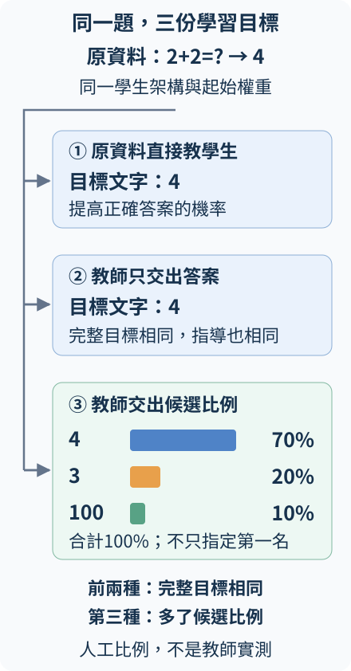
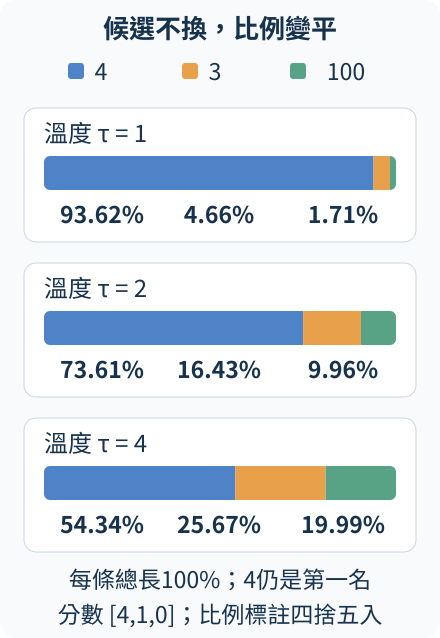
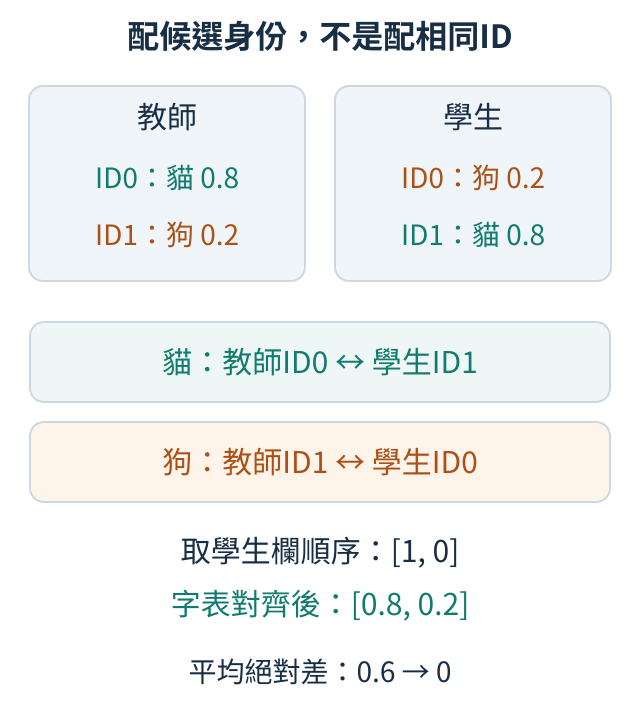
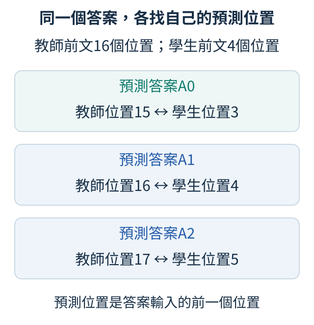

# 第 18 章：蒸餾，讓小模型向教師學習

如果想降低部署成本，可以先選較小的學生，再用教師的回答或候選比例提供指導；這條蒸餾路線是否值得採用，要看同一任務的品質與成本。教師是否可靠、教師與學生的候選能否對上、學生有沒有改善，是三個需要分別回答的問題。本章先用固定數字追蹤軟目標、溫度與KL，再檢查內容、風格及多模態的答案位置。短程式幫助理解機制；實際結果用共同的正確答案（ground truth）比較，不由「更像教師」或更小的檔案代替任務完成。讀到忘了的名詞，可以查[名詞頁](../glossary.md)。

第9章那種直接輸出機率的判斷，也能改學教師給的分布；但[9.14](09.md#9.14)已經提醒，目標分布若只是教師的猜測，學到的是貼近教師，不等於機率已經校準，也不保證答案正確。

## 18.1 教師能提供什麼學習訊號？

手上已有一筆原始資料：問題「2+2=?」，正確答案是「4」。小模型可以直接用這份資料學習，提高答案4的機率。現在請一個已訓練好的教師來指導同一個學生：教師若只交出文字「4」，學生收到的答案仍然是4；教師若交出候選 `[4,3,100]` 的比例 `[0.7,0.2,0.1]`，學生還能看見第一名以外的偏好。問題沒換，收到的學習目標卻可能不同。

蒸餾（distillation）指讓學生透過教師提供的訊號學習。原始資料和正確答案都在手上，仍可以加入教師指導；不必等到原資料拿不到才使用蒸餾。教師也不一定對：候選比例只是它在當下前文裡的模型偏好，不是宣稱2+2有10%的機會等於100。

下圖把同一題分成三種可選的訓練目標。比較時，三者使用同一學生架構、同一份起始權重；第一種學原資料的正確答案，第二種學教師交出的相同答案，第三種另外取得候選比例。箭頭表示同一題可以交給哪一種目標，不表示依次訓練。這裡的比例是人工示例，後面會算出它如何改變學生的調整方向。



[下一字分數](04.md#4.6)常叫logits，softmax把它們轉成總和為一的機率分布；[監督式微調（SFT）](07.md#7.1)則用回答文字作目標，讓模型提高每個示範答案token的機率。只能看到教師生成文字的方式常叫黑盒蒸餾；可讀取教師分布的方式常叫白盒蒸餾。這些名字描述的是能拿到哪種訊號，不表示教師是不是可靠。

沿用問題「2+2=?」和候選 `[4,3,100]`，只把教師比例換成另一份 `[0.4,0.35,0.25]`。原本的 `[0.7,0.2,0.1]` 和這份比例，第一名都是4。只取得「4」無法分辨這兩種情況：它沒有記錄第二名與第一名的差距，也沒有記錄100的相對位置。

```python
import torch

candidates = ["4", "3", "100"]
probabilities = [torch.tensor([0.7, 0.2, 0.1]), torch.tensor([0.4, 0.35, 0.25])]
for prob in probabilities:
    answer = candidates[prob.argmax().item()]
    print("回答", answer, "分布", prob.tolist())
```

輸入是人工指定的兩個分布，用來隔離資訊差別，不是呼叫真的教師。這裡把三個答案當成三個候選；真實的tokenizer可能把100切成多個token，不能把這三欄當成實際的byte字表（vocabulary）。`argmax`選出最大機率的索引，再查候選文字，兩行回答都應為4；分布欄卻不同。實際回答是一串token，黑盒資料保存整串文字；白盒則通常要在回答的每個有效目標上，保存或即時讀取一整列字表分布，資料量和計算需求可能更大。有效目標是labels不是-100、要計代價（loss）的位置，回看[7.3](07.md#7.3)。

取得文字後，可由學生自己的tokenizer重新切詞（tokenization），所以黑盒方式能搭配不同的字表。逐欄比較機率則必須確保兩邊同一欄代表同一個token，這是[18.6](18.md#18.6)要處理的字表對齊。白盒能提供更多候選關係，也可能把教師的錯誤偏好一起交給學生；多一份資訊不等於保證更好。

這兩種訊號在本章的實驗裡都有實際來源。文字任務的實驗用了三位只讀文字、已訓練好的教師，之後談文字任務時都用這三個名字稱呼：**屬性教師**回答小世界的屬性問題，例如題目 `color=green;shape=square;pitch=low;color?` 先列出一個物件的顏色、形狀與音高，再問顏色，它答`green`；**風格教師**依指定寫法回答算術等題，例如 `1+2=?` 要求簡短時答`3`、要求JSON時答`{"answer": 3}`；**MoE教師**續寫英文小故事，內部用[第15章](15.md)的MoE。三者分別按[T.4](../training.md#T.4)、[T.5](../training.md#T.5)與[T.8](../training.md#T.8)的配方訓練，蒸餾時都固定不更新。[18.13](18.md#18.13)的多模態實驗另用兩位會看圖片的教師：圖片教師與圖音教師，到那一節再介紹。

練習換成分類任務，候選是 `[貓,狗,鳥]`。兩份人工教師比例分別是 `[0.8,0.15,0.05]` 和 `[0.8,0.05,0.15]`。若資料只保存第一名「貓」，能判斷教師認為狗還是鳥比較接近嗎？先說理由，再把程式的 `candidates` 改成 `["貓", "狗", "鳥"]`、`probabilities` 改成這兩份比例核對。兩份的第一名都是貓、機率都是0.8，次要候選的順序卻相反；只留下文字「貓」，無法還原這份關係。

<details>
<summary>選讀：訊號分類、教師來源與方法範圍</summary>

[Hinton等人原文第1節](https://arxiv.org/abs/1503.02531v1)明說蒸餾可使用原訓練集，也可用另一份轉移資料；原資料有正確答案時，還可以同時學它與教師的軟目標。教師比例能傳遞已學出的候選關係，不等於新增正確答案，也不保證學生進步。

[MiniLLM原文的導論](https://arxiv.org/abs/2306.08543v6)也按可取得的是文字還是分布，區分這兩類訊號。本章的實驗只用普通CE與固定前文上的forward KL（[18.8](18.md#18.8)說明這個方向），沒有採用該論文的reverse KL或policy-gradient方法。三位教師都載入實際訓練好的權重；它們的完整檔案SHA、架構與步數保存在[蒸餾實驗紀錄（JSON）](https://github.com/birdhackor/tiny-perceptron-vlm/blob/main/docs/course-experiments/results/distillation.json)，這是機器可讀的完整結果：`results.tasks`底下的`attributes`、`style_transfer`、`moe_to_dense`依序是屬性教師、風格教師與MoE教師的任務，各自的`teacher_provenance`欄記載教師來源。

</details>

## 18.2 怎麼讓學生本身更小？

把模型取名student，再讓它向教師學習，權重檔就會自動縮小嗎？不會。蒸餾改變學習目標，不會直接刪掉模型的參數（parameter）。要得到較小的學生，必須先選較少層、較窄的特徵，或不同結構，再看教師訊號能否幫它彌補容量的減少。先把[教師訊號](18.md#18.1)放在一邊，只選架構：「小」要用實際的參數與成本記錄說明，不靠模型名稱。

下面的教師與學生用同一張264項的字表：256種byte，加上8個特殊token（special token，見[6.6](06.md#6.6)）。教師特徵寬度16、兩層，學生特徵寬度8、一層。特徵寬度（程式裡的`width`）是每個位置保存幾個特徵數字，層數（`layers`）是[區塊](04.md#4.5)疊幾次。字表相同，讓兩者的每個輸出候選能對上，內部特徵卻可以不同。較窄的學生，embedding表、各個矩陣與中間特徵（activation）都會縮小；較少層則減少重複處理的次數。

學生從哪份權重開始，和它向誰學，是兩個選擇。學生可以從隨機權重開始學教師，也可以先預訓練再蒸餾。比較原資料直接訓練與蒸餾時，可以讓兩個小模型各拿同一份隨機初始權重的副本，之後只改學習目標；「從頭開始」不會把蒸餾變成另一種方法。下面只建立架構，真正提供指導的教師則須先有經過檢查的能力。

```python
from tiny_perceptron.model import TinyLM, ModelConfig

configs = [("教師", ModelConfig(width=16, layers=2)), ("學生", ModelConfig(width=8, layers=1))]
for name, config in configs:
    model = TinyLM(config)
    parameters = sum(p.numel() for p in model.parameters())
    print(name, "特徵寬度", config.width, "層數", config.layers, "參數", parameters, "FP32數字bytes", parameters * 4)
```

`ModelConfig`描述架構（[4.5](04.md#4.5)），`TinyLM`按它建立模型（[4.6](04.md#4.6)）；`parameters()`逐一列出可學的參數，`numel()`數每一份參數有幾個數字，`sum`再全部加起來。兩個模型仍然是隨機初始化，沒有教師能力，也沒有訓練學生；這段只確認所選的學生真的較小。FP32是32位元浮點數的儲存格式，一byte是8位元，所以每個FP32數占32/8=4 bytes，程式用參數數量乘4。輸出應為教師16960個參數、67840 bytes，學生6104個、24416 bytes。這只量參數數字本身，沒有量檔案容器與執行時的峰值。

特徵寬度減半、層數減半，參數卻沒有減到八分之一，因為各部分隨寬度變化的方式不同。注意力與FFN裡的矩陣，兩個邊都隨特徵寬度變，數量大致隨寬度平方變化；embedding表與輸出層（output layer，也叫LM head）則是字表裡每個token各要一列，只隨寬度線性變化，也不隨層數重複。比較完整模型時應數所有模組，不能只看一層中最大的矩陣。

學生更小可能損失表達能力。應先用相同的學生架構訓練一個不蒸餾的對照（control），再加入教師文字或分布，才能知道好處來自教師訊號，還是原本的學生設置。固定同一學生架構時，也要記錄訓練資料、已讀token數、初始化與評估方法；已讀token數是訓練累計處理多少個token，不是字表有幾項。[18.10](18.md#18.10)會比較這些條件。

練習只把程式學生那組的 `ModelConfig(width=8, layers=1)` 改成 `ModelConfig(width=16, layers=1)`。先預測它比原學生大、比兩層的教師小，但不是教師參數的恰好一半；再執行，應得到13744個參數。這時雙方特徵寬度相同、只差層數：拿掉一層只少了 `16960−13744=3216` 個參數，embedding表、輸出層這些不隨層數重複的部分，讓參數無法減半。

<details>
<summary>選讀：實驗中屬性教師與學生的實際尺寸</summary>

屬性教師特徵寬度64、兩層，共141,568個參數，FP32數字566,272 bytes；兩個學生都是一層、兩個注意力頭，寬16的有13,744個參數／54,976 bytes，寬32的有33,632個／134,528 bytes。這些縮小先由架構決定。同特徵寬度下，只學正確答案、學教師生成回答與CE+KL三支學生，參數個數和初始化完全相同，輸出層也相同，蒸餾的那支沒有偷偷多一個輸出層。但寬16與寬32的表示容量本來就不同，不能跨寬度把所有品質差都歸給教師訊號。

</details>

## 18.3 只能看到教師回答也能學嗎？

如果服務只回傳教師的回答文字，拿不到各候選分數，仍可以用這些文字教學生。做法是把題目與教師回答保存成對話，檢查品質，再照[7.11的對話SFT](07.md#7.11)訓練學生，讓學生提高回答中各token的機率。這就是[黑盒蒸餾](18.md#18.1)，不是逼學生重建沒有取得的完整分布。

我們希望學生對「2+2=?」回答4。材料裡卻有兩筆教師回答，一筆4、一筆5。我們知道正確答案是4，應先排除5，而不是期待學生自己發現教師的錯誤。下面故意用人工記錄模擬格式，沒有呼叫任何教師。保留下來的每筆資料，除了對話，還多記兩欄：`teacher_revision`記下是哪一版教師生成的，這裡沒有真的教師，所以填Python表示「沒有值」的`None`；`provenance`就是來源欄，寫明這筆資料從哪裡來。來源欄清楚標成示例，避免教材跑完後產生「已收集教師資料」的誤解。實際生成時應保存教師版本、提示、生成設定與檢查結果，才能追蹤錯誤從哪裡來。

```python
import json

records = [{"numbers": [2, 2], "answer": "4"}, {"numbers": [2, 2], "answer": "5"}]
accepted = []
for record in records:
    if record["answer"] == str(sum(record["numbers"])):
        accepted.append(
            {
                "messages": [{"role": "user", "content": "2+2=?"}, {"role": "assistant", "content": record["answer"]}],
                "teacher_revision": None,
                "provenance": "人工示例，非教師生成",
            }
        )
print("保留筆數", len(accepted))
for record in accepted:
    print(json.dumps(record, ensure_ascii=False))
```

輸入兩筆字典，`numbers`只供這個簡單的驗證器核對數學，`answer`是要交給學生的文字。`sum`算出正確答案，`str`轉成文字再比較；不合格的記錄不進入`accepted`。輸出應保留一筆，內容包含user問題與assistant的4；JSON把`None`寫成`null`。`json.dumps`將字典編成JSON文字，`ensure_ascii=False`讓中文直接顯示；把每筆JSON各存一行的檔案叫JSONL。此程式只印出，不建立資料檔，也不訓練模型。

學生訓練時，assistant回答的位置計入代價，user題目作為可見的前文，回顧[哪些位置應該學](07.md#7.3)。回答先作為文字取得，再由學生自己的tokenizer切詞，所以教師與學生不必使用同一張字表。這與白盒逐欄比較機率不同，不要把有`answer`欄當成已經有教師的logits。

對保留下來的這筆題目，如果原資料本來也標「4」，而教師回答切成學生的token後，連同EOS（結束標記）、前文與有效目標都相同，兩種目標就是在教同一份答案。用同一個代價公式時，沒有新增監督訊號；把來源欄改成「教師」，不會讓代價公式多出知識。若初始權重、batch次序、最佳化器（optimizer）與隨機運算也一致，訓練就會沿著相同的路徑進行。

若教師改交「2個加2個共有4個，所以答案是4」，收到的整串示範就不同了。它可能多教了解題過程或風格，也增加要學的token；是否正確、有用，仍須檢查。這串文字仍沒有提供每個位置未被選中的候選比例，不能當成完整分布。

生成本身會花教師的算力，資料還需要驗證與保存，成本不能只算學生訓練。對於無法用加法檢查的任務，需依來源、規格或評分規則檢查，不能把學生模仿得多像當作正確答案。GSM8K是收錄小學程度文字算術題與人寫解答的公開資料集；若使用它原有的答案，來源欄也應寫原資料集，不能換一個來源名稱就宣稱由教師生成。

練習換成翻譯：原資料把「Good morning」標為「早安」，教師甲也回答「早安」，教師乙回答「早上好」。固定同一個學生tokenizer與訓練方式，哪一份會改變完整的文字目標？兩種譯法都合適，是否就表示訓練訊號完全相同？又能否由任一譯文還原教師的整列機率？請分別說明目標文字與語意正確性的判斷，不用啟動訓練。

<details>
<summary>核對你的推理</summary>

若其他目標位置與結束條件相同，教師甲沒有改變原資料所標的正確答案；教師乙改變了要學的文字與token序列。兩種譯法意思合適，不代表每一步的目標相同，也不能單憑這點宣布哪一種目標較好。兩份譯文都沒有保存完整的候選機率。

</details>

<details>
<summary>選讀：實驗中的教師生成回答、錯誤審核與正常結束</summary>

上方驗證器示範的是篩選；實驗裡學教師生成回答的那支學生則保留全部實際的教師生成回答，量出教師錯誤的後果。屬性教師對45筆訓練題全部答對、全部以EOS結束，所以它生成回答的ID恰好和正確答案相同；同一初始化與batch計畫下，只學正確答案與學教師生成回答的兩支學生，權重及成績也完全相同，這不是額外知識帶來的提升。風格教師185筆中180筆正確，另外五筆是日期題，已知日期卻把日子加10，例如要求確認`2026-10-06`，回答`已確認2026-10-16。`；這些錯誤的標籤仍原樣保留，逐筆審核記錄在[蒸餾實驗紀錄（JSON）](https://github.com/birdhackor/tiny-perceptron-vlm/blob/main/docs/course-experiments/results/distillation.json)的`results.tasks.style_transfer.hard_target_generation.audit`欄。

兩位教師共230筆生成回答都有實際的EOS，沒有不該出現的特殊token，也沒有零長度的目標。教師與學生共用同一套264-ID的byte字表與特殊token約定，同一ID代表相同token；這是這次實驗能直接沿用ID的前提。工具逐筆保存完整的`teacher_ids`與EOS旗標，再直接用原始ID作標籤；若教師達到生成上限卻沒有EOS，就不補一個假的結束。零個目標則明確失敗並保存題數，不能悄悄丟題。對只回傳文字的外部服務，結束原因也應另外保存：普通的文字解碼可能隱藏特殊token，不能由「畫面像一句完整的話」推定正常停止。

</details>

## 18.4 第一名以外的選項有什麼價值？

回到同一題「2+2=?」、正確答案4與候選 `[4,3,100]`。學生目前給 `[0.5,0.4,0.1]`，教師仍給 `[0.7,0.2,0.1]`。原資料的正確答案4與教師只交出的文字4，都會形成目標 `[1,0,0]`；教師的完整比例則是另一份目標。這次不換原題或學生，只看這三份指導各要求它怎樣調整。

只指定正確候選的目標叫hard target（硬目標），用比例描述各候選的目標叫soft target（軟目標）。這些比例不必表示答案數值的距離，也不是「3只差1，所以一定給20%」；它們是教師讀到一段前文後，給下一個token各候選的機率。實際保存軟目標時，這段前文取自資料裡的標準序列：教師讀的是正確答案的前半段，不是自己接著寫出的內容，也就是[5.8](05.md#5.8)與[7.22](07.md#7.22)的teacher forcing。正確答案只指定這一筆應選哪一項，教師比例還可能傳遞它學出的候選關係。若這些關係對新輸入有用，就可能幫到學生；本例的固定數字只能展示額外的訊息，不能證明教師知道數字的相近程度，也不能證明學生會進步。

交叉熵（cross entropy，CE）把目標比例乘上學生機率的負log，再加總。硬目標只剩第一項，代價是 `-log(0.5)≈0.6931`；軟目標則是 `0.7×0.6931+0.2×0.9163+0.1×2.3026≈0.8987`。兩種目標不同，這兩個代價不能直接拿來替方法排名。更有用的是觀察它們要求學生怎樣調整。

在這種單一位置、分數直接做softmax的例子裡，把學生比例q減去目標比例p，就得到各候選分數的梯度 `q−p`。p可以是正確答案的 `[1,0,0]`，也可以是教師比例。下面沿用同一個q，算三種目標的代價與梯度；沒有更新模型，只看學習目標提出的要求。

```python
import torch

q = torch.tensor([0.5, 0.4, 0.1])
targets = [
    ("正確答案", torch.tensor([1.0, 0.0, 0.0])),
    ("教師生成回答", torch.tensor([1.0, 0.0, 0.0])),
    ("教師分布", torch.tensor([0.7, 0.2, 0.1])),
]
for name, target in targets:
    logits = q.log().detach().clone().requires_grad_()
    loss = -(target * logits.log_softmax(0)).sum()
    loss.backward()
    print(name, "CE", round(loss.item(), 4), "分數梯度", logits.grad.round(decimals=4).tolist())
```

輸入q是學生當下的比例，取log作為一組能產生相同比例的分數；`log_softmax`穩定地算出各候選的log機率。建立`logits`時，`.detach()`切斷它與前面計算的反向傳播（backpropagation）連結；本例的q原本沒有記錄梯度，這一步只是明確保留數值。`.clone()`再把數值複製成獨立的一份，`.requires_grad_()`把副本設為接下來要求梯度的輸入。`backward()`讓我們看到這份分數自己的[梯度](../first-steps.md#W.6)，也就是微調分數會怎樣影響代價。每次都重建`logits`，避免三種目標的梯度累加。

輸出前兩行的CE都是0.6931，梯度約 `[-0.5,0.4,0.1]`；教師分布那行的CE是0.8987，梯度約 `[-0.2,0.2,0]`，最後一項印成`-0.0`，就是0。正確答案與相同的教師生成回答提出一樣的要求，分布則改變了方向和強度。沿梯度反方向更新，會提高負梯度候選的分數、降低正梯度候選；硬目標對3與100都推低，軟目標對100的直接分數梯度為零。這不表示100的機率永遠不變：其他分數改變時，softmax分母中的指數總和也會改變，連帶改變100的機率。各候選的機率總和仍然是一。

教師也可能偏錯。若教師給3的機率高於學生目前的0.4，沿梯度反方向更新便會提高這個錯誤候選的分數，所以正確答案與行為評估仍需獨立保留。這個單位置實驗不證明某個學生會提升整段回答的品質，也不表示學生一定能完全複製教師。

練習回到分類任務，候選 `[貓,狗,鳥]`，正確答案是貓。學生比例 `[0.6,0.2,0.2]`，教師比例 `[0.8,0.15,0.05]`。請用 `q−p` 算正確答案與教師分布各自的分數梯度，說明兩種目標對狗、鳥的要求為什麼不同。若教師改成 `[0.15,0.8,0.05]`，哪個錯誤候選會被推高？這些梯度足以證明測試正確率提高嗎？先推理，再分兩步改程式核對。第一步把`q`改成`torch.tensor([0.6, 0.2, 0.2])`，`targets`第三筆「教師分布」的比例改成`torch.tensor([0.8, 0.15, 0.05])`；前兩筆不用改，因為正確答案貓仍是`[1,0,0]`，這位教師的第一名也是貓，它生成的回答同樣是貓。第二步換成偏向狗的教師：第三筆改成`torch.tensor([0.15, 0.8, 0.05])`；這位教師生成的回答會是狗，所以第二筆「教師生成回答」也改成`torch.tensor([0.0, 1.0, 0.0])`；第一筆「正確答案」仍不動。

<details>
<summary>核對你的推理</summary>

正確答案的梯度是 `[-0.4,0.2,0.2]`，教師分布是 `[-0.2,0.05,0.15]`；兩者都提高貓的分數，但對兩個次要候選的要求不同：正確答案把狗和鳥推低一樣多，教師分布推低鳥比推低狗多，因為教師給狗的比例比鳥高。第一步應印出前兩行CE 0.5108、梯度約 `[-0.4,0.2,0.2]`，第三行CE 0.7305、梯度約 `[-0.2,0.05,0.15]`。

教師偏向狗時，分布的梯度變成 `[0.45,-0.6,0.15]`，會提高錯誤候選狗的分數。第二步的第一行不變；第二行CE 1.6094、梯度約 `[0.6,-0.8,0.2]`，第三行CE 1.4446、梯度約 `[0.45,-0.6,0.15]`。教師不論只交出文字狗，還是交出偏向狗的比例，都會把狗往上推。多一份比例不保證更好；這只是單位置的調整要求，測試品質仍須獨立評估。

</details>

<details>
<summary>選讀：實驗裡保存的兩種教師訊號</summary>

屬性教師的軟目標，保存的是教師讀標準序列時、每個有效目標上264個候選的logits；即使greedy已經選錯第一名，其他候選的比例仍可能不同。這份快取檔占345,101 bytes；教師生成回答的檔案則逐筆保留生成的ID。下一節會對同一列教師與學生的分數使用溫度。

</details>

## 18.5 如何顯示較低機率的候選？

沿用同一題和候選 `[4,3,100]`，這次改用更尖的人工分數 `[4,1,0]`，讓第一名占約94%。其他候選只剩少許份量，它們在軟目標代價裡的份量也很小。可以讓分布平一些，保留排名但縮小差距嗎？[1.15](01.md#1.15)選字時用過同一招：先把分數除以正數τ（讀作tau），再softmax。在蒸餾裡，這個τ叫蒸餾溫度（temperature），τ越大，分布通常越平。

取候選 `[4,3,100]` 的分數 `[4,1,0]`。`exp(x)`就是`e ** x`，e約為2.718，把分數轉為正數份量。softmax把各份量除以同一個總和；兩個機率相除時，共同的總和消掉，所以候選4比候選3是`exp(4/τ) / exp(1/τ) = exp(3/τ)`。τ=1時，第一和第二的分數差3，機率比為 `exp(3)`，約20.1；τ=2時，差縮為1.5，比例約4.48，所以第二名的相對份量增加。τ=4時差0.75，比例約2.12。沒有改教師的排名，改的是它展示給學生的選項差距；溫度不是答案正確率，也不是讓教師重新推理一次。

```python
import torch

logits = torch.tensor([4.0, 1.0, 0.0])
for temperature in (1.0, 2.0, 4.0):
    probability = (logits / temperature).softmax(0)
    print(
        "τ",
        temperature,
        "機率",
        probability.round(decimals=4).tolist(),
        "第一比第二",
        round((probability[0] / probability[1]).item(), 4),
    )
```

輸入三個固定分數，不用已訓練的教師。`softmax(0)`沿候選軸轉成機率；溫度在softmax之前除，不是把最後的機率隨便除以τ，那會讓總和不再為一。三行的第一比第二依序約20.0855、4.4817、2.117，和上面的手算一致。最後一個候選從τ=1的1.71%增到τ=4的19.99%，它在學生代價裡占的份量也跟著變大。

下圖每條的完整長度都是100%機率，由左到右的顏色固定對應候選4、3、100。溫度提高時，橘色與綠色的份量變大，藍色的候選4仍是第一名；這表示次要選項更清楚，不表示答案排名改了。百分比四捨五入到小數點後兩位，條寬按原始機率繪製。



分布更平不一定更有用。τ非常大時各候選接近平均，原本有意義的差異也被抹掉；教師給錯候選的份量同樣會變得更明顯。τ要用驗證資料來選：拿沒有用來訓練學生的驗證題，比較不同τ訓練出的學生在這批題目上的回答品質，再決定τ，而不是只希望所有候選都平均。最後報成績用的測試題另外保留，不拿來反覆選τ；資料的分工可回看[1.2](01.md#1.2)。學生也要用相同的τ形成比較用的分布，否則比較的是兩套不同的尺度。

除以τ還有一個副作用：學生收到的梯度會變小。[18.4](18.md#18.4)的分數梯度是 `q−p`；分數先除以τ之後，梯度變成 `(q−p)/τ`，這裡的p、q都是除過τ的分布。前面多了一個1/τ，而且p、q都變平，兩者的差距也縮小，所以整體大約縮成原本的1/τ²。若同時還有正確答案的CE（它不除以τ），提高τ就會讓教師那一項的份量悄悄變輕。常見做法是把教師那一項乘上τ²（文獻常寫成T²），把梯度補回原本的量級；這是[Hinton等人原文第2節](https://arxiv.org/abs/1503.02531v1)給的理由。下面讓學生分數全為0，核對這件事。

```python
import torch

teacher = torch.tensor([4.0, 1.0, 0.0])
for temperature in (1.0, 2.0, 4.0):
    student = torch.zeros(3, requires_grad=True)
    p = (teacher / temperature).softmax(0)
    loss = -(p * (student / temperature).log_softmax(0)).sum()
    loss.backward()
    size = student.grad.norm().item()
    print("τ", temperature, "梯度大小", round(size, 4), "乘τ²後", round(size * temperature**2, 4))
```

`loss`是18.4的軟目標交叉熵，只是教師與學生的分數都先除以τ。`student.grad.norm()`把三個梯度平方加總再開根號，得到一個總大小，`temperature**2`是τ²。τ從1升到4，梯度大小從0.7387縮到0.0651，只剩約十一分之一；乘上τ²後是1.0416，回到和τ=1相近的量級。乘τ²不會讓三種τ完全相同，只是讓它們保持在同一個量級，換τ時才不必重新調整兩項代價的比例。本章[18.8](18.md#18.8)的`distillation_kl`已在函式內乘上τ²，外層不用再乘；使用其他計算蒸餾代價的函式時，要先確認它是否已內建這個乘數，避免重複相乘。τ²只是尺度的約定，不是教師突然多教了τ²倍的知識。

蒸餾溫度和[1.15](01.md#1.15)生成時抽樣（sampling）用的溫度應分開記錄。這裡改的是訓練時的教師／學生分布，不是要求最終回答以相同的τ抽樣；同一個蒸餾學生可以搭配不同的選字規則。

練習只把第一段程式的 `logits` 改成 `torch.tensor([8.0, 2.0, 0.0])`，溫度清單不變。先預測新的τ=2與原本τ=1的結果相同、新的τ=4與原本τ=2相同，再執行核對。兩者都是同樣的「分數除以溫度」，這能幫你分辨絕對數值與相對尺度的作用。

<details>
<summary>選讀：實驗的溫度設定</summary>

本章的實驗預設τ=2、正確答案與教師各占一半；加入教師分布的每支學生，都在實驗紀錄記下`temperature_squared_applied_once=true`，表示τ²只乘了一次。實驗沒有跑多個溫度挑最好的成績，不能把τ=2寫成這些任務的最佳設定。在測試題上生成回答時用greedy，不沿用蒸餾溫度抽樣。

</details>

## 18.6 教師與學生的 token 對得上嗎？

教師與學生都輸出兩個機率，看形狀相同就能直接比較嗎？若教師字表是 `[貓,狗]`，學生卻是 `[狗,貓]`，第0欄代表的候選不同。把兩邊第0欄硬對上，會教學生把教師給貓的機率配給狗。這不是學生尚未學好，而是我們把答案名稱弄錯了。我們希望兩邊都把貓的80%對上貓。[18.2](18.md#18.2)讓教師與學生用同一張264項的字表，欄數相同；但欄數相同之外，還需要每一欄的候選身份一致，不能只看ID數字。

教師比例 `[0.8,0.2]`，學生比例 `[0.2,0.8]`，看數值似乎差很多；但兩者都對貓給80%、狗給20%，其實語意完全相同。如果只是字表順序交換，可以先把學生的欄位重排成教師的順序，再比較。若兩者切詞的粒度也不同，例如教師用一個「小貓」token、學生用「小」「貓」兩個，就不再是交換欄位能解決的。

圖上先列出兩邊自己的ID對應，下面按「貓、狗」的身份配對。教師ID0的貓要對學生ID1；教師ID1的狗要對學生ID0。因此取學生欄的順序是 `[1,0]`，才得到教師順序下的 `[0.8,0.2]`。



```python
import torch

teacher_vocab = ["貓", "狗"]
student_vocab = ["狗", "貓"]
p = torch.tensor([0.8, 0.2])
q = torch.tensor([0.2, 0.8])
order = [student_vocab.index(token) for token in teacher_vocab]
reordered = q[order]
print("重排索引", order)
print("錯配MAE", round((p - q).abs().mean().item(), 4))
print("重排後", reordered.tolist(), "MAE", round((p - reordered).abs().mean().item(), 4))
```

`index(token)`找出該詞在學生字表的欄號，依教師字表的順序建立`order`，應為 `[1,0]`。`q[order]`沿候選軸按這個順序取欄。MAE是mean absolute error（平均絕對差）：逐欄相減後，`.abs()`取絕對值、`.mean()`求平均、`.item()`取出單一的Python數字。錯配時是`(|0.8-0.2|+|0.2-0.8|)/2=0.6`，重排後每欄相同，因此為0。這個MAE只作配對檢查，不是[18.8](18.md#18.8)的蒸餾KL；只要同一欄的意義錯了，後面任何逐欄計算的代價都會被誤導。

此外，雙方要在同一前文、同一個待預測位置比較。教師已經讀到「小貓追」，學生只讀到「小貓」，即使字表相同，分布也在回答不同的問題。EOS與角色標記這些[特殊token](06.md#6.6)也要有相同的身份和字表對齊規則；EOS表示文字結束，角色標記辨認說話者，它們不是普通字詞。字表項數一致只是必要條件之一，不是充分保證。

練習只把程式的 `student_vocab` 改成 `["貓", "狗"]`，`q` 也同步改成 `torch.tensor([0.8, 0.2])`。先預測`order`為 `[0,1]`，錯配與重排後的MAE都為0，再執行核對。若只改字表不改q，你就給同一組數字換了意義，不能稱為完成字表對齊。

<details>
<summary>選讀：實驗如何讓兩邊對得上</summary>

本專案的白盒訓練程式固定讓雙方共用ByteTokenizer：雙方用同一套文字單位與特殊token的ID約定，讓各ID與位置更容易一致。byte切詞的方式可回看[6.7](06.md#6.7)，本節只需要知道雙方共用轉換規則。使用不同tokenizer的白盒方法，需要另外設計語意與位置的映射，本節不假裝交換欄位就能解決；[黑盒文字蒸餾](18.md#18.3)則可先拿文字，再由學生切詞，避開兩份字表的逐欄比較。

屬性教師與寬16、寬32的學生都用相同的264-ID byte字表，角色與EOS的約定也相同。CE+KL那支學生以各位置的`labels != -100`挑出有效目標的分數；教師快取按同一筆題目、同一份標準序列排好，核對有效目標數後才計算，問題和PAD不直接算KL。學教師生成回答的那支，則另外保存教師自由生成的ID，沒有拿它不同的前文去逐行配這份白盒快取。

</details>

## 18.7 教師需要跟著更新嗎？

一次學生更新後，我們希望教師的參數完全不變，只有學生的參數改變。若兩者一起更新，學生追的目標也會跟著移動；本章選擇先保存固定的教師版本，再讓學生學它提供的訊號。下面用同一個輸入 `[1,2]` 核對誰真的改了數字，同時分清評估模式、參數凍結與不記錄梯度三個工具。

[5.17](05.md#5.17)見過其中兩個：`eval()`切換模組行為，例如讓dropout改用評估時的行為，但不會停止記錄梯度；`no_grad()`讓該區塊裡的計算不建立反向傳播需要的計算圖。第三個`requires_grad_(False)`讓教師的參數不求梯度，這叫凍結。最佳化器只接收學生的參數，決定更新哪些數字。三者一起使用，能清楚表達教師固定的角色，也避免保存不需要的教師中間計算。

下面用兩個很小的線性層，只檢驗固定與更新；這個教師隨機初始化，沒有已學會的知識。輸入 `[1,2]`，教師和學生都輸出三個特徵，用兩者平方差的平均當學生的代價，方便檢查一次更新是否只改了學生。

```python
import torch
from torch import nn

torch.manual_seed(0)
teacher = nn.Linear(2, 3).eval().requires_grad_(False)
student = nn.Linear(2, 3)
optimizer = torch.optim.SGD(student.parameters(), lr=0.1)
x = torch.tensor([[1.0, 2.0]])
teacher_before = teacher.weight.detach().clone()
student_before = student.weight.detach().clone()
with torch.no_grad():
    target = teacher(x)
output = student(x)
optimizer.zero_grad()
(output - target).square().mean().backward()
optimizer.step()
print("教師梯度", teacher.weight.grad)
print("教師最大改動", (teacher.weight - teacher_before).abs().max().item())
print("學生有改動", bool((student.weight - student_before).abs().max() > 0))
probe = x.clone().requires_grad_()
print("輸入可微時教師輸出記圖", teacher(probe).requires_grad)
```

應印出教師梯度None、最大改動0、學生有改動True。`SGD`是沿梯度反方向更新的最佳化器，`lr=0.1`是學習率；它只拿到`student.parameters()`，手上沒有教師的參數。更新前的快照用`.clone()`建立獨立的數值副本，才能比較更新前後；若只保留引用，檢查時看到的也會是新的權重，比較就失效了。

最後一行應為True：即使教師的參數凍結，`probe`這個輸入要求梯度，普通的`teacher(probe)`仍會記錄輸入怎樣影響輸出，之後的梯度就能穿過教師、流回輸入。這說明`no_grad`與凍結不是同一件事。蒸餾通常不希望梯度穿過教師再流回輸入端，所以產生教師目標的那段仍用`no_grad`；若另有需要讓梯度穿過教師的用途，應明確說明改變了哪條學習路徑。

凍結不等於教師的計算免費：前向計算（forward）仍要讀參數、做矩陣運算；若預先保存目標以便重用，也會增加儲存與版本管理的成本。教師的能力應由獨立的任務驗證，不是由 `grad is None` 判斷。

練習只把最後一行改成在 `with torch.no_grad():` 底下計算 `teacher(probe)` 再印出 `requires_grad`，先預測印出False，再執行核對。其他訓練更新的那段不用改，教師仍不變、學生仍更新；你就能具體分辨模組模式、參數凍結與整段不記圖三種機制。

<details>
<summary>選讀：實驗中的固定教師</summary>

三位教師都以eval、凍結參數及no_grad預先產生訊號。白盒用的是快取：教師在已知前文下、對每個下一token候選給的分數，存起來讓學生多次學習時重用。黑盒用的是教師生成回答：教師實際生成的一整段文字，例如形狀答案`circle`，不是整份候選分數表。

所有學生訓練完後，教師逐張參數表的數值指紋仍與起點相同，[蒸餾實驗紀錄（JSON）](https://github.com/birdhackor/tiny-perceptron-vlm/blob/main/docs/course-experiments/results/distillation.json)在每個任務的`teacher_frozen_and_unchanged`欄記為`true`；這比只看梯度None多核對了實際結果。教師訊號可以重用，但生成與保存仍有成本：同一份紀錄的`teacher_cache`欄記錄快取檔的大小與產生秒數，`hard_target_generation`欄記錄教師生成回答花的秒數。

</details>

## 18.8 如何學習整個分佈？

學生的第一名與教師一樣，是否就學會了教師的分布？假設教師給貓、狗80%、20%，學生給各50%：學生的兩個候選平手，第一名可能剛好也是貓，比例卻明顯不同。第一名一致，不等於分布一致。我們需要一個比較整個分布的代價，而且要說清楚用誰的比例當權重。先固定[同欄身份](18.md#18.6)和同一前文，並讓[教師不更新](18.md#18.7)，再比較兩個候選比例整體差多少。

[13.14](13.md#13.14)介紹過**KL散度（Kullback–Leibler divergence）**：`KL(p||q)=Σ p_i(log p_i-log q_i)`，i逐一走過同一字表的候選。本節讓p是固定的教師比例、q是正在學習的學生比例；每一項都乘上教師的比例p_i，所以是用教師的偏好當權重。以p=`[0.8,0.2]`、q=`[0.5,0.5]`，兩項約0.3760與-0.1833，總和0.1927。單項可以是負的，整個總和卻不會小於0；兩邊完全相同時是0。反過來的KL(q||p)改用學生的比例加權，是另一種代價，不能隨意交換方向。蒸餾文獻把用教師比例加權的KL(p||q)叫forward KL，把KL(q||p)叫reverse KL；本章只用forward KL。

13.14代入的也是`[0.8,0.2]`與`[0.5,0.5]`，所以同樣得到0.1927，兩者的角色卻和本節相反：那裡的`[0.8,0.2]`是正在更新的策略模型給的比例，`[0.5,0.5]`是固定的參考模型給的比例。照本節的定義，13.14是用正在更新那一方的比例加權，屬於reverse KL的方向。兩節的數字相同，只因為式子和代入的比例都相同，不代表方向一樣。

兩邊要讀同一段已知的前文、預測同一個下一token。這段前文取自資料的標準序列，也就是[5.8](05.md#5.8)、[7.22](07.md#7.22)的teacher forcing。不能讓教師自由生成「貓」當前文、學生自由生成「狗」當前文，再按位置盲比。以正確回答「小貓追球」為例，下表從預測「貓」的位置算起，兩種做法在各位置讀到的前文是：

| 比較的位置 | teacher forcing | 各自自由生成 |
| --- | --- | --- |
| 第1個 | 兩邊都讀「小」 | 兩邊都讀「小」 |
| 第2個 | 兩邊都讀「小貓」 | 教師讀「小貓」、學生讀「小狗」 |
| 第3個 | 兩邊都讀「小貓追」 | 教師讀「小貓追」、學生讀「小狗跑」 |

右欄從第2個位置起，兩邊回答的已經是不同的問題，按位置相減沒有意義。同時只計算有效目標，提示與PAD不直接算KL。PAD是把較短序列補到共同長度的佔位token，不是實際的回答；這些位置的labels設為-100，本節的函式不計它們的直接代價，回看[7.3](07.md#7.3)。下面先用函式庫的`distillation_kl`算一次。

```python
import torch
from tiny_perceptron.alignment import distillation_kl

student = torch.zeros(1, 3, 2, requires_grad=True)
p = [0.8, 0.2]
teacher = torch.tensor([[p, p, p]]).log().requires_grad_()
labels = torch.tensor([[-100, 0, 1]])
loss = distillation_kl(student, teacher, labels, temperature=1.0)
loss.backward()
print("KL", round(loss.item(), 4))
print("學生分數梯度", student.grad.round(decimals=4).tolist())
print("教師梯度", teacher.grad)
```

輸入的形狀是一段、三個位置、兩個候選。`p`是兩個候選的機率清單；`[p,p,p]`把同一分布列在三個位置，再包一層`[[p,p,p]]`表示只有一段，所以建立的tensor是`(1,3,2)`。`.log()`逐格把機率轉成自然對數，最後設為要求梯度。學生的全零分數經softmax後各0.5；教師的log p經softmax則還原成p。labels第一項-100表示忽略，後兩項是有效目標；這個函式只看labels是不是-100，0與1的值不影響KL。輸出KL為0.1927；學生第一個位置的梯度是 `[0,0]`，其餘各 `[-0.15,0.15]`，因為只對兩個有效目標取平均。教師梯度是None：這裡故意讓教師的分數也要求梯度，用來驗證函式仍會切斷通往教師的路徑。

這些結果從哪裡來？函式定義在[tiny_perceptron/alignment.py](../../tiny_perceptron/alignment.py)，全文十一行：

```python
# 節錄自 tiny_perceptron/alignment.py：distillation_kl
def distillation_kl(student_logits, teacher_logits, labels, temperature=2.0):
    """KL(teacher || student)，逐 token 加總詞表，再平均有效位置，含 T²。"""
    if student_logits.shape != teacher_logits.shape or temperature <= 0:
        raise ValueError("教師／學生的詞表與序列 shape 必須相同，temperature 必須為正")
    valid = labels != IGNORE
    if not valid.any():
        raise ValueError("蒸餾不能没有有效回答位置")
    p = (teacher_logits.detach().float() / temperature).softmax(-1)
    log_q = (student_logits.float() / temperature).log_softmax(-1)
    per_token = F.kl_div(log_q, p, reduction="none").sum(-1)
    return per_token[valid].mean() * temperature**2
```

說明文字裡的「詞表」就是本書的字表，「有效位置」就是有效目標，T²就是τ²；函式庫沿用文獻的寫法。

- `if student_logits.shape != teacher_logits.shape or temperature <= 0:` 先擋掉兩種錯：兩邊形狀不同，例如字表項數不同，[18.12](18.md#18.12)的練習會遇到；或溫度不是正數。
- `valid = labels != IGNORE`：`IGNORE`是函式庫的常數-100，得到一張True／False表，標出有效目標。全部是False時直接報錯，不讓沒有有效目標的一批資料悄悄算出無意義的平均。
- `p = (teacher_logits.detach().float() / temperature).softmax(-1)`：`.detach()`切斷通往教師的反向傳播，這就是上面教師梯度None的原因；`.float()`轉成32位元浮點數，除以τ後沿最後一軸、也就是候選軸softmax，得到教師分布。下一行的`log_q`把學生分數同樣除以τ，取log機率。
- `F.kl_div(log_q, p, reduction="none")`：`F`是`torch.nn.functional`，`kl_div`是PyTorch的KL函式。PyTorch規定第一個引數放模型預測的log機率、第二個放目標機率，所以這裡先放學生的`log_q`、再放教師的`p`，順序和公式字面KL(p||q)的p、q相反。它逐格算出 `p_i(log p_i−log q_i)`；`reduction="none"`表示先不加總，`.sum(-1)`再沿候選軸加總，每個位置得到一個KL。
- `per_token[valid].mean() * temperature**2`：`per_token[valid]`只留下valid標成True的位置，`.mean()`對這些有效目標的KL取平均，再乘上[18.5](18.md#18.5)說明過的τ²，所以外層不用再乘。

函式要用的`IGNORE`與`F`不在節錄範圍內。照Notebook的順序執行到這裡時，上面節錄的程式格已用`def`重新定義`distillation_kl`，蓋過第一段從函式庫匯入的同名函式。下面補上這兩個import，用第一段的同一組輸入再呼叫一次，和第一段用函式庫版本算出的`loss`比較。若跳過節錄的程式格，呼叫到的仍是函式庫版本，比較就成了同一份程式和自己比。

```python
from torch.nn import functional as F

from tiny_perceptron.data import IGNORE

again = distillation_kl(student, teacher, labels, temperature=1.0)
print("IGNORE的值", IGNORE, "節錄版KL", round(again.item(), 4))
print("與函式庫版本相同：", torch.equal(again, loss))
```

應印出IGNORE的值-100、節錄版KL 0.1927，以及與函式庫版本相同True。被忽略的位置不計直接KL，但它仍是後面位置的前文，會透過注意力影響後續的特徵與學生的學習。[18.4](18.md#18.4)用的軟目標交叉熵和這個KL只差一個不隨學生改變的常數，所以對學生的梯度相同；推導見選讀。

練習只把第一段程式的 `labels` 改成 `torch.tensor([[0, 0, 1]])`，也就是第一項-100改成0。先預測三個位置都有效，因為各位置的分布相同，平均KL仍是0.1927；每個位置的梯度變成 `[-0.1,0.1]`，再執行核對。有效目標數改變了分母與梯度；被忽略的位置也不是看不見的輸入。

<details>
<summary>選讀：KL與軟目標交叉熵差一個常數</summary>

[Hinton等人的原文](https://arxiv.org/abs/1503.02531v1)用的是軟目標交叉熵 `CE(p,q)=−Σ p_i log q_i`。教師自己的熵是 `H(p)=−Σ p_i log p_i`，用教師自己的機率衡量分布的不確定程度；本例約0.5004，就是0.8與0.2各乘自己的負log再相加。把KL式展開，可得 `KL(p||q)=CE(p,q)−H(p)`；本例的0.1927約等於0.6931−0.5004。教師固定時，H(p)不隨學生的q變動，扣掉這個常數不改變學生的梯度，所以兩種代價對學生的更新方向相同；KL多了一個好處，兩邊相同時恰好是0。這個代數關係沒有把forward KL變成[18.1選讀提到的MiniLLM](18.md#18.1)所用的reverse KL。

</details>

## 18.9 正確答案和教師偏好怎麼一起學？

學生有兩個待預測的位置，正確答案分別是候選0、候選1，教師卻在兩個位置都偏好候選0。我們想保留正確答案的要求，又利用教師的候選關係，這兩項代價該各占多少？可以把[正確答案的交叉熵](18.md#18.4)和[教師KL](18.md#18.8)一起當作學生的學習目標，而不是選了一種就丟掉另一種。混合係數alpha介於0與1，決定教師訊號占多少份量；它不是教師可信度的自動測量。

設CE是正確答案的代價，K是已包含τ²的蒸餾KL，總代價寫成 `L=(1-alpha)×CE+alpha×K`。alpha=0只學正確答案，alpha=1只學教師，中間的值兩項都保留。以學生每個位置各給50%、教師每個位置都給 `[0.8,0.2]`、兩個位置的正確答案分別是0與1：CE為0.6931，τ=1時K為0.1927。alpha=0.5時總代價約 `0.5×0.6931+0.5×0.1927≈0.4429`，就是兩項各取一半。函式庫的`distillation_loss`就是這個L，下面先用它算，再看它的六行實作。

```python
import torch
from tiny_perceptron.alignment import distillation_loss, distillation_kl
from tiny_perceptron.model import masked_loss

student = torch.zeros(1, 2, 2, requires_grad=True)
p = [0.8, 0.2]
teacher = torch.tensor([[p, p]]).log()
labels = torch.tensor([[0, 1]])
ce = masked_loss(student, labels)
k = distillation_kl(student, teacher, labels, temperature=1.0)
print("CE/KL", round(ce.item(), 4), round(k.item(), 4))
for alpha in (0.0, 0.5, 1.0):
    loss = distillation_loss(student, teacher, labels, alpha=alpha, temperature=1.0)
    print("alpha", alpha, "總代價", round(loss.item(), 4))
same = torch.allclose(distillation_loss(student, teacher, labels, alpha=0, temperature=1), ce)
print("alpha=0時與CE相同：", same)
assert same
```

輸入是一段文字、兩個位置，每個位置有兩個候選。`student`的形狀是`(1, 2, 2)`，零分數形成均勻分布。教師先用清單`p`保存兩個候選的比例；`[[p, p]]`最外層只有一段，裡面放兩份相同的`p`，因此建成同樣的`(1, 2, 2)`。`.log()`逐個比例取自然對數，讓後面的softmax得到指定的比例。[`masked_loss`](05.md#5.2)按labels的索引取正確答案的負log機率；`distillation_kl`則對整列候選比例比較。labels在這裡同時是正確答案與有效目標的標記，沒有-100，所以兩個位置都算。程式沒有更新學生，只核對同一份分數的代價組合。

輸出第一行是0.6931與0.1927，後面依序是0.6931、0.4429、0.1927。最後確認alpha=0時確實退回普通的CE，印出True後再用`assert`守住。這個端點是很有用的程式約定，避免配方看似混合，卻仍偷偷加入教師那一項。alpha=1的數字較小，不代表學生答得更好，因為各行的目標已經不同；真正的品質要用相同的獨立評估比較。

`distillation_loss`同樣定義在[tiny_perceptron/alignment.py](../../tiny_perceptron/alignment.py)：

```python
# 節錄自 tiny_perceptron/alignment.py：distillation_loss
def distillation_loss(student_logits, teacher_logits, labels, alpha=0.5, temperature=2.0):
    if not 0 <= alpha <= 1:
        raise ValueError("alpha 必須介於 0 與 1")
    return (1 - alpha) * masked_loss(student_logits, labels) + alpha * distillation_kl(
        student_logits, teacher_logits, labels, temperature
    )
```

- `if not 0 <= alpha <= 1:` 拒絕範圍外的alpha。alpha是負數時，最小化總代價反而會把學生推離教師；超過1時，正確答案那一項的係數變成負數，學生會被推離正確答案。
- `return`那一行就是 `L=(1-alpha)×CE+alpha×K`：`masked_loss(student_logits, labels)`是正確答案的CE，`distillation_kl(...)`是18.8的教師KL。τ²已在`distillation_kl`裡面乘過，這裡不再乘，否則教師項會被放大兩次。這個運算式很長，括號裡換行只是為了排版。

本例第二個位置的正確答案是候選1，教師卻仍偏好候選0：在這個位置，CE把學生推向候選1，KL卻推向候選0。alpha越大，CE的係數`1-alpha`越小，推向正確答案的力道越弱；alpha=1時只剩KL，這個位置就被推向教師偏好的錯誤候選0。所以教師可能出錯時要保留CE；具體哪個alpha有效，必須依驗證資料判斷，不是固定0.5永遠最好。τ不是1時，教師與學生都用同樣的τ形成KL的分布。記錄alpha、τ與是否包含τ²，其他人才知道你訓練的實際目標。

練習只在第一段程式的alpha清單加入0.25，改成 `(0.0, 0.25, 0.5, 1.0)`。先手算 `0.75×0.6931+0.25×0.1927≈0.5680`，再執行核對。注意alpha是兩項的係數，不是它們在總代價裡的實際占比：這一行的教師項是`0.25×0.1927≈0.0482`，只占總代價0.5680的約8.5%，比alpha的25%少得多，因為本例的KL本身就比CE小。也不要把總代價降低當成新任務的正確率提高，你改的只是兩種指導之間的權重。

<details>
<summary>選讀：實驗的固定混合目標</summary>

實驗裡CE+KL那支學生用的也是 `0.5×CE + 0.5×τ²×KL(teacher||student)`，τ=2；CE仍讀獨立的正確答案，沒有用教師的錯答案代填。教師分布在標準序列上預先保存，學生每次更新才算自己的分布。原始logits可以重新用不同的τ轉成比例，但實驗沒有搜尋alpha或τ，也沒有因為測試成績不好而臨時調整。不同目標的訓練代價不能互相排名，下一節只用共同的正確答案評估結果。

</details>

## 18.10 蒸餾是否幫到學生？

蒸餾學生答對更多題，是否一定是教師訊號的功勞？如果它比對照多讀了一倍資料，或學生架構也變大，答案還不能歸因於蒸餾。比較時先固定[學生架構](18.md#18.2)，讓兩個學生用同一份初始權重、同一份訓練資料與同樣的已讀token數，只差學習目標：一支是只學正確答案的SFT，一支另外學教師的候選比例。最後在同一批沒有用來更新學生的測試題上評估，答對與否也由正確答案判定，不由教師的猜測代填。

評估要用和教師無關的指標，本章看兩個。一是自由生成後整串答對幾題。二是**回答的平均 NLL**：讓模型讀測試題的標準序列，在回答的每個有效目標上，取它給正確token的機率、算負自然對數；把全部有效目標（包括回答最後的EOS）加總後，再除以有效目標數。[6.5](06.md#6.5)的NLL是加總，這裡多除一次，所以叫平均 NLL；越低，表示正確答案越容易被預測。兩個指標都只看正確答案、不含教師KL，所以用不同目標訓練的學生能放在一起比；各自訓練時的混合代價則不能拿來排名。

本章的屬性任務就這樣比過一次，數字出自[蒸餾實驗紀錄（JSON）](https://github.com/birdhackor/tiny-perceptron-vlm/blob/main/docs/course-experiments/results/distillation.json)，欄位說明見選讀。屬性教師在10道測試題答對5題。特徵寬度32的學生裡，只學正確答案的那支答對4題、回答的平均 NLL是0.4393；加入教師分布的那支同樣答對4題，平均 NLL卻是0.5037。在這批題目上，蒸餾沒有幫到學生，平均 NLL反而變差。只學教師生成回答的那支，因為屬性教師的訓練題全部答對，學到的目標和正確答案一模一樣，結果也和只學正確答案的那支完全相同。這是單一seed、只有10道測試題的小型合成任務，不能由一次持平或退步推論蒸餾普遍無效；[18.12](18.md#18.12)的故事任務就看到整篇故事的平均 NLL小幅改善。

教師的計算也不免費。假設兩種方法的學生部分都花10秒、更新100次；蒸餾另外花40秒做教師的前向計算，把輸入交給教師、算出候選分數與比例，總時間就是50秒，不是10秒。固定學生的更新次數來比，回答的是「多給教師訊號有沒有幫忙」；固定總時間來比，回答的是另一個問題：同樣50秒，只學正確答案的學生能更新更多次。這兩種比較要分開報告。下面用這個人工情境算一次；四題答對三題與四題也是假設的數字，不是模型實測。

```python
updates, budget = 100, 50
runs = [("SFT", 3, 4, 10, 0), ("蒸餾", 4, 4, 10, 40)]
for method, correct, total, student_seconds, teacher_seconds in runs:
    seconds = student_seconds + teacher_seconds
    budget_updates = updates * budget // seconds
    print(method, "正確率", correct / total, "合計秒數", seconds, "預算", budget, "秒內可更新", budget_updates, "次")
```

`runs`的每一筆依序是方法、答對題數、總題數、學生秒數與教師秒數；`for`那行一次把五個值分給五個名字。`seconds`是學生與教師時間的合計。`budget_updates`把時間預算`budget`換算成能更新幾次：每支學生花`seconds`秒更新`updates`次，所以預算內可更新`updates * budget // seconds`次，其中`//`是整數除法，只留商的整數部分。輸出中SFT正確率0.75、合計10秒，預算50秒內可更新500次；蒸餾正確率1.0、合計50秒，只能更新100次。固定更新次數時蒸餾看似較好，固定時間時SFT卻多了五倍的更新，兩種比較回答的問題不同。

部署又是另一筆成本。這裡兩個學生的架構相同，沒有因為蒸餾而再縮小；教師與較小學生之間的節省，不能當成普通小學生與蒸餾小學生之間的節省。同架構的實際耗時仍受回答長度與執行條件影響，應量測成品的延遲、吞吐量（單位時間能處理多少token或請求）與記憶體，不能由教師訊號或權重大小直接填出速度。較少的學生更新、較少的總訓練時間與較便宜的部署，回答的是三個不同的問題。

評價也不能只用「與教師回答的一致率」。教師若給錯答案，學生模仿得越像，可能反而退步；[18.11](18.md#18.11)會實際看一個例子。若教師先離線生成文字，成本就改成資料的生成與驗證，蒸餾訓練時不一定每步都要教師的前向計算；這些一次性成本仍要另外列出。白盒訓練需要可載入、已檢查過目標任務能力的教師；能力不足的教師可以當失敗的對照，但要明說，不能把本章程式裡的隨機教師當成可靠的教師。也要保存教師版本與[字表對齊](18.md#18.6)的條件，讓比較能重現。

練習只把程式的 `budget` 改成100。先預測印出的預算變成100，SFT可更新1000次、蒸餾200次，兩者仍差五倍，再執行核對。接著想一想：若兩個學生部署時每次都只需1毫秒，請求次數再多，能從推論時省下的時間收回蒸餾多花的40秒嗎？若比較的是每次10毫秒的教師與每次1毫秒的學生，又要先確認哪些品質與成本條件？請說出比較的兩個對象，以及你正在算準備成本還是使用成本。

<details>
<summary>核對你的推理</summary>

前一對學生每次耗時相同，推論時沒有省下的時間可以累積；蒸餾若提高品質，那是另一項收益。後一對的每次成本才有差距，仍須確認學生的品質可以接受、計時設備與輸入條件可比，並加計準備教師訊號與訓練學生所需的成本。預先快取只改變成本發生的時點，沒有讓生成快取變成免費。

</details>

<details>
<summary>選讀：屬性任務的條件、欄位與域外診斷</summary>

屬性任務在同一特徵寬度下固定初始化、訓練題目與有效目標的預算，比較只學正確答案、學教師生成回答與加入教師分布三支學生。寬16的學生方向相同：只學正確答案的答對1題、回答的平均 NLL 1.1134，加入教師分布的同樣答對1題、平均 NLL 1.2407。實驗紀錄的`results.tasks.attributes.runs`底下，每支學生以特徵寬度與目標命名，例如`w32_ce`與`w32_ce_kl`；各自`test`欄是測試題的結果，其中`answer_nll`是回答的平均 NLL（`nll_sum`除以`supervised_tokens`），`correct`是答對題數。教師自己的成績在`teacher_test`欄。

域外診斷另外受上下文視窗（context window）的限制：只計題目、聊天提示、生成空間與正確答案都能完整放進上下文視窗的GSM8K題目，沒有截短題目再配完整答案。這樣的少量診斷不能稱為完整的GSM8K benchmark；選題條件與輸出保存在同一份紀錄的`out_of_domain_gsm8k`欄。

</details>

## 18.11 教師的風格和錯誤會被學走嗎？

學生回答越來越像教師，可能也把教師的錯誤一起學走。蒸餾資料裡不僅有內容，還有篇幅、語氣、格式與「什麼時候說不知道」等行為。如果教師每題都說不知道，學生模仿得很成功，仍可能無法完成原本能回答的問題。我們沿用[18.10](18.md#18.10)用正確答案評估的做法，把「像教師」與「符合任務」分別量；資料不足時，還要看是否[合理揭示不足](09.md#9.2)。

取三個問題：「1+1=?」「2+2=?」「我的晚餐是什麼？」。前兩題有答案2與4，最後一題沒有提供個人資訊，應揭示不足。教師三題都回答「不知道」，學生完全複製它。教師一致率是100%，但前兩題沒有完成；第三題則合理。若評估只做字串完全比對（exact match），把第三題的正確答案寫成「資訊不足」，又會錯把意思合適的「不知道」判成錯誤。

```python
teacher_answers = ["不知道", "不知道", "不知道"]
student_answers = teacher_answers.copy()
truth = ["2", "4", None]


def acceptable(answer, expected):
    if expected is None:
        return "不知道" in answer or "資訊不足" in answer
    return answer.strip() == expected


agreement = sum(a == b for a, b in zip(teacher_answers, student_answers)) / 3
checks = [acceptable(a, t) for a, t in zip(student_answers, truth)]
print("教師一致率", agreement)
print("逐題合格", checks)
print("任務合格率", round(sum(checks) / 3, 4))
```

這裡用人工回答清單，沒有模型生成。`truth`中的None表示第三題不應捏造確定的答案，`acceptable`按本題規則接受兩種揭示不足的措辭；前兩題則按已知的算術答案核對。`zip`將相同位置配成一對，`sum`把True視為1、False視為0。輸出一致率1.0，逐題 `[False,False,True]`，任務合格率0.3333。這個很小的判準不是所有開放題的通用判分器，只為示範獨立條件如何影響結論。

風格也可能傳遞，例如教師習慣每題長篇解釋，學生會學到篇幅，即使使用者要求簡短。要看內容、格式、長度與完成情況，而不只是文字相似度。安全與拒絕行為同樣需要分開檢查：該保留的回應限制不能因為模仿文字而消失，普通可回答的任務也不能因為教師過度拒絕而全部跳過，回顧[過度拒絕](09.md#9.6)。

資料生成後，應檢查已知錯誤、不能驗證的資訊與偏離目標的風格，保存過濾原因。這不保證學生不犯錯，但讓你能追到它看過哪些訊號。對教師本身與SFT學生也用同樣的判準，才知道蒸餾究竟繼承了什麼、又在哪些地方改善或退步。

格式與內容也要分開判斷。風格教師被要求用JSON回答`2+2=?`時，生成`{"answer": 3}`：JSON能解析、`answer`是整數，格式完全通過，內容卻錯了。三支學生在同一題都生成`{"answer": 10}`，同樣是格式對、內容錯。這個例子只示範一件事：格式通過不能補上內容正確。它也不是學生照抄教師錯誤的例子：學生的10和教師的3不同，而且從沒看過教師訊號、只學正確答案的那支學生也答10，可見這是學生自己的錯。要判斷錯誤有沒有被學走，得像本節開頭那樣，逐題比較學生是否答出教師的同一個錯答案。實驗的範圍與判準見選讀。

練習在第一段程式的`teacher_answers`那行，只把第一項字串`"不知道"`改成字串`"2"`，保留引號；後面的`student_answers`仍照copy取得回答。回答在本例都是文字，改成整數2會讓後面的`.strip()`報錯。先預測一致率仍是1.0，逐題變成 `[True,False,True]`、合格率0.6667，再執行核對。改進來自教師內容的更正，而不是一致率更高；這兩個指標不能互相替代。

<details>
<summary>選讀：實驗的對照、判準與適用範圍</summary>

風格任務以[8.4的條件式模型](08.md#8.4)當風格教師，把同一學生架構、資料與更新預算分成只學正確答案、學教師生成回答與加入教師分布三支。測試題把同一道加法配成多種風格；這些寫法不能當成多道獨立的新算術題。標準序列上的平均 NLL、自由生成的內容、格式與正常結束，也要分開檢查。

判準從原始ID核對日期的完整答案，JSON的`answer`必須是整數，布林值不通過，回答裡出現特殊token也不通過。這套規則只針對明示的積木比喻、JSON與日期模板，沒有測一般的誠實或安全拒絕能力。完整條件與逐題輸出見[蒸餾實驗紀錄（JSON）](https://github.com/birdhackor/tiny-perceptron-vlm/blob/main/docs/course-experiments/results/distillation.json)的`results.tasks.style_transfer`。

</details>

## 18.12 MoE 教師能教 Dense 學生嗎？

教師內部有三位expert，學生只有一套Dense FFN，是否要先把教師所有的expert搬進學生？如果比較的是下一個token的分布，就不需要。教師的內部路由怎樣得到結果，是它自己的運算；學生只需在相同的前文後，產生相同候選意義下的分布。我們沿用[相同候選身份](18.md#18.6)和[KL目標](18.md#18.8)，先確認不同的內部結構仍輸出同一種答案分數。

例如教師特徵寬度16、一層，FFN換成三位expert、每個token選兩位；學生特徵寬度8、一層，用一套Dense FFN。`ModelConfig`的`experts=3`把區塊裡的FFN換成三位expert的MoE，`top_k=2`是每個token選幾位，回看[15.4](15.md#15.4)。兩邊的內部特徵分別是16與8個數，不能直接逐項相減；但字表都是264項，讀相同兩個token時，輸出都是 `[1,2,264]`。這個共同的輸出介面讓分布蒸餾可行，不要求同樣的層數、同樣的特徵寬度或同樣的expert數量。

```python
import torch
from tiny_perceptron.model import TinyLM, ModelConfig
from tiny_perceptron.alignment import distillation_kl

torch.manual_seed(0)
teacher = TinyLM(ModelConfig(width=16, layers=1, experts=3, top_k=2)).eval().requires_grad_(False)
student = TinyLM(ModelConfig(width=8, layers=1))
ids = torch.tensor([[1, 2]])
with torch.no_grad():
    t = teacher(ids)["logits"]
s = student(ids)["logits"]
labels = torch.tensor([[1, 2]])
loss = distillation_kl(s, t, labels, temperature=1.0)
loss.backward()
print("教師/學生分數形狀", tuple(t.shape), tuple(s.shape))
print("總參數", teacher.description()["parameters"], student.description()["parameters"])
print("學生輸出層權重有梯度", student.output.weight.grad.abs().sum().item() > 0)
```

輸入是同一段ID，兩個模型的字表沿用相同的預設設定。teacher內部用MoE，student用Dense；`distillation_kl`只接收分數與有效目標的標記，不讀內部的expert索引。這個人工標籤把兩個位置都設為有效，只檢驗資料介面與梯度，不模擬完整的對話遮罩。`description()`回傳模型的設定與參數總數，[4.8](04.md#4.8)用過。`student.output`是學生的[輸出層](04.md#4.6)，把每個位置的8個特徵轉成264個候選分數；最後一行檢查KL的梯度確實流到它的權重。應輸出相同的 `(1,2,264)`，總參數18048與6104，學生輸出層權重有梯度True。

兩個模型都隨機初始化，此例證明能構成學習路徑，沒有證明教師有數學或語言能力，更沒有完成真正的蒸餾。實際使用時需載入已驗證的教師，保留同學生架構的未蒸餾對照，再比較任務品質與成本。教師的MoE總參數、每個token啟用的expert數與實際計算時間也要分別記錄，不能因為每次只選兩位，就把第三位的權重儲存算成零。跨架構蒸餾是一條可選的路線，不要求Dense成品一定經過MoE教師。

本章的MoE教師確實教過特徵寬度32的Dense學生，條件見選讀。故事沒有題目與回答之分，所以這裡的分數是**整篇故事的平均 NLL**：算法和[18.10](18.md#18.10)相同，但每篇故事的每個token連同最後的EOS都是有效目標，不像18.10只算題目之後的回答；52篇測試故事共有41,914個有效目標。只學原文的學生是2.4601；加入教師分布的學生降到2.3890，教師自己是2.3017。加入教師分布的學生，平均 NLL 較低，也更接近教師的水準；但兩個學生續寫時都還在重複`the`這類常見詞，平均 NLL 的改善不等於已經會寫故事。

學生更小會限制它能學到的細節。即使候選分布對齊，Dense學生仍可能無法在所有輸入上接近教師，尤其教師不同的expert形成多種複雜規則時；這需要獨立評估，不能由形狀相同推論能力相同。反過來，學生沒有router，也不代表它一定更快，實際耗時仍受硬體與輸入條件影響。

練習只把程式學生那行改成 `TinyLM(ModelConfig(width=8, layers=1, vocab_size=265))`。先預測學生分數的最後一軸變成265、教師仍是264，`distillation_kl`開頭的形狀檢查會報錯，錯誤訊息裡的「詞表」就是字表；再執行觀察。改回264之後路徑恢復：候選欄位先對上，內部結構才有自由。

<details>
<summary>選讀：實驗的對照與資料預算限制</summary>

實驗載入[15.13](15.md#15.13)比較過的MoE教師：特徵寬度64、兩層，每層四位expert、每個token選兩位，共340,608個參數。它教兩個同架構、同初始化的Dense學生。只學原文的學生以原故事文字為正確答案，用交叉熵提高真實下一個token的機率；CE+KL學生保留同一個正確答案目標，再加入教師的候選分布。這裡CE的目標是故事原文，與[18.8](18.md#18.8)選讀用教師軟目標說明CE與KL關係的例子不同。

受資料預算限制，兩個學生都只讀前32篇訓練故事，教師原本讀過完整的409篇。所以教師與學生的差距還包含資料預算；能隔離教師訊號的，是兩個讀相同資料的學生。完整配方、逐篇原始ID與測試評估保存在[蒸餾實驗紀錄（JSON）](https://github.com/birdhackor/tiny-perceptron-vlm/blob/main/docs/course-experiments/results/distillation.json)的`results.tasks.moe_to_dense`：`runs`底下`w32_ce`與`w32_ce_kl`的`test.answer_nll`是上面整篇故事的平均 NLL，教師的在`teacher_test.answer_nll`。欄位名稱沿用回答任務的`answer_nll`；在這個任務裡，分母`supervised_tokens`是整篇故事的有效目標數41,914。

</details>

## 18.13 圖片／音訊能力能如何蒸餾？

教師看圖時用16個視覺位置，學生只用4個：同一張16×16的圖，教師切成邊長4的塊、學生切成邊長8的塊，回看[11.10](11.md#11.10)。接著兩者回答同樣三個文字token。若把兩條整段的logits直接對上，同一個位置可能一邊還在處理圖片、另一邊已經在回答，機率就不具相同的意義。我們希望比較同一個答案A0、A1、A2的分布；[模態展開](10.md#10.7)改變了前文的位置，必須按[下一位置對齊](07.md#7.4)，各自找到負責預測同一答案的位置。

用沒有角色或問題額外位置的玩具序列：教師前文16個位置、學生4個，答案為A0、A1、A2。A0在輸入裡的位置分別是16與4，但預測A0的logits來自它的前一個位置，也就是15與3；A1由16與4預測，A2由17與5預測。這個「往前一個位置」的下一位置對齊非常重要，不能因為談的是圖片就忘了下一字預測的規則。

圖中每個答案框都配上兩邊負責預測它的位置：A0對教師15、學生3，A1對16、4，A2對17、5；這是在配同一個待預測的答案，不是配相同的絕對索引。答案的輸入本身從教師16／學生4開始，和負責預測A0的前一個位置分開。



```python
import torch
from tiny_perceptron.alignment import distillation_kl

teacher_prefix, student_prefix, answer_tokens = 16, 4, 3
t_rows = list(range(teacher_prefix - 1, teacher_prefix + answer_tokens - 1))
s_rows = list(range(student_prefix - 1, student_prefix + answer_tokens - 1))
t_logits = torch.zeros(1, teacher_prefix + answer_tokens, 2)
s_logits = torch.zeros(1, student_prefix + answer_tokens, 2)
t_logits[:, t_rows] = torch.tensor([0.8, 0.2]).log()
t_answer, s_answer = t_logits[:, t_rows], s_logits[:, s_rows]
labels = torch.zeros(1, answer_tokens, dtype=torch.long)
print("預測位置", t_rows, s_rows)
print("下一位置對齊形狀", tuple(t_answer.shape), tuple(s_answer.shape))
print("答案KL", round(distillation_kl(s_answer, t_answer, labels, temperature=1).item(), 4))
```

輸入只是人工的分數表，沒有載入圖片或聲音。`range(a, b)`從a數到b−1，所以教師的`range(15, 18)`是15、16、17。`t_logits[:, t_rows]`的冒號表示全部的段，`t_rows`選出那幾個位置；教師選中的三個位置都設成比例 `[0.8,0.2]`，學生的零分數則是均勻分布。`t_answer`與`s_answer`各自挑出預測相同答案的那幾列logits，labels把三個位置都標成有效。應印出 `[15,16,17]`與 `[3,4,5]`，兩邊形狀同為 `(1,3,2)`，KL為0.1927。沒有下一位置對齊時，整段長度是19與7，不能直接按位置計算分布的代價。

真實模型還含角色、問題、圖片標記或聲音的時間框，答案位置應從展開後的有效labels與下一位置的位移推導，不能固定套用16和4。兩邊也需看同一份圖片／聲音與問題，否則學生是在學另一個條件下的教師回答。若要比較內部的視覺特徵，因為數量與寬度都不同，還需另外設計映射與目標，不是直接沿用這個文字KL。

答案位置對齊後，仍要用真實的輸入驗收學生。本章的多模態實驗另用兩位教師，它們不是[18.1](18.md#18.1)那三位只讀文字的教師：**圖片教師**接上[11.5](11.md#11.5)訓練過的圖片問答模型，回答合成圖的顏色或形狀；**圖音教師**接上[12.12](12.md#12.12)訓練過的模型，同一題要同時看圖片、聽一段純音調。下面看圖音教師那組：題目只寫`joint?`，形狀要從圖片看出、音調要從聲音聽出，例如正確答案是`circle,low`；屬性教師的題目則把`shape=square;pitch=low`這類屬性直接寫在文字裡。加入教師分布的學生，在12道測試題上的生成ID，和把圖片換成空白後完全相同，形狀全部答`circle`，而這些測試題有一半是方形。這是警訊，不是成功：在這批題目上，它的形狀答案完全不隨圖片改變。音調倒是全部答對；把聲音換成空白後，音調全變成`high`，可見音調答案確實依賴聲音。同一批測試題，只學正確答案的學生答對8題，加入教師分布的只答對6題。

所以不能由答案位置對齊，就說學生保留了教師的視覺能力。這12題只說明在這批輸入上，形狀答案沒有隨圖片改變；它說不出原因，也不能推論所有輸入都如此。要找原因，得另做對照，例如比較兩個學生訓練時形狀題的代價，或換alpha、τ重新訓練後再做空白圖檢查。實際的位置與資料範圍見選讀。

練習只把程式的`student_prefix`改成6，保持同樣三個答案。先預測`s_rows`變成 `[5,6,7]`，教師不變，下一位置對齊後的形狀與KL仍相同，再執行核對。聲音前文的時間框數改變時也是同樣的道理：找到負責同一答案的位置，再比較分布。

<details>
<summary>選讀：真實的答案位置與檢查範圍</summary>

兩位教師都把圖片展開成16個，學生只有4個；但整段還含角色、問題與答案，圖音教師那組另有聲音，不能說總長度只剩四分之一，更不能直接算出加速倍數。這次只蒸餾答案分布，沒有蒸餾內部的圖片特徵，也沒有量推論kernel（GPU上的計算程式）的速度或單獨量執行記憶體。

實際的下一位置對齊可看兩筆訓練資料。圖片教師那組的紅方形`color?`，正確答案是`red`與EOS，四個ID為`[122,109,108,2]`；教師的預測位置是25–28，學生是13–16。圖音教師那組的藍方形加180 Hz音調`joint?`，答案`square,low`與EOS共11個ID；教師的位置是36–46，學生是24–34。這些位置包含真實的聊天前文與模態展開，和玩具例的15與3不同。工具分別從兩邊位移後的有效labels選出位置，再驗證兩邊的答案ID完全一致；教師讀的是同一份圖、聲音、問題和標準序列。

資料按家族（family，同一場景衍生的一組題目）切分，同一家族整組放在同一邊；兩支學生固定初始化、資料與更新預算，才能比較教師訊號。測試題的純音頻率是260與340 Hz，沒有出現在圖音聯合訓練的訓練題裡，卻在聲音入口（audio encoder）單獨訓練時用過（[12.12](12.md#12.12)），所以不能說整條路徑從沒聽過這些頻率。空白圖片與空白聲音檢查的逐題生成ID與條件，保存在[多模態蒸餾實驗紀錄（JSON）](https://github.com/birdhackor/tiny-perceptron-vlm/blob/main/docs/course-experiments/results/multimodal_distillation.json)的`results.tasks.joint.runs`：`ce`與`ce_kl`兩支學生各有`test`、`blank_image_test`、`blank_audio_test`欄。上述十二題的觀察不能擴成所有輸入的保證。圖片教師那組在同一份紀錄的`results.tasks.vqa`：另外12道測試題中，只學正確答案的學生答對9題，加入教師分布的答對8題。這次只檢查合成形狀與純音調，沒有測自然圖片問答或語音辨識（ASR）；多模態教師的準備步驟見[T.10](../training.md#T.10)。

</details>

## 18.14 蒸餾後再量化能省多少？

教師、普通小學生、蒸餾小學生、量化蒸餾學生，四個版本要怎麼比較？[較小的架構](18.md#18.2)減少數字的個數，[量化](17.md#17.9)縮短部分數字的儲存；教師訊號則改變學生的學習目標，希望改善小學生的品質。只比較教師與最終的量化學生，會看不出哪一步帶來品質變化。

實驗應保留四組：教師、同架構的普通SFT學生、蒸餾學生、量化蒸餾學生。普通SFT學生與蒸餾學生架構相同，權重bytes通常相同，品質差異才主要反映學習訊號；蒸餾學生與量化蒸餾學生則可以隔離量化的影響。每組都在同一批獨立資料上量正確率、格式與行為，再一起列成本，不能只有教師與最終版兩個端點。

下面只檢查結構的儲存量，不執行任何蒸餾。教師架構特徵寬度16、兩層，學生特徵寬度8、一層；量化副本換掉學生的Linear，其他的embedding表與正規化保留浮點。程式算參數與buffer的數字大小，讓我們先知道這條組合路線在此模型能省多少。

```python
import copy
from tiny_perceptron.model import TinyLM, ModelConfig
from tiny_perceptron.quantization import replace_linear_layers

teacher = TinyLM(ModelConfig(width=16, layers=2))
student = TinyLM(ModelConfig(width=8, layers=1))
quantized = replace_linear_layers(copy.deepcopy(student), bits=4)


def payload_bytes(model):
    tensors = list(model.parameters()) + list(model.buffers())
    return sum(t.numel() * t.element_size() for t in tensors)


for name, model in (("教師結構", teacher), ("學生結構", student), ("量化學生結構", quantized)):
    print(name, "bytes", payload_bytes(model))
print("量化學生/教師比例", round(payload_bytes(quantized) / payload_bytes(teacher), 4))
```

`payload_bytes`同時算parameters和buffers，避免轉換後的量化權重登記成buffer，就從加總裡漏掉。對每個tensor，`numel()`數它有多少元素，`element_size()`給每個元素佔幾個bytes，兩者相乘才是這張表的儲存量；最後把各表相加。輸出應是67840、24416、15680 bytes，最後的比例約0.2311。

學生架構先減少參數，四位元轉換再縮到15680。4位元的數只占FP32的4/32＝1/8，但這只對被量化的權重成立。被量化的是注意力、FFN與輸出層的權重矩陣，共 `4×64+2×256+2112=2880` 個數：FP32要11520 bytes，4位元只要1440 bytes，正好八分之一。embedding表、位置表、正規化與偏移（bias）共 `24416−11520=12896` bytes沒有量化；每個量化層還要為每一列存一個FP32的刻度（scale），共336個、1344 bytes。合計 `12896+1440+1344=15680`，整個學生只縮到約64%，遠不到八分之一。這些是數字本身的大小，不是磁碟檔案或執行時的峰值。

三個模型都隨機初始化，名稱中的「結構」提醒你：此例只確認成本的組合，沒有宣稱學生已學會教師。實際流程應先執行蒸餾、保存與驗證該學生，再對同一份權重做PTQ，最後重跑[品質與行為的保留檢查](17.md#17.15)。訓練過程的教師算力與生成資料的成本也要另算，不能因為部署時只放學生就忽略它們。

在屬性任務的實際對照裡，特徵寬度64的屬性教師，數字共566,272 bytes；特徵寬度32的普通學生與蒸餾學生都是134,528 bytes。把同一個蒸餾學生轉成packed4，也就是[17.8](17.md#17.8)每兩個4位元的碼裝進一個byte的格式後，數字儲存降到64,160 bytes，但一題原本答對的`blue`變成`ble`。學生架構與低位元確實各減少了儲存，最後一步卻帶來看得見的品質退步。這些是權重與buffer的數字bytes，不是完整檔案或執行RAM；完整四版的結果與範圍見選讀。

蒸餾代價、量化權重的平均絕對誤差（MAE：逐格比較還原值與原值，取絕對差後平均）與最終答案的品質是不同的指標。若四位元讓行為明顯改變，可以先比較八位元，或另設保留敏感層浮點的實驗。本例只量化權重，沒有量化中間特徵，也沒有執行[17.12的範圍校準](17.md#17.12)；若後來要量化中間特徵，才需要另外設計那條範圍校準流程，不能只改本例的bits就說完成。這些取捨要由評估題的結果支持，不能只因最終的bytes比最大的教師小就宣布成功。

練習只把程式的 `bits=4` 改成 `bits=8`。先預測學生原版仍是24416、量化後比15680大；用上面的算式，8位元的2880個權重要2880 bytes，`12896+2880+1344=17120`，教師的67840不變，再執行核對。這只改了量化這一步，不會自動改變學生架構，也不會補上尚未執行的蒸餾訓練。

<details>
<summary>選讀：實驗的組合結果與量測範圍</summary>

屬性任務保留[18.10](18.md#18.10)的教師、普通學生、蒸餾學生，以及從同一份蒸餾權重直接量化的版本；最後一步沒有新增更新。各版本完整的數值儲存、檔案條件與逐題品質，見[蒸餾實驗紀錄（JSON）](https://github.com/birdhackor/tiny-perceptron-vlm/blob/main/docs/course-experiments/results/distillation.json)：`results.tasks.attributes.runs`底下名稱以`_packed4`結尾的是量化版，`storage`欄是儲存量，`test`欄是測試題的結果。檔案除了數值，還有格式、metadata與可能保留的訓練狀態；公開匯出後應重新量檔案大小，不能把實驗時存下的原檔大小當成最終發布的大小。

這次packed推論仍完整反量化到FP32，沒有量專用低位元kernel的速度，也沒有單獨量執行RAM。較小的儲存、分布代價與自由生成的品質仍是不同的結果，不能讓最終的壓縮比遮住未解決的任務問題。

</details>
