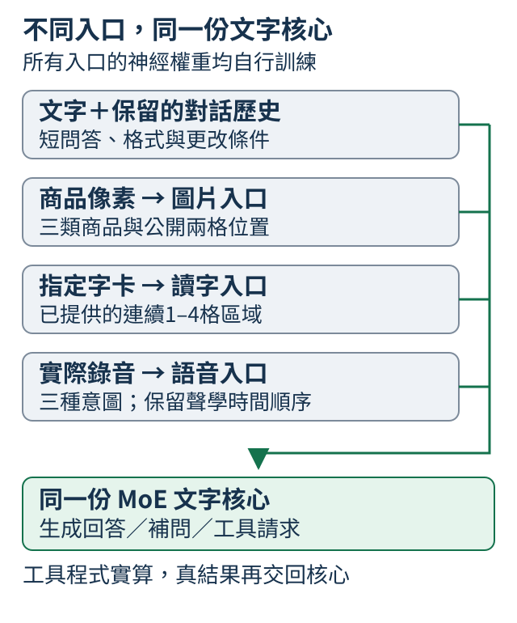
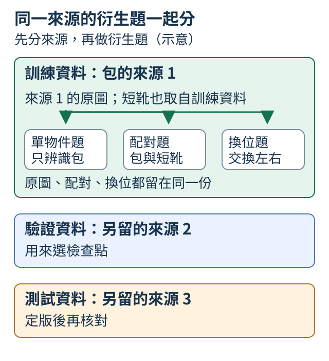
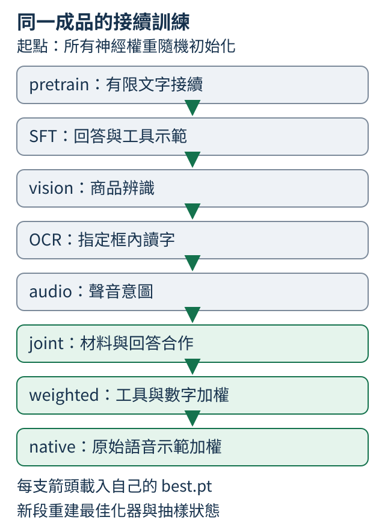
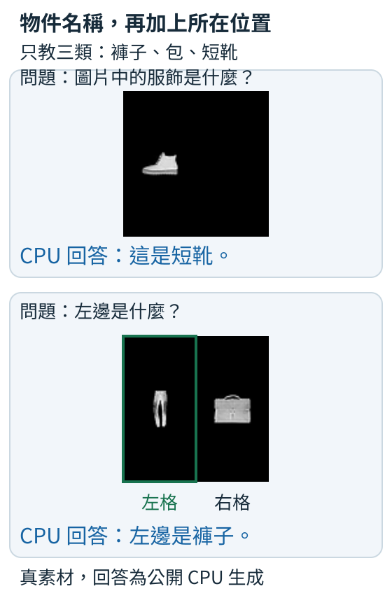
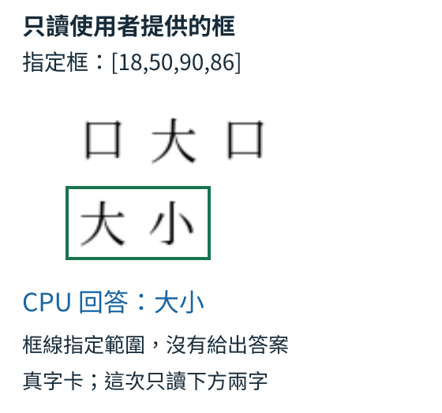
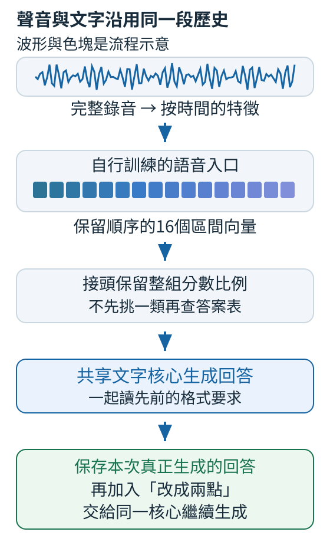
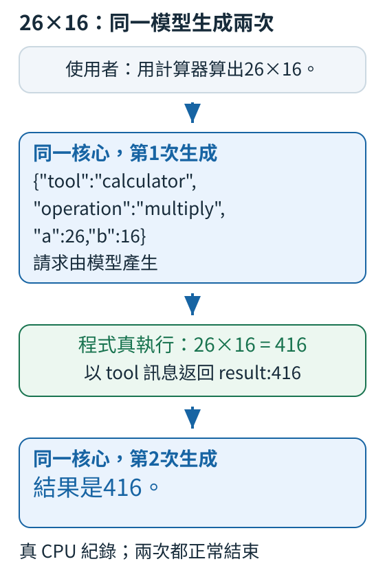
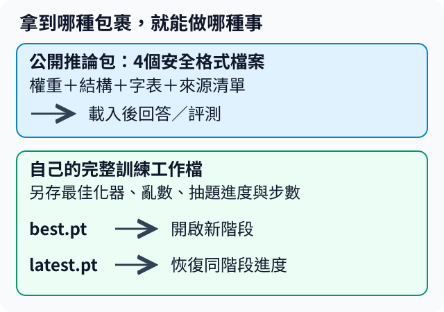

# 第 19 章：三個自行訓練的成品與 Auto 整合

前面學過文字模型、圖片與聲音的入口、機率判斷與循環深度。本章把它們做成三個可以實際使用的成品：**MoE 助理**讀文字、商品圖、字卡與錄音後用文字回答；**Looped 解題器**讀固定語法的事件或加法題，算出答案；**機率判斷器**依狀態、問題與候選意義回傳機率。本章依節號順讀：19.1–19.12 完成 MoE 助理的資料、訓練與驗收；19.13 對照三個成品的用途，19.14–19.20 再讀共同資料、兩個新成品與 Auto 整合。

MoE 助理是本專案第 2 版的有限多模態助理，下文的「V2」只指這個版本。它的文字核心、三個入口及接頭都由本專案從隨機權重訓練，沒有沿用別人訓練好的神經權重；圖片、字型與錄音取自明確列出的資料來源。本章把圖片入口、讀字入口與語音入口合稱**感知入口**：它們把素材轉成特徵，再由接頭轉成文字核心讀得懂的向量。先看助理真正怎麼回答，再拆開模型、資料與訓練流程，最後在[19.12](19.md#19.12)用整份測試資料核對能力與不足。另兩個成品也已完成 GPU 訓練，並在設定凍結後做過測試；從[19.13](19.md#19.13)看用途，再到[19.20](19.md#19.20)核對成績與失敗。第 20 章再把視野擴到成熟模型的應用。

<details>
<summary>回查：本章會接起哪些前面的概念？</summary>

對話角色與只監督助手答案見[7.1–7.3](07.md#7.1)；圖片入口見[第 10 章](10.md)，看圖與讀字見[第 11 章](11.md)，聲音與語音入口見[第 12 章](12.md)；多位 expert 的路由見[15.4–15.5](15.md#15.4)；循環深度見[14.11–14.15](14.md#14.11)；機率判斷的介面見[9.11–9.15](09.md#9.11)。本章仍會在使用處交代每個零件的作用；查不到的詞可查[名詞頁](../glossary.md)。

</details>

## 19.1 一個成品，為什麼要試好幾種問題？

先給助理兩段條件：「接下來請用兩點回答」，以及「App錯誤訊息一直重複出現」。第一句決定格式，第二句決定內容。這份公開 MoE 權重在 CPU 上實際生成了下面的回答，並產生表示回答結束的 EOS（結束標記）。

| 交給模型的材料 | 內容 |
| --- | --- |
| 先前的 user 要求 | 接下來請用兩點回答。 |
| 先前的 assistant 確認 | 好，接下來用兩點回答。 |
| 目前的 user 問題 | App錯誤訊息一直重複出現。 |
| 模型這次的回答 | 1. 先檢查網路並重新啟動App。<br>2. 仍失敗再詢問官方客服。 |

這裡的「先前確認」是公開示範檔提供的對話歷史；最後兩點才是本次模型生成的內容。它同時用到了當前問題和先前格式。沒有圖片或聲音的這一題，先讓我們確認文字核心與回答流程能運作。

<details>
<summary>操作：用自己的 CPU 重做這個公開權重例子</summary>

以下命令都在自己電腦的終端機執行，不是貼進 Notebook 程式格。本頁的 Colab 入口只用 pip 安裝課程的基本套件，沒有建立這些命令使用的 uv 專案環境，也沒有安裝 `selftrained` 額外套件；我們也沒有在 Colab 驗證過這組命令，所以請用本機終端機。

先安裝 [Git](https://git-scm.com/downloads) 與 [uv](https://docs.astral.sh/uv/getting-started/installation/)。第一次取得本章專案，可從終端機執行：

```bash
GIT_LFS_SKIP_SMUDGE=1 git clone --branch selftrained-v2 https://github.com/birdhackor/tiny-perceptron-vlm.git
cd tiny-perceptron-vlm
uv sync --frozen --extra cpu --extra selftrained
```

已有專案的讀者在專案根目錄執行其中的 `uv sync --frozen --extra cpu --extra selftrained` 即可。這個純文字例子不需解開圖片與錄音資料包。接著執行：

```bash
uv run --frozen --extra cpu --extra selftrained python scripts/selftrained/chat.py \
  --model-dir outputs/selftrained-v2/public/moe-joint \
  --asset-dir outputs/selftrained-v2/data \
  --repo birdhackor/tiny-perceptron-course-models \
  --revision 979cdfacc588ad0536f1c64fff96f264571cf054 \
  --prefix selftrained/v2/moe-joint \
  --manifest-sha256 f27856892b0c46ca81ba43bfadf7051ed6bd31d848e4868a05147e5799df1e5e \
  --messages docs/selftrained/examples/v2/text.messages.json \
  --task text --device cpu --max-new-tokens 128 --threads 2
```

程式第一次會匿名取得固定版本的四份公開檔案，核對 SHA-256 指紋後讀入權重，再依訊息檔真正生成回答；後續可重用下載的檔案。這是推論，不會更新模型。輸出為 JSON，先找 `answer`，應為上表的兩點；再看 `generations[0].eos`，應為 `true`。文字中的 `\n` 表示換行。`model.stage` 會是 `joint`、`model.selected_step` 是 `1000`：發布的權重取自 native 段的第 1,000 步，而 native 段在命令列也寫成 `--stage joint`，[19.4](19.md#19.4) 會把這幾個名字拆開。

這份訊息檔的 system 設定只說明有限助理的任務，沒有放入當前問題的答案。若要看完整輸入，可直接打開[示範訊息檔](../../docs/selftrained/examples/v2/text.messages.json)。其他圖片、讀字、語音與工具的 CPU 命令及資料準備見[公開操作頁](../../docs/selftrained/v2-public-cpu-commands.md)。

</details>

接著把同一個文字核心用在別的材料。商品圖先經過圖片入口，指定字卡經過讀字入口，錄音經過語音入口；入口把內容變成文字核心可讀的向量，放進它的輸入序列。下圖的箭頭都朝向同一個文字核心，表示它們最後使用同一份文字權重來回答。



一個文字例子只走了一條路。整合檢查還要改材料、改問題和改歷史，逐項看答案是否跟著條件改變。

| 本章材料 | 要核對的行為 | 使用範圍 |
| --- | --- | --- |
| 短問答、商品清單與對話歷史 | 內容、選取範圍、格式和正常結束 | 有限中文指令與教過類型的新問法、組合 |
| Fashion-MNIST 灰階商品圖 | 商品類別；兩格場景的左右或上下關係 | 褲子、包、短靴三類；兩個格位的位置由呼叫程式提供 |
| 12字「大小上下左右開關入出人口」組成的字卡 | 讀出指定區域，保留字序及要求的換行 | 一個已提供的連續1–4格區域；Sans、Serif兩種已學過的字型 |
| MInDS-14 中文真人錄音 | 用聲音內容決定客服短答，再沿用對話歷史 | 地址、App錯誤、卡片問題三種意圖；輸出文字回答 |
| 小整數計算要求 | 生成合法工具請求，讀取真結果，再生成答案 | 有界的計算器往返 |

例如，把兩格商品圖左右交換，回答也應交換；把「兩點」改成「一句」，內容仍應正確而格式改變。這樣才能區分「認出素材」「選對範圍」和「照要求回答」。上面的成功案例是可重做的示範，整體成功率要由各項測試題分別判定。

## 19.2 為什麼成品選 MoE，卻仍保留 Dense 路線？

助理讀到「App」或一個商品向量時，每一層都要用 FFN（前饋網路，見[4.4](04.md#4.4)）轉換當前特徵。Dense 每層使用一組 FFN；本章 MoE 每層備有四組 expert，由 router 選出兩組，按權重合併它們的輸出。expert 就是一組可訓練的 FFN，不是事先寫好「專門看圖」或「專門聽聲音」的程式。

成品採 MoE，是把[第 15 章](15.md)的路由機制放進同一位多模態助理，觀察多組規則怎麼共同學習。Dense 則提供特徵寬度、層數、注意力與感知入口都相同的另一條完整訓練路線，讓我們有具體對象理解成本和行為的取捨。

先看結果：下面用函式庫建立與公開成品**相同結構的隨機模型**，只數參數，不訓練也不生成答案。`SelftrainedConfig` 記錄模型的形狀，這裡只寫出和預設值不同的四項：字表 550 個編號（`vocab_size`）、特徵寬度 256（`width`）、FFN 中間寬度 512（`ffn_hidden`）、每個位置選 2 位 expert（`top_k=2`）。其餘沿用預設：4 層；每層 4 個 Query 頭共用 2 組 Key、Value（`kv_heads=2`，也就是[16.4](16.md#16.4)的 GQA）；MoE 每層 4 位 expert；最長 512 個位置。`architecture` 決定每層的 FFN 用 MoE 還是 Dense。

```python
from tiny_perceptron.selftrained.model import LimitedAssistant as LibraryAssistant
from tiny_perceptron.selftrained.model import SelftrainedConfig

for architecture in ("moe", "dense"):
    config = SelftrainedConfig(vocab_size=550, width=256, ffn_hidden=512, top_k=2, architecture=architecture)
    library = LibraryAssistant(config)
    ffn = type(library.lm.blocks[0].ffn).__name__
    print(architecture, "每層 FFN：", ffn, "全部參數", library.description()["parameters"])
    print("  embedding 表與輸出層共用同一張表：", library.lm.embedding.weight is library.lm.output.weight)
```

`type(物件).__name__` 取出物件所屬類別的名字。MoE 版每層的 FFN 是 `PaddingSafeMoE`，也就是[15.11](15.md#15.11)的 `MoEFFN` 再加上「補齊的 PAD 位置不參加路由」；Dense 版是[4.4](04.md#4.4)的 `DenseFFN`。`library.description()` 回傳一本記錄各種計數的字典，`["parameters"]` 取出整個助理的參數總數：MoE 是 5,447,107，Dense 是 2,288,067。第二行兩次都是 True：查字的 embedding 表與輸出層用的是同一個張量，這叫**權重共享**（weight tying，見[14.6](14.md#14.6)），數參數時只算一次。

它怎麼做到？下面是 `LimitedAssistant` 的精簡版，只留下建立零件與三項參數計數兩件事。省略的部分有：把圖片、字卡、錄音放進序列的程式（[19.6](19.md#19.6)說明這些材料怎麼交給文字核心）、`forward` 與 `generate`（[19.9](19.md#19.9)的程式會呼叫 `forward`）、回報各種材料保留幾個位置的 `modality_token_count`、沒給設定時改用預設設定的寫法，以及 `description` 回傳的其他欄位。零件的名字與函式庫相同，所以能載入同一組參數。`nn.Module` 類別的寫法見[3.7](03.md#3.7)。

```python
# 精簡自 tiny_perceptron/selftrained/model.py：LimitedAssistant（只留建立零件與三項參數計數；省略 forward、generate、modality_token_count、圖片／字卡／錄音輸入的組裝、config 預設值與 description 的其他欄位）
from torch import nn

from tiny_perceptron.selftrained.model import AudioEncoder, OCREncoder, SelftrainedLanguageModel, VisionEncoder


class LimitedAssistant(nn.Module):
    def __init__(self, config):
        super().__init__()
        self.config = config
        self.lm = SelftrainedLanguageModel(config)
        self.vision_encoder = VisionEncoder(config.width)
        self.ocr_encoder = OCREncoder(config.width)
        self.audio_encoder = AudioEncoder(config.width)

    def description(self):
        def count(module):
            return sum(parameter.numel() for parameter in module.parameters())

        language = count(self.lm)
        active = language
        if self.config.architecture == "moe":
            experts = sum(count(block.ffn.experts) for block in self.lm.blocks)
            active -= experts * (self.config.experts - self.config.top_k) // self.config.experts
        return {
            "parameters": count(self),
            "language_parameters": language,
            "active_language_parameters_per_token": active,
        }
```

- `__init__` 建立四個零件。`self.lm` 是文字核心 `SelftrainedLanguageModel`：它沿用[4.6](04.md#4.6)的 `TinyLM`，改用 RMSNorm、RoPE 與 GQA，每層的 FFN 再依 `config.architecture` 換成 MoE 或 Dense。`vision_encoder`、`ocr_encoder`、`audio_encoder` 是三個感知入口，各自包含把特徵轉成寬度 `config.width` 的接頭。
- `description` 裡的 `count(module)` 數一個零件有多少個可學的數字：`module.parameters()` 逐一給出它的參數張量，`numel()` 是一個張量裡的數字個數，`sum(… for … in …)` 把它們逐一算出再相加。`count(self)` 數整個助理，`count(self.lm)` 只數文字核心。
- `active` 是「每個位置邏輯上用到的文字參數」。Dense 每個位置都走完整的文字核心，所以等於 `language`。MoE 時，變數 `experts` 先加總 4 層裡全部 expert 的參數。設定裡的 `self.config.experts` 是每層有幾位 expert（4），`self.config.top_k` 是每個位置選幾位（2）；沒被選中的 4 − 2 位不算，所以扣掉 `experts × (4 − 2) ÷ 4`。`//` 是捨去小數的整數除法。

核對：兩個版本用同一份設定各建一次，比較三項計數。

```python
for architecture in ("moe", "dense"):
    config = SelftrainedConfig(vocab_size=550, width=256, ffn_hidden=512, top_k=2, architecture=architecture)
    ours, library = LimitedAssistant(config), LibraryAssistant(config)
    ours.load_state_dict(library.state_dict())
    expected = {key: library.description()[key] for key in ours.description()}
    print(architecture, ours.description(), "與函式庫相同：", ours.description() == expected)
    assert ours.description() == expected
```

`state_dict()` 把模型每個參數的名字和數值收成一本字典，`load_state_dict` 依名字把數值抄進精簡版；名字或形狀有一個對不上就會報錯，能往下執行表示兩者的零件完全相同。`expected` 只從函式庫的完整報告取出精簡版也有的三個欄位：`{key: … for key in …}` 逐一取鍵，組成新字典。兩行都印出 True 後，assert 再確認一次。

MoE 的文字核心有 5,140,224 個參數。每位 expert 是兩個線性層，256×512＋512＋512×256＋256＝262,912 個參數，4 層 × 4 位共 4,206,592 個。每個位置只用 2 位，所以邏輯啟用數是 5,140,224 − 4,206,592 × 2 ÷ 4 ＝ 3,036,928。Dense 的文字核心是 1,981,184 個，每個位置全部用到。兩版的三個感知入口及接頭都是 5,447,107 − 5,140,224 ＝ 306,883 個。

「邏輯啟用」用來說明只選部分 expert，沒有計入真正運算次數、分派花費或執行時記憶體。所有四組 expert 仍要存放；同一段輸入的不同位置也可能選不同組。本章 MoE 一個位置用兩組 FFN，Dense 用一組，所以這個配對不是同計算量或同記憶體的比較。

兩條路線的最終訓練目標與選定歷程也不同：MoE 最後多跑一段 native（tool 權重 4、numeric 權重 1、native voice 權重 4），選定其中第 1,000 步；Dense 停在 weighted 段（tool 權重 4、numeric 權重 4），也選定第 1,000 步。這些段名與權重的意思見[19.4](19.md#19.4)的表。因此不能把得分差直接歸因於 MoE。保留 Dense 的用途，是比較兩份真實成品並看清差異；要做隔離架構因素的實驗，還需要按[15.13](15.md#15.13)另行配對條件。上面的程式確認結構與計數，模型已學會什麼則由生成的測試題核對。

練習把第三段程式的 `top_k=2` 改成 `top_k=1`，先預測：全部參數不變（四位 expert 一樣要存），MoE 的邏輯啟用數變成 5,140,224 − 4,206,592 × 3 ÷ 4 ＝ 1,985,280，Dense 不受影響。執行核對後再看差距：1,985,280 比 Dense 的 1,981,184 只多 4,096 個，正是 4 層 router 的參數（每層 256×4）。

<details>
<summary>補充：550個編號從哪裡來？</summary>

本章沿用字元 tokenizer：普通文字逐字轉成編號，另外保留角色、模態和結束等 11 個特殊 token，合計 550 個編號。普通字元只從訓練資料的文字收集，再加入事先指定的 ASCII 可列印字元與 12 個讀字字元；驗證資料和測試資料沒有拿來擴充字表。推論時不在字表內的字會變成未知字元 `<unk>`，不能把這份小字表當作完整的中文用字。編號怎麼排見[19.5](19.md#19.5)，實作見[tokenizer.py](../../tiny_perceptron/selftrained/tokenizer.py)，公開配置與計數見[成品紀錄](../../docs/selftrained/results/v2-final-public-results.json)（看 `architectures.moe.capacity` 一欄）。

</details>

## 19.3 同一題的不同版本，怎麼避免同時跑進訓練與測試資料？

同一張包的原圖，可以縮放成單物件題，也可以和短靴配成左右關係題。如果原圖進了訓練資料，縮放版卻進了測試資料，模型就可能靠見過的素材答題。這裡的**家族**指同一個來源或情境，以及由它衍生的所有題目；先決定整個家族去哪一份資料，再製作不同問法與版本。

下圖用包的一個來源示意：單物件、配對與交換位置的題目都留在訓練資料。配對只能使用已分到同一份的兩個來源；圖中的短靴也來自訓練資料，不能拿驗證資料的短靴和訓練資料的包組成訓練題。驗證資料和測試資料使用各自另留的來源，而不是把同一個來源的不同版本隨機拆散。



本章的固定資料分成以下三份。題數是對話記錄數：同一張圖或錄音可能產生多筆記錄，因此題數不是原始素材數。

| 資料份 | 對話記錄數 | 用途 |
| --- | ---: | --- |
| train：訓練資料 | 28,876 | 參與梯度與參數更新 |
| validation：驗證資料 | 2,435 | 檢查學習狀況、選定檢查點 |
| test：測試資料 | 3,734 | 定版後做最後檢查，不再用來選權重 |

不同材料需要不同的家族規則；只要求每筆記錄的 ID 不同還不夠。

| 材料 | 一起留在同一份的內容 |
| --- | --- |
| 文字與對話 | 同一組改述、同一棵客服情境樹，以及由它改出的格式、範圍與歷史版本 |
| 計算工具 | 同一組數字及交換順序、不同運算、工具可用性與結果回填題；同一種問法句型也整組放在同一份 |
| 商品圖 | 先按原始商品ID與原始像素去重再切分；只在同一份內配對，再製作單物件、方向與換位題 |
| 字卡 | 2–4字的組合按字串分開；同一來源的區域問題及訓練用的增強版本留在同一份 |
| 錄音 | 同一來源錄音、重複或近重複語句群組，以及由它衍生的格式、續聊與增強題 |

表中的**資料增強**（data augmentation）是從已有的訓練素材做出變化版本，讓模型看到更多變化：字卡用不同字型、大小與背景深淺重畫同一串字；錄音稍微加快或放慢、加上合成的背景雜音。增強版本只加進訓練資料，原有的驗證與測試素材沒有改動。

字卡考的是已知字元的新組合與版面。訓練資料本來就有逐一練 12 個單字的讀字題，驗證與測試資料也用同樣 12 個字做單字檢查，所以不能稱為新字測試；測試資料留出的是沒在訓練出現過的 2–4 字組合。V2 訓練已包含 Sans 和 Serif 兩種字型，測試題中的 Serif 也不能稱為陌生字型。**文字偵測**指先在整張圖裡找出文字在哪裡；本章模型不做這一步，使用者要提供一個連續1–4格的讀字框，模型只辨識框內的字。

錄音則有 62 份訓練、15 份驗證和 30 份測試素材。這些數字數的是**錄音**；來源沒有說話者 ID，不能換寫成 62 人、15 人、30 人，或宣稱測試資料裡的人從未出現在訓練中。來源附的轉寫文字（transcript）只供作者整理重複群組及檢查文字題洩漏；推論輸入仍只有實際聲音和公開對話，不附轉寫文字、意圖標籤或當前的正確答案。

這些規則最後都要落到每筆記錄上。記錄裡的 `group_id` 欄是家族標記：寫同一個值的記錄，必須留在同一份資料。V2 的訓練程式用函式庫的 `read_records`（[tiny_perceptron/selftrained/dataset.py](../../tiny_perceptron/selftrained/dataset.py)）一次讀進固定資料的全部 12 個記錄檔，三份資料都在裡面；只要同一個 `group_id` 出現在兩份資料，它就報錯，訓練不會開始。下面手寫兩筆記錄試一次：第一筆是包在左、短靴在右的配對題，分到訓練資料；第二筆是同一對商品交換位置後的版本，答案變成短靴，卻分到測試資料。兩筆出自同一對來源，所以 `group_id` 都是 `bag-boot-07`。

```python
import json
import tempfile
from pathlib import Path

from tiny_perceptron.selftrained.dataset import read_records


def record(number, group, split, answer):
    messages = [{"role": "user", "content": "左邊是什麼？"}, {"role": "assistant", "content": answer}]
    return {"id": f"r{number}", "group_id": group, "split": split, "task": "vision_relation", "messages": messages}


rows = [record(1, "bag-boot-07", "train", "左邊是包。"), record(2, "bag-boot-07", "test", "左邊是短靴。")]
with tempfile.TemporaryDirectory() as directory:
    path = Path(directory) / "records.jsonl"
    path.write_text("\n".join(json.dumps(row, ensure_ascii=False) for row in rows), encoding="utf-8")
    try:
        print("讀入", len(read_records([path])), "筆")
    except ValueError as error:
        print("拒絕：", error)
```

`record` 組出一筆字典，只放 `read_records` 一定要有的五個欄位：`id` 是這筆記錄自己的編號，`group_id` 是家族標記，`split` 是分到哪一份，`task` 是題型名稱，`messages` 是使用者的問題與助手的答案（[7.1](07.md#7.1) 的消息格式）；真正的商品題還有圖檔路徑等欄位，這裡省略。`json.dumps(row, ensure_ascii=False)` 把每筆字典寫成一行 JSON，`"\n".join(...)` 再用換行接起來，就是 [18.3](18.md#18.3) 說的 JSONL；`path.write_text(...)` 用 UTF-8 把這段文字寫進暫存資料夾裡的檔案，暫存資料夾與 `with` 的寫法見 [5.7](05.md#5.7)。

`read_records([path])` 收一份檔案路徑的清單，逐行把 JSON 讀成記錄。它先確認五個欄位都在、`id` 沒有重複、`split` 是 train、validation 或 test（寫成 val 也當 validation）；接著用字典 `groups` 記下每個 `group_id` 出現在哪一份，之後遇到同一個 `group_id` 卻在另一份，就執行 `raise ValueError(f"group 跨 split: {group}")`；最後才檢查每則消息的角色與欄位。全部通過時，它回傳依 `id` 排好的記錄清單，程式印出讀入幾筆。這次第二筆就觸發錯誤，`except ValueError as error:` 接住它（`try`／`except` 見 [W.2](../first-steps.md#W.2)），印出 `拒絕： group 跨 split: bag-boot-07`。訊息最後的 `bag-boot-07` 點名了跨份的家族；第一筆雖然通過，函式一報錯就整個中止，什麼記錄都不回傳。

這道檢查只比對 `group_id` 字串，不比對題目內容或圖片：同一家族的衍生題若被誤標成另一個 `group_id`，它就擋不到。所以家族標記要在製作題目時就照來源給，[19.14](#19.14) 會用另外兩個成品的資料示範怎樣從題目共同的底層事實算出家族 ID；V2 資料裡商品來源像素、字串與錄音群組的隔離，也由各自的資料準備程式另外檢查，不能只依賴一個標記。

練習把 `rows` 那一行的第二個 `"bag-boot-07"` 改成 `"bag-boot-08"`，先預測：兩筆都通過，印出 `讀入 2 筆`。換位題仍出自同一對商品，只是標記寫錯，檢查就看不出來，這正是上一段說的限制。

資料隔離完成後，還要看答案分佈和成對題：例如只回答「包」能猜中多少商品題，同圖換位置是否真的改變答案。家族切分保證訓練資料與測試資料之間沒有同一個來源的重複，但它只排除這種重複，不能單獨證明模型真的用了素材。這些檢查會在感知和最終驗收時與模型回答一起看。

<details>
<summary>補充：怎樣把資料版本固定下來？</summary>

[V2 manifest](../../docs/selftrained/v2-manifest.json)列出12個記錄檔與全部素材的路徑、大小和完整SHA-256指紋（看 `records` 與 `assets` 兩欄）。訓練用的 wrapper 是包在訓練程式外面的啟動腳本 [train_local_stage.py](../../scripts/selftrained/train_local_stage.py)，啟動時先核對這些檔案再呼叫訓練程式；不同階段沿用同一份固定資料。V2的文字、工具、字卡與聲音增強只追加訓練素材，原有驗證、測試記錄及媒體保持原檔內容。

固定資料的取得與逐檔驗證見[訓練操作頁](../../docs/selftrained/TRAINING.md#安裝與固定資料)，來源與授權見[V2資料說明](../../docs/selftrained/V2-DATA-NOTICE.md)。

</details>

## 19.4 怎麼確認下一階段真的接著上一階段學？

文字助理接上圖片入口時，應該是原來的文字核心多了一份材料。如果下一段重新建立隨機文字權重，檔名即使也叫 `best.pt`，仍不是接續同一成品。接續訓練因此要保存**檢查點**（checkpoint，[5.7](05.md#5.7)已用過）：除了當時的權重，還可以包含最佳化器（optimizer）狀態（Adam 的 m、v）、亂數狀態、抽題進度與目前步數。本章的 `best.pt`、`latest.pt` 都是這種檢查點。

本節分三步：先看訓練鏈怎麼一段接一段；再分清「開始新的一段」與「接著中斷處做」；最後從紀錄核對公開成品取自哪一段。

本章從隨機初始化出發，依下圖走到最終 MoE。每支箭頭載入自己上一段依驗證選出的 `best.pt`；不是另取成熟模型或別條路線的零件。Dense 也有自己的完整前段鏈，最終停在 weighted 段。



三個感知階段先練入口本身的辨識；到 joint 段才一起練「讀材料後回答」。入口裡的**骨幹**是提取特徵的部分，**分類頭**是給類別或字元打分的輸出層（[10.5](10.md#10.5)的用語）。從 joint 段起凍結這些感知零件，也就是保留既有權重、不在這段更新它們；仍允許更新文字核心，以及把感知特徵交給文字核心的接頭。

| 新的一段 | 這段主要學什麼 | 允許更新的模組 |
| --- | --- | --- |
| pretrain | 用有限文字練下一個編號 | 文字核心 |
| SFT | 按示範產生助手回答及工具請求 | 文字核心 |
| vision | 從三類商品像素判斷類別 | 圖片入口；文字核心凍結 |
| OCR | 從指定框辨識12字及字序 | 讀字入口；文字核心凍結 |
| audio | 從完整聲學時間序列辨識三種意圖 | 語音入口；文字核心凍結 |
| joint | 混合文字、商品、讀字、聲音與工具題 | 文字核心與接頭；骨幹及分類頭凍結 |
| weighted | 加重工具示範和數字位置的訓練代價 | 同 joint；tool權重4、numeric權重4 |
| native | 再加重未增強的語音問答與續聊示範 | 同 joint；tool權重4、numeric權重1、native voice權重4 |

weighted 與 native 兩段仍用同一個模型和同一份資料，另外調整訓練代價的比重：tool 權重是工具請求與讀回結果那幾列示範的代價倍數，numeric 權重是答案裡數字位置的倍數，native voice 權重是沒有經過資料增強的原始錄音問答與續聊示範的倍數。驗證代價仍用沒有加權的原始算法；訓練目標比較重視哪種題，不會直接變成答對證據。語音入口的分類頭預測的是意圖類別；這裡沒有語音辨識（ASR），不會先把語音轉成轉寫文字。

開始新段與接著中斷點做，是兩個不同動作：

| 要做的事 | 讀入檔案 | 權重以外的狀態 |
| --- | --- | --- |
| `--init-checkpoint`：開始下一段 | 自己前段的驗證選定 `best.pt` | 重建最佳化器；依該段seed重新開始抽樣；新段步數、token計數歸零 |
| `--resume`：恢復同一段 | 自己同段的 `latest.pt` | 恢復最佳化器、亂數狀態（RNG）、抽題狀態（sampler）和計數；保持原目標與最佳化設定 |

所以把「tool 權重 4、numeric 權重 4」改成「tool 權重 4、numeric 權重 1、native voice 權重 4」，要開新的 native 段；它不能冒充原 weighted 段的精確續跑。`--steps` 在續跑時是那一段的總目標步數，也不是額外再做的步數。

選定檔案也不一定是最後檔案，而且有兩個東西都叫 `moe-joint`。下面只讀取隨專案保存的紀錄，CPU 與 Notebook 都能離線執行，不需下載權重或重做訓練。

```python
import json
from pathlib import Path

here = Path.cwd()
for repo in [here] + list(here.parents):
    if (repo / "docs/selftrained").is_dir():
        break
docs = repo / "docs/selftrained"
for row in json.loads((docs / "v2-training-stage-index.json").read_text())["stages"]:
    if row["stage_key"].startswith("moe-"):
        print(row["stage_key"], row["attempt"], "完成", row["completed_steps"], "選定", row["selected_step"])
for label, file in [
    ("moe-weighted", "v2-moe-weighted-10000-training-stage-index.json"),
    ("moe-native", "v2-moe-native-balanced-4000-training-stage-index.json"),
]:
    row = json.loads((docs / "results" / file).read_text())
    print(label, row["attempt"], "完成", row["completed_steps"], "選定", row["selected_step"])
public = json.loads((docs / "results/v2-final-training-source-selection.json").read_text())["moe_joint"]
print("公開成品 moe-joint 取自", public["source_training_run"], "第", public["selected_step"], "步")
```

開頭從 `here = Path.cwd()` 到 `break` 的這幾行先找專案根目錄：`Path.cwd()` 是目前所在的資料夾，`here.parents` 是它的每一層上層資料夾；`for` 從目前資料夾開始一層層往上試，遇到含有 `docs/selftrained` 的那層就用 `break` 停下，`repo` 便停在專案根目錄。這樣不論從 Notebook 所在的 `notebooks/19` 還是根目錄執行，都找得到檔案。`json.loads(… .read_text())` 把 JSON 檔讀成字典。

第一個迴圈讀訓練索引，只印 `stage_key` 以 `moe-` 開頭的六段；`attempt` 是那次執行嘗試的編號，中斷後重跑同一段會換一個新編號。第二個迴圈讀 weighted 段與 native 段各自的紀錄。最後的 `public = …` 讀「最後權重選擇」紀錄裡的 `moe_joint` 欄位，它記的是公開成品的來源。

輸出共九行。`moe-joint gha-37424663711-1 完成 6000 選定 2000` 是 **joint 段**；接著 weighted 段完成 10000 步、選定第 3000 步；native 段完成 4000 步、選定第 1000 步。最後一行的 `gha-37440329212-1` 與 native 段那行相同：公開成品 `moe-joint` 的權重取自 **native 段第 1,000 步**，不是訓練索引裡那個 joint 段。兩個名字撞在一起，是因為 joint、weighted、native 三段在命令列都寫 `--stage joint`；公開目錄沿用這個階段名。本章之後用「joint 段」「weighted 段」「native 段」稱呼訓練段，`moe-joint` 只指公開成品的目錄。

每一段都接著自己的前一段：native 段紀錄的 `initialization.loaded_step` 是 3000，正是 weighted 段選定的步數；weighted 段紀錄的 `initial_selected_parent` 則指向 joint 段那次執行。這些欄位說明權重取自哪裡；選得較早或驗證代價較低，都不等於整份測試資料都答得好。

練習把第二個迴圈的 `("moe-native", "v2-moe-native-balanced-4000-training-stage-index.json")` 改成 `("dense-weighted", "v2-dense-weighted-10000-training-stage-index.json")`，先預測 Dense 的 weighted 段完成 10000 步、選定第 1000 步，再執行核對；[19.11](19.md#19.11)的公開 `dense-joint` 就取自這一段。

<details>
<summary>操作：用本機 wrapper 開始及接續自己的訓練</summary>

這是重做成品的配方，不是本頁短程式的一部分。以下命令在自己電腦的終端機執行，不是 Notebook 程式格；Colab 入口沒有建立這些命令使用的 uv 專案環境與 `selftrained` 額外套件，也沒有驗證過這組命令。

這些命令要在 main 分支的 clone 根目錄執行，照 [W.1](../first-steps.md#W.1) 取得的專案就是 main 分支。照 [19.1](19.md#19.1) 從 `selftrained-v2` 取得的專案不行：那裡的 `docs/selftrained/v2-manifest.json` 和下面命令的 `--manifest-sha256` 對不上，wrapper 會在訓練開始前停下。還沒有 main 分支的 clone，就照 [TRAINING.md 的安裝與固定資料](../../docs/selftrained/TRAINING.md#安裝與固定資料)取得。若執行 `git clone` 的資料夾裡已經有 19.1 建立的 `tiny-perceptron-vlm`，在 `git clone` 那個命令最後加上新的資料夾名稱，例如 `tiny-perceptron-vlm-main`，接著的 `cd tiny-perceptron-vlm` 也改成 `cd tiny-perceptron-vlm-main`；否則 Git 會因為同名資料夾已存在而拒絕 clone。接著照同一段逐檔驗證固定資料，放在 `data/selftrained-v2`。每個輸出目錄必須是新的。第一段從隨機權重開始：

```bash
uv run --frozen --extra cpu --extra selftrained python scripts/selftrained/train_local_stage.py \
  --manifest docs/selftrained/v2-manifest.json \
  --manifest-sha256 3e50d1333553a8ef0351f8e08343c38456721b6ceda418ac73ca33d3ebe4e5ab \
  --data-root data/selftrained-v2 -- \
  --output-dir checkpoints/selftrained-local/moe-pretrain \
  --stage pretrain --architecture moe --steps 1000 \
  --batch-size 16 --context 512 --seed 20261006 \
  --learning-rate 0.001 --eval-every 250 --save-every 250 --device cpu
```

接著依操作頁的逐段參數，完成自己的 SFT、vision、OCR、audio、joint、weighted；每段都用 `--init-checkpoint` 載入自己上一段的 `best.pt`，並沿用同一 manifest、batch 16、context 512 和 seed。當自己的 weighted 段確實完成後，開新 native 段的完整命令是：

```bash
uv run --frozen --extra cpu --extra selftrained python scripts/selftrained/train_local_stage.py \
  --manifest docs/selftrained/v2-manifest.json \
  --manifest-sha256 3e50d1333553a8ef0351f8e08343c38456721b6ceda418ac73ca33d3ebe4e5ab \
  --data-root data/selftrained-v2 -- \
  --output-dir checkpoints/selftrained-local/moe-native \
  --stage joint --architecture moe --steps 4000 \
  --batch-size 16 --context 512 --seed 20261006 \
  --learning-rate 0.0002 --eval-every 1000 --save-every 1000 \
  --freeze-perception-backbones --sampling-mode task-family \
  --tool-loss-weight 4 --numeric-run-loss-weight 1 --native-voice-loss-weight 4 \
  --init-checkpoint checkpoints/selftrained-local/moe-weighted/best.pt --device cpu
```

native 段只接受同架構、真正完成的 weighted 段（tool 權重 4、numeric 權重 4）及其驗證選定的 `best.pt`。Wrapper 會核對來源的執行紀錄與指紋，保存本次真實命令、執行結果與檢查點。未完成的 attempt 可用自己的 `latest.pt` 恢復同段，不能當作下一段的完成來源；續跑的完整例子見[新stage與exact resume](../../docs/selftrained/TRAINING.md#新-stage-與-exact-resume)。

Dense 使用自己的 `dense-*` 目錄與 `--architecture dense`，沿完整前段鏈接自己的來源；本章發布的 Dense 停在 weighted 段。公開的 safetensors 檔只供推論，沒有最佳化器等續訓狀態（見[19.11](19.md#19.11)）；這套訓練從自己產生的完整檢查點接續。

</details>

核對接續時，先比較兩個指紋：新段實際載入的**父檢查點**（新段開始時讀入的那個前段檢查點）的 SHA-256，和前段選定檔案的完整 64 字元指紋；再確認前段的執行紀錄真的完成了。只看相同檔名不夠。這一步只能確認權重鏈接對了；文字、格式與感知回答有沒有保留，仍要回到每段的驗證題。下一節先看 SFT 要教哪些完整示範。

## 19.5 讓助理簡短、誠實與守規則，要教哪種示範？

先告訴助理「接下來請用兩點回答」，再問「App錯誤訊息一直重複出現。」本章公開 MoE 權重在 CPU 上真正生成了：

> 1. 先檢查網路並重新啟動App。  
> 2. 仍失敗再詢問官方客服。

這個回答的內容對應當前 App 問題，也符合先前要求的兩點格式。公開的[輸入訊息](../../docs/selftrained/examples/v2/text.messages.json)只含一般工作設定、格式確認與問題；目前的答案是在呼叫模型後才產生的。這是挑選出的成功驗證例，可以核對介面與生成流程，不能由一題推出所有新問法都成功。

要教出這種行為，示範不能只有「問題 → 一句好答案」，還要讓**條件改變時，答案也改變**。本輪文字訓練資料包含下列實際示範。表中是拿來訓練的示範答案，與上方模型生成的回答用途不同。這些答案寫在資料準備程式的任務範本裡；範本與程式由 AI 工具 Codex 協助撰寫，答案沒有逐題經人撰寫或審核，見[V2資料說明](../../docs/selftrained/V2-DATA-NOTICE.md)。

| 工作條件與使用者問題 | 訓練示範回答 | 要教的差別 |
| --- | --- | --- |
| 用一句回答；「App打不開，該怎麼辦？」 | 先檢查網路並重新啟動App，仍失敗再詢問官方客服。 | 回應已教過的需求，使用指定格式 |
| 「那個問題要怎麼處理？」 | 請說明是地址、App還是卡片的問題。 | 資訊不足時先追問缺的條件，不自己猜是哪個問題 |
| 計算器不可用；「算0加0是多少。」 | 計算器目前不可用，請開啟後再計算。 | 依工具狀態回答，不假裝已執行 |
| 「請預測明天天氣。」 | 這超出我的範圍，我能協助有限聊天、地址、App、卡片或加減乘問題。 | 說明這個有限助理的工作範圍 |

這裡的「誠實」有具體教法：缺條件就詢問、工具未開就說未開、範圍外就說明範圍。也要保留能直接回答的題目，否則每題都求助也可能看似謹慎。學會幾種澄清句，不等於能估計任意問題的可靠程度；成品在測試題上是否選對行為，仍要另外評分。

**監督式微調（SFT）**就是用這種示範調整參數，讓模型在相同前文下較可能生成示範回答。system 訊息寫一般工作條件，user 訊息寫請求，assistant 訊息寫希望學到的回應。本輪 SFT 更新自己的文字核心；問題與歷史仍在輸入裡，但作答代價只計 assistant 的文字與 EOS（結束標記）。EOS 表示這輪回答結束，也需要學，不能只學會前幾個字。

先看結果：下面在 CPU 上整理一筆手寫示範，查看哪些字被列為 SFT 目標。它使用成品相同的訊息編碼器 `RecordEncoder` 與字元 tokenizer `CharacterTokenizer`，沒有下載權重、生成回答或更新模型。

```python
from tiny_perceptron.selftrained.dataset import RecordEncoder as LibraryEncoder
from tiny_perceptron.selftrained.tokenizer import CharacterTokenizer

messages = [
    {"role": "user", "content": "那個問題要怎麼處理？"},
    {"role": "assistant", "content": "請說明是地址、App還是卡片的問題。"},
]
tok = CharacterTokenizer.build([m["content"] for m in messages])
print("字表大小", tok.vocab_size)
print("BOS", tok.bos_id, "EOS", tok.eos_id, "user", tok.user_id, "assistant", tok.assistant_id)
row = {"id": "teaching-demo", "task": "text", "messages": messages}
library = LibraryEncoder(tok, ".").encode(row)
targets = [value for value in library["labels"] if value != -100]
print(tok.decode(targets, skip_special_tokens=False))
```

`CharacterTokenizer` 先固定 11 個特殊 token 的編號：0 是 PAD、1 是 BOS（開始標記）、2 是 EOS；3 到 6 是 user、assistant、system、tool 四個角色標記；7 到 9 是圖片、字卡、錄音的保留位置；10 是未知字元 `<unk>`。普通字元從 11 起依排序編號。`build` 收集傳入文字裡的每個字，另外一定加入 12 個讀字字元與 0–9，所以第一行印出的字表大小是 11 個特殊 token 加 46 個字元，共 57，第二行印出 BOS、EOS 與兩個角色標記的編號；成品改用全部訓練文字，並加入 ASCII 可列印字元與 12 個讀字字元建立字表，才是 19.2 的 550 個。實作見[tokenizer.py](../../tiny_perceptron/selftrained/tokenizer.py)。

`RecordEncoder(tok, ".")` 的第二個參數是素材資料夾（`asset_dir`），圖片與錄音檔要從這裡讀；這筆純文字記錄用不到素材，所以給目前資料夾 `"."` 即可。`encode(row)` 回傳一本字典：`"input_ids"` 是模型讀的編號，`"labels"` 是每個位置的答案。`[value for value in … if value != -100]` 只留下不是 −100 的答案，`decode` 再換回文字；`skip_special_tokens=False` 讓 EOS 也印出來。第三行輸出是 `請說明是地址、App還是卡片的問題。<eos>`：只有助手那句話和它的 EOS 會被計分。

它怎麼做到？下面是 `RecordEncoder` 的精簡版，只留純文字對話的 `encode`。函式庫版本另外還有這些部分，精簡版都省略了：

- 讀進圖片、字卡與錄音，並在對話裡放進它們的保留位置（[19.6](19.md#19.6)講這些材料怎麼交給文字核心）。
- `encode` 的四個選項：`pretrain`（每則訊息的角色標記、內容與 EOS 都計分，不只助手的部分）、`generation`（推論用：在結尾補上 assistant 角色標記；沒有另外給 `messages` 時，也先去掉紀錄裡最後一則訊息）、`messages`（改用呼叫者另外給的訊息清單）與 `modality_override`（把素材特徵換成全零）。
- 長度上限檢查，以及 tokenizer 回傳 tensor 時先轉成清單的步驟。
- 組成 batch 與搬到裝置的 `batch`、`to_device`；回傳值裡的 `modalities` 與 `record` 兩個欄位也一併省略。

```python
# 精簡自 tiny_perceptron/selftrained/dataset.py：RecordEncoder（只留純文字對話的 encode；省略圖片、字卡與錄音的讀取與保留位置，pretrain、generation、messages、modality_override 四個選項，長度檢查，tensor 轉清單，batch、to_device 與回傳的 modalities、record）
class RecordEncoder:
    def __init__(self, tokenizer):
        self.tokenizer = tokenizer

    def encode(self, record):
        tok = self.tokenizer
        ids, labels = [tok.bos_id], [-100]
        for message in record["messages"]:
            role_id = getattr(tok, message["role"] + "_id")
            content = tok.encode(message["content"])
            ids += [role_id] + content + [tok.eos_id]
            if message["role"] == "assistant":
                labels += [-100] + content + [tok.eos_id]
            else:
                labels += [-100] * (1 + len(content) + 1)
        return {"input_ids": ids, "labels": labels[1:] + [-100]}
```

- `ids` 從 BOS 開始。BOS 本身不是要學的答案，所以 `labels` 同時放一個 −100。
- 每則訊息依序放進三段：角色標記、內容、EOS。`getattr(tok, "assistant_id")` 等於寫 `tok.assistant_id`；這裡用字串拼出 `"user_id"` 或 `"assistant_id"`，依角色欄位取出對應的編號。`+=` 把右邊的清單接到原清單後面。
- 助手訊息的 `labels` 依序是 −100（角色標記不學）、內容的每個字、EOS；其他角色整段都是 −100，`[-100] * (1 + len(content) + 1)` 做出與「角色標記＋內容＋EOS」等長的一串。到這裡，`labels` 與 `ids` 的位置一一對應，記的都是「這個位置放了什麼」。
- 最後的 `labels[1:] + [-100]` 把答案整串往左移一個位置：切片 `[1:]` 去掉第一個，再在尾端補一個 −100。位置 i 的答案因此變成位置 i+1 的編號，也就是「讀到這裡，下一個字應該是什麼」；[4.7](04.md#4.7)的 `shifted` 做的是同一件事。

核對精簡版，並把交界處印出來看：

```python
ours = RecordEncoder(tok).encode(row)
same = ours["input_ids"] == library["input_ids"] and ours["labels"] == library["labels"]
print("與函式庫相同：", same)
assert same
start = ours["input_ids"].index(tok.assistant_id)
for i in range(start - 1, start + 3):
    shown = tok.decode([ours["input_ids"][i]], skip_special_tokens=False)
    target = "不計" if ours["labels"][i] == -100 else tok.decode([ours["labels"][i]])
    print("讀到", shown, "→ 目標", target)
```

第一行印出 True：兩份編號與答案逐項相同。`index` 找到 assistant 角色標記的位置 `start`，`range(start - 1, start + 3)` 從它的前一個位置印到它後面第二個位置，共四行；`"不計" if … else …` 是條件運算式，條件成立取前者，否則取後者。讀到使用者訊息結尾的 `<eos>` 時目標是「不計」：下一個是角色標記，由程式插入，不必學。讀到 `<assistant>` 時目標是「請」，讀到「請」時目標是「說」：模型讀問題與已給定的回答前綴，逐字預測下一個字。

`-100` 表示該位置不計作答代價，並沒有把使用者問題從輸入刪掉。真正推論時，模型則要接著自己剛生成的字繼續回答。能把標籤整理對，只證明訓練目標的安排，不證明模型已學會。

練習把第一段程式 `messages` 第一則的 `"role": "user"` 改成 `"role": "assistant"`，先預測：兩則都是助手訊息，第三行會印出兩句話，各帶一個 `<eos>`；再執行核對。

文字示範還包含選項記憶、格式改寫與工具請求／讀回。**選項記憶**是記住使用者在前文最後選定的東西：例如前文說「我先選褲子，後來改選短靴，接下來用一句回答。」之後問「請說出我的選項。」應答「你選了短靴。」[19.12](19.md#19.12)的「改歷史選項」對照就在檢查這件事。訓練題、驗證題與測試題依前面的家族分開；驗收時分別查內容、指定範圍、格式、完整結束及澄清行為，19.12 會列出分項結果。下一節沿用這些回答規則，只把其中一輪的文字材料換成圖片或聲音。

<details>
<summary>查證：示範、實際生成與成熟方法</summary>

訓練示範保存在固定資料包的 `text-tools-train.jsonl`；讀取與標籤安排見[訊息編碼器](../../tiny_perceptron/selftrained/dataset.py)，各階段更新範圍見[訓練程式](../../scripts/selftrained/train.py)。上方 App 回答來自[公開 CPU 執行紀錄](../../docs/selftrained/infrastructure/v2-public-cpu-smoke-actual-review.json)（看 `invocations` 裡 `task` 為 `text` 那一筆的 `actual_answer`），可重做的完整命令見[CPU 操作頁](../../docs/selftrained/v2-public-cpu-commands.md)。

[7.17](07.md#7.17)已解釋預訓練與監督式微調（SFT）的分工，第13章再介紹 PPO 與 DPO。這些是有用途與適用條件的成熟方法；本章的有限成品不重做每種方法的實驗，所以只簡述它們，不把它們當成必經步驟。

</details>

## 19.6 圖片與聲音怎麼交給同一位助理？

下圖用的是公開 CPU 命令真正讀取的商品圖。第一題問「圖片中的服飾是什麼？」，模型生成「這是短靴。」；第二題改問「左邊是什麼？」，模型生成「左邊是褲子。」先看物件，再看位置：第二張的包在右格，不能因為圖裡有包就答包。本節依序看三種材料怎麼交給同一個文字核心：商品圖、字卡、錄音；最後看三者共用的接頭，以及錄音回答怎麼接到下一輪對話。



圖片入口只學 Fashion-MNIST 的**褲子、包、短靴三類**。本輪把來源灰階商品像素放進自製場景，另外提供兩個格位的公開座標：例如左半張與右半張。程式按座標取出兩格，再把各格的像素與位置送進自行訓練的圖片入口。座標回答「看哪裡」，沒有提供「那裡是褲子」這個類別答案；這也不是模型自行偵測任意照片中的物件。

圖片入口算出物件特徵，接頭把它們轉成文字核心能讀取的向量，放進對話序列中預留的兩個圖片位置。格位座標與格位順序也進入表示，因此交換左右後，文字核心有機會分辨物件搬到了哪裡。這接續[10.6](10.md#10.6)的寬度轉換與[11.14](11.md#11.14)的位置保留：只留下「有褲子、有包」的平均摘要，還不夠回答「左邊是什麼」。

讀字再增加一個明確條件：使用者提供要讀的框。下面是公開命令的真字卡，綠框是 `[18,50,90,86]`：四個數依序是框的左、上、右、下邊界，單位是原圖的像素（整張字卡寬 192、高 96）。框內寫「大小」，上方的字不在這次回答範圍內。



程式先依座標裁切，等比例縮放框內像素並補白邊，再交給自行訓練的讀字入口。它保留從左到右的特徵位置，接成32個輸入向量，由同一個文字核心生成字串。因此「讀對字」「保留字序」「只讀框內」是三件要分開核對的事；裁切本身不會認字。

讀字入口認得的字只有 **「大小上下左右開關入出人口」12 個**，每次使用者提供一個連續、包含1–4字格的區域。字卡用 Noto Sans CJK TC 與 Noto Serif CJK TC，**兩種字體都出現在訓練中**。測試題可以檢查沒在訓練出現過的字串組合、素材與版面變化，不能稱作未見字體測試；它也沒有自動找文字位置的模型。[11.18](11.md#11.18)的「先指定框，再讀框內字」在這裡成了實際推論介面。

讀字入口的單獨訓練（19.4 的 OCR 段）使用**CTC**（Connectionist Temporal Classification，連結式時序分類），處理「影像有32個欄位，答案卻只有幾個字」時，哪個欄位對到哪個字的問題。訓練只給整串正確文字，不要求人工逐欄標出哪裡屬於哪個字。這是入口的學習方法；接頭仍把特徵與整組字形分數交給文字核心，最後回答由文字核心生成。

<details>
<summary>讀字入口怎麼學整串文字？</summary>

先看五個欄位的人工預測：`大、大、〈空白〉、小、小`。合併相鄰重複後是 `大、〈空白〉、小`，再移除空白符號，得到 `大小`。空白符號表示此處不輸出字，不是判斷圖片像素為白色。若答案有重複字，`大、大、〈空白〉、大、大` 會得到 `大大`；先把所有空白刪掉，反而會把兩個字誤合成一個。

同一份「大小」可以對應多種欄位預測，CTC訓練會加總能合成正確字串的那些路徑機率，再提高這個總機率。獨立檢查入口時，本成品則每欄挑最高分，再依上述規則合成字串；這個簡單解碼不保證找出總機率最高的字串，也不代替文字核心的回答。

函式庫的 `decode_ocr` 照這個簡單解碼寫成：

```python
# 節錄自 tiny_perceptron/selftrained/model.py：decode_ocr
def decode_ocr(logits):
    """Greedy CTC collapse: blank is 0; repeated glyphs require an intervening blank."""
    previous, output = -1, []
    for index in logits.argmax(-1).detach().cpu().tolist():
        if index != previous and index != 0:
            output.append(OCR_CHARACTERS[index - 1])
        previous = index
    return "".join(output)
```

`logits` 的一列是一個欄位的分數，`argmax(-1)` 每欄挑出最高分的類別：0 是空白，`index` 為 1–12 時是 `OCR_CHARACTERS` 裡的第 `index` 個字，Python 從 0 數，所以寫成 `OCR_CHARACTERS[index - 1]`；`OCR_CHARACTERS` 是讀字入口認得的 12 個字，下一段程式從 tokenizer 取來。`if index != previous and index != 0` 只在這一欄和前一欄不同、也不是空白時才輸出字；不論有沒有輸出，`previous = index` 都記下這一欄，空白也一樣。所以相鄰的重複只留第一個，而夾在兩個相同字之間的空白，會讓後一個字和前一欄不同、再輸出一次。

```python
import torch

from tiny_perceptron.selftrained.tokenizer import OCR_CHARACTERS

examples = [
    ["大", "大", "〈空白〉", "小", "小"],
    ["大", "大", "〈空白〉", "大", "大"],
    ["大", "大", "大", "大"],
]
for columns in examples:
    ids = [0 if column == "〈空白〉" else OCR_CHARACTERS.index(column) + 1 for column in columns]
    logits = torch.nn.functional.one_hot(torch.tensor(ids), len(OCR_CHARACTERS) + 1).float()
    print("、".join(columns), "→", decode_ocr(logits))
```

每個欄位先換成類別編號：〈空白〉是 0，其他字是它在 `OCR_CHARACTERS` 裡的位置加 1；`one_hot` 再把每個編號做成一列分數，只有那一類是 1、其餘是 0，所以 `argmax` 挑回的正是清單裡寫的欄位預測。前兩行重現上面的 `大小` 與 `大大`；第三行是先把空白都刪掉後剩下的 `大、大、大、大`，合併後只剩一個 `大`。

方法與解碼的區別見[Graves等人的原始CTC論文](https://www.cs.toronto.edu/~graves/icml_2006.pdf)第3節；本課實作見[入口訓練目標](../../tiny_perceptron/selftrained/dataset.py)與[讀字解碼](../../tiny_perceptron/selftrained/model.py)。

</details>

聲音則保留隨時間變化的材料。公開例子使用一段 MInDS-14 中文 App 問題錄音，對話中目前的 user 文字只有「請回答這段語音問題。」；音訊附在這一輪，沒有把轉寫文字或意圖標籤塞進問題。下圖的波形與色塊是**流程示意**，不是這段錄音的實測圖。



固定的 log-mel 計算先把完整錄音變成按時間排列的 40 個頻帶特徵；[12.6](12.md#12.6)用 16 帶示範，這份成品用 40 帶。自行訓練的語音入口再處理時間變化，整理成 16 個有順序的時間區間向量，交給同一個文字核心；這個 16 是時間上切出的段數，和 12.6 的 16 帶無關。這份材料只涵蓋地址更新、App 問題、卡片問題三類銀行需求，回答是專案撰寫的一般短提示，不涉及實際帳戶操作。

三種入口還有共同安排：除了內容特徵，也保留各候選類別或字形的**整組分數比例**，用可調投影接進文字核心。這種接頭可稱為 soft bridge，意思是還保留多個候選的程度，沒有先挑最大分數的類別，再查表貼一句固定答案。最終文字仍由文字核心逐 token 生成；感知分類頭的最高分預測與最後回答，要各自評分。這個公開語音例正好兩者不一致：用同一份公開權重在 CPU 上單獨讀出分類頭，地址、App、卡片三類的機率約為 0.05、0.46、0.49，最高的是卡片；文字核心最後的回答卻是 App 問題的正確建議。兩件事不能混稱通過。

公開 CPU 續聊也真的沿用了模型自己的回答：

| 這輪收到什麼 | 這輪實際生成什麼 |
| --- | --- |
| 先前要求「用一句回答」＋同一段 App 問題音訊 | 先檢查網路並重新啟動App，仍失敗再詢問官方客服。 |
| 保留上述真實回答，再加入「請將剛才的答覆改成兩點。」 | 1. 先檢查網路並重新啟動App。<br>2. 仍失敗再詢問官方客服。 |

第一輪生成後，程式保存原訊息、音訊路徑與這次真正的 assistant 回答；下一輪只加入新的 user 要求。音訊留在原來那輪，不重新當成目前問題，也沒有用示範答案替換第一輪。保存歷史讓文字核心收得到前文，使用歷史的行為則需要訓練，這正是[12.16](12.md#12.16)說的兩件事：系統要把各輪內容保存並送回，模型也要學會使用它們。

本輪先分別訓練圖片、讀字與語音入口，再從 joint 段起固定感知的骨幹與分類頭，更新文字核心和接頭。所有神經零件都由本專案從零訓練；聲音這條路沒有載入別人訓練好的語音辨識（ASR）模型，也沒有先轉成轉寫文字。它是有限語音需求的文字回答，不能稱為通用語音辨識或語音輸出。是否能依新素材改答、能否保留文字格式與續聊主題，統一用[19.12](19.md#19.12)的測試題及成對對照核對。

<details>
<summary>素材來源、公開輸入與重做位置</summary>

兩張服飾圖取自固定資料包的 `images/vision/c98cb897d639c880fde261eafc6d953d.png` 與 `images/vision/13913fb756b87b5c3e0f52e4ba194fec.png`；字卡為 `images/ocr/3a8d1184bb954b6f30c6fc09b31c678e.png`。插圖只內嵌這三張小 PNG，並加上教材框線與標註。Fashion-MNIST 原像素來自 Han Xiao、Kashif Rasul、Roland Vollgraf／Zalando Research（2017），採 MIT；版面由本專案合成。字卡由本專案以 Noto CJK 字型渲染，字型採 SIL OFL 1.1。

語音公開例讀取 `audio/ef25d9a7a3a6ce3790a040ba.wav`。來源為 PolyAI MInDS-14 zh-CN，採 [CC BY 4.0](https://creativecommons.org/licenses/by/4.0/)。107段來源錄音分成62段訓練、15段驗證與30段測試；這是錄音數，不是人數，來源沒有 speaker ID，不能宣稱跨說話者測試。[固定資料授權清單](../../docs/selftrained/V2-DATA-NOTICE.md)記錄來源與使用範圍。這段錄音的分類頭讀數見[分類頭紀錄](../../docs/course-repair-20261017/artifacts/primary-audio-head-values-01.json)：看 `values.head.probabilities`，三個數依序是地址、App、卡片；`reference_id` 是 1，表示這段錄音的正確意圖是 App。

完整 argv、輸出及 history 保存步驟見[公開 CPU 操作頁](../../docs/selftrained/v2-public-cpu-commands.md)；[純推論輸入](../../docs/selftrained/examples/v2/)不含目前答案或評分標籤。[訊息編碼器](../../tiny_perceptron/selftrained/dataset.py)、[感知入口與接頭](../../tiny_perceptron/selftrained/model.py)、[推論程式](../../tiny_perceptron/selftrained/inference.py)可逐項核對像素、波形、向量與歷史的交接。

</details>

## 19.7 計算器算對，為什麼助理還可能答錯？

請助理「用計算器算出26×16。」公開 MoE 權重在 CPU 上先生成了乘法請求，程式真正算出416，同一模型讀回結果後再生成「結果是416。」這題需要三個動作連續完成：提出正確請求、執行工具、根據返回結果作答。



第一份輸出是 JSON：以固定欄位記錄工具名、運算與兩個整數，讓程式可以明確讀取。工具請求怎麼寫、怎麼解析成有效呼叫、結果怎麼回到對話，分別見[B.1](0B.md#B.1)、[B.2](0B.md#B.2)、[B.3](0B.md#B.3)。這個計算器只支援0–99非負整數的加、減、乘。system 訊息說明一般格式與範圍，模型依 system 的工具條件與學過的示範，從這題選出 `multiply`、`26`、`16`；程式沒有先從問題抽出正確算式，替模型補一份呼叫。選擇工具是學習條件與作答規則的結果，不能解讀成模型已能可靠判斷自己算得對不對。

| 往返位置 | 這次留下的實際內容 |
| --- | --- |
| 第一次模型生成 | `{"tool":"calculator","operation":"multiply","a":26,"b":16}` |
| 程式執行後的返回值 | `{"tool":"calculator","ok":true,"result":416}` |
| 回填到歷史 | 一則 assistant 呼叫，接一則 tool 結果訊息（[B.3](0B.md#B.3)） |
| 同一模型第二次生成 | `結果是416。` |

執行器先檢查欄位、運算種類和整數範圍，再進行乘法；它不把模型文字交給 Python 的 `eval`。合法也不一定正確：若模型把26抄成25，請求仍可能合法，工具也會正確計算25×16，整個任務卻已偏離原題。因此「可執行」與「參數符合問題」必須分開判定。

下面在 CPU 上展示並重做解析與執行；`raw` 是我們手工提供的字串，程式沒有呼叫神經模型。函式庫的 `parse_tool_call` 與 `execute_tool_call` 會用到 tools.py 開頭的幾個常數與小工具，先把它們取來：

```python
import json

from tiny_perceptron.selftrained.tools import CALL_KEYS, MAX_CALL_CHARACTERS, ToolCallError
from tiny_perceptron.selftrained.tools import CalculatorCall, _unique_object, _validate_call
```

`MAX_CALL_CHARACTERS` 是 256，請求最多 256 個字元；`CALL_KEYS` 是 `tool`、`operation`、`a`、`b` 四個欄位名；`ToolCallError` 是請求不合法時丟出的錯誤種類；`CalculatorCall` 是只裝運算名與兩個整數的小資料類別，它的 `to_dict()` 會寫回字典。名稱前加底線的 `_unique_object`（同一欄位出現兩次就報錯）與 `_validate_call`（檢查運算種類與 0–99 的範圍）是 tools.py 內部用的小工具。這些名字要先取來再貼函式，因為函式標頭的型別註記 `-> CalculatorCall` 在定義函式時就會用到。

```python
# 節錄自 tiny_perceptron/selftrained/tools.py：parse_tool_call、execute_tool_call
def parse_tool_call(text: str) -> CalculatorCall:
    """Require exactly four unique JSON keys and bounded integer operands."""
    if not isinstance(text, str) or len(text) > MAX_CALL_CHARACTERS:
        raise ToolCallError("call must be a bounded string")
    try:
        value = json.loads(text, object_pairs_hook=_unique_object)
    except (json.JSONDecodeError, RecursionError) as exc:
        raise ToolCallError("invalid JSON") from exc
    if not isinstance(value, dict) or set(value) != CALL_KEYS:
        raise ToolCallError("call must contain exactly tool, operation, a, b")
    if value["tool"] != "calculator":
        raise ToolCallError("tool is not permitted")
    return _validate_call(CalculatorCall(value["operation"], value["a"], value["b"]))


def execute_tool_call(call: CalculatorCall | str) -> dict:
    """Execute arithmetic itself; operands alone determine the integer result."""
    if isinstance(call, str):
        call = parse_tool_call(call)
    if not isinstance(call, CalculatorCall):
        raise ToolCallError("executor requires a validated calculator call")
    call = _validate_call(call)
    if call.operation == "add":
        result = call.a + call.b
    elif call.operation == "subtract":
        result = call.a - call.b
    else:
        result = call.a * call.b
    return {"tool": "calculator", "ok": True, "result": result}
```

- `text: str` 與 `-> CalculatorCall` 是型別註記，說明輸入是字串、回傳 `CalculatorCall`，不影響計算。`raise` 丟出錯誤並停止這個函式。
- 第一個 `if` 拒絕不是字串或超過 256 字元的輸入。
- `try`／`except`：`try` 裡的 `json.loads` 把文字解析成字典；文字不是合法 JSON 時，Python 會丟出 `JSONDecodeError`，`except` 接住它，改丟出 `ToolCallError("invalid JSON")`。`object_pairs_hook=_unique_object` 讓同一個欄位出現兩次時也報錯，不會默默只留後一個值。
- `set(value) != CALL_KEYS`：欄位必須恰好是那四個，多一個、少一個都不行；`value["tool"]` 還必須是 `"calculator"`。
- 最後用三個欄位建 `CalculatorCall`，交給 `_validate_call` 檢查運算是 add、subtract、multiply 之一，兩個數都是 0–99 的整數。
- `execute_tool_call` 收到字串就先解析；確認是 `CalculatorCall` 後再檢查一次，然後由 Python 自己做加、減或乘。回傳的字典只有 `tool`、`ok` 和 `result`，沒有任何中文答句，最後那句話仍由模型生成。

```python
raw = '{"tool":"calculator","operation":"multiply","a":26,"b":16}'
call = parse_tool_call(raw)
print("合法請求", call.to_dict())
print("真執行結果", execute_tool_call(call))
print("抄錯但合法", execute_tool_call(raw.replace("26", "25")))
try:
    parse_tool_call(raw.replace("multiply", "divide"))
except ToolCallError as error:
    print("拒絕", error)
```

第一行是解析後的合法請求，第二行的 `result` 為 416。第三行用 `replace` 把字串裡的 `26` 換成 `25`：請求一樣合法，執行器也正確算出 400，但已不是原題的答案。最後一段用 `try`／`except` 試一個不支援的運算 `divide`，印出 `拒絕 operation is not permitted`。這證明請求能被解析並真正執行，沒有證明模型會生成它，也還沒有第二次模型回答。上方公開紀錄則保存了兩次真正生成，兩次都正常產生 EOS；第二次的輸入包含第一次的原始請求與真 tool 訊息，所以416是模型讀回後生成的答案。

工具往返要同時查：是否需要工具、是否選對工具與參數、是否真正執行、是否根據結果回答並正常結束。工具未開或缺參數的題目，要學會說明條件或詢問。另可在測試回放中替換返回值，查回答是否跟著變；這檢查讀回依賴，正常成功率仍應使用真正計算器結果。

這個26×16是挑選出的已知驗證成功例。一題真往返證明流程能運作，不能證明未見算式與問法穩定：公開 MoE 在 276 道真正計算器往返的測試題上是 0／276，[19.12](19.md#19.12)列出失敗發生在哪一步。這也回答了本節的問題：計算器只保證按收到的參數計算，參數選擇與最後文字都仍由模型負責。

練習把第三段程式 `raw = …` 裡的 `"a":26` 改成 `"a":100`，先預測：接著的 `call = parse_tool_call(raw)` 就會停下，錯誤訊息是 `operands must be integers from 0 to 99`；再執行核對。

<details>
<summary>查證：兩次模型生成與真正執行器</summary>

[公開 CPU 原始執行核對](../../docs/selftrained/infrastructure/v2-public-cpu-smoke-actual-index.json)確認 `26×16` 的參數、真結果416及第二次生成使用的 tool 訊息（看 `callbacks` 一欄）；[操作頁](../../docs/selftrained/v2-public-cpu-commands.md)提供同一輸入與完整命令。`generations` 保存兩次原始輸出與輸入歷史，`tool_trace` 保存解析呼叫、實際結果與最終回答。

實際限制與算術實作見[tools.py](../../tiny_perceptron/selftrained/tools.py)；同一生成函式如何被呼叫兩次，見[inference.py](../../tiny_perceptron/selftrained/inference.py)。執行器只返回結構化結果或明確錯誤，不代寫最終中文答案。

</details>

## 19.8 後訓練方法很多，成品需要全部依序跑嗎？

同一段 App 問題，回答內容合理，卻沒有照「兩點」排版，應先補什麼材料？如果訓練資料中沒有這種前文，補上「同一問題、不同格式要求」的示範就有直接用途。若已能回答，但兩份正確答覆中有一份更清楚，才有比較偏好的材料。方法要對應現在缺少的學習訊號。

[7.17](07.md#7.17)把大模型的常見分工說清楚：預訓練從大量文字學下一字的規律，SFT 再用對話示範教「此刻輪到助手，該怎麼回答」。本輪小成品也分段，但預訓練材料是有限的文字資料，並不是已讀過整個網路。兩段沿自己的權重接續，改變的是資料用途與有效目標；SFT 不是把前段已學的參數全部清掉。

本輪實際完成的主線是：文字預訓練 → SFT → 圖片、讀字、語音入口訓練 → joint 段 → weighted 段 → native 段。後兩段調整了工具、數字與語音題的代價比重，讓這些既有示範在更新中得到更多重視；它們仍使用示範目標，不是 PPO 或 DPO。公開 MoE 依 native 段的驗證代價選出第 1,000 步的檢查點；完成全部更新不表示最後一步一定最好。完整接續與選定步數見[19.4](19.md#19.4)與[訓練操作頁](../../docs/selftrained/TRAINING.md)，能力則由[19.12](19.md#19.12)的測試題確認。

接下來若要改善回答，可以按資料與目的選擇方法：

| 已有的材料與目的 | 適合考慮的做法 |
| --- | --- |
| 有清楚的問題、前文與理想回答，希望學會作答或新條件 | SFT：提高示範回答的機率 |
| 同一問題有兩份回答，知道哪份更合適，希望調整相對偏好 | DPO：直接用偏好對與固定參考模型更新 |
| 希望模型產生新回答，再用可信的評分與回饋更新 | 可考慮 PPO 等強化學習方法，並檢查評分是否真的代表任務成功 |

**RLHF**指利用人類回饋改善模型的一類流程，**PPO**是可用的策略更新方法，**DPO**則是直接使用偏好對的另一條路。它們不是「SFT → RLHF → PPO → DPO」四道必經工序。[13.17](13.md#13.17)已比較兩條偏好路線；這份公開成品沒有依序套用它們，少跑其中幾種方法，並不表示訓練漏了必要步驟。

選方法後，還要先寫出希望改善的現象。例如「答覆仍正確，但更符合兩點要求」，就比較同題、同內容、不同格式的回答；若一份連主題都答錯，不能把差別只叫作風格。更新後再檢查圖片、讀字、聲音、工具及原有文字能力，才知道新行為是否以舊能力退步為代價。更多更新、較低訓練代價或較晚存的檢查點，都不能直接替代這項比較。

[第13章](13.md#13.1)的偏好小實驗可用來練習比較與更新機制；那些局部實驗不屬於這份公開多模態成品，也不應拿來補它的能力表。

[7.20的MTP](07.md#7.20)也是可選的訓練設計：在同一前文位置增加未來token的目標，希望共同特徵學到更多後續線索。本成品仍只用下一token的交叉熵，沒有MTP分支。這次整合要追蹤同一文字核心如何接問答、圖片、讀字、聲音與工具；多加未來目標並不直接解決某條入口或工具請求的問題。原論文的結果支持它值得考慮，卻沒有證明本課約5.45M的模型會改善，因此本配方保留清楚的單步目標。

若另做MTP版本，應從設計時決定分支、目標位置、邊界與訓練預算，再以驗證資料比較。它會成為另一份有自己架構和紀錄的模型，不能在既有權重外加隨機分支，就當作成品已學會預測更多token。

選好要交付的權重後，下一節才接到推論效率：推論時的加速做法（例如[19.9](19.md#19.9)的 KV cache 與 SDPA）可以換得更快，但仍需確認輸入、歷史與生成答案的意義保持一致。

## 19.9 接上較快的做法，先檢查什麼？

助理每生成一個新字，都需要知道前文。若每次把整段對話重新算一遍，會重複處理已讀過的位置；KV cache 保存各層已算好的 Key、Value，讓下一步沿用它們。但省下重算以前，必須確認前文、位置與可讀範圍仍相同，否則兩條路可能已在回答不同問題。

本章實際交付的文字核心採用下列設定，表中每列都連到教過它的小節。這些做法各自改變一部分計算，不能合成一句「最佳化後品質與速度都更好」。

| 實際選用的做法 | 在這份文字核心中做什麼 |
| --- | --- |
| [RoPE](14.md#14.1) | 旋轉 Query、Key 的特徵，讓注意力使用位置資訊。 |
| [RMSNorm](14.md#14.2) | 按特徵的均方根調整尺度，再使用可學的縮放係數。 |
| [GQA](16.md#16.4) | 4 個 Query 頭共用 2 組 Key、Value，減少這部分的權重與快取。 |
| [權重共享](14.md#14.6)（weight tying） | 查字的 embedding 表與產生下一字分數的輸出層共用同一張權重表。 |
| [SDPA](16.md#16.8) | 用 PyTorch 的縮放點積注意力介面計算注意力。 |
| [top-2 MoE](15.md#15.4) | 每層有 4 個 expert，每個非填充位置的 token 選其中 2 個 FFN。 |

**SDPA 是介面，FlashAttention 是可能的底層實作**；裝置、數值格式與形狀都會影響選擇。本成品的設定記錄支持「使用 SDPA」，沒有支持「已選到 FlashAttention 這種 kernel（計算程式）」。同樣，Python 逐 expert 分派也不等於專用的稀疏運算 kernel。實際設定可查[最終模型記錄](../../docs/selftrained/results/v2-final-public-results.json)（看 `architectures.moe.capacity.config`），運算路徑可查[模型程式](../../tiny_perceptron/selftrained/model.py)。

先用同一套實作的**局部微型示範**核對快取：模型縮成特徵寬度 16、1 層，仍用隨機權重；5 個人工 ID 只是機制輸入，不是一道已學會的問答。一路一次讀完 5 個 token 位置；另一路先讀前 3 個位置、存下快取，再接後 2 個位置。最後比較兩路在最後一個位置的 32 項候選分數。

```python
import torch
from tiny_perceptron.selftrained.model import LimitedAssistant, SelftrainedConfig

torch.manual_seed(42)
config = SelftrainedConfig(vocab_size=32, width=16, layers=1, heads=2, kv_heads=1, ffn_hidden=32, top_k=2)
core = LimitedAssistant(config).eval()
ids = torch.tensor([[1, 11, 12, 13, 14]])
split = 3
with torch.no_grad():
    full = core(ids)["logits"][:, -1]
    cache = core(ids[:, :split])["cache"]
    cached = core(ids[:, split:], cache=cache)["logits"][:, -1]
print("最大分數差", (full - cached).abs().max().item())
print("同一計算", torch.allclose(full, cached, atol=1e-4, rtol=1e-4))
```

第二行應是True：程式以絕對與相對容差各 `1e-4` 比較，支持本例的兩路計算接近。第一行的最大差可隨浮點運算環境略變。兩路都使用 `eval()` 評估模式；本例模型沒有會隨訓練／評估模式改變計算的層，因此切換模式不改變本例輸出。`no_grad()` 則讓這次計算不建立求梯度的運算圖。程式沒有更新權重，也沒有量速度。

公開成品的生成預設已使用 KV cache。圖片與聲音在首次計算時編成特徵，放進完整前文；後續生成沿用快取，不重新編碼素材。另一項常見做法是[sequence packing](16.md#16.5)：把短紀錄裝到同一序列，再用遮罩隔開。這份正式訓練仍是一筆紀錄佔一列，較短列補 PAD，沒有採用 packing；[16.5](16.md#16.5)的局部示範不能當成它已套用的證據。

[16.14的推測解碼](16.md#16.14)則先提出草稿，再由目標模型核對。本成品仍逐 token 生成，沒有這條草稿驗證路徑；是否採用MTP訓練與是否啟用推測解碼，應各自記錄。增加候選、測得分數接近，都不能替代真正的接受規則與速度量測。

練習只把 `split = 3` 改成 2，先預測兩路仍讀相同5個位置，最後分數應接近，再執行核對。若要宣稱某條路更快，下一步才是在同一硬體、同一權重與生成條件下量時間和記憶體；快取的一致性與模型的回答品質要分開評估。

## 19.10 如何把成品帶到較小的電腦？

先問電腦要放下哪些數字。MoE 每個 token 只使用部分 expert，下一個 token 卻可能選另一組，因此本實作仍把所有 expert 的權重載入記憶體。少用一部分計算，並沒有把其他權重從 RAM 移走。

這份 MoE 共有 **5,447,107 個參數，約5.447M**；Dense 共有 **2,288,067 個，約2.288M**，兩者都包括文字、影像、OCR與語音元件。M在此表示一百萬個數字。公開版以 FP32 計算，每個參數4 bytes；先估數值本身的儲存：

```python
for name, count in [("MoE", 5_447_107), ("Dense", 2_288_067)]:
    weight_bytes = count * 4
    print(name, "FP32參數bytes", weight_bytes, "約MiB", round(weight_bytes / 1024**2, 2))
```

結果約為 MoE 20.78 MiB、Dense 8.73 MiB，MiB以1024² bytes計。這只計每個可學參數一次。實際公開的 MoE `model.safetensors` 是 22,366,908 bytes，約 21.33 MiB，比 20.78 MiB 大：共享的那張 embedding 表在檔案裡存了兩份（550×256 個數，約 0.54 MiB），檔頭另記每個張量的名稱與形狀。載入時也會有暫存副本，執行另需模態特徵、KV cache與工作空間。它不是整個程式的 RAM 峰值，更不能直接當成電腦最低需求。

若資源仍不足，可以沿用[第17章的量化](17.md)或[第18章的蒸餾](18.md)思路。量化以較少位元近似保存同一結構的權重；蒸餾先選較小學生，再向教師的文字或分布學習。這兩章已教過機制，但**本輪 V2 公開交付的是原浮點模型，沒有完成並驗收這份最終成品的全量量化版或蒸餾版**。

選部署版本時，應把三個問題並排：檔案多大、載入與生成占多少資源、同一任務的答案保留多少。Dense 的參數較少，最終能力也有自己的結果，見[19.12](19.md#19.12)；不能把它改稱 MoE 的蒸餾學生。兩條路線的訓練目標與歷程不同，這份比較也不能單獨證明架構造成某項差異。

練習另算「每個數字2 bytes」的理想數值儲存，預測兩個合計都減半。這一步只改算術；要採用實際低精度或量化版本，仍須轉換、存檔、重載，並重新核對任務與資源。

## 19.11 下載一份權重，就能從中斷處繼續訓練嗎？

直接回答與接續訓練，需要不同的包裹。**推論包**只要能回答：完整神經權重、模型結構、字表和預處理規則。**續訓包**還要能回到中斷的那一步：最佳化器狀態（Adam 的 m、v，[5.7](05.md#5.7)存過同樣的東西）、亂數狀態、抽題進度（下一批輪到哪些題）與訓練步數。只拿到推論包，不能還原這些狀態。

本章有 4 組公開推論權重包，固定在[Hugging Face 這一版](https://huggingface.co/birdhackor/tiny-perceptron-course-models/tree/979cdfacc588ad0536f1c64fff96f264571cf054/selftrained/v2)：模型庫為 `birdhackor/tiny-perceptron-course-models`，revision 為 `979cdfacc588ad0536f1c64fff96f264571cf054`。revision固定一份不可變的發布版本，讓後來的下載仍指向同一批檔案。

| 版本名稱 | 模型庫內的目錄 | 用途 |
| --- | --- | --- |
| `moe-pretrain` | `selftrained/v2/moe-pretrain` | 觀察文字預訓練（pretrain 段）的推論權重。 |
| `moe-sft` | `selftrained/v2/moe-sft` | 觀察加入對話示範（SFT 段）後的推論權重。 |
| `moe-joint` | `selftrained/v2/moe-joint` | 本章選定的 MoE 助理；權重取自 native 段第 1,000 步（名稱由來見[19.4](19.md#19.4)）。 |
| `dense-joint` | `selftrained/v2/dense-joint` | 從自己的隨機起點訓練、比較用的 Dense 成品；權重取自 Dense 自己的 weighted 段第 1,000 步。 |

每組都包含4個檔案：`model.safetensors`保存完整神經權重，`model-config.json`描述結構，`tokenizer.json`保存字元與ID對應，`inference-manifest.json`記錄來源、預處理版本與檔案內容指紋。**safetensors** 是專門存張量的檔案格式：檔頭用文字記下每個張量的名稱、形狀與數值型別（另可附幾項文字說明），後面接數值本身；讀取時只解析這些資料，不會執行檔案裡的程式。其餘三個是 JSON 文字檔，讀取時同樣不執行程式；本章把這種讀取時不執行程式的檔案稱為**安全格式**。下載程式核對指紋，載入器再核對結構與所有權重；公開檔案不含最佳化器狀態。前兩組是階段比較用的權重，不具有最後成品的完整訓練歷程與能力。



圖中上路取得的是只能拿來回答與評測的權重。下路才有自己的完整訓練狀態：`best.pt`是驗證選出的起點，`latest.pt`是最近一次保存的進度。兩者即使都含權重，也不是同一用途。

<details>
<summary>操作：在CPU下載公開MoE並回答一個文字問題</summary>

以下命令在自己電腦的終端機執行，不是 Notebook 程式格。本頁的 Colab 入口只用 pip 安裝課程的基本套件，沒有建立這些命令使用的 uv 專案環境，也沒有安裝 `selftrained` 額外套件；我們也沒有在 Colab 驗證過，所以請用本機終端機。

沿用你在 [19.1](19.md#19.1) 執行 `chat.py` 的那個專案，下面的指令都在它的根目錄執行。從 `selftrained-v2` 或 main 分支取得的專案都可以：兩者的 `chat.py`、推論程式、示範訊息檔與 `uv.lock` 內容相同。若尚未裝好CPU依賴，先執行：

```bash
uv sync --frozen --extra cpu --extra selftrained
```

接著執行已核對的文字示例。`chat.py`會匿名下載上述4個檔案，存入 `outputs/selftrained-v2/public/moe-joint`，核對後直接在CPU生成；不需要私人 `.pt` 或登入。

```bash
uv run --extra cpu --extra selftrained python scripts/selftrained/chat.py \
  --model-dir outputs/selftrained-v2/public/moe-joint \
  --asset-dir outputs/selftrained-v2/data \
  --repo birdhackor/tiny-perceptron-course-models \
  --revision 979cdfacc588ad0536f1c64fff96f264571cf054 \
  --prefix selftrained/v2/moe-joint \
  --manifest-sha256 f27856892b0c46ca81ba43bfadf7051ed6bd31d848e4868a05147e5799df1e5e \
  --messages docs/selftrained/examples/v2/text.messages.json \
  --task text --device cpu --max-new-tokens 128 --threads 2
```

訊息檔先要求兩點格式，再問「App錯誤訊息一直重複出現。」本次CPU示例的 `answer` 是：

> 1. 先檢查網路並重新啟動App。  
> 2. 仍失敗再詢問官方客服。

JSON中的 `generations` 保留實際生成，`model`標示選定權重。相同下載可重用；若目的地已有不同內容，程式會拒絕覆寫，請改用新的 `--model-dir`。文字示例不讀圖音資產；想試圖片、OCR、錄音與真正後續對話，按[完整CPU操作頁](../../docs/selftrained/v2-public-cpu-commands.md)先取得固定素材，再執行對應命令。該頁的7組情境用來檢查安裝與介面，都是已知的驗證示例，不是未知問題的成功率。

</details>

練習判斷兩個需求各要哪個檔案：「前一階段完成後，開啟下一階段」，以及「native 段訓練中斷後接回原進度」。答案：前者用自己的 `best.pt` 與 `--init-checkpoint`，開新階段與新的最佳化器；後者用自己的 `latest.pt` 與 `--resume`，恢復最佳化器、亂數與抽題狀態，繼續到原本的總步數。公開 safetensors 不能代入任何一項：它只供推論與評測，目前的訓練程式沒有把它當成訓練起點的載入器。

這兩個命令都透過[本機訓練指引](../../docs/selftrained/TRAINING.md)的 wrapper（[19.3](19.md#19.3)補充介紹的啟動腳本）執行，完整命令見[19.4](19.md#19.4)的操作摺疊，要在那裡說明的 main 分支 clone 執行。wrapper 只接自己建立、可信任的檢查點，核對保存的資料、設定與執行紀錄，而且每次 attempt（一次執行嘗試）都用新目錄保存輸出。這條路已支援本機執行，不依賴作者的私人訓練儲存空間。

## 19.12 完成整合後，怎樣回答「這個模型會什麼」？

回到最初的問題：同一個自行訓練的文字核心，能否讀文字、接圖片與錄音、使用工具，再保留對話要求？模型先由[驗證資料選定](../../docs/selftrained/results/v2-final-training-source-selection.json)（看 `moe_joint` 與 `dense_joint` 兩欄），固定推論權重與評分規則後，MoE與Dense各在同一份 3,734 道測試題上做一次最後檢查；這份測試資料沒有再拿來訓練或挑版本。

一句話的答案：兩版都能在本課的有限範圍內認出三類服飾與兩格位置；OCR 只有 Dense 達到門檻；文字題各有幾個意圖、語音的兩項任務、真正計算器往返與幾類工具規則題都沒有達到。已給定工具結果時，兩版多半能讀回數字，但這一項沒有門檻。所以**兩版都沒有通過全部能力驗收**。

下表集中列出主要能力。分母是**被評分的問題數**，不是互相獨立的原圖、錄音或人數。文字題用固定的關鍵詞規則檢查內容：例如 App 錯誤的回答要同時含「網路」「App」「客服」，並含「重新啟動」或「重啟」其中之一，所以 19.1 那份兩點回答的內容算對。語音、OCR、服飾、位置與已提供工具返回值這幾列不用關鍵詞：回答要和正確答案相同，比對前只去掉空格、換行和頭尾的句號、引號這類標點。「真正往返」則要通過表中整條鏈，最後答句裡讀出的數字還要等於計算器的結果。門檻欄是看到成績前就訂好的原定判準，括號裡標出達到或未達。

| 測試任務 | 這一列要求什麼 | 門檻 | MoE | Dense |
| --- | --- | --- | ---: | ---: |
| 有限文字與指令 | 回應範圍內問題，依歷史保留條件與必要內容。 | 每個意圖 80% | 464／560（9 個意圖中 4 個未達） | 429／560（3 個意圖未達） |
| 指定區域OCR | 讀出所給文字框內的完整字串。 | 整串 80%，字元錯誤率至多 10% | 252／324（77.8%，未達） | 281／324（86.7%，達到） |
| 三類服飾 | 回答指定商品的類別。 | 每類 80% | 357／360（達到） | 356／360（達到） |
| 兩格位置關係 | 回答左／右／上／下指定格位的商品類別。 | 每類、每個位置 80% | 1427／1440（達到） | 1426／1440（達到） |
| 語音客服回答 | 從錄音回答地址、App或卡片問題。 | 每個意圖 80% | 42／90（三個意圖都未達） | 37／90（三個都未達） |
| 真正語音後續對話 | 第一輪回答正確，再用模型自己生成的歷史完成下一輪要求。 | 每個意圖 80% | 26／60（三個都未達） | 24／60（三個都未達） |
| 真正計算器往返 | 產生正確工具與參數、真正執行，再讀回結果答對。 | 95% | 0／276（未達） | 7／276（未達） |
| 已提供工具返回值 | 已給定工具訊息後，依返回值生成回答。 | 答對數沒有門檻；只檢查格式 90% | 答對 551／552（格式 552／552，達到） | 答對 468／552（格式 532／552，達到） |

有格式要求的題目（例如一句或兩點）另有格式門檻 90%，兩版都達到。最後兩列回答不同問題。已提供返回值的題目省去了「模型自己提出正確請求」，所以高分能支持讀回結果，不能替真正往返補分。語音後續對話也沒有貼入正確的第一輪答案；第一輪答錯，即使下一輪把錯話改成兩點格式，整條鏈仍算錯。

真正往返失敗在哪一步？把 276 題拆開看：MoE 有 160 題根本沒提出工具請求、2 題請求格式不合法；其餘 114 題真的執行了，參數卻沒有一題與題目相符，所以最後一題都沒答對。Dense 有 173 題沒提出請求、1 題格式不合法，102 題執行，其中 8 題參數正確、7 題最後答對。已執行的題目裡，最後答句與計算器結果一致的有 MoE 110 題、Dense 97 題：讀回大致做得到，錯在要不要提出請求與參數有沒有抄對，不是計算器本身。

再回收[19.3](19.md#19.3)的答案分佈檢查：360道單物件服飾題中，褲子、包、短靴各120題。完全不看圖、固定答「這是包。」只能對120／360，也就是三分之一；這是按正確答案分佈算出的基線，不是另跑一次模型。上表的357／360與356／360超過這個固定猜法，接著還要看保持問題、改變材料或歷史時，答案是否跟著改對。

下表整理同一份測試資料中的**對照**（control）組：同一組題只改一個條件，看答案是否跟著改對。交換位置與換讀字框，每組2題；主題對照每組3題，其他歷史對照每組2題。後兩欄依序列出MoE、Dense的組數，分母寫在第一欄。「全組皆正確」要求組內每題依本節判準檢查內容都正確，且有格式要求時也通過；「回答有改變」只檢查按既有規則整理後的輸出至少有兩種，不等於改對。

| 對照與答案預期（分母：組） | 全組皆正確：MoE、Dense | 回答有改變：MoE、Dense |
| --- | ---: | ---: |
| 交換商品位置（720組）：固定位置問句與兩件商品，交換實際像素的位置；應答出移到指定位置的商品。 | 707、706 | 715、714 |
| 同圖換讀字框（150組）：固定字卡，換框與框內字串；應只抄新框內的完整文字。 | 86、110 | 150、150 |
| 改歷史主題（40組）：固定這輪改寫要求，前文分別談地址、App或卡片；應改寫各自的主題。 | 31、33 | 40、40 |
| 改歷史格式（140組）：固定這輪問題，前文改成要求一句或兩點；應保留正確內容並採指定格式。 | 103、113 | 138、140 |
| 改歷史選項（80組）：固定這輪詢問與格式，改前文最後選定的物件；應回答最新選項。 | 63、0 | 66、69 |

例如換讀字框時，兩版150組的回答都改了，但只有86組與110組的兩題都抄對；Dense的選項對照有69組改答，卻沒有一組兩題都答對。這些觀察能核對[19.6](19.md#19.6)承諾的材料、範圍與歷史依賴，也保留了依賴失敗的位置。它們是上述測試題的重新分組，不是額外的獨立樣本；條件與計數可回查[資料準備](../../scripts/selftrained/prepare_vision_ocr.py)、[文字對照](../../scripts/selftrained/prepare_text_tools.py)和[評分彙總](../../scripts/selftrained/evaluate.py)，兩版原始數值見本節末的結果連結。

<details>
<summary>測試資料另外檢查哪些工具邊界？</summary>

另外4類題目檢查工具規則，均使用固定語意判準：只問工具概念而不需執行，MoE為6／8、Dense為3／8；缺少必要參數而應詢問，為5／8與8／8；工具未開啟而應說明，為29／48與24／48；要求不支援的運算而應澄清，兩版均為4／8。後三類的門檻是 80%：MoE 三類都未達，Dense 只有缺參數一類達到。這些題目和上表一起構成完整3734題，不等於又多測了一份測試資料。

</details>

分開看入口與回答，還會發現一個有教學用的反例：兩版讀字入口的 CTC 讀字都完整辨對324／324，但文字核心生成的最終字串只有上表的252／324與281／324。[19.6的讀字入口](19.md#19.6)另有逐欄預測合成字串的獨立檢查：這裡的324／324是那個字串與正確答案完全相同的題數。入口辨對，不保證後面的文字核心會忠實保留字序、範圍與完整內容。因此評測要追到使用者真正收到的答案，不能只用中間辨識分數代表整個助理。

本表的能力範圍也由材料決定。OCR只含12個字，使用者提供一個連續1–4格的文字框；Sans與Serif兩種字體都在訓練中出現，不是自動找文字或陌生字體測試。圖片限三類服飾與已提供的兩格位置。語音來自同一來源內的有限客服意圖：測試資料保留的是30份錄音，衍生出不同歷史與要求，並非30位新說話者；來源沒有 speaker ID，沒有驗收說話者隔離的泛化。新問法與未見組合的結果支持上述具體範圍，不能換成一般中文、任意照片或任意真人語音的宣稱。

這些門檻在看到測試結果前就固定，沒有因結果不理想而調低；高分任務不能抵銷另一項未達標。訓練、公開下載與最後評測完成，讓我們能查清成品；它們和能力通過是不同的結論。[完整結果](../../docs/selftrained/results/v2-final-public-results.json)（看 `architectures.moe.final_test.per_task_final_reply`）、[MoE原始彙總](../../docs/selftrained/results/public-raw/moe/test/metrics.json)、[Dense原始彙總](../../docs/selftrained/results/public-raw/dense/test/metrics.json)與[檔案索引](../../docs/selftrained/results/public-raw/index.json)保留可回查的分項；[MoE判準明細](../../docs/selftrained/results/v2-moe-public-final-test-stage-index.json)與[Dense判準明細](../../docs/selftrained/results/v2-dense-public-final-test-stage-index.json)的 `below_original_numeric_thresholds` 列出每個未達項目，`tool_call_chain` 與 `tool_statuses_by_task` 是上面工具往返的分步數字。

練習用人工分數看平均的差別：若一類12題全部答對，另一類6題全部答錯，按題合計與每類等權重會得到不同摘要。

```python
by_question = (12 + 0) / (12 + 6)
by_task = (1.0 + 0.0) / 2
print("按題合計", by_question, "每類等權重", by_task)
```

前者是三分之二，後者是一半；這些是假設分數，不是本模型成績。把同一種題多出幾份，會改變按題合計的比重，卻不會自動增加能力。因此交付時先列各項判準與分母，再選摘要，而不是讓總分遮住重要失敗。

這個有限成品讓我們走完從隨機權重、分階段學習到同一文字核心實際回答的MoE路線，並知道能力在哪裡中斷。接著在[19.13](19.md#19.13)對照三個成品的用途，再從[19.14](19.md#19.14)讀共同切分，完成Looped解題器、機率判斷器與Auto的路線。三個成品走完後，[第20章](20.md)換一個起點：接手 Qwen 圖文模型，語音先由 Whisper 轉成轉寫文字，再研究應用與驗收。Qwen 與 Whisper 是外部團隊已訓練好並公開發布的成熟模型，第 20 章會交代版本與規模。那是成熟模型的延伸，不是本章 MoE 的接續訓練，也不替這份成品補上能力分數。

## 19.13 三個成品，分別拿來做什麼？

同一個小型客服工作台，可能同時需要三種工作：看商品或聽需求、追蹤多次修改後的狀態，以及判斷資料是否足夠。與其把所有輸出都叫「聊天」，這次讓三個成品各有清楚的輸入與驗收方式。

**MoE 助理**就是 19.1–19.12 的 V2 有限多模態助理，處理文字、商品圖、字卡（19.6 讀字用的中文字圖片）、客服語音與工具；權重與固定的測試成績沿用原版本，也保留尚未通過全部原定判準的結論。它的 Dense 版只供比較，不另算第四個主要成品。

**Looped 解題器**是一個 Dense 結構、反覆使用同一個區塊的有限文字解題模型。它讀固定語法的兩盒事件，例如 `兩盒追蹤;A=2;B=6;事件=A設5,A設1;查詢=A`，回答 A 的最後值 1；也處理三個 0–6 整數的加法。共用的區塊可以跑不同輪數，最後讀出一個答案類別。它從隨機權重學起，獨立載入與使用；它不是把 MoE 的輸出換個介面，也不宣稱一般聊天能力。兩種題目的輸入寫法見[19.15](19.md#19.15)。

**機率判斷器**輸入狀態、問題與候選意義，回傳各候選的機率，可做服務選擇、資訊充分判斷及有限規準評級。它採用[9.11](09.md#9.11)的 Jev 式輸入輸出契約，也就是事先約定輸入哪些欄位、輸出哪種機率；它有自己的權重與推論指令，就算不接 Looped 解題器，也能單獨判斷客服材料。它不冒充未公開的商業 Jev 配方。

| 成品 | 一個最小輸入 | 要檢查的輸出 |
| --- | --- | --- |
| MoE 助理 | 商品圖＋「右邊是什麼？」 | 依其有限類別與位置範圍生成回答 |
| Looped 解題器 | `兩盒追蹤;A=2;B=6;事件=A設5,A設1;查詢=A` | 答案類別 1；實際輪數 |
| 機率判斷器 | `卡片進度;申請編號=?`＋「必要資訊是否齊備？」 | yes／no 機率、選中候選與集中度 |

三個神經模型都用本專案訓練的權重，但任務與輸出形式不一樣。三個成品各有自己的推論指令，使用者依任務選擇；只有 Looped 解題器的輪數能對應到[7.23](07.md#7.23)的思考投入（thinking effort）檔位，MoE 助理沒有因此得到原生的思考投入能力。後面的 Auto 是機率判斷器與 Looped 解題器合作的服務流程，不是第四個神經模型。

Looped 解題器與機率判斷器已從隨機權重完成訓練，19.15–19.18 使用實際測試題的結果，19.20 保留通過與失敗項目。閱讀不必自己重訓三個模型；短 Notebook 教機制，19.19 另提供固定權重的下載與使用方式。

練習：要問「有沒有足夠資訊查詢」應選哪個成品？機率判斷器；若已知有限語法事件、只要最後數值，則由 Looped 解題器處理。若輸入是任意照片，不能因 MoE 助理接受圖片就假定它辨識所有物件。

## 19.14 同一個世界，怎樣避免三份資料互相洩題？

假設一筆事件是「A=2、B=6，A 設成 5，再設成 1，查詢 A」。Looped 解題器用它學最後狀態；機率判斷器可能用它學「這是兩盒追蹤任務」；Auto 又用它記不同輪數能否答對。如果各自隨機切資料，同一事件便可能在 Looped 解題器的訓練資料、機率判斷器的測試資料中同時出現，最後的整合分數不再代表新情境。

因此先給每個底層事件一個固定的**家族** ID，再共同決定切分。家族包含同一底層事件的措辭改寫、不同問題及候選重排；從家族衍生的兩個成品與 Auto 的紀錄，全部繼承相同的切分。題目 ID 標一筆具體輸入，家族 ID 標它和哪些題有共同來源，兩者角色不同。

下面直接用成品資料產生器的兩個函式，示範同一家族怎樣固定分到同一份；不訓練模型。它們會用到產生器開頭的 `SPLITS`（四份資料的名稱）與 `digest`，先取來：

```python
import hashlib

from tiny_perceptron.lesson_products.data import SPLITS, digest
```

```python
# 節錄自 tiny_perceptron/lesson_products/data.py：family、split_of
def family(task, facts):
    return task + ":" + digest(facts)


def split_of(family_id, salt):
    bucket = int(hashlib.sha256((salt + ":" + family_id).encode()).hexdigest()[:12], 16) % 1000
    return SPLITS[0 if bucket < 760 else 1 if bucket < 840 else 2 if bucket < 920 else 3]
```

- `family(task, facts)` 由任務名與底層事實組出家族 ID。兩盒追蹤的事實是「A 的初值、B 的初值、事件序列」。`digest(facts)` 把事實寫成固定格式的 JSON，再算 SHA-256 指紋（[5.11](05.md#5.11)用過的那種固定長度十六進位字串）；同樣的事實永遠得到同一串，所以家族 ID 也固定。查詢 A 還是 B、換措辭、刪掉欄位或重排候選，都不在 `facts` 裡，這些衍生題都帶著同一個家族 ID。
- `split_of(family_id, salt)` 只收家族 ID 與一段固定字串 `salt`，題目文字根本不是它的輸入，所以同一家族不論衍生幾筆、怎麼改寫，都分到同一份。`salt + ":" + family_id` 先把兩段字串接起來；`.encode()` 換成 bytes，`hashlib.sha256(…).hexdigest()` 得到 64 個十六進位字元；`[:12]` 取前 12 個，`int(…, 16)` 把它當十六進位數換成整數，`% 1000` 取除以 1000 的餘數，得到 0–999 的「桶號」。hash 的結果看起來像隨機，卻每次相同，所以能把家族穩定又平均地撒進各桶。
- `return SPLITS[…]` 依桶號挑資料份：`0 if bucket < 760 else 1 if …` 是接連的條件運算式，從左往右找第一個成立的條件。桶號 0–759 取 `SPLITS[0]`（`train`，訓練資料），760–839 是 `calibration`（校準資料），840–919 是 `policy`（決策資料），920–999 是 `test`（測試資料），也就是約 76%、8%、8%、8% 的家族。校準資料與決策資料的用途見下文。

```python
salt = "finite-worlds-v1-coverage-1"
for a, b in [(2, 6), (2, 3)]:
    world = family("boxes", (a, b, (("swap", 0),)))
    print("A=", a, "B=", b, "交換 → 家族", world[:16], "→", split_of(world, salt))
print("四份資料：", SPLITS)
```

`(("swap", 0),)` 表示事件序列裡只有一個「交換」。輸出顯示 A=2、B=6、交換的世界分到 train；只把 B 的初值改成 3，就是另一個世界，分到 test。不同家族各自分，同一家族的所有衍生題跟著走。`salt` 抄自資料 manifest 記下的 `split_salt`；換一個 salt 就會換一種分法。作者在訓練前依事先訂的條件選定它，例如 19 種加法答案（0 到 18）都要出現在訓練資料，沒有看任何成績。5–6 個事件的世界不進這四份，另做壓力測試（19.15）。

這能防同家族跨份，卻不自動證明測到新推理能力：如果所有問題仍套同一句型，模型可能只熟悉語法。實驗紀錄還會分開列未見事件組合、實體／措辭變化及更長事件序列；每種測試說明哪些關係見過、哪些沒有。有限語法任務可先驗收有限能力，不能改名成一般中文理解。

四份資料各有用途。train 用來更新參數。驗證資料再分成兩份：**校準資料**（calibration split）選[9.14](09.md#9.14)的校準溫度 τ；**決策資料**（policy split）選檢查點與 Auto 規則。test 是測試資料，封存到設定凍結後才評分。若已看過某批測試題的錯題並修訓練，那批只能作開發診斷，新的最後評估另留資料。不能反覆查看同一份測試資料，仍稱一次最後檢查。

這版資料的規模如下。不同問題、缺欄情況與候選集合會從同一個世界衍生多列，不能把列數當成同樣多個獨立世界。

| 規模 | Looped 解題器 | 機率判斷器 |
| --- | ---: | ---: |
| 全部資料列（四份加上各種變化測試） | 47,673 | 420,110 |
| 主要測試題 | 2,998（追蹤 2,956、加法 42） | 33,577（服務選擇 11,797、資訊充分 10,890、規準 10,890） |
| 主要測試題來自幾個家族 | 1,488 | 554 |
| 跨切分重複的輸入句 | 0 | 5,453 種，出現在 215,427 列 |

實際查重還發現一個重要差別：Looped 解題器沒有跨切分相同的輸入；機率判斷器則有 5,453 種**跨切分重複的輸入句**，也就是同一段輸入（連同問題與候選）出現在不同資料份的列裡。例如 `卡片進度;申請編號=?` 在四份資料裡都出現：許多不同的卡片世界刪掉申請編號後，都只剩這一句，而且答案都一樣（服務是查卡片、資訊不齊、等級 0）。這些重複沒有互相衝突的答案，卻表示「家族沒有跨份」不等於「模型從未看過這段文字」。因此機率判斷器的高分只支持固定任務與句型，不能宣稱對全新語義或一般中文的泛化。

每個版本保存生成器、seed、世界規則、家族與題目ID、欄位說明、檔案指紋及切分統計，見[資料manifest](https://github.com/birdhackor/tiny-perceptron-vlm/blob/main/docs/lesson-products/data-v2-manifest.json)（看 `config` 的 `split_salt` 與 `audit`）及[token與重複輸入稽核](https://github.com/birdhackor/tiny-perceptron-vlm/blob/main/docs/lesson-products/data-v2-token-audit.json)（看 `c.cross_split_shared_token_observations`）。上面那句卡片輸入的四份答案見[重複輸入例](https://github.com/birdhackor/tiny-perceptron-vlm/blob/main/docs/lesson-products/results/duplicate-observation-example-v1.json)。合成資料不等於免查洩漏；同義重排、對稱算式或相同事件的等價編碼，也要先定義如何合併家族。

練習：`2+3`與`3+2`要不要同組？若本次希望測未見加數組合，就應用排序後的加數建立共同家族。這是測試目標決定的契約，不能等看到成績才改。可以在第三段程式最後加一行 `print(family("sum", (1, 2, 3)) == family("sum", (3, 2, 1)))`，先預測會印 False：`family` 只看你給它的事實，順序不同就是不同事實。本課的產生器在呼叫 `family` 之前，先把三個加數排好順序，`1+2+3` 與 `3+2+1` 才同屬一個家族。

## 19.15 Looped 解題器怎樣成為獨立成品？

讀入有限事件、輸出正確答案，是 Looped 解題器的主要工作。為了先把共用深度的效果看清楚，第一版採明確文字語法。狀態追蹤沿用[14.15](14.md#14.15)的兩盒世界：A與B各有0–7的初始值，事件依序把某盒設為指定值，或把兩盒的值交換，最後查詢其中一盒。輸入要照固定寫法，例如 `兩盒追蹤;A=2;B=6;事件=交換;查詢=B`：欄位之間用半形分號隔開，多個事件用半形逗號隔開，設值寫成 `A設5` 這種形式。這一題的正確答案是2；再交換一次（`事件=交換,交換`），B便回到6。因此重複交換要按順序處理，不能只記出現過哪些數字。

三數加法則給三個0–6整數，預測總和，寫成 `三數加法;x=1;y=2;z=3`，這一題的正確答案是6。兩類題都把預測整數與正確答案完全相同算答對；答案只有 0 到 18 這 19 種，所以最後輸出各答案類別的分數，不要求逐 token 生成一段說明。

tokenizer 把語法與數字轉成編號，embedding 表把它們變成向量。共用的 Transformer 區塊讀原輸入及目前狀態，反覆更新；最後由第一個位置的特徵經分類頭（程式裡的 `answer`）給 19 個答案類別分數。輸入順序仍然重要：「先設成5，再設成1」的答案是1，倒過來是5；位置資訊與改順序測試能幫我們檢查模型是否只數過哪些數字。

本版 Looped 解題器有170,003個參數，從seed7421的隨機權重開始，在NVIDIA L4完成1000次更新，依決策資料選出的也是第1000步。產品配方把同一題的1–5輪答案CE（交叉熵）取平均，讓每個部署深度都收到直接監督；問題的正確答案沒有隨輪數改變，模型需要學的是在不同計算預算下接近同一答案。

下面用隨機初值建立一個和成品同結構的 Looped 解題器，核對參數數與每一輪輸出的形狀；它沒有訓練過，不是成品，印出的 CE 不代表答題能力。

```python
import torch
from torch import nn

from tiny_perceptron.lesson_products.model import Block, Config, LoopedSolver, Tokenizer

torch.manual_seed(0)
tokenizer = Tokenizer()
model = LoopedSolver(Config(vocab_size=len(tokenizer)))
print("全部參數", sum(p.numel() for p in model.parameters()))
state = "兩盒追蹤;A=2;B=6;事件=交換;查詢=B"
logits = model(torch.tensor([tokenizer.encode(state)]), loops=5, all_depths=True)
print(state, "→ 各輪答案分數的形狀", tuple(logits.shape))
losses = nn.functional.cross_entropy(logits[0], torch.tensor([2] * 5), reduction="none")
print("1–5 輪各自的 CE", [round(loss, 3) for loss in losses.tolist()], "平均", round(losses.mean().item(), 3))
```

`Config(vocab_size=len(tokenizer))` 只指定字表大小，特徵寬度 128（`width`）、FFN 中間寬度 256（`ff`）等其餘設定都用預設值，和成品相同，所以全部參數印出 170,003；匯入的 `Block` 這段用不到，是下一段原始碼要用的。`all_depths=True` 讓模型交出每一輪的答案分數，形狀 `(1, 5, 19)` 依序是 1 題、5 輪、19 個答案類別。`nn.functional.cross_entropy(…, reduction="none")` 把 5 輪的分數各自和正確答案 2 比較（`[2] * 5` 是每輪一個 2），回傳 5 個 CE 而不先平均；它們的平均，就是產品配方替這一題算的訓練代價，因為五輪的權重都是 1。

```python
# 節錄自 tiny_perceptron/lesson_products/model.py：LoopedSolver
class LoopedSolver(nn.Module):
    def __init__(self, config):
        super().__init__()
        self.config = config
        self.embedding = nn.Embedding(config.vocab_size, config.width, padding_idx=0)
        self.position = nn.Embedding(config.max_length, config.width)
        self.shared = Block(config)
        self.norm = nn.LayerNorm(config.width)
        self.answer = nn.Linear(config.width, 19)

    def forward(self, tokens, loops=3, all_depths=False, diagnostics=False):
        if type(loops) is not int or not 1 <= loops <= 6:
            raise ValueError("公開loop範圍是1–6")
        if tokens.shape[1] > self.config.max_length:
            raise ValueError("輸入超過max_length")
        original = self.embedding(tokens) + self.position(torch.arange(tokens.shape[1], device=tokens.device))
        hidden = original
        logits, norms = [], []
        for _ in range(loops):
            hidden = self.shared(hidden + self.config.input_injection * original, tokens != 0)
            logits.append(self.answer(self.norm(hidden[:, 0])))
            if diagnostics:
                norms.append(float(hidden.detach().float()[tokens != 0].square().mean().sqrt().item()))
        result = torch.stack(logits, dim=1) if all_depths else logits[-1]
        return (result, norms) if diagnostics else result
```

`__init__` 只建立**一個**區塊 `self.shared`，每一輪都用它；這個 `Block` 是 `lesson_products` 自己的版本，不是[4.5](04.md#4.5)那一個：它的注意力不限於前文，每個位置都讀得到整段輸入；呼叫時傳入的 `tokens != 0` 是 `valid` 遮罩，讓注意力不讀補齊的 PAD 位置。`forward` 先算 `original`，也就是[14.12](14.md#14.12)的 e（embedding 表查出的向量加上位置表 `position` 的向量）；迴圈每一輪都把 `hidden + self.config.input_injection * original` 交給同一個 `self.shared`，`input_injection` 預設 0.5，所以每輪都再讀一次原輸入。每輪結束都取第一個位置的特徵 `hidden[:, 0]`，經 `norm` 與 `answer` 得到 19 個答案類別分數；這個位置放的是 tokenizer 固定加在開頭的編號 1，不是題目的第一個字，它靠注意力讀到整題。`all_depths=True` 時 `torch.stack` 把各輪分數疊成上面的 `(1, 5, 19)`，否則只回傳最後一輪；`diagnostics` 另外記錄每輪特徵的均方根，本節用不到。

[14.15](14.md#14.15)另做固定3輪與抽1／3／5輪的末端監督對照，資料、初始化與實際更新次數配對。那是檢查未直接監督的終止深度的機制實驗，不混用這份產品。完整最佳化器狀態、隨機狀態與成對檢查點另存，且本次L4實際核對了恢復後下一步一致；只下載推論權重不包含這些續訓狀態。

交付不是只有權重檔。設定要足以重建網路；tokenizer要讓同一文字得到同一編號；推論指令要能選輪數、在CPU載入、回傳答案及實際執行設定；manifest把這些檔綁到固定版本。訓練指令另保存資料、最佳化器、隨機狀態及選權重依據，讀者才分得清繼續訓練與只作推論。

預先訂定的主要門檻是五輪狀態追蹤至少90%。凍結後的測試得到2928/2956，約99.05%，通過主要門檻；加法只有2/42，約4.76%，未達85%的次要目標。不能因主要門檻通過，就把 Looped 解題器稱成可靠的三數加法器。

平均數也會藏住子群。**重複交換**是事件裡至少交換兩次的題目，2,956 道追蹤測試題中有 42 題，只答對 32 題（這個 42 和加法的 42 題只是剛好相同）；把盒子名稱 A、B 換成 P、Q 後只對 1486/2956；把事件長度拉到 5–6 時只對 1245/3200。這版通過的是原A/B命名、原句型與1–4次事件的有限測試題，仍有上述子群失敗；長事件與改名只作壓力測試。這些結果都保存在實驗紀錄 [final-report-v1.json](https://github.com/birdhackor/tiny-perceptron-vlm/blob/main/docs/lesson-products/results/final-report-v1.json)，它是機器可讀的完整結果（看 `b` 欄的 `"5"`，以及 `shifts.entity_shift`、`shifts.long_shift`）。

本版low／medium／high事前固定為1／3／5輪，代表允許的工作設定，不是三個品質保證。即使1–5輪都直接受監督，一輪追蹤仍只有1598/2956，約54.06%；四輪2930/2956還略高於五輪2928/2956。實驗紀錄也測了第 6 輪（2925/2956）：產品配方只監督 1–5 輪，第 6 輪用來看超出訓練深度時的表現，不在部署的檔位裡。這使我們能直接看見：多深度訓練促進各輪答題，但不保證每個檔位都達90%，也不保證越多輪越好。[19.18](19.md#19.18)會把相同測試題的品質與成本一起列出。

練習：把 19.13 例子裡的「事件=A設5,A設1」刪掉最後一次覆寫，變成「事件=A設5」，答案應如何變？先用世界規則求正確答案（5），再看模型輸出。這種只改關鍵事件的小變化，比只挑一個漂亮成功例更能查出是否使用材料。

## 19.16 機率判斷器怎樣獨立回答三種問題？

機率判斷器的工作不是代替 Looped 解題器算完再包成JSON。它從狀態、當前問題與候選意義直接產生機率，讓另一個程式可以決定顯示服務、詢問資訊或分配預算。最小世界沿用卡片、地址與App客服材料；每種工作先有可人工核對的規則。

第一種是 **Choice**（[9.11](09.md#9.11)）：「需要哪類服務？」候選含卡片、地址、App及不適用。第二種是 **yes／no**：「對當前流程，必要資訊齊了嗎？」輸出yes機率，也就是[9.15](09.md#9.15)說的 Noul 型別。第三種是**有限規準評級**：例如0＝必要欄位都缺、1＝只滿足部分、2＝已全滿足，回傳各級機率。規準須按每題流程列出必要欄位，不能只看文字長短。

一個共用的候選評分器可服務三者：讀狀態與問題，再把每個候選意義送進同一網路得到分數。yes／no有兩個互斥候選；等級候選則把每級意義寫清楚。這是本課可實作的條件評分設計，不是宣稱官方 Jev 內部也使用同一網路。新問題、新詞義或任意級數都不自動受支援，應列明訓練與測試範圍。

本版機率判斷器有84,545個參數，從seed9041的隨機權重在L4完成800次更新，依決策資料選出第800步。三種問題各自在校準資料上用 CE 選校準溫度 τ（[9.14](09.md#9.14)的溫度縮放），本次都選0.25。交付同時綁定權重、語義ID、規準與這三個溫度；換候選順序不應偷偷換候選意義。

主要測試題中，Choice為11,797/11,797、資訊充分10,890/10,890、規準10,890/10,890；倒序候選後語義選擇一致11,797/11,797。缺少所需服務候選時，以none為答案的子集是849/849。這些是[19.14](19.md#19.14)已交代有跨切分重複輸入句的有限測試題；倒序一致也部分來自每個候選獨立評分及語義ID平手規則，不單獨證明模型懂任務。

下面用隨機初值建立和成品同設定的候選評分器，核對其中「每個候選獨立評分」這一部分：同一組候選換兩種順序，各候選的機率是否相同；它沒有訓練過，四個機率都接近 0.25，不代表成品的判斷。

```python
import torch
from torch import nn

from tiny_perceptron.lesson_products.model import (
    Block,
    CandidateScorer,
    Config,
    Tokenizer,
    candidate_batch,
    grouped_scores,
)

torch.manual_seed(0)
tokenizer = Tokenizer()
model = CandidateScorer(Config(vocab_size=len(tokenizer), width=64, ff=128))
print("全部參數", sum(p.numel() for p in model.parameters()))
state = "卡片進度;申請編號=?"
for candidates in (["card", "address", "app", "none"], ["none", "app", "address", "card"]):
    row = {"state": state, "question": "choice", "candidates": candidates}
    tokens, slices, max_candidates, _ = candidate_batch([row], tokenizer, model.config)
    probabilities = grouped_scores(model(tokens), slices, max_candidates).softmax(-1)[0]
    print(dict(zip(candidates, [round(p, 4) for p in probabilities.tolist()])))
```

設定照成品寫成特徵寬度 64、FFN 中間寬度 128，全部參數印出 84,545；`nn` 與 `Block` 這段用不到，是下一段原始碼要用的。`candidate_batch` 先用 `validate_candidates` 檢查候選：Choice 的候選只能取自 `CANDIDATES["choice"]` 列出的六個任務名，而且一定要有 `none`；接著把同一段狀態與問題文字分別接上每個候選的意義文字（例如 `card` 是「查詢卡片申請進度」），一個候選成一列編號，再補齊成同樣長度。`grouped_scores` 把這些列的分數依題目排回一列，`softmax(-1)` 再換成機率，兩者的原始碼見 [model.py](../../tiny_perceptron/lesson_products/model.py)；兩行印出的四個機率逐一相同，只是排列順序跟著候選清單反過來。

```python
# 節錄自 tiny_perceptron/lesson_products/model.py：CandidateScorer
class CandidateScorer(nn.Module):
    def __init__(self, config):
        super().__init__()
        self.config = config
        self.embedding = nn.Embedding(config.vocab_size, config.width, padding_idx=0)
        self.position = nn.Embedding(config.max_length, config.width)
        self.blocks = nn.ModuleList(Block(config) for _ in range(config.c_layers))
        self.norm = nn.LayerNorm(config.width)
        self.score = nn.Linear(config.width, 1)

    def forward(self, tokens):
        """每列一個(state,question,candidate)，沒有候選清單的位置。"""
        if tokens.shape[1] > self.config.max_length:
            raise ValueError("輸入超過max_length")
        hidden = self.embedding(tokens) + self.position(torch.arange(tokens.shape[1], device=tokens.device))
        for block in self.blocks:
            hidden = block(hidden, tokens != 0)
        return self.score(self.norm(hidden[:, 0])).squeeze(-1)
```

`CandidateScorer` 用的是 19.15 那個 `lesson_products` 自己的 `Block`，但疊 `config.c_layers` 個（預設 2）各有參數的區塊，不循環。`forward` 收到的 `tokens` 每一列是一組「狀態、問題、一個候選」，說明字串寫的「沒有候選清單的位置」就是指這件事：各列在同一批裡互不干擾地通過同樣的區塊，最後由第一個位置的特徵經 `norm` 與 `score` 得到一個分數，`squeeze(-1)` 把形狀 `[列數, 1]` 變成每列一個數。一個候選的分數因此只由它自己那一列決定，換候選順序只是換列的順序；分數跟著候選走，softmax 後各候選的機率也一樣。

Choice 的**集中度**（concentration，[9.15](09.md#9.15)）只量候選之間的集中程度，不能當作答對機率。Noul式介面直接回yes機率即可；服務決策及輪數選擇留給外層的決策規則，與權重檔分開版本化。

驗收先要求 Choice 測試題正確率至少90%，並在同題重排候選後有至少99%的語義選擇一致率。後者單獨高也可能只是穩定選錯，因此必須同時看前者。資訊充分與有限等級各報正確率、CE及Brier；另外測正確候選缺席、同狀態換問題、無關欄位及新措辭，保存高信心錯誤例。

校準後的效果也要在換措辭的題目上重新檢查：主要測試題的 Choice CE 從約0.000550降到0.00000814；換措辭後，正確率卻只剩11,493/11,797，CE更從0.183惡化到0.698。資訊充分與規準在換措辭後也各為10,773/10,890。在原分布上選出的溫度，可能讓新措辭上的錯誤更有信心。

例如輸入「幫我預報明天天氣」，本世界的正確答案是不適用（none）；模型卻選兩盒追蹤（boxes），集中度約1。這個[保存的錯誤例](https://github.com/birdhackor/tiny-perceptron-vlm/blob/main/docs/lesson-products/results/observed-failure-examples-v1.json)（看 `examples` 的第一筆）直接說明：集中、高分與語義判斷正確是不同的事。主要測試題零錯誤，也沒有排除分布變化時的高信心錯誤。

若同一問題集合只有一個正確候選，評分與標籤就按該契約；若有多個同樣合理答案，須修改規準或評分方式，不能靠模型猜標註者喜好。這使成品的機率有可討論的對象，而不是只把自由文字壓成固定欄位。

練習：兩份材料都有編號，但一份是查規則、一份是執行查詢。是否充分的標籤要查當前流程要求，不能用「有編號就yes」通吃。把同狀態換問題列進測試，才能抓到這種捷徑。

## 19.17 Auto 怎樣選檔，手動又怎樣優先？

現在把機率判斷器接到 Looped 解題器：先判斷題目是否屬於支援任務、必要資訊是否完整，再選 Looped 解題器要跑的輪數。這是一個服務的 **Auto effort**，也就是由服務自動選[7.23](07.md#7.23)的思考投入檔位；Looped 解題器仍負責解題，機率判斷器提供可觀察的判斷，決策規則把判斷變成預算。三者不必被混成同一種模型能力。

接上 Looped 解題器時，機率判斷器也要學會辨認 Looped 解題器的材料。同一個「需要哪類服務？」問題，候選擴為卡片、地址、App、兩盒追蹤、三數加法及不適用；相關題目也要進入訓練與驗證，依[19.14](19.md#19.14)繼承共同家族切分。不能只在使用時臨時加入候選，就當作機率判斷器已理解新含義。

資訊充分也按這個有限介面的欄位契約判斷：追蹤題要求兩盒初值、事件序列與問哪一盒，加法要求三個運算元。例如 `兩盒追蹤;A=2;B=6;事件=交換;查詢=B` 材料齊全；把 A 的初值換成 `?`（寫成 `A=?`）後，B的最後值便無法確定，機率判斷器應判資訊不足，先詢問再交給 Looped 解題器。標籤依世界規則準備，不先讓 Looped 解題器猜答案再反推是否充分。客服、追蹤與加法的充分性各按自己的流程要求，不能拿「有沒有申請編號」通用於所有題目。

使用者可傳 `auto/low/medium/high`。指定固定檔時，服務用已凍結的對應設定；auto時才依決策規則選檔。無論選哪一種，都先檢查支援範圍與硬上限。若某個檔超出使用者上限，要依介面約定回報受限或拒絕，不能悄悄加算；也不能選了low卻偷偷跑high，再把結果算成low。

第一版使用容易查清楚的**規則 Auto**，整個流程分三步：

1. 機率判斷器各作一次 Choice 與資訊充分判斷，以當前候選中分數最高者決定，不另加機率門檻。
2. Choice 選的不是兩盒追蹤或三數加法，就回 `unsupported`；資訊不齊，就回 `clarification_needed`。這兩種情況都不呼叫 Looped 解題器。
3. 材料齊全且任務合適，才決定輪數交給 Looped 解題器：手動檔位直接查表，auto 時查下面這條凍結規則。

規則本身只有十行，下面是函式庫的原始碼：

```python
# 節錄自 tiny_perceptron/lesson_products/inference.py：rule_depth
def rule_depth(policy, task, event_count=0):
    if policy.get("version") != 1:
        raise ValueError("需要凍結的Auto規則版本")
    if task == "sum":
        depth = policy["sum_depth"]
    else:
        depth = 1 if event_count <= policy["low_max_events"] else 3 if event_count <= policy["medium_max_events"] else 5
    if depth not in (1, 3, 5):
        raise ValueError("Auto規則只能選1／3／5輪")
    return depth
```

`rule_depth` 收三個東西：凍結的規則 `policy`、任務 `task`，以及事件數 `event_count`。第一個 `if` 確認規則版本是 1，避免拿到格式不同的設定。加法題直接用 `sum_depth`；追蹤題用一行接連的條件運算式：事件數不超過 `low_max_events` 就跑 1 輪，不超過 `medium_max_events` 就跑 3 輪，否則跑 5 輪。最後再確認結果只會是 1、3、5。

```python
from tiny_perceptron.lesson_products.inference import EFFORT

policy = {"version": 1, "low_max_events": 0, "medium_max_events": 4, "sum_depth": 1}
for events in range(1, 7):
    print("兩盒追蹤", events, "個事件 → auto 選", rule_depth(policy, "boxes", events), "輪")
print("三數加法 → auto 選", rule_depth(policy, "sum"), "輪")
print("手動檔位", EFFORT)
print("指定 medium、硬上限 2 → 實跑", min(EFFORT["medium"], 2), "輪")
```

`policy` 的四個值抄自凍結檔 [b-auto-policy.json](../../docs/lesson-products/results/b-auto-policy.json)（看 `low_max_events`、`medium_max_events`、`sum_depth` 三欄）；公開的 Looped 解題器包裡的 `auto-policy.json` 和它的 SHA-256 相同。`low_max_events` 是 0，而追蹤題至少有 1 個事件，所以 auto 從不替追蹤題選 1 輪：輸出顯示 1–4 個事件選 3 輪，5–6 個事件選 5 輪，三數加法固定 1 輪。`EFFORT` 是手動檔位表，low、medium、high 對應 1、3、5 輪。`min(EFFORT["medium"], 2)` 示範硬上限：指定 medium 要求 3 輪，上限 2 就只跑 2 輪；函式庫會把這種結果標成 `budget_limited`，不假裝跑滿。

完整流程寫在 [inference.py](../../tiny_perceptron/lesson_products/inference.py) 的 `auto_solve`：它依序呼叫兩次機率判斷器，`choice["selected"] not in ("boxes", "sum")` 時回 `unsupported`，`info["selected"] != "yes"` 時回 `clarification_needed`；否則算出要求的輪數 `requested`（手動檔位查 `EFFORT`，auto 呼叫 `rule_depth`），再用 `actual = min(requested, max_loops)` 套上硬上限。

本次在決策資料上比較了45組事件長度界線及加法輪數，目標是在完整題目平均輪數不超過3的條件下，讓整個流程答對率最高；選出的就是上面這組。主要測試題的追蹤題全是 1–4 個事件，因此全部用3輪，這次並未替它們找到更細的分檔。5–6個事件會選5輪，但仍屬壓力測試，沒有因此變可靠。

設定凍結後，Auto在2998個完整題中答對2926題；固定medium是2927題。Auto只把42道加法各少算2輪，共少84輪，也少對1題。這是這份測試題的實際品質／工作量取捨，沒有證明Auto優於固定medium。

決策規則的目標也要先明定，例如「在平均解題輪數不超過3的限制內，讓答對率最高」。機率判斷器的計算不能被免費略過；實驗紀錄另外量它的時間，總時間包含機率判斷器與 Looped 解題器。若題目很簡單，機率判斷器的開銷可能比直接用 low 跑 Looped 解題器還大；若機率判斷器錯估難度，Auto也可能輸給固定medium。

更進一步可學各預算的成功率或加算收益，但需要**新標籤**。先凍結 Looped 解題器、tokenizer、提示、讀出答案的方式與預算定義，再在路由訓練題跑各檔、記成敗；不能把Choice的集中度直接當成 Looped 解題器會答對的機率。單次0／1只是一筆結果；若讀出答案時用抽樣（[1.15](01.md#1.15)）而不是取最高分，還得重複多次才能估成功率。

進階路由訓練後還要重驗機率判斷器原本的選項與校準能力；Looped 解題器一改，舊路由標籤也可能失效。因此這一版先交付規則Auto，學習式Auto另列後續里程碑。第一版是開始前選輪數，不聲稱中途可無成本改檔或續算；重新從low跑high時，兩次成本都要記。

練習把第二段程式的 `"medium_max_events": 4` 改成 2，先預測 3、4 個事件改選 5 輪，再執行核對；這樣平均輪數會超過 3，不符合本次的決策目標。另一題：題目少了必要起始狀態，選high能解決嗎？更多計算不能補出未提供的事實；先澄清，再把新材料交給 Looped 解題器，才符合這個流程。

## 19.18 三個成品要如何比較才有意義？

MoE 助理能處理有限圖片與聲音，Looped 解題器只處理明確文字語法，機率判斷器回機率判斷。如果把各自最拿手的測試分數排成一欄，就沒有回答共同問題。比較前先問用途：是選一個合適成品、檢查Auto取捨，還是研究循環架構的因果效果？

選成品時，先並排輸入、支援輸出、能力範圍、權重大小與使用成本；MoE 助理的結果和另兩個成品的結果來自不同日期、不同資料，後兩者出自同一份實驗紀錄，要一起註明。這是用途導覽，不能讀成架構勝負。共同客服場景能讓讀者理解如何合作，也不能抹平任務差異。

| 項目 | MoE 助理 | Looped 解題器 | 機率判斷器 |
| --- | --- | --- | --- |
| 輸入 | 文字與對話歷史；商品圖與兩個格位；字卡與讀字框；錄音 | 兩盒追蹤或三數加法的固定語法字串；輪數 | 固定語法的狀態；問題（choice、info、rubric）；候選 |
| 支援輸出 | 文字回答；計算器請求 | 0–18 的答案類別與實際輪數 | 各候選機率、選中候選、集中度 |
| 能力範圍 | 有限客服文字、三類服飾、12 個字、三種語音意圖；未通過全部判準（[19.12](19.md#19.12)） | 1–4 個事件的追蹤通過主要門檻；加法 2/42（[19.15](19.md#19.15)） | 主要測試題全對；換措辭後出現高信心錯誤（[19.16](19.md#19.16)） |
| 參數與權重檔 | 5,447,107 個；`model.safetensors` 22,366,908 bytes | 170,003 個；`model.pt` 685,437 bytes | 84,545 個；`model.pt` 346,625 bytes |
| CPU 使用成本 | 沒有正式量測；公開示範每次執行 `chat.py`，整個命令約 4–9 秒 | 直接跑 medium（3 輪）平均約 1.30 毫秒 | Auto 流程中的兩次判斷合計平均約 2.9 毫秒 |
| 結果出處 | [v2-final-public-results.json](../../docs/selftrained/results/v2-final-public-results.json)，2026-10-06 | [final-report-v1.json](https://github.com/birdhackor/tiny-perceptron-vlm/blob/main/docs/lesson-products/results/final-report-v1.json)，2026-10-16 | 同左 |

MoE 的執行秒數來自[公開 CPU 執行紀錄](../../docs/selftrained/infrastructure/v2-public-cpu-smoke-actual-review.json)：`invocations` 裡呼叫 `chat.py` 的 8 筆 `elapsed_seconds`，是整個命令從啟動到結束的時間，紀錄沒有拆開下載、載入與生成各花多少；另兩欄是下面同一份計時的函式內時間，不能和它直接比快慢。

Auto的比較則有共同測試題：同一凍結 Looped 解題器、相同解題題目與讀出方式，依次測固定low、medium、high及規則Auto。每題保留答案、輪數、機率判斷器的判斷、時間及是否受硬上限限制。medium必須在表裡，因為 medium 檔位可能才是最好的固定選擇。平均成本相同時比較正確率，或達同樣品質時比較成本，才知道選擇器是否值得。

回看正確答案、替每題挑最便宜又答對的檔位，得到的是**離線理想上界**（oracle，[7.25](07.md#7.25)）：它只屬於這份固定執行紀錄。全部檔都錯的題仍算錯；若還要找出最佳檔，搜尋成本也不是免費。它可以提示Auto還有改善空間，不能和實際可用的決策規則混列成部署成果。

研究循環本身，需要新訓練的匹配 Dense 對照（control）：資料、起點規則、工作量及選權重方式盡量對齊，說明對照的是參數還是計算。MoE 助理的訓練歷史不同，不能拿它來隔離共用區塊的效果。[14.15](14.md#14.15)的機制實驗與[19.15](19.md#19.15)的產品配方各有自己的結果，不混在同一張表。

本次完整流程用同一份2998題（2956追蹤＋42加法）比較。機率判斷器回 `unsupported` 或 `clarification_needed` 的題目也留在分母並算答錯；本次 2998 題都被機率判斷器接受。每列都先作兩次判斷，再由 Looped 解題器解題。

| 模式 | 答對／2998 | 正確率 | 平均解題輪數 | CPU流程平均毫秒 |
| --- | --- | --- | --- | --- |
| low | 1598 | 53.30% | 1 | 3.63 |
| medium | 2927 | 97.63% | 3 | 4.32 |
| high | 2930 | 97.73% | 5 | 4.99 |
| Auto | 2926 | 97.60% | 2.972 | 4.37 |

品質與平均輪數用全部2998題；時間另依固定ID抽24題，每題重複3次，共72次／模式，先各暖機3次。環境是CPU、float32、2執行緒、batch1，模型已先載入。計時從 `auto_solve` 通過輸入格式檢查之後開始，包含兩次判斷與解題，不含模型載入，也不含網路傳輸。這是函式內等待，不能冒充所有裝置的完整服務延遲。

機率判斷器兩次平均約2.9毫秒；直接呼叫 Looped 解題器的medium約1.30毫秒。Auto雖少用約0.93%的解題輪數，本次流程平均時間並未比medium低。少量時間差會受系統波動影響，實驗紀錄保留原始次數與範圍，不把它當可靠尾端延遲保證。記憶體仍要分權重與執行峰值；輪數不是秒數替代品。

練習：Auto少用一輪，卻多跑一個機率判斷器，總時間可能更長嗎？可能。把機率判斷器的時間加回來，再看符合實際限制的品質／成本表；別只報對方案有利的代理量。

## 19.19 下載到權重，怎樣確認自己用對版本？

同名模型經過再次訓練，答案與Auto規則都可能改變。因此一份可使用的成品，要把**權重、網路設定、tokenizer及決策規則**對到同一個固定版本。下載網址只告訴我們去哪裡取得檔案，檔案指紋才協助我們確認拿到的是哪份內容。

新成品用兩層清單配對版本：release.json固定 Hugging Face（HF）上的 commit、成品目錄及 manifest 指紋；各成品的 artifact manifest 再列推論檔案的大小與SHA-256。推論時先核對，再建立網路、載入權重、切成評估模式；評估模式關閉某些訓練行為，但不會把抽樣自動變成固定答案。讀出方式、輪數及裝置仍須一起記。首次下載成功與真正離線載入推論，是兩項不同檢查。

三個成品各有獨立的推論指令：MoE 助理沿用[19.11](19.md#19.11)的公開CPU操作；Looped 解題器接受有限文字與輪數；機率判斷器接受狀態、問題與候選。Auto 指令同時載入 Looped 解題器、機率判斷器與凍結的決策規則，並接受 effort 設定。使用本課已訓練完成的權重作推論，不代表你正在訓練，也不代表借用了外部成熟神經模型。

若要自己重訓，先用小設定確定資料與程式能運作，再選CPU、Apple裝置的GPU運算後端MPS（Metal Performance Shaders），或NVIDIA GPU。完整作者訓練可用GPU，學生不必在筆電重跑全部正式實驗。訓練配方另記seed、更新步數、資料版本、檢查點選擇與硬體；可續訓的檢查點還要有最佳化器與隨機狀態，不能只用推論權重假裝無縫續訓。

程式碼與生成器保存在Git；大量資料、檢查點與推論權重放在既有的資料／模型儲存位置。公開檔案應有來源與授權，不能把私人存取金鑰（access token）或帶憑證的下載連結寫入教材。下載與上傳驗證會保留可公開的檔案hash及結果，避免把環境祕密當操作教學。

以下命令在自己電腦的終端機執行，不是 Notebook 程式格：沿用[W.1](../first-steps.md#W.1)的CPU環境，在專案根目錄啟用`.venv`後執行。`--product b` 是 Looped 解題器、`--product c` 是機率判斷器；`download`第一次連線取得兩者，後面的命令只用本機檔案：

```bash
python -m tiny_perceptron.lesson_products download --product b
python -m tiny_perceptron.lesson_products download --product c
python -m tiny_perceptron.lesson_products solve --state '兩盒追蹤;A=2;B=6;事件=交換;查詢=B' --loops 3
python -m tiny_perceptron.lesson_products judge --state '卡片進度;申請編號=?' --question info
python -m tiny_perceptron.lesson_products auto --state '兩盒追蹤;A=2;B=6;事件=交換;查詢=B' --effort auto
```

例中的交換把A原來的2移到B，所以正確答案是2；卡片進度缺申請編號，資訊充分性的正確類別是`no`。`--question` 可選 `choice`（服務選擇）、`info`（資訊充分）或 `rubric`（規準等級）。這些短輸入讓你看懂介面，模型在其他有限輸入上仍可能答錯。Looped 解題器輸出答案與實際輪數，機率判斷器輸出候選機率與集中度；Auto 另記實際使用的兩次判斷和解題輪數。在 Auto 指令指定`--effort medium`要求3輪，`--max-loops 2`則會截到2並標`budget_limited`。

[成品操作](https://github.com/birdhackor/tiny-perceptron-vlm/blob/main/docs/lesson-products/README.md)列出固定HF版本、候選ID、三種問題、本機JSON服務及重訓命令。可用`serve --port 8765`在本機 127.0.0.1 開一個 HTTP 服務：HTTP 是網頁與程式之間傳送請求的協定，這個服務讓別的程式用網址送出同樣的 solve、judge、auto 請求；它接受有限語法，不是一般聊天服務。完整訓練使用自己的新輸出目錄。

這兩個新成品的推論權重叫 `model.pt`，和 MoE 助理的 `model.safetensors` 是不同成品的不同格式。`model.pt` 是 PyTorch 自己的檔案格式，這裡只存模型參數，程式用 `torch.load(…, weights_only=True)` 讀取：只還原張量與字典這類基本資料，不執行檔案裡任意物件的載入程式；它和[19.11](19.md#19.11)的公開 safetensors 一樣只供推論，只下載它無法恢復原本的最佳化器與隨機狀態。

練習：只換了 Looped 解題器的權重，仍用舊的 Auto 規則，為什麼需要重驗？選擇器原本根據舊 Looped 解題器各檔的表現制定，換權重後成功與成本關係可能改變。版本鎖定保護的是整個決策流程，不只是能否讀檔。

## 19.20 什麼證據才足以把候選版叫成品？

一次示範成功，證明那個輸入在那個設定下能答對；訓練代價降低，證明模型更貼近受監督材料。要交付成品，還需要它在預先指定的新題上達到最小用途，且別人能用同一版本重做推論。

本輪在2026-10-16完成驗收。模型、資料SHA、溫度與Auto規則先提交到[測試前commit](https://github.com/birdhackor/tiny-perceptron-vlm/commit/821a2c717f05ad7b57e08e88cd965e92ff0c1200)，再首次執行測試；評分後沒有用這份測試資料改權重或選設定。兩位獨立工程審核者另從保存的原始分數，重算 Looped 解題器、機制實驗、Auto與機率判斷器的結果。

| 事前要求 | 實際結果 | 判定 |
| --- | --- | --- |
| Looped 解題器：五輪追蹤至少90% | 2928/2956，99.05% | 主要門檻通過 |
| Looped 解題器：加法次要目標85% | 2/42，4.76% | 未達 |
| 機率判斷器：Choice至少90% | 11,797/11,797，100% | 主要門檻通過 |
| 機率判斷器：重排一致至少99% | 11,797/11,797，100% | 主要門檻通過 |

兩個新成品通過預定的主要門檻，加法失敗沒有被移除或降門檻。資訊充分、規準、校準、事件子群與分布變化分開報告；例如重複交換只有32/42，整體99.05%不能代替這個子群。機率判斷器的家族切分仍包含已披露的跨切分重複輸入句，100%不能改名成對一般中文或Jev所有問題的理解。

MoE 助理的固定測試紀錄已指出未達全部原定能力判準；新增兩個成品不會改寫這個結論。若新成品沒有達主要門檻，就標為候選或實驗，檢查錯誤、在授權預算內改善，不能因為三份檔案已上傳便宣布三成品完成。若資料規則或測試範圍要改，另開版本、說明理由，不在看完答案後悄悄降低門檻。

最後的實驗紀錄應接起四段證據：資料怎樣產生與隔離，模型怎樣訓練及選權重，凍結後如何評估，下載者能否實際使用。同時保存失敗例與限制，例如長度超界、錯誤但自信、改問句後失準，讓讀者知道何時應澄清或換工具。正式數字不以人工表格或手工狀態更新代替。

測試結果仍受樣本與訓練seed影響。剛好跨過門檻，不代表每一種實體、長度或問法都可靠；實驗紀錄須列實際樣本數、分任務結果與適用範圍。若在不同seed重訓，另外保存版本，不用最好一次覆蓋原始失敗。GPU正式訓練與CPU短練習各有目的，後者不代表完整訓練只能使用CPU。

閱讀這份教材時，可以先跑短小機制Notebook，再按[19.19](19.md#19.19)下載固定版本測自己的有限輸入。完整的實驗紀錄 [final-report-v1.json](https://github.com/birdhackor/tiny-perceptron-vlm/blob/main/docs/lesson-products/results/final-report-v1.json) 包含1–6輪的結果（產品配方只監督1–5輪，第6輪看超出訓練深度時的表現）、分任務與子群、校準前後、變化測試及Auto成本；公開配套另附可重算成績的逐題原始分數。想研究架構才重做匹配實驗；想改服務才重做資料、校準與決策規則。三條路都從清楚的問題開始，沿著版本與證據判斷結果。

練習從實驗紀錄或[保存的錯誤例](https://github.com/birdhackor/tiny-perceptron-vlm/blob/main/docs/lesson-products/results/observed-failure-examples-v1.json)找一個失敗例：先按世界規則寫出正確答案，再檢查是哪一層出錯——資訊不足、候選規準、模型判斷、預算選擇，還是執行版本。只有找到層次，修正才對得到問題。
