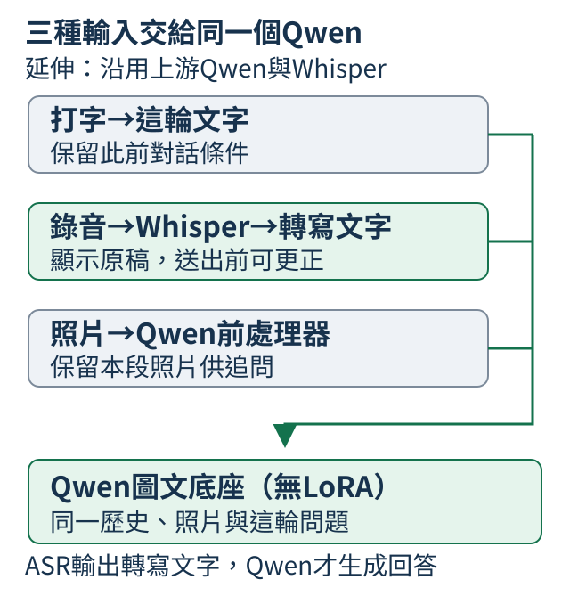
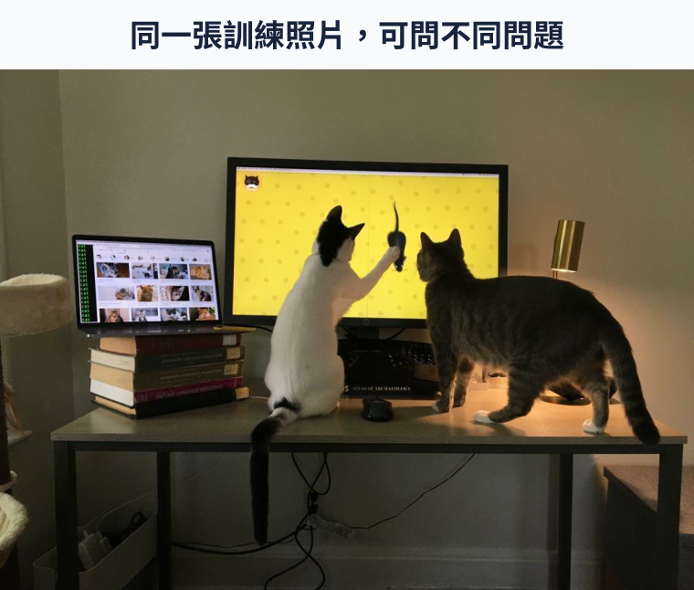
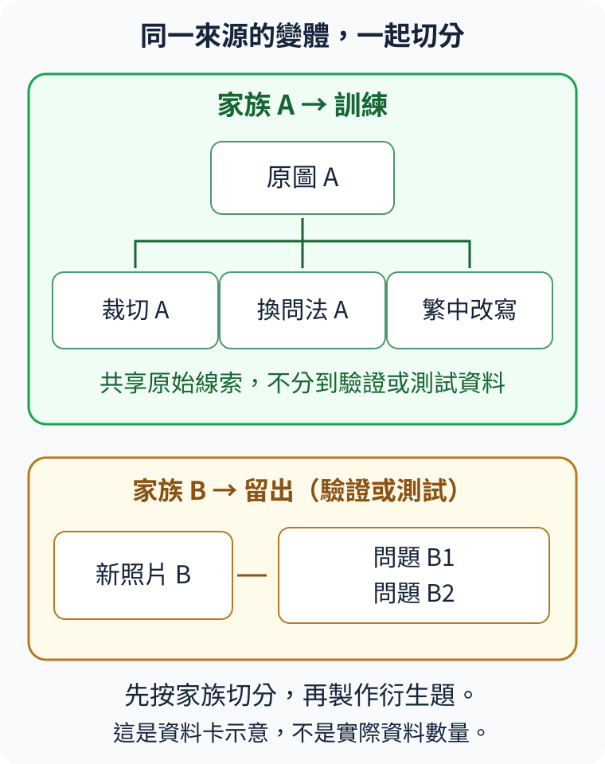
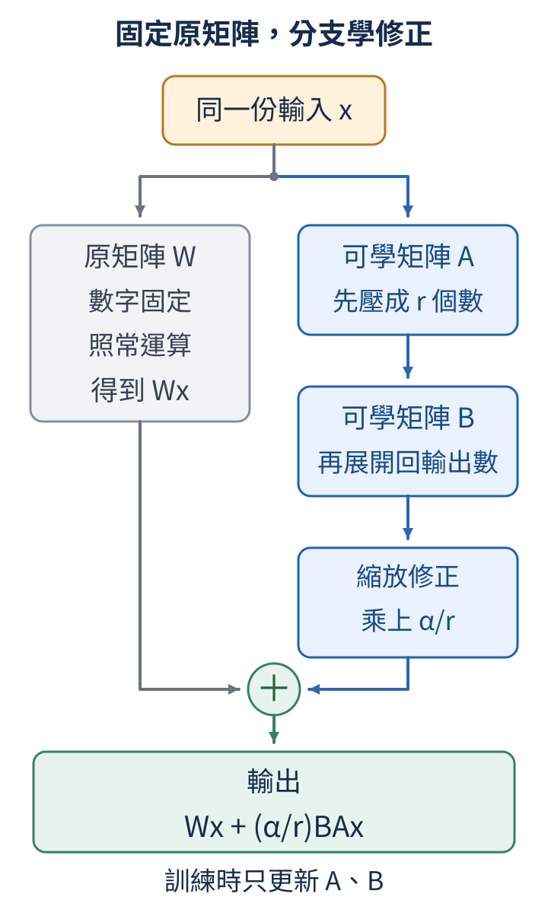
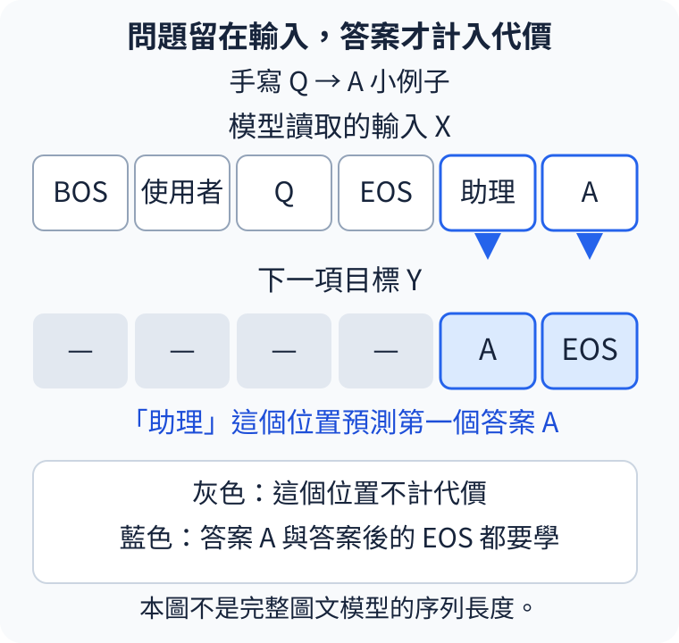
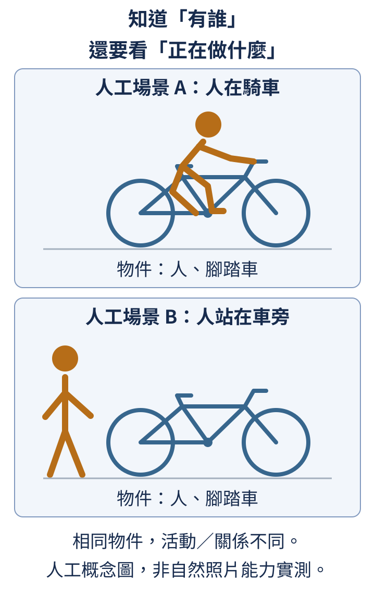
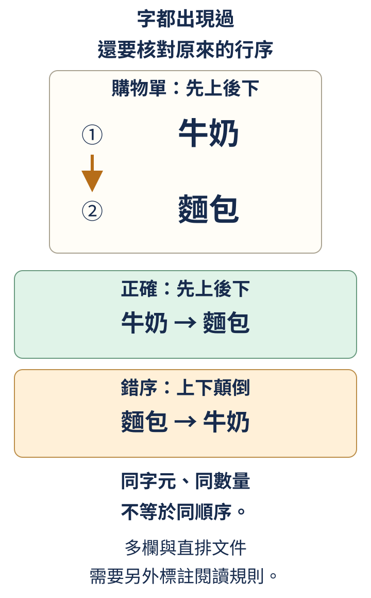
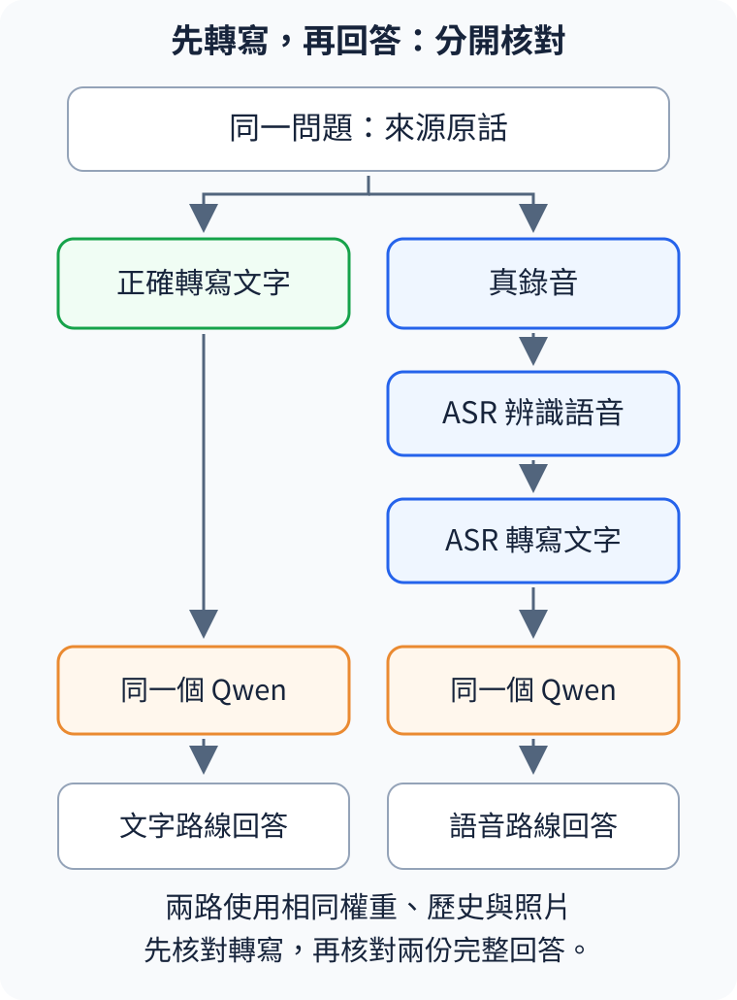

# 第 20 章：延伸——沿用成熟模型處理照片、讀字與語音提問

第 19 章的三個成品，所有神經零件都從隨機參數開始訓練。本章換一個起點：直接接手別人已經訓練好的成熟模型——讀照片與文字、生成回答的 Qwen3-VL-2B-Instruct，以及把語音轉成文字的 Whisper——研究怎麼使用、微調與驗收一個已經具備能力的模型。

Qwen 在本章是底座（base model），也就是已經訓練好、拿來當下一階段起點的模型（[7.11](07.md#7.11)）。我們曾在它旁邊訓練 LoRA：底座的參數全部不動，只另外學一小份加在旁邊的修正數字，做法見 [20.6](20.md#20.6)。這樣訓練出的兩個修正版本（稱為候選）都沒有通過驗證，所以目前交付的仍是原底座，理由見 [20.8](20.md#20.8)。

各節的 Python 都是在 CPU 上幾秒就跑完的小例子，每段只隔離一個機制，沒有載入 Qwen 或 Whisper；它們的輸出不能當成完整模型能力的證據。想在自己的電腦開啟成品，見 [20.2](20.md#20.2)；想重新訓練候選，另有[訓練指引](../../docs/natural-assistant/v4/TRAINING.md)。讀到忘了的名詞，可以查[名詞頁](../glossary.md)。

## 20.1 照片、打字與說話，怎麼交給同一位助理？

先打字說「接下來請用繁體中文回答」，附一張招牌照片問上面寫什麼，下一輪改用說話追問。我們希望前面的語言要求和照片都還在，改變的只是這一輪問題的輸入方式。本章的做法是讓所有輸入方式共用同一份聊天歷史：打字的文字直接加入；錄音先由 Whisper 轉成文字，再加入同一個位置。

Whisper 做的是語音辨識（ASR，[12.11](12.md#12.11)）：輸出「聽到哪些字」，也就是轉寫文字（transcript），不是問題的答案。回答由圖文底座 Qwen 生成，它讀照片、聊天歷史與這一輪的文字。這和 [12.14](12.md#12.14) 先轉寫、再根據文字與歷史回答的分工相同，只是兩站都換成上游已經訓練好的成熟模型。章首提到的 LoRA 是加在 Qwen 旁邊的小修正，不是另一個聊天模型；目前交付的配置沒有開啟它。

下圖上面三列依序是打字、錄音與照片三種輸入，最下面一列是它們會合的地方。照片先交給 Qwen 附的前處理器（processor，[20.7](20.md#20.7)），換成模型能讀的輸入。



下面用 [7.1](07.md#7.1) 的消息格式（每則消息是一個有 `role` 與 `content` 的字典）手寫這兩條路線。`typed_question` 是打字送出的問題，`recognized_question` 假裝是 Whisper 對同一句話的轉寫文字；兩者這次手寫成一樣。

```python
history = [{"role": "user", "content": "接下來請用繁體中文回答。"}]
typed_question = "請讀出照片裡的招牌。"
recognized_question = "請讀出照片裡的招牌。"
typed_chat = history + [{"role": "user", "content": typed_question}]
spoken_chat = history + [{"role": "user", "content": recognized_question}]
print("Qwen收到相同對話", typed_chat == spoken_chat)
print("這輪問題", spoken_chat[-1]["content"])
```

`history + [...]` 把兩份清單接成一份新清單，所以兩條路線都保留第一輪的語言要求，只在尾端多一則這輪的使用者消息。`==` 逐項比較兩份清單裡的字典，因此「Qwen收到相同對話」印 True；`spoken_chat[-1]` 取最後一則消息，也就是這輪的問題。程式沒有辨識錄音，也沒有讀圖，只示範兩條路線在哪裡會合：會合之後，Qwen 分不出這段文字是打的還是說的。

所以轉寫文字一旦出錯，錯字就成了 Qwen 收到的問題。成品介面因此先顯示「辨識原稿」，讓使用者更正後再送出。評測語音路線時要保留更正前的轉寫文字：更正後答對是人工介入的結果，不能算成 ASR 原本就聽對。這套配置也只以文字回答，沒有語音朗讀。真正比較兩條路線時，還要固定照片、歷史與生成設定，再查 ASR 有沒有改掉問題的條件，[20.12](20.md#20.12) 會用一個例子做這件事。

練習把程式的 `recognized_question` 改成 `"請讀出照片裡的找牌。"`，假裝 ASR 把「招」聽成「找」。先預測：「Qwen收到相同對話」變成 False，「這輪問題」印出有錯字的版本——這就是 Qwen 這一輪會收到的內容。

## 20.2 不重新訓練，怎麼先開啟成品？

想試用本章的助理，最穩的順序是先打字問候，再附一張照片提問，最後加一段錄音：每次只多開一條輸入通路，卡住時就知道是哪一站的問題。這一版使用 Qwen3-VL-2B-Instruct 圖文底座與 Whisper-large-v3-turbo，沒有加本課的 LoRA。試用不必重新訓練，但要把兩個成熟模型下載到自己的電腦，並在自己的電腦上執行。

本課實際走完並記錄的，只有 Linux 上的 CPU 路線：Bash 終端機、Git、Python 3.12，圖文模型用 float32（每個數字用 32 bits 存）。其中一次完整操作的紀錄在[學生操作指引](../../docs/natural-assistant/v4/STUDENT.md)第 2 節：兩個官方模型的檔案共 5,889,111,977 bytes，約 5.48 GiB；服務程式執行時的記憶體峰值為 13,496,104 KiB，約 12.87 GiB；模型已經下載好時，啟動到介面可用花 24.24 秒，四次聊天各等了 3.42 到 42.87 秒。這些是一臺機器、一組輸入的實測，不是最低需求；記憶體為什麼比下載的檔案大，[20.3](20.md#20.3) 用乘法說明。

macOS 與 Windows（包括 Windows 上的 WSL）都沒有經過本課驗證，下面的命令也是照 Linux 的 Bash 寫的；想走本課核對過的路線，就在 Linux 電腦上操作。可以先知道的差異有三項：Windows 的 PowerShell 不接受 `GIT_LFS_SKIP_SMUDGE=1 git ...` 這種寫在命令前面的設定；Windows 上專用環境裡的 Python 在 `.venv-natural\Scripts\python.exe`，不是 `.venv-natural/bin/python`（[W.1](../first-steps.md#W.1) 有同樣的對照）；啟動程式的 `--device` 只接受 `cpu` 與 `cuda`，沒有 Apple 晶片 GPU 的選項，所以 Mac 只能試 `--device cpu`。在這兩種系統上嘗試時，照下面的順序一步一步走，每一步先看到它自己的核對結果再往下：第一步顯示 `Python 3.12.x`，第二步的安裝命令都沒有錯誤訊息，第三步的 `--verify` 通過、終端機顯示助理已啟動，最後介面先回出一句文字。哪一步失敗，就從那一步查起：是缺少工具、命令寫法和 Bash 不同，還是那個系統裝不起某個固定版本的套件。不要為了讓檢查通過而修改清單裡的指紋。

第一步，取得固定版本的程式，並確認有 Python 3.12：

```bash
GIT_LFS_SKIP_SMUDGE=1 git clone --no-checkout https://github.com/birdhackor/tiny-perceptron-vlm.git tiny-perceptron-natural
cd tiny-perceptron-natural
GIT_LFS_SKIP_SMUDGE=1 git checkout --detach ee17b8871cfe2ba9807b796dd11f339b5dae3b5c
python3.12 --version
```

這會建立新的 `tiny-perceptron-natural` 資料夾，不動你原有的專案與練習；`python3.12 --version` 應顯示 `Python 3.12.x`。找不到 `git` 時，依 [Git 官方安裝指引](https://git-scm.com/downloads)安裝；找不到 `python3.12` 時，先安裝 Python 3.12 與它的 `venv` 支援，[Python 官方下載頁](https://www.python.org/downloads/)列出各系統的取得方式。之後的命令都在這個新資料夾裡執行。

第二步，建立成品專用的環境 `.venv-natural`，安裝固定版本的套件：

```bash
python3.12 -m venv .venv-natural
.venv-natural/bin/python -m pip install --upgrade pip
.venv-natural/bin/python -m pip install torch==2.8.0 torchvision==0.23.0 --index-url https://download.pytorch.org/whl/cpu
.venv-natural/bin/python -m pip install -r requirements-natural.txt
```

這條路線不用 W.1 的 uv：成品自己固定了 PyTorch 與其他套件的版本（`requirements-natural.txt`），另建一個環境，就不會動到前面小實驗用的 `.venv`。`venv` 與 `pip` 是 Python 內建的建立環境與安裝套件工具；每個命令都寫出 `.venv-natural/bin/python`，就不用猜終端機正在用哪一套 Python。帶 `--index-url https://download.pytorch.org/whl/cpu` 的命令安裝 CPU 版的 PyTorch 與 torchvision，`-r requirements-natural.txt` 補齊其餘套件。

第三步，查看並下載公開清單指定的配置，核對後啟動助理：

```bash
.venv-natural/bin/python scripts/fetch_natural_release.py --manifest docs/natural-assistant/v4/public-release.json --list
.venv-natural/bin/python scripts/fetch_natural_release.py --manifest docs/natural-assistant/v4/public-release.json --output checkpoints/natural-assistant/release-v4
.venv-natural/bin/python scripts/fetch_natural_release.py --manifest docs/natural-assistant/v4/public-release.json --output checkpoints/natural-assistant/release-v4 --verify
.venv-natural/bin/python scripts/fetch_natural_release.py --manifest docs/natural-assistant/v4/public-release.json --output checkpoints/natural-assistant/release-v4 --serve --device cpu --dtype float32
```

`--list` 只印出清單固定的版本資訊：這次發布的代號、配置文件放在哪個模型倉庫的哪一版、圖文底座與 Whisper 各自的版本，以及選定的配置（`selected_variant`，本版是 `base`，也就是原底座）；不列檔案，也不下載。只帶 `--output` 的命令取得兩份小型配置文件，加上 `--verify` 再核對它們，兩者都不含模型權重。加上 `--serve` 啟動服務時，才從指定的官方版本下載並載入圖文底座；Whisper 等第一次按「辨識語音」才下載。已經下載過的模型會重複使用。終端機顯示助理已啟動後，用同一臺電腦的瀏覽器開啟 `http://127.0.0.1:8766/`：這個位址指向你自己的電腦，運算也在你的電腦上，不是教材網站在代算；終端機要保持開啟，網頁才拿得到回答。這頁的 Bash 區塊在 Notebook 裡只是說明文字，不會自動執行下載。

接著在介面依序操作，每一步等結果出現再繼續：

1. 在「要送出的文字」寫「你好，請用一句話回答」，按「送出問題」。
2. 加入一張 PNG、JPEG 或 WebP 照片（8 MiB 以內），問畫面有哪些東西；再追問同一張圖裡某個物件的位置，照片與前文會留在這段對話中。
3. 準備一段最長 30 秒、8 MiB 以內的中文錄音（WAV、FLAC、MP3 或 OGG），在「中文語音」選取，按「辨識語音」，查看「辨識原稿」。這時只有轉寫文字，助理還沒有回答。
4. 確認或更正「要送出的文字」再送出，核對回答依據的是最後送出的那份文字。

「開始新對話」清除這段歷史與上傳的檔案。要停止時，在終端機按 Ctrl+C；已下載的模型留在快取裡，下次可以重用。這些步驟確認的是每條通路接通，不是回答可靠；回答品質看 [20.13](20.md#20.13) 的能力卡。

<details>
<summary>補充：命令的細節、清單欄位與其他裝置</summary>

`git clone --no-checkout` 先只取得版本歷史，不把檔案展開；`git checkout --detach` 再把資料夾固定在本課核對過的那次提交，讓程式與公開清單都是當時的版本。這兩個 git 命令都設定 `GIT_LFS_SKIP_SMUDGE=1`，讓 Git 跳過以 Git LFS 保存的大型訓練資料：現在只用成品，不需要下載全部練習題。

[公開清單](../../docs/natural-assistant/v4/public-release.json)的 `base_model` 與 `asr_model` 兩欄固定兩個官方模型的版本，`files` 欄列出要下載的兩份配置文件與各自的大小、SHA-256；下載程式逐檔核對這兩項，不需要 Hugging Face 登入。本版沒有另加修正權重，所以 `adapter_parameters` 是 0。下載中途失敗時，可以重跑同一個下載命令；`--verify` 回報內容不同時，改用新的 `--output` 目錄重新下載，之後的 `--verify` 與 `--serve` 也要改成同一個新目錄。`--serve` 啟動前會先核對 `--output` 指定的目錄，還指著舊目錄就會再次失敗。

有 NVIDIA GPU 的安裝與啟動方式、離線使用（`--local-files-only`），以及聲音檔讀不進去時的處理，見[學生操作指引](../../docs/natural-assistant/v4/STUDENT.md)第 2、4、7 節。

</details>

## 20.3 只調整一小份權重，為什麼還要載入大模型？

LoRA 修正像貼在書頁旁的幾張便條：要讀懂便條，原書仍得攤在桌上。可更新的參數少，不等於要載入的參數少。本章的圖文底座 Qwen3-VL-2B-Instruct 實際有 2,127,532,032 個參數；它是上游另外訓練好的 Dense 模型，沒有第 15 章 MoE 的 expert 路由，也不是接續第 19 章從隨機參數訓練的 MoE。選它是為了接手成熟的圖文能力，不表示 Dense 普遍優於 MoE。

先用乘法估這份底座的參數要佔多少位元組。每個參數存成一個數字；32-bit 每個數字佔 4 bytes，16-bit 佔 2 bytes：

```python
parameters = 2_127_532_032
for label, bytes_per_number in [("32-bit", 4), ("16-bit", 2)]:
    weight_bytes = parameters * bytes_per_number
    print(label, "權重數字bytes", weight_bytes, "約GiB", round(weight_bytes / 1024**3, 2))
```

`2_127_532_032` 裡的底線只是讓長數字好讀，Python 會忽略它。`for label, bytes_per_number in [...]` 每次從清單取出一組兩個值，分別取名 `label` 與 `bytes_per_number`。`1024**3` 是 1024 的三次方（`**` 是次方），也就是 1 GiB 的 bytes 數；`round(..., 2)` 四捨五入到小數兩位。32-bit 共 2,127,532,032×4＝8,510,128,128 bytes，約 7.93 GiB；16-bit 約 3.96 GiB。這段沒有載入模型，算的只是參數本身。

這可以解釋 [20.2](20.md#20.2) 記錄的兩個數字。那裡的兩個官方模型檔案共 5,889,111,977 bytes；Whisper 另有 808,878,080 個參數，兩個模型合計 2,936,410,112 個，平均每個參數約 2 bytes。那次實測的圖文模型卻以 float32（就是 32-bit）執行，每個參數在記憶體裡占 4 bytes，光是圖文底座就要上面的 7.93 GiB。服務程式的記憶體峰值約 12.87 GiB，又比 7.93 GiB 多出許多：執行時還要放 Whisper 的參數、照片換成的特徵、對話越長就越大的 KV cache（[16.2](16.md#16.2)），以及計算用的暫存空間。乘法只回答「參數本身佔多少位元組」，不能直接當成整套助理需要的記憶體。

訓練又比推論多一層負擔。即使只更新 LoRA，反向傳播仍要從輸出往回穿過 Qwen 的文字核心，才能把梯度送到修正參數，途中要用到前向計算留下的中間特徵（activation，[17.11](17.md#17.11)）。本課的訓練程式開啟了 [16.10](16.md#16.10) 的中間特徵重算（activation checkpointing）：前向時少存一些中間特徵，反向傳播需要時再重算，用額外的計算換較少的記憶體。修正參數自己的負擔反而很小：1,605,632 個修正參數（[20.6](20.md#20.6)）各有一份梯度；這次訓練用的最佳化器（optimizer）是 AdamW，它還替每個參數另存 [5.4](05.md#5.4) 的 m、v。就算每個數都用 4 bytes 存，三份合計也只有 1,605,632×4×3＝19,267,584 bytes，約 0.02 GiB。本課在 NVIDIA L4 上以 bfloat16（每個數字 16 bits）訓練 LoRA，PyTorch 記錄的 GPU 記憶體配置峰值為 5,719,892,480 bytes，約 5.33 GiB，已比 16-bit 權重的 3.96 GiB 多。紀錄只有這個總數，沒有分項，所以不能替它拆出中間特徵或其他部分各占多少；它也不含 CUDA 執行環境等其他占用，不是最低硬體需求（[訓練指引](../../docs/natural-assistant/v4/TRAINING.md)第 1 節）。所以看見 4 GiB 的權重，不能推論 4 GiB 的顯示卡就能訓練。

Whisper 另外負責語音辨識，它的參數不在圖文底座的 21 億裡。後面比較 LoRA 時，圖文底座與 Whisper 各自固定，才能把變化歸到實際改過的地方。

練習把 `parameters` 改成 Whisper 的 `808_878_080`，先預測 32-bit 約 3.01 GiB、16-bit 約 1.51 GiB，再執行核對。

## 20.4 怎樣的練習，才能教到我們想要的能力？

這張照片裡，兩隻貓在書桌上看著電腦螢幕。若請求是「桌上有幾隻貓？」，示範應直接回答「兩隻」；若請求一至兩句描述，就要把物件與看得見的姿勢連成短句。同一張圖片能教不同的要求，關鍵在問題和答案是否配成對，而不是圖片放在哪個資料夾。



照片由Jason Baldridge and family創作，DOCCI透過Google LLC以[CC BY 4.0](https://creativecommons.org/licenses/by/4.0/)提供；[固定版本原圖](https://storage.googleapis.com/docci/thumbnails/train_01827.jpg?generation=1713028329088595)未裁切或改動。它可以提供兩種互補的練習：

| 練習請求 | 示範回答 | 這題教什麼 |
| --- | --- | --- |
| 請用一至兩句繁體中文描述主要內容。 | 兩隻貓在書桌上看著黃色的電腦螢幕；左邊的貓抬起一隻前腳。 | 把物件與可見姿勢連成短描述。 |
| 桌上有幾隻貓？ | 兩隻貓。 | 直接回答畫面中的數量。 |

這兩份回答是 AI 助理（不是本章交付的助理）實際看圖、讀過原始的人工英文描述後寫的繁中標註，不是 DOCCI 官方的人工中文答案；原圖、原始描述與改寫來源一起保存。這張照片屬於訓練資料，用它解釋題型可以，不能拿它報告模型在沒見過的照片上的能力。

本章依用途挑選下列資料，表中的 OCR 是從圖片辨識文字（[11.12](11.md#11.12)）。表中寫到的 AI 助理，都不是本章交付的助理。先看每份資料是什麼，再看它的答案從哪裡來：

| 來源 | 是什麼 | 本章拿它做什麼 | 答案從哪裡來 |
| --- | --- | --- | --- |
| DOCCI | Google 公開的自然照片，每張附人工撰寫的英文詳細描述 | 短場景描述與可見事實問答 | AI 助理改寫的繁中題目與回答 |
| NVIDIA 合成 OCR 文件 | 合成的文件圖片，不是真人街拍 | 從文件取出文字區域，練原樣抄寫 | 資料集附的原轉寫 |
| Wikimedia Commons 文字照片 | 個別署名的真實照片，有招牌、路牌或背景中的中文字 | 補充真實場景裡的文字 | AI 助理看圖寫的轉寫；裁切仍記原圖來源 |
| OpenAssistant 中文對話 | 社群撰寫的多輪問答 | 練完整回應一般的文字請求；驗證與測試裡的一般文字聊天題都出自這裡 | 來源的助手（assistant）回答，由 AI 助理按繁中需求改寫 |
| 本課另寫的條件對話 | 短對話，50 段共 80 題；其中 30 題接在前一輪之後 | 只用於訓練，練依照條件與前文回答 | AI 助理撰寫；每筆標成合成資料，與 OpenAssistant 的社群對話區分 |
| FLEURS | 真人朗讀的句子錄音 | 只檢查語音辨識 | 來源附的轉寫文字；沒有助手答案，不拿它計聊天成功率 |
| AISHELL | 真人朗讀的中文問句錄音 | 檢查轉寫，以及同一問句走文字與語音兩路後的回答 | 轉寫文字來自來源；回答的判準由本課另訂 |

授權各有條件：DOCCI、NVIDIA 合成 OCR 與 FLEURS 採 CC BY 4.0，OpenAssistant 與 AISHELL 採 Apache-2.0，Commons 照片逐張依作者的條件（CC BY 4.0、CC BY 3.0 或 CC0），本課另寫的對話採本專案的 MIT 授權。逐筆的來源與授權，以及改動過的素材改了什麼，記在[資料說明](../../docs/natural-assistant/v4/DATA.md)連到的紀錄檔。

照片、合成文件和真實招牌各有不同難點，所以來源與標註要分開記。錄音附的轉寫文字只能當語音辨識的正確答案；要檢查助理的回答，還得另訂判準。OpenAssistant 裡，從同一段開場對話延伸出的不同回覆分支合稱一棵對話樹，整棵樹算同一個家族（[5.12](05.md#5.12)），[20.5](20.md#20.5) 會說明為什麼要整組一起分配。這批改寫題目只用於本章的成熟模型延伸，不屬於第 19 章從隨機參數訓練的主線資料：本章資料的入口是上面的資料說明，第 19 章的素材另記在它自己的[固定資料授權清單](../../docs/selftrained/V2-DATA-NOTICE.md)。

把同一句重複多次，只是加重它的練習比重，不會增加新情境。要教保留條件，就展示不同歷史下的不同回答；要教只讀指定區域，就讓同一張圖搭配幾個不同的指定區域，每題的答案只含自己那一區的字（指定區域怎麼交給模型，見 [11.18](11.md#11.18)）。挑題時，先看這道示範實際教的是哪件事。

練習想一想：把「桌上有幾隻貓？」這一題複製十份放進訓練資料，模型多看到幾種新情境？答案思路：一種也沒有；十份都是同一張圖、同一個問題和同一個答案，只是這題在代價裡的比重變大。

## 20.5 換個問法，為什麼仍可能是同一道舊題？

同一張貓照片，可以問數量，也可以問姿勢，兩題共用同一個畫面。若一題拿去訓練，另一題卻當成「沒見過的照片」來測試，模型可能早已熟悉這張圖。所以原圖、裁切與各種問法要先歸成同一個家族（[5.12](05.md#5.12)：從同一個來源衍生的題目算一家），再讓整個家族一起分到訓練、驗證或測試的其中一邊。



下面用四筆手寫記錄，檢查已分到訓練資料（`train`）與測試資料（`test`）的題目，有沒有同一個家族同時出現在兩邊。程式只做檢查，不會自動重新切分。

```python
records = [
    {"family": "貓照片A", "split": "train", "question": "有幾隻貓？"},
    {"family": "貓照片A", "split": "train", "question": "哪隻貓抬起前腳？"},
    {"family": "招牌照片B", "split": "test", "question": "招牌寫什麼？"},
    {"family": "招牌照片B", "split": "test", "question": "有沒有中文字？"},
]
train_families = {row["family"] for row in records if row["split"] == "train"}
test_families = {row["family"] for row in records if row["split"] == "test"}
print("訓練家族", sorted(train_families))
print("測試家族", sorted(test_families))
print("兩邊都有的家族", sorted(train_families & test_families))
```

`{row["family"] for row in records if ...}` 和 W.2 的生成式寫法相同，只是外面換成大括號：收集的結果是一個 set，重複的家族名只留一個。`if row["split"] == "train"` 只收分到訓練資料的記錄。兩個 set 之間的 `&` 取交集，也就是兩邊都有的項目；`sorted` 把結果排成清單再印出。這裡訓練只有貓照片A、測試只有招牌照片B，所以「兩邊都有的家族」是空的 `[]`。

練習把第二筆記錄的 `"split": "train"` 改成 `"split": "test"`，先預測「兩邊都有的家族」會印出 `['貓照片A']`：兩題文字不同，卻共用同一張照片。修正的方法是讓整個家族一起移動，不是替其中一題改個名字。

真正的資料還要核對來源 ID 與實際檔案，避免同一份像素換了檔名就被當成新照片。家族能分到多細也有限度：DOCCI 公開的相似群組只表示畫面相近，不等於已確認是同一次拍攝；OpenAssistant 的共享前文分支則確定屬於同一棵對話樹。資料有哪一種分組，能力聲明就只能說到哪一種。

三種資料的用途也要分清楚。驗證資料用來挑選本課的微調版本；測試資料要等版本定下來之後，才拿出來檢查一次。已經用過、公開過的舊題，之後仍可以拿來檢查修改後是否還能完成原本的工作，這叫回歸檢查（regression check）；但它已經不是訓練與選版都沒看過的新題。本課的家族隔離也只管得到本課的資料，不能排除上游訓練 Qwen 時曾看過這些公開素材。

## 20.6 保留底座，怎麼只學一小份修正？

一層線性層讀四項特徵、輸出三項分數，它的權重矩陣 W 是 3×4。想讓輸出往新的方向調整，又不想改動 W，可以在旁邊加一條修正路：矩陣 A 先把四項壓成 r 項，矩陣 B 再把 r 項展開回三項，最後和原本的輸出相加。這就是 [8.8](08.md#8.8) 的 LoRA（Low-Rank Adaptation，低秩調適）。修正路中間只剩 r 項，這個 r 叫 rank（秩）；alpha（α）是另外選的縮放設定，修正路的結果要先乘上 alpha/r 再相加。下面的例子 rank 與 alpha 都是 2，倍率 alpha/r＝1。訓練時只更新 A、B，固定的 W 仍照常參與計算。



8.8 是第 8 章的選讀延伸，那裡已節錄並逐行講解課程函式庫的 `LoRALinear`。這裡只用到其中幾點：`layer.base` 是被包起來、凍結不更新的原 Linear，`layer.a` 與 `layer.b` 是 A、B，而且 B 一開始全是 0，所以剛建好的層輸出和原層相同。下面把它建在 `nn.Linear(4, 3)` 上，做一次真正的更新：

```python
import torch
from torch import nn
from tiny_perceptron.alignment import LoRALinear

torch.manual_seed(42)
layer = LoRALinear(nn.Linear(4, 3), rank=2, alpha=2)
base_before = layer.base.weight.detach().clone()
a_before = layer.a.detach().clone()
b_before = layer.b.detach().clone()
optimizer = torch.optim.SGD([p for p in layer.parameters() if p.requires_grad], lr=0.1)
loss = layer(torch.ones(1, 4)).square().mean()
loss.backward()
optimizer.step()
print("可更新參數", sum(p.numel() for p in layer.parameters() if p.requires_grad))
print("原矩陣完全未變", torch.equal(base_before, layer.base.weight))
print("修正A這一步沒變", torch.equal(a_before, layer.a))
print("修正B真的改變", not torch.equal(b_before, layer.b))
```

`.detach().clone()` 複製一份獨立的舊值，之後才能和更新後的數字比較；若只是把 `layer.b` 另取一個名字，兩個名字指向同一份資料，更新後會一起變。`[p for p in layer.parameters() if p.requires_grad]` 只挑出可學的參數交給最佳化器（[1.13](01.md#1.13)），也就是 A 與 B。代價取輸出平方的平均，目標是讓輸出接近 0；這只是為了產生梯度的局部例子，不是讀照片。`loss.backward()` 做反向傳播、算出梯度，`optimizer.step()` 才真的更新參數。

輸出依序是 14 與三個 True。A 有 2×4＝8 個數、B 有 3×2＝6 個數，共 14 個可更新參數；W 一個數都沒變。A 這一步沒有變，是因為 B 還是 0：A 的改變要經過 B 才影響輸出，所以 A 的梯度全是 0（8.8 也看過這個現象）；B 則收到梯度而改變。等 B 不再是 0，A 才會在之後的更新中改變。注意這個小例子的 14 反而比 W 的 3×4＝12 多，不能拿它示範省參數：修正路要比較少，`r×(輸入數+輸出數)` 必須小於 `輸入數×輸出數`。

練習把 `rank=2, alpha=2` 改成 `rank=1, alpha=1`（倍率仍是 1），先預測可更新參數：A 是 1×4、B 是 3×1，共 7 個，才比 W 的 12 個少；其餘三項仍是 True。不論 rank 多小，固定的 W 仍要載入並參與計算（[20.3](20.md#20.3)）。

真正的候選把 LoRA 加在 Qwen 文字核心的注意力裡，產生 Query 與 Value 的那兩個 Linear 上（Q 是 [3.2](03.md#3.2) 的 query，V 是 [3.4](03.md#3.4) 按比例帶回的 value），rank 8、alpha 16（倍率 2），共 1,605,632 個可更新參數；看圖的部分與 Whisper 都不因此重新訓練。小例子的學習率 0.1 只是為了看清一次更新，完整訓練用 0.00003，兩者不是同一個實驗。

每個候選的修正檔約 6.44 MB，只有修正參數，不含底座，也不含續訓需要的完整狀態。[訓練核對](../../docs/natural-assistant/evidence/v4-runtime/train-37217452291/training-audit-summary.json)是這次訓練機器可讀的完整紀錄（JSON），`independent_audit` 底下的 `changed_adapter_tensors` 是 112，表示 112 個修正張量的前後指紋都改變了；`frozen_scope` 說明底座只抽查了幾個位置，沒有逐一比較全部二十億個數值。更新確實發生，和用途因此改善，是兩件要分開證明的事。

## 20.7 題目和答案都在輸入裡，模型究竟練哪一段？

一道訓練題寫著「桌上有幾隻貓？」和答案「兩隻」。題目提供線索，回答才是要模仿的輸出。所以對話的監督式微調（SFT，[7.1](07.md#7.1)）讓問題、圖片與前文都留在輸入裡給模型讀，只把助手的答案和答完後的結束標記算進代價；不是把題目從模型的視野裡遮掉。

下圖用手寫的 Q、A 小例子畫出這件事：上排是模型讀的輸入 X，第一個位置是 BOS（開始標記）；下排是每個位置要猜的下一項目標 Y，藍色是計入代價的目標。



在「助手」這個位置預測 A 時，模型能讀的只有開頭到這個位置為止的前文，右邊的 A 還看不到；到了 A 的位置，才以它為前文去預測答案後的 EOS（結束標記）。這是 [7.4](07.md#7.4) 的下一位置對齊：要猜的答案不能先交給負責猜它的位置。圖中有兩個 EOS：上排第 4 個位置是使用者那段話的 EOS，只當前文；下排最後一個位置是答案後的 EOS，這個才是要學的目標。兩者是同一個 token，差別在它出現在輸入裡，還是被當成目標。

下面用 [7.1](07.md#7.1) 節錄過的 `render_chat` 排出這個小例子，印出 X 與 Y：

```python
from tiny_perceptron.data import render_chat

x, y = render_chat(
    [
        {"role": "user", "content": "Q"},
        {"role": "assistant", "content": "A"},
    ]
)
active = y != -100
first = active.nonzero()[0].item()
print("輸入X", x.tolist())
print("目標Y", y.tolist())
print("有效目標數", active.sum().item())
print("第一個有效目標的位置", first)
print("有效目標ID", y[active].tolist())
```

這個小例子用 byte 編碼，Q 和 A 各只占一個位置，輸入共六個位置：X 是 `[1, 3, 89, 2, 4, 73]`，依序是 BOS、使用者、Q、使用者那段的 EOS（ID 2）、助手、A。Y 的前四項是 −100，也就是 7.1 的 `IGNORE`，表示這個位置不計代價（它只出現在目標裡，不是輸入的 token ID）；後兩項是 73 與 2，也就是 A 和答案後的 EOS。`y != -100` 對每個位置問「這裡計不計代價」，得到由真、假組成的 `active`；`active.nonzero()` 列出所有為真的位置，`[0]` 取第一個，`.item()` 換成普通整數。所以有效目標有 2 個，第一個在 0 起算的位置 4，正好是 X 讀到「助手」的位置。這個小例子只示範下一位置對齊，不表示完整的 Qwen 圖片輸入也只有六個位置。

練習把程式裡的 `"content": "A"` 改成 `"content": "AB"`。先預測：輸入變成七個位置，有效目標變成 3 個（A、B 與 EOS），第一個有效目標的位置仍是 4，問題 Q 仍留在輸入裡；再執行核對。

真正的資料先交給 Qwen 附的前處理器（processor）：它把圖片換成模型能讀的輸入，並套用 Qwen 的對話模板標出角色。長度要在這一步完成之後才算得準。本課訓練的序列上限是 2,048 個 token；超過上限而截掉答案的尾端或結束標記，就改變了原示範要教的工作（[7.10](07.md#7.10)）。逐筆核對有效目標與保留的範圍，比只問「句子夠不夠短」更準確。

## 20.8 訓練跑完後，怎麼決定可以交付哪個版本？

照片描述變好了，聊天卻退步，要不要採用這份修正？這要由事先約定好的用途與門檻決定，不能事後只挑進步的那幾欄。本課的比較讓原底座與 LoRA 版本使用相同的圖片處理與生成設定，Whisper 的版本和它實際產生的轉寫文字也固定，差別只在有沒有開啟修正。候選有兩個：同一次訓練在第 1,039 次與第 2,077 次更新後，各保存一份修正，下面簡稱 1,039 步與 2,077 步。

修正版要取代原底座，必須同時通過三項條件：

1. 回答完整結束：全部 132 份驗證回答都以 EOS 結束。生成的上限是 384 個新 token，用滿上限仍沒有 EOS，就算截斷。
2. 每種用途達到保留門檻：答對題數不能比原底座少太多。照片短描述、指定讀序與兩條語音問句聊天，一題都不能少；其餘用途最多少 1 題。下表最右欄是由此算出、修正版至少要答對的題數。
3. 綜合分數嚴格高於原底座，算法在表後。

| 同一份驗證題的用途 | 原底座 | 1,039 步 | 2,077 步 | 修正版至少答對 |
| --- | ---: | ---: | ---: | ---: |
| 照片短描述 | 16／28 | 23／28 | 24／28 | 16 |
| 照片可見事實問答 | 31／56 | 53／56 | 51／56 | 30 |
| 有沒有清楚可見的中文字 | 18／18 | 18／18 | 18／18 | 17 |
| 單一區域逐字抄寫 | 6／10 | 5／10 | 5／10 | 5 |
| 指定讀序與分行 | 2／3 | 2／3 | 2／3 | 2 |
| 一般文字聊天 | 3／9 | 2／9 | 5／9 | 2 |
| 真人問句：直接給正確轉寫文字後聊天 | 4／4 | 2／4 | 1／4 | 4 |
| 同組問句：給 ASR 轉寫文字後聊天 | 3／4 | 2／4 | 2／4 | 3 |

照片兩項大幅改善，但兩個候選都在最後兩列跌破門檻。直接給正確轉寫文字的那一列完全不經過 ASR，1,039 步仍從 4／4 降到 2／4，可見退步不全是聽錯造成的；走真正 ASR 的那一列也下降。兩個候選也各有 3 份回答用滿 384 個新 token 仍沒有結束，第一項條件同樣沒有通過。

綜合分數把八種用途分成五組能力，各組先算正確率：照片組取前兩列兩個正確率的平均，聊天組取最後三列三個正確率的平均，中間三列各自成一組；五組再平均，每組各占五分之一。這樣題數多的照片題，不會因為題多就蓋過其他用途。原底座的綜合分數是 (1/5) × [(16/28 + 31/56)/2 + 18/18 + 6/10 + 2/3 + (3/9 + 4/4 + 3/4)/3] ＝ 53,277/75,600，約 70.47%。75,600 是讓每一項都化成整數分子的共同分母，比較時就不必四捨五入。下面照抄選版程式 [scripts/score_natural_v4_validation.py](../../scripts/score_natural_v4_validation.py) 的 `WEIGHTS`（每列答對一題得幾分）與 `DENOMINATOR`（滿分），用上表的答對題數重算三個版本，並檢查第 2、3 項條件：

```python
# 每題分數與滿分照抄自 scripts/score_natural_v4_validation.py 的 WEIGHTS、DENOMINATOR
weights = [270, 135, 840, 1512, 5040, 560, 1260, 1260]
denominator = 75600
allowed_drop = [0, 1, 1, 1, 0, 1, 0, 0]  # 保留門檻：各列最多可比原底座少答對幾題
base = [16, 31, 18, 6, 2, 3, 4, 3]
candidates = {"1,039步": [23, 53, 18, 5, 2, 2, 2, 2], "2,077步": [24, 51, 18, 5, 2, 5, 1, 2]}
base_score = sum(c * w for c, w in zip(base, weights))
minimum = [b - d for b, d in zip(base, allowed_drop)]
print("原底座", "綜合分數", f"{base_score}/{denominator}", "百分比", round(100 * base_score / denominator, 2))
print("修正版至少答對", minimum)
for name, counts in candidates.items():
    score = sum(c * w for c, w in zip(counts, weights))
    passed = [c >= m for c, m in zip(counts, minimum)]
    print(name, "綜合分數", f"{score}/{denominator}", "百分比", round(100 * score / denominator, 2))
    print(name, "高於原底座", score > base_score, "各列達到門檻", passed)
```

每份清單都照上表由上到下排列；`weights` 的第一項 270＝75,600×1/5×1/2×1/28，也就是照片組占的五分之一先由兩列平分，再分給該列的 28 題。「修正版至少答對」由 `allowed_drop` 算出，和上表最右欄相同；`score > base_score` 就是「嚴格高於原底座」。程式算出 1,039 步是 52,285/75,600，約 69.16%；2,077 步是 52,705/75,600，約 69.72%；兩者的「各列達到門檻」都只有最後兩項是 False。照片組的進步被聊天組與單區讀字的下降抵掉，兩個候選的綜合分數都比原底座低。

練習把 `weights` 的八項都改成 1、`denominator` 改成 132（全部驗證題數），讓每題同分。先預測：照片兩列占 132 題裡的 84 題，它們的進步會蓋過其他列的退步，兩個候選變成 107/132 與 108/132，都高於原底座的 83/132；「各列達到門檻」不變，所以仍然不能選。

三項條件都沒有通過，所以本版[選定原底座](../../docs/natural-assistant/v4/selection.json)（`selected_variant` 欄是 `base`），搭配相同的 Whisper-large-v3-turbo，不開 LoRA。較晚保存的 2,077 步，也沒有因為訓練得比較久就自動取得交付資格。這些分母很小，部分題目共用同一張照片；開放式描述與聊天的對錯依約定判準逐題判讀，換一位判讀者可能有出入。所以結果只支持這組比較。

練習用上表核對 2,077 步：它的一般文字聊天 5／9 比原底座多答對 2 題，為什麼仍不能選？答案思路：門檻要每一列各自通過，它的正確轉寫文字聊天 1／4 低於 4、ASR 轉寫文字聊天 2／4 低於 3，其他用途的進步不能抵銷。

訓練代價下降，只說明模型對示範答案的預測變了；完整生成的回答仍可能重複，或多添畫面沒有的細節。正確的順序是：先在驗證資料上決定配置，再凍結權重與生成設定，最後才用測試資料描述它的能力（[20.13](20.md#20.13)），測試結果不再拿來挑模型。原底座自己也會錯，這次驗證中也有 6 份回答沒有正常結束；保留它，只表示兩個候選沒有提供足夠的採用理由。

<details>
<summary>補充：候選訓練、判準與原始驗證</summary>

候選從固定底座開始更新 LoRA，在第 1,039 與 2,077 次更新後保存。訓練命令與更新條件見[訓練指引第4節](../../docs/natural-assistant/v4/TRAINING.md#4-保存配方開始自己的新訓練)，驗證命令與完整門檻見[第6節](../../docs/natural-assistant/v4/TRAINING.md#6-先驗證用途再選定自己的版本)。各分項與完整生成見[驗證得分](../../docs/natural-assistant/evidence/v4-runtime/validation-37219466611/blind-review/scored/scores.json)：`variants` 底下每個版本的 `correct_counts` 是上表的答對題數，`primary_numerator` 是綜合分數的分子（分母 75,600），`gates` 列出每道門檻的最低題數與是否通過。本節沒有重新訓練或重新選版。

</details>

## 20.9 回答出現正確名詞，就算看懂照片了嗎？

圖裡有一個人和一輛腳踏車，人可能正在騎車，也可能只是站在車旁。說出兩個正確的名詞，還不能回答「人在做什麼」。照片問答要依請求核對物件、動作或關係，再查回答多出來的細節有沒有畫面支持。



圖上的場景 A 與 B 物件相同，人與車的關係不同。下面假設題目給的是像場景 A 那樣的照片：人在騎車。`truth` 是這張照片的正確答案，`cards` 是兩張回答卡，也就是兩份待評分的回答：第一張說人在騎車，第二張說人站在車旁——後者描述的其實是場景 B。

```python
truth = {"objects": {"人", "腳踏車"}, "activity": "騎車"}
cards = [
    {"objects": {"人", "腳踏車"}, "activity": "騎車"},
    {"objects": {"人", "腳踏車"}, "activity": "站在車旁"},
]
for index, card in enumerate(cards):
    objects_match = card["objects"] == truth["objects"]
    activity_match = card["activity"] == truth["activity"]
    print("回答卡", index, "物件吻合", objects_match, "活動符合本題", activity_match)
```

`{"人", "腳踏車"}` 是一個 set，兩個 set 只要成員相同就相等，不管寫的先後。`enumerate` 逐張取出回答卡時順便給編號（W.2）。兩張卡的物件都吻合，只有第一張的活動符合「騎車」：若只核對名詞，兩張會拿到一樣的分數。程式沒有讀圖，只把評分的差別隔離出來。真正評分時允許同義的措辭，但不能把「站在車旁」當成「騎車」。

練習把 `cards` 第二張的 `"objects"` 改成 `{"人"}`，先預測「回答卡 1」的物件吻合也變成 False：漏掉腳踏車的回答，連名詞這一關都過不了。

同樣的判尺用在 [20.4 的兩隻貓訓練照片](20.md#20.4)：問數量時，答「兩隻」就完成了；問左邊那隻貓的姿勢，就核對牠是否抬起前腳。若再補一句「牠在等主人回家」，那是畫面以外的推測，回答變長不代表更完整。換一張實際照片時，即使問題、歷史與設定都不變，答案也要依新畫面重新核對；少量換圖只支持那一組對照。要報告能力，還要用沒參與本課訓練與選版的照片，分別檢查描述、可見事實問答等用途；家族怎樣整組分到驗證或測試資料，見 [20.5](20.md#20.5)。

## 20.10 讀懂意思，和逐字抄寫，是同一項能力嗎？

告示上寫「今天去臺北」，回答「今天去台北」可能保留了意思，卻沒有逐字抄對。用 OCR 做原樣轉寫時，「臺」寫成「台」這種字形差異，正是要檢查的內容。

逐字核對要先數清楚差了多少。[11.13](11.md#11.13) 的字元錯誤率（Character Error Rate，CER）就是做這件事：把預測改成正確答案，最少需要幾次插入、刪除或替換，再除以正確答案的字數。本例按 Unicode 字元計數，不按 UTF-8 bytes，所以「今天去臺北」是 5 個字。「是否完全相同」與 CER 各回答一個問題：有沒有全部抄對，以及差了多少。下面用 `text_error_report` 計算，它的輸入與回傳欄位見 [11.16](11.md#11.16)；那一節用過同一組字，這裡把它接到成熟模型的讀字驗收：

```python
from tiny_perceptron.natural_concepts import text_error_report

report = text_error_report("今天去臺北", "今天去台北")
print("完整相同", report["exact"])
print("最少編輯次數", report["edits"])
print("正確答案字數", report["reference_characters"])
print("CER", report["cer"])
```

第一個參數是正確答案，第二個是預測。完整相同是 False；「台」換成「臺」需要一次替換，正確答案 5 個字，所以 CER＝1/5＝0.2。分母永遠是正確答案的字數，不是預測的字數。

練習把 `text_error_report` 的第二個參數改成 `"今天去臺"`：臺抄對了，只漏掉「北」。先預測需要一次插入，CER 仍是 1/5＝0.2，分母還是 5、不是預測的 4。再改成 `"今天去台"`：臺寫錯又漏掉北，先預測要兩次編輯，CER＝2/5＝0.4。

核對前要先約定允許哪些整理。NFKC 是一種 Unicode 文字正規化（Unicode Normalization Form KC），會把全形的「Ａ」換成「A」這類相容寫法，但不會把「臺」改成「台」。是否忽略空白、標點，或接受繁簡互換，都必須事先訂好，原樣的結果也要保留。使用者要求用繁中解釋，也不代表模型可以自行把圖片上的簡體字轉寫成繁體。

沒有字的圖要另外測：回答補上一句熟悉的文字，也是錯誤。正確答案是空字串時沒有字數可除，不能直接報一般的 CER；`text_error_report` 這時把 `cer` 記成 `None`。圖片模糊到讀不清，則屬於「有字但沒有可讀內容」，又是另一種情況。合成文件、真實招牌、短行與整頁各有不同難點，得分要和實際材料的範圍一起報告。

## 20.11 字都認對，為什麼整頁仍可能讀錯？

購物單上一行寫牛奶、下一行寫麵包。回答「麵包／牛奶」保留了所有的字，卻把兩行對調了。讀整頁時，要把選中的文字按指定的版面順序接起來。



```python
from collections import Counter

reference = "牛奶\n麵包"
predicted = "麵包\n牛奶"
print("字元種類與數量相同", Counter(reference) == Counter(predicted))
print("完整字串相同", reference == predicted)
print("正確答案的行序", reference.splitlines())
print("預測的行序", predicted.splitlines())
```

`"\n"` 是換行字元，所以兩個字串各有兩行。`Counter` 數出每種字元各出現幾次，換行也算一種字元；兩邊的字元種類與次數都相同，所以「字元種類與數量相同」是 True。完整字串不同，所以「完整字串相同」是 False。`splitlines()` 在換行處切開，把每一行放進清單，看得出兩種行序。

練習把 `predicted` 改成 `"牛奶麵包"`，也就是去掉換行。先預測：「字元種類與數量相同」變成 False（少了一個換行字元），「完整字串相同」仍是 False，預測的行序只剩一行 `['牛奶麵包']`。若比較前先去掉所有空白，換行也會一起被去掉，「要分行」這個要求就檢查不到了。

這個橫排的例子約定由上到下、每行由左到右讀。直排、多欄或不同招牌區域，要事先另訂讀序，不能看到答案後才挑一種方便得分的規則。裁切可以把字放大，但要記下原來的位置；否則看清了一行，也不知道它原本在頁首還是頁尾。

完整的版面驗收要留下文字區域、內容與順序。單一區域的 OCR 正確，或整理後的字串相同，都不能替多欄的讀序背書；[20.13](20.md#20.13) 的能力卡把這些用途分開列，才看得出下一份測試資料還缺哪種材料。

## 20.12 助理答錯時，怎麼分清聽錯與回錯？

使用者說「請推薦不辣的晚餐」，ASR 的轉寫文字卻漏掉「不」，條件就反過來了。助理照著收到的字推薦辣菜，可能是正確使用了錯誤的中間輸入。診斷時要先查轉寫，再查回答，不把兩站混成一個錯誤。

下圖讓同一個問句走兩條路。左路的正確轉寫文字是錄音來源附的，不經過 ASR。



先用 [20.10](20.md#20.10) 的 `text_error_report` 量出這個漏字：

```python
from tiny_perceptron.natural_concepts import text_error_report

reference = "請推薦不辣的晚餐。"
recognized = "請推薦辣的晚餐。"
report = text_error_report(reference, recognized)
print("最少編輯次數", report["edits"])
print("正確答案字數", report["reference_characters"])
print("CER百分比", round(report["cer"] * 100, 1))
print("兩份問題相同", reference == recognized)
```

補回一個「不」就和原話相同，所以最少編輯次數是 1；正確答案連句號共 9 個字，CER＝1/9，約 11.1%；兩份問題不相同。只差一個否定詞，要求就整個反轉，所以平均的字元差距不能代替「條件有沒有保留」。程式沒有播放錄音，也沒有生成回答。

練習把 `recognized` 改成 `"請推薦不辣的晚飯。"`（「餐」聽成「飯」）。先預測：最少編輯次數仍是 1，CER 仍約 11.1%，但這次條件沒有改變。CER 一樣，對回答的影響卻可能完全不同。

真正的評測讓同一個問句走兩條路：一條把來源的正確轉寫文字直接交給 Qwen，另一條把 Whisper 實際的轉寫文字交給同一個 Qwen；照片、歷史與要求都固定。正確文字也答錯，就繼續查回答這一站；正確文字答得好、錄音路線卻答錯，就先查 ASR 有沒有弄錯關鍵字。

AISHELL 提供朗讀錄音與正確轉寫文字，助理回答的判準由本課另訂。這不是即興的長聊天，也沒有驗收各種噪聲、口音或多人同時說話。介面上的人工更正有助於使用，但評測原本的語音路線時，要保留更正前的結果。

## 20.13 交給別人使用時，要一起帶走哪些東西？

把助理交給下一位學生時，要讓他拿到同一份底座、前處理器（[20.7](20.md#20.7)）、ASR 模型與生成設定；用了 LoRA 才另附修正，本版沒有開啟它。只拿到一份修正檔，卻不知道該搭配哪個底座，就無法知道重現的是哪一位助理。

```python
from hashlib import sha256

expected = b"base A, adapter B"
received = b"base A, adapter C"
print("期待內容指紋", sha256(expected).hexdigest()[:12])
print("收到內容指紋", sha256(received).hexdigest()[:12])
print("內容符合清單", sha256(expected).digest() == sha256(received).digest())
```

引號前的 `b` 表示這是一串 bytes；[5.11](05.md#5.11) 說過，SHA-256 只接受 bytes。`hexdigest()` 把指紋寫成十六進位文字，`[:12]` 只取前 12 個字元印出來方便看；`digest()` 是同一個完整指紋的原始 bytes，「內容符合清單」比較的是完整指紋。兩串手寫的 bytes 只有 adapter 的名稱不同，完整指紋就不相同，所以印 False。正式下載比較的是完整 SHA-256 與檔案大小。指紋只確認拿到的是哪份內容，不保證回答正確。

練習把 `received` 改成 `b"base A, adapter B"`，先預測兩個前 12 字元相同、「內容符合清單」變成 True；再改成 `b"base a, adapter B"`（只改一個大小寫），先預測指紋又變得完全不同。

本版選定的配置是 Qwen3-VL-2B-Instruct＋Whisper-large-v3-turbo，不開 LoRA。圖文底座有 2,127,532,032 個參數，ASR 模型另有 808,878,080 個，兩者的權重來源與工作各自列明。[執行核對](../../docs/natural-assistant/evidence/v4-runtime/evaluate-37221188153/selected-final-test-audit-summary.json)的 `artifact_binding` 欄記錄這次測試用的模型與版本，[ASR選版](../../docs/natural-assistant/v4/asr-selection.json)的 `selected_variant` 欄是 `turbo`；兩份紀錄保存了這組固定配置。

用固定配置跑一次測試資料，再把每種用途的結果與範圍整理成一張表，就是這個助理的能力卡。每題同時核對內容、請求與是否正常結束。測試共產生 178 份回答，171 份正常結束；另外 7 份都在文字聊天組，用滿 384 個新 token 而截斷，這 7 份仍算在 13 題的分母裡。

| 用途 | 測試結果 | 考了什麼，結果支持到哪裡 |
| --- | --- | --- |
| 自然照片的主要場景描述 | 25/42題通過 | 42張照片，各要求一至兩句繁中描述主要內容；不是把所有細節逐一列完。 |
| 自然照片的可見事實問答 | 58/84題通過 | 同42張照片各問兩題，包含物件、屬性、數量、動作、姿態、狀態與關係。當中動作／姿態／狀態題3/11，包含站著或坐著、交通錐直立或倒下等問題；關係題21/29。這些題目已包含在84題裡。 |
| 有沒有清楚可見的中文字 | 18/18題通過 | 18張真實照片，10張有、8張沒有；只判有無，不代表讀出文字。 |
| 真實照片裡指定區域的逐字抄寫 | 8/10題通過 | 10張照片，先做NFKC文字正規化並移除全部空白，保留繁簡差異及正規化後的標點；不是整張照片所有文字的轉寫。 |
| 真實文字的指定讀序與分行 | 1/3題通過 | 三張照片，依問題選定文字、排列順序並保留要求的換行；文字與順序一起正確才算通過。 |
| 中文文字請求與聊天 | 2/13題通過 | 13題裡只有1題必須依前文作答，該題未通過；其中7題截斷。沒有驗收長多輪聊天。 |
| 真人朗讀的語音辨識 | 原樣CER 112/674＝16.62%；正規化後CER 96/661＝14.52% | 22段普通話真人朗讀：18段FLEURS句子、4段AISHELL問句；這是語音辨識的字元錯誤率，不是聊天成功率。 |
| 同一語音問句，直接給正確轉寫文字再回答 | 2/4題通過 | 把四段AISHELL問句的正確轉寫文字交給Qwen，檢查它收到正確請求時的回答。 |
| 同一語音問句，先辨識錄音再回答 | 2/4題通過 | 把同四段錄音的實際ASR轉寫文字交給同一個Qwen，檢查整條語音問答路線。 |

42 個描述與 84 個問答共用 42 張圖；讀字題也共用部分照片，兩條語音問答共用四個問題。因此 178 份回答不是 178 個獨立情境，不合成一個「什麼都會」的總分。結果見[逐題得分](../../docs/natural-assistant/evidence/v4-runtime/evaluate-37221188153/blind-review/scored/scores.json)（`correct_counts` 是各用途的通過題數，`asr` 是語音辨識的編輯次數與正確答案字數）；題型子集見[子集](../../docs/natural-assistant/evidence/v4-runtime/evaluate-37221188153/blind-review/descriptive-subsets.json)（`photo_fact_subsets` 底下的 `action` 與 `relation` 是上表的動作與關係題）。

原樣 CER 保留空白與標點；正規化後的 CER 先做 NFKC 再去掉空白，仍保留標點、大小寫和繁簡差異。四段 AISHELL 問句的兩種 CER 都是 0/42，兩路聊天卻都只有 2/4：聽對之後，仍要答對。動作／姿態／狀態 3/11、讀序 1/3 與聊天 2/13 也要留在能力說明裡，不能因為某些讀字題成功就蓋掉。

本版支持部分照片和中文文字任務，還不足以當可靠的通用助理。任意整頁、多欄與即興的長語音對話都沒有測，保持未驗收。官方權重提供了什麼、本課的 LoRA 候選做了什麼，都要說清楚，才不會把沿用底座的能力記成從隨機參數學會的。

下載配置與操作見[公開清單](../../docs/natural-assistant/v4/public-release.json)、[20.2](20.md#20.2)與[學生操作指引](../../docs/natural-assistant/v4/STUDENT.md)。想做新的候選，使用[資料說明](../../docs/natural-assistant/v4/DATA.md)與[訓練指引](../../docs/natural-assistant/v4/TRAINING.md)，並另外保留驗證資料與測試資料。試用需要的推論配套，和精確續訓需要的完整狀態，是兩份不同的包裹。
