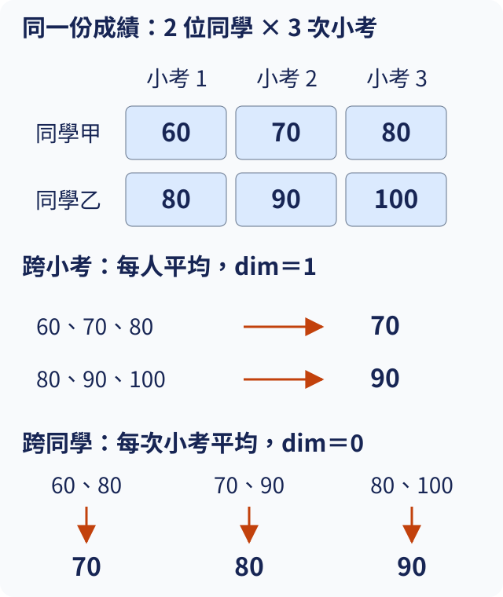
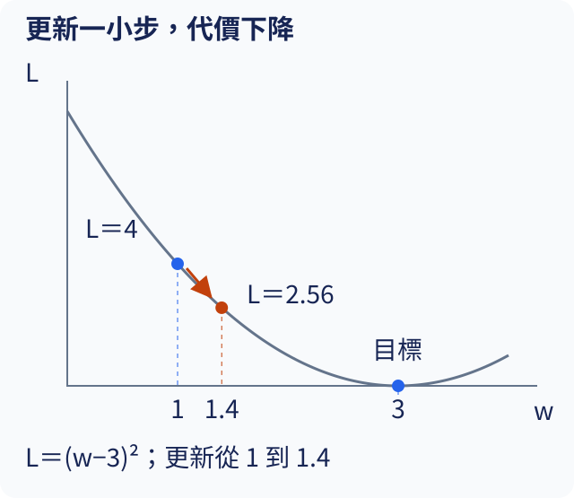

# 操作與數學暖身

想知道電腦怎樣從一段文字接著寫出下一個字，不必先背完數學名詞。這份暖身先說明怎麼讀這套教材、想自己動手時怎麼開啟工作頁，再用動物清單、考試成績與飲料配方認識後面會用到的工具。各節可以按需回來查：程式的資料怎麼取、數字表的軸怎麼讀、機率如何計代價、可調數字怎樣改善。每次只改一個具體輸入並核對輸出，讓閱讀和實驗接在一起。

## W.1 第一次開啟教材

最簡單的讀法是直接打開[教材網站](https://birdhackor.github.io/tiny-perceptron-vlm/)，不必安裝任何東西。第 1 章起，各節程式的下方都附有用 CPU 實際執行的輸出，可以像讀書一樣從頭讀到尾。本課每節會先交代一個問題，再用小例子說明做法；程式不是需要全部背起來的答案，而是讓你核對「剛才的解釋是否真的會產生這個結果」。暖身各節也可按需閱讀：遇到清單就看 [W.2](#W.2)，遇到數字表的形狀就看 [W.3](#W.3)，不用先修完一套數學課才開始第 1 章。

等某個數字引起好奇、想自己改了再跑，再打開那一節的 Notebook，也就是把正文和可執行程式放在同一份文件的工作頁。有兩種開法。第一種是在自己的電腦執行，步驟在本節下半段；下載的專案裡已經有每一節的 Notebook，放在 `notebooks/` 資料夾，直接開那裡的檔案即可。頁尾的「下載本節 .ipynb」存下的也是同一份 Notebook；它的第一個程式格會從檔案所在的資料夾往上層找專案的共用程式，下面的步驟也只從 `notebooks/` 資料夾開檔，所以下載的檔案要放進專案的 `notebooks/` 資料夾才能在本機執行。第二種是按頁尾的「在 Colab 開啟」，用 Google 的雲端服務打開同一份內容；這需要 Google 帳號，而且本課還沒有實測過 Colab 的雲端執行。在 Colab 要先跑第一個程式格（「準備本節的工具」），它會下載專案並安裝工具，等它完成才能使用後面的程式；若下載失敗，可以先讀網站正文，或改用本機方式。

本機方式先準備 [uv](https://docs.astral.sh/uv/getting-started/installation/) 和 [Git](https://git-scm.com/install/)：uv 負責安裝與管理 Python 套件，需要時也會自己下載合適版本的 Python，不必另外安裝；Git 負責下載與管理專案檔案。安裝 Git 後在終端機執行 `git --version`，應顯示版本號。終端機是輸入指令的視窗。

下列三行依序下載專案、進入專案資料夾、安裝 CPU 與 Notebook 所需工具；`git clone` 會在終端機目前所在的資料夾裡建立 `tiny-perceptron-vlm` 資料夾。本課的訓練資料包用 Git LFS（Git 處理大型檔案的擴充工具）保存，第一行開頭的 `GIT_LFS_SKIP_SMUDGE=1` 讓 clone 不下載這些資料包；沒有安裝 Git LFS 也可以照打。Windows PowerShell 不寫這段開頭，改成先執行 `$env:GIT_LFS_SKIP_SMUDGE="1"`，再執行 `git clone https://github.com/birdhackor/tiny-perceptron-vlm.git`。每行完成、回到可輸入狀態後再輸入下一行。

```bash
GIT_LFS_SKIP_SMUDGE=1 git clone https://github.com/birdhackor/tiny-perceptron-vlm.git
cd tiny-perceptron-vlm
uv sync --frozen --extra cpu --group notebook
```

`uv sync` 根據專案的套件清單建立 `.venv`，這是只供本專案使用的工具箱。`--frozen` 採用已記錄的套件版本；`--extra cpu` 選 CPU 用的 PyTorch（本課做模型計算的套件）；`--group notebook` 加入開工作頁的工具。GPU 選擇另見 [環境說明](../docs/environment.md)，現在用 CPU 足夠做短實驗。下載和安裝需要網路。完成後可在本機 CPU 環境執行本書的小型示範程式；若需要下載新的專案版本、套件或實驗檔案，請保持網路連線。

在 macOS 或 Linux 執行 `source .venv/bin/activate` 啟用工具箱；Windows PowerShell 執行 `.venv\Scripts\Activate.ps1`。啟用後，`python` 指向剛安裝的 Python 工具箱。仍在專案資料夾內，接著執行：

```bash
python scripts/check_env.py
python -m ipykernel install --sys-prefix --name tiny-perceptron --display-name "Tiny Perceptron"
jupyter lab notebooks
```

也可以不啟用，直接寫出工具箱裡 Python 的路徑；這時第三行改由這個 Python 啟動 JupyterLab（在瀏覽器裡開工作頁的程式），寫成 `-m jupyterlab`。[操作頁](training.md)的命令就用這種寫法。Windows PowerShell 啟用時若出現含 `PSSecurityException` 的紅色錯誤，是系統的執行原則不允許執行 `Activate.ps1` 這類腳本，不表示工具箱沒有裝好，改用不啟用的寫法即可。macOS 與 Linux：

```bash
.venv/bin/python scripts/check_env.py
.venv/bin/python -m ipykernel install --sys-prefix --name tiny-perceptron --display-name "Tiny Perceptron"
.venv/bin/python -m jupyterlab notebooks
```

Windows PowerShell：

```powershell
.\.venv\Scripts\python.exe scripts/check_env.py
.\.venv\Scripts\python.exe -m ipykernel install --sys-prefix --name tiny-perceptron --display-name "Tiny Perceptron"
.\.venv\Scripts\python.exe -m jupyterlab notebooks
```

第一行檢查 Python 與 PyTorch 能否使用；看到 `compute` 那列為 `OK`（括號中的裝置名稱依電腦而異），且套件沒有「未安裝」或紅色錯誤訊息，就表示計算環境可以使用。第二行把工具箱登記成工作頁可以選用的執行環境，名稱叫 **Tiny Perceptron**。第三行啟動 JupyterLab，終端機會提供瀏覽器網址。JupyterLab 從 `notebooks` 資料夾開始列出檔案；在其中開啟 `01/1.1.ipynb`，選 **Tiny Perceptron**，點進一個程式格並按 **Shift+Enter**。一個程式格叫 cell；負責執行程式格的程序叫 Notebook 執行程序（kernel），可想成工作桌：前面程式格取過的名字還留在桌上，後面的程式格才能使用。

因為工作桌會保留前面的結果，更改前面的輸入後，需要重跑依賴它的後續程式格；只跑最後一個程式格，可能仍使用舊資料。第一次開啟、或想檢查整份能否從零重現時，在 JupyterLab 選「Kernel → Restart Kernel and Run All Cells」，清空工作桌再由上到下跑；Colab 則在「執行階段」選單找「重新啟動工作階段並全部執行」（介面也可能稱重新啟動執行階段）。想動手的話，練習打開 [1.1 正文](chapters/01.md#1.1) 對應的工作頁，先執行一次，再把輸入那行 `text = "貓看狗，狗看貓。"` 改成 `text = "鳥看狗，狗看鳥。"`，重啟並全部執行。程式最後的文字輸出應為 `鳥看狗，狗看鳥。`，而非舊句；這就是要核對的還原結果。若看到紅色錯誤，先讀最後一行再查 [W.7](#W.7)，不要急著重裝所有工具。

要試跑暖身中的短程式，先開一節的 Notebook（例如 `01/1.1.ipynb`），跑完它的第一個程式格「準備本節的工具」，再用工具列的「＋」新增程式格；Colab 則用上方「＋程式碼」。把暖身的整段程式貼入新的程式格，按 Shift+Enter。貼入時保留每行開頭的空格，因為 Python 靠行首的縮排判斷哪幾行屬於同一段，例如迴圈要重複的那幾行（見 [W.2](#W.2)）。

上面這些步驟不需要安裝 Git LFS；只讀教材與跑各節短程式也不需要它，要照[操作頁](training.md)下載訓練資料包時才需要：依 [Git LFS 官方指引](https://git-lfs.com/)安裝後，在終端機執行 `git lfs version`，應顯示 `git-lfs/` 開頭的版本號；再到專案資料夾裡執行一次 `git lfs install --local`，讓這個專案使用它。

## W.2 看懂程式如何存取與重複資料

你要整理兩張動物照片，先記下「貓、狗」，再替第一張加上「貓在睡覺」的說明。Python 也能按順序保存這些資料，再依位置或欄位名稱取出。下面沿用這份動物清單，看程式怎麼存、怎麼取，以及如何逐項重複同一個動作。

`animals = ["貓", "狗"]` 把右邊的清單取名為 `animals`。方括號表示清單（list），逗號分開其中的項目，引號表示文字。`=` 的意思是「讓這個名字指向右邊的結果」，不是數學課的等號。電腦從 0 開始編位置，所以 `animals[0]` 取出「貓」，`animals[1]` 取出「狗」。方括號放在名字後面時，就變成「取出某個位置」。這個位置編號叫索引（index）。

字典（dictionary）則像貼好欄位名稱的表單。`record = {"animal": "貓", "caption": "貓在睡覺"}` 用大括號裝入兩個對應；冒號左邊叫鍵（key），右邊是值（value）。`record["caption"]` 根據鍵取出說明，不是查清單的第幾項。鍵和值都可以是數字或文字，鍵在同一份字典裡不能重複。

下面的輸入是兩個動物名稱和一筆記錄。`len` 計算項目數量；`print` 把括號中的結果顯示出來。先把整段貼進程式格執行（做法見 [W.1](#W.1)），再觀察最後的迴圈怎麼重複同一個動作。

```python
animals = ["貓", "狗"]
record = {"animal": "貓", "caption": "貓在睡覺"}
print(animals[0], len(animals))
print(record["caption"])
for animal in animals:
    print("看到", animal)
assert len(animals) == 2
```

最先印出的兩行依序是 `貓 2` 和 `貓在睡覺`。`for animal in animals:` 每次從清單拿一項，暫時叫它 `animal`；下面縮排四格的 `print` 因而跑兩次，印出 `看到 貓`、`看到 狗`。冒號和縮排告訴 Python 哪些行屬於這個迴圈。`==` 是詢問兩邊是否相等，`assert` 是檢查這個問題的答案：成立就繼續，不成立就停下來顯示錯誤；通過時不會額外印出訊息。

有時想重複使用一段做法，可以用 `def` 定義函式（function）。例如 `def first(items):` 下一行縮排寫 `return items[0]`，再用 `first(animals)` 呼叫，就會得到第一項；括號裡的材料是輸入，`return` 後面的結果是輸出。後面看見 `import torch` 時，意思是把名叫 `torch` 的工具箱載入，讓程式能使用其中的功能。這些工具會在需要時逐一介紹，現在只要分清「存資料、取資料、重複動作、呼叫做法」。

練習把清單改成 `animals = ["鳥", "貓", "狗"]`，並把最後的檢查改成 `assert len(animals) == 3`。執行前先預測第一行會顯示哪個名字、迴圈會印幾行。核對時應看到 `鳥 3` 和三行「看到」。再只改字典的 `caption` 值：動物清單的輸出應不受影響，因為這兩份資料是分開保存的。

### 本課會用到的 Python 寫法

後面各章還會用到下面這些寫法。不必先背，讀到時忘了再回來查。右欄箭頭左邊是例子，右邊是在 Python 裡執行它得到的結果：引號包住的是文字，方括號是清單，小括號包住的一組值叫 tuple。例子外面包的 `list(...)` 把逐項取出的結果收成清單，好一次看到全部內容；`max` 取出最大的一項，`sum` 把各項加總。

下表 `sorted` 那列的 Unicode 是電腦通用的字元編號標準。

| 寫法 | 白話 | 例子 → 結果 |
| --- | --- | --- |
| 切片 `[起:迄]` | 取出一段：從「起」那一項開始，停在「迄」之前；省略表示從頭或到尾，`-1` 表示最後一項 | `[5, 2, 7][:-1]` → `[5, 2]`；`[5, 2, 7][1:]` → `[2, 7]` |
| `range(n)` | 依序產生 0 到 n−1 的整數，常配合 `for` 重複固定次數 | `list(range(3))` → `[0, 1, 2]` |
| `set(...)` | 去掉重複，每種只留一個；不保證順序 | `len(set("貓狗貓"))` → `2` |
| `sorted(...)` | 排好順序的新清單，原資料不變；文字依每個字的 Unicode 編號由小到大排（「狗」是 29399、「貓」是 35987）；加 `reverse=True` 改成由大到小 | `sorted([3, 1, 2])` → `[1, 2, 3]`；`sorted([3, 1, 2], reverse=True)` → `[3, 2, 1]`；`sorted(set("貓狗貓"))` → `['狗', '貓']` |
| `key=len`、`lambda` | `key=` 指定比較前先把每一項換成什麼；`lambda i: ...` 是當場寫的小函式，冒號左邊是輸入、右邊是輸出 | `max(["貓", "小花貓"], key=len)` → `'小花貓'`；`scores = [5, 9, 7]` 時，`max(range(3), key=lambda i: scores[i])` → `1` |
| `zip(...)` | 把幾份清單按相同位置配成一組組 | `list(zip(["貓", "狗"], [3, 1]))` → `[('貓', 3), ('狗', 1)]` |
| `dict(zip(...))` | 配好的兩兩一組直接變成字典：左邊當鍵、右邊當值 | `dict(zip(["貓", "狗"], [0, 1]))` → `{'貓': 0, '狗': 1}` |
| `enumerate(...)` | 逐項取出時，順便給從 0 起的位置編號 | `list(enumerate(["貓", "狗"]))` → `[(0, '貓'), (1, '狗')]` |
| `reversed(...)` | 從最後一項往前逐項取出 | `list(reversed(["貓", "狗", "鳥"]))` → `['鳥', '狗', '貓']` |
| `"".join(...)` | 把一串文字接成一段，引號裡是接縫 | `"".join(["貓", "看", "狗"])` → `'貓看狗'`；`"、".join(["貓", "狗"])` → `'貓、狗'` |
| 生成式 `[... for ... in ...]` | 對每一項做同一件事，收成新清單；改用小括號時不先存成清單，需要時才逐項算出 | `[x * 2 for x in [1, 2, 3]]` → `[2, 4, 6]`；`sum(x * 2 for x in [1, 2, 3])` → `12` |
| `next(...)` | 從小括號生成式這類需要時才逐項算出的來源，取出下一個值；配合生成式的 `if`，就是取第一個符合條件的值，找不到時改用第二個值（`None` 表示沒有值） | `next(x for x in [3, 8, 12] if x > 5)` → `8`；`next((x for x in [3] if x > 5), None)` → `None` |
| f 字串 | 字串前加 `f`，大括號裡的名字或算式會換成它的值 | `animal = "貓"` 時，`f"看到{animal}"` → `'看到貓'` |
| `//` | 整數除法：只留整數的商，捨去餘數 | `7 // 2` → `3` |
| `class` | 定義一種新的物件 | 本頁不舉例；PyTorch 的模型零件都用它定義，[3.7](chapters/03.md#3.7) 第一次用到時才完整說明 |

`while`、`try`／`except` 與位元運算要寫成好幾行，放在下面一起執行：

```python
n = 1
while n < 10:
    n = n * 2
print(n)

table = {"貓": 0}
try:
    value = table["狗"]
except KeyError as error:
    print("找不到", error)
    value = -1
print(value)

packed = (3 << 4) | 5
print(packed, packed >> 4, packed & 15)
```

`while` 在條件成立時一直重複縮排的那一行：`n` 從 1 開始每次乘 2，變成 16 時 `n < 10` 不再成立，迴圈停止，第一行輸出 `16`。`try` 底下的程式先試著執行；字典裡沒有「狗」這個鍵，取值會引發 `KeyError`，程式就跳到 `except KeyError as error:` 底下，把錯誤訊息存在 `error`，改設 `value = -1`，所以接著印出 `找不到 '狗'` 與 `-1`，而不是停在紅色錯誤。

最後一段把整數寫成二進位逐位處理，叫位元運算。3 的二進位是 `11`，`<< 4` 往左移四位變成 `110000`，也就是十進位的 48；`|` 把兩邊的 1 合在一起，併入 5（二進位 `101`）得到 `110101`，也就是 53。`>> 4` 往右移四位、丟掉最低四位，取回 3；`&` 只留兩邊都是 1 的位，15 的二進位是 `1111`，所以 `& 15` 取回最低四位的 5。輸出是 `53 3 5`。[17.8](chapters/17.md#17.8) 用同樣的方法把兩個 4 位元的數裝進一個 byte。

<details>
<summary>動手執行</summary>

本節只用 Python 內建寫法。按 [W.1](#W.1) 開啟 Notebook，把程式放進程式格並按 Shift+Enter，輸出就會出現在下方。

</details>

## W.3 tensor 是有軸的數字盒子

班上有兩位同學，每人有三次小考成績。若只把六個數字寫成一排，就容易忘記哪些屬於同一人；把它們排成兩列、每列三格，就能沿著「同學」或「考試」兩個方向查資料。模型也經常同時記錄多筆資料，每筆又有很多數字。tensor 是 PyTorch 保存這類有規則分組數字的容器，中文常譯為張量；先理解分組，比先背名稱更有用。

一個單獨的數字叫純量（scalar），一排數字叫向量（vector），兩個方向的數字表叫矩陣（matrix）。它們都是 tensor 的不同形狀。每個可編索引的方向叫一個軸（axis）。下面以兩位同學的三次成績作輸入，第一個軸選同學，第二個軸選小考；需要的 Python 索引已在 [W.2](#W.2) 說明。

接著用這張表回答兩個不同問題：每位同學的平均是多少，以及每次小考的班級平均是多少。跨哪個方向計算，會決定留下哪個方向的資料。

下圖上方是本例中的六個成績，列標同學、欄標小考。下方兩種箭頭表示選取不同方向的數字一起平均：跨三次小考，得到兩個「每人平均」；跨兩位同學，得到三個「每次小考平均」。箭頭指的是一起計算的數字，不是把資料搬到另一格。平均跨過哪個軸，結果就不再保留那個軸。



平均時要先說清楚要跨哪個方向。`mean(dim=1)` 跨小考軸，把每人的三個數平均，得到 `[70, 90]`，留下同學軸。`mean(dim=0)` 則跨同學軸，得到三次小考的班級平均 `[70, 80, 90]`，留下小考軸。`dim` 是指定軸的編號，從 0 算起；寫 `dim=-1` 表示最後一個軸，在這張兩軸表上和 `dim=1` 相同。軸的編號取決於資料放法，不是固定代表某種意義。

程式先建立這份表，再印出形狀、取出的成績與兩種平均。

```python
import torch

scores = torch.tensor([[60.0, 70.0, 80.0], [80.0, 90.0, 100.0]])
print(scores.shape)
print(scores[0])
print(scores[1, 2].item())
print(scores.mean(dim=1))
print(scores.mean(dim=0))
```

`torch.tensor` 把兩層清單變成數字表。`.shape` 告訴我們每個軸有幾格，輸出 `torch.Size([2, 3])`，也就是兩位同學、每人三個數。`scores[0]` 取第一位同學整列，得到 `[60, 70, 80]`；`scores[1, 2]` 取第二位同學的第三次成績，得到 100。`.item()` 把只有一個數的 tensor 取成普通 Python 數字，方便顯示；它不能用於整張表。

後面有時會用普通 Python 資料印出結果：`tuple(scores.shape)` 把軸長度收成以括號表示的一組數字，得到 `(2, 3)`；`scores.tolist()` 把這張 tensor 的數值轉成兩層 Python 清單。若只取一列再用 `.tolist()`，得到的就是那一列的一層清單。這兩種轉換用來方便顯示或讀取，不會修改原本的 `scores`、數值或軸順序。

後面的文字模型常看到 `[B, T, D]`：B 是同時處理幾筆句子，T 是每筆有幾個文字位置，D 是每個位置保存幾個特徵數字，後面稱為特徵寬度（程式裡常寫 `width`）。這些字母只是我們替三個軸取的標記，不是 Python 特殊語法。例如 `[2, 4, 3]` 表示兩句話，每句四個位置，每個位置三個數；第一個軸取 0 後，仍是一張 `[4, 3]` 的表。看到新形狀時，先把每個軸的意思寫在旁邊。

`reshape` 可以把同樣的數字重新分組，例如 `scores.reshape(6)` 把兩列排成六個數的一排。它不改數值，也不知道哪些數屬於同學；要分回來，就得知道原本是 `reshape(2, 3)`。兩邊總格數必須相同，六個數不能重排成八格。

練習把第一位同學的最後一次成績從 80 改成 110。執行前先預測：每人平均中誰會變？哪次小考的班級平均會變？核對應得到 `[80, 90]` 與 `[70, 80, 105]`。若分不清兩種平均，不妨在紙上畫兩列三格，把正在平均的數字圈起來。

## W.4 機率、log 與猜錯的代價

袋子裡有三張「貓」卡和一張「狗」卡，每張抽到的機會相同。隨手抽一張，抽到貓的機率就是 3/4，抽到狗是 1/4。機率（probability）用 0 到 1 的數字表示事件出現的機會：0 表示不會，1 表示一定；互斥且涵蓋所有結果的機率要加總為 1。若候選只剩貓和狗，不能同時把兩者都說成 0.9。

文字模型也會分配候選字的機率，但我們需要一把尺衡量分配好不好。假設答案是貓，甲給貓 0.9，乙給貓 0.1；甲應該受到較小的處罰。光看「最後是否選貓」不夠，還要看把正確答案看得多可信。常用的代價是 `-log(p)`：p 是給正確答案的機率，`log` 是自然對數，也就是以數學常數 e（約 2.718）為底的對數。

對數是在已知次方結果時，反求指數 a。若 `p = e ** a`，那麼 `log(p) = a`。`**` 是 Python 的次方符號：`e ** 2` 是 e 乘 e，`e ** -1` 則是 1/e，約 0.368；因此小於 1 的正數能對上負的次方。a 也可以不是整數，程式會用 `math.log` 算出它。當 p 在 0 與 1 之間，a 是負數，因此加負號後得到非負代價。p 越接近 1，代價越接近 0；p 越接近 0，代價越大。下列程式逐一輸入三個正確答案機率，看看代價如何改變。

```python
import math

for p in [0.9, 0.5, 0.1]:
    cost = -math.log(p)
    print(p, round(cost, 3))
```

`round(..., 3)` 只把顯示的數字縮成小數三位。三種代價依序約為 `0.105`、`0.693`、`2.303`：給正確答案 0.9 時代價小，給它 0.1 時代價大。這把尺特別懲罰「很有把握地排除正確答案」。

為什麼對數常出現？若兩個答案的機率相乘，對數會把乘法變成加法：`-log(p1*p2) = -log(p1)-log(p2)`。例如假設兩題答對與否互不影響，這叫獨立；此時兩題正確機率都為 0.5，同時答對的聯合機率是 0.25，總代價是 `1.386`，等於兩個 `0.693` 相加。於是我們能把很多位置的代價加起來或取平均，而不必一直乘越來越小的數字。真的給答案機率 0 時，代價沒有有限值；程式也不能直接計算 `log(0)`。

後面會遇到 softmax，它把一組自由的分數換成總和為 1 的機率；cross entropy 則是一個計算正確答案平均代價的工具。先記住兩者做不同工作即可，具體分數與計算會在 [1.7](chapters/01.md#1.7) 和 [1.8](chapters/01.md#1.8) 展開。PyTorch 的 `cross_entropy` 接收原始分數，內部已處理換算，因此不要先把它的輸入換成機率。

練習在清單加入 `0.25`，先預測代價比 0.5 大還是小，再執行核對，應約為 `1.386`。正確答案得到的機率越小，這份猜法的代價就越高。

## W.5 忘了線性代數，可以先想配方

第 1 章只會用到本節的一句話：`nn` 是 PyTorch 的神經網路工具箱，[1.6](chapters/01.md#1.6) 會載入它。矩陣乘法、Linear 與 `copy_` 從第 2 章才開始用，讀到 [2.1](chapters/02.md#2.1) 之前再看即可。

兩間店各有一份飲料配方，材料是紅茶、牛奶和糖。第一間的用量寫成 `[2, 1, 0]`，第二間是 `[1, 2, 1]`。如果三種材料每單位分別提供 10、20、30 分成本，第一杯成本就是 `2×10 + 1×20 + 0×30 = 40`。每種材料乘自己的權重，再把結果加起來，叫加權和。矩陣乘法只是把許多這種配方一次做完，沒有忽然增加一種神秘運算。

先回顧 [W.3](#W.3)：兩間店、每間三個材料量，形狀就是 `[2, 3]`。現在要同時計算兩種指標，成本權重是 `[10, 20, 30]`，另一種假想甜度的權重是 `[0, 1, 4]`。把兩套權重排成三列兩欄，每列對應一種材料，每欄對應一個指標，就能用 `@` 做矩陣乘法。左右相接的軸都是三種材料，這個方向會被乘完加總。

```python
import torch

recipes = torch.tensor([[2.0, 1.0, 0.0], [1.0, 2.0, 1.0]])
weights = torch.tensor([[10.0, 0.0], [20.0, 1.0], [30.0, 4.0]])
result = recipes @ weights
print(result)
print(result.shape)
```

輸入 `recipes` 每列是一杯飲料；`weights` 的第一欄計成本，第二欄計甜度。`result` 輸出兩列：`[40, 1]` 和 `[80, 6]`。以第二杯為例，成本是 `1×10+2×20+1×30=80`，甜度是 `1×0+2×1+1×4=6`。結果形狀 `[2, 2]`，保留兩間店，將每杯三個材料量換成兩個指標。只有對應材料的三個格子互相乘，不會把第一間的資料和第二間混在一起。

通常用 `[2,3] @ [3,2] → [2,2]` 記住這個規則：內側兩個 3 要相同，外側兩個 2 決定結果形狀。若右邊只有兩列，程式不知道第三種材料該乘什麼，就會報錯。模型也用這種計算，把一組輸入特徵按權重混合成另一組；特徵在這裡只是描述每筆資料的數字，不一定有飲料材料那樣清楚的名字。

PyTorch 的 `nn.Linear(3, 2)` 包裝了「三個輸入配成兩個輸出」。`nn` 是神經網路工具箱，Linear 稱線性層。它還加上一個偏移（bias），例如每杯固定的杯子成本，所以實際做 `輸入 @ 權重轉置 + 偏移`。Linear 儲存的權重形狀是 `[輸出數, 輸入數]`，與上例相反；轉置 `.T` 把列欄交換，才配得上輸入。

```python
from torch import nn

layer = nn.Linear(3, 2)
with torch.no_grad():
    layer.weight.copy_(weights.T)
    layer.bias.copy_(torch.tensor([5.0, 0.0]))
print(layer(recipes).tolist())
```

這段接續前段執行，沿用 `recipes` 的材料用量，將相同的成本、甜度權重 `weights.T` 手動寫入 Linear，再為成本加 5。`copy_` 把數字抄進層的權重；`torch.no_grad()` 表示這次設定不必記錄如何求導，求導會在 [W.6](#W.6) 解釋。`.tolist()`把數值表轉成一般Python清單，方便直接讀數字。兩列結果是 `[45, 1]`、`[85, 6]`，甜度不變。練習只把偏移的 5 改成 8，先預測兩杯成本都增加 3，再執行核對；若甜度也變了，就檢查你改的是哪一欄。

## W.6 忘了微積分，可以先想旋鈕敏感度

想把水溫調到 3 個單位，眼前的旋鈕位置卻是 1。為了比較調整前後，用「離目標的差，自己乘自己」當代價：`(1-3)²=4`。把旋鈕調到 1.1，代價變成 `(1.1-3)²=3.61`，下降了 0.39。這個例子想回答的不是「目標在哪」，而是「從目前位置往哪邊調、調一點會影響多少」。模型有很多可調數字，不能每次靠人試完所有方向，因此需要一種計算敏感度的工具。

當調整量越來越小，「代價改變數 ÷ 旋鈕改變數」會靠近某個數，這個區域性敏感度叫導數（derivative）。上例在 1 附近約為 -4：旋鈕稍微增加，代價就減少；負號表示方向，絕對值表示每單位改變的強弱。有多個旋鈕時，每個旋鈕各算一個導數，排列起來叫梯度（gradient）。模型中的這些可調旋鈕叫參數（parameter）；訓練要改的就是它們的數值。

下面先讓 PyTorch 自動算出導數，再試著調一次旋鈕，最後重新計算代價。輸入 `w=1`，目標固定為 3；`requires_grad=True` 要求工具記錄與 `w` 有關的運算，稍後才能沿著它們計算敏感度。tensor 的概念見 [W.3](#W.3)。

算出導數只是知道方向，真正調整還需要一條規則：從目前的 w 減去「一個倍數乘梯度」，沿梯度相反方向走一小步。這個倍數叫**學習率**（learning rate，lr），這裡選 0.1。`w -= 0.1 * w.grad` 就是這條更新規則的簡寫；`w.grad` 是工具存放此次導數的位置。梯度為負時，減去負數會讓 w 增加。更新放在 `torch.no_grad()` 中，暫時不把這次改參數記成求導運算。0.1 是本例的選擇，是否改善仍要看新的代價。

```python
import torch

w = torch.tensor(1.0, requires_grad=True)
loss = (w - 3).square()
loss.backward()
print(loss.item(), w.grad.item())
with torch.no_grad():
    w -= 0.1 * w.grad
print(w.item(), (w - 3).square().item())
```

`loss` 是代價的英文名；`.square()` 就是平方。`backward()` 從代價往回計算每個參數的導數，把結果存到 `.grad`；這個往回算的過程叫反向傳播，[1.10](chapters/01.md#1.10) 會拆開說明。第一行輸出 `4.0 -4.0`，確認代價 4、梯度 -4。但呼叫 `backward()` 之後，w 還是 1，它只算出方向，沒有真的調旋鈕。

下圖橫軸是旋鈕位置 w，縱軸是代價 `(w−3)²`。藍點是目前的 w＝1，橘點是更新後的 w＝1.4；沿箭頭往右，代價從 4 降到 2.56。最低點仍在 w＝3，表示這一步改善了猜法，但還沒到目標。



第二行輸出對應圖中的橘點：用梯度 -4 更新時，`1 - 0.1 × (-4) = 1.4`，新的代價是 `(1.4-3)² = 2.56`。這次有改參數，也有用新參數重新評分；浮點數輸出可能帶少許小數誤差。

這個例子也能寫成公式：代價 L=(w-3)²，在目前位置的導數是 2(w-3)。代入 w=1 得到 -4；代入 w=1.4 得到 -3.2。注意導數會隨位置改變，所以每次更新後要重算。梯度只描述目前附近的斜率，不保證一大步後仍沿著同樣方向下降。PyTorch 會把多次求導的結果累加到 `.grad`，如果重複算新的一步，要先清除舊梯度；[1.13](chapters/01.md#1.13) 會用具體數字拆開看。

練習只把學習率 0.1 改成 0.6，先算下一個 w：`1-0.6×(-4)=3.4`。它跨過目標 3，但代價仍降到 0.16。再試 1.1，應到 5.4、代價 5.76，比原先更差。核對這兩個結果，便能看到「方向正確」和「步子合適」是兩個問題。

## W.7 檔案放哪裡

只在網站上閱讀時用不到這一節。開始在自己的電腦跑程式之後，若遇到同一個檔名找不到、昨天能跑今天不能跑、或紅色訊息看不懂，再回來讀。先把專案想成一個工作資料夾，正文是書，Notebook 是工作頁，共用 Python 檔是工具，資料與輸出是材料和成果。分清楚它們放在哪裡，就不用把所有錯誤都猜成套件壞了。開啟與安裝步驟見 [W.1](#W.1)。

| 路徑 | 你會在裡面找到什麼 |
| --- | --- |
| `course/chapters/` | 正文與短程式，依章節編號命名 |
| `notebooks/` | 可操作的工作頁，例如 `01/1.1.ipynb` |
| `tiny_perceptron/` | 共用 Python 零件；各檔的實作在哪一節講，見表下可展開的對照 |
| `scripts/` | 環境檢查、資料製作、訓練與評估的入口 |
| `data/` | 本機資料，通常不存入 Git |
| `checkpoints/` | 訓練時存下的檢查點（checkpoint）檔，見 [5.7](chapters/05.md#5.7)；通常不存入 Git |
| `outputs/` | 報告、執行結果與網頁等產物 |
| `.venv/` | `uv sync` 建立的工具箱（Python 與套件），不存入 Git |

<details>
<summary>tiny_perceptron 各檔在哪一節講實作</summary>

下表依各檔第一次出現的閱讀順序排列，列出節錄該檔程式、或點名該檔並說明其中零件的小節；只匯入來用的小節不列。

| 檔案 | 在哪一節看到它的實作 |
| --- | --- |
| `tiny_perceptron/data.py` | [1.2](chapters/01.md#1.2)、[4.7](chapters/04.md#4.7)、[5.11](chapters/05.md#5.11)、[6.6](chapters/06.md#6.6)、[7.1](chapters/07.md#7.1)、[7.10](chapters/07.md#7.10)、[7.11](chapters/07.md#7.11) |
| `tiny_perceptron/simple.py` | [2.5](chapters/02.md#2.5) |
| `tiny_perceptron/attention.py` | [3.6](chapters/03.md#3.6)–3.7、[16.5](chapters/16.md#16.5) |
| `tiny_perceptron/modern.py` | [4.4](chapters/04.md#4.4)、[14.1](chapters/14.md#14.1)–14.2、[15.11](chapters/15.md#15.11) |
| `tiny_perceptron/model.py` | [4.5](chapters/04.md#4.5)–4.6、[5.2](chapters/05.md#5.2) |
| `tiny_perceptron/training.py` | [5.6](chapters/05.md#5.6)–5.7 |
| `tiny_perceptron/capstone.py` | [6.6](chapters/06.md#6.6) |
| `tiny_perceptron/tokenization.py` | [6.6](chapters/06.md#6.6) |
| `tiny_perceptron/alignment.py` | [8.8](chapters/08.md#8.8)、[9.10](chapters/09.md#9.10)、[13.3](chapters/13.md#13.3)、[13.5](chapters/13.md#13.5)、[18.8](chapters/18.md#18.8)–18.9 |
| `tiny_perceptron/multimodal.py` | [10.1](chapters/10.md#10.1)–10.2、[10.5](chapters/10.md#10.5)、[10.7](chapters/10.md#10.7)–10.8、[12.1](chapters/12.md#12.1)、[12.6](chapters/12.md#12.6)、[12.8](chapters/12.md#12.8) |
| `tiny_perceptron/natural_concepts.py` | [11.14](chapters/11.md#11.14)–11.16、[12.13](chapters/12.md#12.13)–12.14 |
| `tiny_perceptron/selftrained/` | [12.15](chapters/12.md#12.15)、[19.2](chapters/19.md#19.2)–19.3、[19.5](chapters/19.md#19.5)–19.7、[19.9](chapters/19.md#19.9) |
| `tiny_perceptron/posttraining.py` | [13.10](chapters/13.md#13.10)–13.11、[13.13](chapters/13.md#13.13)–13.15 |
| `tiny_perceptron/lesson_products/` | [14.15](chapters/14.md#14.15)、[19.14](chapters/19.md#19.14)–19.17 |
| `tiny_perceptron/quantization.py` | [17.5](chapters/17.md#17.5)、[17.7](chapters/17.md#17.7)–17.9、[17.14](chapters/17.md#17.14) |
| `tiny_perceptron/retrieval.py` | [A.3](chapters/0A.md#A.3)、[B.2](chapters/0B.md#B.2)、[B.4](chapters/0B.md#B.4) |

</details>

相對路徑是從「目前所在資料夾」出發找東西，而不是從電腦固定的位置找。例如 `scripts/check_env.py` 的意思是先進 `scripts` 再找那個檔案；若目前在 `notebooks/`，就會走錯地方。在終端機先 `cd tiny-perceptron-vlm`，是把起點移到有 `pyproject.toml` 的專案根目錄。Notebook 的工作位置也可能不同，故短實驗盡量直接寫小資料，不先要求讀檔。

下面用 Python 內建的 `pathlib` 查起點。`Path` 是表示檔案路徑的工具，`cwd()` 回傳目前資料夾，`exists()` 回答某個路徑是否存在。這段不會建立、修改或刪除任何檔案。

```python
from pathlib import Path

print(Path.cwd())
print(Path("pyproject.toml").exists())
print(Path("tiny_perceptron").exists())
```

第一行輸出依你電腦而不同。在專案根目錄執行時，後兩行應都是 `True`；若都是 `False`，先看第一行，確認是否站在別的資料夾。這比把所有路徑改成電腦上的絕對位置容易重現。若用終端機執行這段，先在專案根目錄輸入工具箱裡 Python 的路徑並按 Enter：macOS 與 Linux 是 `.venv/bin/python`，Windows PowerShell 是 `.\.venv\Scripts\python.exe`；已照 [W.1](#W.1) 啟用工具箱時，只輸入 `python` 也可以。看到 `>>>` 就進入 Python 互動模式；逐行貼上包含 `from pathlib import Path` 在內的程式，輸出會緊接在後。輸入 `exit()` 並按 Enter 可回到終端機指令模式，才能再用 `cd` 切換資料夾。練習先退出 Python，在專案根目錄輸入 `cd notebooks`，再進互動模式重跑這段：工具箱這時在上一層，路徑要改成 `../.venv/bin/python`（Windows 是 `..\.venv\Scripts\python.exe`），啟用時仍只要輸入 `python`。先預測 `pyproject.toml` 是否還會被找到；核對後用 `exit()` 退出，再 `cd ..` 回到上一層專案根目錄。只換起點，檔案本身仍存在。

紅色錯誤通常會列出哪個檔案、哪行程式，最後一行說明原因。`ModuleNotFoundError: No module named 'torch'` 表示現在的 Python 找不到工具；先確認 Notebook 選 **Tiny Perceptron**，或終端機已啟用 `.venv`；也可以在專案根目錄直接用 `.venv/bin/python` 執行，Windows 是 `.\.venv\Scripts\python.exe`（見 [W.1](#W.1)）。`FileNotFoundError` 是找不到指定檔案，先查目前起點和檔名。`KeyError` 是字典中沒有那個鍵，可回看 [W.2](#W.2)。`IndexError` 是索引超出範圍。例如 `animals = ["貓", "狗"]` 從前面用 0、1 編號；取 `animals[2]` 是取第三項，就會超出範圍。`SyntaxError` 則先檢查括號、冒號與縮排。

模型訓練的指令碼有些預設只檢查資料與流程。這類命令最後印出的那行 JSON 是報告；其中的 `mode` 若是 `dry-run-no-weight-update`，表示這次沒有更新模型；依[操作配方](training.md)加上 `--train` 才正式訓練。不要只因看到報告就以為模型學過了。閱讀錯誤時也採同樣原則：指出程式實際做到了哪一步，再處理阻擋下一步的那個原因。
